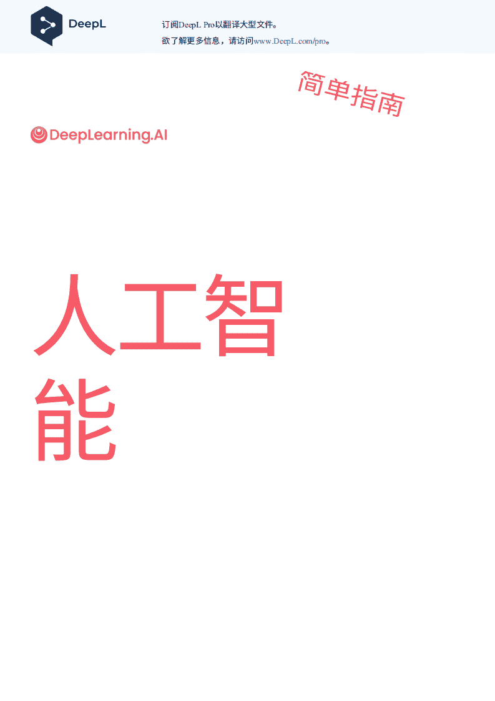

# 9.3  更多宝藏学习资源 💡

> 来源：[https://my.feishu.cn/docx/IlpId30beoUEiVxj88FcFo20ngh](https://my.feishu.cn/docx/IlpId30beoUEiVxj88FcFo20ngh)

### 下列是日常网上冲浪得来的一些精彩信息收藏：

---

# 9.1  AI 深度洞察&名人访谈/发言

[Neural Networks: Zero to ](https://youtube.com/playlist?list=PLAqhIrjkxbuWI23v9cThsA9GvCAUhRvKZ&si=gfYIwsxCU6kNVZNF)Hero｜Andrej Karpathy

[A](https://youtu.be/lXUZvyajciY?si=23mU0aLpqaT8igTs)ndrej Karpathy — “We’re summoning ghosts, not building animals”

+   **AI 并不比人类“聪明”**：目前的 AI 更像是拥有完美记忆但缺乏认知的“过拟合”实体，而人类虽然记忆力差，但这恰恰是人类拥有强大泛化和抽象能力的特征。

+   **甚至连 LLM 也还没“毕业”**：尽管 LLM 能通过博士资格考试，但在认知架构上，它们仍像小学生一样，缺乏真正的世界模型和自主文化创造能力。

+   AI 发展是“一切照旧”的自动化进程，更多的算力不等于奇点：Karpathy 不认为会出现突然的“智能爆炸”或奇点。他将 AI 视为计算机技术的延伸，就像编译器自动化了汇编代码一样，AI 将逐步自动化更多知识工作。但即使有无限的算力和 AI 副本，社会和经济的整合仍需要时间，就像历史上其他技术革命一样，是一个线性的加速过程，而不是瞬间的垂直飞跃。

+   **2%**：历史上技术革命带来的经济增长率（如工业革命），Karpathy 预测 AI 带来的增长也会维持在这个量级，而不是突然跳升至 20% 或更高。

+   **10年**：Karpathy 预测 AI 智能体真正成熟并广泛应用所需的粗略时间线。

+   AI 的发展将是一个长期的、渐进的工程挑战，而非一夜之间的魔法。未来的 AI 模型可能需要更小的“认知核心”和更少的死记硬背，更多地依赖推理能力。在教育领域，AI 有望通过提供深度个性化的辅导，让人类像在健身房锻炼肌肉一样，出于兴趣和自我提升的目的去高效获取知识。

[Godfather of AI: I Tried to Warn Them, But We’](https://youtu.be/giT0ytynSqg?si=yY_3ZaQkkZzgg0iu)ve Already Lost Control! Geoffrey Hinton

[Ex](https://youtu.be/S9a1nLw70p0?si=6bTbLrJ_j_gEkE5d)-Google Exec (WARNING): The Next 15 Years Will Be Hell Before We Get To Heaven! - Mo Gawdat

[A](https://youtu.be/JMYQmGfTltY?si=HP7kkSnh4BzCGGi2)I AGENTS DEBATE: These Jobs Won't Exist In 24 Months!

#### 腾讯科技张小珺——2024 AI 三部曲

> 对话月之暗面杨植麟：向延绵而未知的雪山前进

> 朱啸虎讲了一个中国现实主义 AIGC 故事

> 王小川想提出中国 AGI 第三种可能性

[[真格基金]万字赏析 DeepSeek 创造之美：De](https://mp.weixin.qq.com/s/8ifsQ1eRJpOSHCrFAtAX0A)epSeek R1 是怎样炼成的？丨荐读

#### 其他

纽约时报对 Anthropic CEO 一个半小时的采访

AI Agents 设计模式：多智能体协作

斯坦福大学 HAI 发布 2024 人工智能指数报告

AI的亚当和夏娃已经出现，伊甸园的那条蛇会是谁？

# 9.2  音视频媒体精彩节目

## Bilibili

B 站｜【硬核科普】一次看懂人工智能

[B](https://www.bilibili.com/video/BV1MY4y1R7EN/?share_source=copy_web&vd_source=b2706342ccb2fe6369e4aeaf5198bb0d) 站｜【渐构】万字科普 GPT4 为何会颠覆现有工作流；为何你要关注微软 Copilot、文心一言等大模型

B 站｜生成式 AI 这一年：从群雄混战到生态确立，世界已被改变

[B](https://www.bilibili.com/video/BV1714y167Xg?vd_source=10ac1f64c31c16db36a207dbc7eac844) 站｜3 万多人学习！科学作家万维钢 X 刘江总编：GPT 是否有人的智能？对 GPT 最接地气的解读

[B](https://b23.tv/QFQlVv1) 站 | 吴恩达最新《面向每个人的生成式 AI 》 Generative AI for Everyone

B 站 | 奇绩创坛 | 陆奇最新演讲完整视频 | 大模型带来的新范式

[B 站｜【央视纪录片】《智能时代》（全 6 集）](https://www.bilibili.com/video/av996452521/?vd_source=5bd86464fb14bc4ab272a83ce82f14af)人工智能、Chatgpt 如何改变世界？

[B 站｜英伟达 GTC23 短片《我是 A](https://www.bilibili.com/video/av226296095/?vd_source=5bd86464fb14bc4ab272a83ce82f14af)I》完整版，由人工智能完成短片脚本和乐谱

[B 站｜最好的致敬是学习：DeepSeek-R](https://b23.tv/Xi8a50Q)1 赏析| Monica 产品合伙人张涛

> 一场面向非技术背景人群的 DeepSeek R 1 技术创新分享会，以通俗易懂的方式深入解析了 R1 和 V3 的技术报告，系统阐述了行业现存的技术挑战、DeepSeek 的创新解决方案及其重要突破点。

一席｜AI 不会杀死创作，但会杀死平庸｜赵汗青

## YouTube

[镜像世界、手机消失、人类爱上AI：“硅谷精](https://youtu.be/8uHur4G1ZVI?si=tNtaik_4cCkUKcOZ)神之父”凯文·凯利的2049预言【专访】

[Y](https://www.youtube.com/watch?v=bpWJ-F-PyTk&ab_channel=%E6%AA%80%E4%B8%9C%E4%B8%9C%C2%B7Tango)ouTube｜学完这个视频，简历加一条：熟练掌握 ChatGPT 解决复杂问题 | ChatGPT 教程

[YouTube｜英伟达 CEO 黄仁勋谈创业与成功的](https://www.youtube.com/watch?v=tPRbXl4j6ho&list=WL&index=2&t=71s&ab_channel=%E7%BE%8E%E5%9B%BD%E6%94%BB%E7%95%A5)秘诀｜2024 年 3 月斯坦福大学采访

[YouTube｜Sam Altman: OpenAI, GPT-5, Sora, Board S](https://www.youtube.com/watch?v=jvqFAi7vkBc&list=WL&index=1&t=1s&ab_channel=LexFridman)aga, Elon Musk, Ilya, Power & AGI | Lex Fridman Podcast #419

## 小宇宙

小宇宙｜口述全球大模型这一年：人类千亿科学豪赌与参差的中美景观

小宇宙 | 乱翻书 | AI 没能颠覆什么？

小宇宙|用好 AI ，每个人都能成为超级个体

## 其他

优酷｜周轶君 X 优酷谈话节目《第一人称复数》：智能来了

# 9.3  AI 应用思考分享

## 大神们的 GPT 场景应用经验分享，以及关于 AI 的各种深度思考

搞懂语言大模型（番外）：40+应用案例精选

ChatGPT 个人使用场景分享 @Joe Hu

关于 AI 未来，我有十二条自用的思考 Prompt 分享 @ 马丁的面包屑

[Generative AI](https://k5ms77k0o1.feishu.cn/wiki/GV8xw99rnipKypkYLQrcsSRunls) @Ryan.eth

AIGC 给品牌全案助力 | 个人单刷全案@大摩托车

我用我的微信聊天记录和 280 篇博客文章，做了我自己的数字克隆 AI @王登科

哄哄模拟器的完整复盘，火了，但一度让我很发愁 @王登科

## **即刻上的高价值分享**

[分享一个 GPT 使用的通用基操，如果已](https://m.okjike.com/originalPosts/644654ba09c07aaec606ded6?s=eyJ1IjoiNjI1ZmQzNzdmNzU0NTMwMDEwYzc2MjcwIiwiZCI6Mn0%3D)经会了的朋友可以略过。 - 即刻 App

[写 Prompt 到底有什么好的方法论？今](https://m.okjike.com/originalPosts/644cc0c2174fdd04a7fc6142?s=eyJ1IjoiNjI1ZmQzNzdmNzU0NTMwMDEwYzc2MjcwIiwiZCI6M30%3D)天和拜拜子@Viv_L - 即刻 App

“提供旁白和流行文化参考”prompt 技巧@杨昌-即刻

## 其他

[AI 创新者的窘境和新机会](https://quail.ink/orange/p/ai-innovators-dilemma-and-opportunity)

[AI 副业赚钱资讯合集](https://github.com/bleedline/aimoneyhunter?tab=readme-ov-file#ai%E5%89%AF%E4%B8%9A%E8%B5%9A%E9%92%B1%E8%B5%84%E8%AE%AF%E5%90%88%E9%9B%86)

# 9.4  AI 博主

+   **博主**

**@DeepLearningAI**：[YouTube 主页](https://www.youtube.com/c/DeepLearningAI) ——由吴恩达教授创办的在线教育平台，提供有关人工智能和深度学习的免费课程。该频道经常发布课程视频和相关讲座。

**@Lex Fridman**：[YouTube 主页](https://www.youtube.com/@lexfridman) —— MIT 研究科学家出身的顶流播客主。以超长深度的面对面访谈闻名，嘉宾包括 Sam Altman、Elon Musk、Mark Zuckerberg 等科技巨头及顶级学者。内容不仅限于技术，更深入探讨 AI 的哲学、伦理、意识以及人类的未来，思想密度极高。

**@Jeff Su**：[YouTube 主页](https://www.youtube.com/@JeffSu)、小红书（杰夫）——Google 上海从业。自媒体提供工作效率和个人成长的相关内容，分享技术专业技巧，特别是与 ChatGPT 和 Google Bard 等 AI 工具的使用相关。特别高质量的 youtuber

**@宝玉**：[微博](https://weibo.com/u/1727858283)&X——AIGC 技术的应用、趋势以及相关的技术分享大牛，提出“两遍翻译法”长文翻译大受欢迎

**@Tina Huang**：[YouTube 主页](https://www.youtube.com/@TinaHuang1) —— 前 Meta 数据科学家（Data Scientist）。主要分享数据科学领域的职业规划、高效学习方法论（如 SQL、Python）以及如何利用 AI 工具提升职场与学习效率。风格清晰干练，非常适合学生及希望通过 AI 技能实现职场进阶的打工人。

@[Andrej Kar](https://www.youtube.com/andrejkarpathy)pathy：YouTube 主页 —— 前 Tesla AI 总监、OpenAI 创始成员，AI 领域真正的技术大神。他在 YouTube 发布的“Zero to Hero”深度学习系列课程被誉为业内最好的入门教程之一，擅长用最通俗的代码从零讲解 ChatGPT 背后的原理，硬核且干货满满。

**@Matt Wolfe**：[YouTube 主页](https://www.youtube.com/@mreflow) —— 专注于 AI 工具挖掘与行业动态的“情报员”，知名 AI 导航站 FutureTools 创始人。他的视频更新极快，涵盖最新的 AI 新闻、软件评测及实用教程，非常适合非技术背景但想紧跟 AI 浪潮、寻找实用工具的用户。

**@Matthew Berman**：[YouTube 主页](https://www.youtube.com/@matthew_berman) —— 开源 AI 与本地化部署的实战派专家。内容专注于如何本地运行大模型（LLM）、微调模型以及搭建 AI Agent（智能体）。对于想要动手折腾开源技术、低代码开发以及探索 AI 自动化工作流的技术爱好者来说，是必看频道。

**@杨昌**：https://web.okjike.com/originalPost/6457af2bb99c001fe8ee29a3

> 影视龙头公司的 AIGC 应用研究院任职，推进 AI 在产业中的应用落地和商业化，分享自己的见解和学习资源

# 9.5  优秀书籍及文档

[大厂 AI 实践合集｜工作流](https://www.yuque.com/wikidesign/vngzgk)

AI 入门神书：《人工智能基础（高中版）》作者：汤晓鸥

吴恩达-

[eBook-How-to-Build-a-Career-in-AI 中文.pdf](https://internal-api-drive-stream.feishu.cn/space/api/box/stream/download/all/RWA1bwQ3ModVfsxg6GCcLApSncg)

斯蒂芬·沃尔弗拉姆**《这就是 ChatGPT》**

# 9.6  GPTs 插件/Agents 智能体开眼界系列

AI 产品沉思录|Agent|体系化认知

# 9.7  其他

[1. AI精选工具库](https://t16jzwqrzjx.feishu.cn/wiki/EsvowFAqFiTiYDkJgE0cWquPnWb?from=from_copylink)

[AI编程蓝皮书（开始更新Claude 3.7/MCP/蓝皮书朝2.0进化）](https://superhuang.feishu.cn/wiki/CBBPwvgEuicVhFkx0s7cPmhpn4e)

[GPT人设描述提示](https://waytoagi.feishu.cn/wiki/Ok2Lw48bgia8yQkqCQacXtdCnRf?from=from_copylink) 教程：如何激活隐藏的“DAN”模式：

各种 DAN prompt ：https://github.com/0xk1h0/ChatGPT_DAN

解密 Kimi 投流策略：大模型应用当红顶流是如何练成的？

ChatGPT 新手从 0 到 1 入门攻略

链接： https://pan.baidu.com/s/1I-f9LjNXgHxVM5Q2o6tLlQ?pwd=kbsi 提取码： kbsi

如何向 ChatGPT 提问以获得高质量答案：提示技巧工程完全指南

## 得到品控手册 9.0

> [得到品控手册9.0](https://dedao.feishu.cn/wiki/wikcnclPHCsD8UjJYVTzN6eArce?from=from_copylink)

> 《得到品控手册》，里面把内容生产标准化这事给标准化了。

> 每个环节，单独分析撰写 SOP，里面有原则，有方法论，也有示例。

> 这是什么？写 Prompt 的原材料啊。

> 把这里的一个个锦囊事项，搞成一个个的 Prompt 或 GPTs，可太容易了。

> Know-how 直接喂到嘴边了，搞内容创业的同学可以试试效果。

## Building with Cursor

在 Cursor 公司，有一个很特别的规定：所有市场和非技术岗位的新员工入职后，都要亲自动手完成一个完整的技术项目——这是他们入职培训的必修课。这可不是走走形式，而是实打实地从零起步，跟着公司内部定制的教程，一步步把项目搭建起来，直到最后成功上线。

因为这套教程太火了，他们干脆把整个操作过程录制下来，免费分享给所有人！

感兴趣的朋友可以点击文中链接查看👇

https://www.notion.so/cursorai/Building-with-Cursor-public-273da74ef0458051bf22e86a1a0a5c7d

这个网页是 Cursor（一款 AI 代码编辑器）发布的公开版入门指南，其核心内容是为初学者（尤其是非技术背景的用户）提供一个从零开始到完成项目部署的完整教程。它的主要用途是引导用户通过安装设置、项目构建、代码管理（Git）到最终部署（Vercel）的六个步骤，亲手创建一个真实的项目，从而快速学习并体验 Cursor 的强大功能。