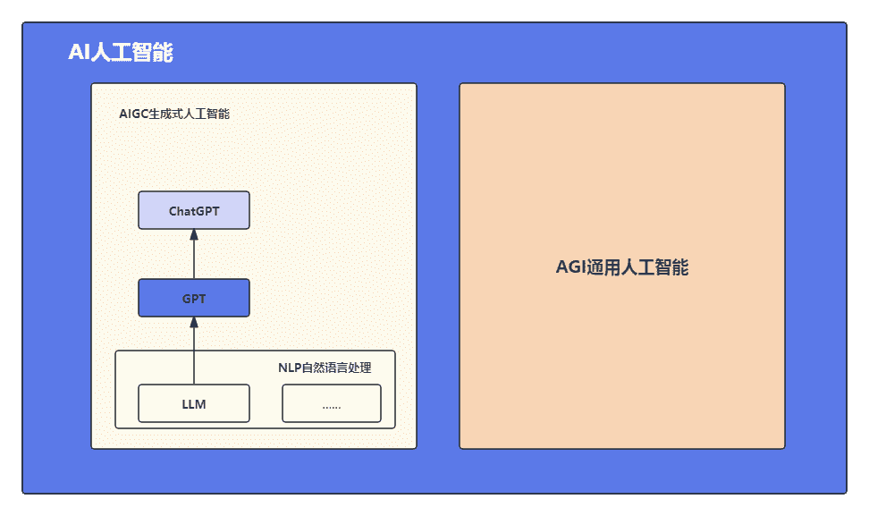

# AI基础知识分享

> 来源：[https://my.feishu.cn/docx/BM8qdJVWOoO60RxbfpMch65SnIb](https://my.feishu.cn/docx/BM8qdJVWOoO60RxbfpMch65SnIb)

## AI人工智能定义

### **什么是 AI？**

AI人工智能 （Artificial Intelligence ）指人工智能技术，由人制造出来的系统所表现出来的智能。能够执行通常需要人类智能才能完成的复杂任务，现阶段的AI人工智能，大多是生成式AI，（Generative AI，简称 Gen AI 或生成式 AI），一种能够像人类一样创造新内容的 AI。

在内容生成（音频、图片、文本、视频）、数据分析（数据分析、文案提炼、知识分析）、智能交互（问答、聊天）以及垂类领域（阿尔法狗下围棋）等方向，均有突出表现。结合现有工具，可以有效形成工作流或者提高工作效率。

生成式 AI 非常有用，但它需要人类指导。

通常情况下，生成式 AI 能就像公司新来的实习生一样，**非常有能力，****但需要清晰的指示才能****做得好。因此，产生了**prompt（指令）这一独特的提问方式。

你可以将**prompt（指令）**理解为人与AI交互的一种方式。

随着科技的发展，提示词（指令）可以是文字、图片、音频甚至是其他媒介。例如，语音指导AI完成某项任务，文字提示让AI生成内容等等。

能够正确地指导生成式 AI 是一项非常强大的技能。你可以通过发送一个 %%指令|你好 世界%% 来指导生成式 AI，这通常是一个文本指令（例如：“给我五种冰淇淋口味”）。

能够读写文本的生成式 AI 称为大型语言模型（LLMs）。

美国麻省理工的温斯顿教授认为，AI是研究如何使计算机做过去只有人才能做的智能工作。

AI的底层逻辑是：通过底层芯片提供的超强算力，对物理世界现行数据进行处理训练，从而识别并理解人类世界，并根据人类提供的各种交互方式（指令、语音……）给予反馈。

**如何理解AI呢？**

把AI当做帮助我们进步的阶梯，提高人生效率的工具，去掌握它。

### AI相关名词

#### AIGC-生成式人工智能（Artificial Intelligence Generative Content）

指的是利用人工智能技术生成内容的过程或方法。

利用人工智能技术自动生成各种类型的内容，包括但不限于文本、图像、音频和视频。AIGC 技术可以用于多种应用场景，如：

1.  **文本生成**：自动撰写新闻文章、生成创意写作、自动回答查询等。

1.  **图像生成**：创建艺术作品、设计图案、生成逼真的虚拟场景等。

1.  **音频生成**：制作音乐、生成语音、模拟特定人物的声音等。

1.  **视频生成**：自动剪辑和编辑视频、生成动画、创建虚拟角色等。

AIGC 技术通常依赖于机器学习模型，尤其是深度学习模型，如生成对抗网络（GANs）、变分自编码器（VAEs）和自然语言处理（NLP）模型。这些模型能够学习大量的数据样本，并生成新的、原创的内容，有时甚至可以达到与人类创作者相媲美的水平。

AIGC 在提高内容生产效率、降低成本以及推动个性化内容创作方面具有巨大潜力。然而，它也引发了关于版权、创意所有权和伦理的讨论，特别是在模仿或复制现有作品时。

#### AGI-通用人工智能/强AI（Artificial General Intelligence）

具有与人类智能相当或超越人类智能的人工智能系统。

是指一种具备广泛认知能力的人工智能系统，它能够像人类一样在多种不同的环境和情境中进行学习、理解、推理和应用知识。与目前普遍存在的专门针对特定任务设计的窄义AI（也称为弱AI）不同，AGI能够跨领域工作，不需要针对每个新任务重新编程或训练。

目前，AGI仍然是一个研究目标，尚未实现。现有的AI系统虽然在特定任务上表现出色，但它们通常缺乏AGI的通用性和适应性。AGI的研究和开发涉及到多个学科，包括计算机科学、认知科学、神经科学和心理学等。

实现AGI将是一个重大的技术突破，它可能会对社会产生深远的影响，包括提高生产效率、促进科学发现、改善医疗保健等。然而，AGI也引发了关于伦理、安全和社会影响的重要讨论，包括如何确保AGI的决策与人类的价值观和利益相一致，以及如何防止AGI被用于有害的目的。

#### LLM 大型语言模型（LLM，Large Language Model）

大语言模型是一种语言模型，由具有许多参数的人工神经网络组成，使用自监督学习或半监督学习对大量未标记文本进行训练。

大型语言模型在2018年左右出现，并在各种任务中表现出色。 尽管这个术语没有正式的定义，但它通常指的是参数数量在数十亿或更多数量级的深度学习模型。

那些经过大量文本数据训练的人工智能模型，它们能够理解和生成自然语言。这些模型通常具有数亿甚至数千亿个参数，使得它们能够捕捉到语言的复杂性，并执行各种语言任务，比如文本摘要、翻译、问答、文本生成、语言理解和文本分类等。

大型语言模型的典型例子包括：

1.  **GPT (Generative Pre-**trained Transformer)：由OpenAI开发，用于生成文本的模型。

1.  **B**ERT (Bidirectional Encoder Representations from Transformers)：由Google开发，用于理解语言的深层次含义。

1.  **Transformer**：一种注意力机制模型，用于处理序列到序列的任务。

这些模型的训练通常需要大量的计算资源和数据，但它们在多种自然语言处理任务上展现出了前所未有的性能。然而，它们也存在一些挑战，比如可能会生成有偏见的内容、难以解释其决策过程以及对环境的影响等。

#### ChatGPT

基于GPT（Generative Pre-trained Transformer）模型的聊天机器人技术。GPT模型是由人工智能研究实验室OpenAI开发的一种先进的语言模型，它通过在大量文本数据上进行预训练来学习语言的模式，并能够生成连贯、上下文相关的文本。

全称聊天生成预训练转换器，是OpenAI开发的人工智能聊天机器人程序，于2022年11月推出。该程序使用基于GPT-3.5、GPT-4架构的大型语言模型并以强化学习训练。

#### NLP自然语言处理(Natural Language Processing)

计算机理解和处理人类语言的技术。

自然语言处理是让计算机来处理、理解以及运用人类语言(如中文、英文等)，达到人与计算机之间进行有效通讯。这里之所以说“自然”是指自然进化形成，为了区分一些人造语言，类似C++、Java 等人为设计的语言。

自然语言处理是人工智能的一个重要分支，它研究如何让计算机理解和处理人类语言。NLP涵盖了许多任务，包括语音识别、自然语言理解、自然语言生成和机器翻译等。

自然语言处理（NLP）就像是教计算机理解和使用人类语言的一种技术。举个例子，当你对手机说：“打开天气应用，查看明天的天气。”这就涉及到了自然语言处理。你的手机需要理解你的指令——这是什么意思，你想做什么，然后才能执行正确的动作。

自然语言处理需要用到很多开源的工具和软件，它们能够帮助研究员处理语言数据，大大降低开发的门槛，让自然语言处理技术的进步的速度变快。

典型应用：如天猫精灵，搜狗AI录音翻译笔，语义情感分析等。

注：AI大模型技术类名词释义为一些不需要特别理解的，AI技术相关的名词概念，如果您只是想使用AI形成自己的工作流，暂时无需了解这些名词。

[AI大模型技术类名词释义（核心部分）](https://hka70cvw3i.feishu.cn/wiki/A9wBwAEvFi6XNJkmR5Mcc5ibnNd?fromScene=spaceOverview)