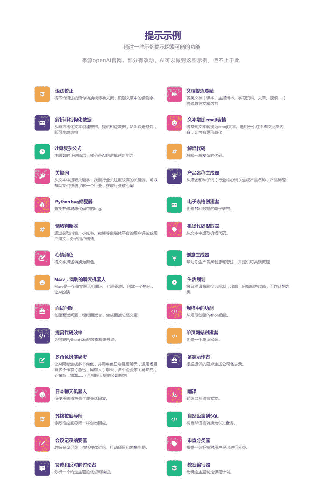

# AI应用场景

> 来源：[https://my.feishu.cn/docx/M75zdQNG6o8K5NxiCQZcb6yGnCd](https://my.feishu.cn/docx/M75zdQNG6o8K5NxiCQZcb6yGnCd)

## AI有哪些应用场景？

实际工作中，AI有着非常广泛的应用场景。

生成式 AI 可以用于自动化迄今只有人类能够完成的创造性任务，这样可以为个人和公司节省时间和金钱。如果你能向生成式 AI 描述你的任务，它很可能为你完成任务或者为你提供一个良好的起点。以下是我们喜爱的几个生成式 AI 应用示例：

### 场景之一：内容营销场景

+   量产自媒体水军文案，电商水军评论

+   将👸号文案，转化成📕文案

+   生成抖音探店文案、📕风格文案

+   一键总结👸号文案、哔哩哔哩/抖音视频

+   分析选题并生成建议、大纲和可实操的内容策略

+   生成客服回答话术

+   市面上的图片有版权问题，直接用AI生成图片

+   [AI一键搞定视频和图片换脸，这个工具免费又好](https://www.bilibili.com/video/BV1NN411v7sa/)用，附教程。_哔哩哔哩_bilibili

+   [快速制作自己的数字人？HeyGen](https://www.bilibili.com/video/BV1Gh4y1i7bU/)数字人生成效果拔群！数字人技术方案拆解！

+   ChatGPT+Canva批量生成社交媒体轮播图 - 📕

### 场景之二：数据分析

+   分析Excel表格，根据表格数据，提供分析维度让AI进行分析；

+   提取网页数据，并形成表格展示

+   根据数据制作分析报告，并形成可视化图表；

+   实例1：整合多个数据表，并对数据表数据进行筛选，计算等操作；

+   实例2：根据现有数据表，进行同比、环比，或者预估数据；

+   [AiGC运营：📕爆款概率预测分析（一）](https://txt6wm3b04b.feishu.cn/docx/F1v8drS3OoE3zyxCULmcukaPntZ)

+   太强了！1分钟用ChatGPT处理数据分析！

+   [如何用 ChatGPT 帮你自动分析数据?](https://blog.csdn.net/2301_77531618/article/details/130689328)_chatgpt 数据分析-CSDN博客

### 场景之三：品牌IP创建

+   行业市场研究分析

+   从IP定位、IP内容策略、品牌IP形象到品牌内容发布一系列创建

+   分析评论正负情感并给出话术

+   分析对标账号内容数据

> 如果你对AI实际用例很感兴趣，在知识库的后面，我们整理了目前生成式AI应用案例。

> [AI案例篇：生成式AI应用案例](https://hka70cvw3i.feishu.cn/wiki/ZihQwN3nyiWdz9k1P8Ncibxonlf)

> 其中还有大厂的AI应用实例。

### 场景之四：日常办公

+   撰写合同协议、免责协议、隐私协议、文书等；

+   撰写周报、日报、月报；

+   整理会议纪要、文档纲领；

+   自动写提纲，做PPT，思维导图，Excel表格

#### AI编程

+   如何不写代码却能制作你人生中的第一个游戏_哔哩哔哩_bilibili

+   [聊天就能编程！我用GPTs做了个自](https://www.bilibili.com/video/BV1ug4y1X7MJ/)己的数字化身_哔哩哔哩_bilibili

### 场景之五：个人提升

+   优化个人简历，模拟面试

+   辅助自学编程

+   辅助快速了解某垂类行业知识

……

### 垂类行业

+   医疗保健

+   X光片识别

+   肿瘤靶区的CT影像分析

+   疾病的早起诊断和治疗方案推荐

+   ……

+   汽车行业

+   自动驾驶汽车

+   运算汽车交通流量并优化

+   ……

+   金融服务

+   金融产品风险管理

+   客户欺诈检测

+   客户服务自动化

+   投资策略优化

+   ……

+   零售业

+   客户行为分析

+   库存管理优化

+   价格竞争对比

+   个性化营销战略

+   ……

+   制造业

+   预测性维护产品

+   生产线自动化处理

+   产品质量控制

+   供应链优化

+   ……

+   教育

+   教育直播场景应用：数字人，虚拟直播，互动化学习体验

+   AI教师

+   个性化学生教育

+   ……

+   企业运营

+   语音助手

+   聊天机器人

+   对话式AI

+   客服运营

+   产品营销优化

+   ……

来源：openAI官网，部分有修改。

更多应用场景，可继续查看：

[200个AI实际运用场景&实际操作](https://hka70cvw3i.feishu.cn/wiki/E4Jpwmz9tiqo3mkv7hrcERbOnlY?fromScene=spaceOverview)

[AI在垂类领域的运用技巧](https://hka70cvw3i.feishu.cn/wiki/Wljbwpjg5ij4ZwkrUCfcXDDen1c?fromScene=spaceOverview)

## **我如何开始使用生成式 AI？**

通常情况下，**现在的AI使用价值，取决于使用者提问题的水准。如果你想好好的**使用AI，那么prompt显得尤为重要。

"prompt"通常指的是输入到AI系统中以触发特定输出或行为的文本、命令或信号。对于AI系统来说，prompt可以视为一种输入，它告诉AI系统执行特定的任务或生成特定的内容。

以下是一些使用prompt的例子：

1.  **文本生成**：在聊天机器人或文本生成模型中，用户可能会输入一个prompt，如“给我讲一个关于太空探险的故事”，AI将基于这个prompt生成一段文本。

1.  **代码补全**：在编程辅助工具中，开发者可能会输入部分代码作为prompt，AI会尝试补全剩余的代码。

1.  **图像生成**：在图像生成模型中，prompt可以是一个描述，比如“画一个坐在草地上的小猫”，AI会尝试生成与描述相匹配的图像。

1.  **语音识别**：在语音识别系统中，用户的语音可以作为prompt，AI将其转换为文本。

1.  **搜索查询**：在搜索引擎中，用户的查询可以视为prompt，AI或搜索引擎据此返回相关的搜索结果。

1.  **机器学习模型输入**：在训练机器学习模型时，输入数据可以视为prompt，AI模型根据这些数据进行学习和预测。

1.  **交互式学习**：在教育软件中，学生的输入或选择可以作为prompt，引导AI提供反馈或进入下一个学习阶段。

1.  **自动化任务**：在自动化系统中，特定的prompt可以触发一系列预定的操作或流程。

当然了，使用是一种使用方式，但并不是所有人都懂得指令是如何使用的，那么，是否有更简单的使用方式呢？

答案是**有**！

大众并未注意到的是，AI早已经渗透到我们生活的方方面面，例如目前爆火的黏土特效，甚至是艺术照，老照片修复等领域。一些先行者，早已经借助AI制作了一个个的应用层产品。

以下是部分示例：

> AI+头像、小朋友照片、不同年龄段夫妻照片、宝宝照片=这个领域有许多产品，例如妙鸭相机、AI证件照，AI艺术照，宝宝艺术照，各美颜相机的优秀滤镜（黏土特效、圣诞节艺术照等），主要是借人工智能图像生成，它利用深度学习技术，根据用户提供的文本提示生成相应的图像。

> 当然了，通用型绘画领域还有Midjourney、stable、diffusion此类人工智能绘画平台。B 端设计、拍摄素材、实物生成以及艺术创作、产品设计、广告制作等领域，都是人工智能通用型绘画产品能实现的。

> 例如：AI+电商，更换模特衣服，直接生成模特等，均是可以通过AI实现的，继续阅读本知识库，您也可以掌握此技巧。

> AI+PDF、PPT、Excel、论文=ChatPDF、ChatDoc，使用人工智能技术来与文档进行交互的功能或服务。这种服务通常允许用户通过自然语言提问来获取文件中的信息，或者执行与文档相关的特定任务。

> AI+论文= 借助AI写论文、检测AI写的论文，提炼论文中的精髓

> AI+播客、视频、网页=播客音频总结、视频总结和对话、网页总结和对话，AI对内容的总结，并不局限于这些格式，相信你还可以挖掘出更多AI内容提炼的场景和方式。

> AI+老照片、低分辨率图片、老动画、老电影……=老照片修复，老照片高清放大、老动画修复、老电影画质修复……除了生成绘画之外，对现有画面的修复和补充，也是AI强大功能之一。同样，AI的修复功能，也并不局限在图画，动画、视频也同样可以。

> AI+文字=图片生成、音频生成、音乐生成、音效生成，视频生成，文生图，文字转语音，文字转音乐甚至是文生视频，这都是目前已经实现的AI功能。

> AI+数据=智能分析

> AI+股票=智能炒股

> ……

> 上面的案例可以看出：

> 使用AI有两个方法，一是借助指令和工具达成我们想要的结果，例如借助智能问答ChatGPT+指令，可以完成各种任务规划；借助midjourney+指令，可以绘画出各种风格的图片。

> 优点是能够按照自身需求进行配置，提高自身工作效率；缺点是需要了解各类工具以及指令优化相关信息。

> 第二个方法，就是借助市面上已经完成的工具，直接达成我们想要的效果。例如：AI换脸，黏土特效，哄哄模拟器（哄女朋友）等等，都是AI为底层运作的工具。

> 优点是不用思考，可以直接套用。缺点是生成的东西太死板，无法完全满足自己的需求，大多只可以做为娱乐产品，无法提高效率。