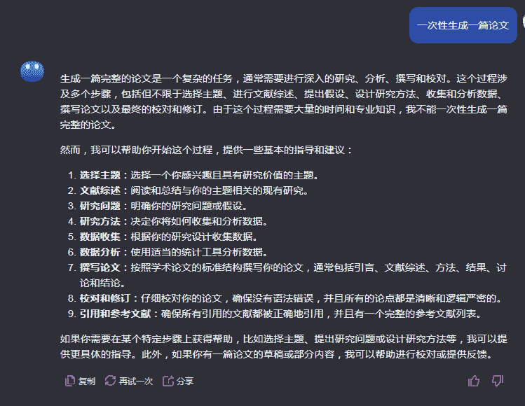
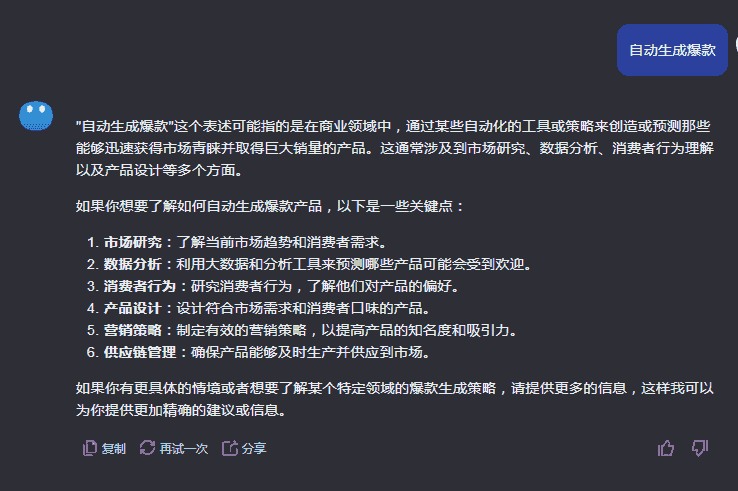

# 理论篇：AI指令效果优化

> 来源：[https://my.feishu.cn/docx/Z37KdOoIEoNWWpxZOdNclqYjnLg](https://my.feishu.cn/docx/Z37KdOoIEoNWWpxZOdNclqYjnLg)

注：以下内容均为提示词Prompt的理论基础，用于辅助大家更好的理解AI指令并自行创造系统性的Prompt。

## 什么是提示词？

提示词，又称指令，Prompt，就是人类和大语言模型（LLM）沟通的语言，也可以理解为自然语言版的编程，你和LLM所说的每一句话，都是提示词。

提示词就像给LLM一个话题或方向,让它知道应该谈论什么。

**你可以将AI理解为一个掌握了全世界公开知识的孩子，**提示词就是和这个"孩子"友好沟通的技巧。因为它只是个"孩子"，让它清楚无误听懂你的话，是很重要的事情。

提示词的使用也分能力和阶段

+   入门玩家：开局先抄，套用别人现成提示词

+   中高端玩家：学会提问，创造专属自己的提示词

+   高端玩家：人词合一，懂业务的人+提示词+工具的思维链，并将其运用在自己的工作流中；

+   精英玩家：意识到提示词的不足，懂业务和提示词的同时，能不断通过各种方式优化提示词。

本知识库会提供从入门级的提示词，到引导大家逐步跟别人拉开差距的高端进阶玩法。

## 如何优雅的写一个提示词并获取有用的答案？

#### 提问时的错误示范

写提示词，肯定是希望AI能够解决自己的问题和诉求，但在提问的过程中，我们可能会犯一些错误。例如：

+   对大模型不恰当的期待，出现：一次性生成一篇论文、准确生成312个字、自动生成一篇爆款文章此类提示词。





缺乏主题，会让AI无法理解我们的话语，将任务变成了解释性说明，或者理解了我们的话，但没办法给我们有用的反馈。

+   答案不满意直接退出

这是很常见的问题，也是很多初学者会犯得错。因为对AI生成的答案不满意，就直接离开。不妨思考一下：

+   提问是不是哪里有缺陷？

+   大模型是不是有一些局限性？

PS：大家现在还不知道大模型的局限性，没关系，我们一步步来。

其实想解决也很简单：

+   审视自己内心想要解决的问题和诉求；

+   通过多轮聊天式的自然语言引导大模型对话，给出优质内容。

事实上，刚接触AI可能还会有其他的困惑，但当你想到的不是退缩，而是去研究AI，那么这个知识库才对你有价值。

#### 优雅的写提示词

在提问的过程中，引入结构化思维，深入理解“角色法”、了解Markdown语法意义，那么你的提示词基础，将会很扎实！

接下来要做的，无非就两点：

1.  实践

大量实践，不同场景下编写提示词，观察反馈结果。

+   测试迭代；

+   优化自己的表述结构；

1.  表达能力

审视自己的表达能力，如果无法理解，那就直接套用结构化指令框架，在表述问题时使用分析决策方法，例如5W2H，SWOT分析，六顶思维帽，决策树等。

当然，哪怕是如此，也可能会出现大模型生成不符合预期，这说明我们需要调整自己的表述方式了。

和大模型对话语感的能力，背后有经验的累积,有对方法论的思考,更多时候也是形成一种潜意识的表达的一种条件反射的语言素养。

#### 延伸：提示词生成的答案没价值？

三个方法：

1.  提示词封装

目前市面上，比较主流的工具有 OpenAI 官方推出的 GPTS 或者叫 Gizmo, 当然也有我们国内国产大模型的很多智能体封装的工具, 例如Kimi、deepseek、智谱清言的智能体,百度文心一言的智能体, 这些都是很成熟的平台化的智能体封装方式。

1.  提供更多语料

AI人工智能仍在不断发展，kimi已经支持200万字的输入，那么提供知识库，私有化知识库训练等都是可行的方案。

1.  更高限制的提示词

提示词中，借助符号能够形成更高限制的指令，从而保证生成的内容是符合你期待的。这也是我研究出来的一个方法，区别于市面上的结构化指令，后面会讲到。

#### AI幻觉

> 人工智能领域中，幻觉（英语：hallucination，或称人工幻觉）是由人工智能生成的一种回应，它含有貌似事实的虚假或误导性资讯。 该术语源自幻觉的心理学概念，因为它们具有相似的特征。 人工智能幻觉的危险之处之一是模型的输出看起来是正确的，而它实际上是错误的。

> AI幻觉并不是人工智能刻意生成错误的答案，而是由于人工智能的语料库，训练是的资料中不包含相应内容，在无意间生成的一种错误回答。

在GPT 3.5刚出来的时候，相信大家看到过很多让人啼笑皆非的答案。

当然了，通用型大模型和通用型大模型也是不一样的，现在知名的通用大模型，例如ChatGPT，kimi，文心一言等，几乎很少遇见此类问题。

不过，RAG不仅是应对AI幻觉的有效解决方案，也是提高输出内容质量的有效方式。

> **检索增强生成（RAG）**是指对大型语言模型输出进行优化，使其能够在生成响应之前引用训练数据来源之外的权威知识库。大型语言模型（LLM）用海量数据进行训练，使用数十亿个参数为回答问题、翻译语言和完成句子等任务生成原始输出。在 LLM 本就强大的功能基础上，RAG 将其扩展为能访问特定领域或组织的内部知识库，所有这些都无需重新训练模型。这是一种经济高效地改进 LLM 输出的方法，让它在各种情境下都能保持相关性、准确性和实用性。

## 提示词的几种提示规范

### 标准提示：

我们将仅包含一个问题的提示称为“标准”提示，我们还认为仅包含问答形式为问题的提示也是“标准”提示。通常来说，标准提示比较简短，只是描述清楚了自己的问题。

之所以用标准提示来定义，是因为在知识库中，除了标准提示，我们会提供许多与标准提示不同的新型提示，并引导你逐步优化。

标准提示：

```
示例一：上海的省会是哪里？

示例二：鲁迅和周树人是什么关系？

示例三：法国的首都是哪里？
```

这就是少量样本提示。

> "Few-shot"（少量样本）学习是机器学习特别是自然语言处理（NLP）领域中的一个概念，它指的是使用非常有限的标注数据（通常只有几个样本）来训练模型。在few-shot学习中，模型需要能够快速地从少量的样本中学习到有用的模式或知识，并将其推广到新的、未见过的数据上。

在few-shot学习的上下文中，"标准提示"（prompt）通常指的是用于引导模型生成答案或完成特定任务的输入格式。这些提示可以是问题、指令或者上下文信息，它们帮助模型理解任务的要求并生成合适的输出。

例如，在文本生成任务中，一个few-shot提示可能是：

```
Q: 描述一下你如何准备一顿简单的早餐。
A: 准备一顿简单的早餐，我会...
```

在这种格式中，"Q"代表问题（Question），"A"代表答案（Answer）。模型会根据提供的示例学习如何回答问题。

在少量样本学习中，提示的设计对于模型性能至关重要，因为它们需要能够捕捉到任务的核心要求，同时提供足够的信息来引导模型生成正确的输出。

---

另外，

大家可以发现，我提供的标准提示，里面有两个提问，本身就存在问题：

+   示例一：上海是直辖市，它并没有所谓的“省会”，所以这是常识错误问题；

+   示例二：鲁迅，原名周树人，这是一个逻辑错误问题。

这也是面向AI智能问答的一个特点：你提供的提示词，并不一定要完全正确！

AI本身了解的知识，来源于人类世界海量的知识，基于逻辑判断，它会识别基础语言中的错误。

有人可能会担心：听起来那么难，我能学会么？

其实不用担心，**AI没那么难！**

看了这个知识库，自己进行实操是完全没问题的。

如果你实操过许多次，那么自己制作一套属于自己的工作流，甚至私有化部署模型，都不在话下。

话不多说，直接提供提示词。