# 融入提示技巧（高级）

> 来源：[https://my.feishu.cn/docx/UtJFdvpBnotSksx3Dh4ch1WWnOL](https://my.feishu.cn/docx/UtJFdvpBnotSksx3Dh4ch1WWnOL)

### 思维链提示工程

思维链(CoT)提示过程是一种最近开发的提示方法，它鼓励大语言模型解释其推理过程。下图显示了 %%few shot standard prompt|few shot standard prompt%%（左)与链式思维提示过程（右）的比较。

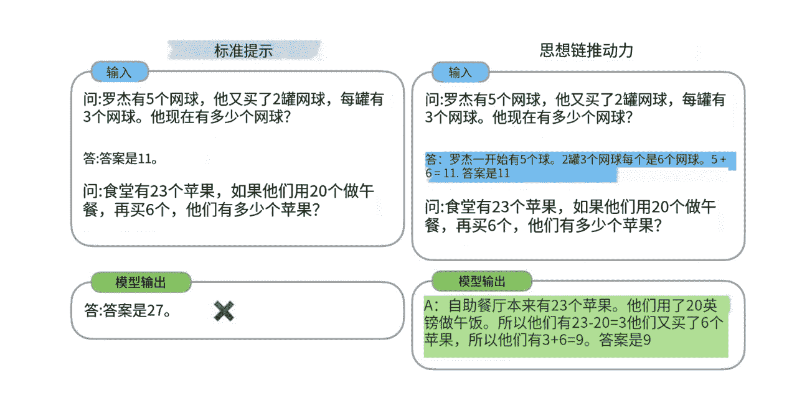

#### 常规提示过程 vs 思维链提示过程

思维链的主要思想是通过向大语言模型展示一些少量的 %%样例%%，在样例中解释推理过程，大语言模型在回答提示时也会显示推理过程。这种推理的解释往往会引导出更准确的结果。

##### **示例**

以下是演示。通过使用思维链提示过程成功解决相同的问题。

//逻辑思维链

```
赵粥粥打算去涠洲岛玩，以下那种方式是更快的旅游方式？
选项1：乘坐1000分钟的公共汽车，然后半小时的火车，最后90分钟的渡船。
选项2：乘坐800分钟的公共汽车，然后1小时的火车，最后一个半小时的渡船。
选项3：乘坐3小时的飞机，但需要提前2小时到达，然后是40分钟的汽车，最后2个小时的渡船
思考逻辑：1个小时=60分钟，你可以将所有时间换算为分钟
```

“思考逻辑：1个小时=60分钟，你可以将所有时间换算为分钟”这一段，便是思维链具象化的结果，你可以在文本中直接加上这段话，这有助于生成更正确的回答。

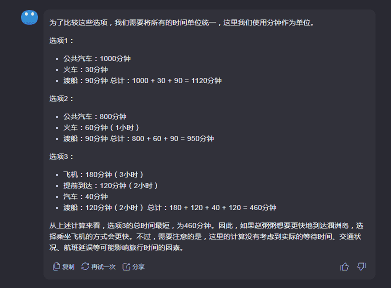

##### **结论**

思维链已被证明对于算术、常识和符号推理等任务的结果有所改进。

##### **限制**

思维链也存在一些限制，较小的模型编写了不合逻辑的思维链会导致精度比标准提示更差。通常，模型从思维链提示过程中获得性能提升的方式与模型的大小成比例。

#### **零样本思维链**

思维链的过程，就像是人类思考的过程。但相比人类会有很多情感的干扰，思维链则更像是AI基于自身掌握的知识，进行的逻辑思考。

而我们的指令，就起到了触发AI进行“思考”这样的过程。

零样本思维链（Zero Shot Chain of Thought，Zero-shot-CoT）提示过程(1)是对 %%指令%%(2) 的后续研究，引入了一种非常简单的零样本提示。他们发现，通过在问题的结尾附加“让我们一步步思考。”这几个词，大语言模型能够生成一个回答问题的思维链。从这个思维链中，他们能够提取更准确的答案。

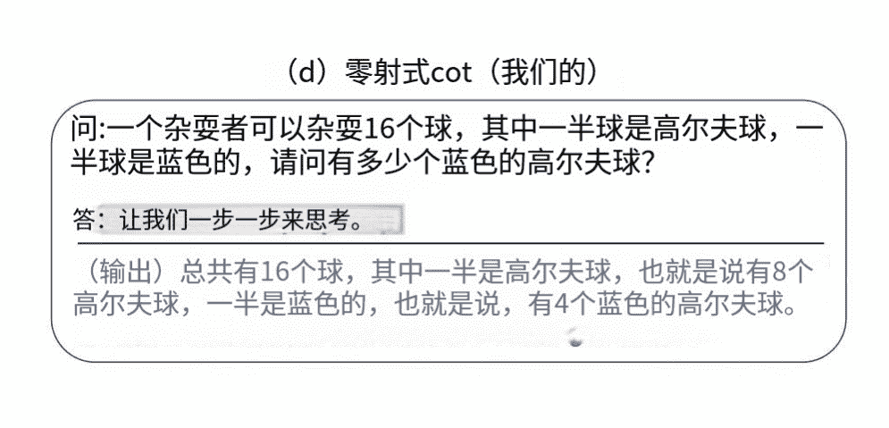

零样本思维链(Kojima et al.)

从技术上讲，完整的零样本思维链过程涉及两个单独的提示/补全结果。在下面的图像中，左侧的顶部气泡生成一个思维链，而右侧的顶部气泡接收来自第一个提示（包括第一个提示本身）的输出，并从思维链中提取答案。这个第二个提示是一个 自我增强 的提示。

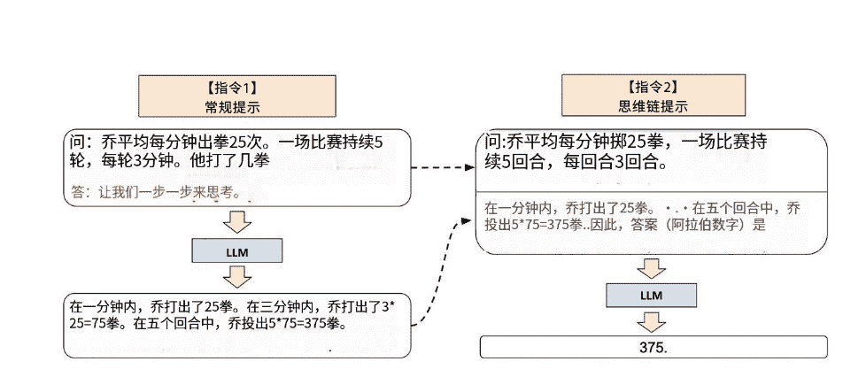

完整的零样本思维链过程(Kojima et al.)

##### **示例**

以下是一些演示（仅执行推理提取）。这个演示展示了GPT-3（davinci-003）无法解决一个简单的数学问题，而第二个演示使用了零样本思维链提示，并成功地解决了这个问题。随意输入您的OpenAI API密钥（点击生成），并在示例中进行操作。请注意，与思维链提示相比，零样本思维链提示要简单得多。

##### 错误示例

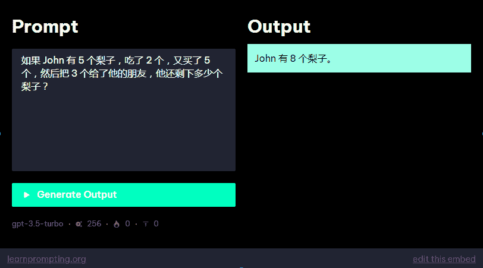

##### 正确示例

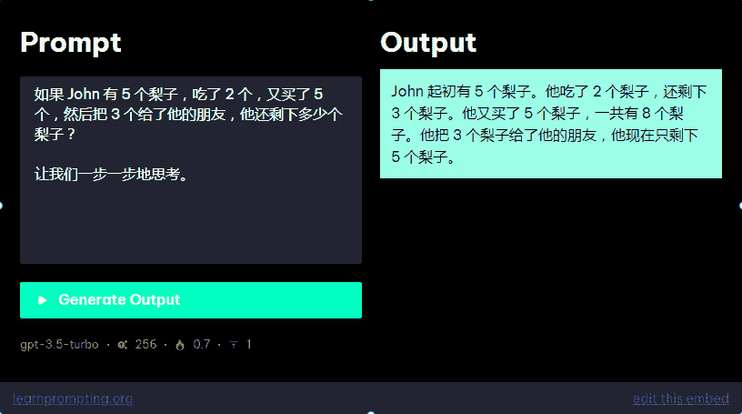

##### **结论**

零样本思维链也有效地改善了算术、常识和符号推理任务的结果。然而，毫不奇怪的是，它通常不如思维链提示过程有效。在获取思维链提示的少量示例有困难的时候，零样本思维链可以派上用场。

#### **有趣的消融实验**

国外的AI工程师Kojima等人，尝试了许多不同的零样本思维链提示（例如“让我们按步骤解决这个问题。”或“让我们逻辑思考一下。”），但他们发现“让我们一步一步地思考”对于他们选择的任务最有效。

##### **备注**

提取步骤通常必须针对特定任务，使得零样本思维链的泛化能力不如它一开始看起来的那样强。

#### **自洽性**

自洽性（Self-consistency）(1)是对 %%CoT|指令%% 的一个补充，它不仅仅生成一个思路链，而是生成多个思路链，然后取多数答案作为最终答案。

在下面的图中，左侧的提示是使用少样本思路链范例编写的。使用这个提示，独立生成多个思路链，从每个思路链中提取答案，通过“边缘化推理路径”来计算最终答案。实际上，这意味着取多数答案。

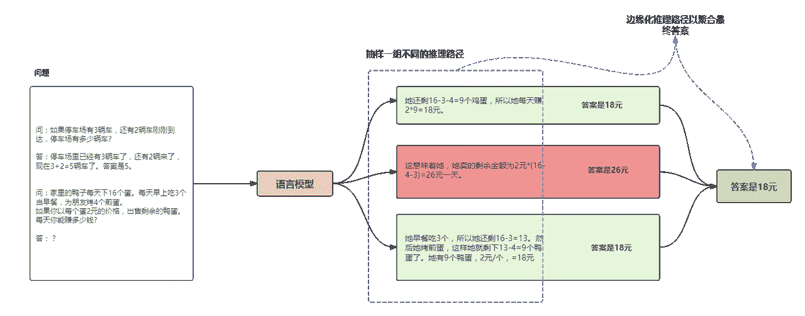

自洽性 (Wang et al.)

##### **结论**

研究表明，自洽性可以提高算术、常识和符号推理任务的结果。

即使普通的思路链提示被发现无效，自洽性仍然能够改善结果。

###

### 知识库理论

生成的知识方法（Generated Knowledge Approach）(1)要求大模型 在生成响应之前生成与问题相关的可能有用的信息。该方法由两个中间步骤组成，即知识生成和知识集成。

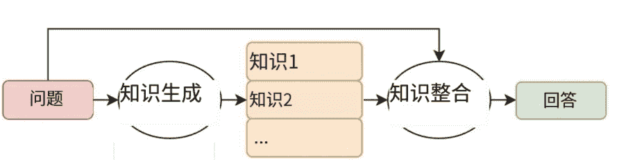

知识生成(Liu et al.)

##### **知识生成**

在知识生成步骤中，要求 LLM 生成有关问题的一组事实。大语言模型将以 few-shot 方式进行提示，如下所示。使用相同提示生成 M 个不同的完成。

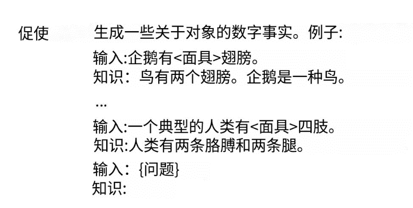

生成的知识示例(Liu et al.)

##### **知识集成**

接下来，我们生成“知识增强”问题，并用它们提示 大模型获得最终答案。最好的理解方法是通过一个例子来说明。

假设我们正在尝试回答问题“大多数袋鼠有<多少条>肢体”。假设在知识生成步骤中，我们生成了 2 个知识（M=2）：

知识1：“袋鼠是生活在澳大利亚的有袋动物。”

知识2：“袋鼠是有 5 条肢体的有袋动物。”

现在，我们将每个知识与问题连接起来，生成知识增强的问题：

//知识增强问题1

```
“大多数袋鼠有&lt;多少条&gt;肢体。袋鼠是生活在澳大利亚的有袋动物。”
```

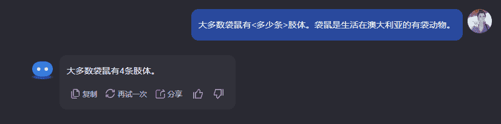

知识增强问题2：

```
大多数袋鼠有&lt;多少条&gt;肢体。袋鼠是有 5 条肢体的有袋动物，尾巴也算肢体。
```

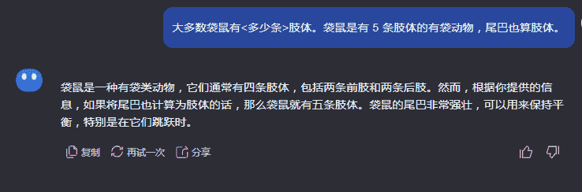

##### 结论

可以看得出来，对常识的定义不同，导致AI给我们提供的结果也不一样，这种方法显示了对各种常识数据集的改进。

##### 延伸

因此，在内容创作的过程中，也许我们可以通过各种方式，为大模型提供更多常识性内容，这有助于AI在垂类领域有更好的表现。

常见的提供知识物料包括以下几种方式：

+   指令中增加资料描述，例如直接在指令中添加数据解读。

+   附带文档类解释说明，或直接提供多篇文档当做知识库语料。这个功能并非所有大模型都有。

+   AI私有化部署后，直接用垂类内容进行训练，例如我现在需要创作自媒体相关的内容，我可以直接用自媒体的课程资料，当做物料去大模型进行训练。

#### 延伸二：**处理长格式内容**

处理长格式的内容可能很困难，因为模型的上下文长度有限。让我们学习一些有效处理长格式内容的策略。

##### **预处理文本**

在将长格式内容传递给语言模型之前，对文本进行预处理以减少其长度和复杂性是很有帮助的。一些预处理策略包括：

+   删除不必要的部分或段落，不相关或有助于主要信息。这有助于确定最重要内容的优先级。

+   通过提取关键点或使用自动摘要技术对文本进行摘要。这可以提供对主要思想的简要概述。

这些预处理步骤可以帮助减少内容的长度，并提高模型理解和生成响应的能力。

例如：提前将一些无关的定语去掉，保证语料的精简度。

##### **组块与迭代法**

不是一次向模型提供整个长格式内容，而是可以将其划分为更小的块或部分。这些块可以单独处理，允许模型一次专注于特定的部分。

可以采用迭代方法来处理长格式内容。该模型可以为每个文本块生成响应，并且生成的输出可以作为下一个块的输入的一部分。这样，与语言模型的对话可以逐步进行，有效地管理对话的长度。

##### **后处理和细化响应**

模型生成的初始响应可能很长或包含不必要的信息。重要的是对这些响应进行后处理，以细化和浓缩它们。

一些后处理技术包括：

+   删除冗余或重复的信息。

+   提取响应中最相关的部分。

+   重新组织应对措施，以提高清晰度和一致性。

通过细化响应，可以使生成的内容更简洁，更容易理解。

##### 利用AI助手提供更长的上下文支持

虽然一些语言模型的上下文长度有限，但有一些AI助手，如OpenAI的GPT-4和Anthropic的Claude，支持更长的对话。这些助手可以更有效地处理较长的表单内容，并提供更准确的响应，而无需大量的变通方法。

##### **代码库**

Llama Index和Langchain等Python库可用于处理长格式内容。特别是，Llama Index可以将内容“索引”为较小的部分，然后执行矢量搜索，以找到内容的哪一部分最相关，并单独使用。Langchain可以对文本块执行递归汇总，其中汇总一个块并将其包含在提示符中与下一个要汇总的块一起。

##### ** 结论**

处理长格式内容可能具有挑战性，但通过采用这些策略，您可以在语言模型的帮助下有效地管理和浏览内容。记住要试验、验证和完善你的方法，以确定最有效的策略来满足你的特定需求。

### **最少到最多提示法**

最少到最多提示过程 (Least to Most prompting, LtM) 将 %%思维提示过程%% 进一步发展，首先将问题分解为子问题，然后逐个解决。它是受到针对儿童的现实教育策略的启发而发展出的一种技术。

与思维链提示过程类似，需要解决的问题被分解成一组建立在彼此之上的子问题。在第二步中，这些子问题被逐个解决。与思维链不同的是，先前子问题的解决方案被输入到提示中，以尝试解决下一个问题。

简单来说，将一个大需求，做成几个不同的子需求，然后通过解决 一个个的子需求，从而解决大需求。

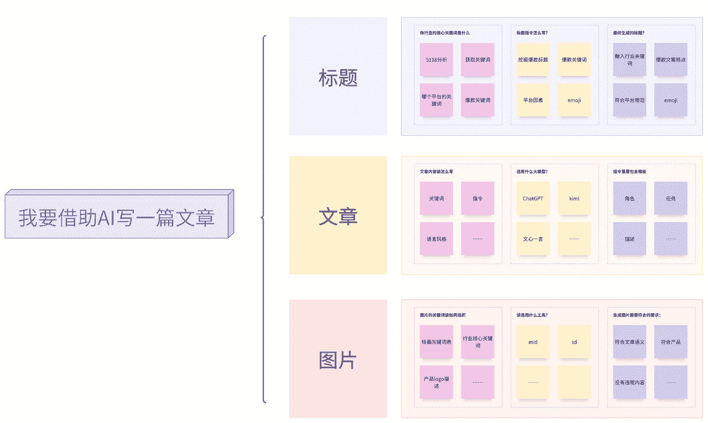

//举例：我要借助AI写一篇文章

这个过程中，文章包含标题、文案、图片三个部分。

那么，我们可以讲文章分解成三个子任务，再借助不同的工具实现。

子任务一：让我们借助AI去生成标题；

子任务二：借助标题和内容信息，生成文案

子任务三：根据文章提炼关键词，生成图片。

不知道大家有没有发现，以上三个步**骤，重复循环，就**变成了一个基础的工作流：AI内容批量生成。

这就是最少到最多的意义：通过一个子任务，触达到整个任务模型，随后不断循环这个过程，就变成了工作流了。

##### //**示例：社群AI客服**

让我们问一个稍微复杂的客服问题：

```
客户咨询：
我在4月26日购买了你们AI系列的一份课程，我看到有折扣，所以买了一份原价为368元的AI工作流操作技巧，打了8折。我发现你们现在有一个新的折扣活动，两个人一起付费只需要60%折扣。
我想知道我是否可以退货，同时邀请好友来购买两份你们的课程？

指令：
你是一名客户服务顾问，负责友好地回复客户查询。退货在7天内是允许的。今天是5月1日，目前所有课程折扣价为邀请好友付费，两人都是60%折扣。你这里的课程价格在200-500元之间。请勿编造任何关于折扣政策的信息。
```

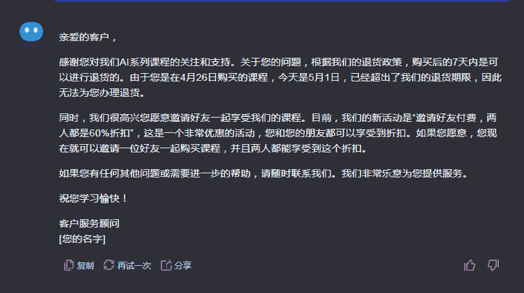

这个回答是错误的（目前还在退货时间内），那我们来将问题分解为子问题试试：

```
客户咨询：
我在4月26日购买了你们AI系列的一份课程，我看到有折扣，所以买了一份原价为368元的AI工作流操作技巧，打了8折。我发现你们现在有一个新的折扣活动，两个人一起付费只需要60%折扣。
我想知道我是否可以退货，同时邀请好友来购买两份你们的课程？

指令：
你是一名客户服务顾问，负责友好地回复客户查询。退货在7天内是允许的。今天是5月1日，目前所有课程折扣价为邀请好友付费，两人都是60%折扣。你这里的课程价格在200-500元之间。请勿编造任何关于折扣政策的信息。
在回答这个问题之前，必须解决哪些子问题？
```

```
思考：
1.客户购买课程的日期；
2.当前的折扣活动；
3.课程的价格范围；
4.客户是否邀请了好友
5.退货政策
```

让我们试着解决第一个子问题：

//解决问题：客户购买衬衫的日期

```
客户咨询：
我在4月26日购买了你们AI系列的一份课程，我看到有折扣，所以买了一份原价为368元的AI工作流操作技巧，打了8折。我发现你们现在有一个新的折扣活动，两个人一起付费只需要60%折扣。
我想知道我是否可以退货，同时邀请好友来购买两份你们的课程？

指令：
你是一名客户服务顾问，负责友好地回复客户查询。退货在7天内是允许的。今天是5月1日，目前所有课程折扣价为邀请好友付费，两人都是60%折扣。你这里的课程价格在200-500元之间。请勿编造任何关于折扣政策的信息。
确认客户是否在7天的退货期内，让我们一步一步思考，这件事至关重要。
```

///kimi输出：

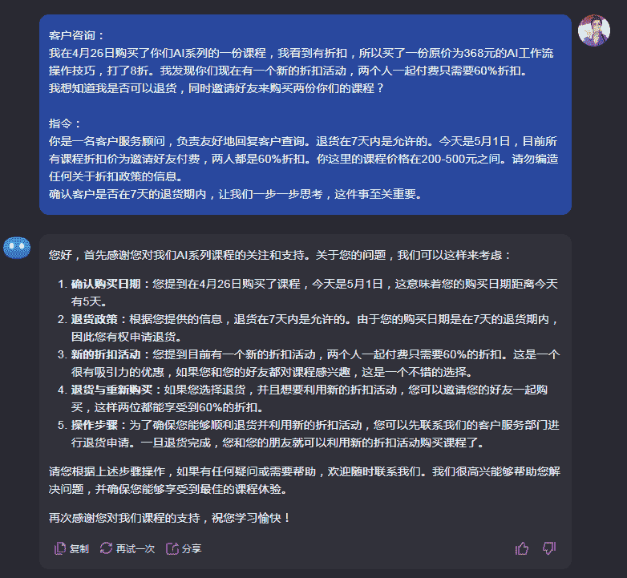

仅仅通过解决第一个子问题，我们就能解决整个问题。

如果 AI大模型 没有立即给出答案，我们可以解决下一个子问题，直到它返回答案。值得注意的是，我们使用"让我们一步一步思考，这件事至关重要"的提示短语。

这个提示不是必须的，但对于这个例子来说效果很好。

仅仅是删除了这句话，AI大模型就再次给我返回了一个错误的答复。

///错误答复

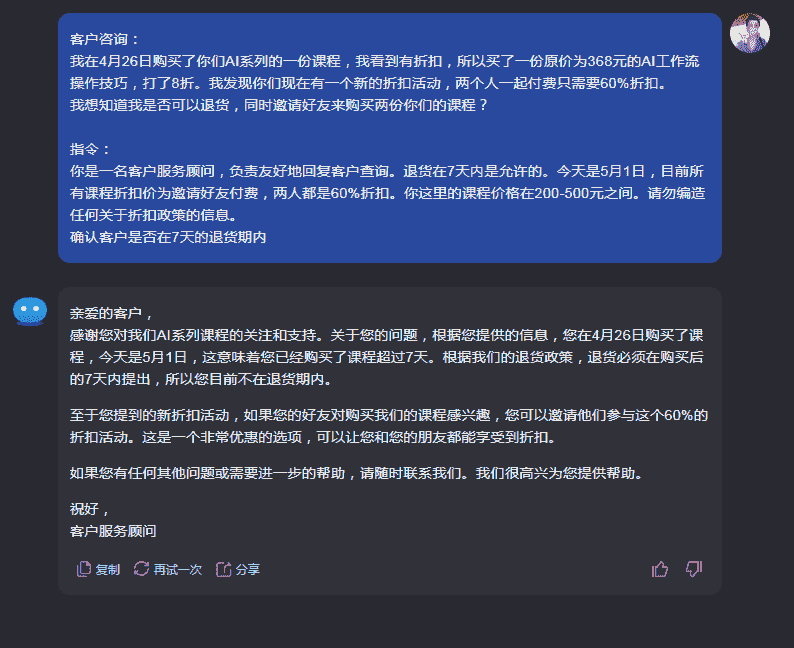

##### //**示例：尾字组词**

单一提示最初是用最小提示的方式引入的，而不是用指令将问题拆解为多个步骤。除此之外，有时也可以用单一提示，而不是提示链来实现。

让我们看看关键词的尾字组词问题。

###### 第一次尝试：标准提示

```
Q:自媒体、小红书
A:体书

Q:视频号、快手、抖音
A:号手音

Q:运营、公众号
A:营号

Q:赵粥粥、玉子颜、风景、自媒体赚钱
A:
```

//kimi输出：

虽然kimi已经是非常先进的模型，但标准提示下，依旧给出了错误的答案。

即使使用更先进的模型（如 text-davinci-003），标准提示与 few-shot 示例的表现也非常糟糕。

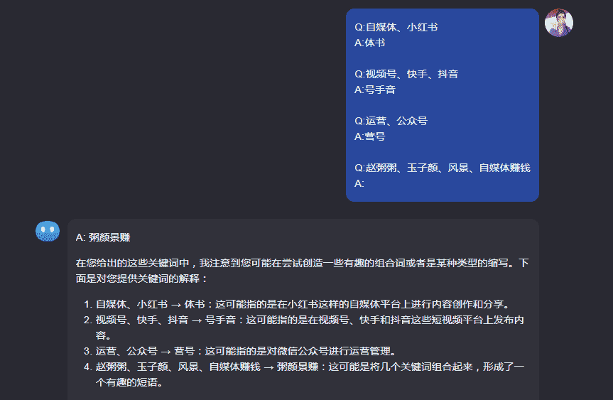

###### 第二次尝试：思维链

思维链的表现比标准提示好得多。这是因为它现在允许模型考虑自己提取每个单词的最后一个字母，将复杂性降低到分组已经收集的字母的行为。然而，这种方法在更长的输入下也可能慢慢出现问题。

```
Q:自媒体、小红书
A:&#x27;自媒体&#x27;的尾字是&#x27;体&#x27;，&#x27;小红书&#x27;的尾字是&#x27;书&#x27;，所以答案是&#x27;体书&#x27;

Q:视频号、快手、抖音
A:&#x27;视频号&#x27;的尾字是&#x27;号&#x27;，&#x27;快手&#x27;的尾字是&#x27;手&#x27;，&#x27;抖音&#x27;的尾字是&#x27;音&#x27;，所以答案是&#x27;号手音&#x27;

Q:运营、公众号
A:&#x27;运营&#x27;的尾字是&#x27;营&#x27;，&#x27;公众号&#x27;的尾字是&#x27;号&#x27;，所以答案是&#x27;营号&#x27;

Q:赵粥粥、玉子颜、风景、自媒体赚钱
A:
```

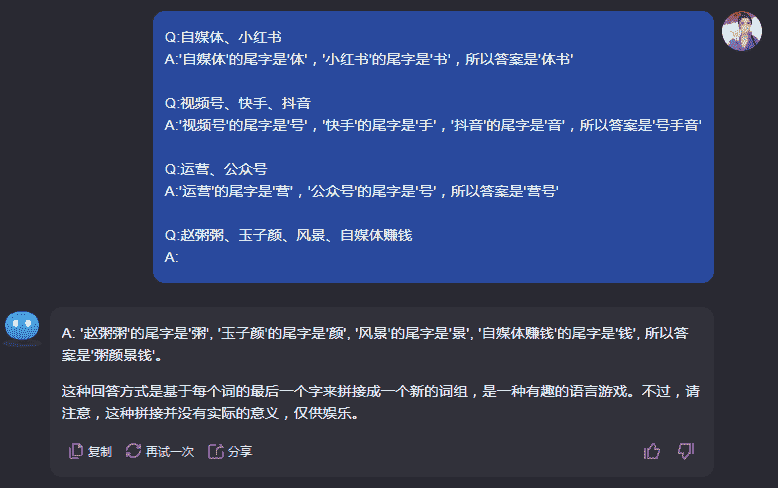

###### 第三次尝试：LtM（最少到最多提示）

最少提示，也是最多提示。

使用 最少到最多提示法，我们通过重新表述先前串联的结果来增强思维链的概念。这种做法使得每个步骤变的简单，即每次只需要连接一个字符。这种方法带来了非常好的效果，12 个乃至更多的词都能得到正确结果。

这种方法看起来与思维链非常相似，但在概念上大有不同。

在这里，每一步都引入了上一步连接的结果。

例如**，在“视频号、快手、**抖音”的这个例子中，它不会单独连接字符“号”，“手”，“音”，而是连接“号”和“手”，然后连接“号手”和“音”。由于重新引入了上一步的结果，模型现在可以推广到更长的链，因为它每一步都带着增量结果，同时单步骤内只需要做很少的工作。

```
Q:自媒体|小红书
A:&#x27;自媒体&#x27;的尾字是&#x27;体&#x27;，&#x27;小红书&#x27;的尾字是&#x27;书&#x27;，将&#x27;体&#x27;和&#x27;书&#x27;串联起来就得到&#x27;体书&#x27;。所以&#x27;自媒体|小红书&#x27;答案是&#x27;体书&#x27;

Q:视频号|快手|抖音
A:&#x27;视频号&#x27;的尾字是&#x27;号&#x27;，&#x27;快手&#x27;的尾字是&#x27;手&#x27;，&#x27;抖音&#x27;的尾字是&#x27;音&#x27;，将&#x27;号手&#x27;和&#x27;音&#x27;串联起来就得到&#x27;号手音&#x27;，所以&#x27;视频号|快手|抖音&#x27;答案是&#x27;号手音&#x27;

Q:赵粥粥、玉子颜、风景、自媒体赚钱、电商、橱窗、带货、尾款、人工智能、知识库、工程师
A:
```

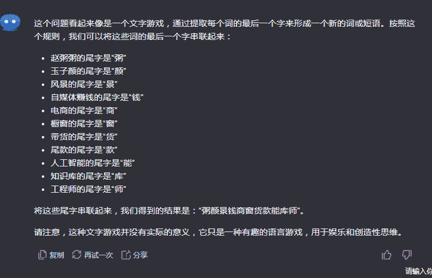

（注：该例子使用了 '|' 而非 '，'，是因为中文的逗号经常不被识别为分隔符）。

###### 结论

在具有 12 个词的字符问题上，思维链的准确率为 34％，而 LtM单一提示 的准确率为 74％。

##### 两个示例的意义

社群AI客服，本质是希望大家明白：

1.  将大任务分解成一个个的子任务，并逐步解决；

1.  情感激励提示，会极大提高提示词的效果；

正如AI提示的那样，尾字组词本身是个没有意义的游戏。但通过AI进行这个游戏，或许会让你发现一件事：原来，AI提示词的小改动，居然有这么大的变化。

1.  善于使用符号，会让你的指令没那么臃肿，同时达成更好的结果。（这一点非常重要，因为马上你会发现，指令中加入符号，会产生比市场上结构化指令更强的内容）

1.  最少到最多提示，串联你的输入输出。

1.  应用场景：对AI的限制性语句，适用于各类场景：例如数据分析中，每次都做增量输出；文案创作中，规范内容批量生产的变量和非变量。

**延伸思考：**

+   我们以后是否能将AI运用在社群客服之中呢？我们自己写出适合我们的AI客服来。

+   最少到最多提示法，如何运用在我们的工作流中？

##### //**示例：关键词向量分类**

问题：我现在有一批1万的关键词，该如何按照特性进行分类呢？

那么，我的要求就是将一批关键词转化为根据某一特性组成的一个个关键词序列。

可能经常和关键词打交道的伙伴脑海里已经有思路了，根据关键词中的词根手动在表格中分类，借助表格进行筛选，但事实上，对关键词的处理，还有一个方法：关键词向量分类。

> 关键词向量分类是一种基于自然语言处理（NLP）的技术。

> 它涉及到将文本数据中的关键词转换为数值形式的向量，然后利用这些向量进行分类。

> 这个过程通常包括以下几个步骤：数据收集——文本预处理——关键词提取——向量化——特征工程——分类模型训练——分类预测

> 备注：

> 向量化：将提取的关键词转换为向量形式。这通常通过词嵌入（Word Embedding）技术实现，如Word2Vec、GloVe或BERT等，它们能够将词语映射到高维空间中的点。

> 特征工程：构建特征向量，这可能包括关键词的向量、词频-逆文档频率（TF-IDF）等。

> 分类模型训练：使用特征向量训练一个分类模型，如支持向量机（SVM）、随机森林、神经网络等。

简单来说，如果没有AI，想要做关键词向量分类，是一个繁琐且十分具备技术含量的事情，你需要懂编程语言，Python的。

但有了AI，我们只需要写一个提示语，将关键词放入进去即可。这个在关键词筛选、关键词分类上，都有及其广阔的应用场景。无论是分析热点关键词、电商关键词分类、营销关键词分类等，都有很好的应用。

相信做过运营的大多有过数据清洗的经历，借助AI处理数据，也许在以后会成为SaaS、自己处理工具的常态选择。

//关键词向量分类

###### **第一次尝试：标准提示**

使用简单的标准提示，kimi的表现非常出色，但还不够出色。

出现明显的分类错误问题。例如“AI剪辑”不属于软件。

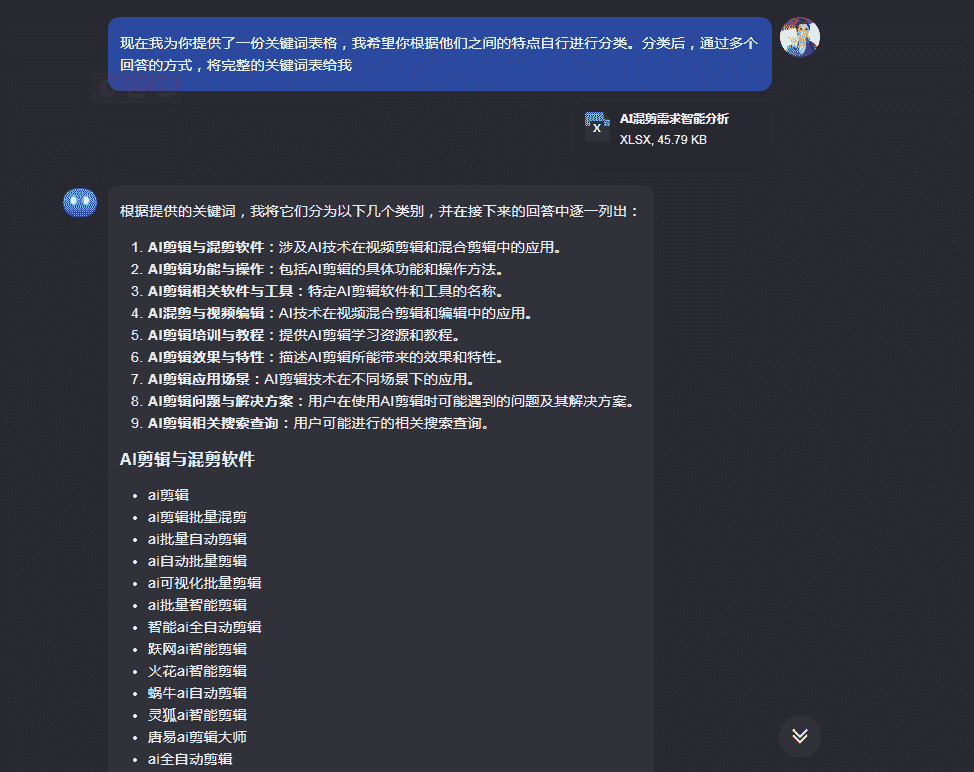

###### **第二次尝试：思维链**

思维链需要给出思考过程，让AI根据给出的思考过程，自动进行推导。

```
现在我为你提供了一份关键词表格，我希望你根据他们之间的特点进行分类。
特点：
1.同类型词通常包含同样的词组，例如：“ai自动批量剪辑”和“ai全自动剪辑”均包含“ai自动”，可创建分类：AI自动化，将这两个关键词放在AI自动化分类中。；
2.按照关键词内包含更多的词进行分类；
3.同时包含多个词组，可任选一个分类放置，关键词具有唯一性，放在一个词组内就不可以放在另一个词组；
4.充分理解关键词，将产品词单独放入一个词组。
分类后，通过多个回答的形式，将完整的分类关键词表给我。让我们一步一步思考，这件事至关重要
```

思维链的提示结果变得好了许多，他的分类更加清晰了，但好像仍然无法处理复杂的关键词序列。

也存在分类错误的情况。

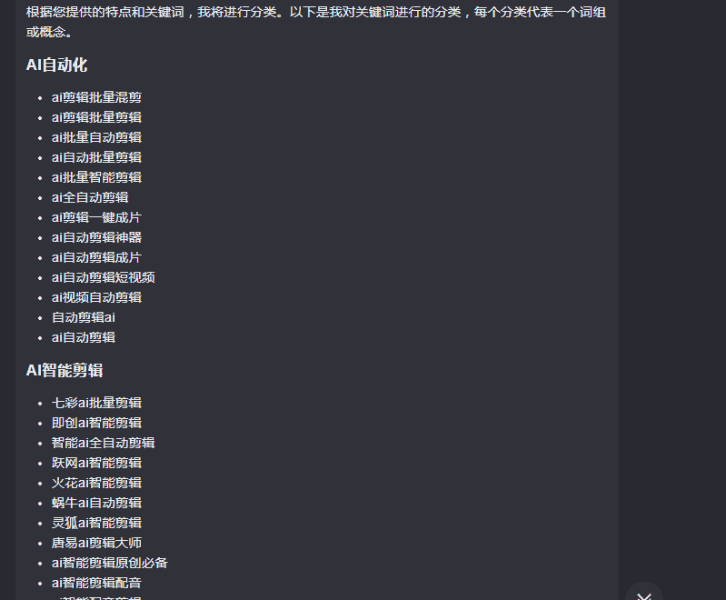

###### **第三次尝试：最少到最多提示**

将输入问题为一个序列，提供完整的思考流程，让AI跟着我们的流程去思考即可。将输入问题缩减为步骤序列。随后，将步骤序列映照到实际操作中。

```
现在我为你提供了一份关键词表格，我希望你严格按照下方表格样式分类：
|分类|关键词|
|AI自动化|ai自动批量剪辑|
|AI自动化|ai全自动剪辑|
|AI自动化|{严格执行,必须包含分类相关关键词}|
|AI批处理|{同理，严格执行,包含分类相关关键词}|
|……|……|
|AI产品|{ai产品词}|
|{关键词属性逻辑分类}|{一个关键词一行}|
通过多个回答的方式，将完整分类词表给我。让我们一步一步思考，这件事至关重要
```

从输出结果来讲，这个结果已经比上面的结果强许多了，而且还支持多轮回答。

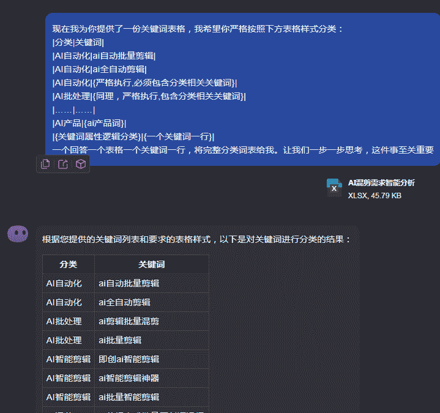

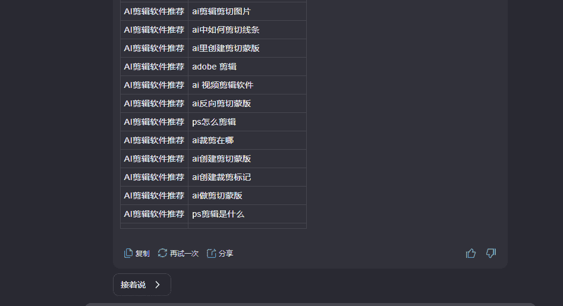

##### 结论

LtM最小到最多提示 带来了多项提升：

+   相对于思维链提高了准确性

+   在难度高于提示的问题上提升了泛化能力

+   在关键词序列向量分类的性能得到了显著提高。

> 同时，最小到最多提示有三个核心点：

1.  通过提示词，引导AI思考整个任务框架和环节。

1.  将一个个大任务，分解成小任务，去处理每个小任务模块；

1.  使用符号"{}"、"|"，能够起到限制，分割，引导等诸多作用。并且，由于Markdown格式输出问题，此类格式还可运用在表格化输出等方面。