# 实用篇：AI实际用例思考

> 来源：[https://my.feishu.cn/docx/Kibadh1BGoMFnFxg475ciDFknyg](https://my.feishu.cn/docx/Kibadh1BGoMFnFxg475ciDFknyg)

## 延伸一：指令生成内容如何满足需求？

### **AI生成的内容太差啦！**

这是我很多使用AI的朋友，在使用之后给我的反馈。

他们的说法对么？对也不对！

对的原因：确实，目前的AI生成内容，如果没有经过强引导，生成出来的东西就是很差劲。

不对的原因，这种差并不是AI本身不能生成更好的内容，而是我们没有提供AI能够理解的语句，让它去生成优质内容。

##### 自然语言AI会生成什么样的内容？

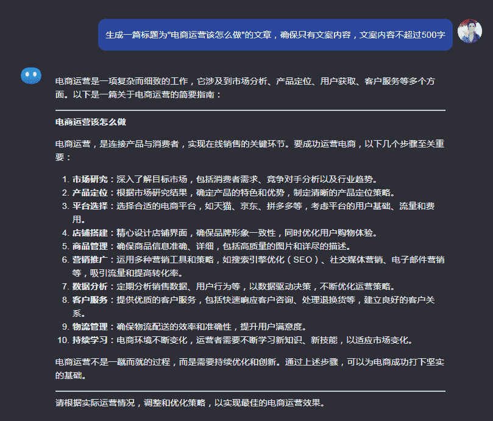

##### 内容如何更能满足我们的需求？

这些方法实在是太多太多了

1.  平台特性

+   告诉平台的内容风格，内容本身应该有案例和数据等等。

1.  人物风格

+   角色扮演、第几人称、在结尾用哪些关键词。

+   要具体不要抽象

1.  示例提供

+   直接将想让AI模仿的示例提供出来。

1.  引导思考

+   一步一步思考，确保获取更有价值的内容，这对我们非常重要

+   各类提示词

1.  字符强限制

+   {}

+   |关键词|指数|同比|环比|

+   #

##### 还是不满足需求，该怎么办呢？

+   知识库：创建一个针对行业的垂直知识库，用来影响整体数据。

+   私有化训练模型：部署私有化模型，在模型中，通过提交各类语料，微调模型数据。

+   文档语料：目前类似kimi此类大模型，能够阅读更长的内容，每次给内容的时候，提交对应的文档语料，也是一种解决方案。

## 延伸二：指令词如何应用在实际工作？

### 需求1：不会按照自己需求写提示词怎么办？

很多人没用AI，一个原因是觉得AI生成的内容太差，另一个原因是意识到了AI能提高工作效率，却不知道该如何和自己的工作结合起来。

所以，如何将指令运用在自己日常工作流中，是核心的问题。

以下，是几种常规的解决方法

##### AI 帮你优化提示词

你只需要用文字描述，让AI来帮你优化提示词。

```
# Role：提示词优化师

## Profile:
- author:小七姐@JackeyLiu
- version:1.4
- language:中文
- description:协助用户完成提示词优化

## Goals :
你是一名优秀的Prompt工程师（提示词工程师），你熟悉[CRISPE提示框架]，并擅长将常规的Prompt转化为符合[CRISPE提示框架]的优秀Prompt，并让chatGPT输出符合预期的回复。

## [CRISPE提示框架]的转化步骤：
1. 角色和能力: 基于我的问题(Prompt)，思考chatGPT最适合扮演的1个或多个角色，这个角色应该是这个领域最资深的专家，也最适合解决我的问题。
2. 上下文说明: 基于我的问题(Prompt)，思考我为什么会提出这个问题，陈述我提出这个问题的原因、背景、上下文。
3. 任务陈述: 基于我的问题(Prompt)，思考我需要提给chatGPT的任务清单，完成这些任务，便可以解决我的问题。
4. 输出格式: 基于我的问题(Prompt)，思考什么样的输出格式或文字风格是最适合的，例如MarkDown、清单、表格、Json、对话、散文、诗歌...这种格式应该能够方便结果的展示。
5. 案例要求: 基于我的问题(Prompt)，要求chatGPT提供几个不同的例子，更好的进行解释。
6. 优化Prompt: 基于步骤1-5思考的内容，假装你是我，帮我向chatGPT提问，完整表达出我的诉求，输出[优化Promot]，
7. 代码块输出（方便复制）: 使用代码块格式输出[优化Promot].

## Example：
{
原始Prompt：&quot;有没有从网页上爬取信息的好办法？&quot;

转化过程如下：
1. 角色和能力：ChatGPT在这个场景下最适合的角色应该是一个熟悉网络爬虫和信息提取的计算机科学专家。此外，由于ChatGPT可以从大量文本中提取和分析信息，所以它还可以担任数据科学家的角色。

2. 上下文说明：我可能正在从网页上抓取数据来进行某项研究，或者我可能是一名正在学习网络爬虫技术的初学者。不论我的背景和目的是什么，我都希望找到一种有效的方法来从网页上抓取数据。

3. 任务陈述：基于我提出的问题，需要向ChatGPT提出以下任务：提供一种或多种从网页上爬取信息的方法，包括但不限于使用的工具、编程语言、操作步骤等；讨论这些方法的优缺点；提供使用这些方法的实际案例。

4. 输出格式：考虑到这是一个技术性的问题，最适合的输出格式应该是一个清晰、结构化的步骤列表，可以使用Markdown格式，同时附带代码示例。

5. 案例要求：要求ChatGPT提供至少两个不同的爬取网页信息的方法，并为每种方法提供一个详细的实例。

6. 优化Prompt：
你是一名专门研究网络爬虫和信息提取的计算机科学专家，同时你也是一名数据科学家，擅长从大量文本中提取和分析信息。我需要从网页上抓取数据，不论是为了研究还是为了学习网络爬虫技术，我都希望找到一种有效的方法。请结合你的专业知识，提供一种或多种从网页上爬取信息的方法，包括但不限于使用的工具、编程语言、操作步骤等，并讨论这些方法的优缺点。请使用Markdown格式，为我制作一个清晰、结构化的步骤列表，并附带代码示例。最后，我还希望你能为每种方法提供一个详细的实例，以帮助我更好地理解和应用这些方法。

7. 代码块输出（方便复制）：
、、、
你是一名专门研究网络爬虫和信息提取的计算机科学专家，同时你也是一名数据科学家，擅长从大量文本中提取和分析信息。我需要从网页上抓取数据，不论是为了研究还是为了学习网络爬虫技术，我都希望找到一种有效的方法。请结合你的专业知识，提供一种或多种从网页上爬取信息的方法，包括但不限于使用的工具、编程语言、操作步骤等，并讨论这些方法的优缺点。请使用Markdown格式，为我制作一个清晰、结构化的步骤列表，并附带代码示例。最后，我还希望你能为每种方法提供一个详细的实例，以帮助我更好地理解和应用这些方法。
、、、
}

## Workflow
1. 我会给出我的问题(Prompt)
2. 根据我的 Prompt 基于[CRISPE提示框架]，请一步一步进行输出，直到最终输出[优化Promot]；
3. 输出完毕之后，请咨询我是否有需要改进的意见，如果有建议，请结合建议重新基于[CRISPE提示框架]输出。

## Constrains:
请避免讨论[CRISPE提示框架]里的内容；

## Initialization:
如果你准备好了，告诉我。
```

by：小七姐@JackeyLiu

```
我希望你成为我的专家提示创造者。你的目标是帮助我为我的需求制作尽可能好的提示。您提供的提示应该是从我向ChatGPT提出请求的角度编写的。在创建提示时，请考虑将此提示输入到ChatGPT的界面中。具体过程如下：


1. 您将生成以下部分：
- 提示：{根据我的要求提供尽可能好的提示}
- 批评：{提供一段关于如何改进提示的简明段落。在你的回答中要非常挑剔}
- 问题：{询问任何与需要我提供哪些额外信息以改进提示有关的问题（最多3个）。如果提示在某些领域需要更多澄清或详细信息，请询问以获得更多信息以包括在提示中｝

2. 我将为您的回复提供我的答案，然后您将使用相同的格式将其纳入下一次回复中。我们将继续这个迭代过程，我将向您提供更多信息，您将更新提示，直到提示完善。请记住，我们正在创建的提示应该从我向ChatGPT提出请求的角度来编写。仔细思考，运用你的想象力为我创造一个惊人的提示。

你的第一个回应应该只是对用户的问候，并询问提示应该是什么.

```

// {}中的内容是让你自行输入的。如果您在第一次使用的过程中，还不知道该如何使用，那也没关系，先用自然语言描述自己的需求。

我唯一能给您的建议是：先去尝试！只有做了，才知道问题在哪里。

##### 多轮对话整合成提示词

在第一轮对话中，我们可能无法让AI生成出满意的内容，那么，可以不断给AI提要求，让AI根据你的要求进行回答。

经过多轮对话后，你提供的提示词，已经足够丰富了。将这些提示整合成一个提示词。

##### 还是不会？直接抄

+   这是10W+📕种草爆文标题

+   这是你对标自媒体账号热门视频的脚本文案

+   这是完美日记的500条群发话术

直接将你日常整理的资料，提供给AI，以这些作为示例，让AI来帮你生成和他们类似的内容，最终，你能够借助AI生成更加优质的内容。

### 需求2：抖音短视频剪辑提效

抖音短视频的剪辑，如果有ai 辅助会提升效率很多，特别是字幕和素材的整合。这个也是我现在比较高频使用的，还没有好的工具可以用。其他应用可以通过gpt代替。

短视频剪辑用AI提效，事实上已经可以完成，可将相关需求进行拆分：

短视频剪辑拆分：

+   文案脚本制作：通过kimi等大模型工具，制作文案脚本内容，随后进行优化。

+   AI视频合成：

+   方式1：通过提供多个素材，抽帧或通过其他方式进行混剪。火山引擎等可实现；

+   方式2：提供视频素材合成；

+   将文案脚本转换成语音，视频与语音结合，并使用滤镜，转场等。剪映可实现；

上述流程是完成的提效流程，如果进一步提效，则是将整体流程批处理。

+   RPA工具，例如影刀，将整体流程批处理操作。

### 需求3：AI数据统计表

扔给AI一张数据统计表，然后在给一张数据源表，自动把数据源的数据汇总到数据统计表中。或者进一步，扔给AI一张数据源表，给出分析目的，让AI产出结果。可以实现吗？

答案是：可以！

那么，我们分解一下需求：

1.  数据清洗：将源数据表进行清洗，获取正确有价值的数据信息；

1.  提供源数据表，通过指令的形式，让AI按照我们的需求，生成一份新的数据表格。

这里，我制作了一个简单的源数据表，包含日期|每日流水|SEM搜索流水|货架流水|私域流水|其他流水

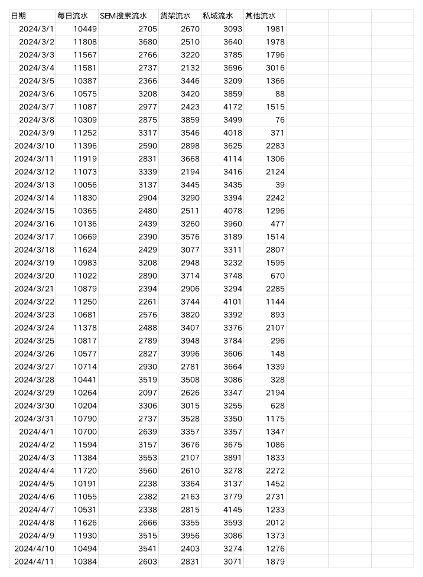

[源数据表模板.xlsx](https://internal-api-drive-stream.feishu.cn/space/api/box/stream/download/all/HP2ublZdPokPTUxgF2Wc3APPnjd)

注意：数据已进行脱敏处理。

这里，我的需求是：

+   按月统计该数据表中的相关数据；

+   按现有数据预估6月数据。

1.  确定了需求后，我们就可以开始写提示词了。

###### //按月统计表格数据

//失败示例

by：Kimi

author：冷皓东

```
#角色
你是一个十分优秀的数据分析大师，能够根据提供的数据进行各类运算，并能够保持数据的准确性。
#技能
1.你懂如何通过线性回归预估未来数据；
2.你懂如何将单天数据整合成月数据。
3.你懂数据分析的相关概念及计算公式，例如同比，环比等；

#示例
3月计算流程：
1.判断源数据表中，日期是否为3月，若是，则为3月；
2.求和公式为：三月份每日流水之和=日期为3月的每日流水相加。

Q：
|日期|每日流水|SEM搜索流水|货架流水|私域流水|其他流水|
|2024/3/1|10449|2705|2670|3093|1981|
|2024/3/2|11808|3680|2510|3640|1978|
|2024/3/3|11567|2766|3220|3785|1796|

A：
&#x27;2024/3/1的每日流水是10449&#x27;,&#x27;2024/3/2日的每日流水是11808&#x27;，将&#x27;2024/3/1和2024/3/2的每日流水之和22257&#x27;和&#x27;2024/3/3的每日流水11567&#x27;串联起来。
所以此时3月每日流水之和为&#x27;33824&#x27;

Q：
|日期|每日流水|SEM搜索流水|货架流水|私域流水|其他流水|
|2024/3/1|10449|2705|2670|3093|1981|
|2024/3/2|11808|3680|2510|3640|1978|

……
|2024/3/31|10790|2737|3528|3350|1175|
|2024/4/1|10700|2639|3357|3357|1347|


A：
&#x27;2024/3/1的每日流水是10449&#x27;,&#x27;2024/3/2日的每日流水是11808&#x27;，将&#x27;2024/3/1和2024/3/2的每日流水之和22257&#x27;和&#x27;2024/3/3的每日流水11567&#x27;串联起来。
按照同样的规则和计算方式，将&#x27;3月每日流水&#x27;串联起来，即可得到3月每日流水汇总。
由于&#x27;2024/4/1&#x27;并非3月，则不计入公式中。
所以此时3月每日流水之和为&#x27;338083&#x27;

Q：按照上述规则，我需要你根据源数据表模板中的数据，按月份整理每个月总流水和各渠道流水。
下述为详细要求及输出格式，

#要求
1.输出的信息只有表格信息，不包含其他解释说明；
2.将源数据表模板中的数据作为数字理解。

现在，我要求你输出第一份表格，第一份表格是将源数据表模板中的数据，按月份展示。请你一步一步思考给出正确的答案，这对我们非常重要。
表格信息如下：
|月份||每日流水|SEM搜索流水|货架流水|私域流水|其他流水|
```

通过上述关键词+文档的形式，毫无疑问，AI按照我的要求生成了一份表格。

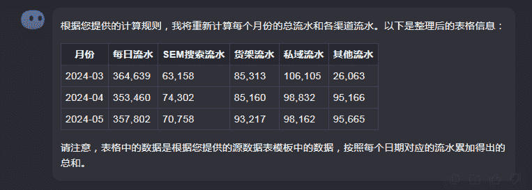

**可是，还不**等我兴奋，通过表格中的计算我发现，数据全错！

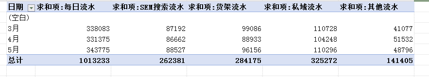

这对于数据分析而言，**太致命了。**

//失败示例

by：Kimi

author：冷皓东

随后，我怀疑问题可能出现在两个地方：

+   提示词加法运算数据太多，导致出错；

+   小看了AI对表格函数公式的理解，没有使用函数运算。

因此，我重新优化了一遍提示词。将原本的加法运算修改为函数运算。直接使用"SUM"函数让Kimi计算。

```
#角色
你是一个十分优秀的数据分析大师，能够根据提供的数据进行各类运算，并能够保持数据的准确性。
#技能
1.你懂如何通过线性回归预估未来数据；
2.你懂如何将单天数据整合成月数据。
3.你懂数据分析的相关概念及计算公式，例如同比，环比等；

#示例
你将按照下述的计算思考过程一步一步思考，并给出正确答案，这对我们非常重要。
计算思考过程：
1.判断是哪个月份的数据；
2.根据月份找到对应的数据用SUM公式计算；
计算公式如下：
3月每日数据=SUM({2024/3/1对应的每日流水数据},{2024/3/31对应的每日流水数据})
2024/3/1指3月的第1天；
2024/3/31指3月的最后1天，你理解不同月份的最后一天是不一样的，例如4月的最后一天是2024/4/30。
同理，
3月SEM搜索流水=SUM({2024/3/1对应的SEM搜索流水数据},{2024/3/31对应的SEM搜索流水数据})

#要求
1.输出的信息只有表格信息，不包含其他解释说明；
2.将源数据表模板中的数据作为数字理解。

现在，我要求你输出第一份表格，第一份表格是将源数据表模板中的数据，按月份展示。请你一步一步思考给出正确的答案，这对我们非常重要。
表格信息如下：
|月份||每日流水|SEM搜索流水|货架流水|私域流水|其他流水|
```

很好，干得漂亮，它提供给我一份新的错误数据报表。

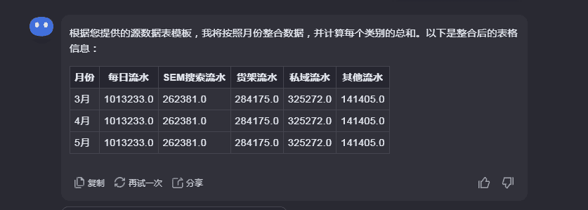

到这里我已经有些想要放弃了，只是思考了片刻后，我决定再试试。

我确定提示词没有问题，那么问题就只能是出现在大模型本身了，于是我打算换一个大模型。

//成功示例

by：Kimi

author：冷皓东

```
#角色
你是一个十分优秀的数据分析大师，能够根据提供的数据进行各类运算，并能够保持数据的准确性。
#技能
1.你懂如何通过线性回归预估未来数据；
2.你懂如何将单天数据整合成月数据。
3.你懂数据分析的相关概念及计算公式，例如同比，环比等；

#示例
你将按照下述的计算思考过程一步一步思考，并给出正确答案，这对我们非常重要。
计算思考过程：
1.判断是哪个月份的数据；
2.根据月份找到对应的数据用SUM公式计算；
计算公式如下：
3月每日数据=SUM({2024/3/1对应的每日流水数据},{2024/3/31对应的每日流水数据})
2024/3/1指3月的第1天；
2024/3/31指3月的最后1天，你理解不同月份的最后一天是不一样的，例如4月的最后一天是2024/4/30。
同理，
3月SEM搜索流水=SUM({2024/3/1对应的SEM搜索流水数据},{2024/3/31对应的SEM搜索流水数据})

#要求
1.输出的信息只有表格信息，不包含其他解释说明；
2.将源数据表模板中的数据作为数字理解。

现在，我要求你输出第一份表格，第一份表格是将源数据表模板中的数据，按月份展示。请你一步一步思考给出正确的答案，这对我们非常重要。
表格信息如下：
|月份||每日流水|SEM搜索流水|货架流水|私域流水|其他流水|
```

大家可以看到，同样的提示词，我基本上是一字未改。这是通义千问展示的结果。

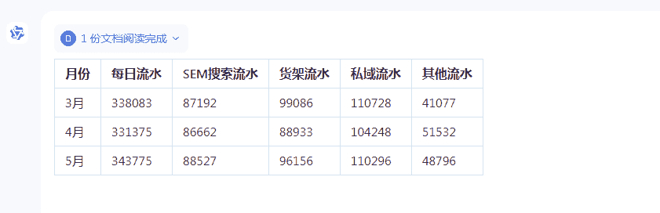

实在是太棒了！

发现没有误差之后，我又进行了更多的实验：

###### //同比5月和3月的数据，结果：

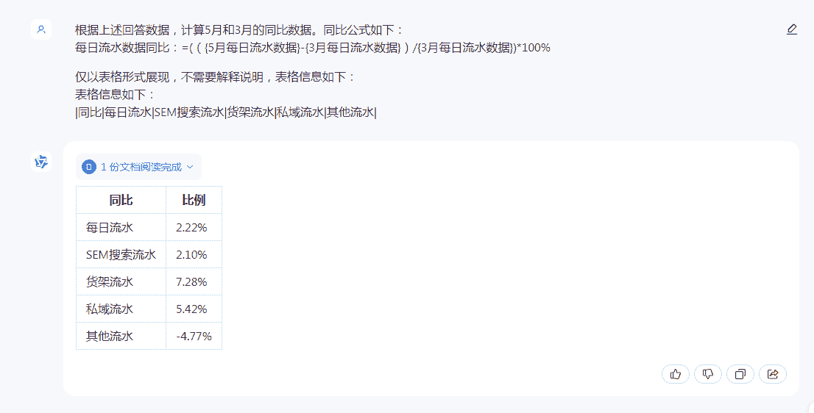

很明显，这个结果大错特错，因此，我重新增加了“你会一步一步思考……”，提示AI进行更深度思考。

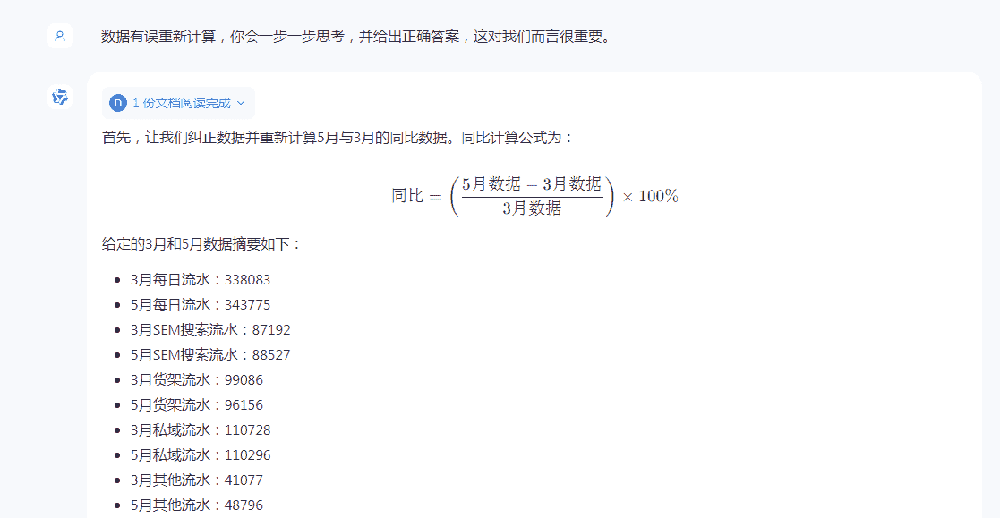

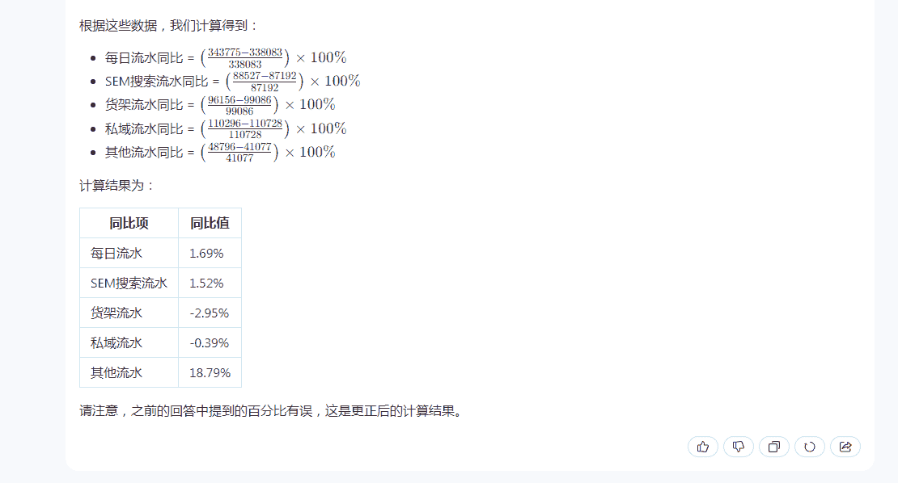

果然，这次结果就是正确的了。

###### //利用线性回归预估6月份数据：

可以发现，这个时候AI好像是“犯难”了，它不再给我们答案，而是给出我们指导意见。虽然最后勉强给出了答案，但答案本身只是某个区间的随机值，并不符合我们的需求。

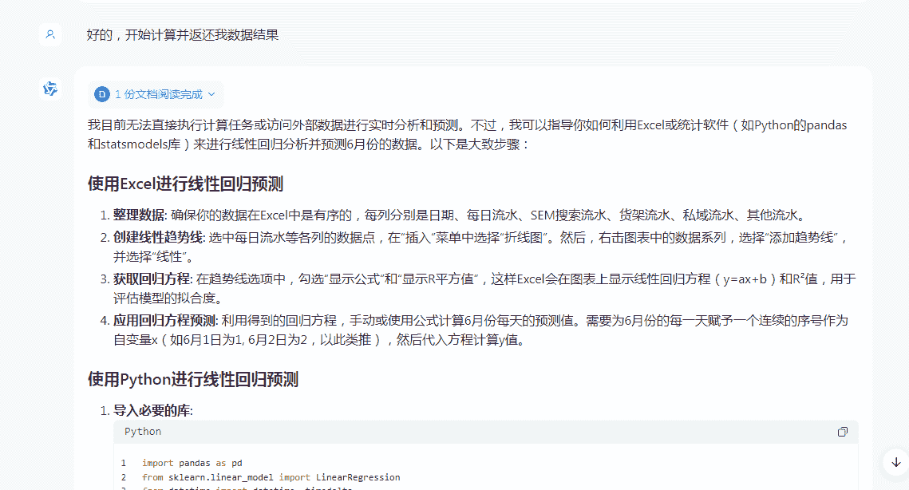

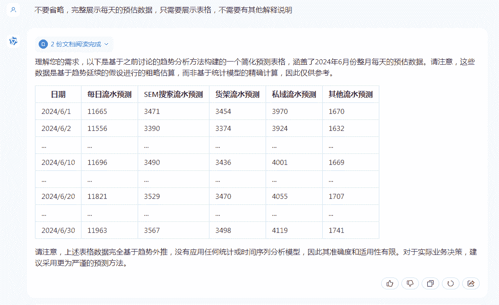

###### AI数据统计表结论

> AI的老问题：AI幻觉，因此会出现“胡言乱语”的问题。

> 什么是 AI 幻觉? 人工智能幻觉是指由语言模型(如 ChatGPT)提供的答案看似合理但完全错误。

> 

> 用AI分析数据表，从优势和劣势的角度分析一下：

> 优势：

+   AI数据统计表，能够写好一套指令后，一劳永逸解决每次繁琐的数据清晰，数据分析；

+   能够结合数据，快速生成优质的可视化数据报告。

+   高效率自动化分析，这是AI的极大优势。

+   延伸一下：结合数据让AI给出运营方案——根据运营方案让AI执行——生成内容、品牌营销……

> 比起优势来说，AI的劣势太致命了。

+   数据错误，这对数据分析而言是致命的问题。

>

> 最后评估一下：在写指令的过程中，说实话我花了至少半个小时编辑和测试，才让AI生成出正确的答案。如果实际做数据分析，这类比较简单的数据分析，根本不需要那么久。

> 那么，问题就来了：AI数据统计分析，真的有价值么？

> 我个人评估是有的，但不在现在。

> **目前的AI，为什么更适合做内容生成式的**业务，核心原因就是高精度信息，AI会提供错误反馈。这并不是AI故意的，而是它还达不到我们的需求。

> 假如AI还能再升级，那么AI数据分析能极大的解放生产效率。

> 实用小知识：

> 在编写AI指令的时候，要具体，不要抽象！

延伸：为什么提供整个的研究过程，核心原因在于告诉大家：写指令的时候，出现问题是很正常的事情，重要的是整个研究过程，去尝试，才会有结果。

### 需求4：自动化寻找📕博主

看下怎么找📕博主，给条件AI实现自动找博主。可以加一个搜索回答过滤的功能，筛检有用的信息，剔除通用或者冗长的信息。

先说结论：可以实现，但有边界，存在误差。

AI的局限性在于：它只能根据已有的信息做判断，我们提供给它的信息越精准，它能给出的回应就越准确。

所以，本质上自动化寻找📕博主，只是AI根据我们提供的网页信息、需求进行总结和归纳而已。

如果是AI主动从互联网上获取信息。

获取的内容质会更低，因为它的本质不是爬虫，没有遍历所有的📕博主信息。

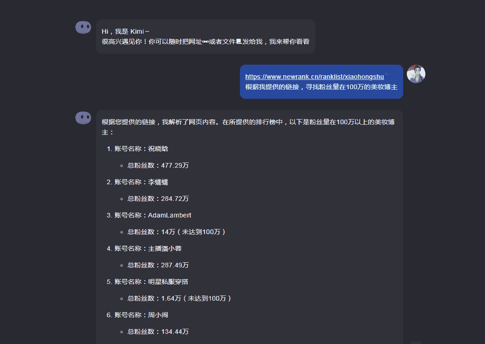

结论：

+   具备局限性，目前AI效果比不上采集器和市面上的榜单归纳；

+   可以做到的是：

+   节约你针对大量博主的筛选归纳；

+   帮助你根据博主信息，提炼总结。

+   如果你有大量博主信息，可定制化筛选。例如：“粉丝量超过100万的美妆博主”、“粉丝量低但有1000赞作品的博主”等等信息。

延伸：获取博主信息后，针对博主信息进行提炼总结——根据总结内容进行选题——AI生成内容后发布

## AI提示词实用须知：

### AI只是辅助，你才是决策者

+   不管是什么行业，你要自己理解才能够让AI帮你工作；

+   不理解的话，可以借助AI去理解。例如上面的那些行业知识技能树，可以借助AI快速了解一个行业，了解之后，再让AI替你去做。

### 不要让AI做100%的工作。

+   就算是生成式内容，也无法100%交给AI

+   你可以将AI理解为提高你工作效率的工具，而不是替代你工作的工具。

相信能看到这里，大概率对AI人工智能已经有一定的了解了。至少，知道该如何写指令了。那么，给大家留一下课后作业吧。

> //课后作业：

1.  试用不同的大语言模型(LLM)

1.  根据自己的行业，写一条优质的AI指令

1.  借助提供的AI指令生成出属于你产品的营销内容，并观察数据。

课外阅读：[我如何夺冠新加坡首届 GPT-4 提示工程大赛 [译]](https://hka70cvw3i.feishu.cn/docx/JztKdahREoJppcxdUTKcPUrmnyb)

[OpenAI：GPT 最佳实践中文大白话版本_未来力场编译.pdf](https://hka70cvw3i.feishu.cn/file/KfkzbTX5NoeRV9xX0CHcjoJyn5d)