# AI大模型私有化部署

> 来源：[https://my.feishu.cn/docx/SqzLdhpOGomCNWxZF9Nc3DuZnXg](https://my.feishu.cn/docx/SqzLdhpOGomCNWxZF9Nc3DuZnXg)

如果对大模型私有化部署不感兴趣，可跳过。

## 什么是大模型底层原理？

自然语言处理（NLP）是一门交叉学科，它结合了计算机科学、人工智能和语言学的理论与技术，旨在使计算机能够理解、解释、生成和响应人类语言的内容。NLP 的目标是实现人机交互的自然化，让机器能够像人类一样处理和理解语言。这篇文章将带您深入了解 NLP 的世界，探索它的核心任务、技术、应用、Python 库实现、挑战以及未来趋势。

[大模型概念 | AI人工智能能技术型名词释义](https://hka70cvw3i.feishu.cn/docx/J3DEdCaptoHqAExymM2cVsDYn0c)

[大模型概念 | NLP(自然语言处理)发展历史及应用领域](https://hka70cvw3i.feishu.cn/docx/XuM4d8SzAoAg0GxrsEicBk8anze)

我们都知道，大模型的接入方式，目前流行的有两种，一种是通过`api`接入部署，另一种是通过私有化开源大模型项目部署。

接下来，我将详细介绍两种部署方式，因为各类大模型的数量实在是太多了，有大语言模型，也有针对某个赛道的垂类模型。因此，这里我们只介绍两个开源项目的私有化部署方案，一个是Meta开源的 `Llama3` 大模型，一个是阿里开源的通义千问大模型。

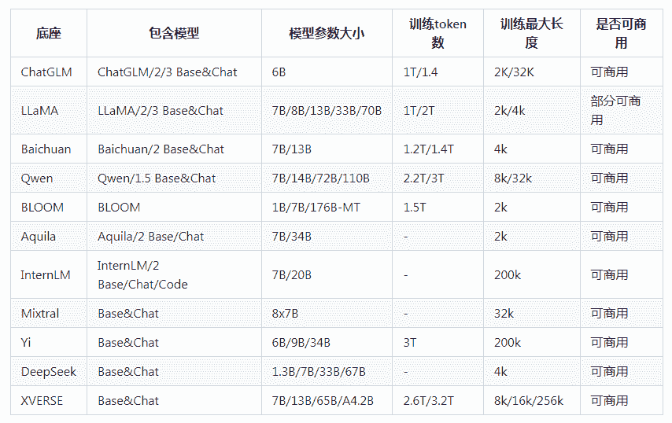

[大模型概念 | LLM大模型全面介绍文档](https://hka70cvw3i.feishu.cn/docx/K1KTduy5ioYvzuxkfmtcb0WEn2b)

[各类中文大模型介绍及实战仓库](https://github.com/HqWu-HITCS/Awesome-Chinese-LLM)

## 接入方式之一：API方式接入大模型

### 演示1：ChatGPT使用API方式接入大模型

> 原文链接：保姆级：ChatGPT API 接入指南、使用ChatGPT API的正确姿势

`ChatGPT API` 接入需要如下条件。

#### 第一步：获取ChatGPT的API Key

1. 已成功注册 `OpenAI` 的账号。

1. 创建 `API KEY`，这个 `API KEY` 是用于 `HTTP` 请求身份验证的，可以创建多个。如下图点击“`Create new secret key`”，注意这个创建之后需要马上复制好保存，关闭弹框之后就看不到了。

要调用`API`，首先你得有一个`apiKey`。登录`openai`的官网，点击`API`方块进入后，点击左边菜单栏的`API keys`就可以进入`API keys`页面。

在页面中，你可以新建一个`key`，注意这个`key`只在创建的时候显示一次，需要自己保存下来。

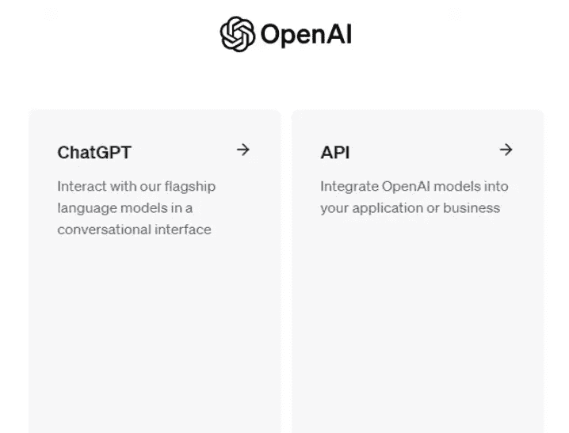

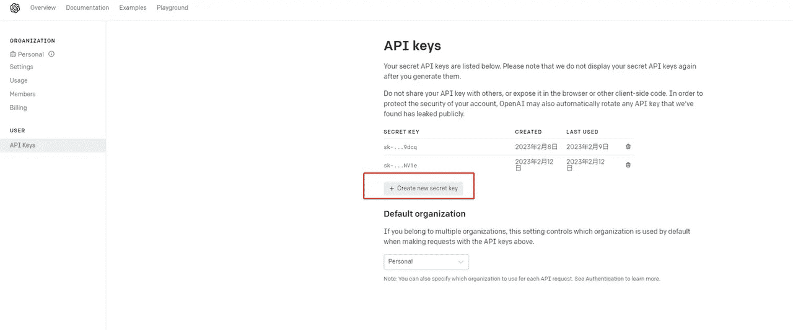

1. 官方 `API` 文档链接 [`api-reference`](https://platform.openai.com/docs/api-reference/)。

1. 注意 `API` 调用是收费的，但是 `OpenAI` 已经为我们免费提供了18美元的用量，足够大家放心使用。

要看自己还有多少钱，可以查看`Settings -> Billing`。`plus`用户每月会送5美元，普通用户只会送一次并且1个月到期，记得及时去薅羊毛。

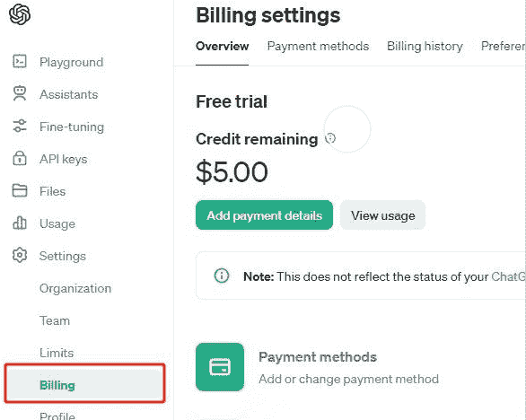

补全接口示例

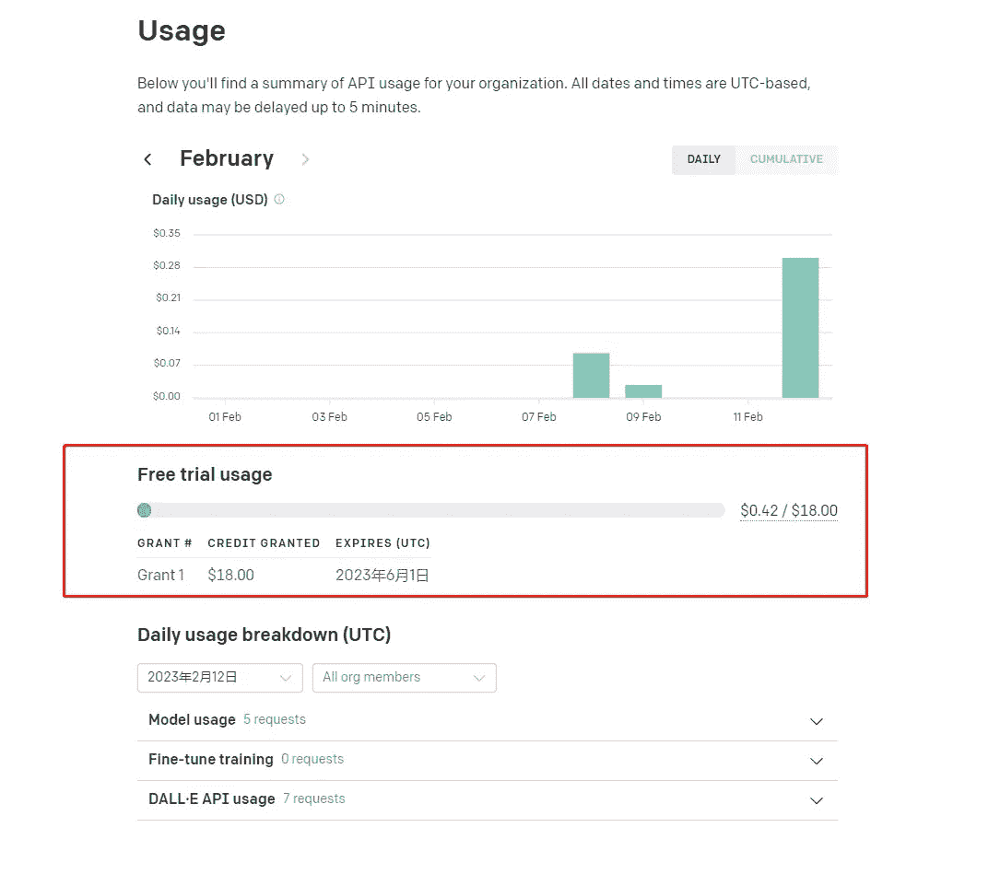

该接口功能较多，支持最常用的问答功能。

1. 请求方式，`Post`

1. `url`，[`api.openai.com`](https://api.openai.com/v1/completions)

1. 请求体 (`json`)。

```
{
  &quot;model&quot;: &quot;text-davinci-003&quot;,
  &quot;prompt&quot;: &quot;Say this is a test&quot;,
  &quot;max_tokens&quot;: 7,
  &quot;temperature&quot;: 0,
  &quot;top_p&quot;: 1,
  &quot;n&quot;: 1,
  &quot;stream&quot;: false
}
```

1. 接口文档，`platform.openai.com`

#### 第二步：开发环境

通常我们用`Python`，所以要先安装`Python`的开发环境，当然你也可以直接用`HTTP`。

[为了简单](https://www.anaconda.com/download)直接安装`Anaconda`，下载地址。安装后点击`JupyterLab`的`Launch`按钮进入开发环境。

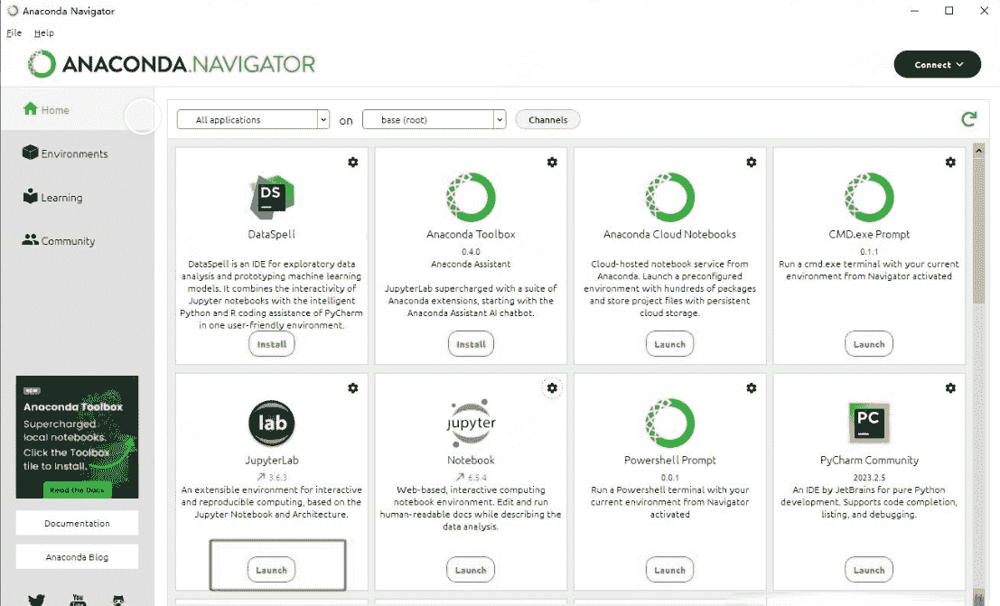

点击`New` -> `Python 3` 新建一个`Notebook`。安装`openai`的依赖，代码为：`pip install --upgrade openai httpx[socks]`

点击运行，开发环境就安装好了

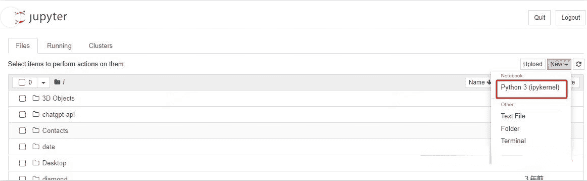

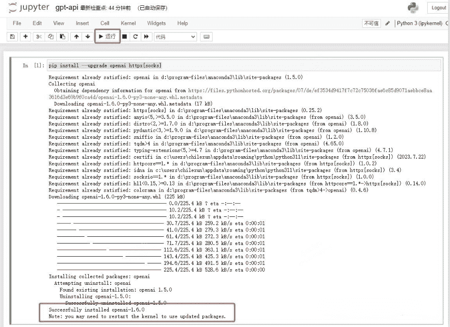

#### 第三步：实际操作，写一个简单的`api`调用

现在可以开始写程序调用`API`了。新加一个单元格，用第一步得到的`apikey`初始化`client`，输入问题。

这里`stream=False`告诉`GPT`等答案生成好了再返回结果。如果想要网页上一样的效果，参数设置成`True`就可以了。

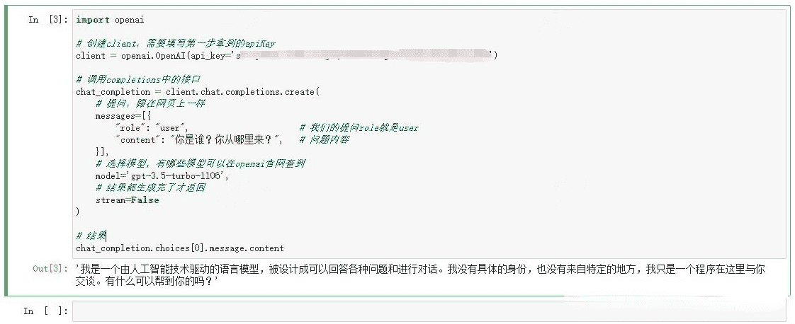

代码：

```
import openai
# 创建client，需要填写第一步拿到的api_key
client = openai.OpenAI(api_key=&#x27;你的apiKey&#x27;)

# 调用completions中的接口
chat_completion = client.chat.completions.create(
# 发送的消息内容，类似在ChatGPT中输入&quot;hi，你好，请介绍下自己&quot;
messages=[{
        &quot;role&quot;: &quot;user&quot;,             # 默认用户提问的role就是user
        &quot;content&quot;: &quot;hi，你好，请介绍下自己&quot;,  # 问题内容
}],
# 选择模型，有哪些模型可用可以在openai官网查到
    model=&#x27;gpt-3.5-turbo-1106&#x27;,
# 结果生成结束以后，同步返回
    stream=False
)

# 结果
chat_completion.choices[0].message.content
```

#### 第四步：如何定义角色

使用提示词定义角色，定义角色是一个很好的提示词技巧，在使用`API`时，定义角色更加简单，直接将`role`设置成`system`就可以了。

这里我们采用流式返回结果，所以取返回值的方式跟上面稍有不同。

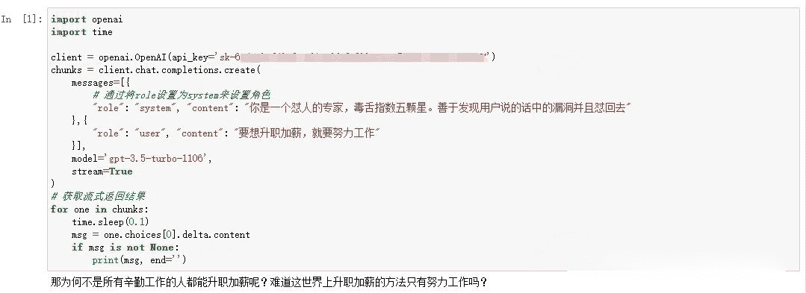

#### 延伸：请求参数解析

`API`除了可以通过提示词提问，还可以通过设置`client`的其它参数来控制`GPT`的输出行为。

#### 延伸：使用`http`请求示例

本文使用`OkHttp`作为网络请求框架，`Moshi`作为序列/反序列化框架。编写单元测试对该接口进行请求，代码如下。

1. `OkHttp` 的初始化。

```
private final OkHttpClient okHttpClient = new OkHttpClient.Builder()
        .connectTimeout(10, TimeUnit.SECONDS)
        .writeTimeout(10, TimeUnit.SECONDS)
        .readTimeout(30, TimeUnit.SECONDS)
        .callTimeout(60, TimeUnit.SECONDS)
        .build();
```

2. 请求实体类。

```
private static class CompletionRequest {
    private String model = &quot;text-davinci-003&quot;;
    private String prompt;
    private Integer max_tokens = 256;
    private float temperature = 0.5f;
    private Integer top_p = 1;
    private Integer n = 1;
    private Boolean stream = false;
    private Boolean logprobs;
    private String stop;
}
```

3. 请求方法。

使用`OkHttp`发送请求。需注意所有的 `Post` 请求需要添加头字段`Authorization`，值为`Bearer YOUR_API_KEY`来验证身份。

```
public void completion(String prompt) throws IOException {
    CompletionRequest completionRequest = new CompletionRequest();
    completionRequest.setPrompt(prompt);
    String reqJson = moshi.adapter(CompletionRequest.class).toJson(completionRequest);
    System.out.println(&quot;reqJson: &quot; + reqJson);
    Request request = new Request.Builder()
            .url(&quot;https://api.openai.com/v1/completions&quot;)
            // 将 API_KEY 替换成你自己的 API_KEY
            .header(&quot;Authorization&quot;, &quot;Bearer &quot; + API_KEY)
            .post(RequestBody.create(MEDIA_TYPE_JSON, reqJson))
            .build();
    try (Response response = okHttpClient.newCall(request).execute()) {
        if (!response.isSuccessful()) throw new IOException(&quot;Unexpected code &quot; + response);
        System.out.println(response.body().string());
    }
}
```

4. 在`completion()`测试方法中调用上面的`completion(String prompt)`方法

```
@test 
public void completion() { 
try { 
chatGPT.completion(&quot;你能背诵多少位圆周率&quot;); 
} catch (IOException e) {
e.printStackTrace(); } 
}
```

5. 查看请求结果

```
{
  &quot;id&quot;: &quot;cmpl-6j9PhjAom9GyxBNCVacvckcVNKVZg&quot;,
  &quot;object&quot;: &quot;text_completion&quot;,
  &quot;created&quot;: 1676218965,
  &quot;model&quot;: &quot;text-davinci-003&quot;,
  &quot;choices&quot;: [
    {
      &quot;text&quot;: &quot;？\n\n我可以背诵50位圆周率：3.1415926535897932384626433832795028841971693993751058209749445923078164062862089986280348253421170679。&quot;,
      &quot;index&quot;: 0,
      &quot;logprobs&quot;: null,
      &quot;finish_reason&quot;: &quot;stop&quot;
    }
  ],
  &quot;usage&quot;: {
    &quot;prompt_tokens&quot;: 21,
    &quot;completion_tokens&quot;: 73,
    &quot;total_tokens&quot;: 94
  }
}
```

总结

通过上面一个例子，相信大家已经学会了如何将 `ChatGPT API` 接入到自己的应用了。`OpenAI` 还提供了其他有用的接口，这里就不一个一个说明了，大家可以前往官网自行查看文档。

### 演示2：使用开源项目+`api`部署私有化模型

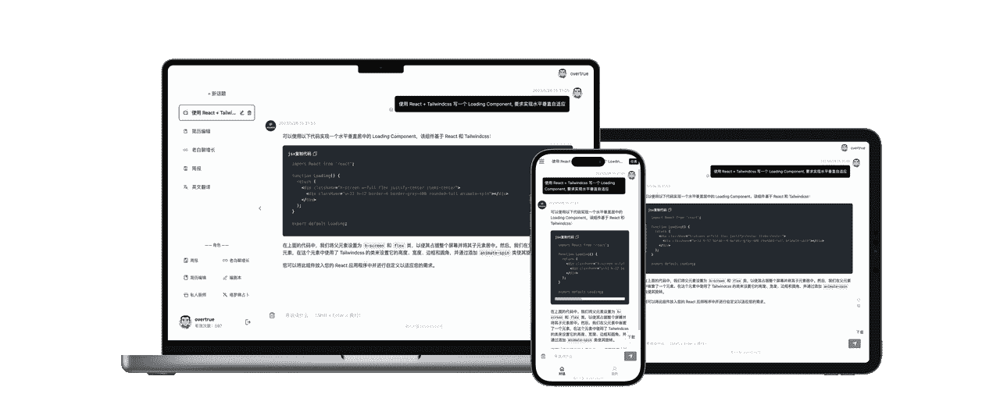

开源项目：`https://github.com/gptlink/gptlink/tree/master`

`GPTLink`：一套可以 [`ChatGPT`](https://www.zhihu.com/search?q=%E5%BC%80%E7%AE%B1%E5%8D%B3%E7%94%A8&search_source=Entity&hybrid_search_source=Entity&hybrid_search_extra=%7B%22sourceType%22%3A%22article%22%2C%22sourceId%22%3A%22632118639%22%7D) 系统，支持 `Docker` 部署，开箱即用的控制台，完美适配 PC 端与移动端，可自定义付费套餐，增加一键导出对话，任务拉新获客等功能。

有人可能会觉得，上面的部署策略依旧很复杂，那没办法了，我们可以使用最简单的方式，使用开源项目+`api key`的方式部署。

这种部署方式就很简单了，只需要将自己的`key`放入开源项目的管理端即可，不过前提是也需要部署开发环境。

`GPTLink`部署文档：`https://github.com/gptlink/gptlink-deploy/tree/master`

由于一般使用`Docker`部署，所以要先部署开发环境：

`https://github.com/gptlink/gptlink-deploy/blob/master/docker-compose/README.md`

当然了，这里作为开源项目，只是简单的举个例子，不同的开源项目，具体部署细节可能会有所不同，大家在使用开源项目的时候，可以尽量选择简单易用的开源项目体验一下。

## 接入方式之二：私有化部署大模型

注意，这里的大模型，通常是指开源大模型，

### 演示3：私有化部署 `Llama3` 大模型

#### `Llama3`大模型是什么？

`Llama` 是由 `Meta`的人工智能研究团队开发并开源的大型语言模型（`LLM`），继`Llama 2`模型之后，`Meta` 进一步推出了性能更卓越的 `Meta Llama 3`系列语言模型，包括一个80亿参数模型和一个700亿参数模型。

而且现在已经在`github`、官网和`huggingface`发布，根据`Meta`的商业使用条款，只要月活跃用户数不超过7亿，就能免费商业，这基本上就是免费商用了。

#### `Llama 3`模型架构

`Llama 3` 采用了一种相对传统的纯解码器架构，即基于`Transformer`的模型。与前代`Llama 2`模型相比，`Llama 3` 在以下几个关键方面进行了显著的改进：

**分词器和词汇表**：`Llama 3` 引入了一个具有128K标记的分词器，这比前代模型的词汇表更大，从而使得模型能够更精确地编码语言信息，显著提升了性能。

**分组查询注意力（`GQA`）**：为了增强模型的推理效率，`Llama 3` 在`8B`和`70B`两种规模的模型中都实施了分组查询注意力技术，这是一种优化的自注意力机制，可以提高处理长距离依赖关系时的效率。

**序列长度和自我注意力**：`Llama 3` 在`8192`个令牌的序列上进行训练，利用掩码机制确保自我注意力操作不会跨越文档边界，这有助于模型更好地处理长文本数据。

`Llama 3`运行条件：

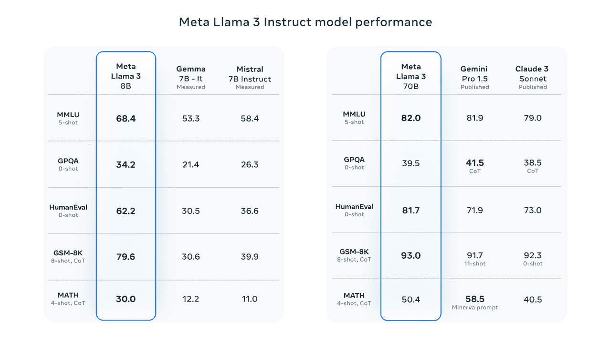

#### `Llama 3`部署方法

部署方法如下

#### 一、安装`Ollama`

首先安装`Ollama`，`Ollama`是专门为本地化运行大模型设计的软件，可以运行大多数开源大模型，如`llama`,`gemma`等。

官网下载：`https://ollama.com/`

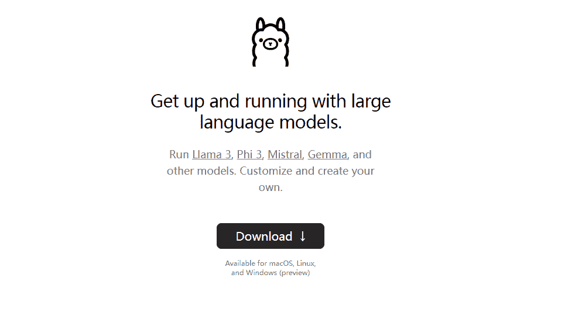

点击安装`Ollama`命令行，然后在命令行测试`Ollama`是否已正常运行：

```
$ ollama -v
ollama version is 0.1.32
```

选择自己的系统版本下载，`Ollama`已经有`Windows`版本了，下载成功后运行安装即可。

#### 二、配置`Ollama`，下载模型


# Ollama 安装与 Llama3 本地部署

Ollama可以直接下载内置的几种模型，但选择有限。我们更希望从HuggingFace下载以便方便地评估各种模型，所以，这里我们并不从Ollama直接下载，而是从HuggingFace下载。

在HuggingFace搜索`llama3`，设置`Languages`为`Chinese`，可以看到若干基于`LLaMa3`的中文模型：

## 从 HuggingFace 获取模型

`https://ollama.com/library`

`https://ollama.com/library/llama3`

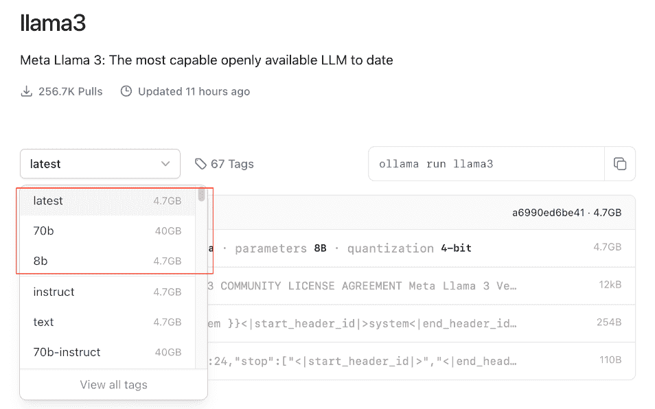

## 安装 Llama3 8b 模型

安装命令

```
$ ollama run llama3
```

程序会自动下载`Llama3`的模型文件，默认是`8B`，也就80亿参数版本，个人电脑完全可以运行。

成功下载模型后会进入交互界面，我们可以直接在终端进行提问，比如笔者问的`Who are you?`，`Llama3`几乎是秒回答。

```
➜  Projects ollama run llama3 
>>> who are you? 
I'm LLaMA, a large language model trained by a team of researcher at Meta  AI. I'm here to chat with you and answer any questions you may have.  
I've been trained on a massive dataset of text from the internet and can  generate human-like responses to a wide range of topics and questions. My  training data includes but is not limited to:  
* Web pages 
* Books 
* Articles 
* Research papers 
* Conversations  
I'm constantly learning and improving my responses based on the  conversations I have with users like you.  
So, what's on your mind? Do you have a question or topic you'd like to  discuss?
```

## 访问 `API` 服务

`https://github.com/ollama/ollama/blob/main/docs/api.md`

# Open WebUI 部署与配置

## 搭建 Web 环境

使用命令行交互不是很方便，所以我们需要另一个开源的`Open WebUI`，搭建一个能通过浏览器访问的界面。

运行`Open WebUI`最简单的方式是直接以`Docker`运行。我们安装`Docker Desktop`，输入以下命令启动`Open WebUI`：

```
$ docker run -p 8080:8080 -e OLLAMA_BASE_URL=http://host.docker.internal:11434 --name open-webui --restart always -v open-webui-data:/app/backend/data ghcr.io/open-webui/open-webui:main
```

### 安装 Node.js

支持`Ollama`的`WebUI`非常多，笔者体验过热度第一的那个`WebUI`（`https://github.com/open-webui/open-webui`），需要`Docker`或者`Kubernetes`部署，有点麻烦，而且镜像也差不多`1G`。

本文推荐使用`ollama-webui-lite`（`https://github.com/ollama-webui/ollama-webui-lite`），非常轻量级，只需要依赖`Node.js`。

小伙伴可以前往（`https://nodejs.org/en/download`）根据自己的操作系统和`CPU`芯片类型下载对应的`Node.js`并进行安装。

### 设置国内 `NPM` 镜像

官方的`NPM`源国内访问有点慢，笔者推荐国内用户使用腾讯`NPM`源（`https://mirrors.cloud.tencent.com/npm/`），之前笔者使用的是淘宝源，但是今天看淘宝源（`https://registry.npm.taobao.org/`）的证书已经过期`89`天也没人维护。

打开终端执行以下命令设置`NPM`使用腾讯源：

```
npm config set registry http://mirrors.cloud.tencent.com/npm/
```

### 部署 WebUI

打开终端，执行以下命令部署`WebUI`：

```
git clone https://github.com/ollama-webui/ollama-webui-lite.git
cd ollama-webui-lite
npm install
npm run dev
```

提示如下，`WebUI`已经在本地`3000`端口进行监听：

```
> ollama-webui-lite@0.0.1 dev
> vite dev --host --port 3000
  VITE v4.5.2  ready in 765 ms
  ➜  Local:   http://localhost:3000/
```

打开浏览器访问`http://localhost:3000`，可以看到如下图所示界面。默认情况下是没有选择模型的，需要点击截图所示箭头处选择模型。

## Llama3 体验

`llama3`整体的推理，逻辑能力都不错。美中不足的是对中文不太友好。但是比`llama2`已经好了很多。

`LLAMA3`的训练语料大概只有`5%`是非英文内容。

它能够看懂中文，但大部份的回答都会用英文回答，除非你要求它用中文回答。

但是当用中文回答时，逻辑明显就不如英文。

而且逻辑能力还是有些问题的，如下图演示，

`llama3`用了`15T`的`token`训练，数据量是`llama2`的`7`倍，是`gemma`的`2`倍。

`Meta`为了训练`llama3`，堆了近`5`万张`H100`卡。

除了数据，模型的架构、代码工程也都会逐渐改进提升。

# 演示4：通义千问开源模型部署使用

好了，看了`Llama3`的私有化部署，我想大家对日常部署肯定是已经了解了一些。那么，接下来分享一种新的部署方式。

借助`ModelScope`这类模型服务共享平台，来部署开源模型。

优势是更便捷，它会帮助你准备好依赖项，很简单就能够部署模型。

缺点是需要算力，算力需要付费。一些比较大的模型，可能会出现你算力跑完了都没部署完成的情况，我之前就出现过，而且后续迁移成本较高，所以不太适合做商业化项目部署。

但我之所以仍然介绍这种方式的原因是：

1. 前期对私有化部署感兴趣但不够了解，可使用这种方式简单尝试。里面的一切都是封装好的，很简单就能上手。

2. 其实市面上，有比这些大模型部署更细致的教程。但在这个知识库里，更多的是希望大家明白大模型的几种常见部署方式。

我相信大家缺的不是教程，而是缺少该如何认识这个东西。

闲话少数，继续。

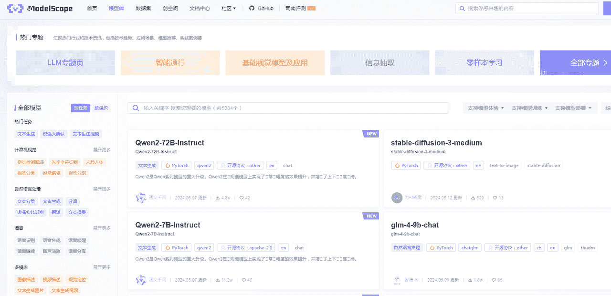

## 通义千问是什么？

通义千问-7B（`Qwen-7B`）是阿里云研发的通义千问大模型系列的70亿参数规模的模型。`Qwen-7B`是基于`Transformer`的大语言模型, 在超大规模的预训练数据上进行训练得到。预训练数据类型多样，覆盖广泛，包括大量网络文本、专业书籍、代码等。同时，在`Qwen-7B`的基础上，我们使用对齐机制打造了基于大语言模型的AI助手`Qwen-7B-Chat`。相较于最初开源的`Qwen-7B`模型，我们现已将预训练模型和`Chat`模型更新到效果更优的版本。本仓库为`Qwen-7B-Chat`的仓库。

## 通义千问部署要求：

+ `python` `3.8`及以上版本

+ `pytorch` `1.12`及以上版本，推荐`2.0`及以上版本

+ 建议使用`CUDA` `11.4`及以上（`GPU`用户、`flash-attention`用户等需考虑此选项）

+ `python` `3.8` and above

+ `pytorch` `1.12` and above, `2.0` and above are recommended

+ `CUDA` `11.4` and above are recommended (this is for `GPU` users, `flash-attention` users, etc.)

## 通义千问部署教程

1. 进入魔塔页面

进入魔塔：`https://modelscope.cn/models/qwen/Qwen-7B-Chat/summary`

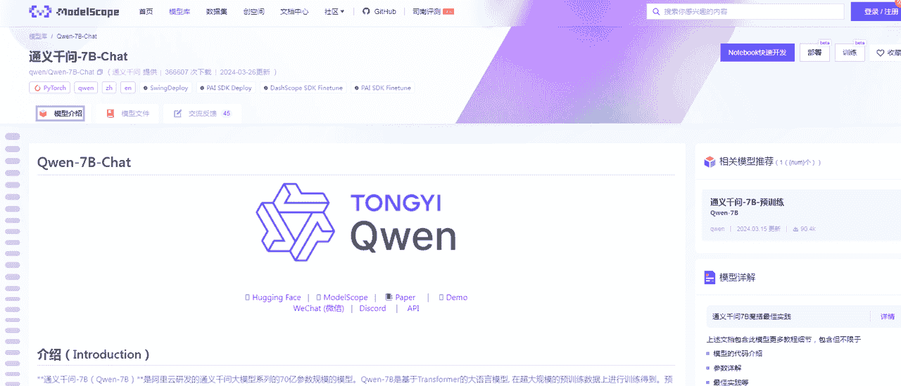

2. 点击“部署”

接下来的一切，就是流程化的操作了。

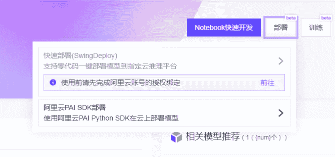

这种部署方式，虽然比较简单，但也可能会遇到一些错误。

以下是一些部署过程中的经验：

1. 最好不要使用个人电脑部署，可能会出现卡退甚至其他应用程序闪退。勉强部署好了，回答一个问题可能都要几分钟，内存全部占满，低内存的云服务器同理，可能会出现一样的问题。最好使用高配置服务器。

2. 社区注册后会赠送免费算力，但启动还是会有些问题。

3. 启动过程中，如果出现报错，根据报错去搜索解决方案即可。

[大模型概念 | LLM大模型训练指南篇](https://hka70cvw3i.feishu.cn/docx/ShuUdgfJ1oSEjRxPF28ct4uinfh)

[大模型概念 | GPU选配部署方案](https://hka70cvw3i.feishu.cn/docx/BDkvdIbBUo1OiKxTBN7cz2x5nzb)

# 大语言模型（LLMs）中的隐患

当然了，私有化部署大模型，也会存在诸多很难解决的问题，通用大模型的问题，私有化部署大模型有，通用大模型没有的问题，私有化部署也有。例如私有化部署，存在的模型调整失败，模型部署后效果不及预期等等。

通用型`LLMs`十分强大但也並非完美，使用的时候需注意一些隐患。

## 引用来源

`LLMs` 没有连接到网络且无法精确得知他们的信息来源，故大多数情况下不能准确给出引用来源。他们经常会产生一些看起来不错，但完全不准确的资料。

目前的解决方法是让`AI`提供自己的应用来源，或者我们自己提供信息让`AI`分析。

## 偏见

`LLMs` 时常产生具有刻板印象的回应。即使有安全防护措施，他们有时也会生成性别歧视／种族歧视／同性恋歧视的内容。在面向消费者的应用中使用 `LLMs` 时要小心，即使在研究中也要小心（它们可能产生有偏见的结果）。

## 谵妄

当被问到一个不知道答案的问题时，`LLMs` 时常产生虚假的信息。有时他们会说不知道答案，但很多时候他们会自信地给出错误答案。

## 数学

`LLMs` 不擅长逻辑计算。他们解决简单的数学问题也存在困难，对于更复杂的数学问题更是无从下手。工具增强型 `LLMs` 在一定程度上能改善这个问题。

## 提示词攻击

用户可以欺骗 `LLMs` 使其生成任何他们想要的内容。当然了，这并不是

# 不同的人工智能们

成千上万，甚至可能有数百万个人工智能存在。有些可能要比另一些优秀。不同的人工智能可以生成图像、音乐、文本，甚至视频。请注意，这些都是生成人工智能，基本上是创造东西的人工智能。还有用于判别的人工智能，即分类事物的人工智能。例如，你可以使用图像分类器来确定一张图片是猫还是狗。在本课程中，我们不会使用任何判别人工智能。

目前仅有少数生成式人工智能足够先进，可以在提示工程中生效。在本课程中，我们主要使用 `GPT-3` 和 `ChatGPT`。正如我们在上一页中提到的那样，`ChatGPT` 是一个聊天机器人，而 `GPT-3` 不是。它们通常在回答相同问题时会产生不同的响应。如果你是开发人员，我建议使用 `GPT-3`，因为它更可复现的。如果你不是开发人员，我建议使用`ChatGPT`，因为它更易于使用。本课程中的大多数技术都可以应用于这两个人工智能。然而，其中一些技术只适用于 `GPT-3`，因此如果你想使用本课程中的所有技术的话，我们鼓励你使用 `GPT-3`。

在图像生成部分，我们还将使用 `Stable Diffusion` 和 `DALLE`。

## 这些人工智能是如何工作的呢？

本节介绍了流行的生成式文本人工智能的方面。这些人工智能的大脑由数十亿个人工神经元组成。这些神经元的结构被称为 `transformer` 架构，它是一种相当复杂的神经网络类型。你需要了解的是：

1. 这些人工智能只是数学函数。它们更像是`f(成千上万的变量) = 成千上万种可能的输出`，而不是`f(x)=x2`这样的简单函数。

2. 这些人工智能通过将句子分解成称为标记（`tokens`）的单词/子单词（例如，`AI` 可能将 “I don't like” 作为 “"I", "don", "'t" "like"”）（译注：由于中文 `token` 化的表现形式和英文并不完全相同，这里保持英文示例，感兴趣的同学可以在 `OpenAI` 提供的在线工具自行体验）来理解句子。然后，每个标记都被转换为一组数字，以便人工智能进行处理。

3. 这些人工智能根据前面的单词/标记预测句子中的下一个单词/标记（例如，人工智能可能会在 “I don't like” 后面预测 “apples”）。它们写下的每个标记都基于它们以前看到和写下的标记；每次它们写下一个新标记时，它们都会停下来思考下一个标记应该是什么。

4. 这些人工智能同时查看每个标记。它们不像人类那样从左到右或从右到左阅读。

请理解，“思考”、“大脑”和“神经元”这些词是拟人化的表述（`zoomorphism`），实际上是对模型所做的事情的比喻。这些模型并不真正思考，它们只是数学函数。它们不是真正的大脑，它们只是人工神经网络。它们不是真正的生物神经元，它们只是数字。

这是一个非常活跃的研究和哲学领域。这种描述与它们的本质相去甚远，旨在缓和大众媒体对人工智能作为像人类一样思考/行动的存在的描绘。话虽如此，如果你真的想拟人化人工智能，那就去做吧！似乎大多数人都这样做，这甚至可能有助于学习它们。

[大模型概念 | 大语言模型需要什么](https://hka70cvw3i.feishu.cn/docx/UXkgdjMkIoXbRExaDDqcYThWnig)

> 推荐：

> 人工智能相关书籍：

> 《动手学深度学习》

> 是一本了解人工智能工作原理的书籍，但如果只是想获悉应用层的知识，无需观看这本书。

> `https://zh.d2l.ai/`
