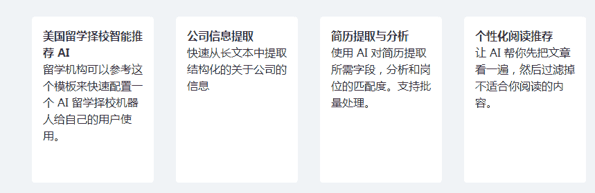

# AI案例篇：生成式AI应用案例

> 来源：[https://my.feishu.cn/docx/ZTcXd8VEoo47trxFhhlc3NXAnst](https://my.feishu.cn/docx/ZTcXd8VEoo47trxFhhlc3NXAnst)

### 内容生成式应用案例

#### **图片绘本故事**

+   使用AI技术重新绘制三国连环画，轻松赚取收益！

+   1分钟教你利用ChatGPT+Midjourney做小红书！月入2w+!

+   人工智能AI助你月入万刀！制作儿童动画视频，轻松实现短视频赚钱和创业梦想！

+   在家轻松搬砖赚钱，全程AI操作，手把手教你如何制作民间故事视频赚取丰厚收益！

+   [AI 儿童绘本工作流 |AI工作流实验之儿童绘本](https://hka70cvw3i.feishu.cn/docx/ZSFwd5fY6oCg9vx39EZciXgAn4d)

+   AI工具制作儿童英语学习动画片，实操演示保姆级全套课程

+   [1个免费黑科技！1条视频860w+播放量](https://mp.weixin.qq.com/s/hqKhHl1z8-9dfDZcZAptqQ)，用AI制作特效大片，看完这篇你也会了！

#### AI美女

+   AI美女跳舞的制作方法来了！视频清晰，动作丝滑，快来体验 - 抖音

+   AI动漫美女跳舞视频，纯原创支付宝视频，私域+支付宝分成，稳定500+

#### 自媒体账号

+   利用AI做神话故事账号，粉丝猛涨5.6万，商单变现1万+

+   最新讲解老人脸特效引流方法，日引流100+，制作简单，保姆级教程

+   单日收益四位数的Ai姓氏头像项目_哔哩哔哩_bilibili

+   制作AI视频打爆流量，一条视频变现5种收益，小白也能日入300+

+   视频号春节玩法 利用AI一键生成财神爷视频 百分百原创 引爆春节流量 日入2k

+   [1分钟自动做动漫解说视频，用Artflow A](https://mp.weixin.qq.com/s/ReqRlyVxOxjtkwDHM8eCew)I做英语口语故事，小红书7天涨粉1.9万

+   AI一键生成剧情动漫爆文项目

+   AI一键生成科目三视频项目

+   Ai视频新思路，AI一键处理，操作简单，100%过原创，单视频热度上百万，双向多平台变现

#### 内容导流

+   AI智能应用百科立即落地实操

#### 虚拟人口播

+   AI数字人媒体账号：发X图在ins上，吸引5000粉丝实操教程

+   最新视频AI数字人玩法，快速涨粉！流量巨大！【喂饭级教程】

### 产品工具技术案例

+   AI一键成片官方版不违规不封号工具全免费

+   最新声音克隆技术，可自用，可变现，日入300+

+   开发数据产品+AI产品通关上岸

+   AI网站推广新玩法，月月躺赚1万加

+   数据产品+AI产品 通关上岸，创建能带来商业价值的AI产品，学习AI产品开发

+   免费AI口播工具推荐！数字人本地部署教程

+   一分钟AI帮你搞定年终总结PPT

+   比沙漠还干的喂饭级教程---光影字，艺术字，二维码的融合

### 知识付费（包括资源售卖）

#### Midjourney

+   Midjourney入门到精通 AI绘图作画教学

+   Midjourney 绘画关键词+配图 12000+

+   零基础ai插画就业实战班第20期

+   Midjourney AI：从零基础到高级版的大师班教程-中英字幕 英文+中英字幕|1080P

+   Midjourney及ChatGPT4人工智能生成艺术图像综合指南-9节课-中英字幕

+   Midjourney AI人工智能创建和销售令人惊叹的海报教程-10节课-中英字幕

+   利用 Midjourneys Ai 人工智能设计自己的服装AI大师班-10节课-中英字幕

+   Midjourney关键词-解锁AI绘画专业级人工智能摄影关键词表

+   Midjourney关键词-AI生成中国风古装汉服美女人像提示关键词

+   玩赚midjourney-AI绘画从0到高手【素材+答疑+直播信息】

#### Stable diffusion

+   Stable Diffusion商业化训练班，Al绘画商业应用课程，AI绘画入门到精通

+   Stable diffusion零基础课程

+   Stable Diffusion 101：使用 AI 创建自定义动漫艺术教程-17节课-中英字幕

+   利用Stable Diffusion AI人工智能生成动漫艺术分步教程-14节课-中英字幕

+   Stable Diffusion 大师班: 利用AI创建艺术图像及视频-31视频课-中英字幕

+   2023年Diffusion商业化训练班

+   stable diffusion-系统课程：0基础系统性学习AI绘画，小白也能轻松上手

#### AI Agent

+   2024Ai必会 Agent(应用解读+项目实战)，一站式搞定Agent应用（71节课）

+   李一舟：人工智能2.0

#### AI 编程

+   0基础Python趣味AI项目，紧跟趋势、趣味Al、强化编程能力（13节课）

#### AI入门教学

+   AI家长必修课 做AI时代第一批智慧父母 助力亲子育儿技能提升

+   0基础AI入门实战(深度学习+Pytorch) 通俗易懂/0基础入门/案例实战/跨专业提升

+   AI学习班2.0：从菜鸟到学霸，夯实基础从干货到硬货，重在应用（17节课）

+   使用Adobe Firefly AI人工智能转变您的图像创造力教程-18节课-中英字幕

+   AI人工智能应用通用实操营，40节AI赋能课，让AI给工作生活提速

#### AI生成式教学

+   【全套教程】AI虚拟模特电商图实战：StableDiffusion为电商图优化赋能

+   AI图文带货训练营：抖音电商新人0基础学，几张图文能赚1.4w+

+   AI写作变现

+   2024年AI辅助摄影人工智能商业应用摄影课程（37节课）

+   AI图文带货小红书入门到精通

+   外面卖399元mj软件ai绘图项目，含剪辑，特效，文案，账号运营（配套齐全）

+   AI合成商业实战班2023年AIGC

+   商业设计应用班01期AIGC课程

+   AIGC商业实战课，让AI成为你的人生合伙人，做跨越周期的超级个体！

+   Ai图文带货项目课，一部手机利用AI一键生成原创作品（22节课）

+   AI数字人爆款视频创作实战课，一个人一部手机·素人小白0基础上手

### 知识付费_工作流

+   AI写作4.0，条条原创，多平台发布，轻松日入1000+

+   天选打工人-用AI高效交付工作，用ai提高工作效率，实现摸鱼！

+   AI超级实操课：零基础新手到大神，掌握ai绘画玩法与变现

+   用AI高效交付工作提升效率

## 想借助AI做副业怎么玩？

### **如何开始副业最稳妥**

1.  做内容搞流量，而不是做产品去卖。搞来流量，流量自然需要产品，找到别人的产品，合作促成交，就可以赚到钱。

1.  别自己做产品，但可以和别人合作

+   OEM贴牌：去贴牌别人的产品，或者把自己的产品当做产品给别人贴牌。

+   分销：如果你自己有产品，可以让别人来一起玩，分销是个好模式，玩的人越多，你赚得就越多。贴牌别人的，也可以去分销给其他人。分销本质是一个让利原则。

1.  前期少花钱，尽量花时间。花钱是高效买认知快速执行的过程，但最好别轻易花钱，有的人卖的东西不值那个价。花点时间，可能你想要的都有。

1.  做资产而不是卖时间，同样的一个视频，你卖给1个人只能获得1份钱，但你发到自媒体平台，多少个人看到，有多少人付费你就有多少份钱。

1.  抓住主流：为什么现在AI生成内容这么火？因为主流就是各个自媒体平台啊，普通用户是看视频，但你想做可以看生意。

1.  做垂类而不做平台，如果你想做一个产品，请足够垂直。做GPT套壳的那么多，你很难脱颖而出，但增加一个垂类，你就能被人所知道。比如桌面版GPT？或者自媒体GPT？或者AI女友GPT聊天？当然，还是那句话，哪怕是垂类也有问题，做产品投入时间长，可能赚不到钱。

### **已验证的一些AI技术赚钱方案**

##### **1、****套壳站**

无论是GPT套壳站，还是MJ套壳站，基本思路就是做个站点，然后搞成SaaS或者支持私有化部署贴牌的，然后几千块一套往外卖给想赚钱的小老板。他们自己去搞流量挣钱。 这种套壳站，往往都离不开分销系统。

##### **2、API聚合**

做API封装的，把各类LLM或者AI能力，缝合成API，支持开发者快速调用，省去了自己海外结算账单，部署转发服务器这些错综复杂的事情。 这个主要就是中间商赚差价，找一些号贩子弄点儿便宜的API账号，然后按照比官网低的价格再卖出来，但要持续维护各个版本的变化，以及各种做调度控制，其实还是挺累的。

##### **3、发卡站**

各种开源发卡站，自动卖GPT账号，很多号贩子在群里卖账号，都不知道有这些东西。搞个发卡站给他们都能赚钱。。

##### **4、聚焦的AI工具**

比如AI写论文，AI自动自媒体发布，AI证件照，把AI能力聚焦到某一个领域或者某一个人群的特定需求上。 这个领域有个特点，必须要刚需才可以。足够聚焦，就会带来力量。

##### **5、模型训练**

帮甲方做模型训练，这个生意也挺多的，但是不好交付。因为国内的模型效果上很可能达不到甲方要求。

> 不知道大家看了那么多AI赚钱方案，是否已经有些热血澎湃想要入场了？

> **请慎重。**

> AI这个圈子里，目前的现实是，应用层依旧很难赚钱的。

> 上面的这些，是我看过或听过的一些赚钱手法，甚至还不止，还有什么卖账号，卖课之类的，总有人有赚钱的方法，但并不代表每个人去都可以。

> 你只看到别人赚钱，却不知道别人使用了什么资源。

> 之所以分享，只是告诉大家：目前AI的一些玩法，也许对你运用AI有一定的启发！