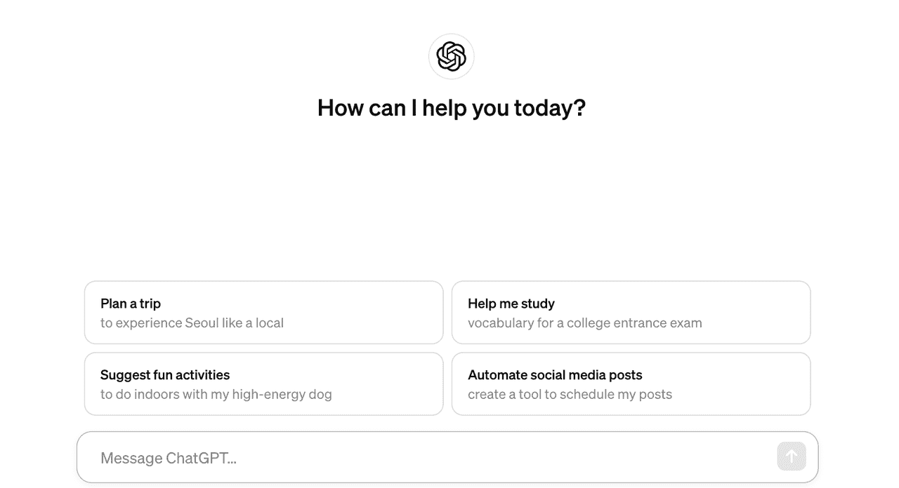
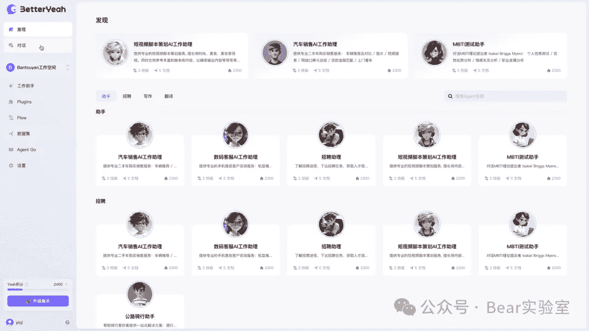
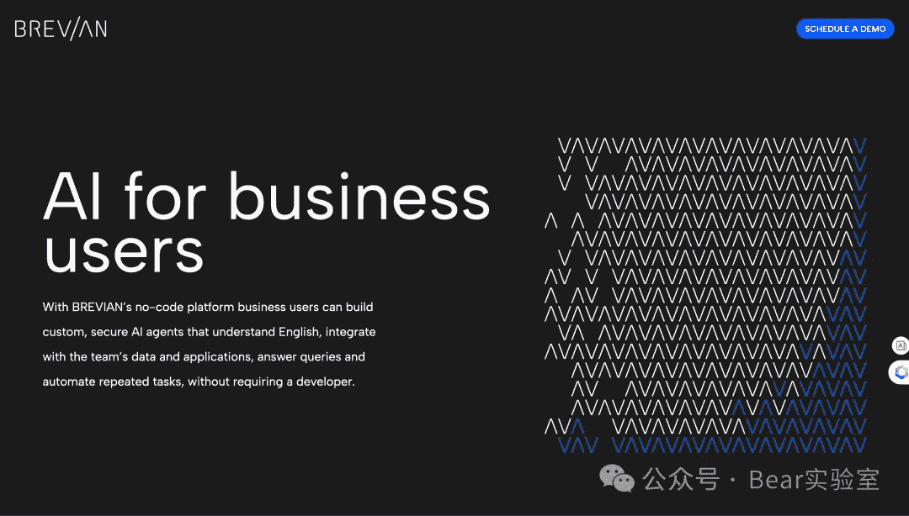
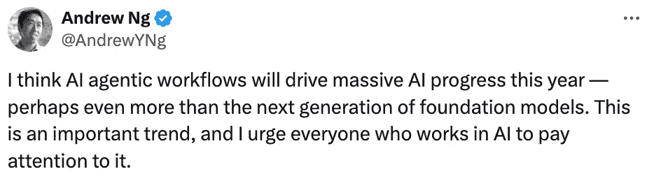
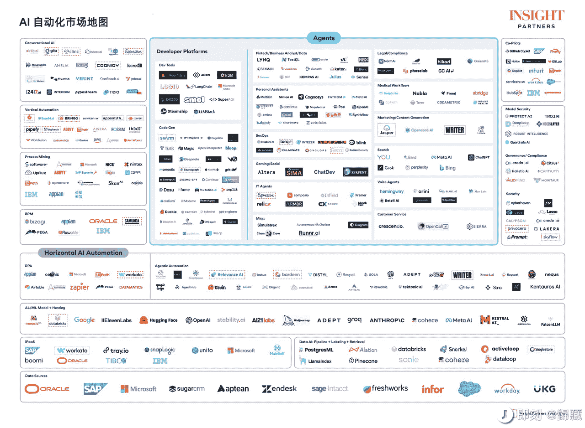
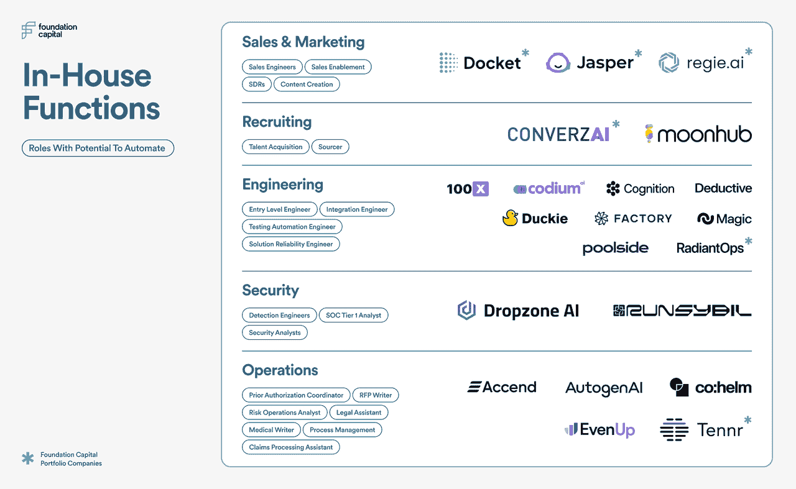
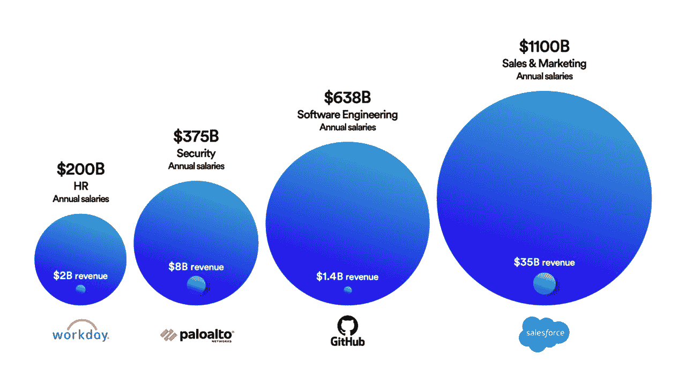
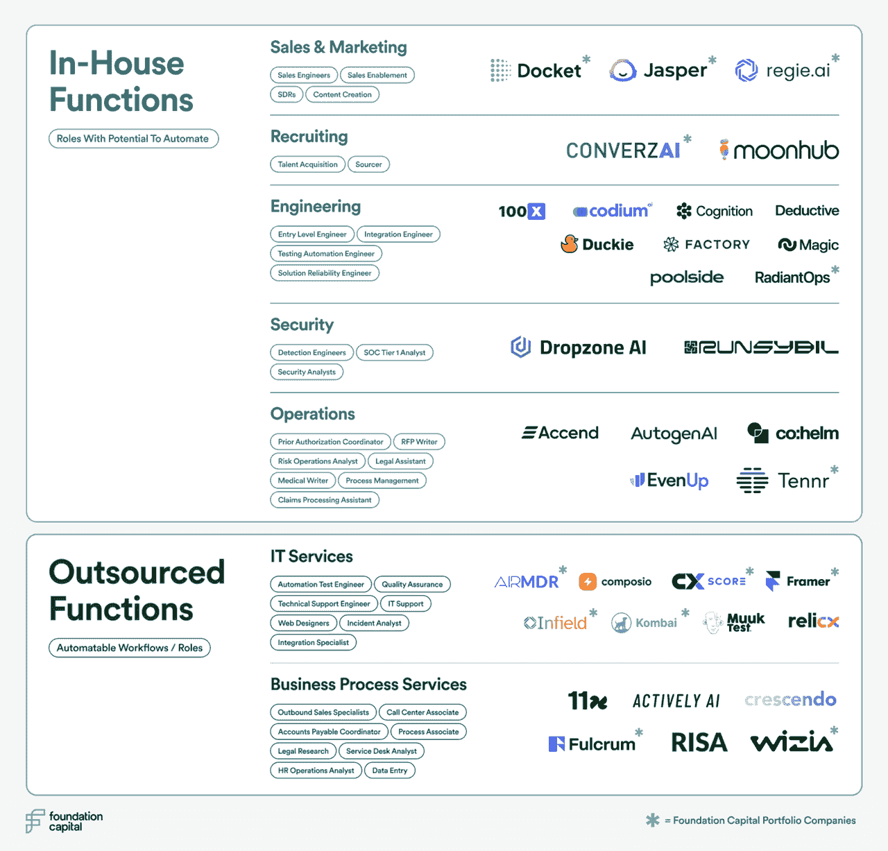

# AI实用篇：智能体和AI商业化

> 来源：[https://my.feishu.cn/docx/HrSidmckmoXCNBxyCtdcUH9On0c](https://my.feishu.cn/docx/HrSidmckmoXCNBxyCtdcUH9On0c)

# RAG（**Retrieval Augment**ed Generation，检索增强生成）系统

介绍RAG系统之前，咱们需要了解一下，预训练，微调和检索增强生成这三个概念。

简单来说，你日常积累了许多行业垂类知识，并且你认真观看完了，这个就是预训练(Pre-training)，通常来说，通用大模型的基础能力就止步于此。

但你**逐步精深发现，自己掌握的知识不**够系统化，更深度的知识自己也还没掌握，于是你针对之前预训练的知识，花了几个月的时间，掌握这些知识，做了更多补充和完善，让这个知识库的内容更丰富，更有价值，这个过程就可以说完成了一轮微调(Fine-Tuning)，好了，恭喜你，现在你可以对外说，你是一个可以垂直领域大模型了。

但是，不对劲啊，几个月时间太久了，我想偷个懒可不可以呀？

当然可以，我们准备了速成的方式。就是以你之前积累的行业垂类知识，再在你身边放更系统化、专业化的资料。这样，你不知道就可以翻书看看。虽然你没掌握这些知识，但你需要的资料都在身边，你也能得到更专业的答案。

而这个过程，就是**检索增强生成(RAG)**。

众所周知，LLM（大预言模型）在处理特定领域或高度专业化的查询时，仍表现出明显的局限性，常见问题就是产生不正确的答案，即AI幻觉。

检索增强生成（Retrieval-Augmented Generation，简称RAG）是一种结合了信息检索和生成模型的技术。其主要目的是通过从外部知识库中检索相关信息，并将这些信息作为上下文输入到大型语言模型（LLM）中，从而提高生成内容的准确性和相关性。

可以看出，RAG系统主要解决的，就是生成内容不精细化以及AI幻觉这些问题。

### **基本概念与架构**

RAG系统通常包括两个阶段：首先是检索阶段，其次是生成阶段。

检索阶段，系统会利用向量数据库或其他检索算法找到与用户查询相关的文档或信息片段。

生成阶段，这些检索到的信息被用作上下文，以指导LLM生成更准确、更丰富的回答。

### **技术实现**

1.  **数据准备**：包括数据拆分、向量化、查询重写和查询路由等关键步骤。

1.  **向量化**：将文本数据转换为向量形式，以便于在向量数据库中进行高效检索。

1.  **查询重写**：为了提高检索效果，对原始查询进行优化和调整。

1.  **查询路由**：根据查询内容选择合适的索引或数据库进行检索。

### **应用场景**

RAG技术应用领域广泛，包括但不限于问答系统、聊天机器人、文本生成和数据对话等领域。

例如，问答系统中，RAG可以先从非参数记忆中检索相关文档集，再通过大语言模型生成准确的回答。此外，RAG还能够处理多模态数据，如图像、音频和视频，进一步拓展其应用领域。

在实际应用中，RAG不仅提高了生成模型的性能，还增强了其对私有数据的处理能力，特别适用于数据资源基础较好的企业。

### **优势与挑战**

#### **优势**

+   **提高准确性**：通过引入外部知识库中的信息，RAG能够提供更加准确和丰富的回答。

+   **缓解幻觉问题**：由于引入了外部知识，RAG有助于减少生成模型因缺乏知识或使用过时信息而产生的错误信息。

+   **快速更新知识**：RAG能够利用最新的外部数据，从而实现知识的快速更新和可追溯性。

+   **避免重训练：**相比于微调，RAG减少了频繁重训练的需要，因为模型可以通过检索即时获取新信息。

#### **挑战**

+   **依赖外部知识库**：RAG系统的性能高度依赖于外部知识库的质量和覆盖范围。

+   **计算资源需求高**：由于需要进行大量的检索和生成操作，RAG系统可能需要较高的计算资源。一定程度上，也会影响输出结果时间。

+   **准确性挑战**：尽管RAG提高了生成内容的准确性，但RAG也面临着确保检索结果准确性和相关性的挑战

### **发展趋势**

随着人工智能技术的不断进步，RAG系统正在向多模态、高精度和实时响应方向发展。未来，更多的开源库和工具将支持RAG系统的开发和应用，使其在各个领域的应用更加广泛和深入。

总之，RAG技术通过结合信息检索和生成模型，显著提升了生成内容的准确性和相关性，成为当前人工智能领域的重要研究方向之一。

# AI智能体（AI AGENT）

推荐阅读：[智能体（AI Agent）](https://www.zhihu.com/column/c_1711344595466510338)

使用 ChatGPT 大型模型时，人们通常会输入几个提示词，然后模型立即为他们创造出答案。就像请一个人坐在键盘前为你写一篇关于“区块链”的文章，他会逐字逐句地将思绪转化为文字。

然而，这种大型模型并不会意识到可能存在的错误或需要删除和重写的情况。尽管如此，这种使用模型的方式已经成为主流，并被广泛应用于非 Agent 的工作流程中。

然而，与此相比，Agent 的工作流程则大不相同，以「区块链」为主题的文章为例。

首先，大型模型会自动生成一份文章大纲，展开深入的研究和分析，借助互联网上的丰富内容进行调查，以形成初稿。接着，Agent 会仔细审阅草稿，思考如何优化和修订，进行多次循环迭代的修改。这种迭代反思的工作流程显著提升了大型模型的输出质量。

所以，在 Agent 的工作流程中，迭代和反思是关键步骤。通过审阅和优化，Agent 不断提升文章的质量和准确性。它像人类思维一样，从之前的输出中学习，并发现并改正错误，逐步完善文章的内容和结构。这类似于人类思维的方式，使最终生成的文章更准确且富有深度。

Agent 的工作方式也体现了一种深度的思考和分析能力。与非 Agent 的方式相比，它更加注重对文章内容的深度挖掘和思考。通过持续迭代和修订，Agent 能够发现文章中隐藏的问题，以更好地满足用户的需求和期待。

**为了实现更**准确的对比，一支研究**团队**进行了一系列实验，让 AI 编写并运行代码，并对不同的模型和工作流程进行了全面评估。最终，得出了以下结果：

1.  GPT-3.5 模型：准确率 48%

1.  GPT-4 模型：准确率 67%

1.  GPT-3.5 + Agent：高于 GPT-4 模型的表现

1.  GPT-4 + Agent：表现的远高于 GPT-4 模型，非常出色

因此，使用大型模型时，Agent 的工作方式为我们带来了全新的体验和方法。它不仅提高了文章的质量和准确性，还能够深度理解和分析文章内容。随着技术的不断演进，这种迭代反思的工作方式是未来人工智能发展的重要方向。

与 AI 进行更深入、更丰富的互动，不再局限于简单的命令和反馈，还将能够与 AI 建立更紧密的合作关系，共同探索知识的边界，解决问题，共同创造未来。

让我们共同期待这个引人注目的未来，不再困扰于大型模型或 AI Agent 的选择，与 DimAI 一同开创全新的篇章！让我们勇于迈向智能化时代的前沿，挖掘无限的可能性和创新的机遇！

## **两种AI Agent构建形式**

从产品角度而言，目前AI Agent构建平台有两种Agent构建形式。

一、Prompt与插件结合的方式

利用prompt定义Agent人物特性与行为模式，再结合各种插件来强化和扩展功能，是当前的主流智能体开发策略，典型代表就是OpenAI的GPTs。现在市面上的类GPTs产品比如Coze、文心智能体等，都是用这种方式实现Agent开发。

Coze Bot构建页面

其优势在于搭建过程的高效性，开发者仅需要输入大致主题方向，平台就可以根据这个主题自动生成一套全面且详尽的人物设定和行为Prompt，极大地提升开发的速度和便捷性。不足之处在于它难以应对逻辑复杂且对稳定性有较高要求的任务流程。在面对这类任务时，可能无法满足需求。

二、基于workflow的工作流构建方式

通过流程图来详细编排Agent的工作流程，是一种更为结构化且清晰的Agent构建方法。Voiceflow和Dify.AI都是这种方式代表性产品。这种开发方式的主要优势在于能够设计出非常复杂且庞大的工作流程，利用意图跳转、条件分支（if/else逻辑）、循环等逻辑结构，可以构建出企业内部非常复杂且精细的业务流程。

Voiceflow Agent构建页面

当然也存在一定的学习难度，尤其是对于初学者或者没有相关经验的人来说，流程配置的上手可能会比较困难。

### 什么是AI Agent？

简单来说就是利用LLM强大的理解和推理能力，调用工具，来帮助你完成任务。

### AI Agent平台

ToC端，有面对普通人的豆包。

ToB侧，轻量级开发者的Coze，企业级的火山引擎的HiAgent开发者平台，代码层的豆包Marscode。

交易生态上，今天刚发现有一个模兜平台，解决AI人才和企业需求之间的匹配，类似于抖音上撮合广告主和视频博主的“巨量星图” 。

---

接下来分享几个国内外比较热门的AI Agent平台。

**百度AgentBuilder**

网址：https://agents.baidu.com/

百度AgentBuilder是一款智能体开发工具，旨在让每个人、每个组织都能够成为智能体的开发者。该工具在2024年4月16日的Create 2024百度AI开发者大会上由百度创始人、董事长兼首席执行官李彦宏介绍156。AgentBuilder是百度推出的三大AI开发工具之一，另外两个工具分别是AppBuilder和ModelBuilder。

**字节 扣子**

网址：https://www.coze.cn/

个人比较推荐扣子，但现在好像已经收费了。扣子是新一代一站式 AI Bot 开发平台。无论你是否有编程基础，都可以在扣子平台上快速搭建基于 AI 模型的各类问答 Bot，从解决简单的问答到处理复杂逻辑的对话。而且你可以将搭建的 Bot 发布到各类社交平台和通讯软件上，让更多的用户与你搭建的 Bot 聊天。

扣子和字节的关系，有媒体报道称，扣子由字节跳动新成立的AI部门Flow开发，对此北京商报记者联系了字节跳动进行求证，但未收到明确回复。扣子官网链接的企业为“北京春田知韵科技有限公司”，天眼查显示，该公司成立于2023年7月，由北京抖音信息服务有限公司100%持股。

在字节扣子Agent构建工作流里，就可以按这个逻辑理解来拆分成三个步骤构建（这一套流程也适用于所有AI Agent平台）：

① 你需要一个强大的LLM

step1选择模型：在列表里面选择你想使用的LLM

② 你需要Agent帮助你完成什么任务？

step2定义Agent：包括Agent角色、具备的技能

③ 你想完成任务所需要的工具

step3加入Agent完成任务所需的工具（插件）

https://www.coze.com/docs/guides/quickstart?_lang=zh

谷歌 Vertex AI Agent Builder

网址：https://cloud.google.com/products/agent-builder

Vertex AI Agent Builder使开发人员能够轻松构建和部署企业级生成人工智能体验。它提供了无代码代理构建器控制台的便利性以及强大的基础、编排和自定义功能。使用Vertex AI Agent Builder，开发人员可以根据其组织的数据快速创建一系列生成的AI Agent和应用程序。

昆仑万维「天工SkyAgents」平台

网址：https://model-platform-skyagents.tiangong.cn/

基于昆仑万维「天工大模型」打造的AI Agents开发平台，用户可以通过自然语言和简单操作，无需代码编程，即可在几分钟之内部署属于自己的AI Agents。

BetterYeah AI 斑头雁

网址：https://www.betteryeah.com/

核心团队来自阿里巴巴钉钉创始团队，提供零代码搭建Agent的能力，快速释放大模型的能力，并内置了ChatGLM、阿里通义千问、百度千帆等国内外知名模型

**智谱清言GLMs**

网址：https://chatglm.cn/

这款国产的定制版Agent生成器中，用户只需要用自然语言输入Agent功能，GLMs就会自动生成应用名称、配置名称、模型能力调用等配置文件信息。用户还可以上传外部知识库，让GLMs进行学习。

**Flowise**

网址：https://flowiseai.com/

Flowise是使用非常广泛的AI零代码工具。不需要任何编码，就可以通过拖拽的方式，轻松实现一个chat bot，并支持一键布署。

**Brevian 美国**

网址：https://brevian.ai/

位于美国Sunnyvale的创业公司Brevian，近期刚刚完成了900万美元的种子轮融资，致力于通过其无代码平台，让企业用户更易于构建和部署定制AI Agent。

Brevian专注于为支持团队和安全分析师提供服务，这些领域不仅具有明确的应用场景，还拥有成熟的训练集，企业计划逐步将其解决方案扩展到更多业务领域。

**Dify 开源**

网址：https://dify.ai/zh

Dify是一款开源的大语言模型(LLM) 应用开发平台。它融合了后端即服务（Backend as Service）和 LLMOps的理念，使开发者可以快速搭建生产级的生成式 AI 应用。即使你是非技术人员，也能参与到 AI 应用的定义和数据运营过程中。

由于 Dify 内置了构建 LLM 应用所需的关键技术栈，包括对数百个模型的支持、直观的 Prompt 编排界面、高质量的 RAG 引擎以及灵活的 Agent 框架，并同时提供了一套易用的界面和 API。这为开发者节省了许多重复造轮子的时间，使其可以专注在创新和业务需求上。

**FastGPT**

网址：https://fastgpt.in/zh

FastGPT 是一个基于 LLM 大语言模型的知识库问答系统，提供开箱即用的数据处理、模型调用等能力。同时可以通过 Flow 可视化进行工作流编排，从而实现复杂的问答场景！

AI智能体｜使用扣子Coze搭建AI智能体，看这一篇就够了（新手必看）

### AI Agent应用场景

#### AI Agent应用场景合集【企业必看】

以下是 100 个 AI Agent 的创新应用场景。

##### 电商场景

+   个性化推荐系统：

AI Agent 根据用户的购物历史、浏览行为和偏好，提供个性化的产品推荐。这种推荐不仅能够提高用户的满意度，还能增加销售额和客户忠诚度。

+   智能客服与支持：

通过自然语言处理和机器学习技术，AI Agent 可以自动回答用户的咨询，处理订单问题和退货请求。这不仅提高了客户服务的效率，还能释放客服人员的时间，让他们处理更复杂的任务。

+   语音助手与购物体验：

AI Agent 可以集成到智能音箱和手机应用中，让用户通过语音命令进行购物。用户可以询问产品信息、下单购买，甚至获取促销信息，这种无缝的交互体验极大地提升了购物的便捷性。

+   内容生成与营销：

AI Agent 可以帮助企业生成吸引人的产品描述、营销文案和社交媒体内容。通过分析市场趋势和用户反馈，AI Agent 能够创作出符合用户兴趣和需求的内容，提高营销效果。

+   库存管理和需求预测：

利用大数据分析和机器学习，AI Agent 能够预测产品需求，帮助企业优化库存水平。这不仅可以减少库存成本，还能确保产品供应与市场需求相匹配。

+   价格优化：

AI Agent可以分析市场动态、竞争对手定价和用户行为，为电商企业提供动态定价建议。这种实时的价格调整策略有助于最大化利润和竞争力。

+   用户行为分析：

通过分析用户的点击流、搜索查询和购买路径，AI Agent 能够洞察用户行为模式，帮助电商企业优化网站布局和导航，提高转化率。

+   售后服务与反馈分析：

AI Agent能够自动收集和分析用户反馈，帮助企业及时了解产品问题和用户满意度。这有助于改进产品和服务，提升品牌形象。

+   多渠道营销集成：

AI Agent 可以帮助企业在多个营销渠道（如电子邮件、社交媒体、移动应用等）上实现自动化和个性化的营销活动，提高用户参与度和品牌曝光度。

##### 教育场景

+   个性化学习平台

AI Agent 可以根据学生的学习进度、兴趣和能力提供个性化的学习资源和辅导。通过分析学生的学习数据，AI Agent 能够推荐适合其学习水平和兴趣的课程内容，从而提高学习效率和兴趣。

+   智能辅导和答疑

AI Agent 能够提供 7*24 的在线答疑服务，帮助学生解决学习中遇到的问题。通过自然语言处理技术，AI Agent 可以理解学生的问题并提供准确的答案和解决方案。

+   自适应测评系统

AI Agent 可以自动批改作业和考试，提供即时反馈。通过智能分析学生的答题情况，AI Agent 能够生成个性化的学习报告和建议，帮助教师和学生了解学习进度和不足之处。

+   虚拟教育助手

AI Agent 可以作为虚拟教育助手，协助教师管理课程和学生。例如，AI Agent 可以自动发送课程提醒、跟踪学生出勤情况、管理在线讨论区等，减轻教师的行政负担。

+   情感分析与支持

通过情感分析技术，AI Agent 能够识别学生的情绪状态，如焦虑、兴奋或挫败，并提供相应的支持和鼓励。这有助于创造更加积极的学习环境，提高学生的心理健康。

+   虚拟现实(VR)和增强现实(AR)教育

AI Agent 结合 VR 和 AR 技术，可以创建沉浸式学习体验。例如，AI Agent 可以引导学生进行虚拟实验、历史场景重现或外语角色扮演，增强学习的实践性和趣味性。

+   教育内容创作

AI Agent 可以帮助教育者创作和编辑教学内容，如自动生成练习题、模拟测试和教学视频。这不仅提高了内容生产的效率，也确保了教学材料的多样性和质量。

+   智能推荐系统

AI Agent 可以根据学生的学习历史和表现，推荐相关的学习资源、课程和活动。这有助于学生发现新的学习机会，拓宽知识领域。

+   教育数据分析

AI Agent 能够分析大量的教育数据，帮助教育机构和决策者了解学生群体的学习趋势、课程效果和教育资源的分配情况，从而做出更加科学的教育决策。

+   远程教育和在线学习

AI Agent 可以支持远程教育平台，为无法到校上课的学生提供在线学习资源和辅导。通过智能匹配教师和学生，AI Agent 能够提供更加高效和便捷的远程教育服务。

##### 房地产场景

+   个性化房源推荐

AI Agent 能够根据用户的搜索历史、偏好和行为模式，智能推荐符合其需求的房源。通过机器学习算法，AI Agent 可以不断优化推荐系统，提供更加精准的匹配结果。

+   虚拟房产展示

利用 AI Agent 和虚拟现实（VR）技术，用户可以在家中通过沉浸式体验来参观远程的房产。这种方式不仅节省了时间，还能为用户提供更加直观的房产了解。

+   智能客服与咨询

AI Agent 可以作为房产中介的在线客服，回答潜在买家的常见问题，如房产价格、地理位置、社区设施等。AI Agent 能够提供 7*24 的服务，提高响应速度和客户满意度。

+   市场趋势分析

AI Agent 可以分析房地产市场的数据，如销售趋势、价格变动、库存水平等，为房地产开发商、投资者和政策制定者提供市场洞察和决策支持。

+   房产估值与定价

通过分析历史交易数据和当前市场状况，AI Agent 能够帮助卖家确定房产的合理售价。这种估值服务可以减少定价过程中的不确定性，提高交易成功率。

+   合同生成与管理

AI Agent 能够自动生成房产买卖合同，并监督合同执行过程中的各个环节。通过智能合同管理系统，可以减少人为错误，提高交易效率。

+   房产营销优化

AI Agent 可以分析营销活动的效果，如广告投放、社交媒体推广等，帮助房地产公司优化营销策略，提高广告投放的 ROI。

+   租赁市场管理

对于租赁市场，AI Agent 可以帮助房东管理租赁合同、租金收取、租客筛选等事务。通过智能系统，可以提高租赁效率，减少管理成本。

+   风险评估与管理

AI Agent 可以分析房产相关的各种风险因素，如自然灾害风险、市场波动风险等，为投资者提供风险评估报告，帮助他们做出更明智的投资决策

##### 旅游场景

+   旅游体验增强

AI Agent 可以通过增强现实（AR）和虚拟现实（VR）技术，为旅客提供沉浸式的旅游体验，例如虚拟景区游览、历史场景重现等。

+   实时语言翻译

AI Agent 在实时语言翻译方面的应用，极大地方便了外国旅客的沟通。例如，可穿戴式翻译耳机可以让旅客与外国当地人进行无障碍交流，提升了旅游体验。

+   虚拟旅游助手

AI Agent 可以作为虚拟旅游助手，为旅客提供 7*24 的在线服务。无论是解答旅行相关问题，还是提供实时的旅游信息，AI Agent 都能提供及时的支持。

+   旅游营销优化

AI Agent 能够分析旅客的行为和偏好，帮助旅游企业更精准地进行市场定位和营销推广。通过个性化的营销策略，提高广告和促销活动的效果。

+   客户服务与支持

在客户服务方面，AI Agent 可以自动回答旅客的常见问题，提供即时帮助。同时，AI Agent 还能够通过多种渠道（如网站、社交媒体、电子邮件等）与客户进行智能对话，提高客户满意度和忠诚度。

+   旅游数据分析

AI Agent 可以对旅游行业的大量数据进行分析，识别热门目的地、评估旅客情绪、捕捉查询背后的本质等，帮助旅游企业更好地理解市场趋势和旅客需求。

+   旅游管理和运营

AI Agent 还可以帮助旅游企业优化管理和运营流程，例如通过自动化工具提高效率、降低成本，或者通过预测分析优化库存和资源分配。

+   旅游安全与风险管

在旅游安全方面，AI Agent 可以进行风险评估和管理，通过分析各种风险因素（如天气、自然灾害等），为旅客提供安全预警和建议。

##### 物流场景

+   表单处理与文档数据管理

OCR 技术应用：通过计算机视觉和深度学习技术，AI Agent 能够识别和处理纸质报表单据，实现电子化，减少人工输入错误和提高数据处理速度。

+   园区管理与监控

IoT与边缘计算：AI Agent 结合 IoT 设备和边缘计算技术，可以监控园区内的人员、车辆、设备等，优化运力成本，提升园区的安全性和效率。

+   搬运与装卸作业

自主移动机器人（AMR）：利用 SLAM 系统和计算机视觉技术，AMR 可以在仓库内自主导航，进行高效的搬运和拣货作业。

+   仓储系统管理

AIoT 操作系统：可以管理仓库内的机器人网络，实现人、设备、订单、空间、货的高效协同。

+   无人驾驶运输

L4 级无人驾驶卡车：AI Agent 结合自动驾驶技术，正在研发和测试无人驾驶卡车，以实现更安全、高效的货物运输。

+   装载优化

智能装载系统：利用 AI 算法和传感器技术，可以实时感知货物量方，自动记录量方变化，优化装载率。

+   调度与规划

智能调度系统：AI Agent 能够基于大数据和机器学习算法，实现车辆、人员、设备的协调统一，最大化作业效率。

+   分单与路径规划

智能分单系统：通过机器学习处理海量数据，AI Agent 可以实现包裹的自动分单和路径规划，提高分单准确率和效率。

+   客服与交互

智能客服系统：AI Agent 能够理解和处理自然语言，提供 7*24 的在线客服支持，减少人工客服需求，提升客户满意度。

+   订单分配系统

即时配送智能调度：AI Agent 通过大数据分析和优化算法，实现订单与运力的最优匹配，提升配送效

##### 制造场景

+   语音助手与操作指导

操作指导与辅助：AI Agent 可以通过语音识别和自然语言处理技术，为操作工人提供实时的操作指导和支持。

+   质量控制

视觉检测系统：利用计算机视觉技术，AI Agent 可以自动检测产品缺陷，确保产品质量，减少人工检查成本。

+   生产线优化

生产流程分析：AI Agent 能够分析生产数据，优化生产流程，提高生产效率和资源利用率。

+   供应链管理

需求预测与库存优化：通过分析市场趋势和历史数据，AI Agent 可以预测产品需求，优化库存水平，减少库存成本。

+   产品设计与开发

辅助设计：AI Agent 可以协助工程师进行产品设计，提供创新的设计方案，缩短产品开发周期。

+   能源管理

能源消耗分析：AI Agent 能够监控和分析能源使用情况，提出节能措施，降低能源成本。

+   机器人自动化

自动化生产线：AI Agent 可以控制工业机器人执行精确的组装、搬运和焊接等任务，提高生产效率和安全性。

+   工艺改进

工艺参数优化：AI Agent 通过分析生产过程中的数据，可以优化工艺参数，提升产品质量和生产效率。

+   客户关系管理

客户数据分析：AI Agent 能够分析客户数据，提供个性化的客户服务和产品推荐，增强客户满意度。

+   智能仓库管理

库存管理和物流优化：AI Agent 可以优化仓库布局，提高库存管理效率，减少物流成本.

##### 金融场景

+   金融产品创新

AI Agent 可以根据市场趋势和用户需求，辅助金融机构设计和推出新的金融产品，增强产品和服务的创新性和竞争力。

+   金融法规遵从

AI Agent 可以帮助金融机构遵守法规要求，通过自然语言处理技术解读政策声明，确保业务操作符合监管要求。

+   智能风控

AI Agent 通过分析客户的信用历史、行为特征和社会关系等数据，为金融机构提供精准的风险评估和欺诈检测。利用图神经网络、对抗生成网络和异常检测等技术，挖掘潜在的风险因素，识别异常行为，防范金融损失。

+   保险科技

AI Agent 可以根据客户的需求、偏好和场景，为客户提供定制化的保险产品和服务。通过模拟不同的保险场景，生成适合的保险方案，提升客户体验和满意度。

+   智能客服

利用 AI Agent 技术，通过语音或文本的方式，为金融用户提供24小时在线的咨询、办理和解决问题的服务。结合金融行业的专业知识和数据进行交互式训练，实现多轮复杂对话、自然语言理解和生成、情感识别和适应等能力。

+   智能运营

AI Agent 在金融机构的后台运营中发挥作用，通过自动化分析和优化流程，提高效率和准确性。

+   智能营销

AI Agent 能够根据用户的行为和反馈，实时调整和优化营销策略，提供更贴合用户需求和喜好的金融服务，丰富用户体验和满意度。

+   金融教育和娱乐

通过智能交互技术，AI Agent 可以提供金融教育和娱乐内容，增强用户参与度和忠诚度，提升金融知识普及和金融服务的趣味性

##### 医疗场景

+   医疗影像分析

AI Agent 能够辅助医生分析 X 光、MRI、CT 等医疗影像，快速识别出异常情况，如肿瘤、肺炎、骨折等。通过深度学习技术，AI Agent 可以提高诊断的准确性和效率。

+   疾病预测和预防

利用大数据分析和机器学习，AI Agent 可以预测疾病发展趋势，为公共卫生决策提供支持。例如，通过分析患者的健康数据，AI Agent 可以预测糖尿病、心脏病等慢性病的风险。

+   个性化治疗建议

AI Agent 可以根据患者的具体情况（如基因、病史、生活习惯等）提供个性化的治疗建议。这有助于提高治疗效果，减少不必要的药物使用。

+   药物研发

AI Agent 能够加速新药的发现和开发过程。通过分析大量的化合物和生物数据，AI Agent 可以预测药物的效果和副作用，降低研发成本和时间。

+   患者管理和跟踪

AI Agent 可以帮助医疗机构管理患者信息，跟踪患者的治疗进展，提醒患者按时服药和复查。此外，AI Agent 还可以通过远程监控技术，帮助慢性病患者管理自己的健康状况。

+   智能问诊和咨询服务

AI Agent 可以提供 7*24 的在线医疗咨询服务，回答患者的问题，提供初步的诊断建议。这有助于减轻医生的工作负担，提高医疗服务的可及性。

+   手术辅助和模拟

AI Agent 可以辅助医生进行手术规划和模拟，提高手术的成功率。例如，通过虚拟现实技术，AI Agent 可以帮助医生在手术前模拟手术过程，提前发现可能的困难和风险。

+   医疗教育和培训

AI Agent 可以作为医疗教育的工具，提供模拟病例分析、手术演示等教学内容。这有助于提高医学生和医生的专业技能，促进医疗知识的传播。

+   医疗数据分析和研究

AI Agent 可以分析大量的医疗数据，发现疾病模式、治疗效果和医疗资源使用效率等关键信息。这对于改进医疗服务、降低成本和提高患者满意度具有重要意义

##### 通信场景

+   客户服务与支持

AI Agent 可以作为虚拟客服代表，通过自然语言处理技术自动回答客户咨询，处理投诉和建议，提供 7*24 的在线服务。这不仅提高了客户满意度，还显著提升了服务效率。

+   网络运营与管理

AI Agent 能够监控和分析网络性能，预测并识别潜在的网络问题，实现自动化的故障检测和修复。通过这种方式，AI Agent 有助于降低运维成本并提高网络的稳定性和可靠性。

+   网络规划与优化

利用机器学习和数据分析，AI Agent 可以协助进行网络流量分析和预测，帮助电信公司优化网络架构和资源分配。这有助于提升网络性能，满足不断增长的数据需求。

+   业务流程自动化

AI Agent 可以自动化执行一系列业务流程，如订单处理、账单生成和客户数据管理等。这种自动化不仅提高了工作效率，还减少了人为错误。

+   营销与销售

AI Agent 可以通过分析客户数据和市场趋势，为电信公司提供精准的营销建议和个性化的销售策略。这有助于提高营销活动的转化率和 ROI。

+   智能推荐系统

AI Agent 能够根据用户的消费行为和偏好，推荐适合的电信产品和服务。这种个性化推荐有助于提升用户体验和增加销售额。

+   网络安全

AI Agent 可以增强电信网络的安全性，通过实时监控和异常检测来识别和防御网络攻击。此外，AI Agent 还可以协助进行安全事件的响应和恢复。

+   语音识别与处理

AI Agent 在语音识别领域的应用，使得电信公司能够提供更高效的语音服务，如智能语音助手、自动语音转录和语音分析等。

+   应急响应与灾害管理

在自然灾害或紧急情况下，AI Agent 可以协助电信公司快速响应，优化资源分配，确保关键通信服务的连续性

##### 人力资源场景

+   招聘与筛选

AI Agent 可以自动化简历筛选过程，通过自然语言处理技术分析候选人的技能和经验，快速识别最适合的候选人。此外，AI 还可以通过聊天机器人进行初步的面试，节省 HR 的时间。

+   员工培训与发展

AI Agent 可以根据员工的工作表现和学习进度，提供个性化的培训建议和学习材料。通过机器学习，AI可以持续优化培训计划，确保员工技能与组织需求相匹配。

+   绩效管理

AI Agent 可以跟踪员工的工作绩效，通过数据分析提供客观的绩效评估。AI 还可以预测员工的绩效趋势，帮助管理层做出更明智的决策。

+   员工福利管理

AI Agent 可以帮助HR团队管理员工福利计划，如健康保险、退休金等。通过分析员工的需求和偏好，AI 可以提供定制化的福利方案。

+   员工满意度与反馈

AI Agent 可以通过调查问卷和反馈系统收集员工意见，分析数据以识别潜在的问题和改进点。这有助于提高员工满意度和工作投入。

+   薪酬管理

AI Agent 可以分析市场数据和内部数据，帮助 HR 团队制定公平且具有竞争力的薪酬结构。AI 还可以预测员工的薪酬需求和潜在的留才问题。

+   人才留存与职业规划

AI Agent 可以分析员工的职业发展路径和个人目标，提供职业规划建议。这有助于员工看到自己在组织中的发展前景，从而提高留存率。

+   合规性监控

AI Agent 可以帮助 HR 团队确保遵守劳动法规和公司政策。通过自动化的合规性检查，可以减少法律风险和潜在的纠纷。

+   工作分配与任务管理

AI Agent 可以根据员工的技能和工作负载智能分配任务，确保资源的有效利用。这有助于提高工作效率和项目交付的速度。

+   员工健康与安全

AI Agent 可以监控员工的健康状况，特别是在需要关注员工心理健康的工作环境中。AI 可以提供预防性建议和干预措施，以维护员工福祉

##### 能源电力场景

+   电力系统优化调度

AI Agent 可以通过分析历史数据和实时信息，优化电力系统的调度策略，提高电网的运行效率和稳定性。

+   新能源发电功率预测

针对风电和光伏等新能源发电的随机性和间歇性特点，AI Agent 能够提供准确的功率预测，帮助电网调度部门提前做好电力调控计划，改善调峰能力。

+   智能监测巡检

利用 AI Agent 进行智能巡检，可以通过无人机、机器人等设备对电力设施进行自动化监测和巡检，提高巡检效率和准确性，降低人力成本和安全风险。

+   虚拟电厂管理

AI Agent 可以在虚拟电厂中发挥作用，通过聚合分布式能源、可控负荷和储能系统等资源，进行智能调度和管理，优化电力资源的分配和使用。

+   负荷预测与管理

AI Agent 能够分析历史负荷数据和相关因素，预测未来的电力需求，帮助电力公司进行负荷管理和调度，避免负荷不足或超负荷的情况。

+   电力市场交易

AI Agent 可以在电力市场中进行高频实时响应决策，帮助售电公司和大用户进行电力交易，优化电力购买和销售策略，提高经济效益。

+   电力设备维护

AI Agent 可以对电力设备进行实时监测和预测性维护，通过分析设备的运行数据，预测潜在的故障和维护需求，减少设备故障率，延长设备寿命。

+   新能源消纳

AI Agent 能够协助新能源电站运营系统进行精细化、智能化升级，提高新能源电力的消纳能力，促进新能源的高效利用

### 对AI Agent的理解

> 对 agent 的一个暴论：现有 (multi) agent workflow 的模式没有太大价值。Agent 今年（在以吴恩达老师为首的各类大佬的吹捧下）热度很高，但现有的这些所谓的 (multi) agent workflow，本质上是把一个大任务拆分成很多个子任务，每个子任务都有明确的 input 和 output，自己定义一些变量和接口，把这些子任务串起来。这种方式很像是早期的自动驾驶，把感知和规控分开解，或者是上一代的语音助手，把语音转文字、LLM、语音合成这些工作流串起来。

> 终极的解决方案应该不是这个样子的。现有的 (multi) agent workflow，速度慢先不说，最大的问题还是在接口的地方把信息降维了。这些 input / output 的接口和变量，本质上都是把信息降维到人能理解的维度，这是以高维信息的损失为代价的。每多一层 workflow，损失的信息就多了一次。面对简单问题时， (multi) agent workflow 或许是可行的，但它注定无法解决复杂问题。就好比Waymo 用感知+规控的架构，搭配高精地图，能够在凤凰城和三藩市勉强把本地 L4 跑通，但很难 scale 成一个通用的解法。只有 Tesla 端到端的方案才是自动驾驶的未来。

> 因此，现有的 (multi) agent workflow方式注定只是一个中间状态，类似自动驾驶中感知+规控+高精地图的拼凑。而最终想要解决复杂问题，需要靠基础模型的进化。当模型能力足够强之后，应该是可以端到端的解决问题。你可以在 prompt 里提示它去使用某些工具，或者采用某些步骤，但应该不需要人为去把 workflow 拆出来。

> Agent 的概念依旧重要，但应该回归它更加 native 的定义，即每一个 Agent 应该是独立的智能体，拥有自己的 memory, planning, tool use 等能力，能够端到端地解决问题，而不是需要人类按照自己的理解一口口地把饭喂到嘴里。一个 Agent 就应该是一辆独立的L5 Autopilot 的汽车，而不是一堆弱智 L2 Workflow 凑出来的所谓 multi agents 辅助驾驶杂牌军团。这听起来就很不优雅。

> （—— 来源：即刻@Diiiii)

AI Agent工作流的四种关键设计模式

斯坦福大学教授、人工智能领域的知名学者吴恩达近期提出了一个关于AI Agent工作流的前瞻性观点。他预测，这种工作流在今年内将为人工智能的发展带来重大突破，其影响力有可能超越下一代基础模型。

吴恩达教授强调了这一趋势的重要性，并倡导人工智能领域的专业人士们密切关注AI Agent工作流的进展。在他的论述中，详细阐述了AI Agent工作流的四种关键设计模式：

+   Reflection（反思）

+   Tool use（工具使用）

+   Planning（规划）

+   Multi-agent collaboration（多智能体协作）

这些模式共同构成了AI Agent工作流的核心架构。

本文梳理了数篇相关论文的研究成果，将通过下面4篇文章对这四种模式进行深入解读，为读者提供一个关于当前AI Agent工作流研究动态的概览：

[Reflection：模型自我评估与完善的3种框架](https://hka70cvw3i.feishu.cn/docx/SjFTdyTL4oYPRWxV9pAcwyVSnDb)

[Tool use：有效地利用外部工具](https://hka70cvw3i.feishu.cn/docx/EoJ4dVwSxoO4Apxoi2RcUHfUn1n)

[Planning：利用LLM规划任务步骤](https://hka70cvw3i.feishu.cn/docx/UEttdwDUooMyh8xpxuJcbuZonIh)

[Multi-agent collaboration 多智能体协作](https://hka70cvw3i.feishu.cn/docx/S4sBdbejyoC0hHxGavncEZ5vnLh)

#### AI智能体发展的五个预测

Insight Partners发布了一篇非常详尽的人工智能智能体的调研，一篇文章就可以完成对智能体概念的入门。

详细介绍了自动化平台的演化过程、RPA和任务自动化平台的实现方式、现阶段 AI 智能体的定义以及分类、最后是关于企业和智能体构建者的建议。

关于AI 智能体发展的五个预测：

1.  从消费者到知识工作者,每个人都将拥有自己的 AI 助手。

这将重新定义垂直应用、自动化平台和 IT 服务之间的传统边界,为企业家创造变革性的市场机会。AI 助手将以不同形式出现,从现有平台的辅助工具,到内嵌 AI 的应用,再到各种形态的 AI 智能体 (AI Agent)。

1.  人机协作是部署生成式 AI 解决方案的核心。

目前大多数应用场景都处于实验或早期生产阶段,侧重于建议和辅助型工作流程。LLMs 还不具备可靠的规划和推理能力,记忆和上下文理解等领域仍在研究中。在自动化平台上,确定性执行至关重要,LLMs 被用于"设计期"的特定任务,而非"运行期"。

1.  自动化是一个被低估的难题。

从业者正将 AI 加入他们的解决方案和专业经验,以提升平台效率和用户体验。顶尖的 LLM 提供商正在加入智能体建模、协作和工具访问功能,让用户能快速构建 AI 智能体 (如 GPT 系列)。有望突破的新兴企业需要利用独特的数据集和简洁的用户体验,提供差异化的客户价值,重塑工作流程。

1.  内置 AI 的自动化部署将采取"从简单到复杂"的渐进方式,从简单任务开始,逐步过渡到复杂工作流。

关键是持续尝试智能体,了解 AI 功能在哪些地方真正创造价值,并确保在数据、工具和运行时等方面搭建合适的"脚手架",使其成为自动化架构的一部分。随着 AI 模型能力的增强,可以逐步扩大 AI 功能的应用范围。

1.  代码生成已成为开发基于生成式 AI (GenAI) 应用和 Agent 自动化平台的基础性要素。

代码兼具文本形式和明确的性能指标两大特性，使其成为 LLM 的理想功能。如今编程辅助工具的初版已经广泛部署，我们看到更成熟的 AI 驱动的开发平台正在涌现。代码生成型 LLMs 将在智能体架构中扮演关键角色。

### AI商业化之路

代码生成已成为开发基于生成式 AI (GenAI) 应用和 Agent 自动化平台的关键要素。代码兼具文本形式和明确性能指标两大特性,是 LLM 的理想功能。编程辅助工具的初版已经广泛部署,我们看到更成熟的 AI 驱动开发平台正在涌现。代码生成型 LLMs 将在智能体架构中扮演关键角色。

##### 一年过去，今天的Agent到底怎么样了？

经过一周的研究，我对当前中文互联网上流行的几种Agent应用有了，有了以下浅见。

1.  去年兴起的Agent概念逐渐成为GenAI行业的核心趋势。 然而，遗憾的是，目前我（水平有限，希望向大家学习）尚未发现特别值得推荐的平台。

1.  Agent生态目前正处于生态竞争的早期阶段。 绝大多数产品仍采用保守的策略。从过去的互联网产品生态发展经验来看，低学习曲线和高产品潜力是生态扩张的核心。

1.  主流的Agent应用要么提供基础的知识库部署，能力有限；要么通过大量投资快速扩张，难以持续；再或者过分沉浸在开发者视角中，忽视了用户的核心需求。 目前最具竞争力的GPT商店举措虽大，成效却微。其他Agent平台在定位与功能封装上也未形成明显的竞争优势。

##### 为什么Agent产品雷声大雨点小？

在这里借用俞军老师的产品价值公式：

> 产品价值=（新体验-旧体验）-迁移成本

我的个人感受是，现阶段的Agent开发平台的体验价值并未高过迁移成本，这导致价值飞轮很难启动。

可以参考的典型行业是在AI浪潮出现之前的No-code/Low-code 开发浪潮，在这次浪潮中，低代码技术的指数级增长预期同用户的对数级增长形成了强烈反差。

通用技术并不一定会带来高速增长，技术成熟还需要规模效应来降低迁移成本，而技术普及率需要参考目标客户的【平均知识水平分布】

GPT作为一种通用技术和之前的低代码有本质上的区别，但回到产品级别和生态级别的竞争，如果LLM不能被封装的足够好，匹配【目标用户的一般知识水平】则难以完成所谓的“范式转移”革命。

Agent 平台想要完成生态化，需要解决的并非与同行比拼功能的更新速度，而是应该回到原点，去思考Agent出现以前人们都在用什么，这些过去的工具与产品的旧体验护城河仍旧非常深。

尤其在自动化、数据分析、知识抽取等领域，旧工具旧平台的平滑学习曲线与可预见的用例是一块硬骨头。

##### Agent 平台接下来会如何发展？

想要真正在有限的窗口时间内争取到Agent 生态中的核心地位，只有两条路走

1.  对不懂代码但懂产品的用户，提供封装完善的且能实现真正的复杂Multi-Agent 能力

1.  对熟悉技术但缺乏闭环视角的用户，提供尽可能便利的模型销售渠道以及更低成本的配套服务

但目前的Agent 平台在打法上都比较中（平）庸，定位也较为模糊。

Agent能力的专业或通用，Agent源代码的开源或闭源或许都不是AI Agent 生态的版本答案。

技术用户觉得太玩具，非技术用户看不懂

PS：这里并未用专业与非专业来区分用户，因为许多Agent 的开发需求并非和技术积累挂钩，而是和行业积累挂钩，只有行业资深用户才有迫切的、刚性的开发和付费需求，这一点我认为是需要明确的。

也许是来自于KPI的压力而选择的折中方案。但这种折中方案会错失正在成长起来的零基础用户，这批在GPT 元年加入的用户许多都来自非ML、CV、NLP行业，对于技术与Ai都不甚了解，但是他们在各自原有的领域中都积累的大量的know-how，这是一笔宝贵的财富，对于Agent 平台而言，也是一个被忽视的富矿。

下面是我对目前Agent 平台的一些简单回顾（挂一漏万）

1.  Dify 我最早接触的LLM应用开发平台，一开始的定位是LLMOps产品，后续逐渐更新了诸多功能并慢慢发展为了类AI应用开发框架，优点是代码开源，文档全面，更新速度快（几乎每周都会update）缺点可能就是人少钱少吧，我个人对Dify还是挺有好感的，希望他们能顺利成长起来。

1.  Coze 字节出品分为海外和国服两个版本，重要的是插件非常多，可视化做的好，且可以免费用GPT4以及各种付费API，缺点是产品定位的不清晰，导致对插件功能的过度阉割以及复杂工作流最佳实践案例文档的缺失（Coze 的上限相对较高，入手难度相对较低，但是在涉及到复杂Agent和Multi-agent 的制作时，学习成本和曲线陡峭，希望后续更新能够弥补）

PS：今晚国服刚更新了图工作流模式，效果不错值得一试。

1.  GPTs ChatGPT的内嵌应用，优点是原生LLM，全球海量用户，资金多团队强，缺点是明星项目太多了，很难做到雨露均沾，作为类App Store 的GPT商店一直不温不火。

1.  Langchian 最早的Agent框架之一，虽然在今天看来存在诸多不足，但是链、代理、工具、内存这些概念都被后来者很好的继承扬弃，并且还在不断更新，时候初学者试着跑一跑，感受一下“初代”。

1.  FastGPT 更加专注问答系统，提供了许多主流RAG技术支持，在QA（问答）场景尤其是相对复杂的QA场景有一定优势，

1.  metaGPT 定向领域的多角色模拟Agent，在去年刚出来的时候是非常亮眼的，但那个时候的我完全不具备代码能力甚至代码思维，Code = SOP(Team) 是他的核心哲学，提出了很有意思的视角，“传统组织的核心资产是SOP，互联网企业的核心资产是Code”，对于特定领域的AI编程需求比较有用。

# 人工智能引领服务即软件的范式转变

（本文为翻译中文整理，原文链接：https://foundationcapital.com/ai-service-as-software/）

过去的自动化几十年都关注于效率：机器帮助人类加速完成各种任务。当前的十年，效率因人工智能的推动而向前迈出了一大步，事情也变得指数级地更加复杂。软件曾经只是数字化并增强了人类的工作和服务，但在自动化2.0中，机器人变得更加智能。

人工智能公司正在引领服务即软件的转变，颠覆了SaaS的本质。在软件业务中，公司可以出售其平台或工具的使用权，但客户仍有责任使用该工具来实现预期结果。在服务业务中，实现预期结果的责任在于销售服务的公司。您提供的不是 QuickBooks，而是税务服务——在本例中，由人工智能会计师进行。这一变化的好处是巨大的——这是一个 4.6 万亿美元的商机，因为全球服务市场规模远远超过软件市场。

Foundation Capital 十多年来一直在智能自动化领域进行投资(支持云管理平台 CliQr、文档管理器 SpringCM 等传统的成功创业公司)。我们对 Eightfold、Tonkean、Turing 和 Ikigai 等新一代公司的信心,来自多年研究此类企业的演变。我们已经梳理了智能流程自动化的发展历程,重点关注三个特定的创新浪潮。在本文中,我们将探讨范式转变到服务即软件(或更恰当地说,软件即自主服务)的影响,详细阐述 AI 领域创业者面临的机遇规模。

### AI 正在蚕食软件,现在又开始蚕食工资和服务

几十年来,企业领导者一直在利用软件推动公司发展。软件已成为现代技术经济的支柱。十年前只有 15 家 SaaS 或软件独角兽公司。今天这个数字达到了 416 家。企业软件公司的总市值超过 1 万亿美元。最近的增长得益于将本地软件迁移到云端,以及软件吞噬了 IT 支出中的硬件部分。

我们认为,在未来十年,软件将继续提高生产力,并开始分食服务市场这块大蛋糕。

它将如何实现?让我们以销售功能为例。

像 Salesforce 这样的软件的基本价值主张是:销售人员输入数据,Salesforce 帮助创建和组织工作流程。瞧,生产力得到提升!

引入 AI,尤其是智能主体(agentic) AI,将使生产力飙升。由大语言模型(LLM)驱动的 AI 智能体可以读取和解释结构化和非结构化内容,生成输出,设置优先级,并指导任务,就像熟练的人类在提供服务。由于智能体能够进行复杂的决策和自主操作,软件不再局限于组织工作流程,而是从根本上改变工作的执行方式。

自动化工作并非新趋势。但当 AI 能够完成曾经需要大量高技能工人处理的工作时,规模就发生了变化。我们这样设想:作为史上最成功的软件公司之一,Salesforce 的年收入仅为 350 亿美元,且只能逐步增长。而全球企业每年在销售和营销人员工资上的支出高达 1.1 万亿美元。AI 带来的颠覆性机遇的规模,将远远超过 Salesforce 所能达到的 水平。

### **4.6 万亿美元的问题**

那么,AI + 自动化和服务即软件(Service-as-Software)模型将取代多少工作?我们认为这是一个价值 4.6 万亿美元的问题。仅几个市场概览数字就让人感受到未来五年内的巨大机遇。我们将要自动化的领域分为两类:

1.  **全**球工作的工资支出(销售和营销、软件工程、安全和人力资源领域的工资总计 2.3 万亿美元;见上图),加上

1.  **外**包服务和工资的支出——根据 Gartner 的估计,IT 服务和业务流程服务的支出总计 2.3 万亿美元

以下是我们对这 4.6 万亿美元的细分。

### **涵盖 A 到 Z 的商业服务**

在企业中,服务被划分为 IT 服务和业务流程服务两类。这些市场的发展历史是引人入胜的全球化故事。美国公司很早就意识到,通过将 IT 服务外包到印度,可以节省大量成本。目前,印度每年出口约 2400 亿美元的 IT 服务。

Gartner 估计,2024 年全球 IT 服务支出为 1.5 万亿美元,到 2028 年将达到 2.3 万亿美元。他们预计,到 2027 年,业务流程服务市场的规模将达到 3030 亿美元。

值得注意的是,随着越来越多公司推出 AI 客服、AI 故障排除助手和各种 AI 助理,AI 在自动化全职岗位和服务方面的潜力是巨大的。

在 DevOps 领域,公司一直希望集成日志、事件管理和基础设施管理。在服务即软件的世界中,重点从销售基础设施管理或监控工具转移到管理和监控本身。DevOps 公司 X 出售内置的值班 AI 智能体,可以自主解决软件事件,减少平均修复时间(MTTR)。该公司还提供 AI 技术支持工程师,通过智能排查和分类棘手的技术问题,减少不必要的工单升级。

这种面向结果的方法不仅将软件单位成本与相应的商业价值对齐,"通过消除因缺乏可归因结果而存在的不透明性",而且还开启了更具可扩展性的商业模式。供应商将没有财务激励来限制产品使用,并可以与客户同步增长。AI 公司通常鼓励更多地使用他们的产品,因为使用越多,收集到的数据就越好。

"面向结果的方法将软件单位成本与相应的商业价值对齐,通过消除因缺乏可归因结果而存在的不透明性。"

业务流程服务(如数据输入或音频转录)是一个长期以来亟需颠覆的领域,因为它涉及许多重复性、基于规则的任务。同样,AI 在这方面如此强大,在于它能够理解上下文、解读用户意图、应用推理并适应新任务。在软件即自主服务领域,招聘电话(ConverzAI)、回答潜在买家的常见问题(Docket)、输入数据和识别传真(Tennr)等工作完全由 AI 处理。Gartner 表示,在未来四年内,AI 和生成式 AI 技术预计将为业务流程服务市场注入 280 亿美元。

在下面的市场地图中,我们概述了服务即软件(Service-as-Software)转型对几个内部和外包职能的影响,以及将被自动化的角色和引领这一浪潮的关键公司。

### **销售与营销**

在我们的销售示例中,一位熟练的销售代表习惯于撰写对外电子邮件、安排演示、跟进以及与客户共进晚餐。AI 现在可以做除了吃晚餐以外的所有事情。

一位销售代表习惯于撰写对外电子邮件、安排演示、跟进以及与客户共进晚餐。AI 现在可以做除了吃晚餐以外的所有事情。

我们的投资组合公司 Wizia 通过构建一个"AI 销售开发代表 (AI Sales Development Representative, AI SDR)"来预测这一变化,该"AI SDR"承担电子邮件外发的全部工作流程——搜索联系人、验证信息、研究目标客户、撰写高度个性化的邮件序列等。

销售公司的商业模式转变可能如下所示:软件供应商不再根据平台上销售开发代表 (SDR) 和客户经理 (Account Executive, AE) 的数量按座位向客户收费,而是根据其软件提供的合格商机或签约客户的数量收费。

### **软件工程**

全球有超过 3000 万软件工程师和数据科学家,代表着近 1 万亿美元的薪资。AI 正在改变这些开发人员构建和维护软件及数据系统的方式。

这从人们的工作流程开始——无论是 AI 编排代码审查、自动化前端设计,还是完全自主编写文档。以 Cursor 为例。它本质上是编码的自动完成功能,让程序员可以消化第三方代码库并自动调试自己的代码。

### **网络安全**

在网络安全领域,AI 可以执行对人类分析师来说过于复杂和耗时的任务,在一个长期人员短缺的行业中。安全分析师经常被警报淹没,增加了大规模漏洞的风险。AI 让公司可以使用自动化更有效地检测和响应攻击。而且他们可以在创建新系统时审查和减轻漏洞。我们的投资组合公司 AirMDR 是由 Sumo Logic 的创始人创立的,正是为了做到这一点——构建一个虚拟分析师,以低廉的成本为中小型企业提供安全保障。

### **SaaS 的演进,而非灭亡**

AI 驱动解决方案的出现及其对服务的推动并不总是意味着 SaaS 模式的终结。在许多市场中,我们看到多种商业模式共存并蓬勃发展的态势。

AI 驱动解决方案的出现及其对服务的推动并不总是意味着 SaaS 模式的终结。

一些客户群可能会选择外包功能,而其他客户群则会将这些功能保留在内部。在许多公司,围绕任务或业务线的每个部分,正在展开人工参与和全自动化之间的讨论。人类仍然负责设计工作流程。即使在最机械化的操作中,如发票处理,他们也会进行抽查并处理问题案例。最终,在任何垂直领域,AI 驱动的公司可能会挑战或取代 SaaS 现有企业,或者它可能提供一项互补业务,可以与之并行工作。

有一点是肯定的:"服务即软件"代表着一个千载难逢的转变,AI 处于领先地位。这一发展指向了一个未来,在这个未来中,服务不仅作为软件交付,而且不断与我们一起学习和进化。

好了，这个知识库的内容，到这里就差不多结束了。下面的就是AI赛道，一些值得关注的KOC，以及我的个人说明了。

最后给大家留一次课外作业吧。

> //课外作业：

1.  试用不同的大语言模型（LLM）

1.  清单如下：ChatGPT、Midjourney、Kimi、文心一言。

1.  试用的过程，也是学习的过程。

1.  创建一个 AI 智能体

1.  了解目前 LLM 和 AI 的局限性

1.  创建一个简单的RAG系统

1.  微调一个LLM

这是给大家的建议，适用于大多数小伙伴。如果你能够做到这些，那说明你就是真的入门AI了。

如果大家能完整的看到这里，那么可以加一下我的🛰️，有任何AI相关的问题都可以探讨。

添加请注明"AI"，麻烦啦