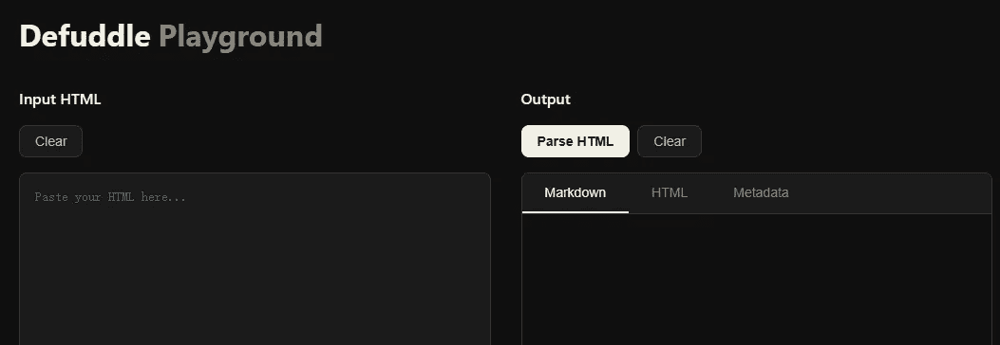
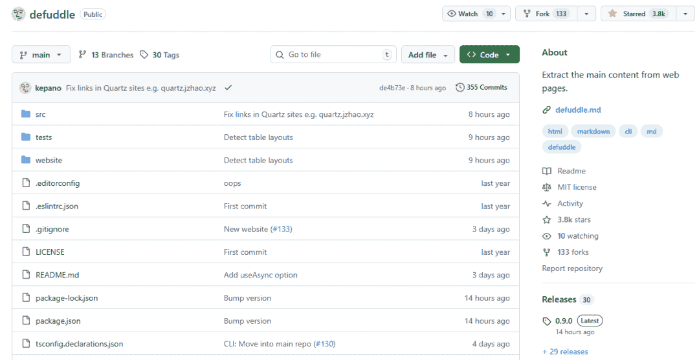

# 2026-03-07免费网页清洗利器Defuddle：一键提取网页内容，转为干净 Markdown。可惜还不支持👸号

> 来源：[https://xuqiwei1986.feishu.cn/docx/BLZXd1bT1oAKVwxoepicdGFDnsm](https://xuqiwei1986.feishu.cn/docx/BLZXd1bT1oAKVwxoepicdGFDnsm)

> 🔗 原文链接： h[ttps://mp.weixin.q](https://mp.weixin.qq.com/s/LU_zus1UEauIwUK_IDw2uw)q.com/s/LU_zus1U...

>

原创 jackao jackao 恶人笔记2026年3月7日 07:45  北京

大家好，我是你们的AI工具猎手夹克。

在信息过载的时代，我们每天浏览成百上千的网页，却常常被广告、侧边栏、评论区和导航栏淹没。想要把优质内[容存入 Obsidian、No](https://mp.weixin.qq.com/s?__biz=MzI1Mzg2MjAxNQ==&mid=2247490020&idx=1&sn=7e401240104559d251080cff09712c30&scene=21#wechat_redirect)tion 或喂给 AI 做知识管理，往往需要手动复制、清理格式，费时费力。针对这个需求， 我前两天分享过Jina.ai 。

最近，一款由 Obsidian CEO Kepano 亲手打造的开源工具 Defuddle 悄然上线。它号称“专门用来 defuddle（去杂乱）网页”，能将任意网页的主内容提取成 干净的 HTML 或 Markdown ，并自动附带丰富的 YAML 元数据。比起部分商业化的 Jina.ai，它完全免费开源；比起老牌的 Mozilla Readability，它更宽容、元数据更全，还特别优化了数学公式和脚注。

具体效果怎么样？今天我们从 实际使用 、 技术分析 到 使用建议 ，整理一篇文章。读完后，你来判断它是否适合你的工作流。

## 一、Defuddle 到底是什么？核心亮点一目了然

Defuddle 的核心使命很简单： 去除网页一切非核心元素 （广告、侧边栏、页眉页脚、评论、社交按钮等），只留下文章正文，并输出 标准化、结构化 的内容。

它最初是为 Obsidian Web Clipper 量身定制，后来开放了公共 API、CLI、NPM 库和 Playground，任何人随时可用。

关键优势：

+   • 输出 Markdown 时自动带 YAML frontmatter（标题、作者、发布日期、字数、Schema.org 数据等）。

+   • 对数学公式、代码块、脚注进行标准化处理（MathML + data-latex 属性，完美支持 Obsidian 渲染）。

+   • 支持本地运行（浏览器扩展/CLI），隐私无忧。

+   • 开源 MIT 协议，GitHub 仓库目前仍在快速迭代，作者说“very much a work in progress”。

它本质上应该是 Readability.js 的 现代升级版 ，但更注重“一致性输出”和“下游工具友好”（如 Turndown 转 Markdown）。



## 二、零基础 5 分钟上手：4 种使用方式全

Defuddle 的设计哲学是“极简可用”，以下按 从简单到高级 排序，任选其一即可。

#### 1. 最快：公共 API（无需安装，秒级获取）

直接在浏览器或终端输入：

```
https://defuddle.md/ + 你要提取的网址
```

示例：

+   • 浏览器直接访问：https://defuddle.md/https://example.com/article

+   • 终端一键获取 Markdown：

```
curl https://defuddle.md/https://stephango.com
```

输出就是 带 YAML 的纯净 Markdown ，复制粘贴进 Obsidian 即用。

适合场景 ：偶尔保存文章、快速测试。

#### 2. 命令行 CLI（批量处理神器）

```
# 全局安装（推荐）
npm install -g defuddle

# 使用示例
defuddle parse https://example.com/article          # 默认输出干净 HTML
defuddle parse https://example.com/article --markdown   # 输出 Markdown
defuddle parse https://example.com/article --json       # 输出完整 JSON（含所有元数据）
defuddle parse https://example.com/article -o article.md # 保存到文件
```

常用参数 ：

+   • --markdown / -m ：直接转 Markdown

+   • --json / -j ：结构化输出

+   • --property title ：只提取标题

+   • --debug ：开启调试模式（保留 class/id，便于排查）

适合场景 ：脚本自动化、批量归档数百篇文章。

#### 3. Node.js / NPM 库集成（开发者首选）

```
npm install defuddle jsdom
```

核心代码示例（ESM 模块）：

```
import { Defuddle } from&#x27;defuddle/node&#x27;;
import { JSDOM } from&#x27;jsdom&#x27;;

const dom = awaitJSDOM.fromURL(&#x27;https://example.com/article&#x27;);
const result = awaitDefuddle(dom, &#x27;https://example.com/article&#x27;, {
markdown: true,   // 直接输出 Markdown
debug: true
});

console.log(result.content);     // Markdown 正文
console.log(result.title);
console.log(result.author);
```

支持三种 bundle（core / full / node），full 版额外支持 MathML ↔ LaTeX 互转。

适合场景 ：构建个人知识管道、AI Agent、自动化爬取。

#### 4. 浏览器端 + Obsidian 原生集成

+   • 书签栏小书签 ：直接拖拽即可（一键转换当前页面）。

+   • Obsidian Web Clipper ：官方已内置 Defuddle，本地运行，支持登录后私密页面、JS 动态渲染内容。

+   • Playground 在线测试 ：https://defuddle.md/playground （粘贴 HTML 可实时预览提取效果）。

## 三、分析：优点亮眼，但绝非“完美替代品”



优点：

+   • 隐私与成本双杀 ：本地 CLI / NPM 完全离线运行，不像 Jina.ai 必须走云端 API（且按量付费）。对敏感研究、公司内网文章友好。

+   • 输出质量更高 ：实测在科技博客、文档类站点上，脚注、代码语言、数学公式保留度远超 Readability。YAML 元数据丰富到可以直接喂给 LLM 做结构化解析。

+   • 生态友好 ：专为 Obsidian 优化，配合 Turndown 几乎零损耗转 Markdown。开源社区迭代快。

+   • 灵活性 ：支持自定义移除选择器、是否删图、debug 模式，开发者可深度定制。

限制与风险：

+   • 仍在 WIP 阶段 ：官方 README 反复强调“very much a work in progress”。部分重度 JS 单页应用（SPA）可能提取失败，只能依赖异步 fallback（会调用第三方如 FxTwitter API），这其实引入了新的隐私/依赖风险。

+   • 兼容性并非 100% ：🛰️👸号文章、部分付费墙后内容、复杂论坛仍无法完美提取（这点与 Jina.ai 一致）。测试了几个国内主流站点，成功率约 85% 左右，需人工校验。

+   • 公共 API 的隐忧 ：虽然免费，但未公布速率限制和 SLA。如果大规模调用，可能被限流或延迟。服务器端渲染能力也弱于专业云服务。

+   • 生态局限 ：纯 JS/TS 实现，无官方 Python 绑定。数学公式虽支持 MathML，但 Obsidian 外其他工具渲染仍需额外配置。

+   • 对比商业方案 ：Jina.ai 在一致性和对全球主流媒体的适配上确实更“开箱即用”，但代价是金钱 + 数据隐私。Defuddle 免费却要你承担“测试 + 调试”的时间成本。

总结评测 ：Defuddle 在 性价比和隐私保护 上完胜大多数工具，但在 稳定性和开箱即用 上仍落后于成熟商业产品。它更适合“愿意折腾”的知识工作者，而不是追求零配置的企业用户。

## 四、使用建议（避坑指南 + 进阶玩法）

1.  1. 先测后用 ：任何重要文章都先丢进 Playground 测试 10 秒，避免浪费时间。

1.  2. 优先本地方案 ：日常使用 CLI 或 NPM，公共 API 只做临时救急。隐私敏感内容绝不上云。

1.  3. Obsidian 用户专属流程 ：

+   • 安装 Web Clipper → 启用 Defuddle 后端 → 一键剪藏 → 自动生成带元数据的 Markdown 笔记。

+   • 配合 Dataview 或 Templater 插件，可自动按 author/site 分类归档。

1.  4. 进阶自动化 ：

+   • 写个 Bash/Python 脚本，批量处理 RSS 或书签列表。

+   • 与 LLM 结合：提取后直接 prompt “基于以下 Markdown 总结核心观点”，token 消耗大幅降低。

+   • 自定义选项：对图文密集型文章加 --removeImages ，对技术文档开启 separateMarkdown 。

1.  5. 长期 ：

+   • 不要全盘依赖：重要内容仍建议人工校对，尤其是法律、医疗、金融类文章。

## 结语：值得每一个知识管理者尝试的“安静革命”

Defuddle 不是又一个“网红工具”，而是一位 Obsidian 核心开发者对“干净阅读”这件小事的执着。它提醒我们： 开源的力量往往藏在细节里 ：一个标准化脚注、一个 YAML 元数据，就能让整个知识工作流安静地提升一个档次。

参考资料 ：

+   • 官网试用：https://defuddle.md/

+   • GitHub网址：https://github.com/kepano/defuddle

+   • Playground 体验：https://defuddle.md/playground

你已经用过 Defuddle 了吗？它在你的站点上表现如何？欢迎在评论区分享真实体验，尤其是那些“翻车”的案例。

知识管理，从一次干净的网页提取开始。保持好奇，持续折腾，我们下期见。