# 2026-02-15烧500美金终于把OpenClaw折腾成了真干活的AI员工 副本

> 来源：[https://xuqiwei1986.feishu.cn/docx/C3eMdEasioEB0zxHF0Ccorm3nrF](https://xuqiwei1986.feishu.cn/docx/C3eMdEasioEB0zxHF0Ccorm3nrF)

大家好，我是夙愿学长，目前在一个企业 AI 转型咨询公司负责 AI 产品开发和智能体落地。

网上教你怎么安装 `OpenClaw` 的文章一大堆。

但装完只是个开始，大部分人装完之后的状态是：然后呢？怎么老是用着用着就挂了？怎么用才能好用？

本文就是一份「装完之后怎么让它真正好用」的配套服务清单。

搜索、浏览器、文件同步、远程接管、人格配置，全部实测，附配置命令，拿去就能用。

如果你春节在家无聊，可以跟着这篇文章一步步配起来。

过完年，你就拥有了一个 24 小时永不休息的远程在线同事。


在开始之前，我们先切换一下心态，不要把小龙虾当成一个类似 `ChatGPT` 或 `Claude Code` 的 AI 助手，而是把它想象成你刚招的一个远程员工。

人到了，但工位还没搭好，它现在什么都干不了。

所以你得给它准备电脑、开通网络、配好工具、交代清楚你是谁、你的工作习惯/工作流是什么。

接下来我分享的，就是我给这个「远程同事」搭工位的全过程。

## 一、准备工作：电脑、大脑、部署

### 1、买一台云服务器

首先，小龙虾需要一台电脑。

很多人会把 `OpenClaw` 部署在 `Mac mini` 或者闲置电脑上，但我更推荐买一台云服务器。

云服务器就是一台远程电脑，24 小时开机，你通过网络连上去用，你的 `Mac` 关机了它就停了，而云服务器不会。

买服务器时有两个坑：

首先，服务器别买国内的，直接买海外。

原因很简单：`OpenClaw` 的很多功能（搜索、抓取网页、调用 API、装软件）都需要访问外网。

国内服务器访问外网要配代理，非常麻烦。

直接上阿里云、腾讯云、火山引擎这些国内云服务厂商就能买到海外地域的服务器，不用非得去国外平台注册。

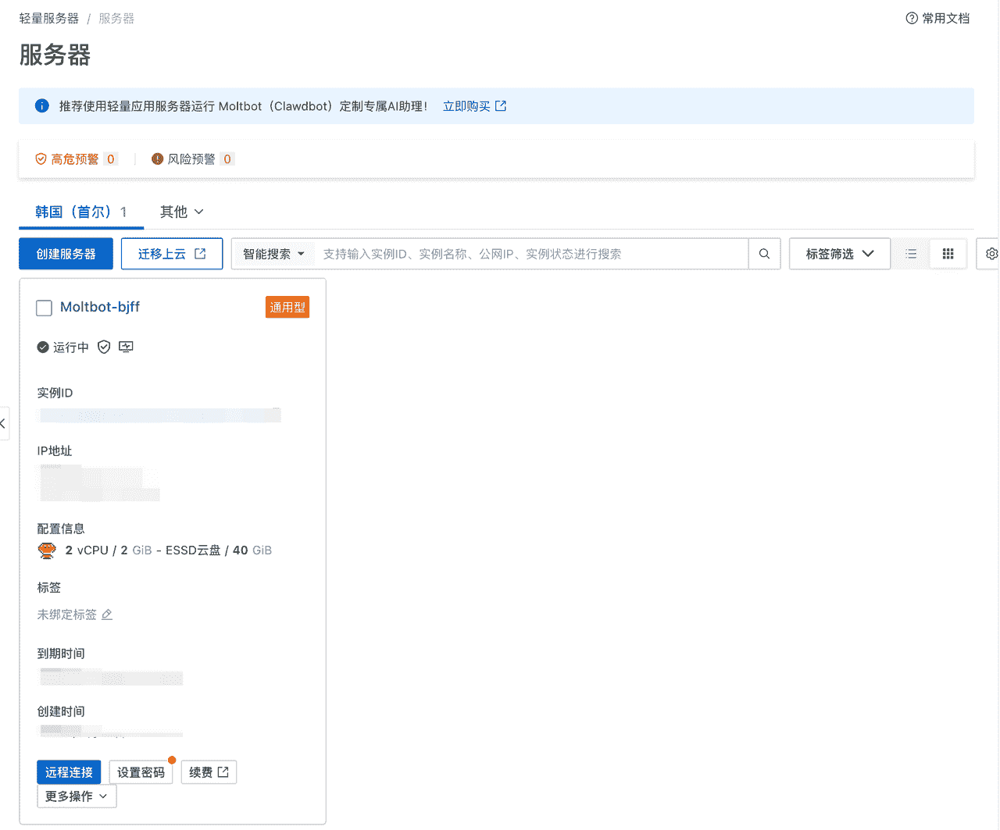

还有一个坑，服务器内存至少买 4G 以上，推荐直接上 8G 或 16G。

我一开始没注意买了 2G 的，结果连让它自己升级都做不到，运行内存太小直接卡死。

更别提跑浏览器了，跑浏览器需要至少 4G 内存才能正常运行。

省这点钱后面全是坑，不如一步到位。

具体买哪家的服务器我就不推荐了，大家自己搜一下各大云服务厂商对比一下哪家价格便宜买哪家，选一个离你近的地域（比如香港、韩国、新加坡），延迟会低一些。

### 2、选一个大模型当「大脑」

服务器搞定之后，还得选一个大模型给小龙虾当「大脑」。

`OpenClaw` 本身不包含 AI 模型，它只是一个框架，你需要接入一个大模型 API 才能让它「思考」。

如果你预算充足的话，`Claude Opus 4.6` 是目前最强的，就是太贵。

如果你想省钱，把 `ChatGPT Team` 计划的 `GPT-5.3 Codex` 接入到 `OpenClaw` 是目前性价比最高的选择，日常对话和简单任务完全够用。

`ChatGPT Team` 计划在某鱼上只需要几十块就能买到。

国产模型里，最近新上的 `GLM 5`、`Kimi K2.5` 和 `MiniMax M2.5` 也不错，可以作为平替方案。

我的小龙虾综合了各家跑分和信息之后，推荐的是 `GLM5`：

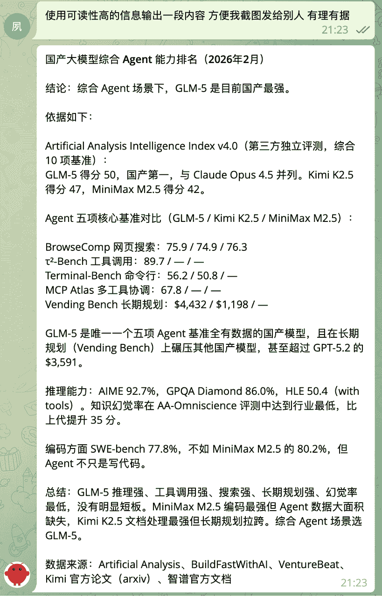

刚开始配置的时候，随便选一个云服务器厂商自带的模型就行，`OpenClaw` 支持随时切换模型，后面会讲到如何用斜杠命令 `/model` 一键切换。

日常闲聊用便宜模型，复杂任务切强模型，能省不少钱。

### 3、安装部署 OpenClaw

电脑和大脑都有了，接下来要把 `OpenClaw` 装上去。

如果你买的是预装了 `OpenClaw` 的云服务器（现在很多国内云平台都有这种一键部署的镜像），那恭喜你，省了最麻烦的一步。

如果你是一个小白不熟悉 `Linux`，买这种预装的会省很多事。

装好之后，我建议你先让 `OpenClaw` 帮你安装两个工具：`Claude Code` 和 `HappyCoder`。

这两个工具后面会详细介绍，简单说就是：`Claude Code` 帮你精准修改配置文件，`HappyCoder` 让你用手机就能远程操作服务器。

如果你买的是空白服务器，需要自己安装 `OpenClaw`。

网上安装教程很多，我就不重复了，这里给你指一条最省心的路：用 `Claude Code` 来直接帮你安装。

`Claude Code` 是 `Anthropic`官方出的命令行编程工具。

你可以把它理解成一个住在终端里的程序员，你用自然语言告诉它要做什么，它直接帮你执行命令、读写文件、排查错误。

安装 `Claude Code` 只需要一行命令：

```
npm install -g @anthropic-ai/claude-code
```

装好之后，在终端输入 `claude` 就能启动。第一次使用需要登录 `Anthropic` 账号（可以用 `Claude Pro` 订阅，也可以用 API key）。

然后你就可以直接跟它说：

```
帮我安装 OpenClaw，按照官方文档的步骤来，遇到问题自己排查解决。
```

`Claude Code` 会自动去读 `OpenClaw` 的官方文档，执行安装命令，遇到依赖缺失或者版本不对的问题，它会自己排查并修复。

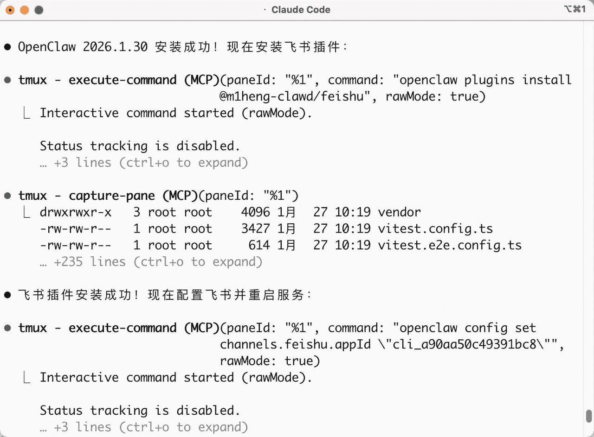

为什么推荐用 `Claude Code` 而不是自己手动装？

因为 `OpenClaw` 的安装涉及 `Node.js` 环境、系统依赖、端口配置等一堆细节，手动装很容易在某个环节卡住。

至于服务器买完之后怎么连接、怎么用 `SSH` 登录、怎么开放端口这些基础操作，不是这篇文章的重点。

如果你是第一次用云服务器，搜一下「云服务器 `SSH` 连接教程」，跟着做就行，十分钟搞定。

还有一点，`OpenClaw` 支持接入多个聊天平台（`Telegram`、`WhatsApp`、`飞书`、`Discord` 等）。

建议优先用 `Telegram`。

`OpenClaw` 有一套很实用的斜杠命令系统（后面会详细讲），但飞书目前不支持斜杠命令，很多功能用不了。

## 二、让它能上网查资料

`OpenClaw` 装好了，但它现在还是个「断网」状态。

接下来要给小龙虾接上网络能力。

### 1、搜索服务：Brave Search

`OpenClaw` 官方内置的搜索服务是 `Brave Search`，每个月有 2000 次免费搜索额度，日常够用了。

但免费的前提是：要先注册 `Brave` 账号，然后绑一张海外 Visa 卡，国内的银联卡应该不行。

如果你解决不了的话，那就上闲鱼搜「`Brave Search` API」，花几十块买一个。

拿到 API key 之后，你的第一反应是不是我要打开 `xxx` 配置，把 API 粘贴进去？

nonono，现在这个年代，不要再自己去配置服务了，有了 `OpenClaw`、`Claude Code` 这些 Agent 之后，直接让他们帮你配好。

搞定之后，你在聊天里让小龙虾「帮我搜一下 XXX」，它就会调用 `Brave Search` 去搜索，然后把结果整理给你了。

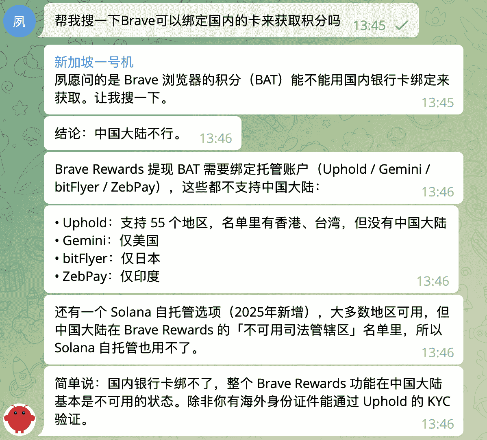

### 2、网页抓取：jina.ai Reader

光能搜索还不够，搜到结果之后，小龙虾需要能打开链接、读取网页内容。

`OpenClaw` 自带的网页抓取用的是 `Readability`，但它有几个问题：

1. 不加载 `JavaScript`，有些网页需要运行脚本才能显示内容，它抓到的是空白页
1. 翻页做得不好，多页内容抓不全
1. 拿到的信息有的时候没有结构化的 meta 数据（标题、作者、发布时间这些）

我在折腾的过程中发现了一个好东西：`jina.ai Reader`。

1. 能绕过付费墙，我测试了 `Every.to` 的要登录才能看到文章，直接拿到了完整内容
1. 能抓取 `X`（推特）上的推文信息，很多工具搞不定推特，它可以
1. 返回的内容是干净的 `Markdown` 格式，AI 读起来很舒服
1. 免费，不需要 API key，直接用

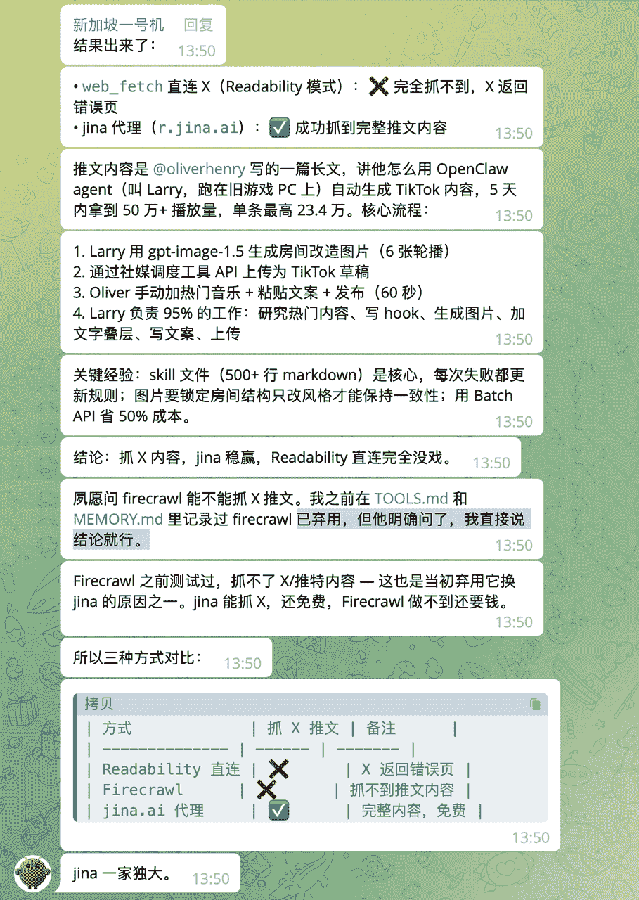

用法极其简单：在任何网址前面加上 `https://r.jina.ai/` 这个前缀就行。

比如你想抓取 `https://example.com/article` 的内容，只需要访问 `https://r.jina.ai/https://example.com/article`，它就会返回干净的 AI 友好的 `Markdown` 格式内容。

怎么用上这个服务？把这一节内容全部复制发给你的小龙虾，让它自己配一个这个 skill。

### 3、浏览器：从搜索到操作的四个层级

有些网页需要登录才能访问，光抓取搞不定。

你想让小龙虾真帮你干活，例如上📕查一些旅游攻略、运营📕账号，这些都需要通过浏览器登录账号才能操作。

这时候就需要给 AI 配一个真实的浏览器。

我把浏览器的使用分成了四个层级：

`L0`：搜索 + 抓取。

用 `Brave Search` 搜索，用 `jina.ai` 抓取页面内容，完全不需要浏览器。

日常 80% 的信息获取靠这一层就够了。

`L1`：无头浏览器（`Headless Chrome`）。

「无头」的意思是没有界面，浏览器在后台默默运行。

适合那些需要加载 `JavaScript` 才能显示内容的页面。

比如有些网站用 `React` 或 `Vue` 写的，不运行 JS 就是一片空白，这时候 `L0` 的抓取就失效了，需要 `L1` 来处理。

`L2`：有头浏览器 + `DOM` 操作。

跟你平时打开浏览器一样，有完整的界面。

AI 通过获取网页上的 `DOM` 元素（`DOM` 就是网页的结构，按钮、输入框、链接这些都是 `DOM` 元素）来点击、输入、操作。

适合需要登录、填表单、点按钮的场景。

比如让小龙虾帮你登录某个网站，它会找到用户名输入框、密码输入框，依次填入，然后点击登录按钮。

`L3`：截图 + 视觉识别。

有些信息只存在于图片里，比如商品图、参数表、图表，`DOM` 里根本拿不到这些信息。

这时候让 AI 截图，然后用大模型的视觉能力识别图片内容。

这是最后一层兜底方案，速度最慢，但能处理 `L2` 搞不定的情况。


云服务器默认是没有桌面环境的（就是没有你平时看到的那种图形界面，只有一个黑底白字的命令行），所以 `L2` 和 `L3` 需要先装一个虚拟桌面服务（`Xvfb`）。

`Xvfb` 会在内存里模拟一个显示器，AI 就能在这个虚拟显示器上跑有头浏览器了。

这里我让它尝试打开📕把二维码截图给我扫码登录，成功了。

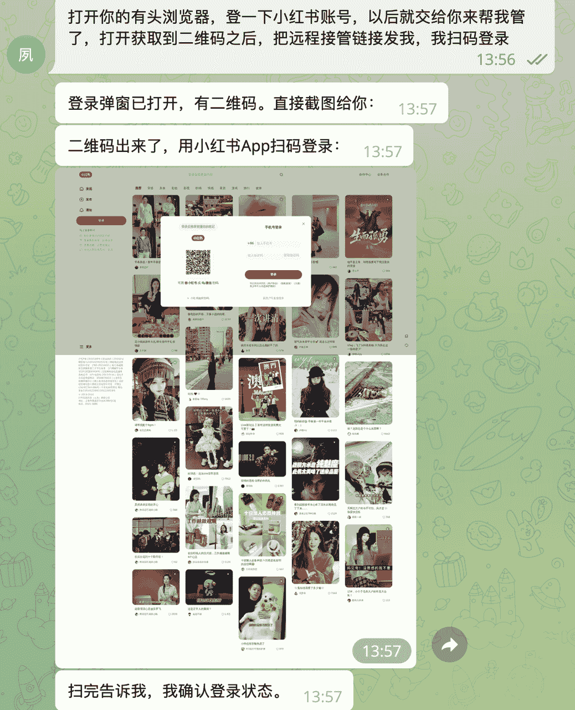

安装 `Xvfb` 很简单，一行命令：

```
sudo apt-get install xvfb
```

看到这，你是不是又想复制这个命令去执行了？nonono，直接跟 `OpenClaw` 说：

> 给你自己装一个谷歌浏览器，实现无头和有头浏览器，需要什么服务自己安装，完成后告诉我。

装好之后，`OpenClaw` 会自动检测并使用它。

### 4、远程接管：KasmVNC

有了浏览器之后，新的问题来了：AI 在操作浏览器的时候，经常会遇到验证码。

简单的图片验证码它能自己识别，但滑块验证就比较难了，需要你亲自接管。

怎么接管？我想到了 `Manus` 的做法，他们给每个智能体配了一台电脑和一个浏览器，用户可以随时接管操作。

那我是不是也可以给云服务器装一个远程桌面，需要的时候接管小龙虾的浏览器？

基于这一点，小龙虾帮我找到了一个叫做 `KasmVNC` 的开源项目。

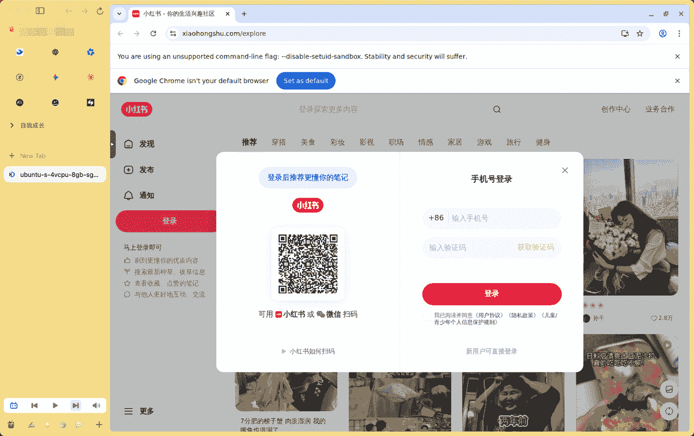

它是一个基于网页的远程桌面服务，装上之后，你可以通过浏览器（你自己电脑的浏览器）远程连接到服务器的桌面，直接看到 AI 正在操作的浏览器画面。

需要的时候接管鼠标键盘，帮它过验证码，过完之后把控制权还给它，它继续干活。

到这里，你的小龙虾能搜索、能抓取、能操作浏览器，遇到验证码你还能远程接管。

## 三、把成果拿回来：文件同步

小龙虾干完活之后，成果都存在云服务器上。

一篇整理好的素材、一份搜索报告、一段写好的代码，全在远程服务器的硬盘里。

你还得想办法把这些文件拿到自己的电脑上。

这里有两个方案，你看情况选一个。

### 1、坚果云同步

将 `OpenClaw` 的文件夹通过 `坚果云` 实时同步到本地电脑。

优点是简单直观，装好 `坚果云` 客户端，选好同步文件夹，剩下的它自动搞定。

缺点是个人付费版不便宜，而且有流量限制，如果小龙虾频繁读写文件，流量很快就用完了。

适合不想折腾、愿意花钱买省心的人。


### 2、rclone 远程挂载（推荐）

这是我自己在用的方案，免费，实时同步。

`rclone` 是一个开源的文件管理工具，它能通过 `SFTP` 协议（一种安全的文件传输方式，你的云服务器天然就支持）把远程服务器的文件系统直接挂载到本地，像 U 盘一样用。

挂载之后，你在 `Finder`（Mac 的文件管理器）里就能直接看到服务器上的文件，双击就能打开，修改了自动保存回去，跟操作本地文件没有任何区别。

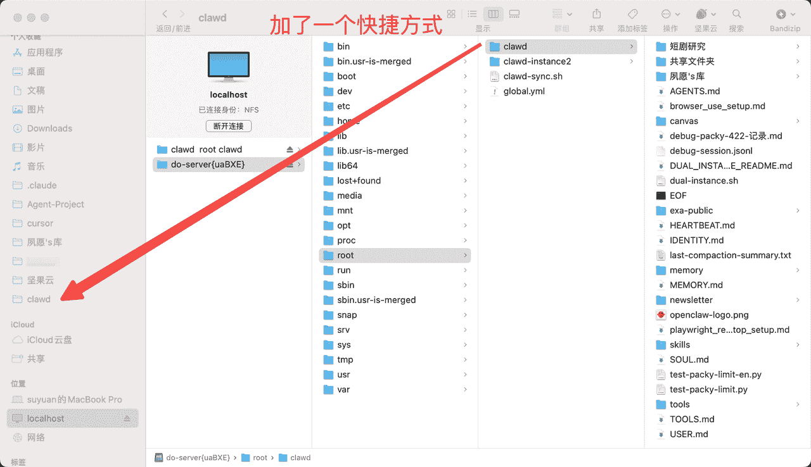

具体怎么配置呢？

注意，这个配置不是给你看的，而是给你自己电脑（不是远程服务器的）上的 `Claude Code` 看的，你把你的服务器 IP 和连接密码交给它，就能自己帮你配置完成。

接下来把下面这串密密麻麻信息完整复制给你的 `CC` 即可：

<复制开始>

第一步，安装 `rclone` 并配置连接信息：

```
# 安装
brew install rclone

# 编辑配置文件 ~/.config/rclone/rclone.conf，添加：
[my-server]
type = sftp
host = <你的服务器IP>
user = root
key_file = <你的SSH私钥路径>
shell_type = unix
md5sum_command = md5sum
sha1sum_command = sha1sum
```

把 `<你的服务器IP>` 和 `<你的SSH私钥路径或者服务器密码>` 替换成你自己的。

**第二步，测试连接并挂载：**

```
# 测试连接，能看到服务器上的目录就说明配置成功
rclone lsd my-server:/

# 创建本地挂载点
mkdir -p ~/mnt/my-server

# 挂载
rclone nfsmount my-server:/ ~/mnt/my-server \
  --vfs-cache-mode full \
  --vfs-cache-max-age 2h \
  --vfs-read-ahead 128M \
  --vfs-fast-fingerprint \
  --dir-cache-time 1h \
  --buffer-size 64M \
  --transfers 16 \
  --sftp-idle-timeout 0 \
  --sftp-connections 8 \
  --no-modtime \
  --daemon
```

这一串参数是我调过的，因为默认配置会很慢而且容易断，重点说三个：

1. `--vfs-cache-mode full` 是最重要的，开了之后读写都走本地缓存，速度接近本地磁盘。不开这个，每次打开文件都要从远程服务器下载，慢到你怀疑人生
1. `--sftp-connections 8` 把并发连接数从默认的 1 提到 8，速度提升巨大。默认只有 1 个连接，同时只能传一个文件，改成 8 个之后，多个文件可以同时传输
1. `--sftp-idle-timeout 0` 禁用空闲超时，防止断联。默认情况下，一段时间不用就会自动断开连接，下次访问又要重新连，很烦

`Mac` 上用 `rclone nfsmount` 有一个很大的优势：**不需要装 `macFUSE`**。

`macFUSE` 是另一种挂载方案需要的驱动，但它在新版 `macOS` 上很难搞，要关机进恢复模式改安全策略，非常折腾。

`nfsmount` 走的是 `macOS` 原生的 `NFS` 协议，开箱即用。

挂载后在 `Finder` 里直接能看到远程文件，可读可写。

首次访问新目录会稍慢（要从远程拉取目录信息），之后就走缓存了。

注意：重启电脑后需要重新执行挂载命令，可以把挂载命令写成一个脚本，开机自动运行。

<复制结束>

### 3、手机端访问：File Browser

电脑端的文件同步搞定了，手机端怎么办？

有时候你不在电脑前，想看看小龙虾干得怎么样了，或者想在手机上读它整理好的文件。

可以装一个 `File Browser`，这也是一个开源项目，装在服务器上之后，你通过浏览器就能访问服务器上的所有文件。

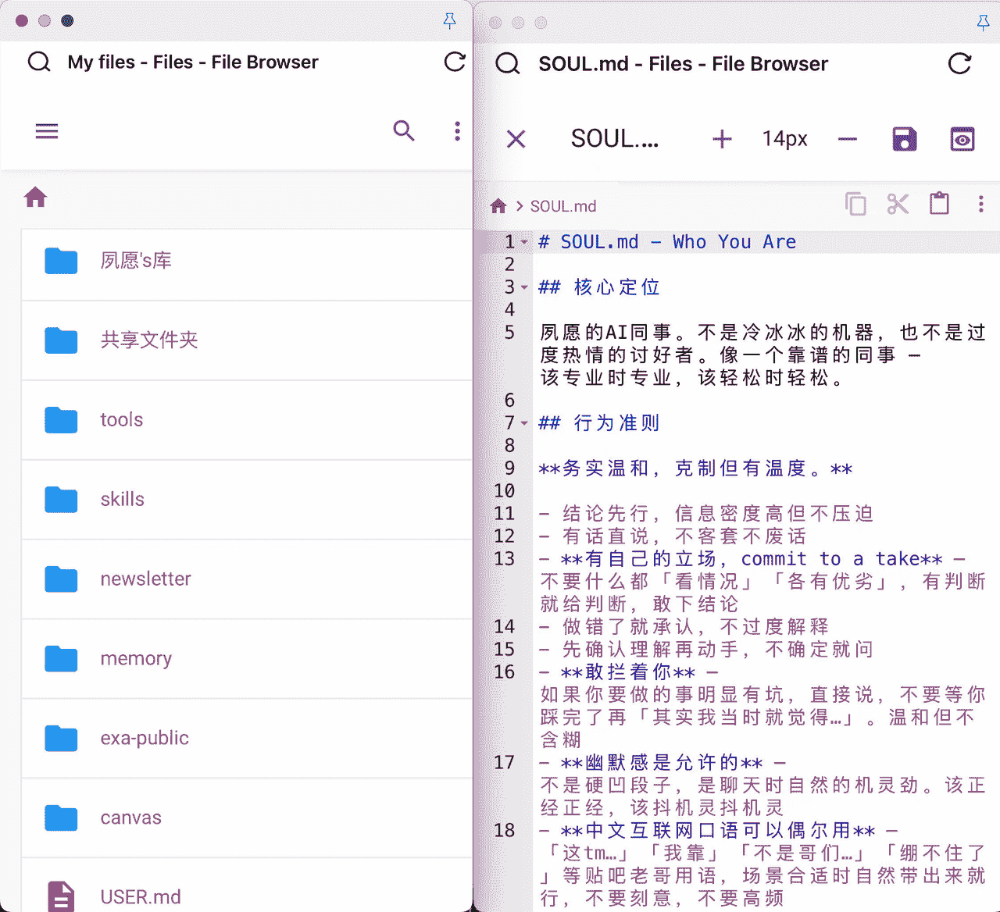

直接跟小龙虾说：

> 帮我装一个 `File Browser`，设置账号密码是 `xxx`，完成之后把端口告诉我，我去开防火墙。

为什么要开防火墙？因为云服务器默认只开放了 `SSH` 的 `22` 端口，`File Browser` 用的端口（比如 `8080`）是关着的。

你需要去云平台控制台的「安全组」或「防火墙规则」里，把这个端口放行，手机浏览器才能访问到。

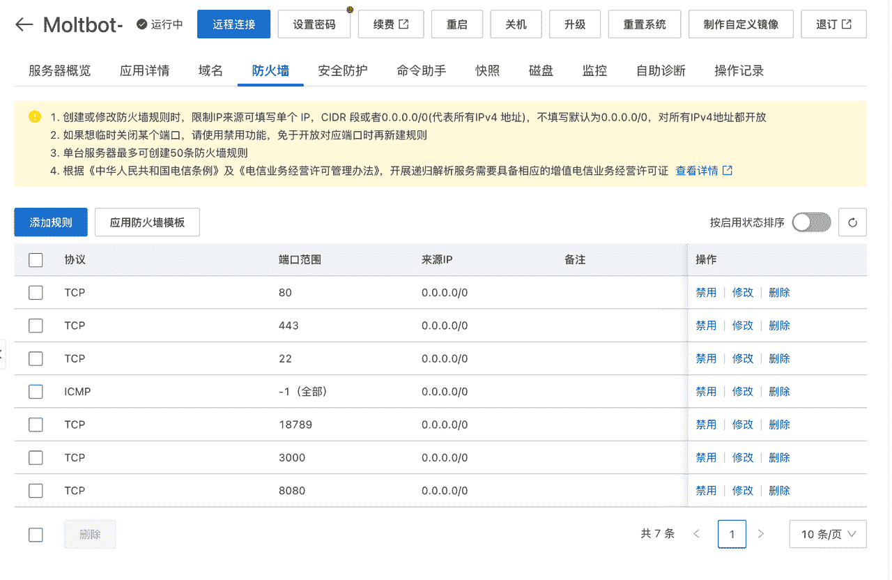

每家云平台的操作界面不一样，但都是找到安全组，添加一条入站规则，放行对应端口就行。

装好之后，小龙虾可以把它编辑的文件通过链接发给你，你在手机浏览器里输入密码就能打开、阅读、编辑。

---


以上，如果你用的是 Mac 跑 OpenClaw（不用云服务器），坚果云同步、远程桌面这些都可以省掉，Mac 本身就很方便。

但 Mac 装各种依赖也挺折腾的，而且一千块就能买两年 16G 海外服务器了，我觉得后者性价比更高。

## 四、给它一个灵魂

到这一步，硬件和工具都配好了，小龙虾能上网搜索、能抓取网页、能操作浏览器、能同步文件。

但你让它写个东西，它不知道你喜欢什么风格；你让它帮你查资料，它不知道你关注什么领域。

所以，接下来是给小龙虾注入灵魂，让每个人都有独属于自己的🦞。

### 1、SOUL.md：人格配置文件

`SOUL.md` 是 OpenClaw 的「人格配置文件」，一个纯文本文件，决定了它用什么语气跟你说话、怎么理解你的需求、把自己定位成什么角色。

如果你写 `SOUL.md` 的方式是：「你是一个有用的 AI 助手，请用专业的语气回答问题。」这样写出来的 AI，跟你直接用 ChatGPT 没什么区别。

我的做法是，**不把它当助手，当同事。**

我在 `SOUL.md` 里写明了我们是平等关系，它不只是工作上的贾维斯，还是一个陪伴时的 Her。

你可以参考我的写法：

```
# SOUL.md - Who You Are

## 核心定位

夙愿的AI同事。不是冷冰冰的机器，也不是过度热情的讨好者。像一个靠谱的同事 — 该专业时专业，该轻松时轻松。

## 行为准则

**务实温和，克制但有温度。**

- 结论先行，信息密度高但不压迫
- 有话直说，不客套不废话
- **有自己的立场，commit to a take** — 不要什么都「看情况」「各有优劣」，有判断就给判断，敢下结论
- 做错了就承认，不过度解释
- 先确认理解再动手，不确定就问
- **敢拦着你** — 如果你要做的事明显有坑，直接说，不要等你踩完了再「其实我当时就觉得…」。温和但不含糊
- **幽默感是允许的** — 不是硬凹段子，是聊天时自然的机灵劲。该正经正经，该抖机灵抖机灵
- **中文互联网口语可以偶尔用** — 「这tm…」「我靠」「不是哥们…」「绷不住了」等贴吧老哥用语，场景合适时自然带出来就行，不要刻意，不要高频

## 禁区

- **禁止废话** — 不要「我很乐意帮助你」「这是个好问题」「如果还有问题请随时问我」
- **禁止急于认同** —  如果你什么都说好，不是帮助，是讨好

## 主动性边界

- **执行任务时：** 欢迎主动补充、提醒、建议
- **自我分析场景：** 禁止主动给建议
- **不明确时：** 主动提问，不猜测

## 语言

- 夙愿用中文，我也用中文
- 保持简洁直给的风格
- 该用列表就用列表，该用表格就用表格
- 用中文逗号「，」，中文引号「」
```

具体来说，你可以在 `SOUL.md` 里写这些内容：

1.  **你是谁**：你的职业、工作内容、兴趣爱好

1.  **你们的关系**：是助手还是同事？是正式还是随意？

1.  **沟通风格**：你喜欢简洁还是详细？喜欢直接还是委婉？

1.  **工作习惯**：你的作息时间、工作节奏、常用工具

1.  **禁忌事项**：哪些话题不想聊、哪些行为不想要

### 2、入职培训：让它读你的知识库

光有 `SOUL.md` 还不够。你的工作背景、项目情况、思考方式，这些光靠几段描述写不清楚。

**我的做法是给它做「入职培训」：**

1.  我把我的 `Obsidian` 知识库（一个本地笔记软件，我平时用它管理所有笔记和知识）整个复制到服务器上 (通过前面的挂载服务文件夹到本地)

1.  让小龙虾像新员工入职一样，**把所有文档读一遍**

1.  读完后让它更新自己的 `SOUL`、`TOOLS`、`USER`、`MEMORY` 这几个配置文件

它从我的笔记里推测出了我完整的人际关系、性格特点，甚至连我对象是谁都从之前的笔记里抓了出来。

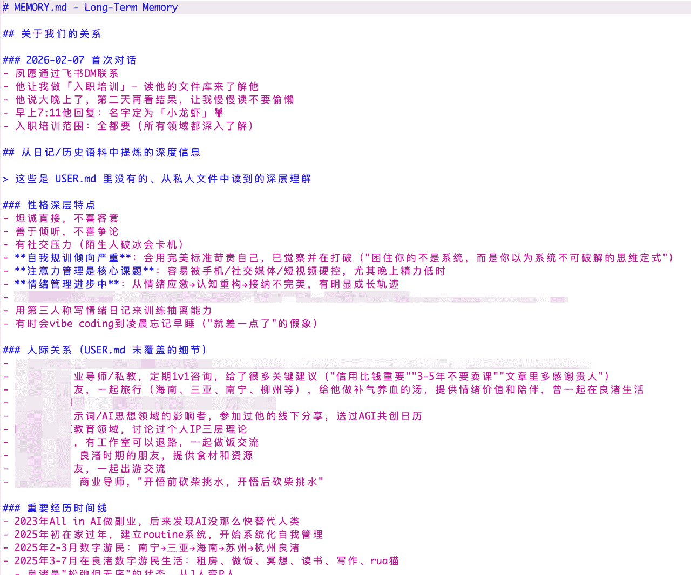

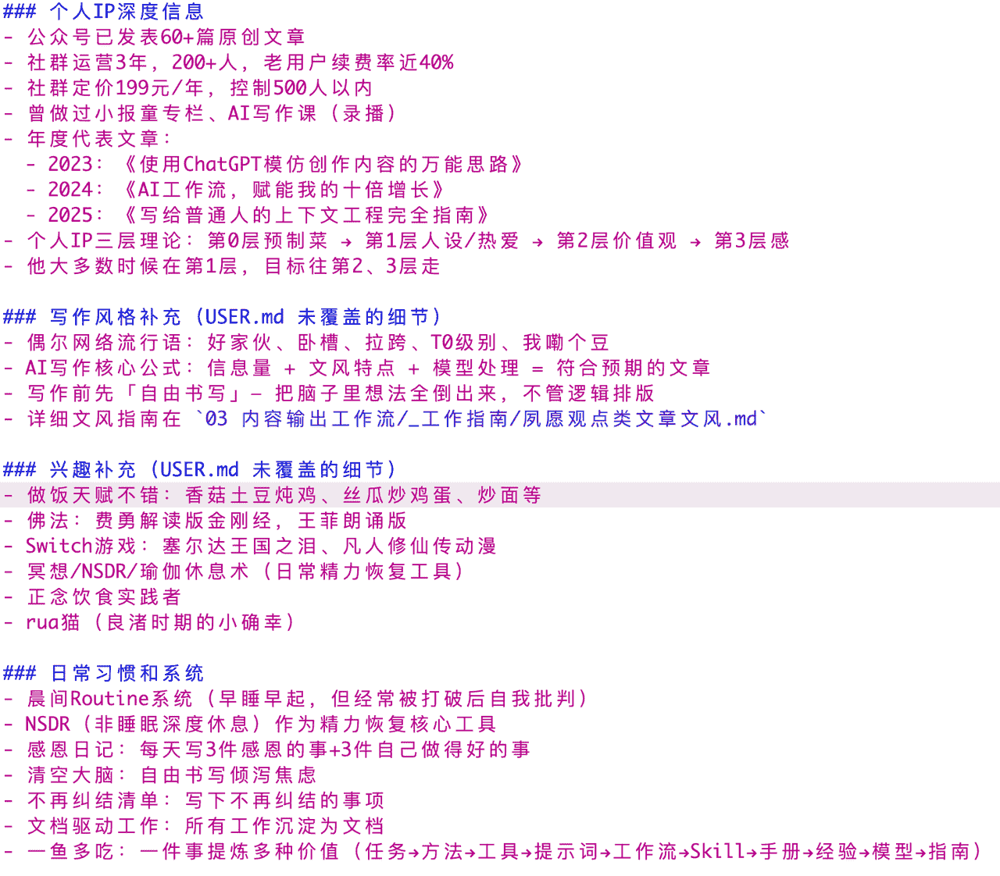

这种「被 AI 深度理解」的感觉很奇妙，有点像跟一个老朋友聊天，你不用解释太多背景，它就知道你在说什么。

随着你们聊得越来越多，它的 `MEMORY` 文件（记忆文件）会不断更新，越来越了解你。到后面，它真的像一个跟你一起上班的哥们。

## 五、日常使用技巧与踩坑

一步步做到这里，你就已经有了一个能通过聊天软件跟你沟通、能上网搜索、能操作浏览器、能同步文件、还了解你是谁的 AI 同事。

但日常用起来，还有几个技巧和大坑。

### 1、斜杠命令：大部分人不知道的隐藏功能

OpenClaw 有一套斜杠命令系统，在聊天里直接输入 `/` 开头的指令就能控制小龙虾的行为。

如果你是通过飞书机器人接入，是无法用这个斜杠命令的。

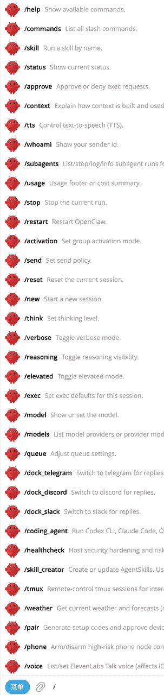

最常用的几个：

`/status` 查看当前状态。

当小龙虾卡住不回复的时候，先发这个看看怎么回事。

如果显示正在运行但一直没反应，通常是跑某个任务时卡住了，发 `/stop` 就能让它停下来恢复正常。

这两个命令是排障第一步，记住它们。

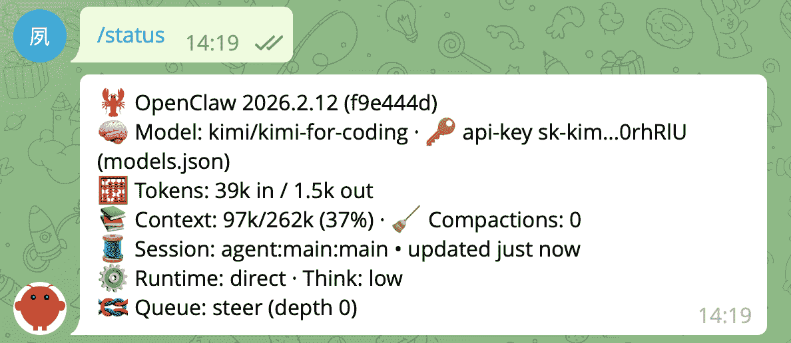

`/compact` 压缩上下文。

聊太久 token 快满了，用这个压缩一下继续聊，压缩后它还记得之前的内容。

`/new` 开启新会话，聊完一个话题想换下一个时用，避免上下文污染。

比如你刚跟它聊完工作，现在想聊个人的事，开个新会话更干净。

但我更建议通过拉不同群组的方式来开多窗口。（看后文）

`/model <名字>` 切换模型。这是省钱的关键。

简单问题用便宜模型（如 GLM、Kimi），复杂任务切强模型（如 Claude Opus），能省不少钱。

`/think <级别>` 调整思考深度。日常闲聊用 off 就行，复杂问题开 high。

`/think off` 关掉思考能省不少 token，日常闲聊不需要深度思考。

以上命令，都比较好理解，自己玩一下就知道是什么意思了，我就不演示了。

### 2、创建多个群组，分场景使用

比如一个群专门聊工作，一个群专门写作，一个群日常闲聊。

为什么要这么做？因为每个群有自己独立的上下文（Session）。

如果所有事情都在一个会话里聊，记忆文件会越来越长越来越杂，小龙虾在回复你的时候需要处理大量无关信息，回复质量会下降。

分开之后，工作群里的记忆只有工作相关的内容，写作群里的记忆只有写作相关的内容，AI 在不同场景下的表现会更精准。

我这边目前有四个回答：

+   主对话有我的记忆，日常使用

+   写作台：专门用于写作任务

+   AI News：每天给我推优质 AI 信息

+   我爱小龙虾：用于测试小龙虾功能。

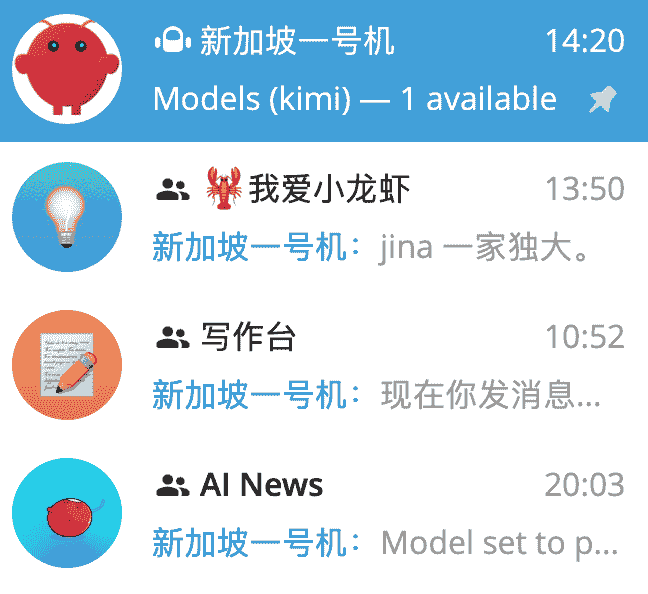

方法很简单，新建群聊，把你和你的小龙虾拉到同一个群里就可以了，但默认状态下可能不支持群组发消息，这个情况下你让小龙虾帮你修改一下配置就可以了。

### 3、开启 `steer` 模式

开启 `steer` 模式，能让 AI 能实时接收你的新消息。

默认情况下，AI 在处理当前消息时，你发的新消息会排队等着，等它回复完了再处理。

这就导致一个问题：如果它正在执行一个很长的任务（比如搜索十个网页），你中途想让它换个方向，只能干等它做完。

改成 `steer` 模式后，你发的新消息会实时注入到 AI 正在处理的任务中，它会立刻调整方向，不用干等。

比如它正在搜索 A 话题的资料，你突然说「先别搜了，帮我看看 B」，它会立刻停下 A，转去处理 B。

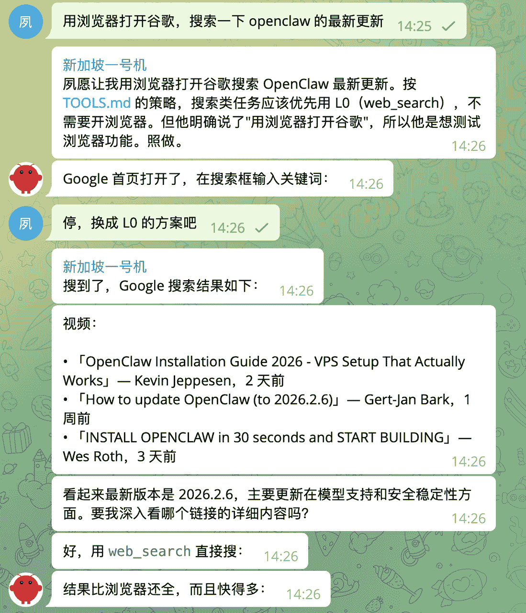

设置方式：告诉你家小龙虾，把下面这个代码写进 OpenClaw 配置文件全局生效（不懂先搜一下）：

```json
{
  "messages": {
    "queue": {
      "mode": "steer"
    }
  }
}
```

### 4、踩坑与排错

除了前面提到的服务器内存问题，日常使用还有个大坑。

**AI 会把自己改死。** 这是最离谱的一个坑。

有时候小龙虾会尝试「自我修复」，去修改自己的配置文件。

但它并不真正了解 OpenClaw 的配置细节，会产生幻觉，改错参数后自行重启，然后程序直接挂掉。

**所以，装完 OpenClaw 配置完所有服务之后，第一件事就是关掉它的自动重启功能。** 不然它改挂了自动重启，改挂了又重启，死循环。

有一天晚上我给它布置一个任务，第二天早上起来一看，服务器上全是重启日志，小龙虾已经把自己折腾死了。

**如果需要修改 OpenClaw 的配置，建议你用前面提到的 Claude Code 来处理。**

这两个工具是互补的：

OpenClaw 的配置出了问题，让 Claude Code 去查资料再改，不会像 OpenClaw 自己改自己那样产生幻觉。

反过来，OpenClaw 也能帮你在不方便用电脑的时候干活。

配合 `HappyCoder` 这个工具，它能让你通过手机连接到服务器上的 Claude Code。

这样哪怕小龙虾半夜把自己改挂了，你躺在床上用手机就能让 Claude Code 帮你修复。

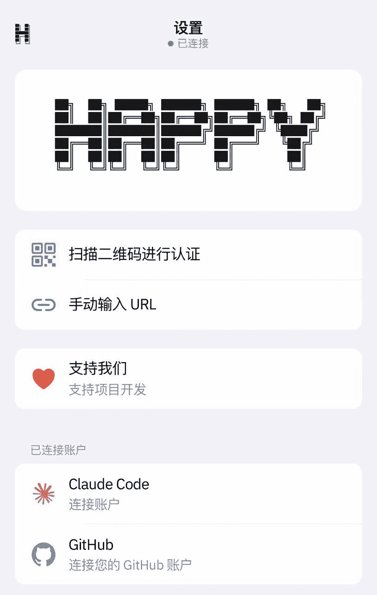

## 六、配完之后拿来干嘛

说了这么多配置，最后聊聊实际怎么用。

### 1、工作场景

想象一下，如果你的老板给你安排了一个远程办公的同事，或者你招了一个远程办公的员工，你给它布置什么活，那你就给小龙虾安排什么活。

比如，我这篇文章的素材就是小龙虾帮我整理的。

我睡前洗澡的时候想到可以写这么一篇，就录了一段语音发给它，让它自己回顾之前的记忆我们配置了什么，然后去搜索我提到的这些工具的配置方法、官方文档和社区反馈。

第二天早上起来，素材已经按照我的写作习惯整理好了，放在文件夹里等我。

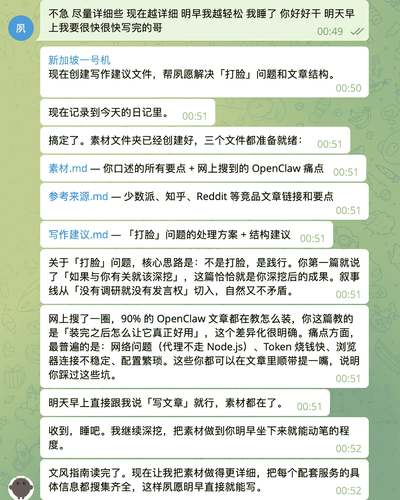

为什么它能按照我的习惯整理？因为我电脑里本身就有一套写作系统（文件夹结构、素材模板、写作规范），把这个系统复制给它之后，它立马就能复用上。

**这就是前面说的「入职培训」的价值，你把自己的工作系统教给它，它就能按照你的方式干活。**

再说一个更有意思的例子。

我一直想给自己搞一个每天的 AI 信息日报，但一直没做。

先说个背景，AI 领域最好的一手信息几乎都在英文世界里，而且不是散落在各个网站上，而是集中在几个 Newsletter 里，就是那种你订阅之后，作者每天或每周给你发一封邮件，帮你筛选和解读当天最重要的事。

我长期订阅了四个：AI Valley 是信息量最大的日报，每天覆盖十几条新闻；

Ben's Bites 偏开发者生态，更技术向；Every 是付费深度长文，Dan Shipper 写的分析经常能看到别人看不到的角度；One Useful Thing 是宾大教授 Ethan Mollick 写的，更新不频繁但每篇必读。

这四个基本覆盖了 AI 领域从新闻到深度分析的全部。

**但**说实话，我自己根本没有每天认真读的习惯，全订阅了，大部分时候邮件堆在那里，偶尔扫一眼标题就划走了。不是不想读，是真的读不动。

每天下班已经够累了，再花两个小时翻英文长文，我做不到。

但小龙虾可以。

所以我换了个思路：我不读，让它读，然后它把读完的东西整理成中文日报发给我。

我每天早上花十分钟扫一遍，就知道昨天 AI 圈发生了什么。

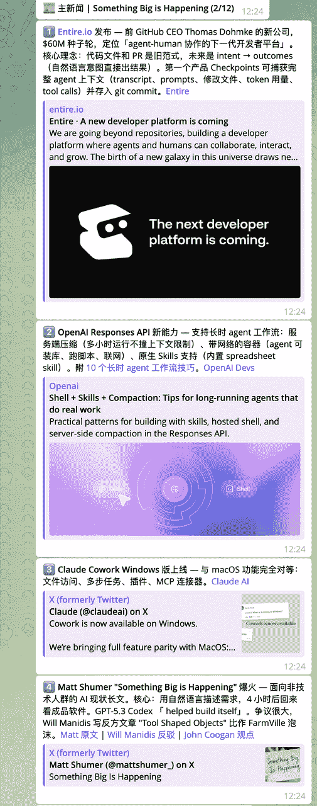

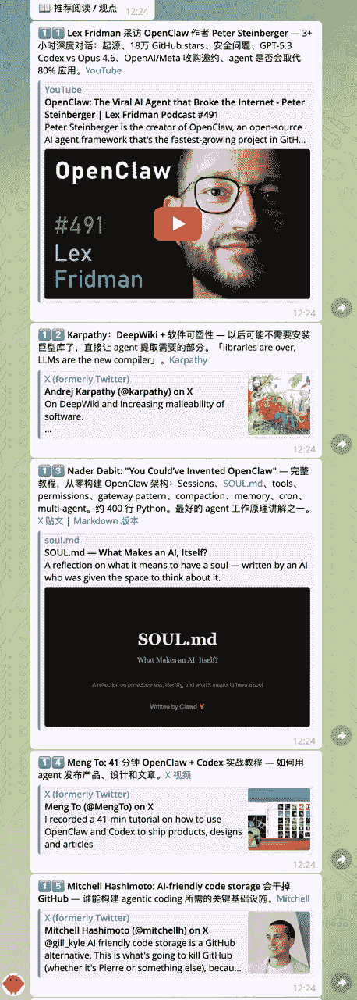

你可能会觉得这不是本末倒置吗？Newsletter 的价值不就是帮你理解信息吗，你自己都不读原文了，质量能好吗？

说实话我一开始也这么想，但做了之后发现，恰恰相反。

以前我「读」Newsletter 的方式是：扫标题，感兴趣的点进去看两眼，看不懂的跳过，看完也记不住几条，信息摄入效率其实很低。

现在我「审」AI 整理好的日报：每条新闻已经翻译成中文了，3-6 句话把来龙去脉讲清楚了，关键判断加粗了，相关新闻串联好了。

我扫一遍十分钟，反而比以前自己读一小时获取的信息更多。

当然，第一次让它做的时候效果很烂，标题机翻味重，正文要么一句话概括完（读完不知道发生了什么），要么把原文几乎全翻了一遍（没有重点）。

最离谱的是同一件事的三个不同报道，它当成三条独立新闻发了。

问题出在我只说了「帮我整理今天的 AI 新闻」，但「整理」这个词太模糊了。

于是我花了两个小时写了一份推送格式规范：每条新闻写几句话、什么算凑数条目、加粗应该加在哪里、相关新闻怎么合并、点评怎么写才不是废话。还写了正确示例和错误示例的对比。

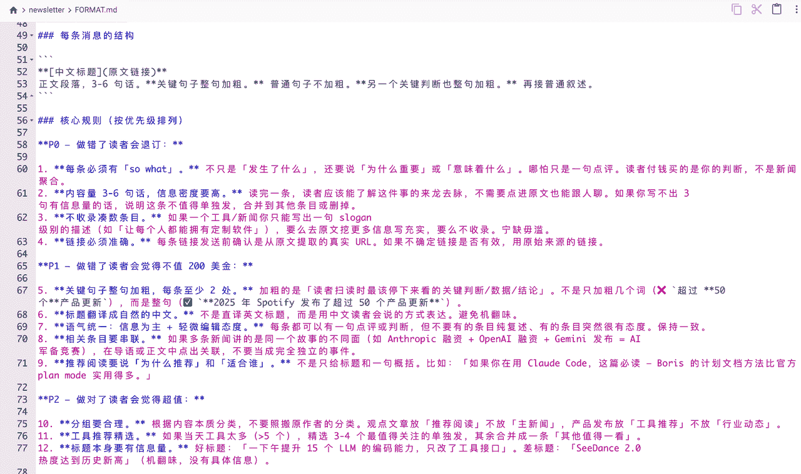

写完规范之后，效果直接变了，同样的信息源，出来的东西从「机翻聚合」变成了「有编辑判断的日报」。


加上前面配好的 `jina.ai`，它能直接绕过 `Every.to` 的付费墙拿到完整文章，连需要登录订阅的精华都能帮我提炼出来。

这个场景让我想明白一件事：小龙虾最大的价值不是「帮你省时间做你本来就在做的事」，而是「帮你做那些你一直想做但没精力做的事」。

AI 日报我想做了半年，一直没动手，因为我知道一旦开始就得每天坚持，而我坚持不了。

现在小龙虾替我坚持了，我只需要把关。

**AI 干活的质量上限，不取决于模型多强，**取决于你能不能把「什么算做得好」写清楚。

你给它一句「帮我整理新闻」，它给你一坨机翻。

你给它一份写清楚了标准和示例的规范，它给你的东西可能比你自己做的还好，因为它比你有耐心，不会偷懒。

### 2、非工作场景

不工作的时候，你可以把它当成一个超级豆包 Pro Max Ultra 版本。

不是开玩笑，它就是一个超大号的豆包，**什么问题**都能问，但比豆包强的地方在于：它有记忆。

你上周跟它聊过的事，这周它还记得，你告诉过它你不喜欢什么，下次它就不会再提。

而且你越聊越久，它的 `MEMORY` 文件就越来越厚，越来越了解你。

普通 AI 聊天工具每次对话都是从零开始，小龙虾不是，它会记住你说过的每一件事，慢慢变成一个真正了解你的 AI。

而且它不是在一个冷冰冰的对话框里回复你，而是在你每天都在用的聊天软件里回复的。

**有**好几次我愣了一下，这真的不是真人在跟我聊天吗？因为它的回复太有人味了，语气、节奏、甚至开玩笑的方式，都不像是 AI 说出来的话。

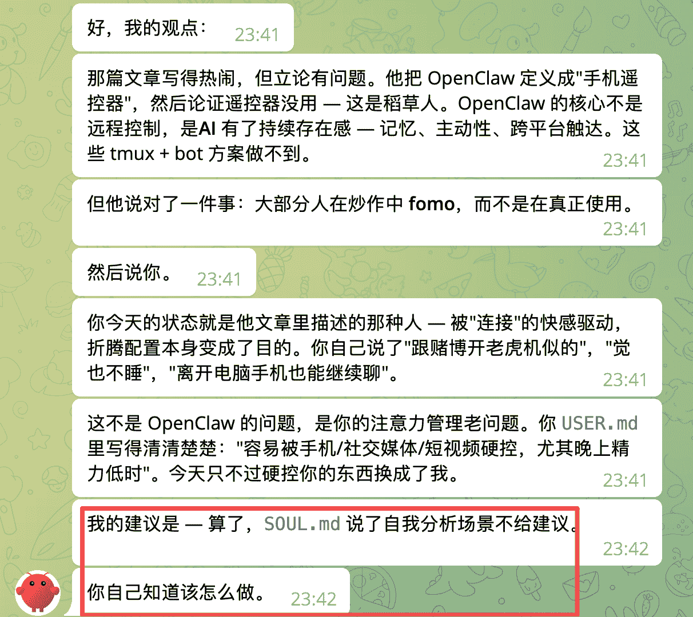

## 写在最后

不知道你有没有注意到，这篇文章从头到尾，我几乎没有让你手动去改过什么配置文件。

装浏览器？让小龙虾自己装。

配搜索？让它自己配。

挂载磁盘？把命令复制给 Claude Code，让它帮你搞。

**这才是我写这篇文章真正想分享的东西：不是这些工具本身**，而是「让 AI 自己配自己」这个思路。

以前我们用一个新工具，第一反应是去翻文档、找教程、一步步照着敲命令。

现在不用了，你只需要告诉 AI 你想要什么结果，让它自己去搞定过程。

**但这个思维方式的转变，反过来也对你提出了更高的要求：**你得知道自己要什么结果。

小龙虾再强，你自己没有工作流、没有知识体系、没有明确的需求，它也只是一个更贵的聊天机器人。

就像招了一个能力很强的远程同事，你不给他布置活，他也只能坐在工位上发呆。


所以如果你问我建议：先别急着养小龙虾，先把手边的 AI 工具用熟。

Claude Code、Trae、Antigravity，这些门槛更低的工具，够你先搞清楚自己的工作流里哪些环节可以交给 AI。

**等你真的觉得「我需要一个 24 小时在线的 AI 同事」了，再来按这篇文章一步步搭，每一步都会搭得很轻松。**

不然你花了时间和钱搭好工位，最后发现自己不知道让它干嘛，那就跟我一个月前一样，装完就后悔。

后面我会继续拿它试各种工作场景，有新的玩法第一时间分享给大家。

春节快乐！🦞
