# 赚钱港湾计划内测招募：给对下一步迷茫的你，一个把航向理清再扬帆的地方

> 来源：[https://xuqiwei1986.feishu.cn/docx/PYkDd7Cb5oPGqtxF318cTaJ6nef](https://xuqiwei1986.feishu.cn/docx/PYkDd7Cb5oPGqtxF318cTaJ6nef)

大家好，我是纪钟。

一眨眼，加入赚钱团队已经 3 年，我也快成了一个在圈里打滚了 7 年的老圈友。

很多人认识我，是因为赚钱体验营的直播。在参与线下活动时，经常被圈友认出跟我打招呼，说当时听了那一场直播，决定加入龙哥盟，或者是和我报喜，说某一次沟通指明了方向，拿到了现在的结果。

每次听到这样的反馈，我都既感动又惶恐：其实在成为大家口中的“纪钟老师”之前，我也只是一个在赚钱里迷茫过、挣扎过、努力过、最终改变命运的普通人。

这个港湾计划我构思了很久，就是想要帮助像我曾经一样迷茫的人，但种种原因一直推迟，今天终于迈出了这一步。

如果你现在通过副业赚取的收入还没有到 1000，并且对接下来做什么很迷茫，那这个计划就是专门为你制定的。

在详细了解这个计划前，我先简单讲下我的经历。

## 我也曾经什么都看不懂

2019 年第一次接触赚钱时，面对海量的赚钱帖子，我非常迷茫。

那时的赚钱对我来说就像一个收费的赚钱版知乎，每天泡在社群里看各种赚钱帖子，知乎好物、抖音电商、淘宝蓝海、闲鱼无货源、知识付费……每一个都让我心动，但每一个又都不知道从哪下手，什么都看不懂。

那时还没有航海实战，如果想做项目全靠自己主动摸索，然而做过项目的圈友应该都知道理论和实操中间差距有多大，遇到问题了还不好意思问贴主，工作一忙就抛到脑后了。

一年时间很快过去，我没有通过赚钱赚到一分钱，自己在过程中好几次怀疑是不是不适合赚钱或者做副业，就应该老老实实打工。

转折发生在 2020 年。

我参加了第一期赚钱线下活动，那时候还叫赚钱夜话，我第一次和这么多赚钱的前辈面对面交流。

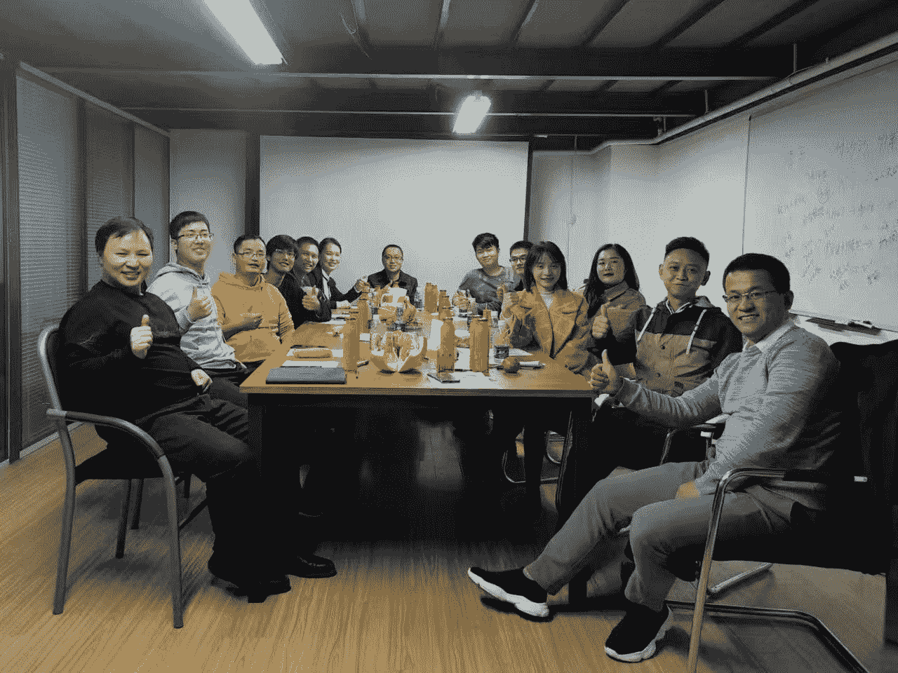

能认出哪个是纪钟吗🌚

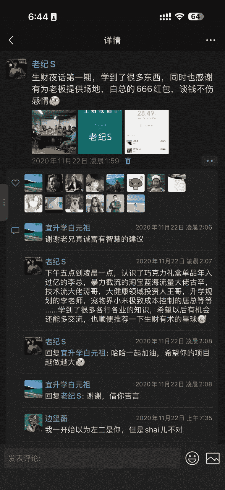

那天聊的很多细节我已经记不清了，但从那天我发现：

**原**来困扰自己许久的迷茫，在经历过的人眼中就是一层窗户纸，别人一两句话很多东西你就通透了。但你自己想的时候，你是不知道自己不知道的。

那次夜话之后，我意识到之前并没有用好赚钱：想要用好，一定要融入圈子，主动寻求圈友们的陪伴。

赚钱不是一本书，让你在其中照本宣科，按步执行来拿到结果。

赚钱也不是一门课，给你讲方法听故事，只靠听讲来提升认知。

赚钱带给大家的是一个圈子，一个环境，而圈子里最重要的，是人和人的链接与陪伴。

从那之后，我开始不再孤单，除了偶尔请教当时夜话中加上好友的几位大佬@李严@唐有为@古辛@彭涛（这些大佬现在也一直在赚钱），我开始勇敢链接更多圈友寻求帮助。

我先从闲鱼开始，在@千城的陪伴下参加了闲鱼无货源航海，赚到了第一笔副业收入；然后做矩阵放大，收入开始稳定；还帮对象做📕异宠项目到被法治周末报采访；

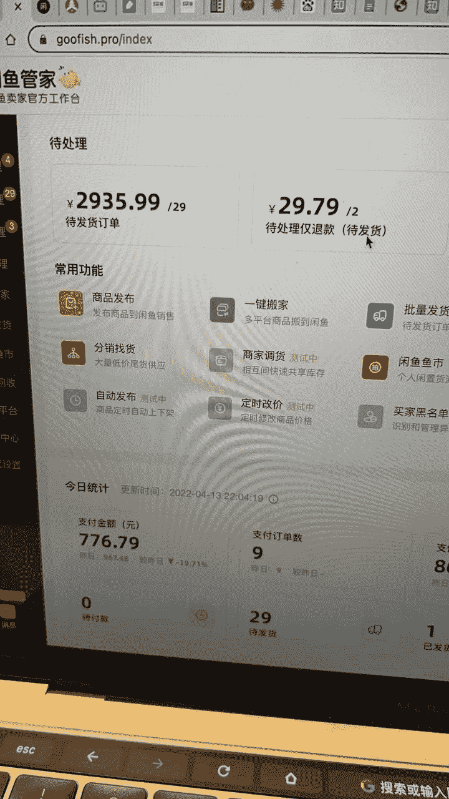

当时最高单店一天能有 3000 的 GMV

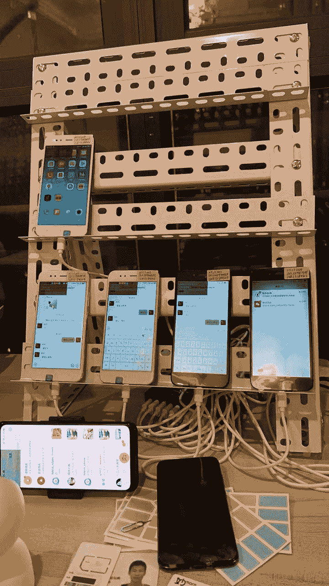

开始矩阵扩量

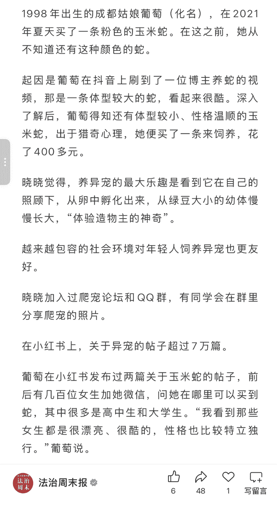

引流几百人被报纸采访

生活不再拮据后，我和女友搬出了当时能听见隔壁说话的隔断房，租下了一整套房子。

后来开启创业，和合伙人一起做海外申博的咨询服务，偶尔也接一些企业的咨询，赚到了职场外的第一桶金。

有钱之后，我用这些钱给家里还了清了负债，跟父母的关系也变好了，也在成都核心区买了自己的房子，跟从我贫穷时期一路打拼过来的女友步入了婚姻殿堂。

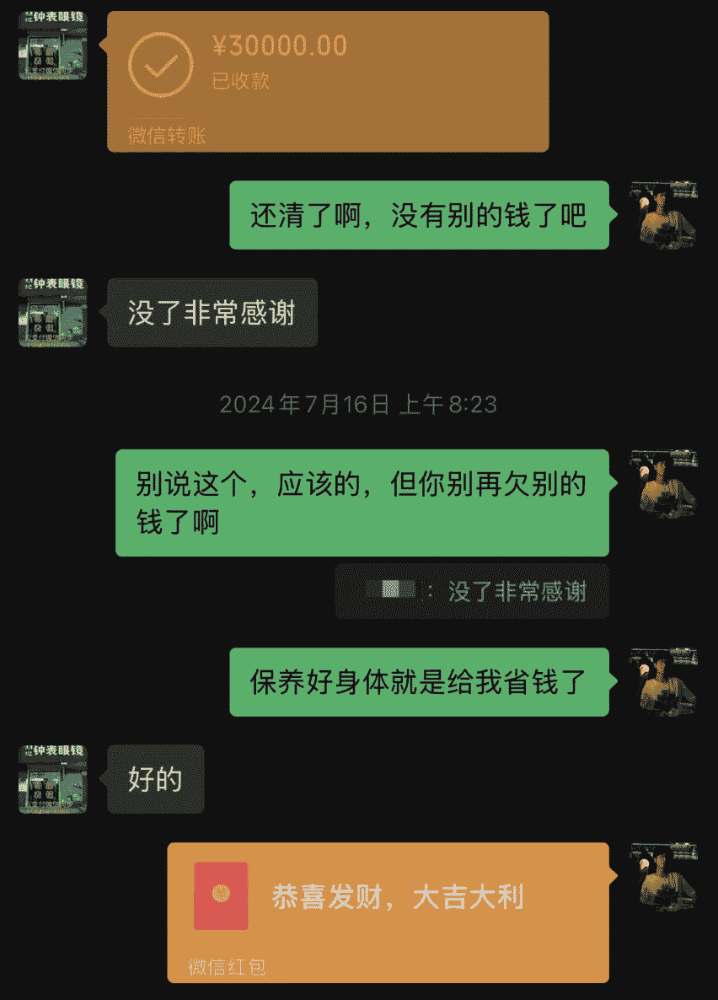

还清了家里所有负债

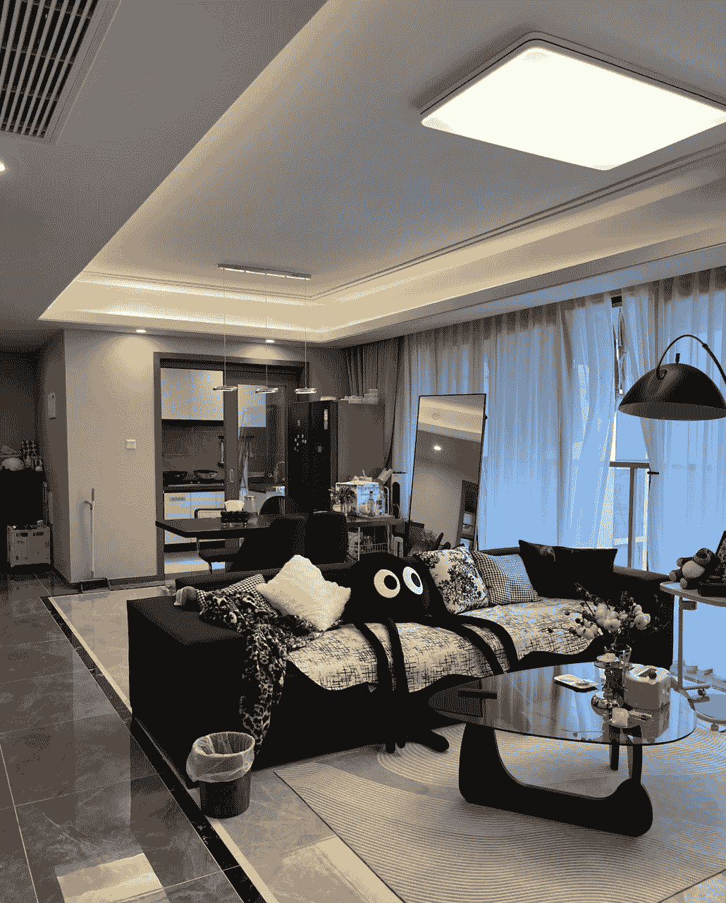

住进了梦想中的大横厅

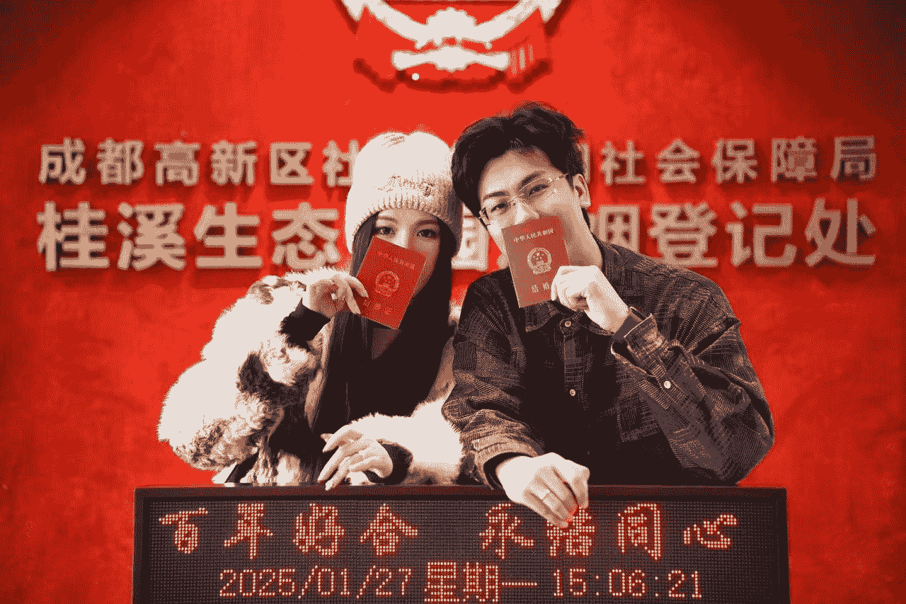

和我一无所有时愿意陪伴我的女友步入婚姻殿堂

可以说，如果没有赚钱，没有那次夜话，如果没有那些愿意分享、愿意帮助我的圈友，我可能还在那个迷茫状态里打转。

有幸被照亮，也想成为光。我想做的，就是帮助过去的自己。

2023 年，我正式加入赚钱团队。这 3 年来，我带着团队服务了十几万用户进一步体验龙哥盟，也有上万人选择在我们的陪伴中加入赚钱大家庭，我也慢慢成了圈友们口中的“纪钟老师”。

每次参与线下活动都会被很多圈友认出并和我报喜：有在直播鼓舞下摆脱迷茫迈出副业第一步的，也有咨询后放大📕副业摆脱职场实现自由职业的，更有坚定创业信心找到合伙人做面试辅导月入几十万的。

每天都能看到有圈友在赚钱找到方向、拿到结果，改善自己的生活甚至追逐更大的梦想，这让我特别有成就感。

## 为大家的成功欣喜的同时，我也注意到了另外一种状态

**你被庞大的信息淹没**，每天都会打开赚钱，收藏了 200 多篇精华帖，关注了十几个话题，加了数个航海群，但依旧不知道下一步要做什么，遇到问题第一时间不知道问谁。

**你一直卡在选项目上**，你看别人的案例，逻辑清晰、路径顺畅。可放到自己身上，觉得不是缺这就是少那：人家有行内经验，你只是门外汉；人家朝九晚五，你只有下班后两小时；人家有资源积累，你要从零开始。从哪个项目做起，你不知道。

**你一直怀疑方向不断切换项目**，你也并非什么都没做过，你尝试过几个项目，有些甚至拿到过小结果。跟过航海，做过📕，试过短视频，可能还赚过几百块……但始终没能持续下去。

上面这些状态不只是你，也是 2019 年的纪钟。

**如**果把赚钱比作一所大学，那精华帖就是前辈们苦心钻研出的论文，航海手册就是不同学科的系统教材，航海实战和教练就是不同的专业课及导师。

如果你有清晰的学习目标，那去学习、去请教，可以很快拿到结果。

但如果你还不清楚自己的目标，或者不知道如何用好这些资源，那你此刻需要的可能不是更专业的导师，而是一个了解你目前卡点、帮你理清如何用好身边资源的辅导员。

你不是不努力。只是每个人的条件：起点、资源、时间都不一样，需要迈出的第一步本就不尽相同。

赚钱的使命是：帮助年轻一代通过互联网建立起和扩大自己的事业

这其中不仅包含那些自己就能跑出来的圈友，同样也包括那些暂时没结果、还在迷茫中探寻下一步的圈友。

## 港湾计划：给还没准备好航行的人

大家很熟悉赚钱的实战活动，是 21 天航海计划。每次航海都有教练、领队、志愿者带着你，跟着明确的路线图，一步步完成项目。

航海，是你已经知道要去哪里，只是需要有人陪着你航行。

但在航行之前，还有很多人连船都还没上：

+   他们站在码头，看着远处的大海，不知道该往哪个方向开

+   或者刚上船试了试，发现自己连基本的操作都还不熟悉，又退回到岸边

+   又或者在港口停了很久，看到每艘船都在出发，但自己始终迈不出那一步

**港湾计划，就是给这些人准备的。**

港湾不是终点，港湾是你整理装备、确认航向、做好准备的地方。在这里，你可以停下来理清方向，然后真正扬帆起航。

最近，我在业余时间用「直播连麦+陪伴群」的方式，小范围地帮一些圈友理清了路径。

**江茶**，迷茫了很久没有动力，连麦后找到方向，立马下场行动就拿到了小结果。

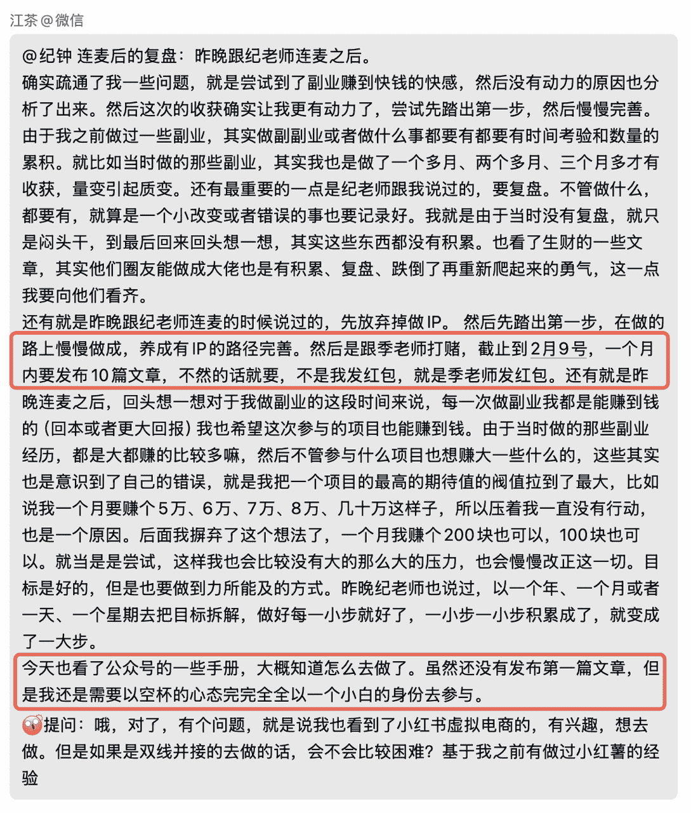

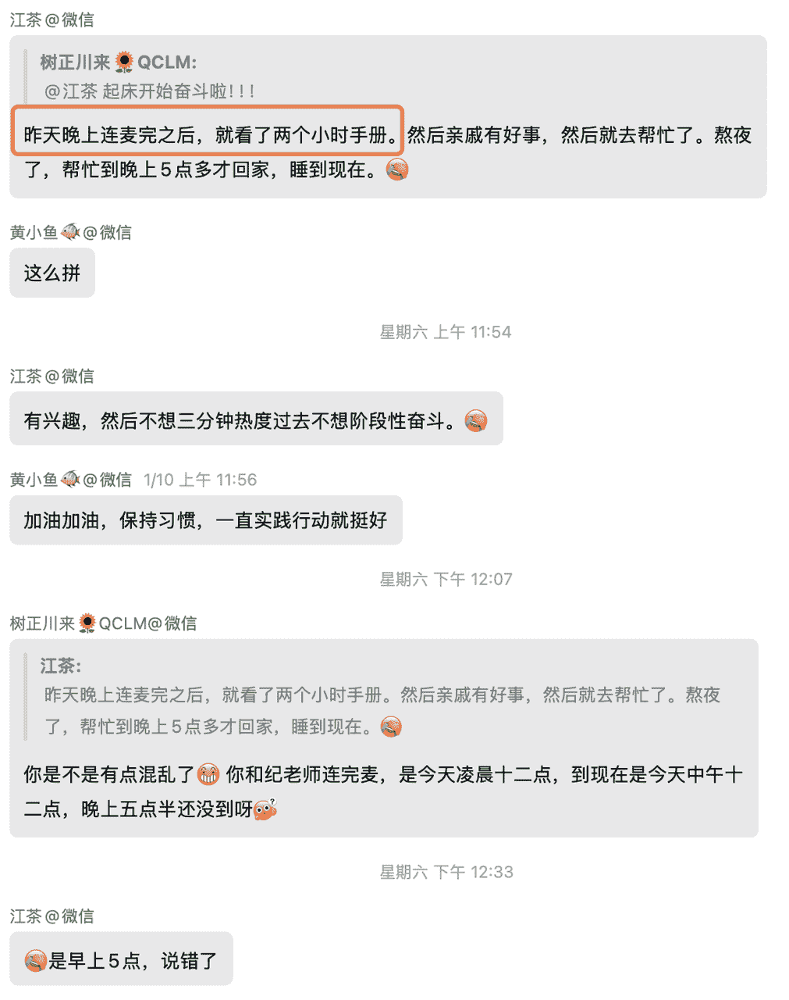

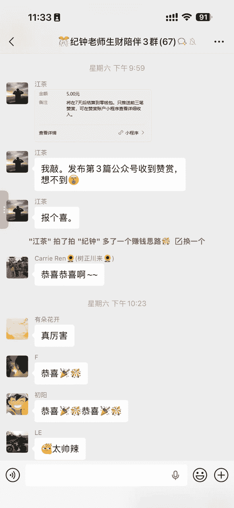

**LE**，在各个项目中切换，理清思路后开始有稳定产出，现在已经拿到精华帖。

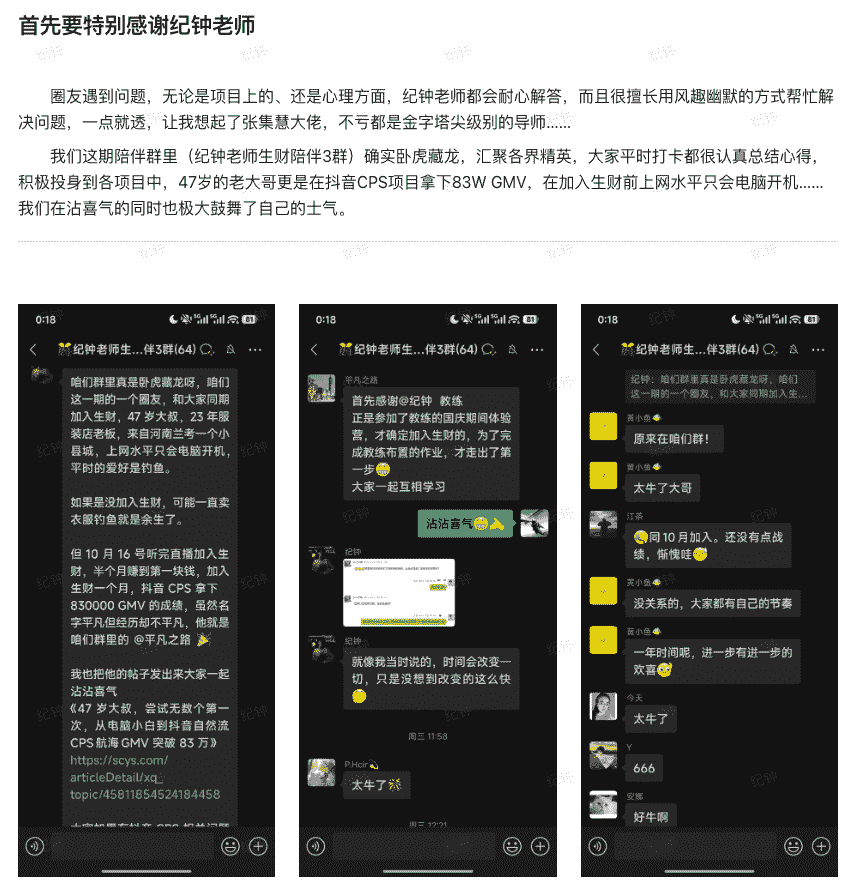

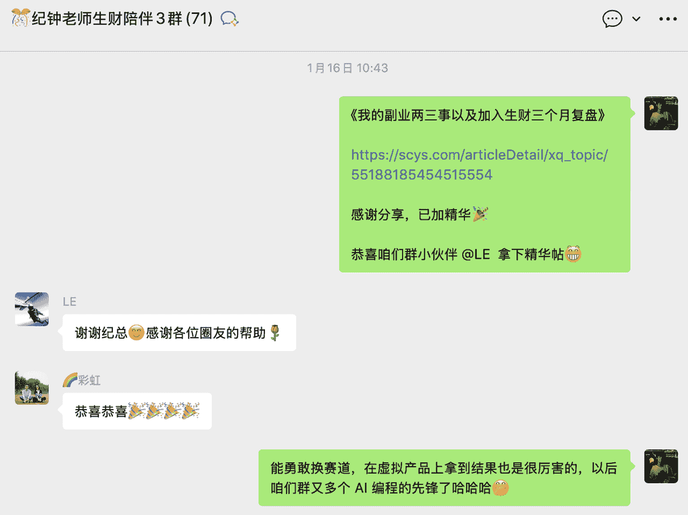

**平凡之路**，也就是大家熟悉的 47 岁大叔，鱼都不钓了专心做抖音自然流 CPS……

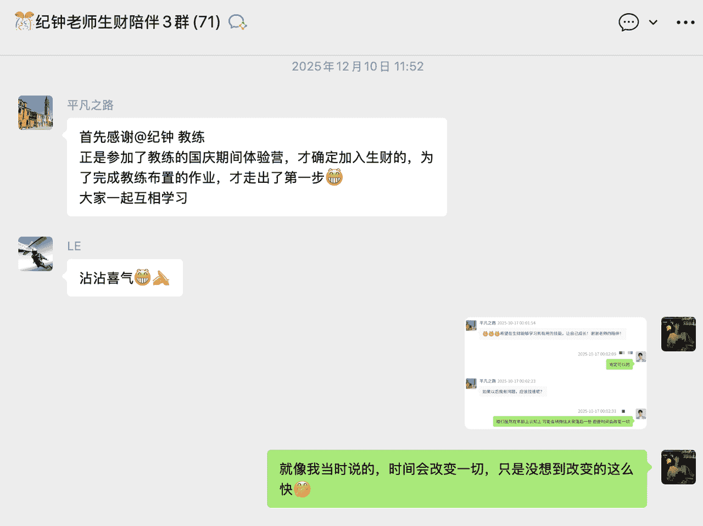

他们之前并不确定该从哪里开始，但在真实的项目环境中，很快就跑了起来。

在这个过程中，我逐渐意识到：在正式进入航行之前，确实有一部分圈友，需要一个“缓冲区”。不是用来观望，也不是用来拖延，而是用来短暂停下，把方向想清楚，再更稳地动起来。

在这里，不需要担心问题是否足够高级，不需要一上来就选对项目，也不需要马上给自己一个明确的结果。

大家只需要做一件事：把混乱的想法梳理清楚，把下一步行动变得可执行。

基于这个判断，我想正式在社群发起「港湾计划」。

## 港湾计划提供什么

我们希望通过港湾计划，提供真正的陪伴——帮基础圈友理清当下最该做的那一件事，基于你的实际情况给建议，在你最容易放弃的阶段推你一把。

**具体来说，你会得到：**

1.  每周固定直播答疑(对所有人开放)

在接**下来测试期间，我会每**周至少两次直播，一般为周三周五，视情况增加周二，来解答大家任何关于副业创业路上迷茫的问题。不管你是不是港湾计划成员，都可以来收听和提问。（可以关注下我的视频号：纪钟商业认知）

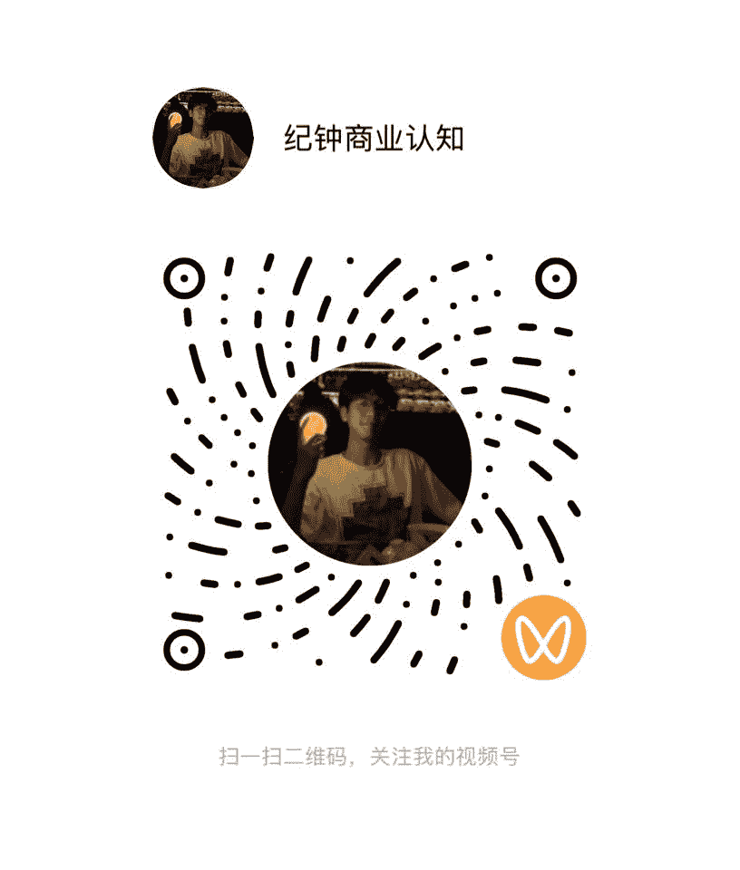

1.  一次1对1连麦机会(港湾计划成员)

我会根据大家当下的情况，抽取有代表性的圈友和我本人连线 30 分钟左右，直到帮你理清现在真正卡在哪里，基于你的时间、能力、资源，找到最适合你的第一步，制定一个简单可执行的行动计划。

1.  陪伴群里的持续答疑(港湾计划成员)

进群后，我会在群里解答你在执行中遇到的具体问题，提醒你别走偏了，偶尔推一推容易拖延的你。有问题随时可以问。

想要做好这件事并不容易，还是需要投入挺多精力的。所以为了把控交付质量，首期港湾计划，我们招募开放 400 个名额，进行为期两个月的内测，后续视情况逐步增加。

为了筛选出更合适的人，想和大家具体说下适合的圈友类型。

## 这个计划适合谁、不适合谁

如果你处在这些状态，港湾计划可能适合你：

1. 完全迷茫，不清楚下一步要干什么，也不知道如何解决

2. 有一些想法， 但是纠结如何做选择，没有下场实践过

3. 尝试过副业，但是收入加起来不超过1000块

如果你是这样的状态，港湾计划可能帮不到你：

+   没有执行打算，只想进来看看热闹

+   已经在做项目，有明确目标和稳定产出（你更适合关注许老师的“从个体到工作室”mini 航海）

+   想要的是完整的项目教学（这个航海里有，但港湾计划不是）

## 你需要做什么

1.  **填写申请表单：**我会根据你的情况筛选，确保港湾计划真的适合你

1.  **预约并完成连麦：**我会根据大家表单填写的情况，抽取更有代表性的圈友逐一连麦

1.  **配合每月回访：**让我们知道这套机制是否真的有帮助，也让我们能持续支持你

1.  **认真执行：**计划再好，不执行等于零

## 念念不忘，必有回响

当我和龙哥小鱼探讨这个计划时，他们说赚钱在 22 年就想要针对那些迷茫的圈友进行针对性的辅导。

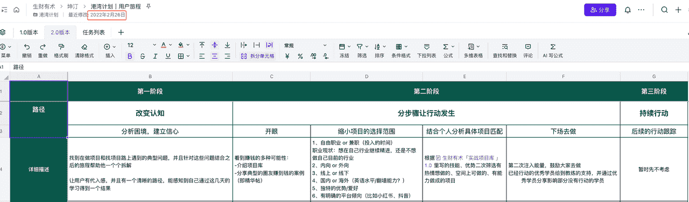

但这件事情受限于组织能力，很难有一个人既熟悉龙哥盟，又有一定的商业认知，还愿意沉下心来不计回报花大量时间了解和帮助一个个具体的人。

龙哥反复和我确认开启这件事情的决心，哪怕牺牲自己的休息时间，哪怕不会带来营收的增长，哪怕这个计划可能吃力不讨好，我依然愿意尝试吗？

我问了问心里那个 2019 年的纪钟，他说：“如果那时候早点遇到你就好了......”

所以，我愿意！

这是一个非常重的事情，在计划确定后走出会议室，我们心底久久不能平静，没想到在 4 年后的今天，港湾计划会以这样的形式来呈现。

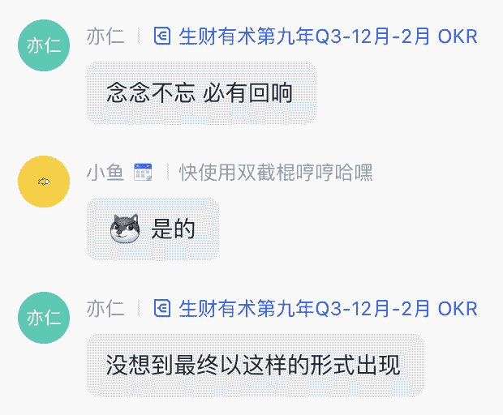

## Anyone can make money

我非常喜欢的一部电影《料理鼠王》里有个情节：

一位著名的美食评论家一直认为，只有大师之手才能做出真正的美食。他曾经抨击过一位坚持"Anyone can cook"理念的厨神，导致那位厨神的餐厅被摘星，不久后离开人世。

后来，一只热爱美食的老鼠，误打误撞帮助一个餐厅打杂的小服务员晋升成为顶级主厨，做出了感动这位美食评论家的料理。当评论家发现让自己为之倾倒的美味竟然出自一只老鼠之手时，他沉默了。

最后，他辞去了自己评论家的工作，但会定期来到这只老鼠开的餐馆就餐，真正承认了那句话："Anyone can cook." 只要你想，人人都可以做出美食。

这个故事让我想到赚钱。

在加入赚钱前我觉得，想要赚钱，你要么有好的家庭背景，或者踩到红利，或者自己特别聪明。

但实际上不是。**只要你愿意努力，用好赚钱这个社群，不一定能年入百万**，但每月多赚个几千上万是完全没有问题的。

我经历过没钱的痛苦，我知道那种感觉。作为过来人，我非常愿意帮助更多和我曾经一样迷茫的圈友，再走一遍这条路。

不过，这是一个实验。我们不知道它最终会变成什么样子。

但我们想试试：能不能让更多还没准备好的普通人，也能在赚钱尽早迈出属于自己的第一步。

只要你不放弃自己，我们就会一直在这里。甚至你放弃自己，我还会再试着拉你一把。

因为我相信：**每个愿意改变的普通人，都值得有一个港湾，让他停下来，**理清方向，然后重新扬帆，最终抵达新大陆。

**这也是赚钱建立以来最核心的共识：**Anyone can make money（只要你想，人人都能独立赚钱）

如果你觉得这件事对你非常有帮助，欢迎填表申请加入。

没有进群的圈友也不用担心，后续我会阶段性把一些共性的问题整理出来，帮助到更多类似的圈友。

就这些，我们港湾见。

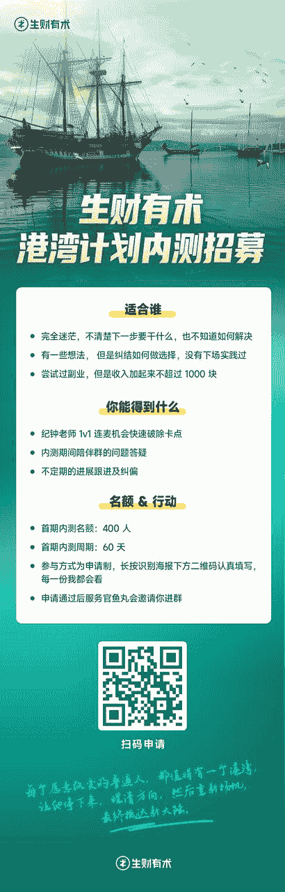