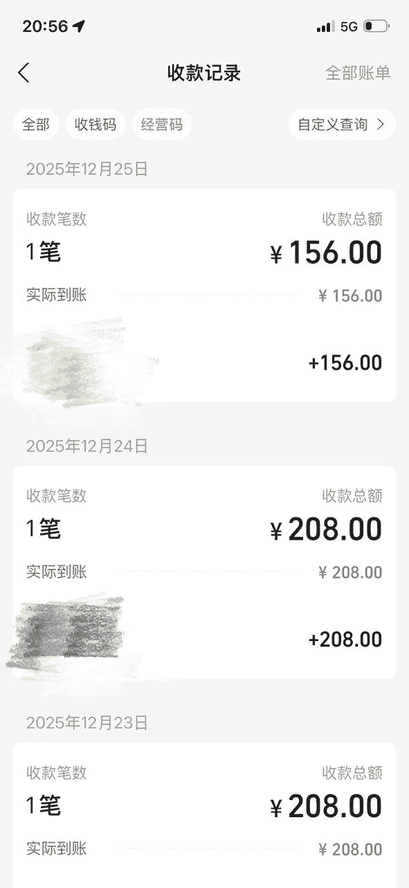
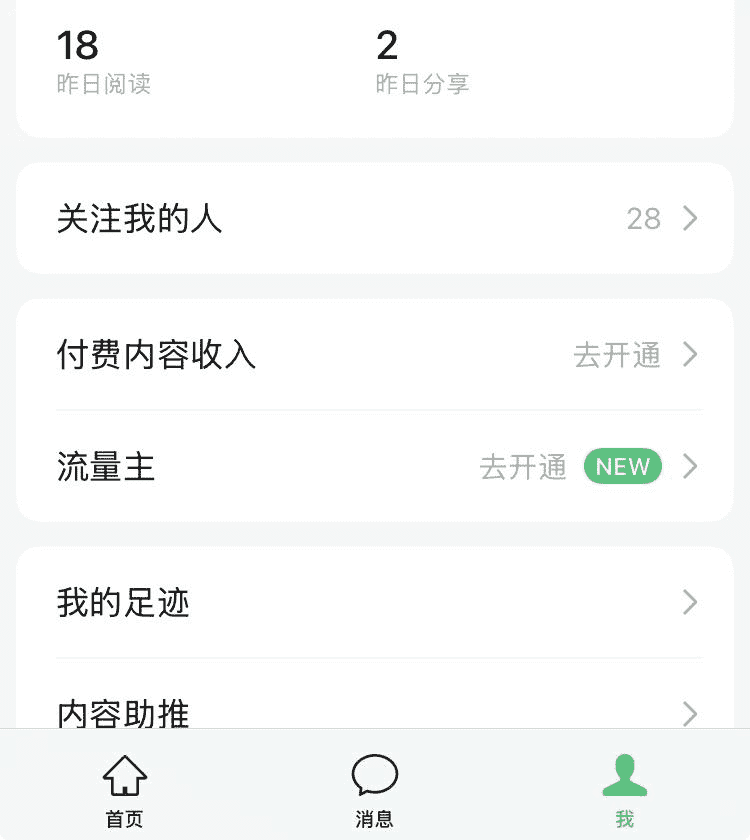
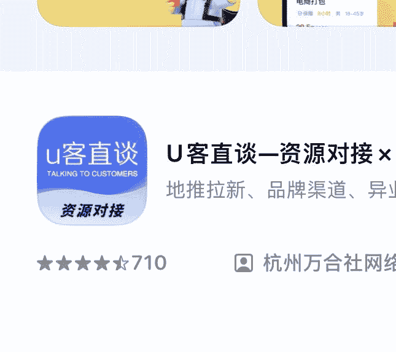
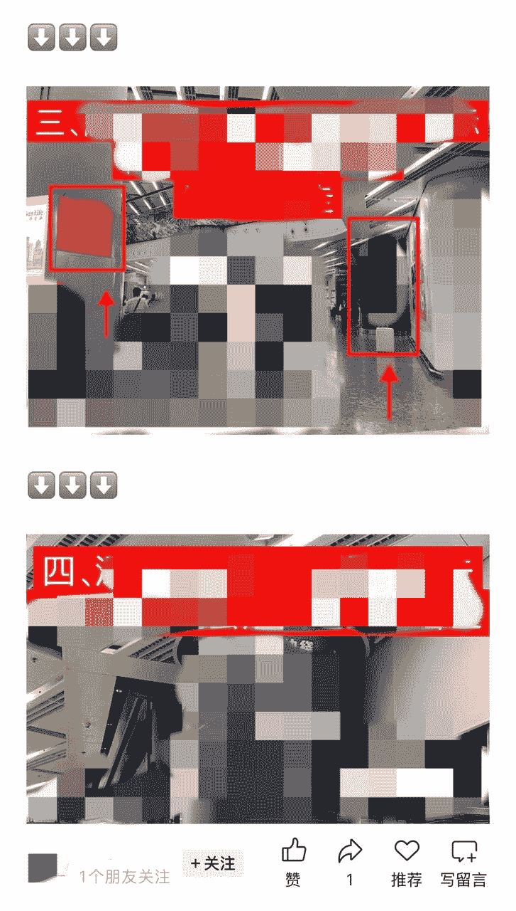
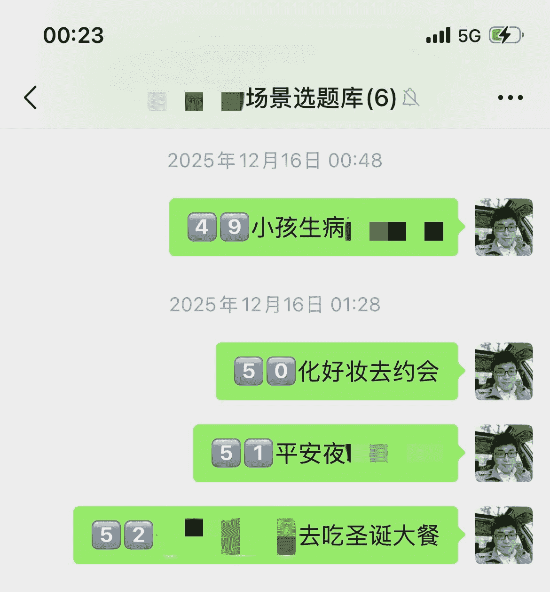
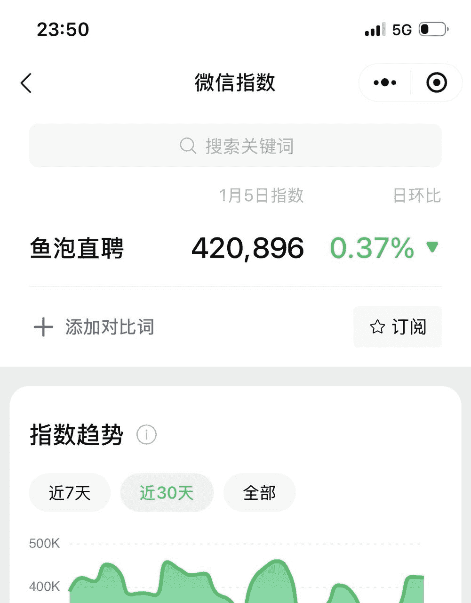

# 新手每天仅10分钟日更，首月变现6000元——利用碎片时间简单粗暴做垂直小号拉新赛道

> 来源：[https://xuqiwei1986.feishu.cn/docx/TYAAd25MQosZJYxWBH8cGTKtnRf](https://xuqiwei1986.feishu.cn/docx/TYAAd25MQosZJYxWBH8cGTKtnRf)

# **一、开篇**

Hello各位赚钱圈友，我是赚钱第一年圈友启茵。

这次我有幸受赚钱官方邀请写一篇帖子，分享一下跑通垂直小号的心路历程。

我今年2月加入赚钱，参加了2025年每一期大航海。

上半年跑通AI写作0-1，并且放大为培训，赚回2倍赚钱门票。

下半年也跑通👸号垂直小号，又赚回了2倍赚钱门票。

我有幸受赚钱官方邀请写一篇帖子，分享我跑通垂直小号的心路历程。

# **二、分享我的垂直小号的小结果**

2025年10月27日起号操作，直到写文的今天2026年1月1日，总共变现了6656元人民币，赚回2张赚钱门票。

我做的赛道项目每单价格大约40-60人民币左右。

其中有一篇文章，我晚上8点发布，第二天中午看才15个浏览量，已经出了4单，变现200多人民币。算了一下eCPM还挺高的。

实操了一个月后我算了一下，每一篇文章平均收益是100元左右。

这种小成绩在高手如云的赚钱圈友面前可能不值一提，但对于我这个👸号新手是个大突破，也让我体会了一把“低粉变现”的商业认知。

严格来说是“低粉低流量变现”！在这过程中，其实我的变现能力几乎和粉丝数量没什么关系。

还有一点，我的客户几乎都是自动化成交，客户完全不需要加🛰️，我就已经把佣金赚了。退款售后更是零。

垂直小号玩的是精准流量，精准变现。我已经脱离了泛流量泛人群的框架了。

** **

# **三、拆解我的方法论（重点）**

## 3-1、我做的细分赛道

目前我用👸号做海外小众CPA拉新，至于具体拉新什么项目就不方便赘述了。

由于这个小项目只能做短期几个月，而且太小众的小赛道未必容纳到太多玩家，平台方也不接纳太多网推。

然而，项目不是最重要的，变现的后端可以有无数个。

能把垂直小号这个“小而美”的玩法初尝0-1才是最重要的。

**重点：用👸号做垂直小号内容，可举**一反三做大部分高客单价垂直类CPA拉新。

## 3-2、以始为终，先有变现业务再倒推做流量

我在U客直谈平台上发现这个机会。互联网圈的大佬肯定知道这平台，但更多人是不知道的。

这就存在一个我知道别人不知道的信息差，这信息差也是我长期对于渴求赚钱而积累下来的。

过程挺有趣的：2025年9月，我在U客直谈平台不断找项目。每个U客账号有6次免费联系项目方的机会，我有5台手机，总共30次机会，我几乎都用光了，但还是没找到一个适合自己赚钱的好路子。剩2次免费机会的时候，换作很多人都放弃了，但我还抱着一丝希望去找。果然还被我刷到了一个新发布的项目，仅用了一分钟，判断出这个是我有优势并且擅长的类别，于是联系对方，聊了半小时，我马上拍板开干。为了抹平信息差，我在U客直谈上找一下有没有同类别，果然还真有，我把最后一次的免费联系机会都用上。后期的事实证明，这个动作是有帮助的。

重点：我把握住U客直谈这个信息差+我坚持不懈的信念。

## 3-3、变现可观的核心原因

如果我单纯靠流量主来变现可能我的变现会少一点，除非我的流量做得很大。

与大部分同行圈友选择用流量主变现不一样，我选择了另一条路——【拉新佣金】这种后端变现。

这也许是受第一个项目AI写作的影响，我的路径思维[公域引流]—[销售转化]—[私域变现]已经成为习惯，所以我更倾向于低粉高变现。（当然对于很多高手来说几十块一单也不算高了，但足够新手小试牛刀。）

重点：海外项目+变现途径决定了这个项目的变现可能性。

## 3-4、具体拆解我的行动步骤

方法很粗糙，但贵在容易执行，正反馈也来得快。

A.接触这个项目后当晚我就制定策略。

B.第二天我就找当地朋友线下测试的方式出了一单，最重要的是把整个流程走一遍，并把所有做单的步骤流程都截图下来，这个可珍贵了。

C.我把每张图都做好了步骤一、二、三、四、五的标注。这样我既能够对步骤链路掌握得非常清晰，而且我把步骤都做成傻瓜式，当用户触达到这个拉新活动的时候也就能完全无脑按照步骤去执行。

D.然后我再让当地的朋友帮忙多出几单，让我可以累积多几种不同的情况用来做素材。

E.根据第一单的步骤截图，我就在👸号写了第一篇保姆级教程，完全就是我朋友操作的流程，我只需要把它用一个人性化、简单化的方式写出来。这样形容都不够彻底，应该说我把傻瓜式+保姆级+喂饭篇用到了极致，让用户看完就可以自行操作参与活动了。坦白说，这时候的我，对于如何根据这个小众项目去做垂直小号，思路还是完全不清晰的。我只知道，先发了第一篇看看效果再说。

F.设计第一篇文章的封面，当时我也不想折腾太多，就来个大字报吧，没想到这个成为了我之后封面的非常垂直的设计，而且这样吸引过来的用户，足够精准，足以把一些只为情绪价值的路人粉泛粉给筛得精光。

G.发完第一篇文章，我也没有刻意去看后端转化数据，紧接着24小时内再发布一篇关于这个项目的一个具体场景应用的文章，再到第三天就出单了。足够及时的正反馈，足够让人振奋的钱味道，给了我天天更新的动力。

H.关于AI方面，我并没有用在写作上，我自己足够能力去手搓。但是在建立选题库上我确实借助AI大大提升了我效率和思考。

I.我围绕着“铁打的人群，流水的选题”这个方针，在30天里几乎做到了日更。用不同选题的文章内容去吸引这一类垂直人群，而且每一篇场景的文章都在文章末端带上了第一篇保姆级步骤文章的链接，看完我的内容如果他们有兴趣就会点进去文章末端链接。所以我是用每一篇新的文章去导流到第一篇步骤操作的文章，因此第一篇文章的浏览数据就在一定程度上反映转化率。

J.还有一点我是在做的过程中才学习的，就是用一到两个关键词来圈住我的这批目标人群。

重点：把手弄脏的执行能力+用户思维+圈垂直人群。

## 3-5、如何能做到自动化成交

尽管我的👸号菜单栏也有留🛰️二维码，但几乎没有客户加我的🛰️，所以只要我的内容有流量有转化，成交的都是自动化的，我剩下需要做的事情只是跟服务商核算佣金。

关于这个原因，后来我自己复盘，很大程度是得益于我第一篇写步骤的文章，我把步骤写得足够傻瓜式、保姆级、喂饭般，以至于让用户看完几乎没有什么疑惑，能够自动参与活动。

另外我无心插柳地布局了很多关键词，吸引了很多精准的搜索流量。这类人群也是有可能参与过同类别活动的人，因此我的文章只要呈现到他们面前他们理应也是一看就懂，不需要我再多引导。

其实大家看我这篇帖子已经反映了我的表达风格——简单清晰，让99%的目标人群都看得懂我写的东西。

至于我每篇不同场景的文章，写多了我也形成了一个内容框架SOP：呼唤人群——场景类别吸引他们——放大用户痛点——抛出解决方案——文末链接引导转化——等待成交。

每天日更就是根据这个清一色的框架，每次的变量只是逃入不同场景并略微调整一下就行了。封面也一样，照样垂直大字报加一些相关场景背景图。

如果大家看我这篇帖子能看得懂，那么就代表了我做这个项目的目标用户也能看得懂我的👸号内容了。

**重点**：把整个拉新链路展示得足够清晰，并且把步骤呈现得足够简单，让人一看就懂，手把手跟着流程做，用户自然成交。并且在做内容的时候形成框架和SOP，套公式一样去创作内容自然就变得简单了。

## 3-6、如何建立选题库

关于内容方面是每一个自媒体创作者绕不过的坎，我的策略也足够粗暴的。

我就围绕参与这类活动的潜在人群，写不同场景下需要参加这个活动的不同文章。

于是我围绕着“铁打的人群，流水的场景”这个方针，在30天里几乎做到了日更。用不同场景的文章内容去吸引这一类垂直人群，而且每一篇场景的文章都在文章末端带上了第一篇保姆级步骤文章的链接，看完我的内容如果他们有兴趣就会点进去文章末端链接。所以我是用每一篇新的文章去导流到第一篇步骤操作的文章，因此第一篇文章的浏览数据就在一定程度上反映转化率。

具体操作：

A.找出核心关键词。我先把自己所做的业务的一两个关键词找出来

B.投喂给伟大的AI，让AI帮自己分析。因为我是根据不同场景来写不同选题，那么就让AI先写30个场景出来。

C.根据AI给出的30个场景做了一些梳理，把场景再分为两大类，一类是天天都会产生的恒常场景，另一类则是和节日相关的热点场景。

D.分类之后我就更容易拓展了。优先节日场景，比如之前的圣诞节、元旦这类,没有热点的时候我就把平时累积的恒常场景用上。

E.恒常场景又如何拓展？根据那一两个关键词再让AI帮忙找一些痛点，痛点就是个很好的场景了。

**重**点：我运用了“核心关键词”——找AI分析——找AI出部分选题——再根据部分选题拓展——再列优先次序——再用痛点拓展。

## **3-7、关于关键词**

我也是从这个项目才开始打开对“关键词”的探索。

我直接给出一个自己探索的粗糙方法论大家去尝试在自己赛道也一些关键词吧。

A.假设别人问你做什么项目，你尝试用一句最简单的话介绍自己的业务。如果做不到，尝试用AI，AI能把你凌乱的思维直接整理，然后把这句话写下来。

B.举个例，一句话介绍业务是“在👸号上发布HR感兴趣内容做鱼泡直聘拉新”。显而易见，两个w——人事部（who）和鱼泡直聘（what）已经是两个核心关键词了。

C.人事部别称是不是HR、人力资源等等相关的？鱼泡直聘的竞对是不是boss直聘？这样可以拓展的关键词太多了。

D.列出的关键词都去🛰️指数搜一搜，如果有收纳，那证明有搜索量。

E.仅用🛰️指数也不够，还再结合腾讯广告。具体可以在咱们赚钱搜“腾讯广告”里面太多大佬分享过如何使用了。

F.把我们值得布局的核心关键词和拓展关键词都列在表格里，可供长期使用。

G.要知道👸号的哪个位置布局关键词更高，以我浅表经验是标题>封面>正文前100个字。

H.每次输出内容就可以按照以上方针去布局自己关键词，但不能太刻意堆砌，文章自然依然是核心王道。

## 3-8、用垂直小号做拉新还有机会吗

第一个号变现了，紧接着我用第二个号去测试也变现了，证明了用👸号写垂直内容去CPA拉新，绝对有机会。

而且我还没完全做到日更，很多运营知识还没用得上，甚至我写的内容也是足够粗糙，没怎么深耕细作都能拿到结果。换成是很多高手，估计能做出我的几倍甚至10几倍结果。

只不过，单纯做我那个垂直小众赛道的CPA机会就不多，我也只是变现了几千块钱。

但是，像这样的CPA项目，甚至比这个客单价更高的，国内也有，海外的就更多选择。例如之前赚钱圈友提及过字节跳动在海外的拉新客单价也非常可观，包括tiktok、剪映海外版、豆包海外版、即梦海外版的拉新，单价都非常可观。

**重**点：只要是能够拿到一个稳定客单价不低的CPA项目，而且目标人群有可能用👸号这个平台的话，都可以用👸号来做拉新。

## **3-9、普通人如何复制**

A.执行能力。我们还没到拼资源的时候，只需要把循序渐进做到位就非常不错了。我也是先踏出实操第一步然后再不断调整的。

B.对垂直小号要有基本理解，不要再去关注涨了多少粉，而是理解用做一米宽度一万米深度的垂直内容。

C.最好要有一些海外的资源。确实有AI已经帮我们能实现很多过去不可能完成的任务。但是如果有海外的资源，我们就更加能贴近用户思维去考虑整个变现链路。尽管我做的这个项目也是面向中国旅客的，无需要外语。但是有一定的海外资源能让自己的认知更贴近。

普通人想要复制完全可以跟以下步骤——

步骤一：找到你们看好的CPA拉新项目，对接好后端。

步骤二：从客户获取拉新链接或者推广码>到使用>到完成订单，这个过程我们最好用自己的手机或者身边亲友的手机，把这个流程完完整整走一遍，每个步骤都要截图下来，并且用大字标上每一个步骤。

步骤三：

用以上步骤作为素材发布一篇操作指南的干货文章。

步骤四：

然后用不同场景来写其他不同文章，文章最后放这篇干货文章的链接作为转化。

就用这么粗暴直接的方法，保持上内容就可以变现了，而且暂时👸号对于放置二维码还不是很严格。

重点：执行能力+垂直小号的理解+有海外资源更好

## **3-10、避坑指南**

留意海外当地市场的法律法规。这一点可能被很多人忽略，但却非常重要。毕竟国内和海外的每个国家地区的法律法规都有不一样，我们不能理所当然地把国内习以为常的一些规则完全套用在海外市场。不然如果我们的用户踩坑了，也就等于我们也踩坑了，自己建立的账号也会翻船。

重点：如果做海外市场要注意当地法律法规避免踩坑。

** **

** **

# **四、复盘总结**

做每一个项目，都要自己亲自下场去测试过才知道能否拿到结果？拿到多大结果？

然后不断测试、不断复盘、不断调整。

👸号属于文字和图文的平台，更适合做垂直人群和精准流量。

在👸号初尝过精准流量的甜头，初尝过低粉高转化的甜头，整个人的商业认知也有一个质的飞跃。

这是除了几千元实质变现之外，我在这个项目获得的更大收获。

最后感激@小武 老师的指点