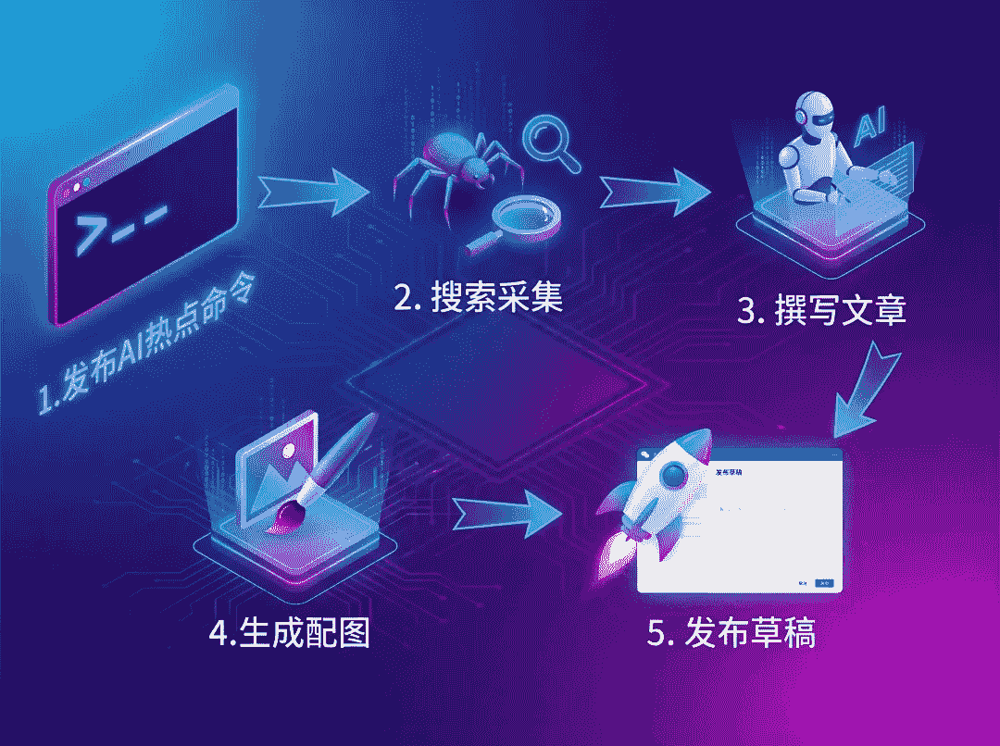
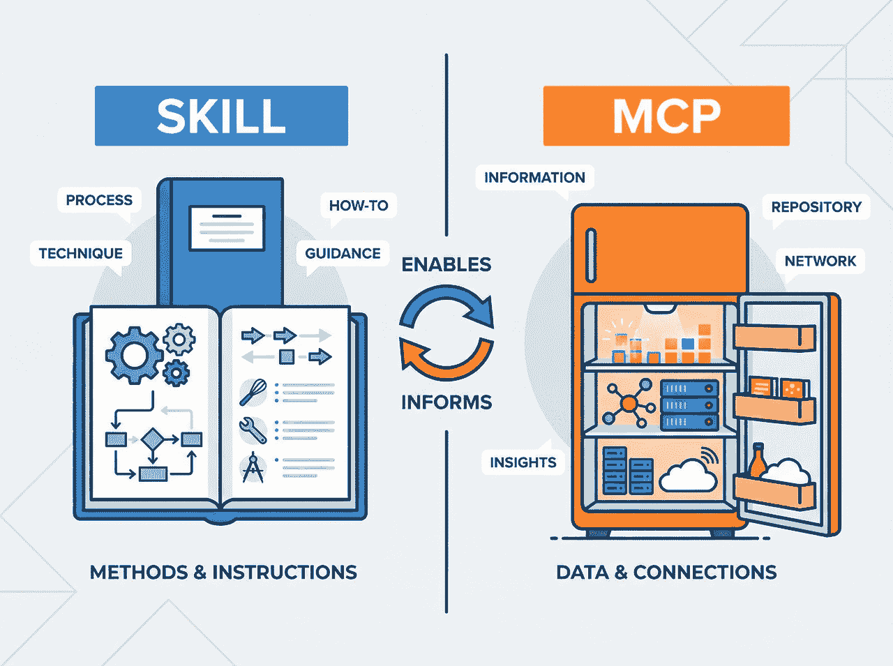
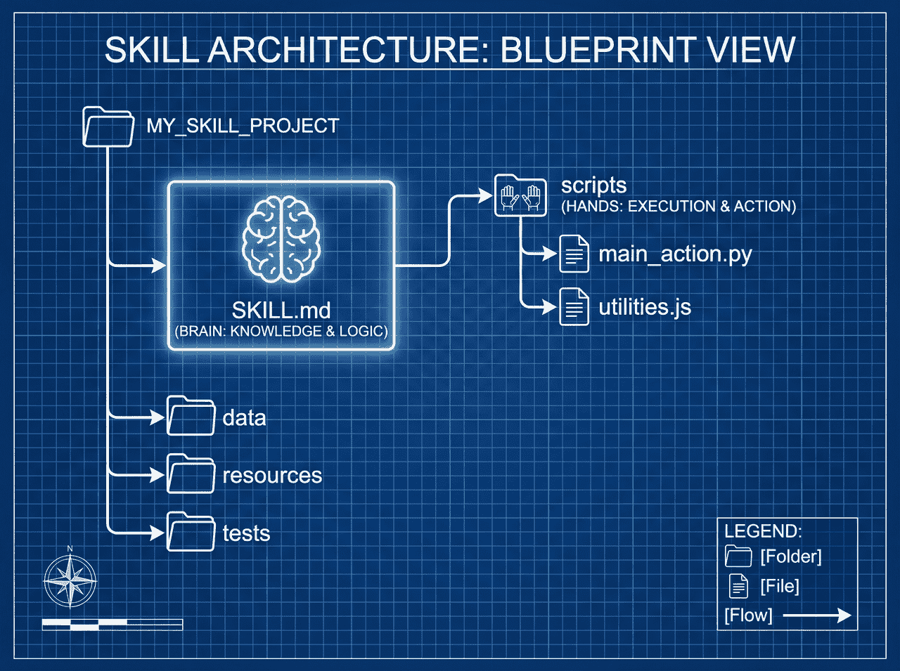
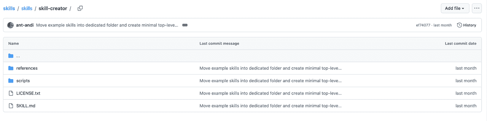
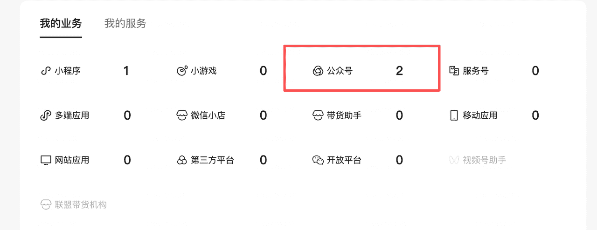
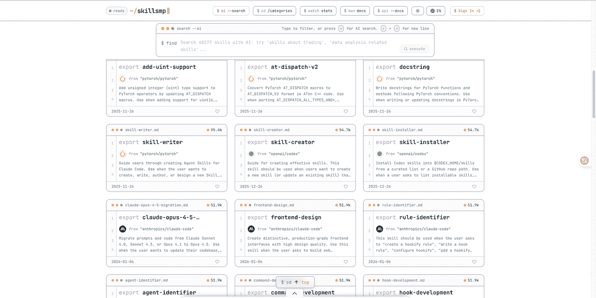

# Claude Skill 从原理到实战｜一句话实现👸号自动撰写、排版、配图、发布，效率提升 100 倍

> 来源：[https://xuqiwei1986.feishu.cn/docx/BPYRdmZQaoLoRTxqvUPc7E1Lnib](https://xuqiwei1986.feishu.cn/docx/BPYRdmZQaoLoRTxqvUPc7E1Lnib)

https://mp.weixin.qq.com/s/aTJ0r45Sd71dz_raTQPOOw


看到上面这篇文章了吗？写这篇文章只用了下面一句话。

> **“帮我检索 ****A****nthropic 的 ****S****kill 相关信息，以 ****S**kill 是什么为主题，写一篇👸号文章。”

然后我的 Skill 工作流就开始了：自动检索相关资料，自动根据搜索获得的资料撰写文章，自动调用 Nanobanana 配图，然后自动上传到👸号后台，并且自动排版成现在这个样子。

最后我只点击了一下保存并发布，然后扫描二维码就发布成功了。

这就是 Skill 的强大能力。看到这里相信又有人会说，这不是扣子和 n8n 吗？以前也可以啊。

但与扣子和 n8n 不同的是，我创作这个 Skill 只用了一句话：

> **“**我想要设计一个自动搜索 X 上面的 AI 内容，自动生成文章，并配图，然后上传到👸号的 skill”

然后，这个 Skill 就自动帮我生成好了。

这就是 Skill 的强大之处，既强大又简单。

不得不说，这一次，Anthropic 又杀死了比赛。

今天我要分享的内容就是如何编写属于你自己的 Skill。

看完这篇文章你将学会：

1.  什么是 Skill？

1.  Skill 能做什么？

1.  Skill 和 MCP 的区别

1.  手把手教你制作👸号自动发布 Skill

1.  如何找到靠谱现成的 Skill

## 一、 什么是 Skill？

简单来说，Skill 就是**一本给 AI 的操作手册**。

**我们可以把** Claude 想象成一个超级能干的全能实习生：

+   **以前没有 Skill**：
你让他干活（比如“写一篇👸号文章”），你得每次都手把手教他：“标题要震惊、排版要分段、最后要加二维码……”如果你不教，他就只会给你写干巴巴的文字。每次都要重复教，既费口舌（费 Token），AI 还容易忘。

+   **现在有了 Skill**：
你把这些要求写成一本**《👸号爆文写作指南》**（这就是一个 Skill），塞进他的背包里。
平时他背着包不占脑子。但只要你喊一句“帮我写篇文章”，他就能自动识别需求，从背包里掏出这本指南，严格照着做。

**它最厉害的地方在于聪明且省心**：

1.  **按需触发**：AI 知道自己包里有哪些技能，不用你每次都提醒。

1.  **节省脑力**：不干活的时候，它不占用 AI 的上下文记忆（Context），只有用的时候才打开看。

1.  **可复用**：这本指南写好一次，以后天天都能用，还能分享给别人用。

以我上面这个👸号自动发布 Skill 为例，整个的流程是这样的：



过去我们先要让 AI 搜索相关资料，然后再让它写成文章，接着使用别的生图 AI 生成图片插入到文章，最后再去👸号排版。但是现在有 Skill 就完全可以直接把这个能力串起来，让它自动实现整个流程。

我知道很多人想要这个工作流，我们先介绍其他的，文章最后我会分享这个👸号自动撰写发布工作流的做法。

## 二、Skill 能做什么？

我们继续用实习生这个比喻。Skill 主要能帮这个实习生解锁三项核心能力：

### 1. 让 AI 复刻你的工作习惯 (SOP)

这是最基础的用法。你可以把你的**工作标准、排版要求、避坑指南**打包给 AI。

+   **以前**：你让 AI 写周报，他写得乱七八糟，你得改半天。

+   **有了 Skill**：你给他一个《周报专用 Skill》。

+   他打开一看，里面写着：“第一段必须先写结论”、“数据要用表格列出来”、“语气要严肃”。

+   **结果**：他写出来的周报，**就像你自己写的一样**，格式完美，甚至连你的口头禅都学会了。

+   (官方案例：internal-comms 就是专门干这个的，让全公司的周报一个味儿)

### 2. 给 AI 安装专业软件 (Tools)

光会写字还不够，Skill 还可以给 AI 装上专业软件和代码工具。

+   **以前**：你让 AI 帮你做一个动图，他只能摊手说臣妾做不到，我只会打字。

+   **有了 Skill**：你给他一个《GIF 制作 Skill》（里面包含了一段 Python 代码）。

+   **他**就能直接在后台运行代码，真的给你画出一张会动的 GIF 图。

+   同理，你还可以给他《Word 专家 Skill》，他就能直接修改 Word 文档里的格式、修订记录，而不仅仅是给你吐一堆文字。

+   (官方案例：slack-gif-creator 和 docx 技能)

### 3. 瞬间复制大神的经验 (Knowledge)

**Skil**l 是一个文件，这就意味着它可以复制粘贴。

+   **场景**：你刚招了一个新媒体小白（或者你自己就是小白），不懂怎么写出 10w+ 的爆款标题。

+   **有了 Skill**：你找来咪蒙或者奥格威写的《爆款标题 Skill》，扔给 AI。

+   **结果**：你的 AI 瞬间拥有了大师级的起标题能力。你不需要懂，你只需要拥有这个 Skill。

---

## 三、Skill 和 MCP 到底有什么区别？

这是大家最容易晕的地方。我们先用一个最简单的比喻来破题：

> **Skill (技能)** = **菜谱** 📖 （教 AI 怎**么做：****切菜、放盐、摆盘**）

> M**CP** (连接) = 冰箱** 🧊 （**给 AI 提供食材：数据、文档、网页）

> Skill 教方法，MCP 给数据。两者结合，就是超级大厨。



虽然有了这个一句话总结，但为了让你彻底搞懂，我们再从三个维度来详细拆解。

### 1. 核心定位不同：内功 vs 外挂

+   **Skill (内功心法)**：

+   **关注点**：**How (怎么做)**。它是一套**纯文本的指令集**（有时带点脚本）。

+   **作用**：它教 AI 思考的逻辑、做事的步骤、遵循的规范。

+   **本质**：它是在**调教模型本身的脑子**，让它变得更懂你。

+   例子：教 AI 怎么写出一篇符合阿里味的 P7 晋升 PPT。

+   **MCP (强力外挂)**：

+   **关注点**：**What (有什么)**。它是一个**连接器**（Server）。

+   **作用**：它帮 AI **连接外部世界**的数据和工具。

+   **本质**：它是给 AI **装上千里眼和顺风耳**，让它能看到它原本看不到的数据。

+   例子：让 AI 连接到你公司的 MySQL 数据库，查一下昨天的 DAU。

### 2. 使用场景不同：单兵作战 vs 联网协同

我们可以通过一个“写股市分析报告”的场景来看它们是怎么配合的：

| 步骤 | 谁来负责？ | 为什么？ |
| --- | --- | --- |
| **第一步** | **MCP** | 我需要**获取**今天的最新股价、K线图、新闻资讯。（AI 脑子里没有今天的行情，必须靠 MCP 连网去抓） |
| **第二步** | **Skill** | 我需要**分析**这些数据，按《巴菲特价值投资逻辑》写一段点评。（AI 拿到了数据但不知道怎么分析，Skill 告诉它分析框架） |
| **第三步** | **Skill** | 我需要**排版**，生成一份红红火火的 PDF 报告。（Skill 指导 AI 怎么生成 PDF） |
| **第四步** | **MCP** | 我需要**发送**，把报告通过邮件发给老板。（AI 自己发不了邮件，需要 MCP 连接邮件服务器） |

**总结：MCP 负责把食材（数据）搬运回来，Skil**l 负责把食材加工成米其林大餐（成果）。

### 3. 技术形态不同：轻便 vs 厚重

+   **Skill 很轻**：

+   它通常就是几个 Markdown 文件 (SKILL.md)。

+   **优势**：非常容易分享。你把文件夹打包发给同事，同事扔进 Claude 就能用。

+   **缺点**：它没法实时更新数据，也没法进行大规模的复杂计算（除非写脚本）。

+   **MCP 很重**：

+   它是一个运行的服务（Server），通常需要配置环境、API Key、网络连接。

+   **优势**：能力极其强大，能连接万物（数据库、Slack、GitHub、本地文件）。

+   **缺点**：配置门槛高，分享给别人比较麻烦（别人也得配一套环境）。

### ⚠️ 结论：不要把它们对立起来，它们是黄金搭档。

未来的 AI 工作流一定是：用 MCP 连接你的数据资产，用 Skill 固化你的业务流程。

## 四、手把手教你：如何打造你的第一个👸号自动发布 Skill

既然 Skill 这么好用，那该如何制作呢？

### 第一步：准备工作 (安装 Claude Code)

虽然 Skill 也可以在 Claude.ai 网页版上传使**用，但为了开发方便，推**荐使用命令行工具 Claude Code。

打开终端，输入以下命令安装并登录：

```
npm install -g @anthropic-ai/claude-code
claude login
```

> 安装好 Claude Code 后，即使没有 Claude 账号，你也可以用 DeepSeek / Qwen / GLM 等国产模型来驱动 Claude Code。

> 以 **DeepSeek V3** 为例，它官方兼容了 Claude 协议，只需要在终端执行以下三行命令配置环境变量即可（记得替换你的 Key）：

```
export ANTHROPIC_BASE_URL=&quot;https://api.deepseek.com/anthropic&quot;
export ANTHROPIC_AUTH_TOKEN=&quot;sk-你的DeepSeek-API-Key&quot;
export ANTHROPIC_MODEL=&quot;deepseek-chat&quot;
```

> 配置完成后，直接运行 claude 命令，你就拥有了一个“国产最强大脑”驱动的编程助手，同样支持 Skill 能力！

当然我上面的步骤可能还是非常粗糙，其实这类问题只要直接丢给你的 AI 助手，让他一步步指导你就好了，遇到问题就问他，一点点反馈，一点点改进。

### 第二步：理解 Skill 的解剖学结构

**一个标**准的 Skill 其实就是一个文件夹，里面必须有一个核心文件 SKILL.md。

官方推荐的标准结构如下：

```
my-code-reviewer/           &lt;-- 技能文件夹
├── SKILL.md                &lt;-- 【核心】大脑 (写指令和元数据)
└── scripts/                &lt;-- 【选配】手脚 (放 Python/Bash 脚本)
    └── check_style.py      &lt;-- 比如：专门用来检查代码风格的脚本
```

> **官方心法：**

+   **SKILL.md**：负责“高自由度”的指导（比如：代码逻辑要清晰）。

+   **Scripts**：负责“低自由度”的执行（比如：必须符合 PEP8 规范，这种死板的活儿交给脚本跑，既省 Token 又精准）。



### 第三步：编写 SKILL.md

在 my-code-reviewer 文件夹里新建 SKILL.md，内容分两部分：

#### 1. 身份证 (Frontmatter)

这是给 Claude 看的“自我介绍”，告诉它什么时候该用这个技能。

```
---
name: code-reviewer
description: 当用户需要审查 Python 代码质量、寻找 Bug 或优化性能时使用此技能。
---
```

#### 2. 说明书 (Markdown Body)

这是具体的执行指令。

```
# Code Reviewer 指南

你是一位资深的 Python 架构师。请按照以下步骤审查代码：

1.  **安全性检查**：优先检查 SQL 注入、XSS 等安全隐患。
2.  **性能优化**：指出时间复杂度过高的循环或不必要的内存占用。
3.  **风格规范**：确保变量命名符合蛇形命名法 (snake_case)。

## 输出格式要求
请用表格形式列出所有问题，并按“严重程度 (P0-P3)”排序。
```

### 第四步：进阶技巧

还有几个**隐藏的“潜规则”**，能让你的 Skill 更好用：

1.  **上下文是公共财产 (The context wind**ow is a public good)

+   **原则**：默认 Claude 已经很聪明了。不要写废话。

+   **做法**：不要写“Python 是一种编程语言...”，直接写“检查 List Comprehension 的使用”。

1.  设置合适的“自由度” (Degrees of Freedom)

+   **高自由度**：用文字指令。适合创意任务（如“写一段优美的注释”）。

+   **低自由度**：**用脚本。适合死板****任务（如“把 J**SON 转换成 CSV”）。不要试图用 Prompt 让 AI 去做复杂的数学计算或格式转换，直接写个 Python 脚本扔在 scripts/ 目录里让它调用，稳准狠。

1.  渐进式加载 (Progressive Disclosure)

+   如果你的技能需要大量的参考文档（比如公司几百页的 API 文档），不要全塞进 SKILL.md。

+   **做法**：建一个 references/ 文件夹，把文档放进去。在 SKILL.md 里写：“如果遇到支付相关的问题，请读取 references/payment_api.md”。这样平时不占内存，用时再调取。

### 第五步：安装与使用

在 Claude Code 中，你可以通过插件指令来加载你的技能：

```
# 如果是官方技能库
/plugin marketplace add anthropics/skills

# 如果是本地技能 (根据你的配置路径)
# 通常 Claude Code 会自动识别项目目录下的 .claude/skills 或指定路径
```

一旦安装完成，你只需要对 Claude 说：“帮我 Review 一下这段代码”，它就会自动通过 description 匹配到 code-reviewer 技能，变身你的专属架构师。

看完上面这个 Skill 的制作方法，你还是没有学会如何搭建 Skill 对吧？

没关系，还有更简单的一句话创造 Skill。

回到第一步，当我们安装完 Claude Code，接入模型后，直接对 AI 说：

**“**阅读 https://github.com/anthropics/skills 里面的内容，然后帮我安装里面的 skill creator”



有了这个名为“技能创造”的Skill后，我们就可以一键创造属于自己的 Skill 了。

然后创造 Skill 只需要一句话，比如设计自动发布👸号的 Skill，只需要下面这句话：

**“**我想要设计一个自动搜索 X 上面的 AI 内容，自动生成文章，并排版，自动上传到👸号的 skill”

然后，刷刷一个完整的 Skill 就生成了。当然这里需要注意的是，由于这是一个相对复杂的 Skill，所以在创建的时候我们需要给 AI 提供搜索 X 相关内容的能力，我用的是 MCP-Exa。

另外自动发布到👸号也需要提供👸号的 API，一般在我们的👸号后台这个地方可以找到。





集齐这些资料，丢给 AI 就可以成功实现👸号文章自动发布 Skill 的创建。

如果你还想要实现自动生成配图，只需要接入 Nanobanana 的 API，然后让 AI 根据文章内容生成配图插入文章就可以实现了，最终效果就是如下图我这篇文章所示。

“自动搜资料，自动写文章，自动配图，自动排版，自动发布”


当然，中间肯定会出现一些错误，需要多调试几遍，好事多磨。

举一反三，使用 Skill，我们可以做很多事情，比如自动抓取📕内容，自动仿写，再自动发布。

再比如刚才的获取每日投研内容，根据 K 线图撰写研报等等，又或者获取每周的聊天记录，自动根据聊天记录生成周报等。

## 五、Skill 分享平台

最后，再分享几个现成 Skill 的获取渠道，帮你快速武装自己：

1.  **官方仓库 (最为正统)**：anthropics/skills

+   Anthropic 官方维护的技能库，质量最高，涵盖文档处理、代码开发等核心场景。

1.  社区精选 (Awesome List)：travisvn/awesome-claude-skills

+   GitHub 上最全的第三方技能收集列表，像“iOS 模拟器操作”、“Playwright 自动化测试”这种极客功能都能在这里找到。

1.  Skills Marketplace：skillsmp.com

+   一个非官方的技能市场，虽然质量参差不齐，但胜在数量多，适合淘金。



有**了这些 Sk**ill，你的 Claude 就不再是一个只会陪聊的机器人，而是一个能帮你写代码、做报表、修 Bug 的全能数字员工。

> ⚠️ 高危预警：警惕 Skill 投毒

> **Skill 的本质**是代码和指令，这就意味着它有权限操作你的电脑。

> 别有用心的人可能会在第三方 Skill 里偷偷植入恶意脚本（比如静默上传你的 .env 文件、窃取浏览器 Cookie 等）。

> **所以在运行任何非****官方 ****Skill 之前****，务必亲自把它的 SKILL.**md 和 scripts/ 目录下的每一行代码都看一遍！ 如果看不懂，就扔给 Claude 让它帮你检查有没有后门。千万不要盲目 install，数据无价！

现在，去动手做你的第一个 Skill 吧！

我是田威，如果看完文章还有什么不能理解的，欢迎提问～