# 个人创作者盗版维权指南

> 来源：[https://xuqiwei1986.feishu.cn/docx/Ax1Cdg7Qmooza4xJcPTcV9gvnvg](https://xuqiwei1986.feishu.cn/docx/Ax1Cdg7Qmooza4xJcPTcV9gvnvg)

> 【声明】本指南仅为个人观察与经验分享，不构成任何形式的法律建议或意见。法律具有时效性与个案差异，具体请以现行法律及专业咨询为准。

**这是一份专为个人创作者/知识付费创业者定制的**、系统化、可操作、接地气的盗版维权指南。

---

# 你是否也遇到过这些情况

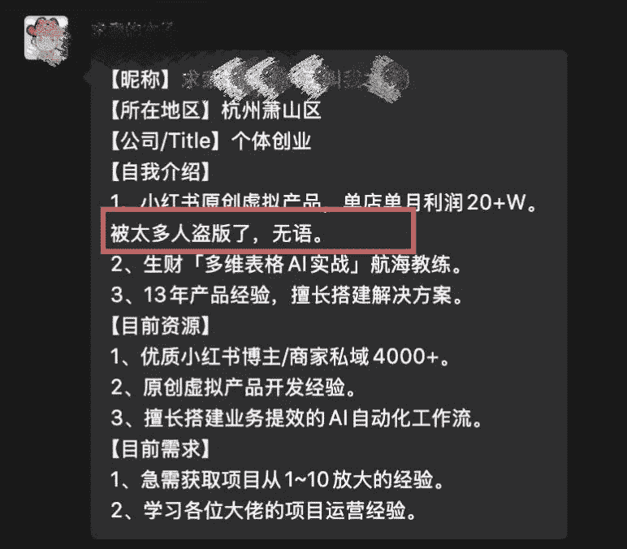

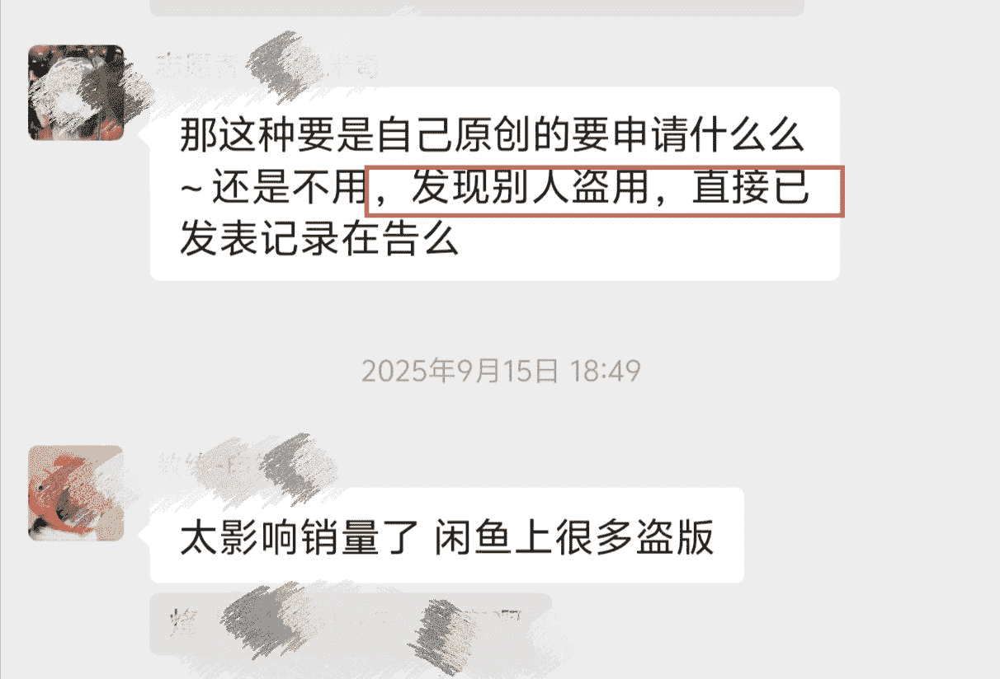

+   **原创被抄袭：** 辛苦创作的内容被洗稿、搬运，投诉无门，只能眼睁睁看别人赚流量？

+   **维权成本高：** 请律师太贵，自己打官司太累，最后赔偿款还抵不上律师费？

+   **流程太复杂：** 不知道如何维权，不了解有哪些维护权利的方式？不知道维权具体能获得什么效果，担心维权费力不讨好

**本篇内容结合我的全部盗版维权经验，为你提供一份全面的维权信息指南，当你再次遇到上述**情况时，脑中有思路，心中不再慌。不仅能快速有效制止侵权，还能打痛侵权人获得赔偿。

# 我是谁

四月，中国政法大学法学本硕7年法律学习（知识产权方向），将近3年头部互联网公司维权法务经验。

累计办理民事侵权案件上千起，行政与刑事案件50余起。

熟悉各主流平台的投诉规则、证据要求与处理逻辑。

**我长期专注侵权维权实务——**

研究如何在成本可控的前提下，提高止损效率与维权成功率。

# 一、为什么我要写这份指南

你好，我是这份指南的作者四月。

如果你点开了这份指南，很可能是因为你发现自己辛辛苦苦创作的文章、课程或者资料包，正被别人肆无忌惮地复制、传播甚至售卖。那一刻，愤怒、无力和沮丧或许同时涌上心头——“我该怎么办？”

这正是我写这份指南的初衷。

大多数个人创作者和小团队在发现盗版后，往往陷入两难：一方面，心血被窃取，实在意难平；另一方面，想到维权需要的法律知识、高昂成本和漫长周期，很多人最终只能无奈选择“算了，太麻烦”。这种沉默，反过来又助长了侵权者的气焰。

但我想告诉你一个事实：维权，没你想的那么难，也没有那么难以实现。

面对侵权，你并非只有“忍气吞声”或“砸钱请律师”两个极端选择。在这之间，存在着一系列系统、可操作且成本可控的路径与工具。你完全有能力，像运营你的创作事业一样，有策略、有步骤地守护自己的劳动成果。

**我为什么能为你提供这份指南？**

我的经历或许能给你一些信心。我在中国政法大学接受了七年的法学专业训练，并在知识产权行业深耕，专门负责维权案件。三年间，我亲手处理过上千起民事诉讼，也办理过五十余起行政及刑事维权案件。

长期面对的对象包括：个体盗版卖家；灰产平台；生产端、渠道端、分销端的完整侵权链条。我深知维权的不易，也总结了诸多经验，所以有了这份指南。

**这不是一份教你“怎么当律**师”的手**册，而是：帮你在发现盗版的第**一时间不慌，给你一套从轻到重、可升级的维**权路径，让你知道：什么**情况适合私下解决；什么情况必须走平台；什么情况值得动用法律资源；在不消耗你全部精力和情绪的前提下，尽可能多地拿回属于你的合法权益。

**这份指南最适合谁？**

1.  只要你对内容享有著作权（由你独立创作产生），且该内容具备稳定表达形式，就在本指南覆盖范围内，包括但不限于：

+   纯文本类：以文字为唯一载体的作品。

+   包括： 电子书、文章、专栏、研究报告、图文资料包（如果资料包内全是文字）。

+   音频类：以声音为唯一载体的作品。

+   包括： 音频课程、直播录音、播客节目。

+   视频类：以影像和声音为载体的作品。

+   包括： 视频课程、录播课。

+   多媒体/混合媒体类：包含两种以上独立格式文件的打包内容。

+   包括： 视频课程+配套PPT+源码+PDF笔记（作为一个整体产品）、系统化的知识库（如果包含图文+视频）。

1.  重点解决：著作权侵权场景下的维权路径选择。

1.  缺乏公司法律团队的支持，追求低成本、高效率、能落地的解决方案。

# 二、发现盗版怎么维权

## （一）维权的基础认知

### 认识你的权利

作为知识创作者，你的核心资产就是创作的内容。它们大多以“文字”为载体，但在法律上，其形态和权利更加丰富。

你享有的著作权是一束权利，包括发表、署名、修改、保护作品完整、复制、发行、信息网络传播等多项具体权利。盗版行为最常见侵犯的是你的 “复制权” 和 “信息网络传播权”（即未经许可，将作品放到网上供人获取）。

| **你的知识产品** | **对应的法律作品类型** | **核心受保护部分** | **维权时的主张要点** |
| --- | --- | --- | --- |
| 电子书、文章、专栏、报告 | 文字作品 | 具体的文字表达、结构安排 | 原文的实质性复制或抄袭。 |
| 音频课程、直播录音 | 口述作品 | 固定的口头讲述内容（其文稿本身也是文字作品） | 未经许可的录音、传播或二次剪辑。 |
| 视频课程、带解说的演示 | 视听作品 | 动态画面、配音、字幕的整体构成 | 非法录屏、截取、修改或去除水印后传播。 |
| 图文资料包、知识卡片 | 美术作品 / 汇编作品 | 单张图文的独创性设计，或整体内容的独创性选择与编排 | 整套资料被破解、打包转卖；或其中核心图表被复制使用。 |
| 系统化的知识库、数据库 | 汇编作品 | 对内容材料具有独创性的选择或编排方式 | 整个知识体系结构、分类方式被照搬。 |

### 识别侵权形态

盗版并非只有“全文照搬”一种形式。对于知识付费产品，侵权形态更具针对性：

1.  **全盘盗卖型（最直接）**

1.  表现：你的完整课程视频、音频、电子书、资料包，被他人以低价甚至免费在电商平台、网盘群、二手社群中出售或分享。

1.  特点：侵权链条完整，通常有推广和销售行为，对你的收入造成直接冲击。

1.  **拆解重组型（最常见）**

+   表现：将你的课程内容进行“录屏”或“转音频”，去除你的品牌标识（LOGO、水印、口播），重新包装成“笔记”、“精华版”、“二手课”进行传播或售卖。

+   特点：隐蔽性强，可能分散在多个平台，但实质仍是你核心内容的复制。

1.  **搬运抄袭型（针对图文）**

+   表现：将你的文章、专栏内容复制粘贴到其他网站、账号；或进行低级“洗稿”（同义替换、调整语序），冒充原创发布。

+   特点：旨在吸引流量，损害你的署名权和传播影响力。

1.  **非法演绎型（更具迷惑性）**

+   表现：未经你许可，基于你的课程内容制作“解读课”、“思维导图”并商用，或翻译成其他语言传播。

+   特点：可能夹杂侵权者自己的理解，但核心骨架和独创性表达仍来源于你，侵犯了你的改编权等。

遇到疑似侵权时，先花几分钟对照上述类型进行初步判断，这有助于你后续选择最精准的维权策略。

### 准备权属证据

维权本质上是“用证据说话”。以下两项准备工作必须做在一切行动之前，它们是你所有维权行动的基石。

准备一：完成权利证明——取得“版权登记证书”（非必须，但有了版权证书，维权举证会更轻松）

虽然著作权自创作完成就自动产生，但登记证书是法律上最直接、最有力的权属证明，尤其在面对平台、行政机关或法院时，能省去大量解释和举证麻烦。

+   怎么做：优先通过你所在省份的版权服务平台（通常免费）进行在线登记。

+   最佳时机：作品发布前或刚发布时就进行登记。如果已发布但未登记，发现侵权后应立即补办。

准备二：建立证据档案——系统化保存所有“原始痕迹”

如果没有做版权登记，你的电脑和云端就是最重要的证据库。

+   创作过程证据：保存好所有创作底稿、修改记录、思路草图、邮件往来等。

+   首次发表证据：在你官方唯一渠道（如你的官网、指定平台）首次发布的链接、截图及发布时间记录。

+   原件保管：妥善保存最终作品的所有原始文件（如Word文稿、视频母版、设计源文件）。

+   权属公示证据：在作品上清晰添加版权声明，如：“© [你的名字或品牌] [首次发表年份]，版权所有。”这虽不产生新权利，但能起到警示和公示作用。

### 怎么固定证据

在对方还没发现你要维权之前，把所有证据都固定下来。因为网络内容随时可能被删除或修改。

**发现盗版，第一时间**要固定的证据类型：侵权事实本身！！！

+   取证方式的效力：公证（行政、刑事、民事）＞时间戳（行政、民事）＞手动截图/录屏取证（协商、平台投诉）

+   若要到达民事诉讼手段需要时间戳取证，侵权情况不严重不需要采取严厉手段维权，可以通过手动截图/录屏取证。

+   时间戳取证平台：[联合信任时间戳服务中心](https://usercenter.tsa.cn/login?redirectUrl=https%3A%2F%2Fev.tsa.cn%2Fapi%2Flogin%3FredirectUrl%3Dhttps%3A%2F%2Fev.tsa.cn%2Findex&clientId=955740&rd=8709086331786554368)，手机APP【权利卫士】，平台本身已有清晰的取证指引，可以按需取用。

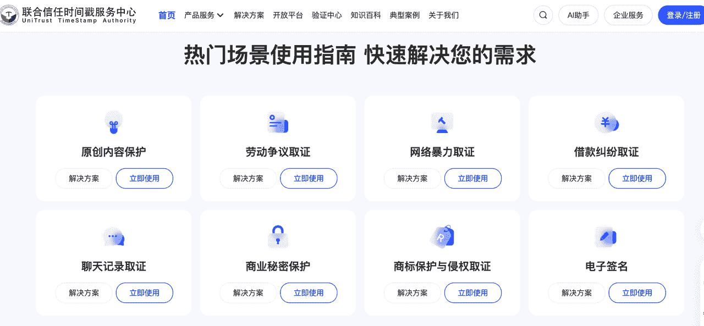

+   **证据1：侵权内容本身**

**要截什么：**

+   侵权页面的**完整截图**（从头到尾，不要只截一部分）

+   页面顶部要包含：**对方账号名、发布时间、平台名称**

+   页面底部要包含：**阅读量、点赞数、评论数、分享数**（这些数据是计算损失的依据）

**特别提醒：**

+   如果是视频，除了截图，还要**录屏保存完整视频**

+   **如果是付费内容被盗版**，要截图对方的定价、销量、购买页面

+   **证据2：你的原创内容+权属证明**

**要截什么：**

+   你的原创内容发布页面（完整截图）

+   重点：你的**发布时间**必须清晰可见（证明你发布在先）

+   如果有，截图你的**阅读数据、粉丝评论**（证明这是你的原创且有影响力）

如果你有版权登记证书，一并准备好。

+   **证据3：侵权对比图**

**怎么做：**

+   把你的原创和对方的盗版，左右并排放在一起

+   用红框或高亮，标注出**相同的段落/画面**

+   在图片上标注：左侧是你的，发布于X月X日；右侧是对方的，发布于X月X日

+   其他证据：对方的获利证据（截图**价格、销量、商品详情页**）、证明对方具有主观恶意的证据：如私信对方配合，对方"拒不配合"

### 维权措施全景图

**核心原则：**维权不是为了"出气"，而是为了"止损+获偿"。选择路径时，要根据实际侵权情况，综合考虑成本、时间和预期收益。

| **维权方式** | 方式说明 | **适用场景** | **时间** | **预期效果** | 怎么做 | **操作难度** |
| --- | --- | --- | --- | --- | --- | --- |
| **私信协商** | 成本最低、最快捷的“首选项”，旨在友好解决 | 侵权事实清晰、情节轻微（如个人用户非恶意转载），或希望以最小成本快速删除内容。 | 1-3天 | 若对方配合，可快速删除侵权内容，有时能获得道歉或小额和解金。但无强制力，对方可能不理睬。 | 通过平台私信等方式，清晰指出侵权事实，出示权属证明（如版权证书、首发链接），明确提出诉求（如下架、道歉、小额赔偿）。 | ⭐ |
| [**平台投诉**](https://my.feishu.cn/wiki/QJzMwenNciRsVykCATdcjMdVnCc#share-LolXd4PlVoS0FGx04AdcEhEcnkg) | 利用平台规则快速删除线上侵权内容的“核心手段”。 | 侵权内容发布于网络平台（如🛰️、抖音、📕等）。 | 5-7天 | 平台审核后，通常会删除或屏蔽侵权链接，这是制止线上传播最有效的方法之一。但平台一般不处理赔偿事宜。 | 在平台官方渠道提交投诉。关键是提交一份合格的投诉通知，必须包含：你的身份信息、权属证明、侵权内容的具体链接、侵权初步说明。否则可能被视为无效。 | ⭐⭐ |
| **律师函** | 正式的法律警告，兼具施压与沟通双重作用。 | 侵权情节较重，或多次协商、平台投诉无效；希望通过专业法律文件表明严肃立场，施压对方。 | 1-3天 | 对部分企业或个人能产生威慑效果，促使其主动联系和解。它本身无强制执行力，但若对方不配合，可作为后续诉讼中对方“恶意侵权”的证据。 | 委托律师撰写并寄送。律师函会正式陈述侵权事实、法律后果，并提出具体要求（如下架、赔偿、限期答复）。 | ⭐⭐ |
| **民事诉讼** | 通过法院判决最终解决争议、获得经济赔偿的“终极法律途径”。 | 侵权情节严重，造成重大经济损失，且与侵权方无法达成和解；核心诉求是获得赔偿。 | 3-12月 | 停止侵权、获得赔偿：法院可判令对方停止侵权并赔偿。赔偿额可按你的实际损失、对方违法所得计算，或由法院在500元至500万元之间酌情判定。你的合理维权开支（如律师费、公证费）也可主张。 | 证据是关键。需系统收集：①权属证明（如登记证书、创作底稿）；②侵权证据（公证过的网页截图、实物证据）；③损失证明（你的损失或对方的获利证据）。起诉后可申请法院进行证据保全。 | ⭐⭐⭐⭐ |
| **行政投诉** | 请求政府主管部门主动查处侵权行为。 | 侵权行为同时损害公共利益（如大规模制售盗版），或你希望由行政机关主动调查、处罚。 | 3-6月 | 行政机关查实后，可责令停止侵权，没收违法所得，销毁侵权复制品，并处以罚款。 | 向侵权行为地的版权行政执法部门（如文化市场综合执法总队）提交投诉材料，需包括申请书、身份证明、权属证明、侵权证据等 | ⭐⭐⭐⭐⭐ |
| **刑事举报** | 针对极其严重、涉嫌犯罪的侵权行为，追求最严厉的惩罚。 | 侵权方以营利为目的，且达到刑事立案标准，例如违法所得超3万元，或非法经营额超5万元。 | 1年以上 | 一旦立案侦查，构成犯罪的，侵权人将面临有期徒刑、罚金等刑事处罚。这是最严厉的打击手段。 | 向公安机关经侦部门报案。需准备详尽的报案材料，包括权属证明、侵权证据、证明侵权达到上述数额标准的证据（如财务数据、销售记录）等 | ⭐⭐⭐⭐⭐ |

> **参考话术：**你好，关于你盗用我原创内容一事，我已固定相关证据。请你于收到此消息后24小时内删除侵权内容。逾期未删除，我将通过平台投诉及法律途径维权，严厉追究你的法律责任。

**Q1：如何选择与组合？**

1.  常规线上侵权（如文章、图片被抄袭）：首选“平台投诉”删除内容，同时可“私信协商”要求道歉或小额赔偿。

1.  造成实际损失（如盗版商品影响销售）：在固定证据后，可“发送律师函”施压谈判。若无果，可以准备“民事诉讼”索赔。

1.  大规模盗版/恶意侵权：可并行“行政投诉”要求查处，并评估是否达到“刑事举报”标准。同时，“民事诉讼”索赔必不可少。

1.  面对多个分散侵权方：可考虑在起诉后，争取通过法院“调解”一揽子解决。

无论选择哪种方式，第一步永远是：全面、有效地固定证据（权属证明、侵权证明、损失证明）。

Q2：对方愿意赔偿，怎么谈和解？

1.  **赔偿金额：先开高价，留谈判空间**

+   参考你的实际损失×1.5-2倍

+   例如：损失5000,可以先开价8000-1万

1.  **谈判筹码：打包要求**

+   不要只要钱，要打包：删除内容+公开道歉+赔偿金

+   对方可能会说"我可以删,但不想赔那么多"

+   你可以让步："那你公开道歉,赔偿可以少一点"

1.  **付款方式：要求先付款再撤诉**

+   先撤诉/删投诉，对方再付款，对方可能赖账

1.  **签署书面和解协议**

+   口头承诺不可信

+   必须签书面和解协议，在协议里增加“违约条款”。例如：如乙方未按约定支付赔偿，甲方有权恢复诉讼/投诉，且乙方需额外支付违约金XXX元。

---

## （二）不同平台侵权投诉操作指南

> **指南中涉及**的投诉模板、维权路径仅为策略性建议。由于各投诉平台（如各电商、社交平台）规则频繁变动，操作时请以平台实时规则为准。本内容不作为法律层面的确定性指引。

90%的创作者维权，都会走"平台投诉"这条路；证据是一切维权的基础，没有证据，什么都做不了

### 各主要平台的侵权投诉入口及指引

处理效果：投诉成立后，平台会根据相应规则对链接采取包括但不限于删除、下架、移除侵权信息等相应处置，并将侵权通知转送至被投诉卖家。

| **平台** | **官方投诉平台及操作指引** | 页面展示 | 反馈期限 |
| --- | --- | --- | --- |
| **淘宝**、天猫、天猫国际、1688、闲鱼 | 1.  [淘天知识产权保护平台](https://ipp.taobao.com/home.htm#/home) | 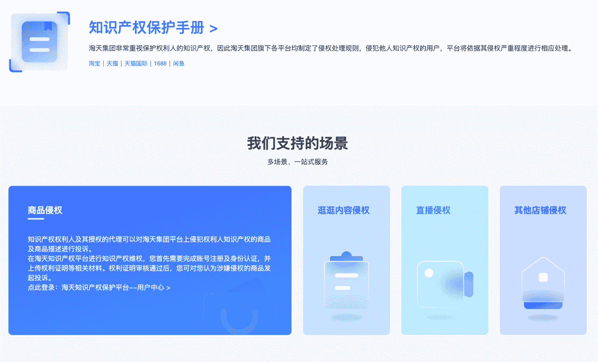 | / |
| 拼多多 | 1.  [拼多多知识产权保护平台](https://ipp.pinduoduo.com/cpp/index?utm_source=baidubz&amp;eqid=8262723200024aea00000004645b0543) | 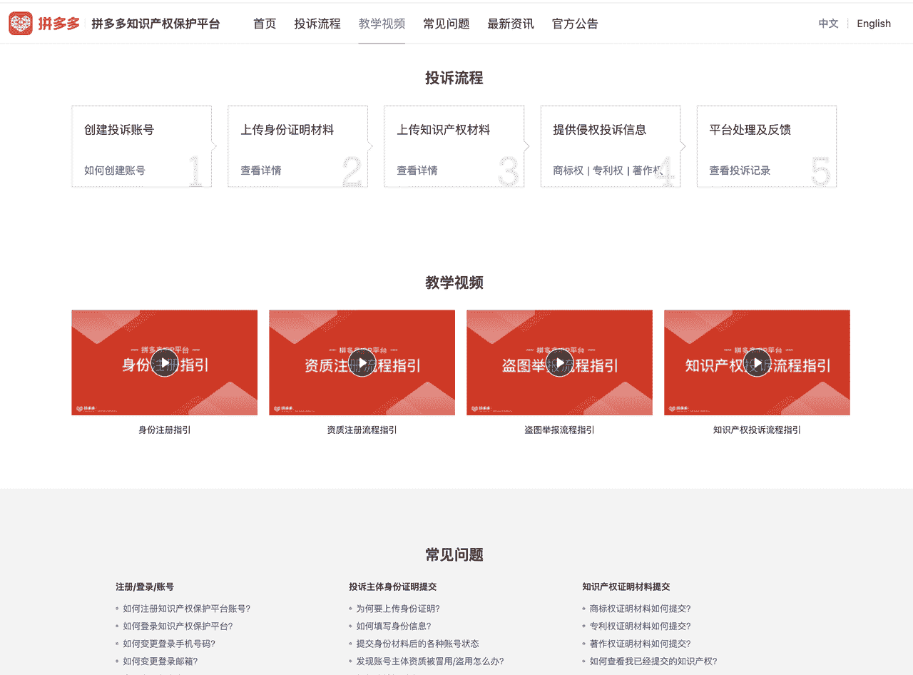 | / |
| 抖音电商 | 1.  [抖音电商知识产权保护平台](https://ippro.bytedance.com/view/login)：含商品、店铺、电商内容、其他投诉等维权操作指南 | 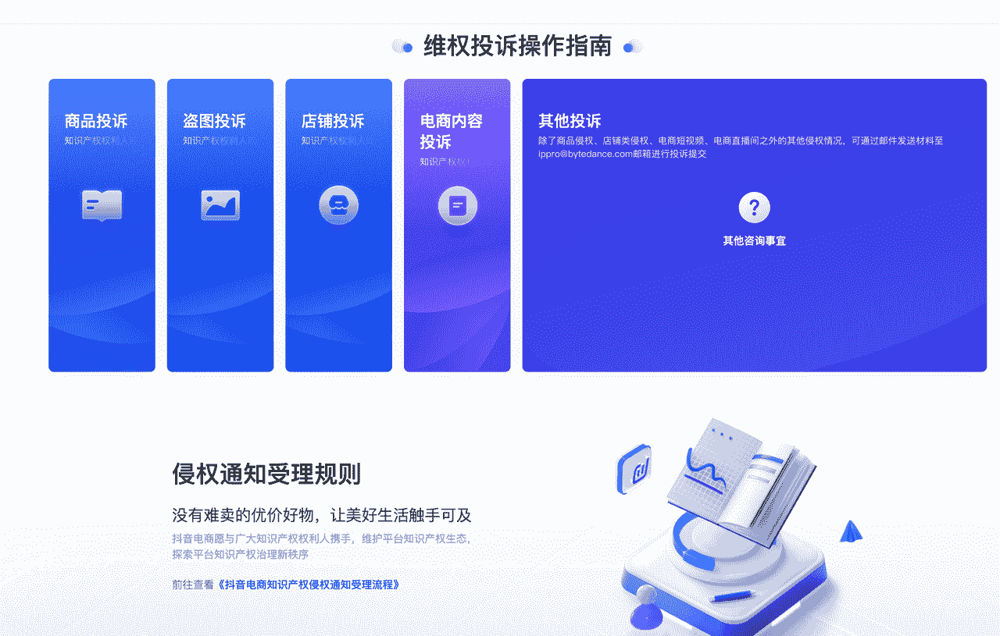 | 5-7个工作日 |
| 🛰️👸号 | 1.  [投诉入口](https://mp.weixin.qq.com/acct/infringementlogin?action=getkey_brand&amp;lang=zh_CN&amp;token=) | 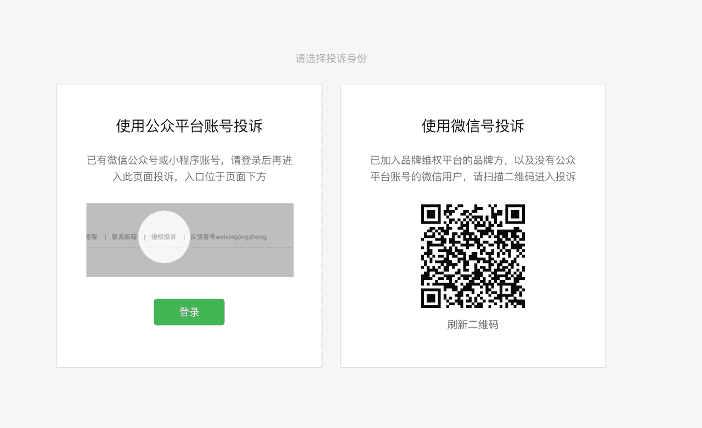 | 提交侵权投诉后，平台会在7个工作日内处理完毕。你可以在侵权投诉“提交记录”中查看投诉状态，同时可以留意通知中心的通知。 |

### 📕侵权投诉操作指南

> 📕提供的侵权投诉指引，点击即可进入：

+   [**📕侵权投诉操作指南**](https://ipp.xiaohongshu.com/login)** ：官方投诉入口及具体投诉说明**

+   [📕电商维权投诉指引](https://school.xiaohongshu.com/rule/detail/89/10028?source=rules_list&jumpFrom=customer&uba_pre=8.school_rule_list..1769001511182&uba_ppre=8.school_rule_list..1769001509725&uba_index=3)：📕平台电商交易场景下所受理的侵权类型（范围）、投诉与申诉操作指引及相应平台处理流程等

+   [侵权投诉指引](https://agree.xiaohongshu.com/h5/terms/ZXXY20230215001/-1)：投诉规则说明

+   [📕官方权利保护中心](https://ipp.xiaohongshu.com/login?uba_pre=8.school_course_detail..1769001124123&uba_index=2)：官方投诉入口

+   [举报中心使用手册](https://school.xiaohongshu.com/lesson/normal/8317386e6a534813b58b53bfe1bcff04?jumpFrom=school&uba_pre=8.school_home..1725011807341&uba_pre=8.school_course_list.system_common_page_system_robin_fatigued_CLICK.1730369191931&uba_pre=8.school_course_detail..1769001239805&uba_index=2&uba_index=2&uba_index=2&courseNo=a5ca355dfa89494cb7b9ce12700f5f81&viewSource=COURSE&fromPage=LessonList)：举报恶意消费者

| **操作指引** | **平台具体要求** | **说明** |
| --- | --- | --- |
| **一、侵权投诉的必要材料** | 1.  **真实身份证明文件** | **【简单总结】** |
|  | 1.  **证明侵权的初步证据** | 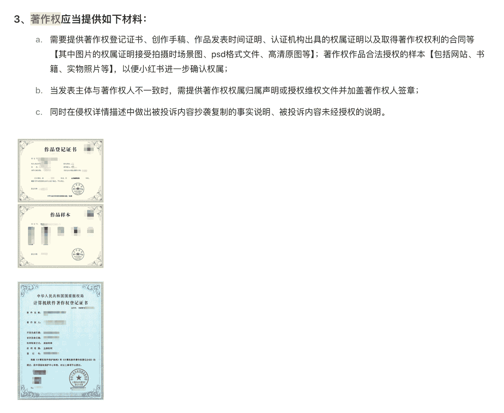 |
|  | 1.  **侵权投诉通知书** | 除侵权投诉通知书外，还需提交权利作品与侵权商品的比对，有利于加速审核确认。 |
| **二、侵权投诉的发送** | 1.  **商品及直播内容侵权投诉方式** | **线上投诉操作步骤展示：** |
|  | 1.  **用户或笔记侵权投诉方式** | / |
| **三、常见问题** | 1.  **侵权投诉处理时间：**通常📕会在 **7 日内**处理您的侵权投诉，但如果您发送的侵权投诉 缺失必要材料、投诉的链接不准确、投诉发送的渠道不正确等 会导致侵权通知无效，📕将无法处理您的侵权投诉。 | / |

+   著作权权属证明材料，包括但不限于：著作权登记证书原件拍摄件或者扫描件（涉及美术作品、摄影作品等，还需要提供实际首次公开的证明材料）、被盗用图片或者视频的原始图片、视频拍摄底稿、版权声明函、出版合同等其他可以证明投诉人拥有合法、完整著作权的证明材料的拍摄件或者扫描件、著作权授权书等

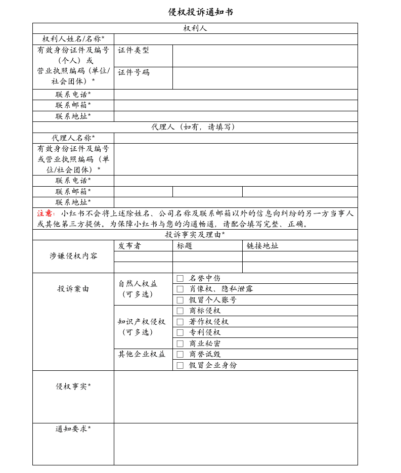

[侵权投诉通知书.docx](https://internal-api-drive-stream.feishu.cn/space/api/box/stream/download/all/Ez3fbGhEwoHUHJxzgWoc2YgCn0c)

1.  **店铺商品侵权投诉：**

+   **邮箱投诉：**如果您需要投诉商品侵权，请您将准备好的侵权投诉的必要材料和投诉商品链接通过邮件发送至 m**ri-**qinquan@xiaohongshu.com 邮箱，并以“权利人真实姓名或名称+被侵害权利类型（例如名誉权、隐私权、著作权、商标权等）”为邮件名。

+   **线上投诉：**如你发现单个商品涉嫌侵权，建议通过app发起侵权投诉，请通过点击”商品页面右上角【分享】 —【举报】—【知识产权侵权投诉】” ，选择对应的侵权类型并提交商品侵权投诉材料进行投诉；

1.  **直播内容侵权投诉：**如果您需要投诉**直播内容**侵权，请您将准备好的侵权投诉的必要材料和直播间链接、直播[侵权时间点、侵权部](mailto:live-qinquan@xiaohongshu.com)分截图或录屏内容通过邮件发送至 live-qinquan@xiaohongshu.com 邮箱，并以“权利人真实姓名或名称+被侵害权利类型（例如名誉权、隐私权、著作权、商标权等）”为邮件名。

+   投诉人须清晰具体地**指出涉**嫌侵权对象侵犯权利人合法权益的具体事实和理由（包括但不限于侵权行为的表现形式、具体场景的截图、涉及的商品 / 服务的定位信息、侵权内容与权利证明的对应关系等），并明确、合理地写明本次投诉的具体诉求（如要求下架侵权商品、删除侵权内容、制止侵权行为等）。

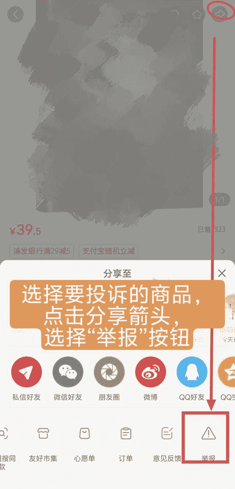

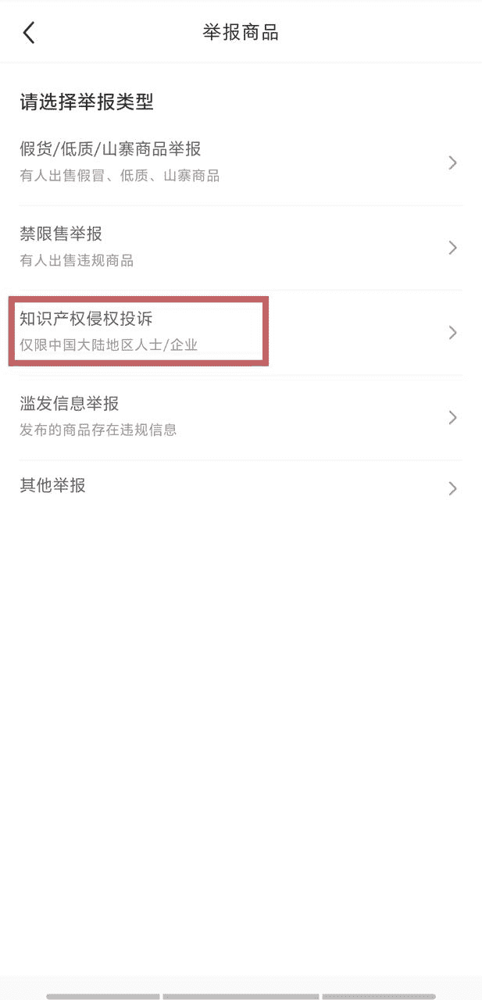

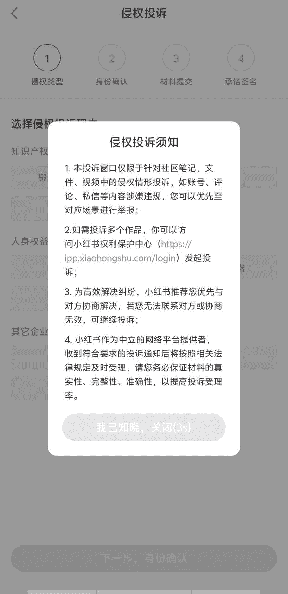

1.  如果您需要投诉单篇笔记侵权，您可以通过“APP端—>点击单项笔记页面右上角图标—>举报—>侵犯我/我的组织的权益”按要求提交侵权投诉的必要材料，发送侵权投诉。

1.  如果您需要投诉用户或多篇笔记侵权，或投诉单篇笔记侵权但[不便通过APP端发送侵](https://ipp.xiaohongshu.com/)权投诉时，请您进入📕官方权利保护中心，按页面所示步骤登录并提交侵权投诉的必要材料，发送侵权投诉。

## （三）如何申请版权登记

| **办理渠道** | **主要负责机构/平台** | **主要受理范围** | **特点与备注** |
| --- | --- | --- | --- |
| **国家级平台** | 中国版权保护中心 | 全国范围的作品，计算机软件必须在此登记。 | 适用于全国作者，尤其是有跨省商业用途的作品。通常需要缴纳登记费用。 |
| **省级平台** | 各省、自治区、直辖市版权局或其指定的办理机构 | 本省（区、市） 作者除计算机软件外的各类作品。 | 通常提供免费登记，且流程更本地化，支持线上办理。 |

### 📝 通用办理步骤与材料

[无论选择哪个平台，核心步骤和所](https://www.ncac.gov.cn/xxfb/bqshfw/bqdj/djjg/202410/t20241018_870052.html)需材料基本相似：全国作品登记机关和办理机构名录

1.  **准备申请材料**
通常需要在线填写或准备以下材料：

+   《作品登记申请表》：填写作品名称、类型、创作完成日期等基本信息。

+   身份证明文件：个人提供身份证复印件，单位提供营业执照等证照复印件。

+   作品样本：提交能清晰呈现作品全貌的电子或纸质文件，如图书文稿、照片、画作图片、视频文件等。

+   权利归属证明（如有）：如委托创作合同、转让合同等。

+   作品创作说明书：简述作品的创作意图、过程和独创性。

+   权利保证书：承诺对申请材料的真实性负责。

1.  **提交申请与审查**

+   在线提交：访问选定的版权登记平台网站（如广西的 http://gxbq.gxbgsx.com/，安徽的 https://bqzx.ahcaee.com/），注册账号后按指引上传材料。

+   现场提交：将纸质材料提交至登记机构的办公地点。

+   提交后，登记机构会进行初审、复审、终审等多个环节的审查。如果材料不全，你会收到补正通知。

1.  **缴纳费用（如适用）与获取证书**

+   中国版权保护中心等国家级机构通常需要缴费，收到缴费通知后按要求支付即可。

+   省级平台很多是免费的。审核通过后，你会获得《作品登记证书》 （纸质或电子版），可在官网查询结果公示。

# 三、法律以外更有效的做法

## （一）如何避免侵权

**学习思想，但是创造自己的表达。** 法律保护的不是知识的垄断，而是激励每个人用自己独特的方式，为知识的大厦添砖加瓦。

1.  **结构重组与视角转换：**完全打散原有目录，按你自己的逻辑重新编排（如按场景、按问题、按难度），或切换讲述视角（如从“教学者”变为“学习者实践日记”）。

1.  **内容具象与案例替代：**将理论与你自己行业、亲身经历的案例结合，用你的故事和细节来诠释观点。

## （二）法律之外如何避免盗版

盗版难以完全杜绝，可以通过优化产品让盗版失去竞争力：

1.  **升级为复合型产品**：将单一资料升级为“资料+服务+社群”的组合，比如在资料基础上增加线上咨询、社群答疑、专属指导等服务。这类组合产品的盗版难度极高，盗版者无法复制你提供的专属服务和社群氛围，正版用户会因为后续的服务支持更愿意选择你。例如有从业者将资料搭配399元的社群，包含运营手册、线上咨询和社群服务，被完全盗版的概率极低。

1.  **做持续更新的产品**：定期迭代资料内容，加入最新的行业动态、案例和工具，盗版者需要承担持续的更新成本，在你规模足够大之前，很少有人会长期跟进盗版，从而缩小盗版的影响范围。

1.  **强化个人品牌标识**：在所有资料中加入你的个人品牌元素，比如专属水印、个人介绍等，让用户能快速识别正版，同时也能提升你的品牌辨识度，减少盗版的传播效率。

1.  **借助平台原创保护机制维权：**如果你的产品在有原创扶持的平台发布，可申请平台的原创保护权益：比如📕平台会邀请原创作者加入保护计划，不仅能保护旗下多个账号，还能实现一键跨平台追责的功能。你可以提交原创证明材料（如创作记录、首发凭证等）申请成为平台认证的原创作者，借助平台的力量打击盗版，对侵权账号进行投诉、追责。