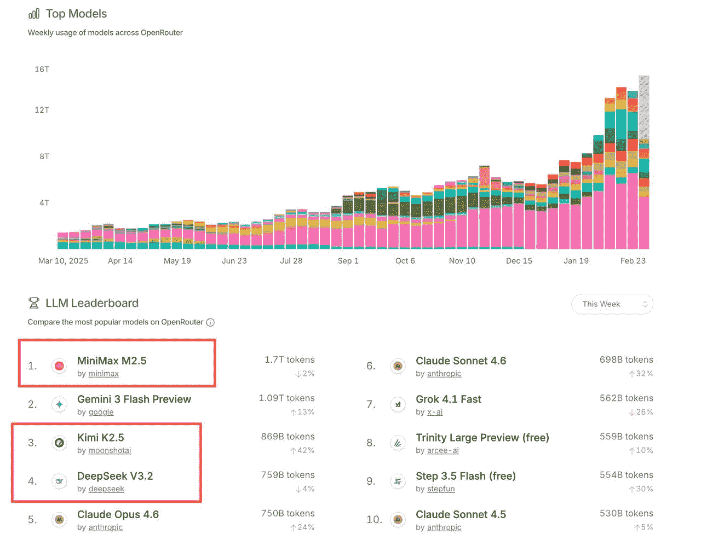
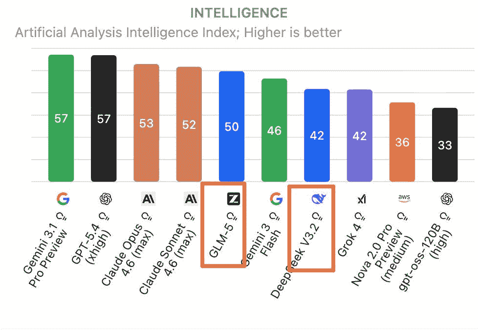

# 2026-03-06我祖上十八代都不会编程，我为什么需要会？

> 来源：[https://xuqiwei1986.feishu.cn/docx/QJxddDGFOoV0D2x4B0kcQdNmn1f](https://xuqiwei1986.feishu.cn/docx/QJxddDGFOoV0D2x4B0kcQdNmn1f)

> 🔗 原文链接： h[ttps://scys.com/ar](https://scys.com/articleDetail/xq_topic/55188424514455884)ticleDetail/xq_t...

哈喽，大家好，我是刘小排。

我和龙哥盟在去年合作过了两期AI编程课程《Idea to Business》，已经全新升级，第三期即将开始报名！

过去三个月，AI编程领域有几个新变化，我把自己的观察分享给大家。 我们第三期课程的变化，也是紧跟领域变化的产物。

# 第一，Vibe Coding 已经成为贬义词。

Vibe Coding的原意：完全跟着感觉走，让AI写代码，自己不怎么碰键盘，遇到报错就把报错扔给AI，看它自己修。

随后，各路自媒体开始用"Vibe Coding"来包装产品、吸引流量、讲故事给投资人听。

"不会编程？没关系，Vibe Coding就行！""两小时做出一个App！"——这类标题铺天盖地。

那些写“两小时做出一个App”的自媒体，一辈子也没做出来过有用的App。 那也不影响人家获取流量，普通人最爱看的就是这样的自媒体文章，平台使劲给流量。

这样的趋势自从2025年9月以后开始反转，资深软件工程师开始把Vibe Coding出来的代码称为"development hell"（开发地狱）、技术债务。 它们往往只是看上去是那么回事儿，实际上很难用于生产环境、发挥出生产力。

连“Vibe Coding”这个词的发明者Andrej Karpathy本人也放弃了它。

2026年2月，在"Vibe Coding"诞生一周年的时候，Karpathy本人在X上发帖，提出了一个新词来取代它： Agentic Engineering 。

如果最近你用AI编程开发了一个产品，别人问你 “喔唷，是Vibe Coding出来的吧？”

你大可以理解为 —— 他在骂你做得烂。

# 第二，国产模型的AI编程模型已经达到可用状态。

我们来看两张图。

第一张， 在Openrouter今天（2026年3月6日）的调用量排行上，第一、三、四名，都是国产模型！

第二张， 权威模型能力测评榜单Artifical Analysis (AA)上，一部分国产模型已经挤进前5。

以下图中的GLM-5为例，它和海外实际上用于编程最广泛的模型Claude Sonnet 4.6，差距已经相当小。

结论是： 虽然国产模型暂时还不如海外顶级模型，但是，它们 已超过可用阈值 。

去年，因为配置海外网络问题、购买海外模型问题，阻拦了相当多对AI编程跃跃欲试的朋友。今天，这个障碍已经不复存在！

基于此项变化， **我们第三期**课程也做出了重大的变化： 全部重写 ！在课程进阶篇之前，几乎全用国产工具， 不需要配置海外网络、不需要购买海外模型服务！

# 第三，AI编程进化很快，越来越快

我们做了三期课程，基本上都全是重头写的。

第一期课程的时候，我自己用Cursor，课程全部基于Cursor。 这才不到一年，已经不太有人用Cursor了。

到了2025年Q4开始，进化加速了。

先是有Claude Cowork，一个软件就打掉了全世界软件公司上亿美元的市值。

很快又有了OpenClaw，小龙虾。

再看Minimax的财报，发现2026年2月的Token调用量，是2025年12月（三个月前）的6倍。

这让我意识到： 好的AI编程课程必须是活的，是一个社区 。

因此，我和龙哥盟做了一个决定： 第三期 课程以 社区的形式（“深海圈”）来运作！朋友们可以社区内持续学习、持续讨论、持续进步。

对了， “深海圈”社区，不再限制为龙哥盟内部。我们也欢迎非龙哥盟圈友参与。

# 那么，我们应该学什么？

按照Andrej Karpathy的区分

> Vibe Coding = 蒙头提示，祈祷有用，不管后果

> Agentic Engineering = 清晰目标，系统拆解，人类判断，AI执行

我们应该学习后者。

根据我的观察，过去两年通过AI编程成为超级个体、一人公司的成功案例，只有较少比例是传统程序员，占比更大的往往是产品经理、用户运营经理、业务负责、小企业的老板。 那些会使用传统手艺写代码的程序员，在AI时代反而最容易被困住——因为他们最容易陷进执行细节的陷阱，花大量时间优化代码，而不是思考“该做什么”。

做产品不再等于写代码。

真正的壁垒从来不是代码本身。

在AI越来越强的今天，真正稀缺的能力是：

把一个模糊的想法，拆解成清晰的任务，然后指挥AI去完成它。

这就是Agentic Engineering ，也是我们课程的核心。

所以回到最开始的问题——"我祖上十八代都不会编程，我为什么需要会？"

换一个问法你就明白了： 如果有一根杠杆，能让你把已有的行业经验、用户洞察、或者一个好想法，直接变成一个跑起来的产品——你要不要？

**过去这根杠杆叫"技术团队**"，门槛是几十万起。 现在这根杠杆叫AI编程 ，门槛是你能不能想清楚自己要什么。

过去，没技术的人只能提想法。

现在，会用 AI 的人，第一次可以亲手把想法做出来。

我越来越相信，AI 时代最不值钱的，是单个工具的教程；最值钱的，是判断力、拆解力，以及把事情做完的能力。

模型会更新，工具会变化，热点会轮换。

但“如何发现机会、如何定义问题、如何快速做出第一版、如何拿到第一批反馈、如何继续优化”这条主线，长期都不会过时。

这也是我为什么想在这个时间点，把新一期课再认真做一遍。

不是因为今天 AI 很热。

恰恰相反，是因为热闹太多了。

大家看了很多，收藏了很多，聊了很多，但真正做出东西的人，依然不多。不是大家不聪明，而是绝大多数人缺的不是更多信息，而是更少噪音，以及一条可以按步骤往前走的路。

这门课不是教你去当程序员，是教你在这个时代，别再把自己的创造力外包给别人。

祖上十八代不会编程，不重要。

重要的是，从我们这一代开始，你得学会 把 AI 变成杠杆，把想法变成现实 。

3 月 10 日（下周二）晚上 20 点正式开启报名

期待课程里见！