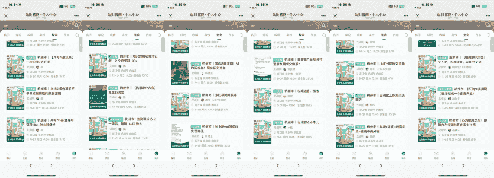
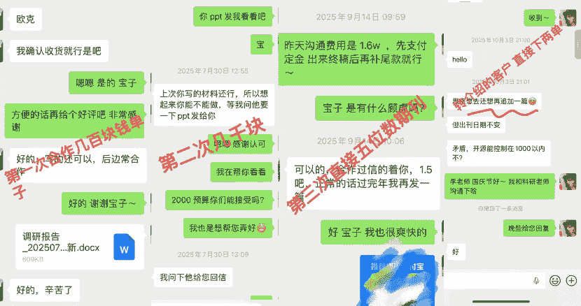
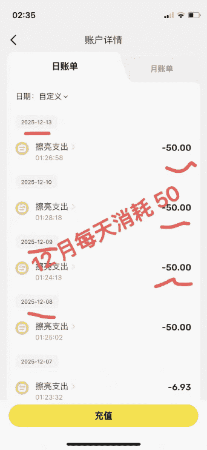
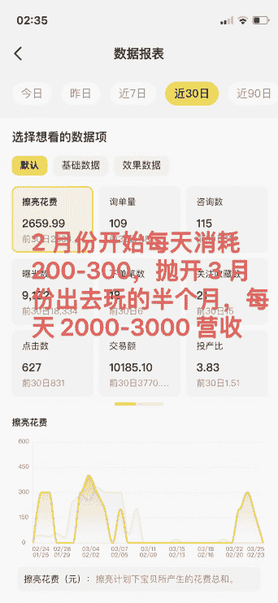
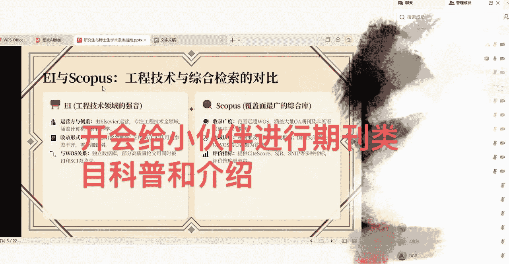
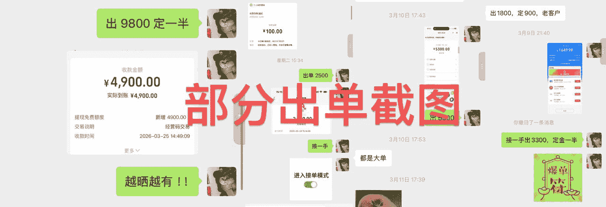

# 加入联合办公半年后，我是如何从月营收 2w 到 20w ，实现了十倍增长

> 来源：[https://xuqiwei1986.feishu.cn/docx/XDZ0dPw8uo4p5GxCImVc7w8rn5g](https://xuqiwei1986.feishu.cn/docx/XDZ0dPw8uo4p5GxCImVc7w8rn5g)

大家好，我叫蛋挞。

对，就是那个好吃的蛋挞。

我是一个前国企牛马，在体制内待了几年，每天办公室出租屋两点一线，所谓的铁饭碗和稳定，背后更多是枯燥和无味，每天最大的盼头就是下班躺床上耍手机。

24年6月，在朋友的介绍下第一次接触 AI 写作，3 个月的时间跑到了副业月入过万，25 年 4 月份离职，全职投入AI写作项目， 一年多的时间，经历过📕严打，经历过闲鱼整顿，也是最早一批开始摸索闲鱼付费投流的人——那时候根本没有人教你怎么投，全靠自己一点一点测出来的。从月营收 1-2w 到现在月营收 20w。

写这篇文章，不是为了晒数字。

是因为联合办公有句话叫越分享越幸运，我自己就是这句话最大的受益者。是别人毫无保留的分享，让我少踩了很多坑，少走了很多弯路。

所以我也想把这一年多真实经历的事情写出来，如果你现在也在做 AI 写作，或者已经做了一段时间但卡住了，希望这篇文章能给你一点用得上的参考。

# 那段卡在 2 万的日子，我到底卡在哪里

24 年 6 月第一次接触 AI 写作。在那之前，我试过很多项目——闲鱼二手书、抖音直播、📕电商，基本上全军覆没，做什么亏什么，一度开始怀疑自己是不是就只能靠上班吃饭。AI 写作是我第一次感受到「创业」这两个字真正的重量。花了大概三个月，月收入跑过了一万。然后就一直在 1-2 万的区间里打转。

打转了很久。

第一个月过万的时候，那种感觉真的很爽，觉得自己好像突破了什么。但这股劲过了之后，我开始意识到一个让我越来越不安的问题：

我只要不坐在电脑前，钱就停了。

不是差一点，是完全停。没有订单，没有咨询，什么都没有。

我不敢请假，不敢生病，出去玩超过一天就开始心虚，总觉得哪里会出问题。朋友叫我出去吃饭，我脑子里第一个念头不是「好啊去哪吃」，而是「今天还有几个咨询没回」。

25 年 4 月，我离职了。

当时的逻辑很简单——上班占用了太多时间，如果全职干，时间多了，收入肯定会涨。

结果完全反了。

失去了工作结构之后，我反而比上班的时候更焦虑。以前上班至少有个固定节奏，现在每天醒来第一件事就是翻手机看昨天有没有出单。没有出单就开始内耗，脑子里各种声音开始冒出来：

是不是账号出问题了？

是不是市场变了？

是不是我的定价太高了？

内耗完了，坐到电脑前，强迫自己工作，工作到很晚，睡着了又开始新一轮的焦虑。

一个人对着屏幕，没有队友，没有反馈，没有边界感，时间全是你的，但你根本不知道该用来干什么。

那段时间我的状态非常差。业绩没涨，但整个人快撑不住了。

我后来复盘那段时间，发现问题不在于我不够努力，而在于我一直没想清楚一件事：

**我**以为我是在创业，但本质上我只是换了一个地方打工，只不过老板变成了自己，还是一个最苛刻、从不给假期的老板。

# 2.加入联合办公，我才明白自己缺的是什么

焦虑到极点的那段时间，我开始疯狂参加线下活动。

不是因为觉得能学到什么，更多是一种本能。一个人待着太难受了，想出去见见人，见见那些在做同样事情的人，哪怕只是坐在一起，也比一个人对着屏幕要好。

在赚钱的活动上认识了涛哥、根源、石神马这些老师，听了很多分享，脑子里装进去了不少东西。后来在小武的引荐下，加入了杭州联合办公。

加入之前，我以为我需要的是一个安静的工位，一个可以专心工作的地方。来了第一天，我才明白——我真正缺的根本不是工位。我缺的，是一个让我无法内耗的环境，和一群让我觉得「这件事是可以做成的」的人。

联合办公二期刚启动的时候，整个氛围是我从来没体验过的。每个人都在干自己的事，每个人都在全力输出。你坐下来，打开电脑，周围全是在认真工作的人，那种场域的能量是真实存在的——你想摸鱼，但你不好意思，你想内耗，但你没时间，因为你看到旁边的人又成交了一单，又在输出新的内容，你的第一反应不是羡慕，而是「我也得干」。

拖延症在那个环境里，真的会莫名其妙消失。

而且不只是工作状态的改变，更重要的是信息密度的改变。

在家一个人做，遇到问题只能自己想，想不通就卡着，然后开始焦虑。

在联合办公，你随手问一下旁边的人，可能半小时就解决了一个困扰你两周的问题。

这种信息流通的效率，是你一个人闷头做永远比不上的。

就是在这样的环境里，我做了联合办公的第一次内部分享，和阿黄德华录了第一期播客，单月业绩从 2 万长到了 10 万。

但 10 万不是终点，只是一个开始。

真正让我从 10 万冲到 20 万的，是两件事

一个让我彻底想明白服务价值的客户，和一个朋友问我的一个问题。

# 3.那个让我彻底想明白的期刊客户

先说客户的故事。

做 AI 写作的时候，我一开始什么单都接，大学生的课程作业、公司白领的周报、商家的产品文案，各种零散需求，心态就是只要有收入就行。这种做法的问题在于，你会把自己的时间切得很碎，每一单金额不大，但每一单都要花精力沟通、交付、修改，忙了一个月账一算，发现自己就是一个高级计件工人，时间全消耗掉了，钱没多赚多少。

后来有一个期刊方向的客户找到我，最开始只是一个几百块的普通调研报告。按理说这种小单完全可以用最快的速度交付，不需要花太多心思，但我没有这么做——该有的格式全都有，逻辑该清晰的地方清晰，他提出修改意见我快速响应，整个沟通节奏都维持得很认真。不是为了表现什么，就是觉得既然接了就应该好好做。结果客户收到之后很满意，过了一段时间又回来了，这次不是几百块的小单，而是一个 1.6 万的订单。做完这个订单，他把自己的朋友介绍给我，那个朋友直接成交了两单 4.2 万，三单加起来5.8 万。

我当时坐在那里看着这个数字，脑子里转了很久。这 5.8 万不是加班加出来的，不是用更多时间换来的，是从一个几百块的小单里慢慢生长出来的。那一刻我才真正理解——服务质量不是成本，是投资。

很多人会说「小单不值得花太多时间」，但我后来的理解是：你永远不知道这个「小单客户」背后连接着什么。他可能只是在用一个小需求试探你，如果你通过了这次试探，后面等着你的可能是一个完全不同量级的机会。

你对每一个客户的认真程度，他们是感受得到的，感受到了他就会带着更重要的事回来找你，还会带着他信任的人来找你。这个链条一旦转起来，获客成本接近于零，而且这些客户的质量，远比陌生获客要高得多。想明白这件事之后，我对业务的理解彻底变了，也就是从这里开始，我开始认真思考怎么把单价和服务做上去，而不是一味地堆量。

# 4.朋友的一句话，让我对投流的认知彻底变了

客户的故事让我想明白了服务的价值，但光靠转介绍，业务的增长速度是有上限的。真正让规模跑起来的，是投流——而推动我认真去做这件事的，是一个朋友问我的一个问题。

那时候我已经在跑闲鱼付费投流了，每天消耗 50 块钱，收益稳定在 500-1500，偶尔好的时候能上 大几千，但不稳定。我当时的状态是：模型跑通了，挺好的，维持着吧。有一天和朋友聊起来，我把数据跟他说了，他听完问了我一个问题：「你现在每天投 50，稳定收 500-1500，你有没有想过—如果一天投 500，收益能不能翻十倍？」

我当时愣了一下。

第一反应是：这个逻辑好像说得通？

但紧接着脑子里冒出来一堆顾虑：

万一 ROI 变差了怎么办？

万一投出去收不回来怎么办？

万一平台算法变了怎么办？

朋友说：「你的模型是正向的，ROI 是正的，你最坏的结果就是损失几百块的测试成本，但你赌赢了，基本盘直接上一个台阶。」就这几句话，把我说动了。

我把日消耗从 50 块一步步提到了 200-300 块，结果单日营收稳定在了 2000-3000，过5000 的概率也比以前大了很多。ROI 确实没有以前高了，但我算了一下总利润——涨了。

这让**我第一次真正理解**了放量的底层逻辑：在增长阶段，看的不是单笔 ROI，看的是总利润规模。 你不能只盯着每一笔钱赚了多少倍，要看整体盘子在不在变大，只要模型是正的，放量就是给增长按下了快进键。

经历了从 50 到 300 的这个过程，我对投流的认知变化很大。

第一：流量有窗口期，后面会越来越贵

闲鱼付费流量是 24 年底才开始玩起来的，现在还是相对早期，红利还在，但窗口不会一直开着。

平台每天的流量是有限的，遵循价高者得的逻辑。当你在犹豫「要不要放量」的时候，你的竞争对手可能已经把坑位占了。

等你「再观察一段时间」，等你「想清楚了再做」，回头一看，窗口可能已经关了一半。

我有一段时间就是太谨慎，数据其实已经在告诉我可以放量了，但我就是不敢动，结果浪费了大概两个月的时间。

所以这件事的逻辑是：ROI 是正的那一刻，就是该行动的信号，而不是等待的信号。

第二：投流是测试逻辑，不是押宝逻辑。

这是很多人对投流最大的误解。

他们觉得投流就是：我投了钱，我等着赚钱，没赚到就说明没用。

这个思维是错的。

正确的投流思维是：我投了钱，我在收集数据，我在测试哪条链接有效，测试哪个人群会转化，测试哪个时间段效果最好。这些数据是买回来的，是有价值的，不管这条链接有没有出单。

所以当你发现某条链接投了几天没效果，正确的反应不是「投流没用，停了」，而是「这条链接没跑出来，换一条继续测」。

账号权重需要积累，算法需要时间学习你的客户画像，当这两件事到位了，效果一定会出来。

我自己也踩过这个坑。刚开始投的时候，有一条链接投了将近一周，每天消耗几十块，几乎没有任何咨询。我当时差点就直接放弃了。

但我没有，我换了一条链接继续测。

新链接第三天开始出单，之后两周一直跑得很稳，把之前那一周的消耗全部赚回来了，还有得多。

所以那一周的「亏损」，本质上是我买来的测试成本，非常值。

** **

第三：ROI 下降不是失败，是放量的必然。

很多人在放量之后，看到 ROI 下降，第一反应是「有问题，要缩量」。

这个反应会让你永远待在一个小的基本盘里。

正确的反应是：先算总利润，再判断要不要继续。

如果总利润在涨，ROI 下降是正常的，继续推进。如果总利润也在跌，那才是真的需要停下来重新审视模型的时候。

坑一：太早精细化，太晚开始跑量。

前期我花了太多时间在优化单条链接的话术上，觉得「写完美了再投」。结果账号权重一直起不来，因为压根没有足够的流量跑进来让算法学习。

正确的顺序是：先跑量，再优化。数据多了，你才知道该优化哪里。

坑二：ROI 一波动就停投，错过窗口。

有几次数据出现波动，我下意识就把投流暂停了，怕亏钱。

后来发现，那几天只是算法在重新学习和调整，如果我坚持住，穿越这个调整期之后效果会更好。停了，反而把之前积累的数据和账号权重打断了，重新启动还要再花时间预热。

坑三：成功链接没有及时复制扩量，白白浪费窗口。

某条链接跑出效果之后，我犹豫了很久才开始复制同类链接，觉得「等稳了再说」。

结果等我反应过来，那个品类的竞争已经多了几个对手，窗口收窄了。

好的打法，出来了就要快速复制，你的速度就是你的护城河。

闲鱼投流目前没那么多特别的技巧，流量和规则都没那么稳定，我们在这个项目上就算 roi，预算之内把弹药狠狠打出去，当然有一天他也会变得和 抖音、📕、淘宝一样，希望那天大家一起顶峰相见。

# 5.光靠自己一个人扛，是真的扛不住的

投流把流量放大了，但随之而来的是一个更现实的问题——流量来了，谁来接？

当咨询量开始上涨的时候，我进入了一段非常痛苦的时期。

订单多了，一个人根本忙不过来，每天就是在赶，赶完这个赶那个，脑子里全是各种客户的需求。交付质量开始下滑，客户开始催，有几个客户明显对结果不满意，我要花大量时间去沟通和修改，然后又影响了其他订单的进度。

整个人就像一个陀螺，转得越来越快，但完全失去了控制感。

就是在那个时候，我开始真正理解一句话的意义：

凡是不能沉淀成 SOP 的努力，都是无效努力。

你靠个人能力把一件事做好，那是你的上限，不是业务的上限。要让业务突破你个人的天花板，唯一的方式就是把你的能力系统化，让别人也能按照你的标准来执行。

就是这句话推着我开始搭团队、建 SOP。

搭团队的过程我也踩了很多坑，当时开始的太晚，我的习惯是先把业务做稳再考虑招人，结果一个人扛了太久，错过了更早放大的机会。也不懂管理和筛选，就是按着小伙伴的头，让他们一定听我的话，可我们的业务是非标的，我能给大家提供话术，但是不能逼他们一定要每个字都按照话术来，特别是前期话术还在打磨的阶段。

前期的话术沉淀和团队搭建sop也产生了很多的矛盾，直到现在我搭建团队的规则才慢慢优化好。

第一步把自己的成交过程完整拆解出来，整理出高转化的话术逻辑，不是让人照着背，而是让人理解背后客户真正在意的是什么；

第二步设计标准化报价模板，让定价有据可依；

第三步建立真正能落地的交付标准，不只是告诉团队「这种情况这么做」，还要让他们理解「为什么这么做」，当遇到手册里没有的情况时能用正确的原则来判断；

最后也是最重要的一步，先花时间找到真正想做好这件事、执行力强的人，再把 SOP 交给他。当这套东西建起来之后，交付才真正脱离了我个人，业务才开始真正跑起来。

# **6.关于报价这件事**

说完投流和团队，再说说报价。

这个认知转变发生得比较晚，但影响非常大。

联合办公里有一本书叫《十倍增长比两倍增长更容易》，里面有个雕塑家的故事——他不断提高报价，只接有挑战性的需求，拒绝那些只想要便宜货的客户，最终从一个无名设计师变成了专门为皇室服务的稀缺艺术家。

我第一次看到这个故事的时候，第一反应是：「这和我有什么关系，我又不是艺术家。

后来有一次，我鼓起勇气把报价基准提了 30%-50%。

我以为会有很多客户跑掉，结果是有一部分人跑掉了。

但跑掉的这些人，我仔细回想了一下，全都是那种：

改了七八遍突然说「我重新想了一下方向」的；

在凌晨十二点发消息问「能不能再便宜两百块」的；

说「全靠你了」然后发完需求消失三天不回消息的；

谈了很久价格，成交了之后又提出一堆当初没说的额外要求的。

这些客户跑掉之后，我反而松了一口气。

因为我意识到，这些客户不只是「价格敏感」，他们消耗的是我大量的时间、精力和心力，而且他们对结果永远不会真正满意，因为他们从一开始就没有把你当成专业的人在看，他们只是在找一个「便宜还能用」的工具。

高价客户是完全不同的一种人。

他们不会在一开始就跟你谈价格，因为他们关注的不是价格，是「你能不能帮我解决这个问题」。

他们沟通效率很高，需求清晰，反馈具体，修改也是有建设性的修改，而不是「感觉哪里不对，你再改改」。

他们尊重你的时间，因为他们的时间也很值钱，他们知道来回拉锯在浪费双方的资源。

而且，高价客户成交之后，满意了他们会回来，还会介绍朋友来。这正是前面那个期刊客户故事里发生的事。

所以涨价的本质，不是为了多赚那几千块钱。

涨价是一种筛选机制。

它筛掉了那些会消耗你心力的客户，留下了那些真正值得你认真服务的人。而当你的精力集中在值得服务的客户身上，你的服务质量会更好，口碑会更好，转介绍会更多，业务会进入一个正向的循环。

# 7.给卡在瓶颈的你，三件最想说的事

写到这里，我想直接跟那些正在卡着的人说几句心里话。

第一件：先找到做得比你好的人，弄清楚方向再使劲。

你的赛道里一定有大哥，有做得比你好很多的人。

在你埋头苦干之前，先去研究这些人是怎么做的。不是简单地看他的内容，是去拆解他的定价逻辑、流量来源、交付方式、团队结构。把这些搞清楚，你才能知道这条路最终可以走到哪里，你现在的打法跟终点之间的差距在哪里。

然后回到自己的业务，盯数据，看结果。

数据是不会说谎的。如果某件事数据一直不好，先不要加大投入，先停下来问自己一个问题：

「我现在的商业模式，是不是最正确的商业模式？」

很多时候人们卡住，不是因为执行力不够，是因为方向本身就需要调整。在错误的方向上越努力，离正确答案越远。不断复盘，不断校准，是你能给自己最好的礼物。

第二件：投流和团队，要同步推进，缺一不可。

我见过两种人：

一种是只做投流，不建团队。流量来了接不住，质量崩了，客诉增加，最后反而把口碑做坏了。

一种是只建团队，不投流。团队搭好了，但没有足够的订单量让团队运转，最后养了一帮闲人，成本全出去了，收入没涨。

这两件事是相互依存的，必须同步推进。

正确的节奏是：先跑通模型，确认 ROI 是正的，同步开始整理 SOP，同步开始找人；然后用投流放大流量，用团队承接增量的交付；流量越来越多，团队越来越熟，整个系统的效率越来越高。

三件事同步跑，才能真正突破天花板。

第三件：相信相信的力量，这件事比你想象的重要。

这句话说出来很虚，但我是真的这么认为的。

加入联合办公之前，我月营收卡在 2 万，而且是那种卖命卖出来的 2 万，随时处于崩溃边缘。

加入之后半年，稳定做到了 20 万。

改变的不只是方法和策略，更根本的是信念系统的改变。

当你一个人在家做，你会觉得「这件事能不能做成不知道」，因为你没有参照物，没有反馈，就只有你和屏幕，还有那些有时候出来有时候不出来的订单通知。

但当你身边都是在全力以赴做同一件事的人，当你每天能看到别人在分享新的成交、新的突破、新的进展，你会开始真实地感受到——这件事是可以做成的，别人做到了，我也可以做到。

这种信念不是靠自我催眠得来的，是真实感受到的，是被环境喂出来的。

越晒越有，越分享越幸运。因为相信，所以实现。

**最后说一句**

从 2 万到 20 万，说复杂也不复杂。

核心就三件事：

做好服务，让客户带客户；投流放量，抓住窗口期；搭好团队，让交付脱离自己。

但每一件事背后，都有一个认知的转变在支撑着它。

不是「我知道了这个道理」就能做到，是你真的在某一刻想通了，然后行动了，然后看到结果了，才真正变成你自己的东西。

如果你现在也在这条路上，希望这篇文章能给你一点用得上的参考。

同频的人，多认识一个是一个。欢迎来聊。