# 海外AI自媒体（X平台）冷启动与放大

> 来源：[https://xuqiwei1986.feishu.cn/docx/EsTQd8mwBoLqMrx6yC0cU4Ntnah](https://xuqiwei1986.feishu.cn/docx/EsTQd8mwBoLqMrx6yC0cU4Ntnah)

hello，大家好，我是逸尘，今天给大家分享一下X的冷启动和放大。

先说下战绩：

一个半月涨粉8000，跑通了商单推广/多个cps/社群引流/后端AI产品变现/后端1v1咨询/创作者收益/YouTube引流/📕互相导流，顺便链接到了超级多的大佬和志同道合的朋友，这就是“做IP”的力量。

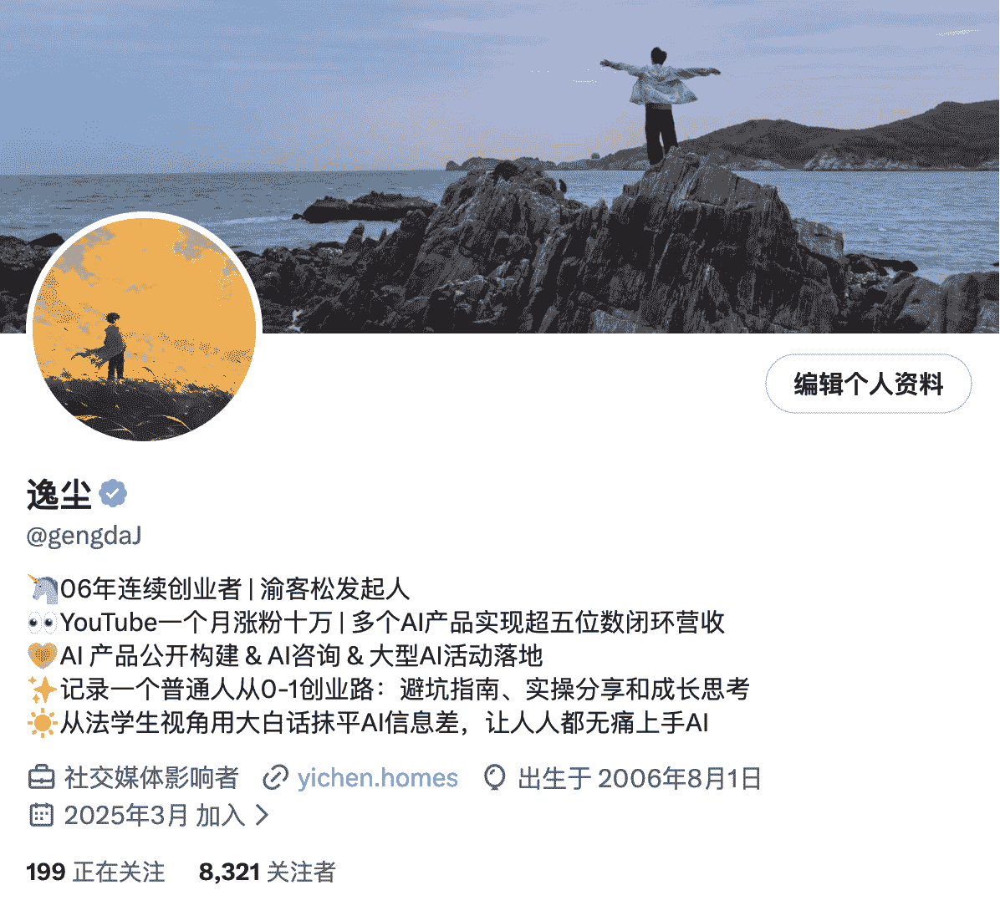

先大概讲一讲我自己的玩法（部分涉及到隐私，就不放截图了，但绝对真实），然后再开始讲普遍适用的玩法：

1、部分商单成绩截图：这个就是2000粉以上可以加入推特的一个创作者社区（需要熟人引荐），里面会发布一些商单。还有一些商单可以在“私信”里面查找，这个应该是变现了一万多

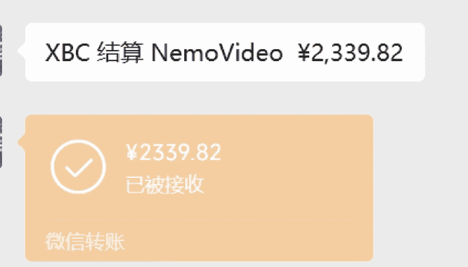


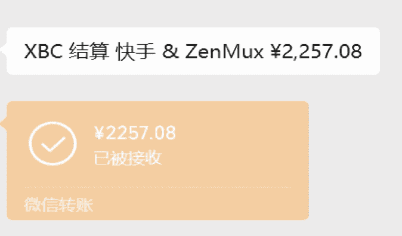

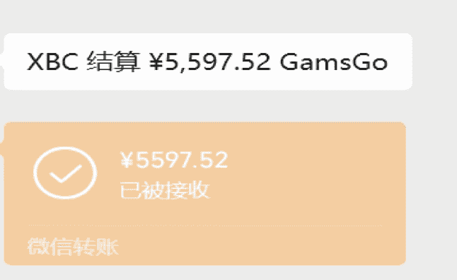

2、社群引流

因为我也在做YouTube，所以顺便做了个YouTube冲刺陪伴群，主要教小白认识一下完整的YouTube创作者收益商业闭环，也变现了大几千。

3、cps

主要就是做一些教程，然后里面放affiliate链接，别人通过自己的链接下单，就可以拿到cps分成，这个大概变现了几百刀。

4、后端AI产品变现

这个我变现的不多，主要我的产品一般，X上的大佬一般不太需要（需要的都自己去vibe coding了），就是赚个咖啡钱。但是很多牛逼的产品大佬，X主页放链接那种，每个月通过主页引流都能赚上几万刀。

5、后端1v1咨询

这个咨询的方向很多，有咨询龙哥盟的（这个顺带就做cps了），有咨询ai ppt的，有咨询ai 视频的，总之，你越牛逼，能给的咨询越多。

6、创作者收益

我大概用了50天开通，主要是500w曝光，开通了计算收益，大概一百多万流量变现了六十多刀。

7、YouTube引流

直接发账号，涨粉

8、📕导流

在📕发布x账号的推文，一鱼多吃（还可以发🛰️贴图），互相涨粉，实测涨的很快，只要内容好。

9、链接了很多大佬

因为我本身还负责抖音今年面向大学生的一个计划的西南地区部分，所以我需要大量的高校和政府资源，通过X上面认识的朋友链接到了资源，包括川大/重大等等高校的校领导，以后实在混不下去了，进抖音应该没啥问题哈哈哈。

同时也认识到了很多的搞钱搭子和自媒体的牛人，大大扩展了一波自己的人脉。

如果你想做 AI 自媒体，X 是一个非常值得认真研究的平台。

它和国内平台最大的不同，不只是“能发什么”，而是它**天然更适合做 个人认知输出、**圈层链接和长期信任积累。很多人在国内平台做内容，更多是在和算法搏；但在 X 上，很多时候你是在和“人”建立关系，你是要打造自己独一无二的ip

# 一、大纲

1.  为什么值得在 X 做 AI 自媒体

1.  X 平台冷启动的核心路径

1.  冷启动之后怎么持续运营

1.  X 上的主要变现方式

1.  一个核心判断

1.  Q&A分享

X 真正要做的不是“发内容”本身，而是建立个人 IP 与信任资产。 一旦信任建立起来，后面的变现方式就不止一种。

---

# 二、主题分享

1. 为什么选择在 X（推特）做 AI 自媒体

### 1.1 内容创作门槛低，形式自由

相比国内平台（📕、👸号），X 平台不需要露脸视频，也不需要写长文。推文可以只有几个字，甚至无字推文也能跑出千万流量。内容形式丰富：原创推文、引用他人推文加评论、转推等都可以带来流量，上手难度低。

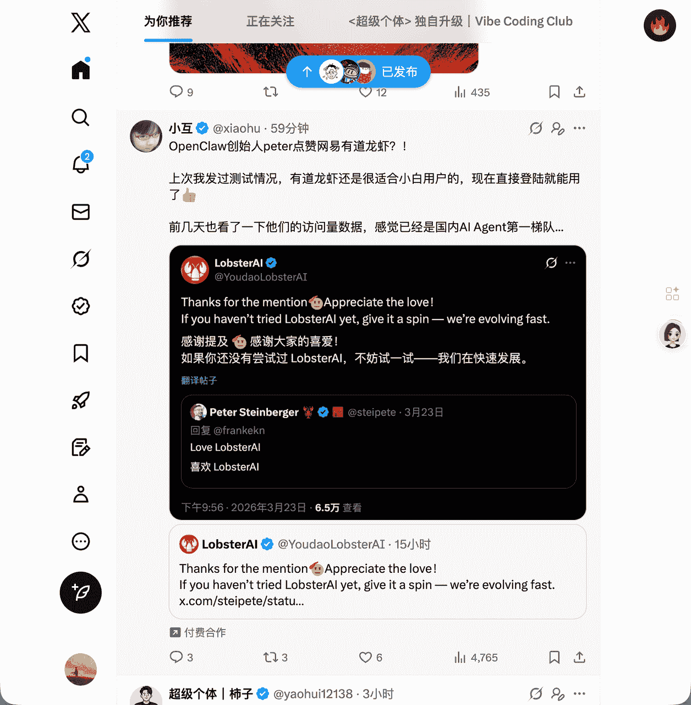

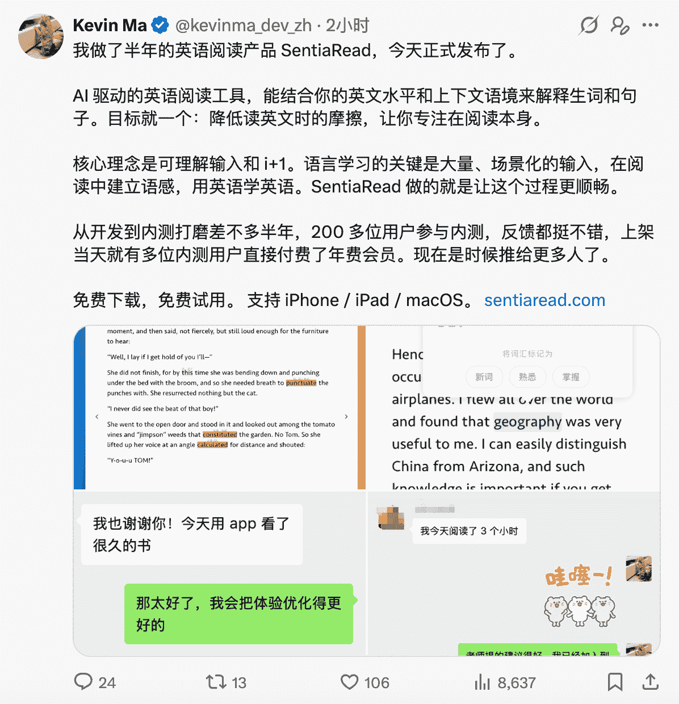

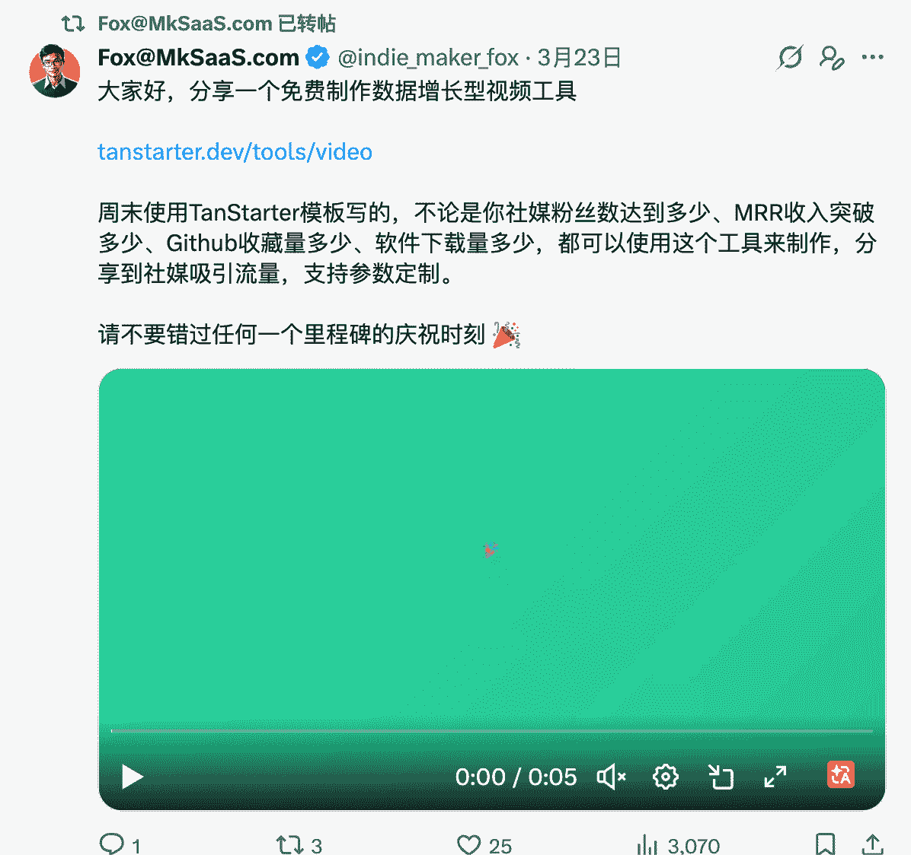

更**重要****的是，它对“内容形态”的包容****度更高。你可以发观点、发****观**察、发案例、发情绪、发截图、发链接，甚至只是用一句话切入一个趋势。这对很多还没有形成完整长文写作能力，或者暂时不想做露脸视频的人来说，是一个很友好的开始ai自媒体创作的方法。

### 1.2 无违禁词限制，内容发布自由

国内平台存在大量违禁词审查，X 平台基本没有内容限制（种族歧视等极端内容除外）。想到什么就发，朋友圈式的内容也不会影响账号权重。

这意味着，很多在国内平台不方便直接展开的观点，在 X 上可以更完整、更自然地表达。对于 AI、创业、产品、商业模式这些本来就需要频繁讨论真实问题的内容方向来说，这种表达自由非常重要。

比如下图：是一个esim相关内容，在墙内基本上看不见了，但是在X这种干货内容随处可见。

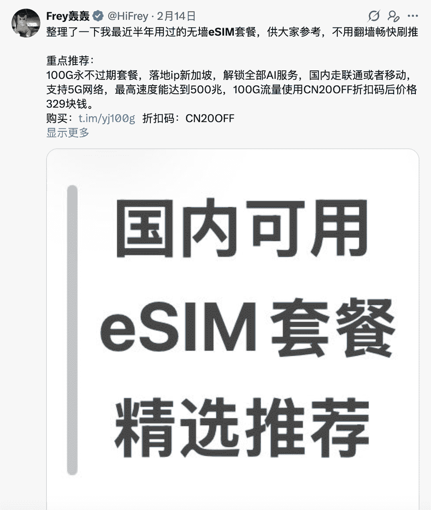

### 1.3 引流私域非常方便

X 平台对引流几乎没有限制，可以在主页直接放联系方式、🛰️号、群二维码、产品链接等。引流到私域的路径比国内平台友好得多，直接发二维码即可快速吸引用户入群。

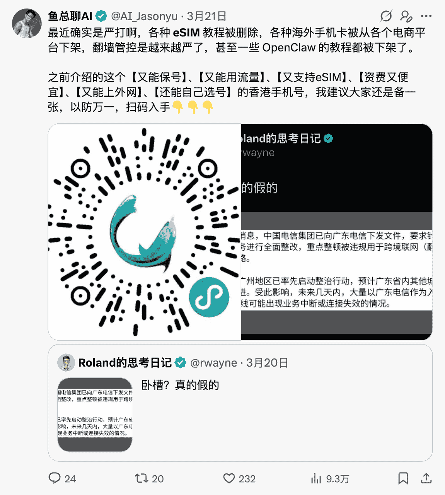


这背后最有价值的点在于：内容、信任、转化之间的链路很短。 你不需要绕很多层，也不需要处处担心触发平台限制。对于想做咨询、社群、产品、服务转化的人来说，这种路径优势非常明显，但是，前提是内容好，得做出活人感和真诚感。

### 1.4 熟人社区氛围，链接更深

X 中文区（简体 + 繁体）活跃用户约几百万，圈子相对紧密。混熟之后大家彼此认识，不像国内平台每条内容都要单独吸引新粉丝。算法上约 30% - 40%来自关注的人， 60% - 70% 来自相关领域的陌生人。只要持续输出优质内容，就能与粉丝建立更深的连接。

也就是说，X 的逻辑不是“你每一次都要重新证明自己”，而**是“你一旦被记住，后面会越**来越有复利”。这里就是一个小型的朋友圈，这对想做长期 IP 的人非常友好。

### 1.5 创作者分成

X 平台推出了创作者分成机制：三个月内累计达到 500 万曝光，即可开通创作者收益。中文区顶流泛流量博主两周可收入约 2000 美金，AI 垂类博主收益相对低一些（但是Ai博主比较容易接广）。收益通过 Stripe 提现到wise账户或者某些银行卡，两周发放一次。

虽然这部分收入未必是做 X 最核心的目的，但它至少说明：平台本身提供了内容变现的基础设施。 对刚起步的人来说，这是一个不错的正反馈机制。

### 1.6 推广商单灵活

软文推广流量较大。目前平台要求标注【商业推广】标识，只要内容质量好影响不大，但不标注可能被举报导致账号权重降低。

换句话说，X 并不是不能接广告，而是要更透明、更自然地接。只要你的账号建立起了清晰定位与真实信任，商单并不难接，关键在于内容别太硬。

左下角有标注付费推广。


### 1.7 直接接触行业大佬

X 平台聚集了大量 AI 领域创始人、顶尖从业者和投资人，他们在这里分享国内平台不好公开的内容。能力出众的人很容易被看见，甚至有大厂直接在帖子评论区“抢人”的案例。

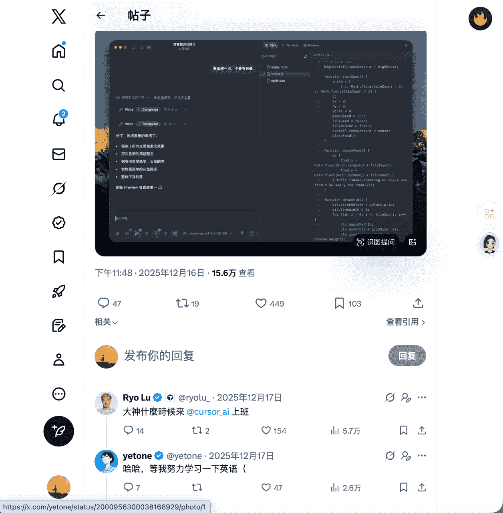

这也是很多人低估 X 的地方：你发的不是一条普通内容，而是在一个高密度、高质量的人群网络里公开展示你的判断力。

### 1.8 一手信息源头

X 平台是全球最前沿的信息首发地，很多 AI 行业重大动态在这里第一时间曝光，国内平台往往要滞后很长时间。利用信息差可以创造变现机会（如早期 AI 工具在闲鱼上的知识差套利）。

包括龙哥老大也经常在上面浏览讯息，说明这个平台的一手信息很有价值！！！

如果你做的是 AI 相关内容，那 X 不只是分发平台，更是你的信息源头、选题雷达和行业情报站。如果你不是专业做X的玩家，也可以用自动化工作流获取最前沿的讯息。

## 2. X 平台冷启动三步法

冷启动是 X 平台最难的环节。内容再好，没有曝光就是零。以下是经过验证的冷启动路径。

### 第一步：开通蓝 V（Premium 会员）

开通蓝 V（付费订阅）是冷启动的前提条件，不开通基本不可能起来。核心原因：

+   在大 V 评论区抢流量时，蓝 V 账号的评论排名更靠前，曝光更多

+   免费账号推文字数限制为 140 个中文字符 / 280 个英文字符，创作内容非常受限

+   开通 Premium（约一年四五百元人民币）后，字数限制解除，且达到 500 万曝光后可领取创作者收益

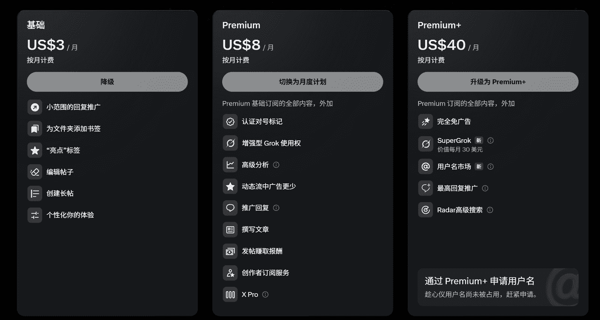

建议用美元订阅；点击“取消”时平台通常会弹出挽留优惠，可获半价；前期可先开基础档（Premium），跑通 500 万曝光后再考虑是否升级（Premium+）。

这一步本质上不是“买特权”，而是给自己买一个基本入场券。尤其对新号来说，没有基础权重时，蓝 V 能明显提升你抢到第一波曝光的概率。

### 第二步：发布“秀肌肉”推文

X 是熟人社区，必须让别人快速了解你的价值。第一篇推文要包含以下三个要素：

+   自我介绍：简单说明自己的背景和在做什么

+   展示战绩：晒出真实成果（收入、项目、数据等），体现实力

+   承诺价值：明确告诉别人关注你能获得什么（如：分享 AI 创业经验、公开构建过程、提供某领域干货等）

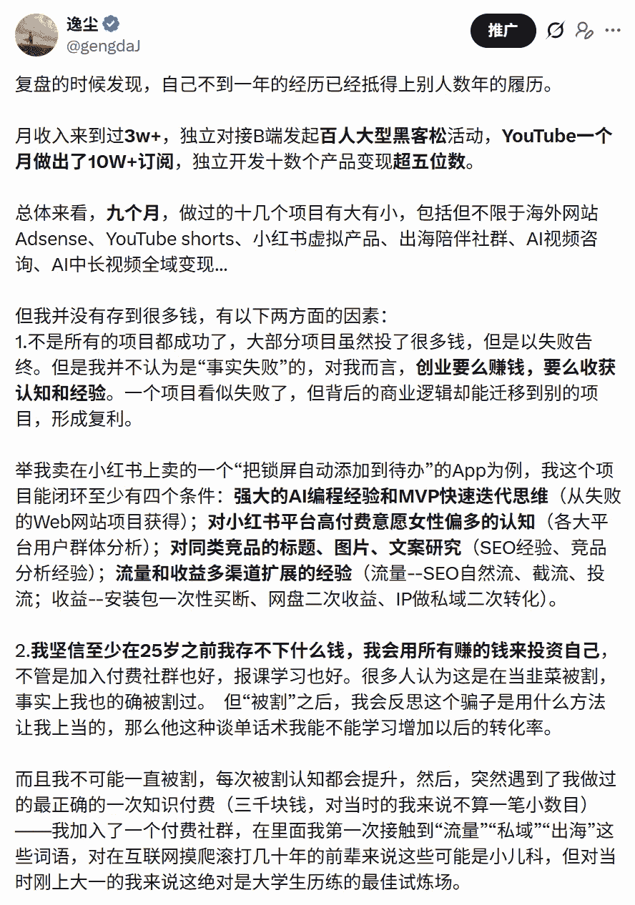

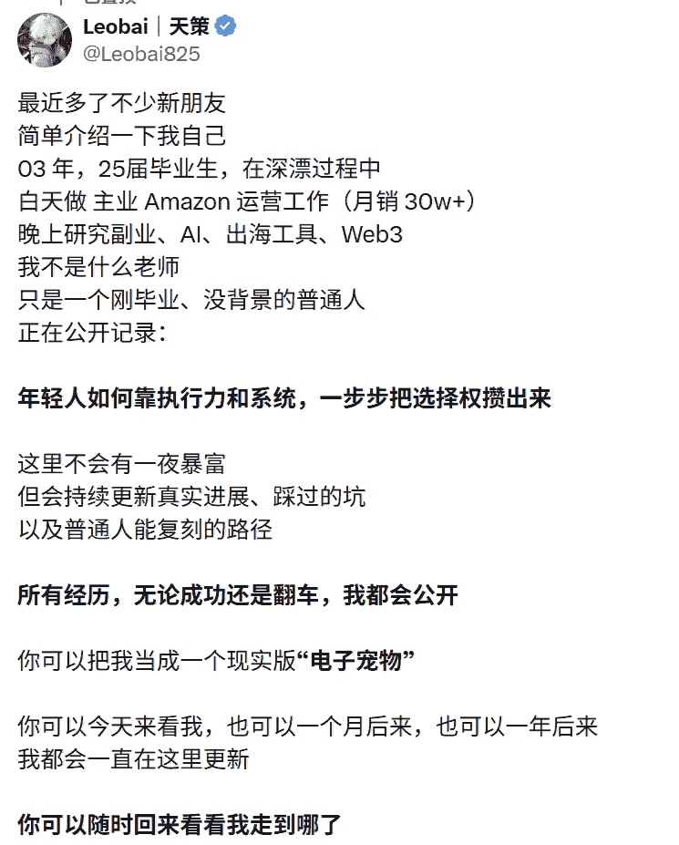

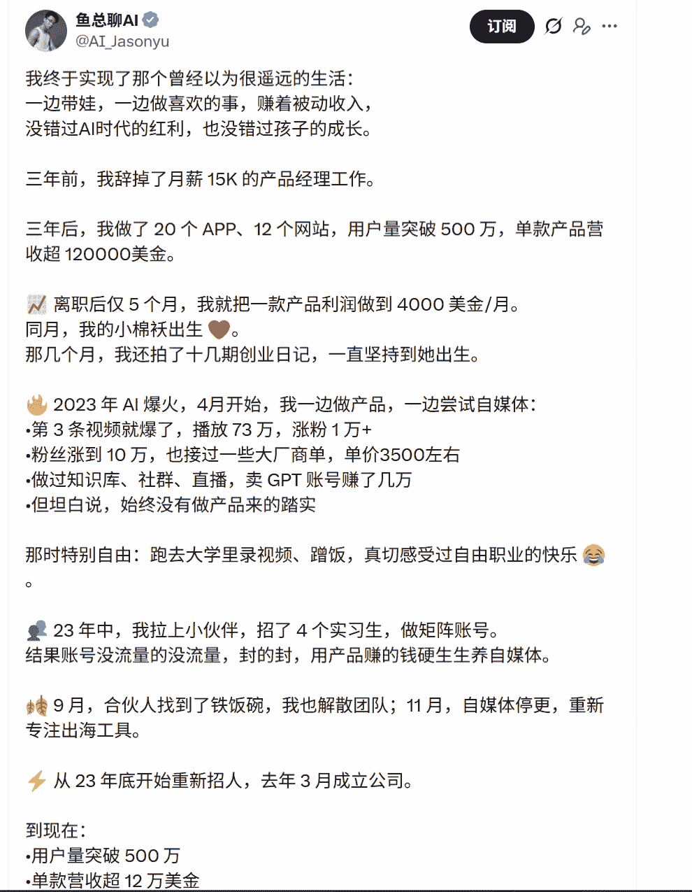

【案例】一位 03 年的创作者，承诺公开记录自己作为普通人从零开始的成长历程，吸引了大量有共鸣的粉丝关注。另一种方式是写一篇极具稀缺性和实用性的技术文章踩中热点，借助内容本身的传播力起号。

**这类推文的作用，****不**是单纯“自我介绍”，而是让别人迅速判断：你是谁、你凭什么值得关注、你之后会持续输出什么给他带去什么价值。 如果这三点不清楚，账号后面的增长会很慢。

### 第三步：找大 V 转推

这是冷启动中最关键的一步。没有大 V 转推，即使有蓝 V 加持，新账号的推文曝光也只有一两百；有了大 V 转推，可以借助其几万甚至更高的曝光基础快速突破千粉。

操作要点：

+   目标大 V：最好找 2 万以上且账号持续活跃（有稳定流量）的博主

+   获取途径一：加入 X 上的付费微社群，群主或社群成员会帮助有价值的新人转推

+   获取途径二：长期在大 V 评论区高质量互动，被记住后主动请求转推（X 圈子看实力）

+   自来水：推文内容足够感人或有干货，会有人主动帮你转推，但早期可靠性较低

我当时并不了解需要大 V 转推的方法，是一位朋友（也是我加入的付费社群群主）主动帮忙转推后，直接涨粉七八百，突破千粉门槛。

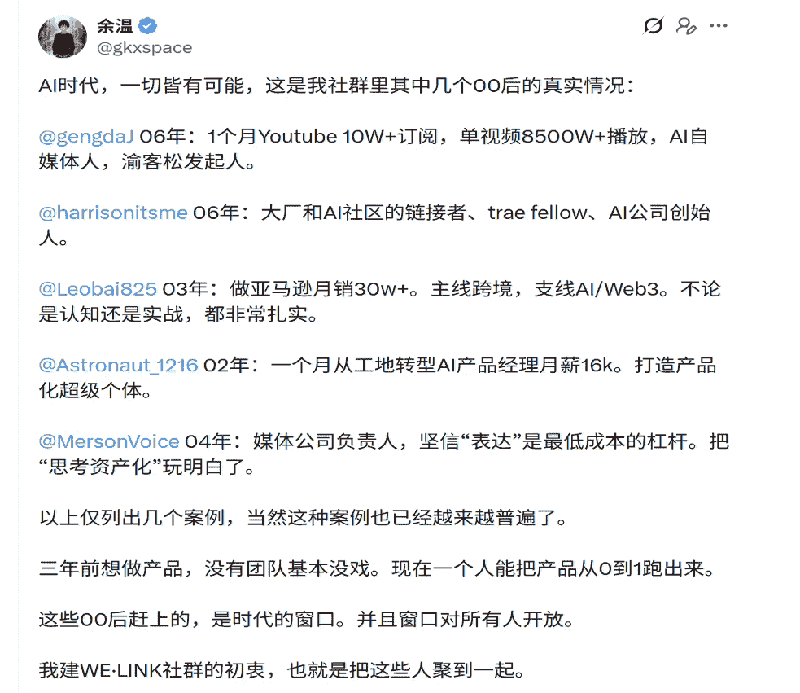

这里最关键的一点是：**X ****冷**启动本质上不是“发了就有人看”，而是先进入别人已经存在的圈子。 所以评论区、高质量互动、社群关系，都是冷启动的一部分。

## 3. 冷启动后的长期运营策略

### 3.1 持续输出干货，建立 IP 信任

X 平台卖的不是产品，而是信任。只有持续输出有价值的内容，才能积累后端变现所需的信任基础。AI 自媒体的内容方向可以包括：AI 工具评测与技巧、代码副业、AI 自媒体经验、创业心得与项目复盘等，核心关键词围绕“AI”和“创业”展开。

内容方向不需要一开始就铺得太大，但要让别人逐渐形成一个认知：你在这个领域是长期在线、持续有料、并且能说人话的。

### 3.2 拆解对标账号，模仿后超越

研究同领域头部博主的成长路径，拆解其爆款推文的选题、结构、表达方式，模仿后逐步形成自己的风格。AI 工具可以辅助提效，但早期打造 IP 仍需要有自己的东西在里面，纯 AI 生成的内容难以建立独特人设。

所以“模仿”不是照抄，而是学习别人如何起标题、如何切观点、如何制造停留感、如何建立人设稳定性。早期先学框架，后期再形成自己的表达肌肉。

### 3.3 用 AI 工具建立信息监控系统

嘉宾分享了一个实操做法：通过 AI 工具对对标账号进行监控，每天早上自动推送一份日报（一份英文区 AI 大号动态，一份中文区 AI 博主动态），用于：

+   发现流量较大的热点推文，及时跟进互动或引用评论（算入自己的 500 万曝光）

+   获取一手 AI 行业资讯，作为创作素材来源

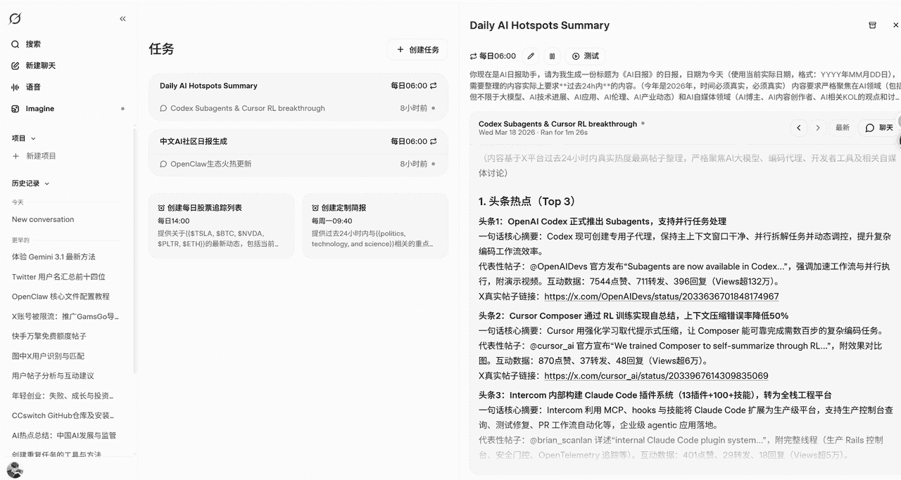

注意：引用中文区推文的流量通常优于英文区（读者看得懂中文内容，互动率更高）。

这套系统的核心意义，不只是“省时间”，而是让你从被动刷信息，变成主动监控信息。对于做 AI 内容的人来说，这会显著提升你的选题反应速度。

我的提示词分享如下：

```
你现在是AI日报助手，请为我生成一份标题为《AI日报》的日报，日期为今天（使用当前实际日期，格式：YYYY年MM月DD日），需要整理的内容实际上要求**过去24h内**的内容。（今年是2026年，时间必须真实，必须真实）

内容要求严格聚焦在AI领域（包括但不限于大模型、AI技术进展、AI应用、AI伦理、AI产业动态）和AI自媒体领域（AI博主、AI内容创作者、AI相关KOL的观点和讨论）的当天热点。特别优先覆盖AI编码代理、开发者工具和工作流优化相关话题。

核心数据来源必须是X平台（Twitter）上最近24小时内热度最高、最受讨论的**真实的**帖子。请使用以下多组搜索策略同时获取热点（务必运行多组查询，确保覆盖全面）：

1. 主关键词搜索（中英文混合）：AI OR 人工智能 OR artificial intelligence OR LLM OR 大模型 OR Grok OR ChatGPT OR Claude OR Gemini OR OpenAI OR Anthropic OR xAI OR AI自媒体 OR AI博主，模式：Latest，limit至少20-30，优先min_faves:500 或 min_retweets:200（如果高门槛帖少则降低）。

2. 编码代理专搜（英文为主，高频热点）：(&quot;Claude Code&quot; OR &quot;Claude Projects&quot; OR Cursor OR OpenCode OR Aider OR Devin OR &quot;AI agent&quot; OR &quot;coding agent&quot; OR &quot;SWE-agent&quot; OR &quot;agentic workflow&quot; OR &quot;AI coding&quot; OR &quot;code interpreter&quot;)，模式：Latest，limit至少30，优先min_faves:300（降低门槛以捕获新兴插件/开源项目讨论）。

3. Anthropic/Claude生态专搜：(from:AnthropicAI OR from:bcherny OR from:trq212 OR Claude OR &quot;Claude Code&quot; OR &quot;Claude Mem&quot;)，模式：Latest。

4. 其他高热度补充：(AI agent OR &quot;AI coding&quot; OR &quot;agent mode&quot; OR &quot;dynamic context&quot; OR &quot;memory plugin&quot;) min_faves:500，模式：Top。

优先选择互动量高（点赞/转发/回复总和优先）、有代表性的帖子，特别关注知名AI博主（如@bcherny、@trq212、@LiorOnAI、@cursor_ai、@DeepNodeAI 等）和开发者社区讨论。

日报结构必须严格按照以下格式：

1. **头条热点（Top 3）**  
   选出当天讨论度最高的3个具体事件/话题（优先包含编码代理类热点，如果存在），每个热点给出：
   - 简短标题
   - 一句话核心摘要
   - 代表性帖子引用（作者、主要内容摘要、互动数据）
   - X的真实帖子链接（必须有）

2. **热门话题榜（Top 8-10）**  
   列出当天X上热度最高的其他AI相关话题，按热度从高到低排序（确保至少2-3个为编码代理/开发者工具相关，如果当天有讨论），每个话题：
   - 话题名称或关键词
   - 简要描述（2-3句）
   - 代表性博主观点或典型帖子摘要
   - 互动数据参考（点赞/转发数）
  - X的真实帖子链接（必须有）
3. **AI自媒体声音**  
   专门挑选3-5位当天活跃或被热议的AI博主/自媒体（优先包含编码代理领域活跃账号，如Anthropic团队成员、Cursor相关、开源项目作者），简述他们的核心观点和影响
   - 话题名称或关键词
   - 简要描述（2-3句）
   - 代表性博主观点或典型帖子摘要
   - 互动数据参考（点赞/转发数）
  - X的真实帖子链接（必须有）
4. **小结与展望**  
   用一段话总结当天AI领域的整体情绪和趋势，并简要展望可能持续发酵的话题

以上所有X的帖子链接在第一轮完整抓取到之后，必须做二轮校验，即再次点击进去所有的链接，查看是否是对应的真实帖子，而不是显示“帖子不存在或已被删除”。如果查看到的界面显示不存在或者已被删除，此条信息就需要重新搜索核实，不得加入日报列表。

风格要求：客观、中立、精炼、专业，使用简体中文。
所有引用的帖子必须真实来源于今天的X搜索结果。
只呈现事实和热点，不加入个人主观评价。
如果某类话题（如编码代理）当天特别活跃，请适当提升其在头条或榜单中的比重。
```

```
你现在是“中文AI社区日报”助手，请为我生成一份标题为《中文AI社区日报》的日报，日期为今天（使用当前实际的真实日期，格式：YYYY年MM月DD日）。时间必须真实，必须**真实**，今年是2026年
内容来源严格限定为以下指定账号在**过去24小时**内发布的**全部**真实原创帖子（不包含对别人的回复、转发、引用推文，只包含他们的原创推文和自线程主贴）。如果某个账号过去24h无原创发帖，则不提及该账号。
指定账号列表（请严格抓取以下账号所有数据）：
@bourneliu66，@Khazix0918，@vista8，@dotey，@dontbesilent12，@oran_ge，@lifesinger，@lxfater，@xiaohu，@yetone，@op7418，@gkxspace，@Leobai825，@Zesee
核心要求：

必须使用X平台搜索工具，对每个账号分别执行查询：query 为 &quot;from:用户名 -filter:replies&quot;，时间范围 since:昨天日期 until:今天日期（或等效过去24h），mode:Latest，limit 设置为足够高（如50-100）以确保抓取每个账号的全部帖子。
如有自线程，使用 x_thread_fetch 工具补全完整线程内容。
如果帖子数量较多，可分多轮查询或提高limit，确保完整抓取所有原创帖子，不遗漏任何一条。
每条引用的帖子链接必须在生成后进行二次校验（点击链接确认帖子真实存在且未删除），若不存在则排除该条。
内容必须100%基于这些账号的真实帖子，聚焦AI领域（大模型、技术进展、应用、伦理、产业动态、编码代理、开发者工具、工作流优化、AI产品创业等），不加入任何外部帖子、个人主观评价或虚构内容。

日报排版要求：

不使用固定的分节结构（如头条、榜单等），直接以“按互动热度降序”方式呈现所有抓取到的帖子（互动热度 = 点赞 + 转发 + 回复 总数，相同热度时按发帖时间倒序）。
如果当天总帖子数量较多（&gt;20条），可先按账号分组（账号顺序随意或按总互动量排序），每组内再按热度降序列出该账号的所有帖子。
每条帖子统一格式（精炼、专业、客观，使用简体中文）：
• 作者：@用户名（显示名）
• 互动数据：点赞 X | 转发 Y | 回复 Z（总互动：N）
• 内容摘要：一句话忠实概括原帖核心（若帖子较长或为线程，可简述主要观点）
• 完整原帖链接（必须可点击且经验证存在）
• 如为线程，标注“（线程）”并提供主贴链接
在所有帖子列表最前面，添加一行统计：今日共抓取 X 条原创帖子，涉及 Y 位活跃账号。
在列表末尾，添加“当日小结”：用一段话（100-200字）客观总结这些账号当天的整体讨论主题分布（如编码代理相关占比、创业分享、技术工具讨论等）、情绪倾向（如积极探索、实用分享、争议辩论等），并指出高热度帖子涉及的主要话题。保持严格客观，不加入个人预测。

如果过去24h内这些账号整体原创帖子很少（少于10条），则在开头注明“今日社区较为安静，共 X 条帖子”，并尽可能完整呈现现有内容；如果完全无帖子，则输出“今日指定社区账号无原创发帖，社区较为安静。”并结束。
特别优先突出编码代理、开发者工具、工作流优化、AI产品创业相关帖子（如在摘要中加粗关键词，或在小结中重点提及）。
只输出日报正文，不添加任何额外说明、引导语或工具调用痕迹。
```

### 3.4 积累 500 万曝光的技巧

500 万曝光并非只能靠原创推文积累，以下行为均计入曝光量：

+   引用（转推并附加评论）他人的高流量推文

+   在热门推文的评论区发布有质量的评论

建议：每天持续在大 V 评论区互动，被更多人看见并记住，形成正向循环。（案例：一位认识的博主前期每天深耕大 V 评论区互动，一个月内靠纯社区互动从零起号，期间未加任何付费社群。）

这部分很重要，因为很多人对“做内容”的理解太窄，只盯着自己发原创。实际上在 X 上，互动本身就是内容分发的一部分。

### 3.5 掌握 AI 领域基础名词

做 AI 自媒体需要了解圈内常见名词，如 MCP、Claude Code、Codex、OpenAI、hook 等，日常刷推文自然会积累，遇到不懂的随时用 AI 搜索即可。

不需要一开始就学得很体系，但至少要做到“看得懂、接得上、能解释”。这样你在表达时才不会总卡壳。

## 4. 变现路径详解

### 4.1 平台创作者收益

三个月内累计 500 万曝光后开通，收益大约每 100 万曝光约 60 美元左右，实际波动较大，取决于与你互动的蓝 V 用户数量。收益每两周通过 Stripe 提现一次。

这类收入更适合作为“附加回报”，不要把它当成唯一目标

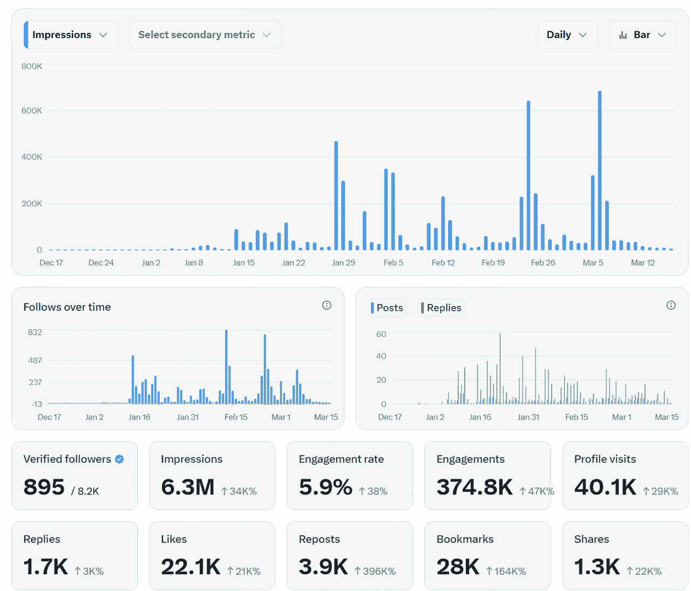

### 4.2 接商单广告

达到约 2000 粉丝后，会被邀请加入 X 上自发形成的 MCN 圈子，可接到广告推广（如 VPS 等）商单。商单通常有两种结算方式：固定推广费用，以及通过附带链接带来的销售分成。注意：商单需标注商业推广标识，否则可能导致账号权重下降。

对很多人来说，这会是比较早期、也比较现实的一种变现方式。

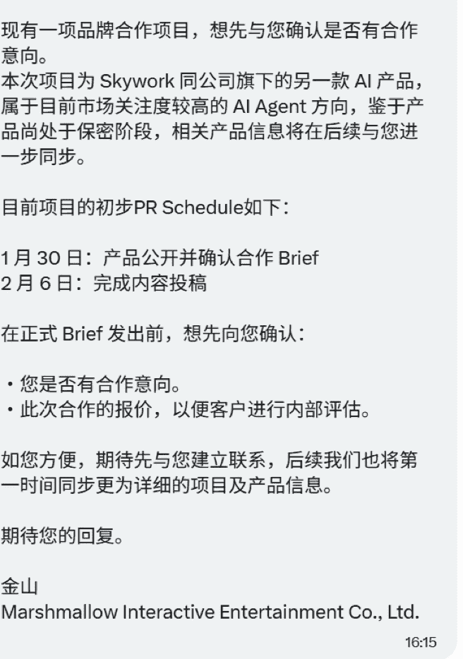

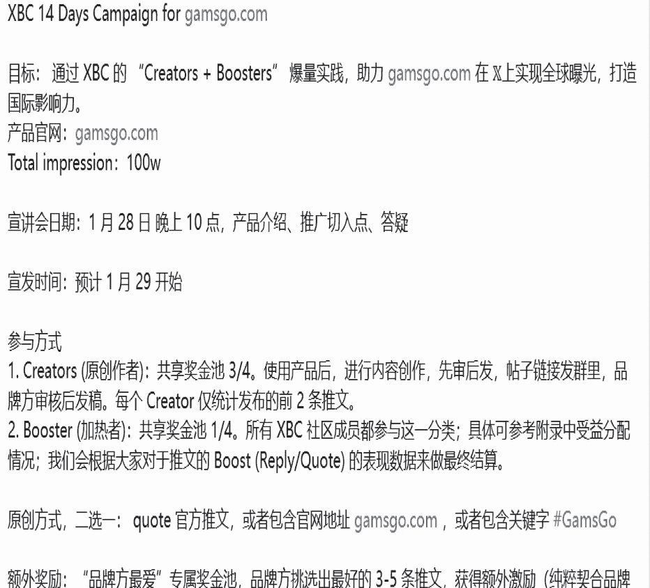

### 4.3 付费社群 / 知识付费

向粉丝推出付费社群是常见变现方式。X 平台用户认知水平和付费意愿普遍高于国内平台，只要清晰描述社群价值，百到数百人入群并不难。案例：一位流量高手将社群定价从 100 多元逐步涨至 2999 元，群内 300 多人，同时开设一对一咨询，每年数万元的高客单价转化了多个。

这说明 X 上真正稀缺的不是“低价流量”，而是“高信任、高认知、高付费意愿”的用户关系。

### 4.4 一对一付费咨询

建立 IP 信任后，粉丝会主动私信寻求付费咨询，适合有专业知识积累的创作者。

如果你本身就有可售卖的经验、方法、资源或专业能力，这类转化往往会比较自然。

### 4.5 后端业务转化

将 X 平台的流量和信任引导至自己的产品或服务，是最灵活的变现路径。适合有具体业务的创作者：

+   AI 产品开发者：直接在主页挂载产品链接，吸引关注者转化为用户

+   实体 / 服务业务：通过 IP 信任带动销售（案例：一位卖画的朋友借此变现了数十单，单价数百元）

+   B 端企业服务：通过 X 对接国内外投资、政府资源、合作方等

这部分往往比平台分成更值得重视，因为它决定的是你能不能把流量真正变成业务。

### 4.6 隐性人脉价值（最被低估的变现）

嘉宾特别强调：X 平台真正最大的价值可能不是显性收入，而是人脉网络带来的隐性机会——资源对接、合作机会、投融资信息、政府资源等。这些价值往往远超创作者收益和商单收入本身。

很多时候，一条高质量内容带来的不是几百块广告费，而是一次更长期的机会入口。

### 4.7 引流至其他平台（YouTube 等）

X 可作为流量枢纽，将粉丝引导至 YouTube（广告分成）、其他自媒体平台等，形成多平台联动的变现矩阵。

如果把 X 放在整个内容体系里看，它更像是一个“高密度认知与链接中枢”。

引流方法：推文和简介直接放YouTube账号或视频链接。

### 4.8 核心原则

X 平台打造的是个人 IP，IP 一旦建立，变现路径理论上无限多。不要过度依赖平台创作者收益或外部商单，要将 X 作为打造个人品牌的核心阵地，其他变现方式都是衍生。

这一点很关键：**不要把 X 当成一个单纯赚分成的平**台，而要把它当成你长期品牌资产的发生器。

---

# 三、Q&A

## Q1：不开蓝 V 也可以做吗？只开基础的 Premium 就够了？

**A：** 前期开 Premium 就够了，不需要上 Premium+。Premium+ 额度更高，但前期没必要。等账号跑通了 500 万曝光、想进一步提升再考虑。订阅时如果点击取消，平台通常会弹出半价挽留优惠，可以利用。

## Q2：创作者分成的收益单价大概是多少？

**A：** 大概每 100 万曝光约 60 美元左右，但会有上下波动，主要取决于与你互动的蓝 V 用户数量（蓝 V 互动权重更高）。视频推文权重略高于普通文字推文，但算法细节未完全公开，只能大致估算。

## Q3：发帖频率有没有要求或上限？

**A：** 没有限制，想发多少条就发多少条。但前期建议先积累十几篇内容打底，让别人点进主页时看到有内容沉淀，增加信任感。早期每条推文流量很少（十几甚至个位数）是正常现象，不用在意。

## Q4：500 万曝光是连续三个月都要达到，还是累计？

**A：** 需要在三个月内达到 500 万曝光才能开通创作者收益，开通后需持续维持（上个月达到才能继续），不是一次性的。

## Q5：X 平台对内容质量和广告有什么要求？

**A：** 内容几乎没有限制（种族歧视等除外），只要挂上🪜正常使用即可。内容质量越高、干货越多，流量自然越好。广告需标注“商业推广”标识，不标注如果被举报会影响账号权重。

## Q6：养成系 IP（记录成长过程的账号）在 X 上好做吗？

**A：** 可以做，X 平台是时间线逻辑，算法会把你的内容推给经常互动的关注者，粉丝黏性高，适合建立深度连接。养成系吸粉的底层逻辑与其他 IP 类似——关键是让别人有理由关注你，提供真实记录和持续价值。

## Q7：X 平台与📕有什么区别？

**A：** 最大的区别是📕有严格的内容审查（违禁词、算法限流等），X 平台基本没有任何限制。📕是推荐算法，适合内容冷启动；X 是时间线逻辑，是熟人社区，混熟之后曝光更稳定。X 上用户认知层次和付费意愿整体更高，但建立关系需要更长时间投入。

## Q8：YouTube 视频可以同步发到 X 吗？

**A：** 可以，但需要注意：X 平台用户更习惯看文字，视频必须配合有质量的文字介绍才能吸引人点进去看。视频只是推文的一部分，核心还是文字吸引力。另外，同步视频之前需要先把账号做起来（有一定粉丝基础），否则单纯同步没有任何意义。

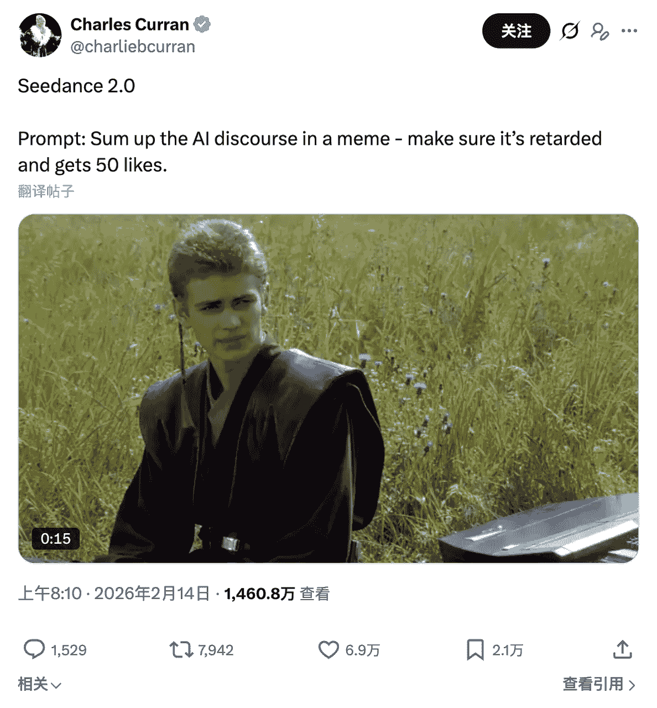

可能很多人看到这条赚了两万多刀的视频心动了，那我不得不泼一盆冷水，要做到这一步至少要满足两个条件，1.你会结合经典电影片段做ai视频 2.你是英文区大v，第一点还好，第二点你付出几年时间也不一定能做到。

中文区的AI视频流量在几十万就封顶了，英文区的流量可以达到几千万甚至上亿。但是英文区的起号难度很大（逻辑一样，需要先混社区，让大v转推，这一点很难，如果不是本身就在国外的圈子里面，很难做起来，目前我见过做起来的大v本身就是在海外，常年在国外的科技圈子里面混）。

所以，YouTube和X并不是同步视频那么简单，YouTube深海圈的那套可以同步迁移到tk，但是不能同步迁移到x，其实这一点只需要理解到X是一个“打造IP”的平台就会比较好理解。

## Q9：X 平台如何引流到🛰️等国内私域？

**A：** 非常直接，平台基本没有管控。主页可以直接放🛰️号、🐧群号、🛰️群二维码，推文中也可以放。引流到抖音、📕等其他平台也没有限制，只要在推广内容上标注商业推广标识即可。

## Q10：没有 AI 技术背景，如何克服 AI 焦虑、系统化学习？

**A：** 不要一开始就追热点（今天小龙虾明天 Codex），先把底层基础打牢。建议路径：

+   优先学 Claude Code（或类似编程辅助工具）：这是当前最重要的基础工具，玩不明白 Claude Code，后续热点工具都很难用好

+   找一个具体切入点实战：比如你写👸号，就用 AI 辅助优化标题、钩子、文章框架，拆解到颗粒度后用 Claude 逐步打磨完整流程

+   遇到不懂的名词就问 AI：不需要提前学所有知识，在实战中遇到问题再查、再积累

核心原则：先用，再学，边用边理解——多用 AI 工具解决实际问题，自然会对底层逻辑越来越清晰。

## Q11：有没有推荐的知识管理工具？（Obsidian 相关讨论）

**A：** 嘉宾目前在使用 Obsidian（本地 Markdown 知识库）搭建个人知识管理系统，主要优点是：

+   所有文档以 Markdown 格式存储在本地，AI 读取和处理本地文档效率极高

+   可通过插件与 Claude Code、GitHub 等工具打通，形成“飞书记录 → 云端 AI 数据库 → GitHub 同步 → 本地 Obsidian”的完整链路

+   支持自定义写作风格（style 文件），AI 改写文章时能保持个人化风格而非 AI 味

+   可集成👸号预览、代码推送 GitHub 等创作辅助插件

注意：Obsidian 上手有一定学习曲线，建议有一定工具使用基础后再切换。对于初学者，先把 Claude Code 玩熟更重要，Obsidian 可作为进阶工具。

## Q12：AI 自媒体内容不限于 AI 领域吗？

**A：** 不限于 AI，关键是结合自己的业务和优势。嘉宾见过做养殖、教男性养生的博主在 X 上也做得很好，因为 X 用户群体（多为 30 - 40 岁）对养生等话题有强烈需求和付费意愿。核心是：找到自己的定位，围绕这个定位持续输出，结合后端具体业务变现。AI 只是当前最热门的流量方向，不是唯一出路。