# 我用 Gemini 写漫剧剧本，跑通了第一笔稿费：单本到手四位数的实操复盘

> 来源：[https://xuqiwei1986.feishu.cn/docx/Rh6mdWckmo6me6xVQWhc4k40nad](https://xuqiwei1986.feishu.cn/docx/Rh6mdWckmo6me6xVQWhc4k40nad)

大家好，我是西瓜，00 后大学生～目前在做 AI 代写，也一直在摸索 AI 写作里真正能交付、能变现的细分方向。

我作为计算机大类的专业，没有系统学过编剧。最开始做这件事，只是想趁还在大学的时候，尽快跑通一个能拿结果的项目，给自己多一段真实的实操经历。漫剧剧本属于 AI 代写分支，看到苗头后也尝试去做，并在今年年初，完整交付了第一本剧本，跑通了从写稿、修改到验收的 0 到 1 闭环。

这个过程中，我遇到的难题其实比写普通短文复杂得多。中间熬过夜，也踩过不少坑。虽然第一笔稿费金额不算特别大，但对我来说，这笔钱最重要的意义是，它证明了这条路径是可以走通的。

今天这篇复盘，把从以下方面把自己整体大概流程分享下，有不足之处，也请各位圈友前辈多多指教。

1/ 我为什么会盯上漫剧剧本这个方向

2/ 我是怎么从 0 到 1 跑通第一本漫剧剧本的可复制SOP

3/ 写本实操遇到的困难点

4/ 认知复盘

希望这篇能帮助你拆解一部喜欢的漫剧，完成自己的第一本漫剧剧本。

## 一、我为什么会盯上漫剧剧本这个方向

### 在当下，漫剧剧本仍是普通人的切入口

我会关注这个方向，主要有几个原因。

第一，AI 把漫剧制作门槛拉低了（指路赚钱的AI视频航海）。以前做高质量漫剧，往往离不开原画师和一整套制作流程。现在 AI 视频越来越成熟，普通人也有机会做出完成度更高的内容。制作端变容易了，市场对好剧本的需求反而更大了。

第二，它符合当下内容消费趋势。现在大家刷短视频，更倾向于开局即高潮、节奏极快的视频，不再有耐心看节奏慢的长篇电视剧。而漫剧本身就很适合这种内容形态～

第三，从 AI 写作变现角度看，剧本是长期需求，而且相对稳定合规。在闲鱼、📕这类平台，也比一些容易违规下架的品类更适合长期做。（不像LW，在平台易违规下架链接）凡事标准先行，稳定合规是基础。

最后，这个赛道的客单价不低。漫剧剧本通常有分级，A级本大概在 5000 到 8000 元，S 级本能到 1 万到 3 万元。

所以综合看下来，我会觉得，漫剧剧本是一个还值得普通人切入的细分机会。

### 跑通0-1：我拿到了什么结果

#### 稿费

#### 交付周期

第一本，稿费到手3k，分成前大概7k左右，这依然是一个下行风险极低、能快速变现的项目


是跟甲方对接后，修改次数周期，除去一卡十集（先投稿），周期是24天，但只有修改意见过来时才去修改

每次改版，主动工作的时间是2-4小时左右，共改版8次，即16-32小时左右，（这只是大概时间，仅供参考），其余时间就是等待甲方反馈

正常是15集/审，由于时间问题，我的提前交稿较多，也导致后面有设定问题 全文重写

（修改难点见下文）

#### 交付全流程：

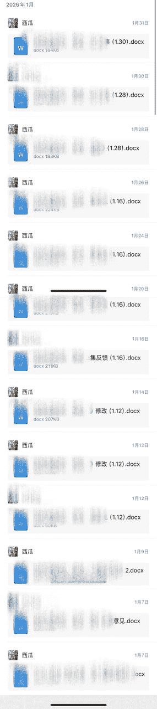

> 1.7 第一版

> 1.9 第二版

> 1.12 反馈意见

> 1.12 第三版

> 1.14 一卡验收

> 1.14 交付完稿（第四版）

> 1.16 反馈意见

> 1.20 第五版

> 1.24 第六版

> 1.26 第七版（字数调整）

> 1.26 1-30集验收

> 1.28 第八版（30-60）

> 1.30 反馈意见

> 1.31 第八版

> 验收

## 二、我是怎么从 0 到 1 跑通第一本/可复制SOP

### 第一步：找爆款

1.  **根据榜单来找当下爆款**，推荐👸号：漫剧有数

当时根据榜单扒对标《地狱模式：你能活到第几集》

1.  **红果app**

也可以根据热度来找


### 第二步：下视频

下载完视频后整理到一个文件夹即可，这里推荐 2 个浏览器下载视频的方式

#### 谷歌浏览器

推荐两个插件

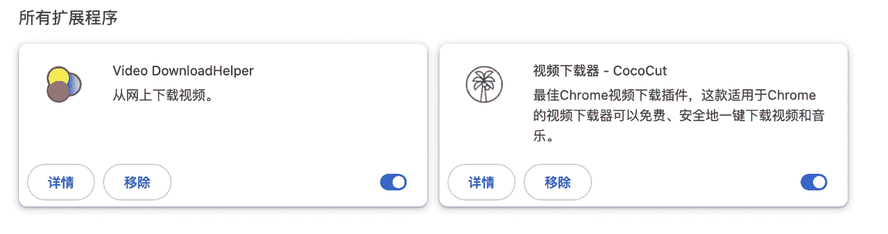

浏览器搜索对标漫剧名字，一集一集下载即可，当然可能有（更快）的方式，例如工作流，小龙虾等，个人认为没有必要（要扒的对标不多的情况下）

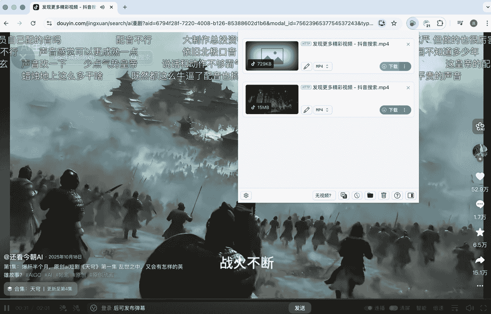

#### Microsoft Edge浏览器

推荐下载视频的插件

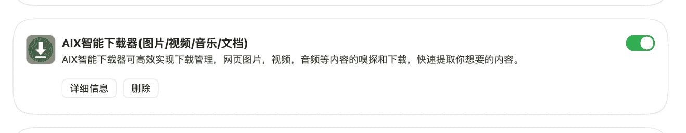

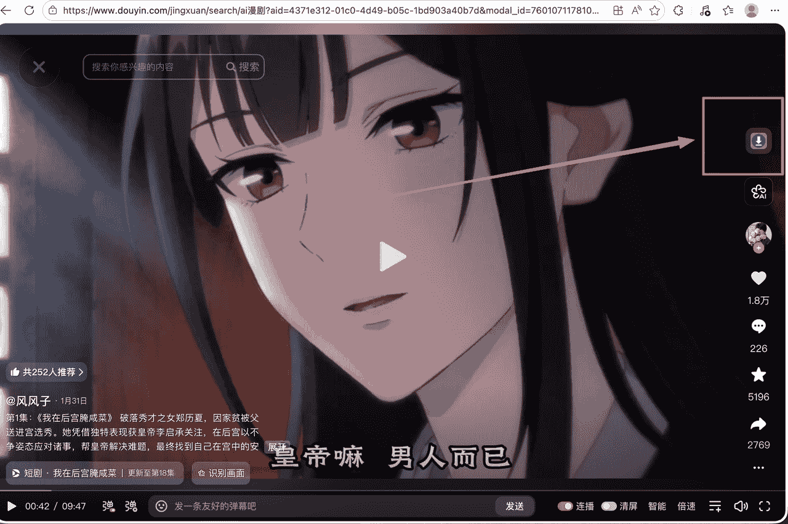

### 第三步：扒对标

【扒对标的步骤】根据提示词把每一集分别投喂gemini，最终把前十集整合成如下文档

具体步骤如下：

> 直接问gemini如何拆解对标

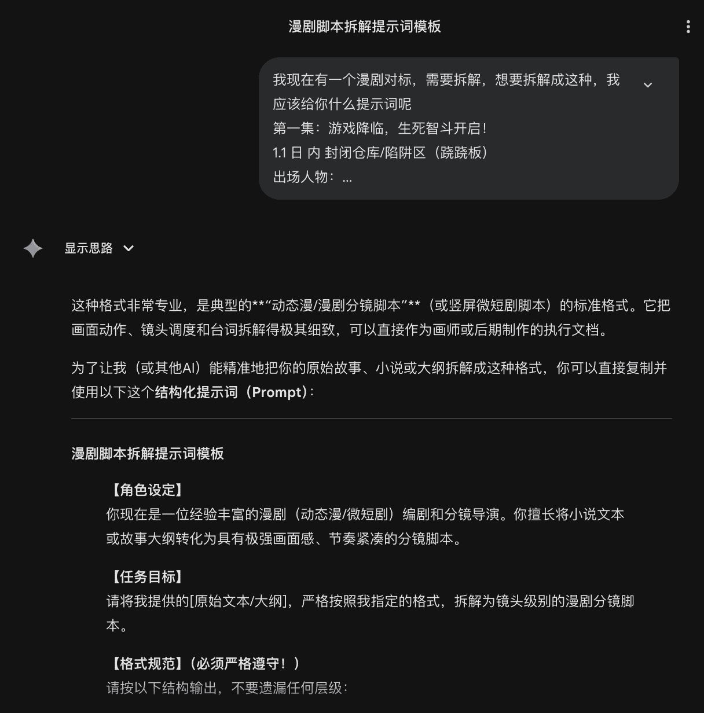

> ⚠️上图【任务目标】中【原始文本/大纲】改为视频

```
**漫剧脚本拆解****提示词模板
****【角色设定】 你现在是一位经验****丰富的漫剧（动态漫/微短剧）编剧和分镜导演。你擅长将小****说文本或故****事大纲转化为具有极****强画面感、**节奏紧凑的**分镜脚本****。
【任务**目标】 请将我提供的视频，严格按照我指**定的格式，拆**解为镜头级别的漫剧分镜脚本。
【格式规范】（必须严格遵守！） 请按以下结构输出，不要遗漏任何层级：
第X集：[集数标题，概括本集核心看点][场景编号] [日/夜] [内/外景] [具体场景名称] （例如：1.1 日 内 封闭仓库/陷阱区） 出场人物： [列出本场出现的角色，可带简短特征，如：慕飞（白发）、红色吉祥物]
[正文拆解规则]： 必须交替使用“画面描述”和“台词/音效”，按镜头顺序推进：
画面描述： 必须以“▲画面：”开头，括号内或冒号后详细描述人物动作、表情、场景细节或特效（如：镜头特写、震动、流血等）。
台词格式： 角色名（情绪/动作，发声方式）：台词内容。 发声方式说明：正常说话不标注，内心独白标为（os），画外音标为（旁白）。
【参考示例】 第一集：游戏降临，生死智斗开启！ 1.1 日 内 封闭仓库/陷阱区（跷跷板） 出场人物：慕飞（白发，暂无名）、红色吉祥物 ▲画面：一个倾斜的金属板悬在半空中。慕飞躺在上面，脖子上有一个发红光的“000”项圈。另一端，一个穿着红色吉祥物服装的角色正努力保持平衡。 慕飞（痛苦呻吟，os)：头好痛... ▲画面：红色吉祥物（焦急，脖子上的项圈闪烁“000”）。 红色吉祥物（大声）：醒醒！醒醒！

```

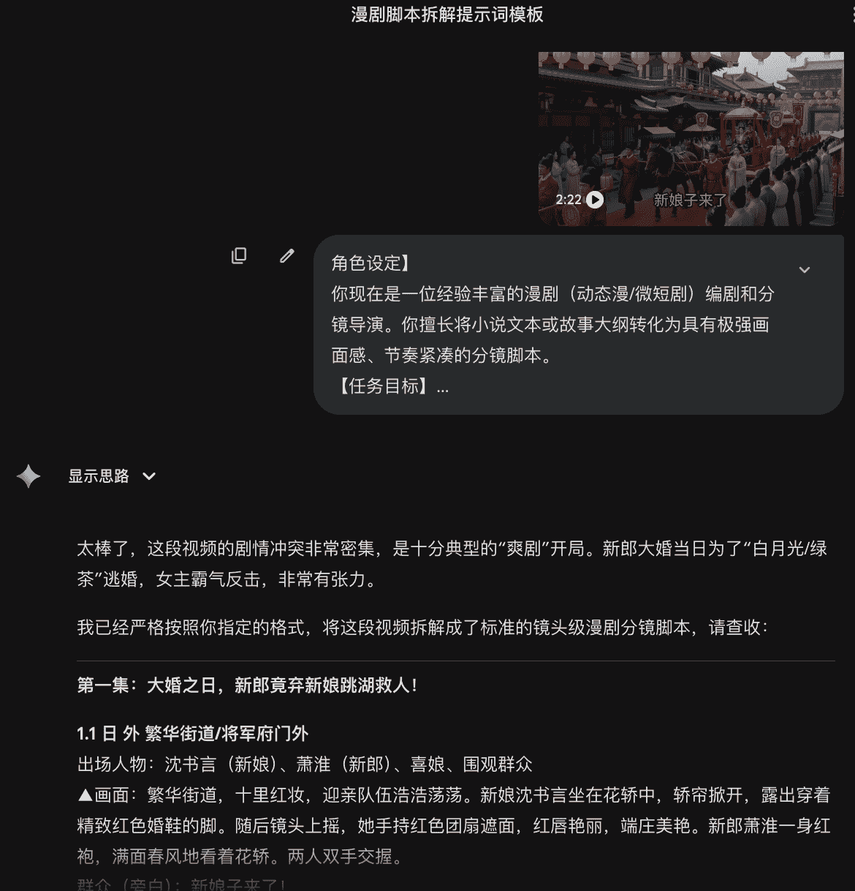

> 复制下面的【第一集：大婚...】到word中，以此类推

> 即可得到对标漫剧剧本

我的第一部漫剧对标剧本如下

[地狱模式，你能活到第几集.docx](https://i0udik9jmth.feishu.cn/wiki/LEMxw6UYoi3RZpk1BOQcnUGFnph?from=from_copylink)

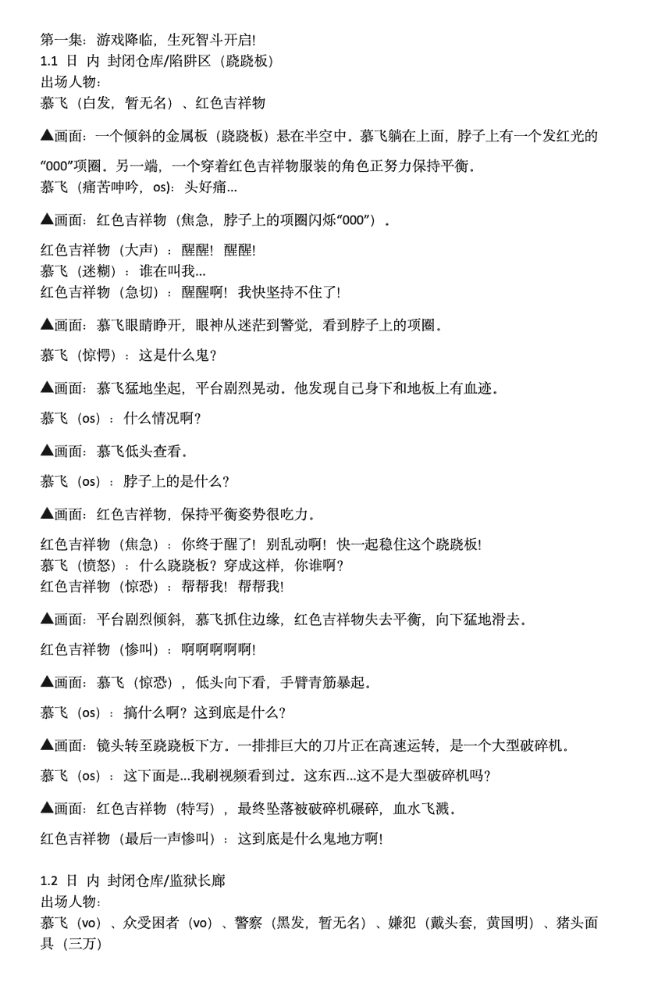

### 第四步：AI 生本

+   【学习对标】先把对标漫剧剧本喂给 Gemini，让它先学会这类本子大概是怎么写的，并让它总结给你

+   【方向确定】然后让它多出几个剧本方向，出完之后就要靠自己感觉了，自己读起来有没有感觉，爽不爽，抓不抓人。这个判断力，平时多刷爆款漫剧会很有帮助。

+   【剧情大纲】方向定了以后，先让 Gemini 出剧情大纲。

+   【生成正文】大纲顺了，再一集一集去生成正文。

⚠️ 这里我的建议是，一定要一集一集盯着看。AI 有时候也会“掉线”，写着写着就容易跑偏，所以别指望它一次性稳定输出完整成品。

## 三、写本实操遇到的困难点

总结一句话：遇事不决，问AI

正常修改过程如下：


甲方会在要修改的地方标注，直接复制这一段剧本，以及意见反馈，一起交给ai，ai会分析哪里出了问题，并给出修改方向，修改哪一集，再让他重新生成这一集。

### 困难点1

> Gemini 输出长度有限，聊到后面还容易因为网络问题中断，导致原对话没法继续用。

### 解决方案

这两个问题，本质上可以看成同一个问题：对话断掉了，但剧本还没写完。重新开一个新窗口，AI 又不知道前面的设定、人物关系和剧情进度，很容易接不上。

我的处理方式是，把已经完成的剧本内容整理到 Word 里。新开对话后，先把这部分发给 AI，让它补齐上下文，再继续往后生成。

### 困难点2

> 甲方一旦改到底层设定，基本就不是局部修改，而是整篇联动调整。

### 解决方案

因为世界观、人物关系、能力逻辑这些底层设定一变，前后很多情节都得跟着重写。看起来只是改一个点，实际常常是牵一发而动全身。这个时候最重要的，不是单独修某一段，而是重新梳理整篇逻辑，保证前后设定一致。

用户的反馈如下👇

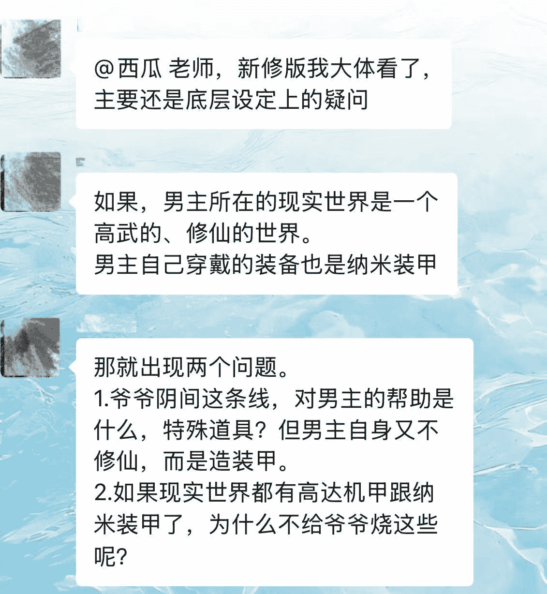

这时候，我会直接把甲方提出来的疑问丢给 Gemini，让它先帮我定位：这些问题具体出在哪，应该从哪里补逻辑。

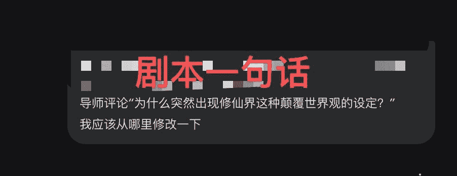

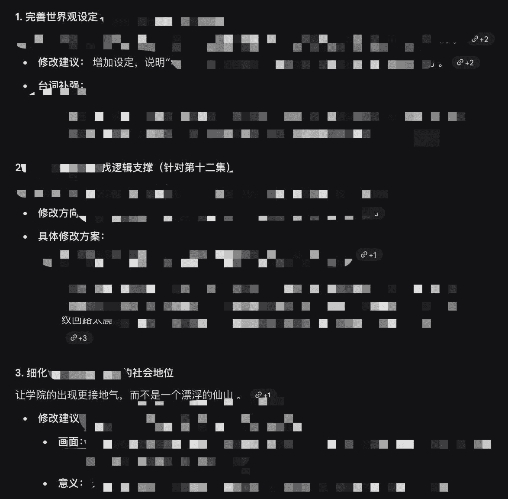

补逻辑会导致一个新问题——比如我把漏洞补在第一集，第一集原本 1000 字，补完可能直接超标达到 2000 字。

**我**的避坑经验是：先不管字数，先把所有逻辑漏洞补齐！等到全篇定稿、甲方对逻辑没有异议后，我再去统筹删减，把每一集的字数压缩到合理范围内。

### ⚠️注意点

gemini生成内容，会带很多“”......

可以在word里统一替换

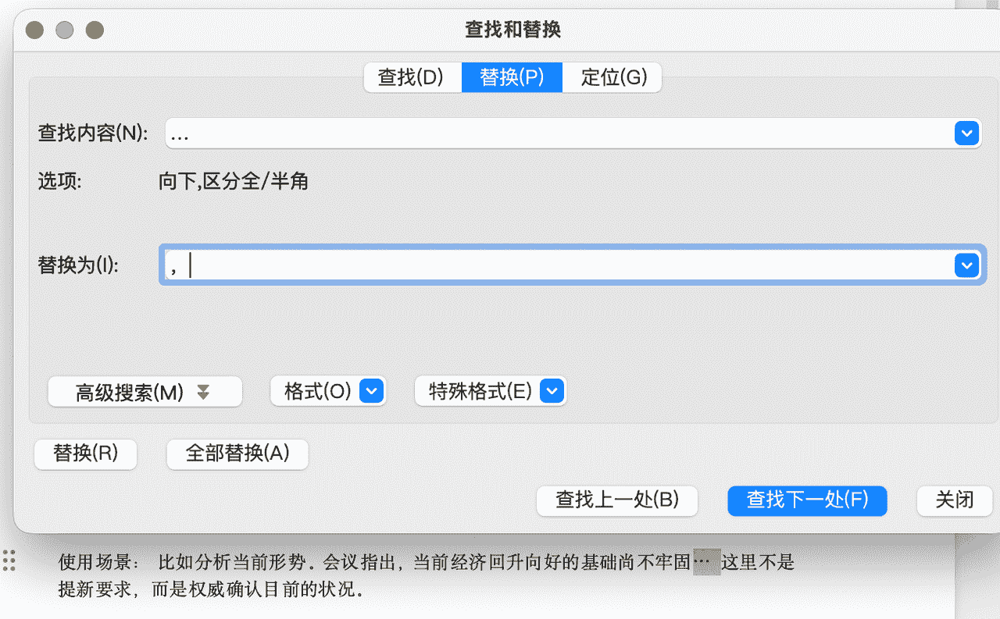

省略号可以替换为，

双引号直接去掉

⚠️不要十集全部生成后再看剧本，最好一集一集看，避免浪费时间精力（可能整体走偏）

去符号可以十集一删

## 四、认知复盘

当然我也只写完交付一本，经验没有很丰富，还请各位大佬轻点批评。也特别感谢在这个过程中给予我指导和启发的所有老师们。

### 做的最对的一件事是什么？

在看到 AI 漫剧苗头的时候，**先把手弄脏，积极去做，**即使面临可能花费时间精力也投不中一本的情况，以及过程困难重重，但跑通 0-1 的那一刻是非常开心的。带来的不仅是稿费，更让我沉淀了自己的经验和 SOP。

当时或许是因为运气，碰到了好的甲方，所以较为容易完稿。现在投稿审核越来越严格，要人工参与，但这恰恰也是一个机会，门槛越高，留给实干者的利润空间就越大。

### 下一步计划

当下继续深耕AI写作，继续写本，尝试自己AI视频，发布平台

### 给新手的建议

如果你还在观望，不妨先去扒一个你最喜欢的漫剧。在这个过程中，你不仅学会了用 Gemini，更学会了如何拆解爆款、如何理解用户情绪。下行风险有限，跑通了，你就多了一项可以赚钱的技能。