# 2026年，如何通过闲鱼实现获客增长？很多人还没看懂的精准流量入口

> 来源：[https://xuqiwei1986.feishu.cn/docx/NEGDdaF40oFtHRxauQZcmJvUnif](https://xuqiwei1986.feishu.cn/docx/NEGDdaF40oFtHRxauQZcmJvUnif)

大家好，我是北骁，也是赚钱4年老会员。

00后，但创业这条路，我已经走了整整6年。

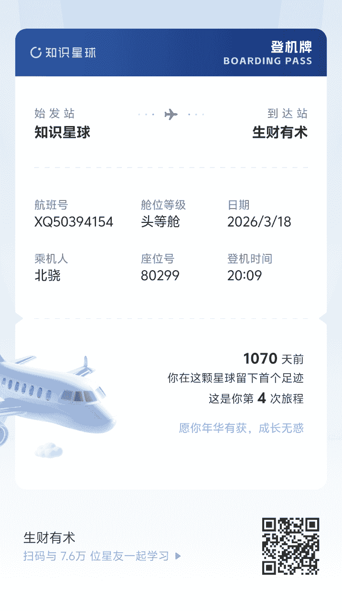

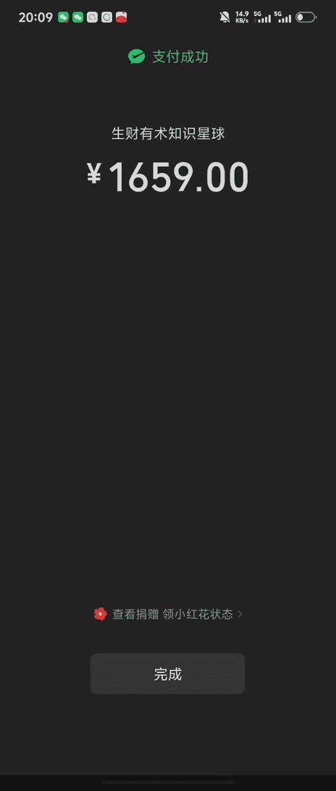

这些年我大部分时间都在潜水、看帖、学习，很少完整地出来写一篇复盘。

今天想借这个帖子，认真跟大家汇报一下我们最近跑完的一件事：闲鱼矩阵微付费。

我是个 00 后，但性格其实一直挺拧巴的。大学开始，我就不算那种很会社交、很会表达的人，更多时候是闷头看、闷头学、闷头自己试。

包括到现在，我骨子里还是偏内向、少话的人。

只是这几年一路被环境推着走，也逼着自己慢慢从一个只会被动输入的人，变成了一个敢下场、敢输出、敢把结果拿出来复盘的人。

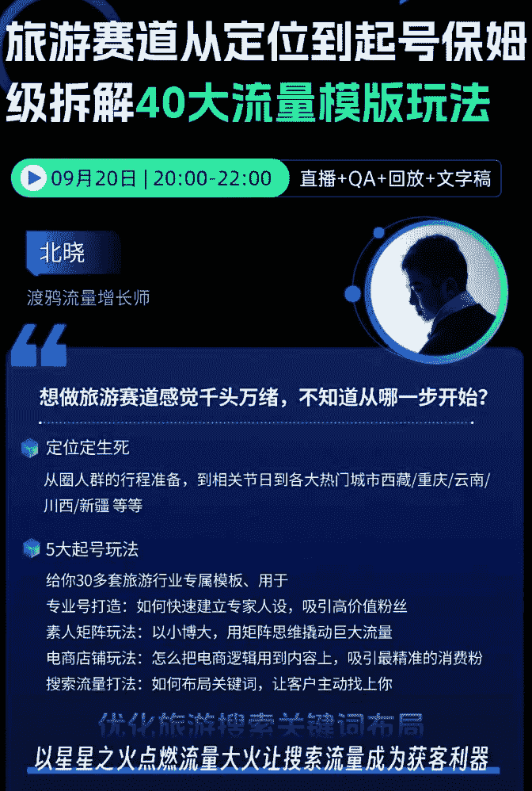

从大一开始，我就一直在折腾网上创业。📕虚拟做过，高端旅游做过，流量和获客做过，私域 `IP` 也做过，前前后后交过的学费，细算下来十几万是有的。

但我这个人也算典型，三分钟热度，可以做的事情太多了，一直找不到自己的主旋律

走到现在，我反而越来越确定一件事：对普通人来说，真正值得长期学的，不是某个平台一时的技巧，而是两种更能穿越周期的能力，第一是流量，第二是写作。

写作我现在也还在补课，最近一直在借助 `Codex` 和龙虾，慢慢把自己的内容产出系统往前推。

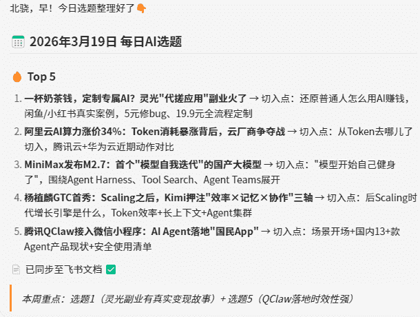

现在我在渡鸦线下主要负责前端自营板块。

对我来说，这两年最大的变化，不是知道了多少概念，而是第一次真的把很多东西从“听懂了”走到了“跑通了”。

以前更多是学别人怎么讲，现在是自己下场看数据、踩坑、调路径、带交付。

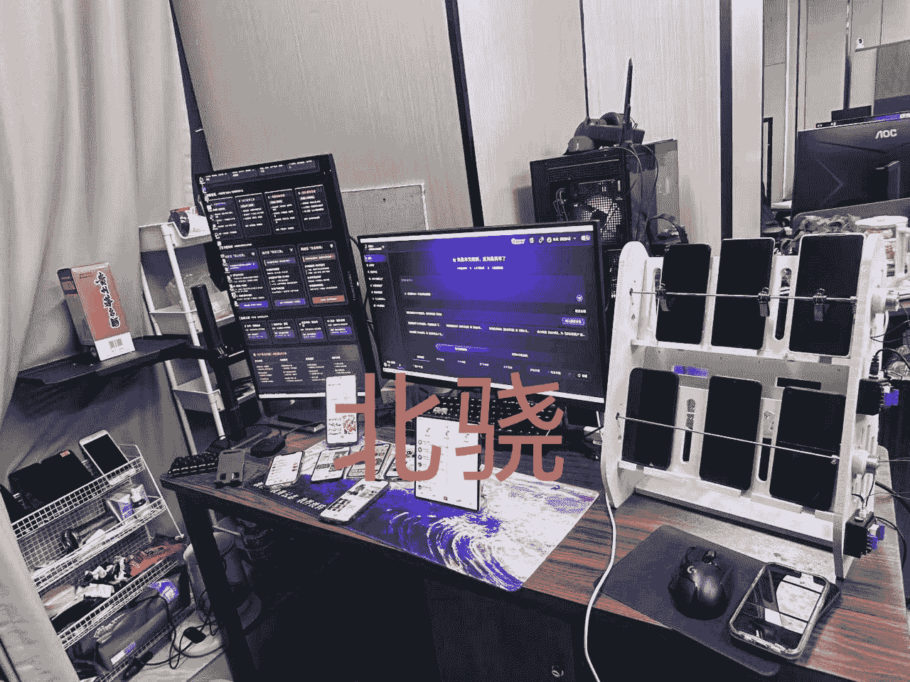

最近在我们在测试出来的一个新的流量渠道付费分享给大家，希望大家看完都有所收获

就在我写的中间时候遇到一个小事件，有人直接照抄我们的训练营，甚至海报都懒得改，看到这个事件其实我还挺高兴，证明我们也算私域的一个小标杆了，这么多的同行在抄模式，抄就抄呗，但是抄不了我们的更新迭代的速度，这个是没法的，

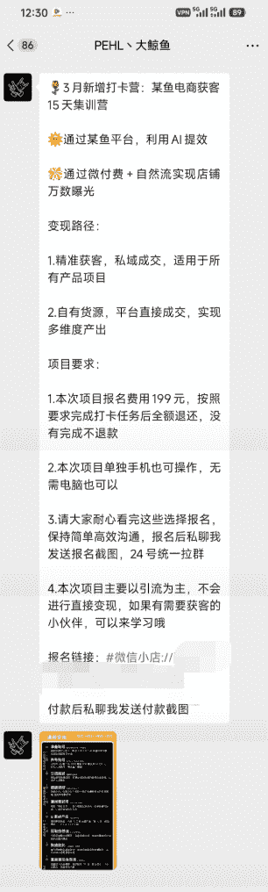

也正因为如此，最近我们把第一期闲鱼矩阵微付费打法训练营正式跑完之后，我就一直想在赚钱圈友做一次阶段性分享，他抄任他抄，我直接把打法公开出来，希望对大家理解流量有所帮助，后面我分享的带上实操部分。

这些年我其实很少完整出来写一篇阶段性复盘。

这次想认真写一篇，是因为我们最近几个月一直在跑一条线：闲鱼矩阵微付费。

我想讲清楚三件事：

1.  为什么我觉得这条路在 2026 年还值得看

1.  为什么很多人进去以后还是跑不通

1.  如果你本身就在做业务，最小的起步路径应该怎么走

## 先说结论

如果让我把这几个月的测试结果压成一句话，我会这么说：

2026 年的闲鱼矩阵微付费，在我看来，确实很像 2023 年的📕自然流和截流。

我这么讲，不是为了把话说得更刺激一点。

而是因为它同时满足几个条件：

1.  还能做矩阵铺量

1.  能承接明确需求

1.  能往私域导流

1.  投产比能打出来

1.  平台还没有被所有同行彻底打透

1.  账号和环境还有可操作空间

对我来说，一个值得认真看的流量入口，不是“偶尔有人跑出来了”，而是它同时具备这些条件，而且能持续验证。

闲鱼现在给我的感受，就是这样。

毕竟官方营销投入确实不少，我也没花时间去调研大公司在干嘛，所以放下豆包的数据

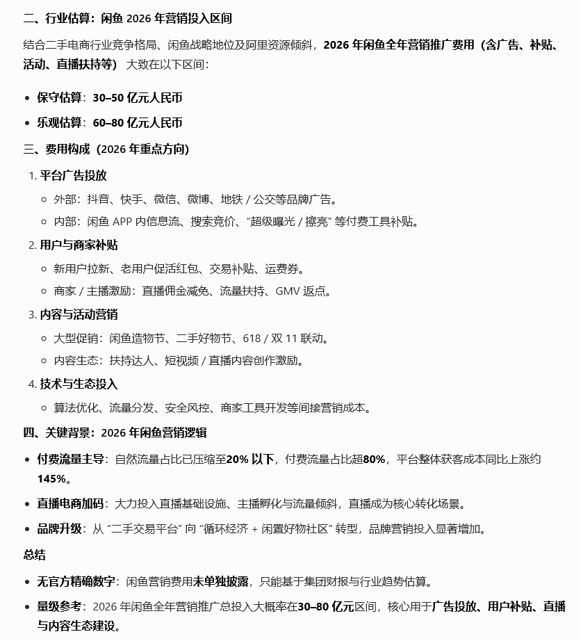

### 我们为什么会认真盯上这条线

这条线不是我们看别人讲得热闹，才临时决定做的。

去年 10 月开始，我们就和蝎子团队一起反复下场实测。

到 12 月，线下自营打 `AI` 粉和私域粉，已经能做到几千万曝光、每天稳定进线百人。

到 2026 年 1 月，这套东西在我们自己手里，已经不再是“能不能跑”的问题，而是“怎么把它跑得更稳”的问题。

也是从那个阶段开始，我越来越确定，这条路值得认真拿出来复盘。

因为它已经不是一个空判断了。

它背后有我们自己踩过的坑，也有一组组实测出来的数据。

### 我们自己跑到了什么

先讲结果。

到 2026 年 1 月，我们自己的自营账号，在闲鱼上做 `AI` 粉和私域粉，单月总曝光突破了 3000 万。

每天稳定进线超过 100 人。

单粉获客成本最低的时候，做到过 6 毛 左右。

更关键的是，这不是某一天突然爆了。

而是连续稳定出量。

对我来说，这一点比“某条链接偶然起量”更重要。

因为真正能做成业务的，不是某一次运气好，而是你有没有把前面的动作跑顺，让它开始稳定出量。

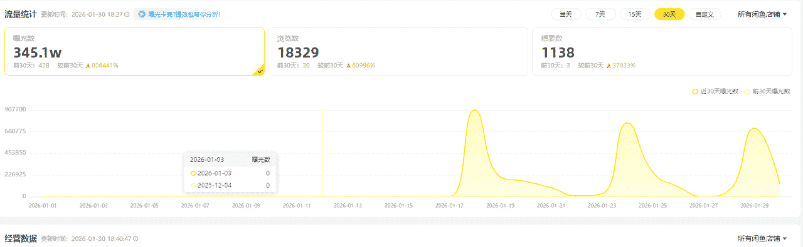

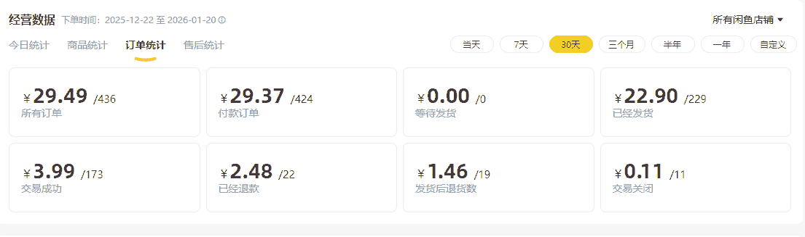

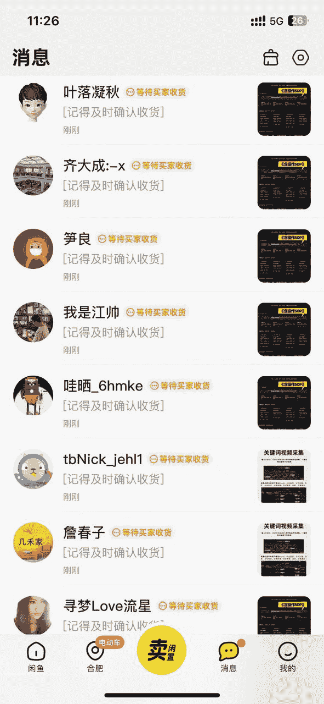

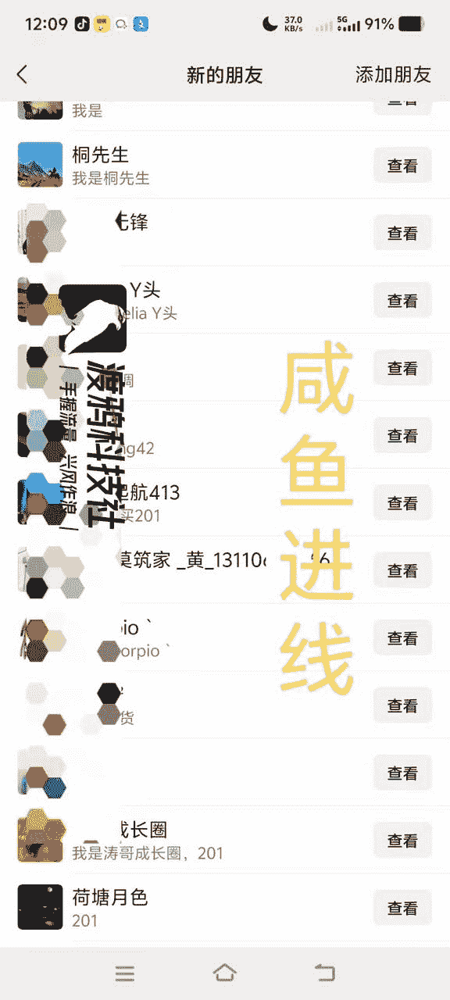

而且这套东西不是只在一个方向里成立。

我们自己测下来，`AI` 工具、创业副业、金融、咨询、旅游、情感、票务、本地服务这些方向，基本都能看到可跑通的迹象。

所以我现在看的已经不是“闲鱼上有没有个别案例”。

我现在看的更像是：

只要你的赛道本身有真实需求，闲鱼就很容易成为一个前端获客入口。真正拉开差距的，往往不是平台本身，而是你有没有把那套基础动作跑顺。

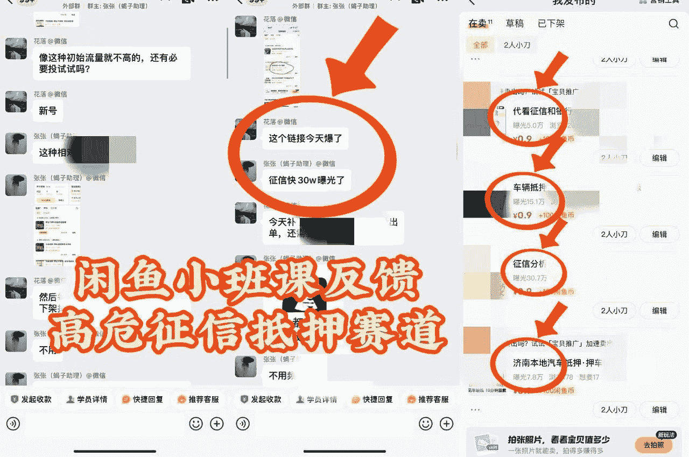

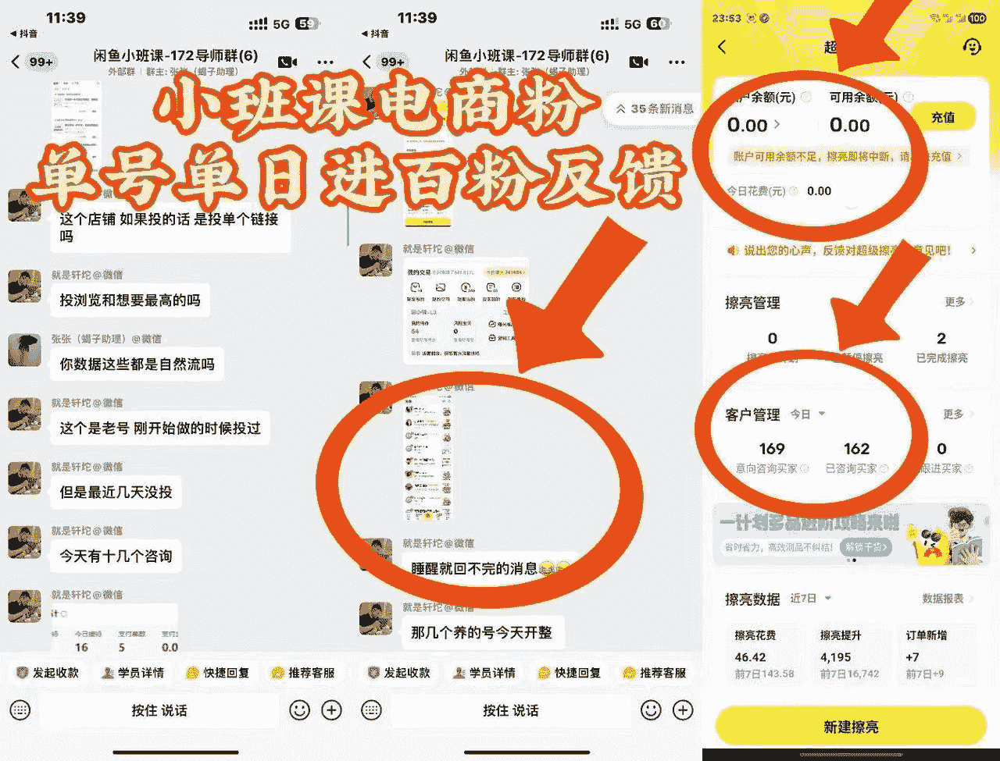

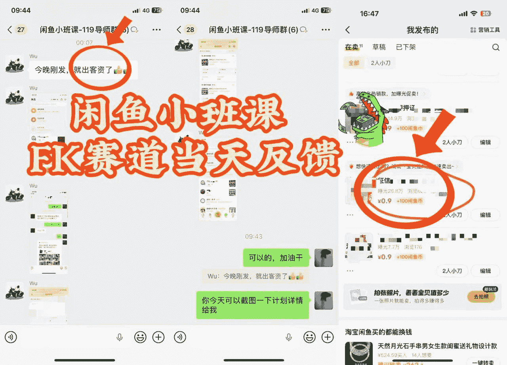

数据不想放太多，这组部分数据对我来说，已经足够说明问题了。

这不是比喻，是我们实测出来的判断。一个真正的流量风口，要同时满足几件事：可以大量矩阵铺量、可以直接导流、投产比打得出来、平台还没被同行打透、账号足够稳定——闲鱼，现在全部满足，而且投产比我们目前稳定在1比10以上。

在这个风口时候，就比如说最近的这个小龙虾`openclaw`，我看到很多开课的圈友、同行靠这个开课，一周卖了7000多份，而我们呢，恰好懂技术，打了一个小龙虾的部署的品，怪不得是小风口，投产比可以达到1比10，舒服的要死，单天单号产出纯利润2k➕

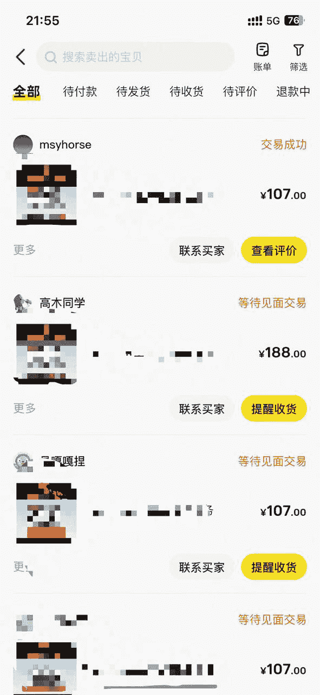

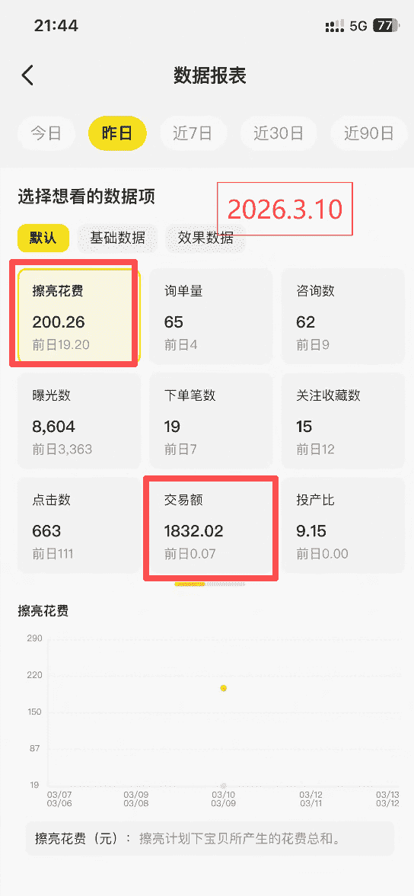

## 小白先看懂这三件事，然后在开始动手

### 你适不适合先做这条线

更适合下面几类业务：

+   服务类

+   咨询类

+   资料类

+   教学类

+   引流型产品

+   需要先拿咨询、再做私域承接的业务

如果你现在本来就在找一个低成本测试前端获客的入口，闲鱼值得做。

但前提是，你得接受它是搜索电商逻辑，不是短视频逻辑。

### 完成标准

> 你开始实操前，脑子里先记住一句话：

> 闲鱼拼的不是谁会喊，而是谁把基建、关键词、链接和数据跑顺。

## 二、准备阶段：先把基建搭对

先把设备、账号、`IP`、店铺基础权限准备好，别等到开始发链接了才发现前面没搭对。

### 准备清单

+   1-5 台干净安卓设备

+   可持续使用的支付宝/闲鱼账号

+   稳定的网络环境

+   鱼小铺权限

+   基础记录表：关键词、链接、类目、数据记录表

+   需要导流时用到的承接素材：网盘、备注图、二维码图、🛰️号图

### 具体动作

#### 设备怎么选

设备不需要贵，核心是干净、稳定、能长期跑。

你没必要上来就用贵设备，我们实测下来三折叠、苹果17promax和几百块钱的安卓机一样能跑，关键看设备环境是不是干净。

对大多数人来说，300 到 600 的安卓机就够用，重点不是设备有多贵，而是你后面能不能稳定铺开。

如果设备以前跑过别的平台，先确认设备环境有没有处理干净，再决定要不要继续用。

#### 账号搭建准备

通过系统性地模拟真实买家行为，在7天内快速、高效地提升新账号的初始权重。

闲鱼是基于“搜索”和“推荐”的电商平台，账号权重直接决定了后续商品获得的自然流量。

精细化的养号行为，本质是向平台算法证明“我是一个有价值的真实用户”，从而获得更高的信任与流量分发。

### 2.1 闲鱼权限设置

#### 定位权限

+   永不允许，不进行一个开通。（如果之前有下载使用闲鱼软件，定位权限已经进行了一个开通。或者需要使用闲鱼软件，购买当地一些产品，或者向附近朋友，出售一些自己不用的产品这种，可以不用管，打开也可以的）

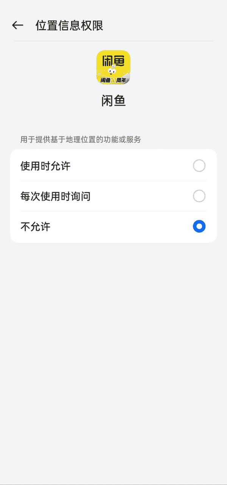

#### 消息通知

#### 很重要，务必打开，前期消息务必及时回复。

#### 允许后台 `App` 刷新

#### 允许后台 `App` 刷新，外加所有照片权限。（截图了一个苹果的，安卓的按照提示进行即可。）

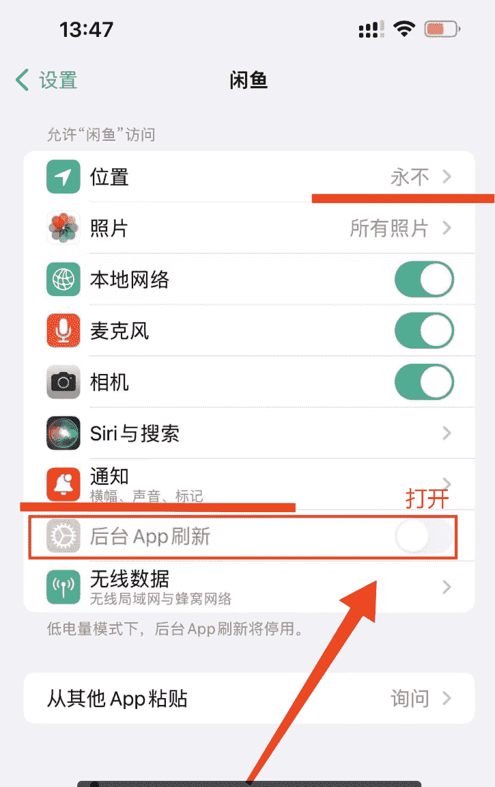

### 2.2 基本软件下载完善

+   下载好闲鱼`APP`，之前未下载，使用过闲鱼的，可以直接借用自己常用的支付宝，淘宝账号登陆即可，比较简单。

+   多号操作务必注意单机单卡单号进行操作，以免一个账号出现风险，影响其他账号。

### 2.3 闲鱼账号完善

1.  个人资料完善

+   登陆之后点击“我的”，进入点击“编辑资料”。

+   根据自身情况完善信息85%以上，图像颜色重一些的比较好，卡通，宠物的，美女，孩子都比较好；女性身份一般比较占优势，可以直接女性。

+   简介这块可以直接对标同行

+   店铺名称没有什么要求，前期可以直接参考同行设置好。

1.  实名认证完善

+   点击我的，右上角设置，点击进入，选择“账号与安全” 往下拉“身份认证”进行认证即可。（具体如下图所示

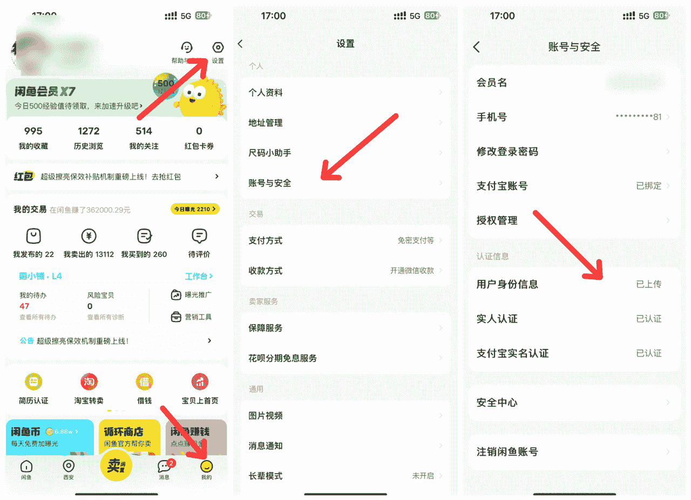

1.  注意事项

+   芝麻信用分尽可能650以上，700左右，自然越高越好。具体查询，打开支付宝，首页搜索“芝麻信用”点击即可。

+   如何提升自己的芝麻信用分？

下方有一个“去涨分”可以按照提示进行，外加平时多使用“花呗”支付，并且及时还款，外加补齐自己的一些身份信息来的。

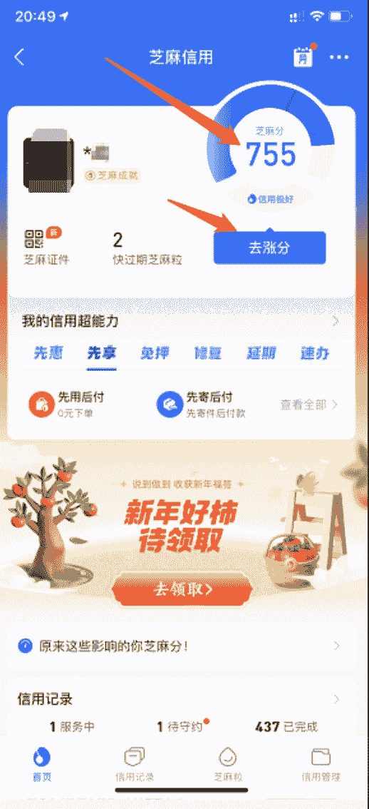

+   一些信用分低的怎么办？

刚开始可以直接借用身边亲人，朋友，信用高的进行使用来的。

#### IP 和环境怎么配

这条线必须坚持 `1 机 1 卡 1 `IP``。

账号少的时候，可以直接用厅卡或独立网络去跑。

账号多的时候，再考虑软路由这类方案。

小白不用先搞得很复杂，但有一个原则不要乱：不要多个号混在同一套不干净环境里跑。

#### 鱼小铺先开好

能开就尽早开。它会影响你后面的发布数量、权益和流量上限。

很多人后面觉得量起不来，不是不会发，而是权限一开始就没打通。

### 完成标准

> 下面这 5 条全满足，再进下一步：

+   有可用设备

+   有稳定账号

+   有独立环境

+   知道自己后面怎么持续补账号

+   鱼小铺能开则开

## 三、养号阶段：7 天到底怎么养

### 先记住养号的原则

养号不是放着等 7 天，而是连续 7 天模拟真实用户行为。

闲鱼是搜索电商，平台更看重你的真实浏览、搜索、互动、交易行为。你养号太敷衍，后面链接天然就弱。

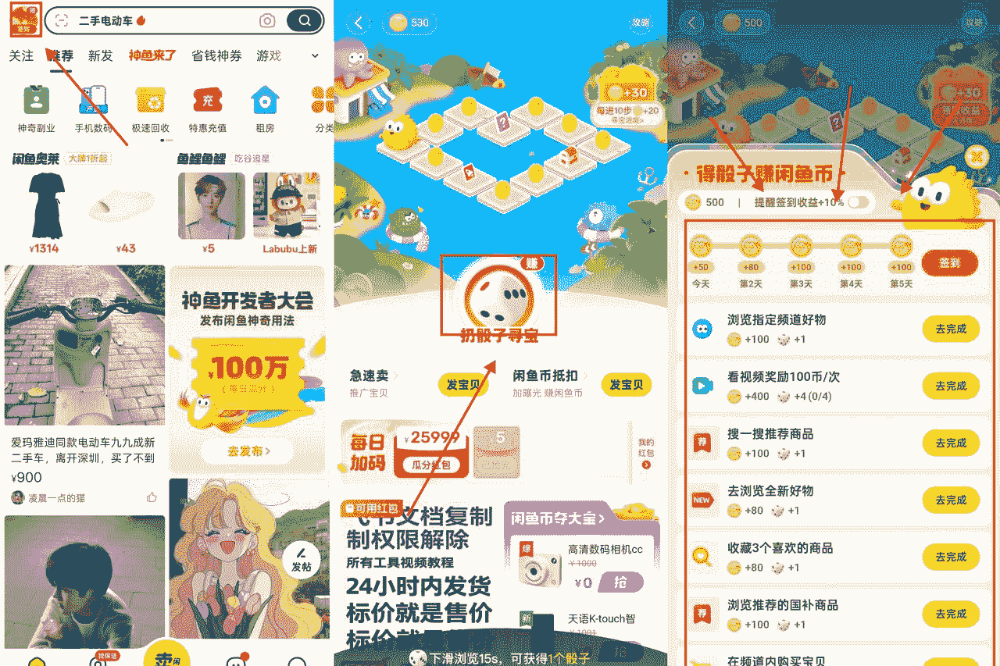

### 7 天执行表

### 每天固定动作

+   刷推荐页 30-60 分钟

+   用搜索框搜不同类目

+   每个商品停留 15 秒以上

+   看商品详情，不要点进去就秒退

+   点“我想要”或做简单咨询

+   做签到

+   做任务中心里的免费任务

### 养号完成的判断标准

+   你已经连续 7 天在用这个号

+   中间没有频繁切换环境和账号

+   有搜索、浏览、互动、任务、交易这些完整动作

+   账号不是空号状态

## 四、模板调研：先找词，再找模板

### 先记住一个原则

模板调研不是抄同行，而是找到你该卡进去的关键词入口。

闲鱼不是你想卖什么就发什么，而是用户搜什么，你能不能出现在他的搜索结果里。

### 三种调研路径

#### 精准大类关键词调研

这是你的赛道统称词。

比如：

+   私域获客教学

+   抖音获客教学

+   📕获客教学

+   创业项目

+   论文服务

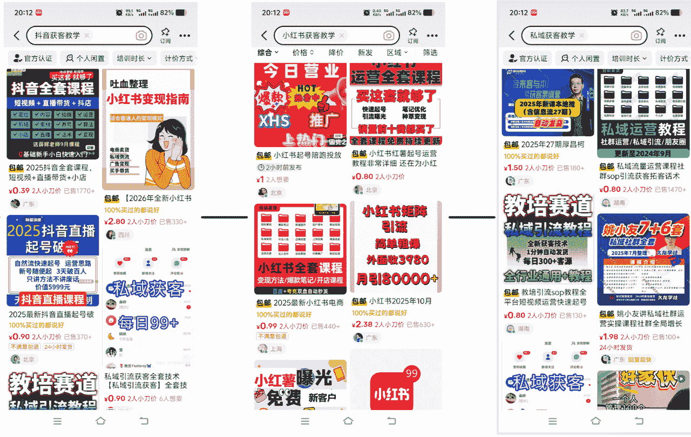

这种词的特点是：

+   搜的人多

+   做的人也多

+   竞争最激烈

适合拿来干两件事：

+   先看这个赛道在闲鱼到底有没有需求

+   先找出头部同行的封面、标题、类目和表达方式

#### 衍生关键词调研

当大类词太卷，就往下拆。

比如“私域获客”这个大类，下面可以继续拆成：

+   SPA 获客

+   教培获客

+   创业粉获客

+   旅游获客

+   本地服务获客

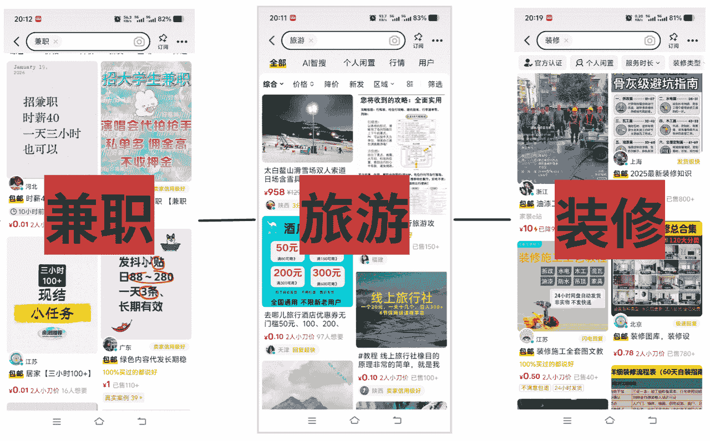

又比如“兼职”这个词，还可以继续拆成：

+   代发

+   代写

+   代拍

+   某具体兼职方向

衍生词的好处是：

+   人群更细

+   需求更具体

+   竞争通常更小

+   转化率往往更高

#### 周边产品关键词调研

这是很多人最容易忽略，但有时最好用的路径。

当你的主赛道词太敏感、太高危、太高净值，或者用户本身不习惯直接在闲鱼搜主词时，就用周边产品切入。

比如：

+   雪茄不一定好直接打，但雪茄剪、雪茄钳、烟灰缸这些周边词更好切

+   高客单业务不一定先打主服务，可以先用相关咨询、周边产品、周边资料做入口

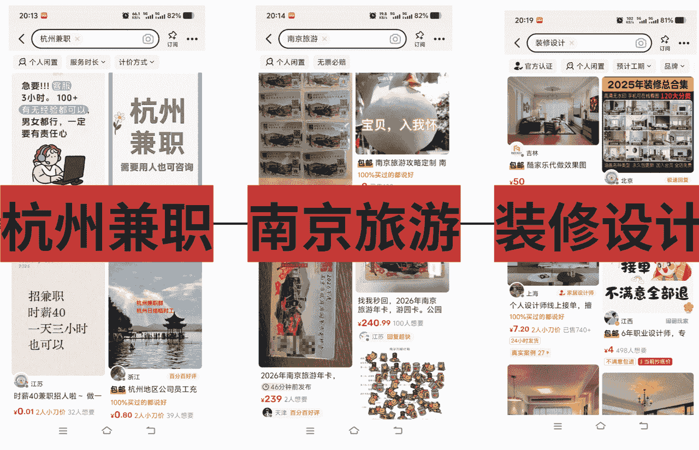

> 核心原则只有一个：

> 只要最终吸进来的人群是对的，入口不一定非要打最直白的大词。

### 调研后你至少要产出什么

每个赛道至少整理出 3 组东西：

+   5 个大类关键词

+   10 个衍生关键词

+   5 个周边产品关键词

同时，把每类词下跑得不错的同行链接整理出来，看 4 个点：

+   主图怎么写

+   标题怎么写

+   类目怎么选

+   价格怎么挂

### 完成标准

> 你发布前，手里至少有一份词表，而不是脑子里凭感觉有几个词。

## 五、发布前准备：先把链接做成能测的状态

先做出 2-4 条可测试的链接，再进入微付费阶段。

### 具体动作

#### 第一天先发 2-4 条链接

不要一上来铺十几条，也不要只发一条。

第一天发 2-4 条的目的，是为了拿到初步数据，后面从里面选出最值得投的一条。

#### 主图和标题优先处理好

闲鱼里用户最先看到的就是主图和标题，所以这里是点击率核心。

主图重点：

+   放关键词

+   放痛点

+   放卖点

+   要让用户一眼知道这条链接跟他的需求有关

标题重点：

+   带上核心关键词

+   不要太虚

+   要让用户知道你在解决什么问题

#### 类目不要凭感觉选

同样的赛道，不同类目、不同主图、不同标题，最后跑出来的价格和咨询量可能完全不一样。

所以类目本身也是要测的。

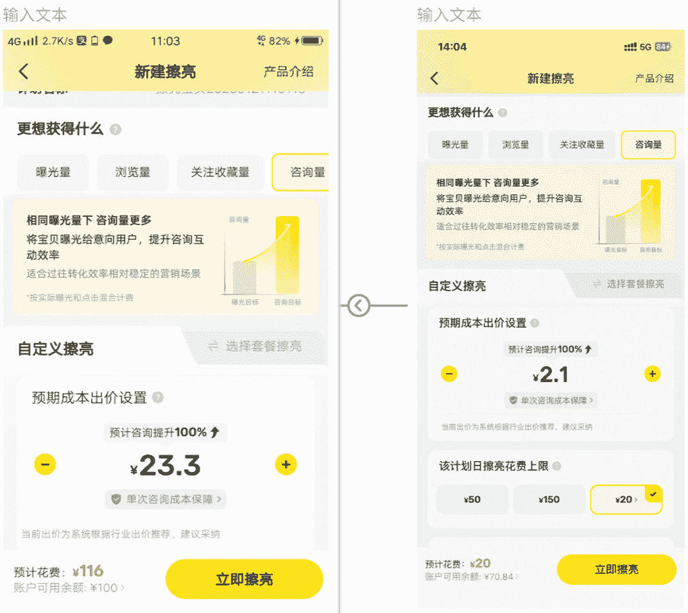

#### 发完先别急着投

先放 24 小时，看基础曝光、浏览、想要，再决定投哪条。

另外，用别的账号去搜你铺的关键词，确认你的链接能不能被搜到。如果搜不到，先别着急投。

### 发完先自检

+   链接能不能搜到

+   主图上有没有核心关键词

+   标题里有没有关键词

+   类目是不是你刻意选来测试的

+   价格是不是你能承受的

+   描述是不是至少把交付说清楚了

## 六、微付费起号：真正开始跑数据

### 这一步的核心不是赚钱，是两件事

1.  快速测出哪条链接值得继续打

1.  让店铺尽快积累有效成交和评价数据

### 具体动作

#### 24 小时后先选链接

从你发的 2-4 条链接里，优先挑：

+   浏览高的

+   想要高的

+   咨询意愿强的

不要只盯曝光。曝光高不等于这条链接值得投，浏览和想要更能说明用户是否愿意点进来、愿不愿意继续往下走。

#### 用超级擦亮里的自定义询单去测

微付费阶段，核心不是大投，而是小预算测。

建议动作：

+   每次先选 1 条链接测

+   单条计划先按小预算跑

+   先跑 1 周左右，再看是否继续放大

#### 预算怎么理解

你前期的预算，是拿来买判断的。

重点不是“今天一定要回本”，而是用尽可能小的成本，尽快确认：

+ 这条链接能不能带来咨询
+ 这条链接吸来的用户准不准
+ 这个类目和表达能不能接住需求

## 微付费阶段最常见的 3 种情况

### 情况 1：空烧

表现：

+ 钱在花
+ 曝光在涨
+ 咨询很少甚至没有

说明：

这条链接被看到了，但没把人点进来。

优先改：

+ 主图
+ 标题

不要先乱改投放设置。先把“用户为什么不点”解决掉。

### 情况 2：能烧动，但出价偏高

表现：

+ 有咨询
+ 预算能消耗
+ 单个咨询价格明显偏高

说明：

人群还没完全跑准，或者当前类目、词、主图的匹配度还不够好。

优先动作：

+ 先观察 2-3 天
+ 同时复盘类目、人群、关键词
+ 如果这条链接本身咨询质量不错，不要一上来就砍掉

### 情况 3：曝光低、浏览低、咨询低

表现：

+ 各项数据都弱

说明：

这条链接整体就不强，不值得继续烧。

优先动作：

+ 直接放弃
+ 重新换词、换主图、换表达、换链接测试

### 完成标准

> 当你出现下面的状态时，说明这一步已经跑顺了：

+ 至少有 1 条链接能稳定带来咨询
+ 你开始知道什么样的主图和标题能把用户吸进来
+ 店铺开始有成交和评价数据

## 七、数据优化：怎么看曝光、浏览、想要

通过数据判断问题出在哪一层，而不是凭感觉乱调。

### 三个核心数据先看懂

+ 曝光：你的链接被平台推到别人眼前了没有
+ 浏览：别人看到了之后，愿不愿意点进来
+ 想要/咨询：点进来之后，愿不愿意继续往下走

### 数据判断速查表

### 你每天复盘时就盯这几件事

+ 哪条链接的浏览最高
+ 哪条链接的想要最多
+ 哪条链接开始出现稳定咨询
+ 哪条链接反复优化还是没起色

你后面要做的不是“所有链接都救”，而是把有机会成为爆款的链接维护好，把弱链接及时换掉。

### 完成标准

> 你已经能根据数据判断：

+ 该改主图还是改标题
+ 该改描述还是改类目
+ 该继续烧还是直接放弃

## 八、导流与承接：咨询来了以后怎么接

### 先记住导流原则

优先走 拍下后导流。

不要一有私信就急着硬拉。很多号不是死在没流量，而是死在太急。

### 标准顺序

1. 用户拍下链接
1. 你先完成发货动作
1. 发导流承接内容
1. 用户按备注、二维码或🛰️号来加你
1. 你在🛰️里继续承接和转化

### 承接内容怎么放

常见做法是用一个网盘页，把几样东西一次性放好：

+ 备注说明
+ 🛰️号
+ 二维码
+ 简单引导语

这样用户点开后，不用反复问你，也更清楚下一步该干嘛。

小技巧：优先用夸克，毕竟他也属于阿里体系下面的

百度网盘还需要复制到浏览器才可以看

### 两种最常见情况怎么处理

#### 已读未加

说明用户看到了你的导流信息，但没行动。

这时候要补一句提醒，不是催命，而是让他知道：

+ 你要给他安排什么
+ 为什么现在就该来加
+ 晚了会损失什么

重点是补“行动理由”，不是单纯再发一遍二维码。

#### 未读未加

说明用户买了，但还没真正看信息。

这时候要做的是提醒触达，让他回来看消息，而不是立刻追加一堆新话术。

### 哪些动作最容易把前面白做

+ 没拍下就急着硬导流
+ 导流话术太直白
+ 咨询一多就乱发违规内容
+ 链接刚起来就把号搞废

### 完成标准

> 你至少已经有一套固定承接顺序：

+ 拍下后怎么发
+ 网盘里放什么
+ 已读未加怎么补
+ 未读未加怎么提醒

## 九、自然流阶段：号起来后每天怎么维护

### 进入自然流阶段的标志

+ 微付费阶段已经有稳定咨询
+ 店铺有基础成交和评价
+ 不只一条链接有反应
+ 停掉付费后，依然有自然咨询进来

### 每天固定动作

#### 每天上新 1-2 条链接

就算已有链接在跑，也要保持上新。

原因有两个：

+ 新链接会带来额外曝光
+ 你永远不知道下一条会不会成为新的爆款链接

#### 每天复盘数据

重点看：

+ 哪条链接还在持续进咨询
+ 哪条链接开始掉量
+ 哪条链接浏览高但咨询低

#### 继续做日常任务

**签到、任务中心、闲鱼**币这些动作，不是起号阶段才做，而是只要你在跑闲鱼，就要持续做。

#### 用闲鱼币去放大强链接

闲鱼币更适合投给已经跑出浏览和咨询的链接，快速把人群标签拉正，而不是瞎投给弱链接。

#### 把回复效率拉上来

自然流阶段，回复慢会直接影响店铺状态。

如果你号多，可以用工具统一收消息、做自动回复，但前提是你的基础流程已经跑顺。

### 日常维护清单

+ 每天上新 1-2 条
+ 每天做签到和免费任务
+ 每天看链接数据
+ 每天优先回复有效咨询
+ 每天观察爆款链接有没有掉量
+ 每天把弱链接和强链接分开处理

### 爆款链接的 3 个不要

1. 不要乱改爆款标题
1. 不要频繁上下架爆款链接
1. 不要大改爆款主图

爆款链接可以微调，但不要大动。很多人不是没爆款，而是把有机会的链接自己折腾死了。

### 可以加上的放大动作

+ 闲鱼币折扣
+ 两人小刀
+ 闲鱼联盟返佣

这些动作的本质都是增加链接的点击和分发概率。

### 完成标准

> 你已经进入“每天维护店铺”的状态，而不是“今天有空就看看，没空就放着”。

好了，大概分享就到这里

## 但这篇帖子不是来告诉你“闲鱼很好做”

好做，是事实的一部分。

但绝大多数人进去以后还是跑不通，这也是事实。

问题不一定出在平台。

更多时候，问题出在很多关键细节上。

更麻烦的是，大部分人踩了坑，自己还不知道坑到底埋在哪里。

所以这篇帖子真正值钱的地方，不是讲“这里有机会”。

而是把那些最容易把人做废的坑先摊开来讲。

## 其实很多人就能明白，为什么闲鱼“听起来能做”，但自己一上手还是乱。

不是平台不给机会。

而是这条路的细节太密了。

我们自己从去年 10 月一直测到 12 月，才算真正把这条路跑顺。

中间废过号，烧过冤枉钱，也重新调过很多次。

如果你自己从零开始摸，保守看，**3 到 6 个月** 很正常。

这也是为什么我会觉得，这条路现在还有窗口。

因为它不是那种“看一眼就会”的打法。

门槛不是没有，而是还藏在细节里。

## 最后说一句实在话

如果让我用一句最实在的话收这个帖子，我会这么说：

2026 年，闲鱼矩阵微付费这个窗口是真实存在的。

但它不属于看热闹的人。

它更属于那些手里本身就有产品、有服务、有承接能力，只是一直缺一个稳定前端入口，

而且愿意把环境、关键词、投流、导流、评价数据这些脏活累活一个个跑顺的人。

我现在越来越少把这条路看成一个“项目”。

更准确地说，我把它看成一个新的流量入口。

如果你本身就在找前端获客入口，希望这篇复盘对你有帮助。

如果你也在测试闲鱼，欢迎在评论区交流你现在卡在哪一步。

或者你有更加高效的打法，欢迎交流
