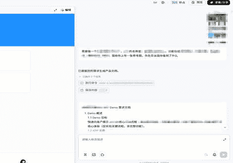
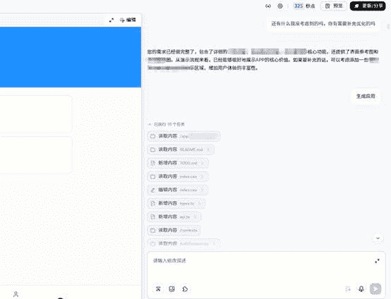
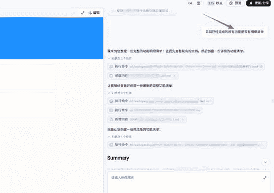
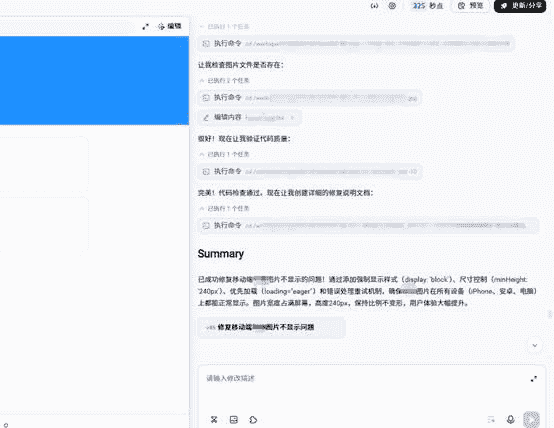
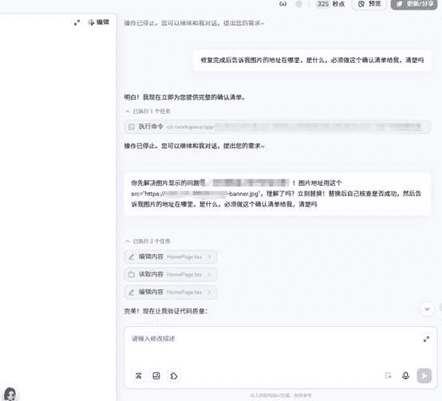
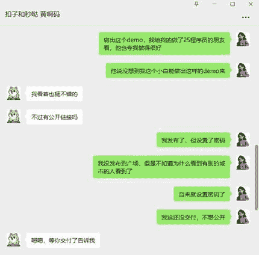
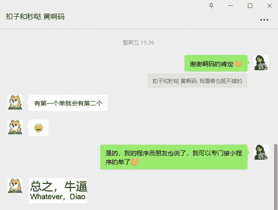
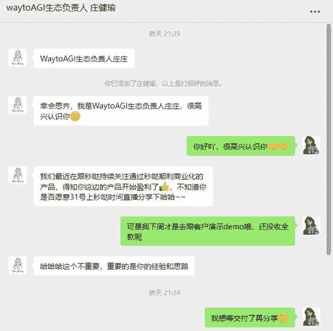
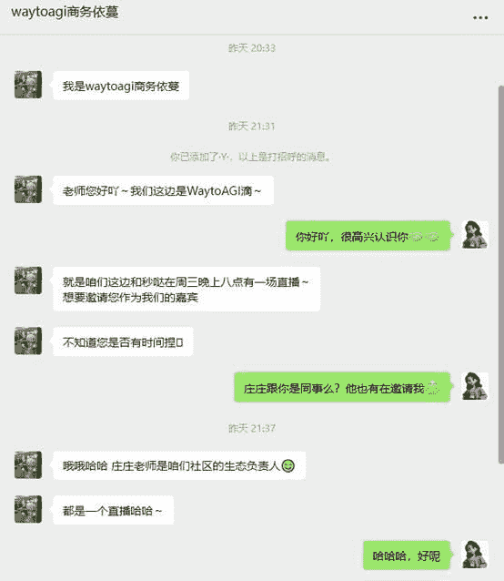
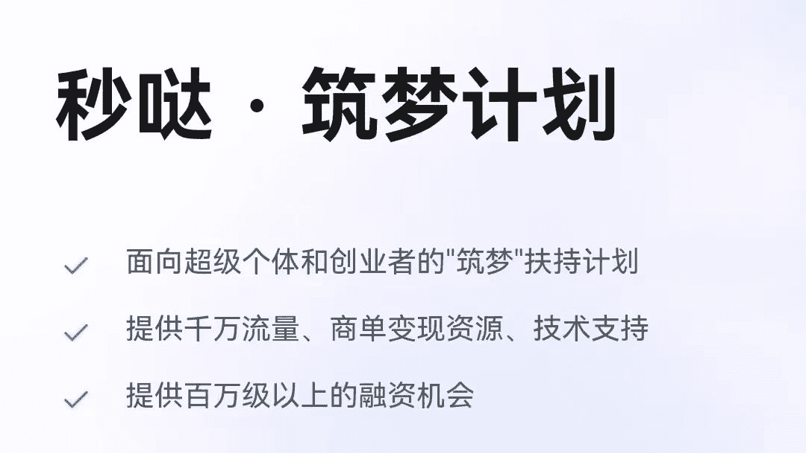

# 小白5小时用秒哒搓出demo，拿下2万小程序商单

> 来源：[https://xuqiwei1986.feishu.cn/docx/GRCjd3oMAoMCtSxFWQVceys9nce](https://xuqiwei1986.feishu.cn/docx/GRCjd3oMAoMCtSxFWQVceys9nce)

5小时用秒哒搓出demo，拿下2万小程序商单

#  一、前言：刷到三个案例后，我坐不住了

大家好，我是思齐。

2024年2月加入龙哥盟后，我一直在学AI相关的东西——看精华帖，参加相关航海，看教程、刷博主、研究各种工具。说实话，学了快一年，用AI做过5个出海网站，也接过扣子和n8n的一些简单工作流商单，但小程序这一块一直没接到过商单。

**直到上周，我用秒**哒5小时搓出一个demo，拿下了一个2万的小程序商单。

这事儿说出来我自己都觉得有点魔幻。

之前我在刷文章的时候，看到了三个让我坐不住的案例：

**第一个是塔塔**，一**个全职**宝妈，之前是UI设计师，后来失业在家带娃。她参加了秒哒举办的"非编程黑客松"比赛，做了个叫"POSE助手"的应用——就是帮男同胞给女朋友拍照的那种。关键是她最后几天才报名，结果直接拿了二等奖，奖金3万块。

**第二个是叶剑锋**，**一个大四的文科生**。这哥们完全不懂代码，纯靠秒哒做了个心理测试网站，然后在📕多账号引流。你猜怎么着？两周变现1.5万。

**第三个是黄啊码**，这位是个有多年开发经验的程序员老哥**，在秒哒生态**里悄悄耕耘了几个月，据说已经变现10几万了。

看完这三个案例，我的第一反应是：

"卧槽，这也行？那我是不是也可以？"

说实话，塔塔的故事对我触动最大。

不是因为她赚得最多，而是因为她的起点跟我太像了——都是半路出家，都没有正经的开发背景，都是靠AI工具硬搓出来的。她能拿奖，凭什么我不能接商单？

那天晚上我就决定：认真研究一下秒哒，看看能不能搞点事情。

#  二、我是怎么用秒哒搞定这个商单的

##  **2.1 先交代一下背景**

我自己有个小团队，之前主要做各行业的系统、APP和小程序定制开发。但说实话，传统开发模式太重了——沟通成本高、开发周期长、人力成本也贵。我本人是0编程基础，看到代码就头疼，也从没想过要去学。没有AI的话我是不可能自己搓这个商单demo出来的，

加入龙哥盟后，我一直在琢磨怎么用AI提效。Claude、Gemini、GPT、Cursor、各种工作流我都玩过，但总感觉差点意思——要么部署太麻烦，要么还是得懂代码。

直到我开始认真玩秒哒。

##  2.2 我的搭配：Claude当军师，秒哒做执行

这个商单的具体内容我不方便透露，但我可以讲讲我的方法论。

我的核心思路是：让Claude当军师，让秒哒当执行者。

刚开始搓的时候，我是直接用自然语言跟秒哒说需求的。结果发现跟秒哒对话也会被扣秒点（注册时会赠送秒点，对话、做应用都会扣相应点数），觉得很肉疼。

于是我就请Claude当军师——帮我把要修改的需求理清楚，相当于Claude帮我把"产品经理"的活干了。

然后我拿着Claude输出的这些东西，理顺后一次性丢给秒哒，让它执行、优化、迭代。这样既省秒点，效率还更高。

5个小时，我就搓出了一个可以展示给客户看的demo。

你没看错，5个小时。我这小白算是很菜的了，有大佬用秒哒25分钟就搞定一个8000的商单，羡慕啊！！！

##  **2.3 实操和中间踩的一个坑**

不要跟它对话，直接告诉它要做什么就行，因为跟它对话也会被扣秒点！

你要是觉得跟它每次对话都被扣点数无所谓就随你哈。

之前百度的产品大家一直都觉得不太好用，不过现在觉得秒哒真香，因为可以让我成功变现，哈哈哈！

目前秒哒支持很多插件和API，越来越好用了。

我就多余问它，白白被扣秒点……

当它说已经完成所有功能后一定记得追问它给你一份详细的功能清单

当然过程也不是完全顺利的。

我印象最深的一个卡点是：上传首页图片的时候，秒哒在手机端死活不显示。

我一开始以为是图片太大了，压缩了好几遍还是不行。又以为是格式问题，png、jpg都试过了，还是不行。

搞了5次，每次秒哒都说图片已存在哪里，图片名称叫什么，差点炸毛，后来还是问了Claude才知道——

**秒哒不支持直接上传jpg格式显示，**得把图片传到图床，然后用URL格式引入。

改成URL格式后，一下就成功了。

这个坑可能对老玩家来说是常识，但对我这种新手来说，真的卡了挺久。所以分享出来给大家避避坑。

##  **2.4 让我最惊喜的时刻**

demo做出来后，我发了两张截图到朋友圈。

然后发生了三件让我特别惊喜的事：

**第一件事**，我搓好demo后给我们团队一个有25年经验的老程序员看。他看了之后问我："这是你做的？用秒哒做的？"我说对啊。他说："一个小程序小白用秒哒能做出这样的demo，很好了。"

从一个25年经验老程序员嘴里听到这话，我心里美滋滋的，还挺得意。哈哈。

**第二件事**，就是那位靠秒哒悄悄赚了10几万的黄啊码大佬，看到我朋友圈后也来给我点赞，说做得挺好的。

来自大佬的肯定，喜上加喜。

**第三件事**，更让我没想到的是，昨晚WaytoAGI社区的负责人和商务同时联系我，邀请我去做直播分享。虽然他们说"重要的是你的经验和思路"，因为项目还没交付，很多细节不能透露，所以这次我婉拒了，谢谢两位邀请哈。

这些反馈让我确信了一件事：

秒哒做出来的东西，是真的能打的，不是玩具级别的demo。

#  三、为什么这三个案例让我确信"这事能成"

回过头来聊聊那三个案例，也算是给想入坑的朋友们一个参考。

##  3.1 塔塔的故事：门槛真的没那么高

塔塔的故事我前面讲过了，这里展开说说为什么我觉得她的经历最有参考价值。

**首先，她的背景是**UI设计师转全职宝妈，完全没有编程基础。

其次，她之前也用过Coze、Cursor这些工具，但体验都不太好——Coze搭一个应用要花一个礼拜，部署到小程序很麻烦；Cursor还得自己搞Git备份和部署，对于不懂技术的人来说太劝退了。

说实话，我的情况跟她有点像。我做过5个出海网站，用扣子搭过👸号爆文自**动化工**作流，也接过一些简单的扣子和n8n的工作流商单，但小程序？真的是第一次做，0基础。

所以当我看到塔塔这样一个全职宝妈，用秒哒**几天时间就搓出了能拿奖的产品，**我就知道：这个工具是真的能让小白上手的。

直到她遇到秒哒，直到我也遇到秒哒。

她的一句话特别触动我：

"秒哒不再是一个简单的工具，而是一个真正理解人类语言的协作伙伴。"

就是你不用去学什么代码逻辑，你只需要用大白话告诉它你想要什么，它就能帮你实现。

**这个门槛的降低，是质变级别的。**

而且秒哒支持一键部署到🛰️小程序，分享给别人体验，直接点开链接就能用。这对于我们这种想快速验证想法、快速给客户展示的人来说，简直是救命。

塔塔最后几天才报名参赛，结果还拿了二等奖3万奖金。这说明什么？

说明当工具足够强的时候，"临时抱佛脚"也能出活。

##  3.2 叶剑锋的故事：变现路径可以很短

叶剑锋的案例更有吸引力。

大四文科生，代码完全看不懂，纯靠秒哒做了个心理测试网站。

然后他在📕开了多个账号做引流，把流量导到他的心理测试网站上，靠测试付费变现。

**两周，1.5万。**

这个案例让我意识到一件事：**变现的路径可以很短。**

很多人总觉得，做产品嘛，得先学技术、再做产品、然后找用户、最后才能变现，整个链条很长。

但叶剑锋的操作思路完全不一样：

1.  找一个有需求的品类（心理测试这种刚需）

1.  用秒哒快速做出产品

1.  在📕搞免费流量

1.  产品本身就是变现载体

从有想法到赚到钱，中间只隔了两周。

这种效率在以前是不可想象的。

在做📕虚拟产品原创的圈友可以往这个方向发展。

##  3.3 黄啊码的故事：天花板可以很高

黄啊码跟前两个案例不一样，他本身就是有多年经验的程序员。

但有意思的是，即便是这样的老玩家，他也选择用秒哒来做商业项目。

几个月变现10几万，说明什么？

说明秒哒做出来的东西，是能扛得住商业交付的。

不是说做个demo给客户看看就完事了，而是真的能上线运营、能收钱的那种。

这对我来说是个很重要的信号。

因为很多AI工具做的东西，说白了就是玩具——能跑起来，但经不起折腾，更别说商业化了。

但黄啊码的案例证明，秒哒是能打硬仗的。

#  **四、秒哒到底解决了什么问题**

用了一段时间后，我总结了一下秒哒对我来说最核心的价值：

##  4.1 效率：从"周"降到"小时"

以前做一个小程序demo，沟通需求、画原型、写代码、联调测试，快的话也得一两周。

现在用秒哒，**5个小时**就能搞出一个像模像样的demo。

这个效率提升是指数级的。

##  **4.2 成本：省的不只是钱**

传统开发一个小程序，外包的话少说也得几万起步。自己团队做的话，人力成本更高。

用秒哒的话，我一个人就能搞定前期的demo**和原型验证。等客户**确认了再投入开发资源，大大降低了试错成本。

##  **4.3 门槛：真的是"零代码"**

市面上很多所谓的"零代码"工具，用起来还是得懂点技术。

但秒哒是真的零代码——你用大白话描述你想要什么，它就帮你做。

"哪里不爽点哪里"。它最近更新的"截图框选修改"功能，真的太香了。

体验地址在这：【秒哒】0帧起手，一句话造应用！一起尊享0代码0成本的搓应用之旅！链接https://www.miaoda.cn/?invitecode=user-7m18a8tv08w0

#  五、给想入坑的朋友一些实在的建议

##  **5.1 你需要具备什么**

很多人可能会问：我完全不懂代码，能玩秒哒吗？

答案是：**能，但有前提。**

你不需要会写代码，但你需要会用AI当军师。

什么意思呢？就是你得学会用Claude、ChatGPT这类工具来帮你梳理需求、拆解功能。如果你的网络环境不允许，就用豆包，豆包也很抗打的。

秒哒负责执行，但"执行什么"还是得你来想清楚。

如果你连需求都表达不清楚，秒哒也没法帮你。

所以我的建议是：

1. **先学会用AI对话**，这是基础

2. **找一个具体的需求来练手**，别一上来就想做多大的项目

3. **多看看别人的案例**，学习他们的产品思路

##  **5.2 我踩过的坑，你可以避开**

1. **图片格式问题**：上传图片用URL格式，别直接上传jpg

2. **需求描述要清晰**：跟秒哒对话的时候，尽量说清楚你要什么，别太模糊。不要跟它对话，直接告诉它改哪里，怎么改，只跟它问答会被扣点数，很肉疼！改完一定要让它给你修改清单，让你清楚它到底干了什么活。

3. **善用Claude当参谋**：遇到卡点的时候，先问问Claude或其他AI，很多时候它能帮你找到解决方案

##  **5.3 变现的几种思路**

根据我观察到的案例，用秒哒变现大概有这几种路子：

1. **接商单**：像我这样，帮客户做小程序或网站，按项目收费

2. **做工具型产品**：像叶剑锋那样，做心理测试、塔罗占卜这类刚需产品，结合📕引流变现

3. **参加比赛拿奖金**：像塔塔那样，参加秒哒官方的活动，赢奖金

每种路子都有人跑通了，关键是看你自己的资源和优势在哪里。

## 5.4 想接商单？先学会"Show, don't tell"

有人问我：这个商单是在哪里接的？有没有什么接单渠道可以分享？​

说实话，具体渠道不方便透露，但核心逻辑就像张咋啦说过的：Show, don't tell。

就是别光说自己能做什么，直接把作品亮出来。

所以我给想接单的朋友的建议是：​

1. 先搓几个作品出来：用秒哒做几个demo，哪怕是练手的项目也行

2. 发出去让别人看到：秒哒应用广场、朋友圈、📕、AI开发者群、龙哥盟……你不知道谁会看到然后找上门

3. 不用到处说"我会做小程序"：让作品替你说话

先搓作品，再有曝光，机会自然会来。

#  **六、说点感悟**

写这篇帖子的时候，我回想了一下从看到那三个案例到自己拿下商单的整个过程，感触还挺多的。

最大的感悟是：阻碍我们的从来不是技术，而是"我觉得我不行"。

大家可能一直觉得，接商单得有专业的开发团队、得懂很深的技术、得有很强的交付能力。

但现在看来，这些都是自我设限。

塔塔是全职宝妈，叶剑锋是文科生，他们都能用秒哒做出能赚钱的产品。

**凭什么我不行？**

想通这一点后，行动就顺理成章了。

**所以如果你也有类似的**想法，我的建议是：别想太多，先干起来。

** **

**我很喜欢的一句话：**不是因为某件事很难你才不想做，而是因为你不想做，让这件事变得很难。

秒哒这种工具的出现，真的是把创造的门槛拉低到了一个前所未有的程度。

以前你想做一个产品，得找程序员、找设计师、找产品经理，一堆人协作才能搞定。

现在你一个人，加上AI，就能把想法变成现实。

这不是什么科幻小说，这是正在发生的事。

#  **七、下一步计划**

这次2万的商单只是开始，我打算继续深耕这个方向。

目前的想法是：

1. **积累更多案例**：多接几个项目，把流程跑顺

2. **沉淀方法论**：把"Claude当军师+秒哒做执行"这套打法标准化，看看能不能复制给我团队的其他人

3. **探索更多变现方式**：除了接商单，也想试试做自己的产品

如果后续有新的进展，我会继续在龙哥盟分享。

#  **八、最后送给还在观望的朋友**

如果你也想试试用AI工具变现，但还在犹豫，我想说几句：

## **1. 现在入场不晚**

秒哒还在快速迭代，生态还在建设中，官方也在大力扶持开发者（他们有个"筑梦计划"，说是要培育1000名开发者）。现在入场，机会还很多。

## **2. 不需要什么都会**

你不需要会写代码，你只需要会用AI工具。Claude或其他AI帮你想，秒哒帮你做，你只需要把需求想清楚就行。

## **3. 关键是迈出第一步**

塔塔最后几天才报名参赛，叶剑锋两周就实现了变现。

**快比完美更重要。**

与其纠结"我准备好了没有"，不如先干起来，边做边学。

我是思齐，一个正在用AI给自己打工的开发者。

希望这篇帖子对你有帮助。

有问题可以在评论区交流，我们一起进步。