# 从裸辞宝妈到3万粉AI博主：9个月接60+商单的真实复盘

> 来源：[https://xuqiwei1986.feishu.cn/docx/DUvZdJWxToA7q6x8JFlczZs0nYf](https://xuqiwei1986.feishu.cn/docx/DUvZdJWxToA7q6x8JFlczZs0nYf)

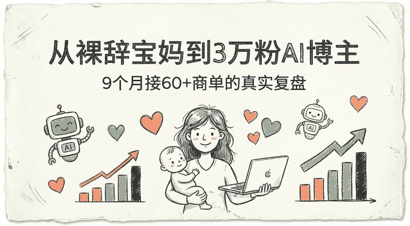

## 写在前面

大家好，我是小丫。做AI自媒体项目9个月了，今天想和大家分享这段时间的真实经历——从裸辞宝妈到3万粉AI博主，接了60+商单的心路历程，以及我踩过的那些昂贵的坑。

虽然还没到月入10万的大神级别，但9个月从0到3万粉、从月入200到月入过万，这个过程中的坑和经验，对和我一样的新手应该很有参考价值。

# 一、我的来时路

现在是12月的尾声，一年过得真快。尤其是马上迎来第二个本命年，会在期盼中带着一份坚定向前的信心。

这两天看到龙哥分享的《项目红利期长短，关键在人不在项目》，给了我很大触动。原本我还纠结是不是要换项目，也不太想分享，觉得自己没拿到大结果。但龙哥说得对：项目的红利期跟项目没太大关系，跟人有关系。你人是长期的，这个项目的红利期就非常长。

### 关于我

我是一名有12年经验的前视觉设计师，准确地说，是外包设计师。从2015年到2023年，都在外包设计师这个圈子里打转。前期在公司做阿里系的设计外包，2020年开始驻场在阿里园区，辅助甲方设计师做设计。

其实我不想一直做外包设计师，但投递的简历回复都是外包岗位。加上薪资也还过得去，就一直这样耗着。骨子里，我一直在观望，想办法跳出这个模式。

第一次接触赚钱：2020年就加入了（编号29484）。那时候很惊喜，发现了新大陆，但也很迷茫——信息量太大，很多看不懂。加上工作忙，一个月后就闲置了一年多。现在想想真的很后悔，如果那时候能加入航海实战，应该是不一样的风景。

第一次做项目：2022年7月，阿里外包项目结束，我一边找工作，一边在赚钱圈友的训练营学习📕虚拟资料。做了2个账号，加了几百好友，赚了两千多块。这是我第一次知道，原来还可以这样赚钱。

冲动裸辞：2023年10月，刚怀孕，觉得视频号带货是不能错过的机会，不顾一切裸辞了。结果一整年除了赚回学费，几乎没有收入。现在想想也很正常。上班这么多年，我除了会用设计软件，没有任何商业思维和运营能力。选品、拍摄、脚本、剪辑、直播，都是新东西。仅凭一股幻想就把自己陷入被动，这是30多岁中年人的无脑冲动。

### 重新出发

2025年过年后，我开始整理简历。刚生完孩子、裸辞一年多，重新进职场的难度确实高。投了一些简历都没回复。

35岁、3个娃、队友工作太忙平时也顾不上家里，找工作上班也难上加难。我心里想要的状态是能在家边工作边照顾家庭，于是和队友商量，给自己3个月时间再试一次。

刚好过年那阵子DeepSeek爆火，我在赚钱👸号看到AI自媒体超级标和新一期航海实战。虽然续费通道已关闭，但我找鱼丸帮忙开通了，赶上了3月的航海实战。

# **AI自媒体实战复盘**

## 一.账号现状

从3月26日发布第一条视频笔记，截止目前📕粉丝3w，视频号4w+，抖音5k+。

接商单60多条（单独合作商单+固定创作者商单），合作品牌有飞书、夸克、阿里云、钉钉、豆包、剪映、MiniMax 、可灵、即梦等等。

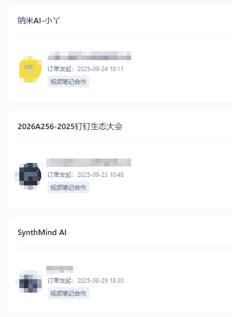

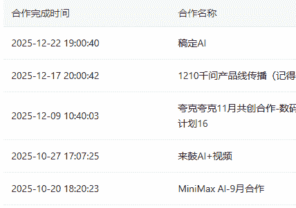

虽然合作多了起来，但变现对于我来说，并没有达到预期。这里原因之后会细讲。

主要的变现方式还是来源广告收入，除了蒲公英平台商单，水下合作广告商单，也加入了AIGC创作者群，目前稳定的是AIGC创作者商单。

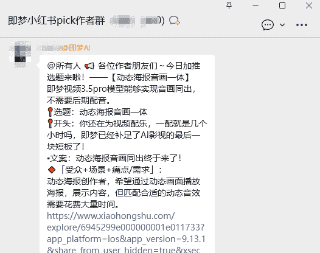

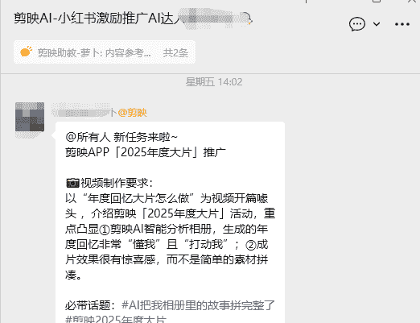

## 二.实战经验分享

### 1.快速加入实战

加入赚钱后，直接上车了AI自媒体航海和DeepSeek，在此之前我对AI的使用和赛道理解并不多，只能边学边做.

#### 定位+方向

选择项目后，当时定位上我选择了AI在职场的效率提升，这个比AI生图和AI视频类的制作简单一些，自己也在职场搬砖了12年，也了解职场普通人的需求。

形式我选的真人出镜口播，一方面出境是做差异化的最好方式，另一方面，24年视频号带货也做了出镜口播的视频,没那么抗拒镜头。（这里也对想出镜做视频口播的同学建议，大胆出镜，熟读几遍口播稿之后，用提词器拍摄，一般教程类视频，出镜的镜头有限，出镜部分看着镜头讲，其他部分可以念稿。等你拍了几十条之后，基本就很熟练了。）

主攻平台一开始我没有确定好，都是同步发布在📕,抖音,视频号。后面发布的内容，📕数据跑的会更好，所以我就以📕作为主场，其他分发，到目前，我的内容都是主发📕，同步在抖音，视频号，B站。

内容我想要简单的好操作又能解决痛点的,刚好DeepSeek还是热点, 一定还有认知信息差,于是我用DeepSeek相关的内容做起号,接下来的动作就是每天坚持发布就行。一开始也是没有流量的,在日更了20天左右，粉丝慢慢的涨到了1千, 然后就继续保持更新,但没有日更那么多,大概两三天一条，保持这个状态,在五月份终于迎来了第一个爆款。

#### 第一条爆款，涨粉1W

这条爆款是看到别人的选题，低粉爆款，并且形式也很简单，就是通过deepseek把纸质表格转成文档。操作简单，EXCEL也是职场人的刚需，纸质表格转文档依然有非常多普通职场人不知道怎么转换。我对标的低粉爆款是一个剧情的版本，我直接用了口播的形式，这条内容直接给📕带来了1.3w的粉丝（半年前的数据后台看不到了），视频号带来了4w的关注。

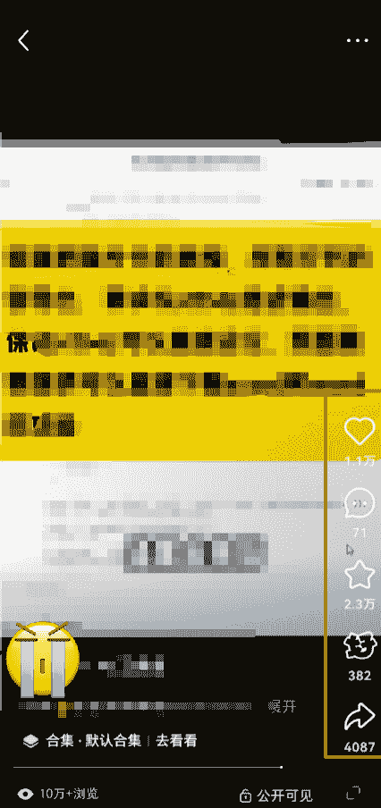

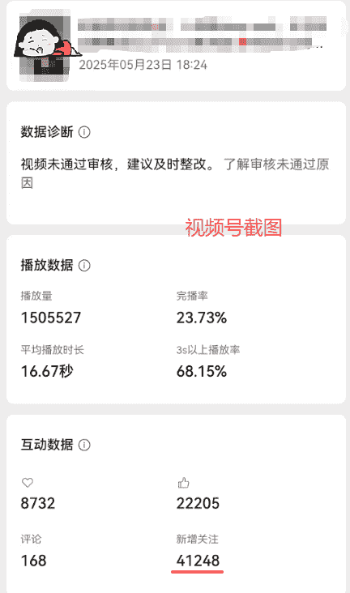

有了这条爆款之后，粉丝也冲到了万粉，之前我也在纠结涨粉,但发现一条内容就可以冲到万粉,验证得出不必过于纠结涨粉，专注做好内容，一条爆款就可以帮你冲刺万粉，甚至更多。前提还是要打磨好内容,只有内容能力在手,才能持续稳定出爆款。

### 2.如何做爆款内容

选题是大家都绕不开的话题,一个好的选题基本就觉得了这条内容的质量.

这段时间我内容选题的方法是围绕跟爆款，追热点。

#### 跟爆款

被平台验证过的内容，会依然有大概率会爆,我会搜一些行业的关键词, 围绕低粉爆款来找, 搜索关键词后,时间一周内,半年内都会看看,然后手动刷,一般万粉以下,点赞收藏高,然后记录到爆款选题库备用.比如我的第一条爆款,也是跟了当时的低粉爆款,对标只有三千多粉丝的时候,我跟了内容选题.

到目前我还没开始用自动化工具抓取,我个人是认为, 我自己的敏感度还需要训练. 因为自己以前都不爱看短视频, 而真正开始刷短视频也就是这一年多的时间,对爆款的敏感度还远不够,这一定是需要时间不断刷出来的直觉, 刚好每天也需要养号,所以我就一直刷着找选题,现在结合飞书的多维表格,只要复制链接通过剪贴板就可以同步到表格,也是比较方便.(教程可以在多维表格的航海中找到详细版)

刷爆款的时候,还有一个点是我会用不同的3个手机刷首页,这样能看到的内容会不一样.

#### 追热点

今年是AI进展很快的一年,虽然我是3月份才进入AI自媒体这个赛道,从年初的DeepSeek爆火后,各大AI的更新速度也是很快,ChatGPT5 ,Sora2 ,到谷歌的nanobanana pro,gemini 3,一段时间就会有热点出来.

其实前期我对热点的敏感度还是很弱,一方面自己认知浅,另一方面,自己的信息来源是依靠📕的科技博主们,等我刷到的时候,也是有一定的滞后性.

从8月我也开始去刷一下x, 前沿的内容大部分是从这里流出, 比如NanoBanana刚出来的时候,我就第一时间在x刷到了,然后📕也第一时间来发了视频.但这条并没有爆. 而我就此打住,没有继续发布,反而等过了好几天再来发第二条,这就错过了很多早期流量.

我复盘下,是自己追热点的选题方法不对.这也是后来看到冷科长的分享,我才意识到的

NanoBanana发布第一篇后,数据没爆,但是热点才刚开始,我没有继续去跟,而是做其他选题方向,

但后面我听冷科长的分享,一个热点选题可以同时做好几篇来测试内容,最后留下数据好了,不好的隐藏.后来我发现,其他博主也会在一个热点的时候,做多条内容,测试不同的方向.

然后尽量多做广告商喜欢的内容,有一些单纯的网站分享,工具分享数据很好,涨粉也很快,但是我接商单下来,基本上广告方的要求,还是希望能结合使用场景来做内容，切入的选题是能解决什么人群的痛点,而不是单纯的讲一下工具.

毕竟最终还是希望带来转化。

如果在没有商单的时候，你想接A品牌的广告，那你可以找到A品牌竞品的视频，模拟做一条软广。只要数据好，接下来会有来源不断的竞品加你询价。

#### 爆款笔记特征

爆款笔记一定是有价值的内容,价值给到位,

比如实用价值,你解决了某一类人群的什么问题,比如“3 步搞定Excel数据可视化”,用户看到这些真的有用,才会去点赞收藏转发.

比如情绪价值,比如吐槽工作中的某个场景,然后引发了大家的共鸣,就会带来传播.

又比如认知价值,你发的内容让用户学到了知识,或者冷知识这些,让他打破固有认知,那这个内容就天然会被收藏,

#### 笔记制作经验

确定好选题之后,需要开始写脚本,前三秒是留存的关键,所以我一般是对标爆款的框架前三秒尽量保留,或者改成适合自己的口语习惯,有很多爆款框架,当测试出了适合自己账号的框架,可以持续的用. 有很多人会用AI写,我自己是感觉,能手戳练习一下,是有必要的阶段,当我自己都不知道什么是好的文案,那AI给我的,我也不知道到底如何.

再说封面,目前一共用过两种类型的,前期是比较粗暴的,照片上打字那种(图1，2）,好处是真实感强, 后续换封面,是因为我想多做一些AI生图,AI视频的内容,而这类内容直观展示成品会更出效果. （图3，4）

图2

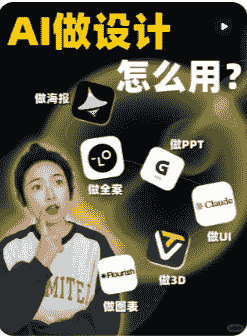

图3

图3

封面的标题一定要醒目,简洁,说重点.除了对标爆款笔记本身的封面,还有一个小技巧,可以把爆款笔记的文字标题,作为你封面的标题参考.

做好的封面,我有时候甚至会做2-3版封面,发给豆包和gemini帮我点评一下.

#### 更新频率

账号在2.2万粉的阶段徘徊了近两个月,因为那段时间精力被分散, 甚至一周都没有更新,所以数据就一直上不去.

当我开始看到之前粉丝比我少的博主,还有之前关注的博主涨粉都很快, 我在会灰豚看了下他们的更新笔记数量, 有几个每月都能达到20篇,这几乎是日更.

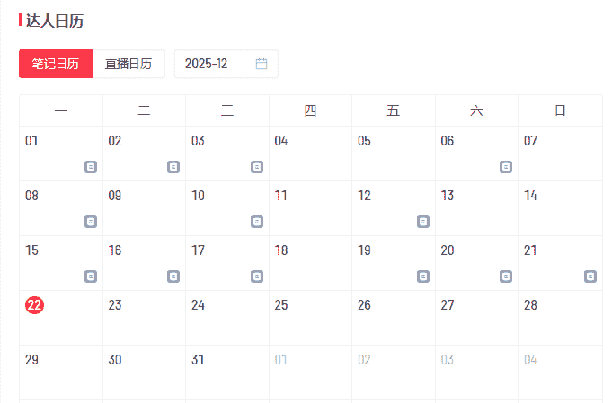

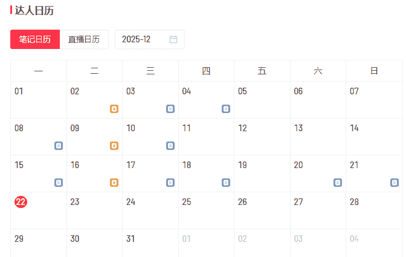

**工作方式迭代**

我开始意识到更新频率不高,账号就不活跃,平台也不会一直给老的笔记流量,那粉丝量肯定就一直上不去,于是我开始规定自己每周至少3更, 这样一阵子更新频率很稳,有一周甚至到了6更,所以账号开始活跃起来. 也陆续的出了几条千赞,在这段时间,我也迭代了下自己的工作方式.

之前我做一条视频,都是写好脚本后,立马开始录口播视频,再录屏幕剪辑, 但这样我每条视频拍摄的时间就很浪费,因为真人出镜,要稍微布置收拾下,化个妆什么的,这看似不起眼的时间,汇总来就是很大一段时间成本.

然后我开始集中在某一天做好至少3条脚本,一次性拍完,这省了不少时间.

**库存思维的重要性**

保持更新还有一个点就是要有库存,当我听到涛哥说他👸号的库存可以发几个月的时候,我就惊呆了,像我没有库存的思维,每次都追着更新就会很耗费心力.

### 3.商单变现之路

#### 踩坑经验分享

在📕只有100粉丝的时候，接到了第一条50块的小程序推广商单，是按点赞付费，数据跑完也只有50多块，这是来自AI自媒体的第一笔收入,虽然很少但也开心有了正反馈。

按理到了万粉后，按粉丝的10-20%报价，也应该是开始好起来了，但因前期没有做足功课，5月底涨粉起来了，蒲公英还是200的报价没有修改，所以整个6月，按照200的单子接了4条广告，不想掐自己一下是不可能的。现在养成了每个月底看下数据,需要改价的时候及时修改.

#### 商单形式

商单分为蒲公英报备商单（水上）和非报备商单（水下）。

**报备商单：**定价自己按照平台粉丝10%-20%或者更高，自己来设定，这里要注意平台会抽成10%，基于📕的水土，和你对接的品牌pr，也会要求有返点，目前我接触到的一般要求在20%-35%，也遇到过更高的45%，这个按自己接受程度。

**非报备商单：**一般是低于报备商单价格，例如我有遇到一个pr，他们公司会要求合作价格为报备商单的60%，仅供参考。

如果有多个平台同步，也可以作为一个谈判的权益，比如我可以免费同步到哪几个平台，如果每个平台数据都很好，能做打包报价提高总价是最好的。

#### **合作流程：**

1.接到蒲公英商单后，📕系统消息会收到邀约通知,点了感兴趣后就会有🛰️号，这里建议主动联系下，会更快进入第一步；

2.和pr对接上(也会有直接的品牌方运营,不过我遇到的也就3个)，对方会让你报价，有的有报价模板，填写后他们会发给品牌方选号，选号成功,pr会和你再核对下排期,这时需要给到对方脚本时间,初稿时间,发布时间.

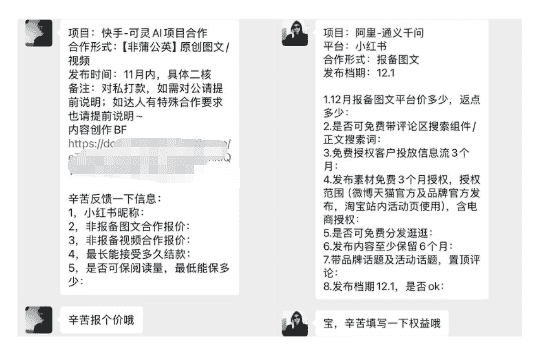

**3.沟通细节：**

1.水下的商单一定要确定结算日期，尽量在1个月内完成结算。我遇到的有最爽快的发布后一天就结算，也有7天,14天,一个月结算。最长的遇到了拖欠了5个多月才结算的,我一度以为这单收不回来了。

2.确认是否要求排竞,一般品牌方会要求发布日期前后几天不能有竞品,也有些pr不会主动说,所以问清楚比较妥当.

3.确认下品牌会不会有投放预算,有些品牌发布24小时后会给你投薯条,但也有一些不仅不投薯条,还会要求你保证数据,要自己投薯条.

### 4.账号运营方向的摇摆

#### **焦虑和混乱并存期**

3月底开始做到4月底的时候,我才变现了200来块,这对我来说压力很大,主要是前面跟队友商量了3个月的时间来看看是否要持续做. 这裸辞做项目的风险就一下暴露, 我开始为了变现,找一些变现的渠道.

在5-6月份的时候，我一边更新账号，一边接令狐峰团队的剪辑单，写脚本等（这里也非常感谢令狐峰和Hawli 的单子，能让我在焦虑的日子里有基础收益,也有了持续做自由职业的谈判筹码）。

在这两个月里,我的收入可以稳定在几千块钱, 收入的焦虑缓解,但其实通过苦劳来变现的路径不是长久之计, 这时候我了解到变现形式，其实是非常有限的，只知道接商单.

7月份有了转折，有一天一个pr加我,于是我加入了即梦创作者，这是按照基础底薪+按互动付费的形式，一个月上限是16条广告。这也可以让我保证有基础收益。

#### 定位纠结

但问题也相继出现，我的账号定位在职场提效，粉丝也大都是来源于爆款excel的内容，粉丝人群在30-40岁, 而即梦是AIGC为主，所以我的即梦商单数据并不好，加上我本身是设计师出身，职场提效excel类越往后做，越发现并不是我的长项。

在这期间就非常纠结，要不要转为AI生图，AI视频类？一方面我更擅长一些，另一方面，通过一段时间的商单询价，AIGC这类商单的报价，相对高一点，当然制作门槛也会更高。但又担心转了后粉丝不喜欢，数据更不好了。

纠结犹豫不如交给市场验证，于是我开始两条腿走路, 一方面我开始在内容的选题上，除了职场提效的，会搭配以AI生图，AI视频类选题内容来探索，到近期这类内容数据也慢慢好起来了，最近的一个AI生图商单，7天自然流跑到了赞藏4k。另一方面,我把一个早期做大学资料的账号,重新启用,小号定位是设计师垂类账号,这样也可以测试选题.

总结一下，因为是想吃长期饭,所以在账号内容方向上,根据自己兴趣爱好，能持续输出，再结合刷对标内容，确定一个方向是最佳选择，后续中途来更换也是可以，但有一定试错成本。

### 5.目前遇到的瓶颈

要说最近这段时间我最大的瓶颈是什么，那就是产能和变现焦虑。虽然是3万粉，但依然是劳务为主，变现路径很单一被动。在一个月更新19条视频的情况下，变现并没有想象的那么轻松乐观，目前我还是一个人单兵作战完成全部。而大佬们的方法，是通过团队来增加收益，例如招募了编导,剪辑很明显，我还没有迈出这一步。

前段时间读了学龙哥老师推荐的《为什么10倍增长比2倍更容易》，从这本书里，也反思了一下我这半年多，一直在做的是2倍增长的路径，例如没有单子的情况下，我依然在做低价格的单子，而没有选择在这段时间，提升视频及内容质量，来想法达到10倍增长。要学着专注于做20%的事情，雇佣其他人来做80%的工作。因为你摒弃的80%里，可能就是别人的20%。

最近也在探索新的变现形式,在12月x自媒体航海里,学习到了如何把内容变现渠道拓宽. 有很多品牌也在考虑出海,海外的商单也是一个新的方向

在探索新的领域,又遇到了很多优秀的自媒体创作者, 学习大家的亮点,也会有让我对内容创作有不同的思考.

# 一些思考

通过这大半年的实战，我深刻认识到“从0到1”的自由职业者和“从1到N”的商业化运营是完全不同的两种心法。

在这过去的9个月，我已经验证了赛道、跑出了爆款、积攒了粉丝和品牌合作资源，也逐步完成了从“职场人”到“自由职业”的跨越。对我来说，现在最大的挑战，就是如何把建立起来的流量池，转化成可持续、可规模化的收益。

正如《为什么10倍增长比2倍更容易》所说，我不能再沉浸于仅够维持生存的低效劳动，要多去思考新的模式,让自己聚焦每一个20%.

如果想要走的更远一点，需要找到我自己的增长道路。

回望2000的互联网时代,AI才发展两三年,还是元年时代,2025年可以看到AI的步伐在加快,AI工具每周都在更新，未来依然是AI的主场。我觉得AI自媒体对于普通人来说依然有红利在, 普通人需要AI提效的需求只会更强，只是在变现模式上,依靠单一的商单变现会比较被动，可以加入更多元的变现方式，例如自媒体出海，AI知识库，和虚拟电商的结合等等，这些也是我在探索的道路之一。如果有跑通的圈友，也希望能评论帮忙指点一下。

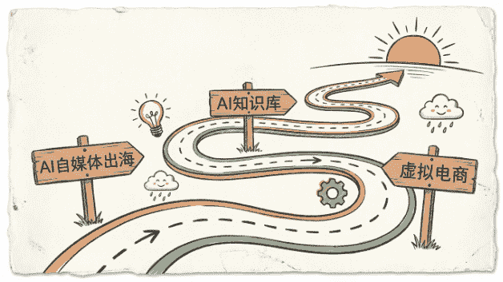

2026，新的一年又重新启航，大家加油啊！