# 《把商业思维前置于优势思维，方为正确；把优势思维赋能商业流程，方可赚钱 》

> 来源：[https://xuqiwei1986.feishu.cn/docx/OZuxdT8KAotev2xRPzbchIL9nog](https://xuqiwei1986.feishu.cn/docx/OZuxdT8KAotev2xRPzbchIL9nog)

# 零、前言

各位，好久不见，这里是七小。

本着菜就多练，好好沉淀的原则，过去一年多一直在具体的事情上去历练，好长时间没在星球发言了。

感谢生财团队一直挂念着我，多次邀约我来小灯塔写篇分享，哈哈，这就来了。

看到参考选题里有一个是：《如何找到自己的优势，并结合优势选择合适的项目?》

这个问题，刚好，真是我从加入生财之后，思考了上百遍的问题，也是我自己很长时间没绕过弯，交了不少学费才想明白的问题，感触颇深，于是选这篇来讲讲我的看法。

话不多说，直接进入正题。

# 一、优势思维经典误区：喜欢>擅长>市场

提到个人优势与项目选择，那基本上就绕不开这一张图了。

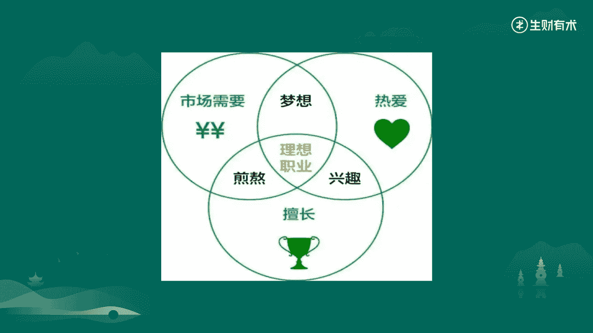

这一张图，相信很多人都有印象吧？

**当提及如何去选择一个项目的时候，一个经典理论就是告诉你，你**要去思考：什么是你喜欢、擅长，市场需要的东西，然后去挑一个三位一体的理想业务，这就是你能一辈子去深耕的事情。

**这个理论听起来是没什么**问题啊，但是呢，根据我上百个副业咨询的经验来看，之前没怎么赚过钱的新手，干副业或自由职业的时候，一开始就信奉的是这一条理论，尤其是对此深信不疑的人，那基本完犊子了，未来两三年内是基本赚不到什么钱了，大概率的两三年之后还是在问，有什么项目是适合我的？

你要问我为什么这样讲？对这个理论为什么存有如此强烈的否定？

因为我就曾是被这个理论忽悠瘸的一员，记得23年12月见亦仁老大的时候，我还在哭诉说老大我好迷茫，我不知道我自己要干什么，求老大给我指点迷津。（那时候我已经加入生财快一年半了），给老大都整的有点无语子。

当然准确一点来讲，错误的并不是这个理论本身啊，而是我们大多数人都容易误解这一张图的真正逻辑。

**人家说的 理想职业= **喜欢X擅长X市场需要， 正确的优先级排序应该是： 市场需要>擅长>喜欢

**但是错误使用的人，往**往会把它误解成：喜欢>擅长>市场需要

然后，就容易game over了。

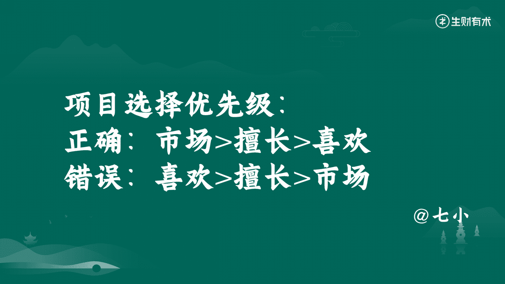

为什么game over了呢？ 我给你结合上面的公式，讲讲死亡原因。

## 1.喜欢之坑

### 1.1 把消费当喜欢，喜欢的太多挑花眼

我遇到过一个圈友，找我做过咨询，想让我给他分析一下，他应该选择什么副业项目。

他说发个经历详情给我看，我说行。

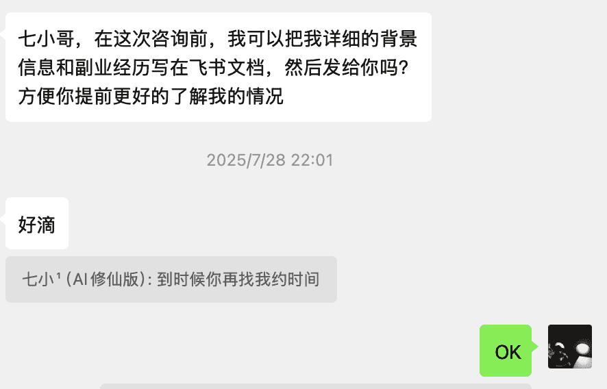

然后我一看，大大小小十几个，各种各样的知识付费的技能学习和项目训练营的报名。

A之前赚到过几百块钱 ，B感觉之前学习的时候体验不错，感觉自己是能做的，C虽然还没正式干过但也颇有兴趣...十几个选项，挑花眼，到底该选哪一个呢？

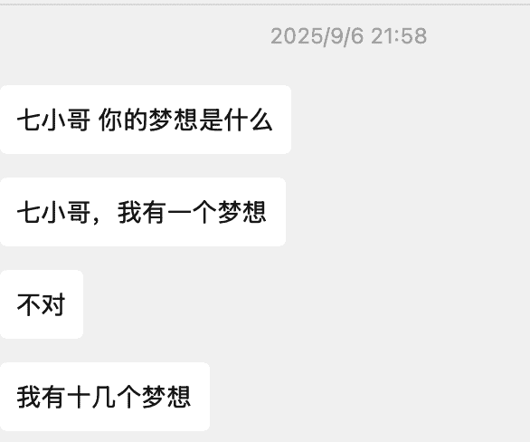

什么都能干，结果就是啥都不会坚定的去干，然后就一直处于犹豫未决的状态，迟迟没有行动了。

### 1.2 把个人爱好当商品去卖，指望别人理解买单

这个就不说别人了，是自己犯过的错。

我个人自己一直非常沉迷研究人生发展的规律，以及过好这一生所需要的必备的知识和技能。

两年前那会，我也把我的个人爱好，当成商品去卖，试图把我迄今为止所有的研究成果都给人倾囊相授，当时收费一万多一年的私教来着。很多用户一看太复杂了，就刷走了。

多年来我一直犯的毛病，就是用户需要的只是某个123,三步、5分钟解决某个问题的方案。 而我总是告诉用户，你得掌握123456789... 99 100 ,你才能彻底根治这个问题啊！ 人家要的只是简单解，而是总喜欢给一个超复杂的根本解。

这就应了一句话：**如**果你根据自己做了一件量体裁衣的衣服，那么也就只有你自己会买单了。赚钱是得满足别人的需求，如果把自我满足放在了首位，就别想着赚钱了。

类似的例子，还有经典的，电影市场里的文艺片：

如果导演不考虑大众审美偏好，大众可理解的文艺范围，只想去做一个自己认为很牛逼的好东西，那就容易沦为叫好不叫座，多年后B站和豆瓣上说神作，当年电影院里票房惨淡的冷门片了。

## 2.擅长之坑

### 2.1 只会把擅长，用来职业技能培训

基于自己的经验和擅长点去选项目，这个思路，也容易把一堆【之前在上班，现在刚开始做副业的人，没啥认知和审美的人群】带进坑里了，误以为这就是所谓的【职业技能培训】【经验分享】

比如设计师和程序员的经典副业选择模式：

我是个设计师/程序员，现在AI来了，快把我取代了，我主业赚不到多少钱，所以想要搞副业，但我又不知道副业能做啥，立马能想到的就是做我这行的职业技能培训+求职面试辅导。（可是你不就是这行不好干了才干副业的嘛？ 然后你培训别人做你这个不好干的行业的技能培训和求职）

**俗称：死胡同里当导游。**

### 2.2 只有职业技能的擅长，没有商业能力的合格

只会职业技能培训，而想不到其他的技能变现的方式，其实本质也是个人商业能力的缺失所导致的。

按照创业的逻辑来说，你得先走完这个精益创业的流程：

1、你要先去挖掘某类人群的需求

2、围绕他们的需求，提出某个解决方案

3、用公众号准备海报和推文，说清楚你的解决方案

4、去公域上引流你的种子用户，邀约付费内测，做内测收费，看看有没有人会为你的方案买单

5、再开发产品的MVP，

6、给用户使用，收集反馈和满意度，看看你的解决方案能不能解决人家的问题

....

然后其中，你的设计能力，可以用在海报设计、小红书图文设计上；你的代码能力，可以用于开发软件作为交付，来替代常规知识付费的课程/训练营模式...

设计能力——用于内容赋能，增强引流转化效果； 代码能力——用于产品交付，降低交付的边际成本；

在你有完整的商业能力的情况下，你之前具备的专业技能，应该是这么用的。（而不是只想到了，我去职业技能培训）

我想表达的是，不要执着于你过往在某个岗位上技能的专用技能的擅长，不要非得想着这玩意能怎么用来变现。而是多把时间用在琢磨商业能力上：调研需求——研发产品——引流获客——转化成交——产品交付 ，至少上述的这些环节，每个都掌握几招。

比如会用搜索框的关键词、指数工具做调研

会用知识付费/代码软件的产品做交付

会在小红书引流

会用朋友圈成交

....

基础环节的操作，每个环节至少会个2-3招操作，能保证你是能持续有收入的。

当你商业能力上能闭环了，你会发现你以前积累的一些专业技能，倒是更容易用上。 反倒是商业技能没闭环之前，专业技能上也用处不大。

### 2.3 抱残守缺，贬值的技能非要逆天而行

我也见过有的朋友，惯性思维蛮严重的。

自己过去所掌握的技能，在如今确实在持续贬值，就像是logo设计、营销设计咨询... 现在AI把价格完全打下来了。

但是朋友不认命，不改变啊，不想着在新时代换一门新的吃饭手艺、新的人群、新的应用场景，老想走之前的那一套。试图在不改变产品服务的前提下，只是靠多引流获客来解决业绩下滑的问题。

这也算是痴人说梦了。

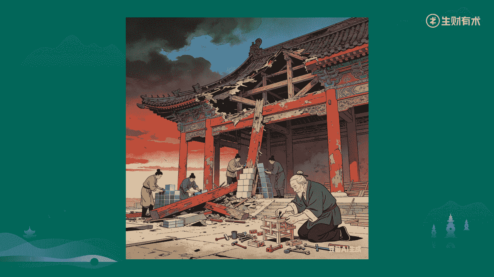

## 3.商业之坑

### 3.1 市场有需求，是一个很大的词

喜欢擅长、市场需要，终于说到市场需要这个模块了。

怎么说呢，市场需要真的是个很大的词，如果你只是理解字面意思，但就如我所说，完犊子了。

市场有没有需要，这属于动动脚趾头都能想出来答案的，肯定是有，对吧。

但是这个市场是什么样子的呢？

这行客户是怎样分层的？低端、中端、高端客户的画像和需求，分别是怎样的？

低端客户的钱，要怎么挣？高端客户的钱，要怎么挣？

干这行，白手起家，要解决的难题有哪些？包括技术上的、管理上的难题是什么？

诸如此类的，真的要细说，很多问题要考虑的。

举个例子，大家在大学的时候，看到当个校园市场的中介，搞搞表白墙，搞搞资源对接挺赚钱的。可能动过心，想着自己也去干干类似的业务吧？

比如推推驾校、做一下大学生家教派单平台，似乎人在宿舍做，就能钱从天上来了。

但是真深入干这行，第一个问题：学生绕过你直接对接驾校了，请补课老师的家长 和 上门家教的大学生私加好友，跳你单了，请问这个问题怎么解决？

可能第一题，很多圈友就创业未出门，就中道崩殂了，直接game over，因为无法解决跳单问题。

市场是否有需求？ 我认为这真不是个好问题。

**有些糟糕的概念，从你开始用他去思考那一刻，你能得**到的所有结论基本都是无用的、甚至错误的。

市场有需求 ≠ 你能做好 ≠你能赚钱。

## 4.小结

以上的这些情况，一句话概括来说，其实就是：你有了一堆的逻辑，唯独没有商业逻辑。

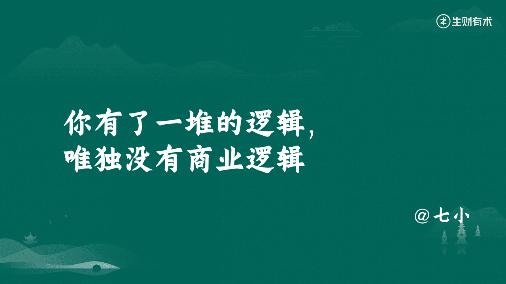

# 二、先抛开优势思维，只用商业逻辑思考

在项目选择的初期，比起纠结 “我喜欢什么、我擅长什么”，更重要的是用商业逻辑判断 “这件事能不能赚钱，怎么做才能赚钱”。商业逻辑是项目的根基，只有根基扎实，后续的优势赋能才有意义。

**那什么是用商业逻辑思考问题呢？**

## 1.商业逻辑简易版

用生财AI来回答这个问题，它给的简单版的回答是这样的：

> 启动新项目前的调研、测算与可行性评估是“先胜而后战”的核心环节，需从认知切换、深度调研、多维评估、风险测试等维度系统推进。以下是具体步骤及要点：

>

>

### 第一步：认知切换——从“先干再说”到“先算后战”

> 新手常凭热情“先战而后求胜”，而熟手需切换为“胜兵先胜而后战”的思维，即通过前期算账和调研预判项目成败。《孙子兵法》强调“未战而庙算胜者，得算多也”，做项目同理：高手在动手前已通过计算明确盈利空间、风险边界，再落地执行；新手则易因缺乏论证导致试错成本过高。因此，启动前需先明确：项目不是“干出来的机会”，而是“算出来的必然”，需抑制盲目行动冲动，将“调研+算账”作为核心前置动作。

>

>

### 第二步：深度调研——获取真实数据，建立项目认知框架

> 调研是算账的基础，需突破“看帖子、搜关键词”的浅层认知，通过多维度获取私密信息和交叉验证，具体方法包括：

>

#### 1. 公开信息建立初步框架，私密信息交叉验证

+   **公开信息**：通过行业报告、平台数据（如抖音/小红书关键词搜索）、竞品公开内容（官网、社交媒体）了解项目基本模式、市场规模，但需默认公开信息可能存在误导，仅作为框架参考。

+   **私密信息**：核心数据（如转化率、复购率、成本结构）需通过“付费咨询同行”（生财圈友、行业从业者，支付咨询费或红包获取真实数据）、“伪装客户体验流程”（加入对标私域，体验从引流到成交的全流程，记录话术、定价、服务细节）、“招聘套取信息”（发布岗位吸引竞品员工面试，获取销售链路数据如客单价、提点）等方式获取，并通过多个渠道交叉验证真实性（如同时咨询3位同行，对比数据一致性）。

#### 2. 研究至少10个对标，像素级拆解流程

> 选择10个以上直接竞品（头部、腰部、尾部均需覆盖），拆解其：

+   **流量端**：内容形式（短视频/图文）、发布频率、引流钩子（如免费资料、低价体验课）；

+   **转化端**：成交路径（私域话术、社群运营、复购策略）、客单价分层（低价引流品/高价利润品）；

+   **交付端**：服务流程（如知识付费的课程更新频率、售后响应速度）、成本结构（人力、物料、平台费用）。通过“上帝视角”分析其核心优势与痛点（如某对标流量成本低但复购差，可能是交付体验问题）。

#### 3. 快速MVP验证：先卖后干，低成本试错

> 若调研后仍无法判断可行性，需制作最小可行产品（MVP）验证需求，核心原则是“先卖再干”：

+   例：知识付费项目先设计海报预售，验证用户付费意愿；实体项目先通过闲鱼/朋友圈小范围测试订单，而非直接投入生产。

+   若MVP跑通（如预售转化率达5%以上），则继续推进；若失败（如0订单），则快速止损，避免投入大量资源。

### 第三步：多维测算与评估——从“能不能做”到“适不适合我”

> 调研后需通过量化测算、自身匹配度、竞争格局等维度评估可行性，具体包括：

>

#### 1. 项目基本面评估：算清“天花板”与“风险底”

+   **财务测算**：

+   **上限与下限**：用“极限思维”测算：

+   上限：假设流量、转化率、复购率达最优（如客单价1000元，月均100单，年营收120万）；

+   下限：假设流量最差、交付出问题（如仅10单/月，扣除成本后是否亏损，亏损多少）。

+   参考案例：“上限高、下限高”的好项目（如海外AI产品，流量稳定则营收无限；知识付费，课程制作后边际成本低）；“上限低、下限低”的差项目（如餐饮单店，座位数锁死营收，亏损则租金+人工损失大）。

+   流量成本（CAC）与利润（LTV）：

+   计算获客总成本（CAC）：包含流量成本（如投流1000元获100线索，线索成本10元）、销售成本（销售工资/成交单数）；

+   对比客户终身价值（LTV）：若LTV＞CAC，项目可持续；反之需优化转化或放弃。

+   **竞争格局**：

+   用“50人测试法”判断竞争度：找50个潜在从业者，若仅2-3人真正在做，且对标水平与自身相近，则竞争较小；若多数人已入局且头部玩家壁垒高（如强技术/资金），则需谨慎。

#### 2. 自身匹配度评估：能力、资源与价值观是否契合

+   **能力与资源**：

+   核心角色：自己是生产方（如研发产品）、营销方（如流量获取）还是运营方（如私域转化）？现有资源（资金、人脉、行业经验）是否覆盖项目启动需求（如做AI产品需技术背景，若无则需合作或外包）。

+   风格匹配：是“爆发型”（擅长抓短期红利）还是“持续型”（擅长长期运营）？例：套利项目适合爆发型，知识付费适合持续型。

+   **价值观排序**：

+   若“自由”优先：选择可远程、轻团队项目（如AI SaaS，一人可开发）；若“赚钱”优先：考虑“普通人能做+可复制”的项目（如IP切片，无需专业技能，批量招人即可放大）。

#### 3. 可行性验证：普通人能否复制，是否依赖“大佬”

+   用“普通人盈利框架”测试：

+   项目是否可拆解为SOP（如内容模板、成交话术），让无经验者（如兼职大学生）也能执行？

+   若离开核心创始人（如技术大佬）后项目是否仍能运转？若需“顶尖人才+高投入”，则普通人难以复制，规模化风险高。

### 第四步：风险预判与止损机制——避免“先战而后败”

+   **合规与稳定性**：项目是否符合平台规则（如抖音投流是否违规）、政策要求（如教育类资质）？避免“灰色地带”玩法，防止平台封号或法律风险。

+   **止损红线**：设定“测试期失败标准”（如MVP验证3个月无订单、流量成本持续高于LTV），一旦触发立即止损，避免沉没成本（如“开餐饮单店，3个月营收未达房租2倍则转让”）。

### 总结：从“调研-测算-评估”到“决策”的闭环

> 启动新项目前需完成：

1.  **认知切换**：用“庙算”思维替代盲目行动；

1.  **深度调研**：通过对标拆解、付费咨询、MVP验证获取真实数据；

1.  **多维评估**：算清财务上限/风险、匹配自身能力与价值观、判断竞争与复制性；

1.  **风险兜底**：设定止损规则，确保“即使失败，损失可控”。

> 通过以上步骤，可将项目成功率从“博概率”变为“算出来的必然”，实现“先胜而后战”。

## 2.商业逻辑全面版

这里我们可参考，大公司做新项目的常用的可行性评估。（往下翻一点的高亮块）

可能会有一些朋友看到下面这一堆框架，心想：要考虑这么多东西？对于我这个刚开始干的新手来说，是不是太复杂了，是不是有点小题大做了？

对此，很难跟你去表述我的心情。

引用一下生财联合办公的负责人——许老师说的：

> 新手常凭热情“先战而后求胜”，而熟手需切换为“胜兵先胜而后战”的思维，即通过前期算账和调研预判项目成败。《孙子兵法》强调“未战而庙算胜者，得算多也”，做项目同理：高手在动手前已通过计算明确盈利空间、风险边界，再落地执行；新手则易因缺乏论证导致试错成本过高。因此，启动前需先明确：项目不是“干出来的机会”，而是“算出来的必然”，需抑制盲目行动冲动，将“调研+算账”作为核心前置动作。——许老师

做业务这几年来，我越发的体会到，所谓的创业失败，本质上，大概率的都是你的商业素养太差了，做事情想事情都太粗糙，导致任何项目都没有做好。很多后期的所谓踩坑，失败复盘，本质就是前期调研时候偷的懒，所以后面要还这欠下的债。

干好一个项目是有学习成本在的，包括时间，金钱，精力，这些成本，你要么是在前期的调研环节去做支付，要么就是踩坑之后的时候复盘环节去做支付，反正你早晚都得付的。

既然你早晚都得学，那你现在就先看一遍吧。你不用怕，这些内容太多，你看完学不会啊，这篇内容是可以复制的，你可以复制下面的这些内容作为一个txt，然后后面呢，你去跟ai对话的时候，就可以把你的个人情况，你的项目说明清楚，然后让ai结合这一个框架，帮你做一下可行性分析，给你一些建议。这就是最简单的用法了。

### 互联网项目可行性分析框架（折叠展开  ）

### 思维导图版

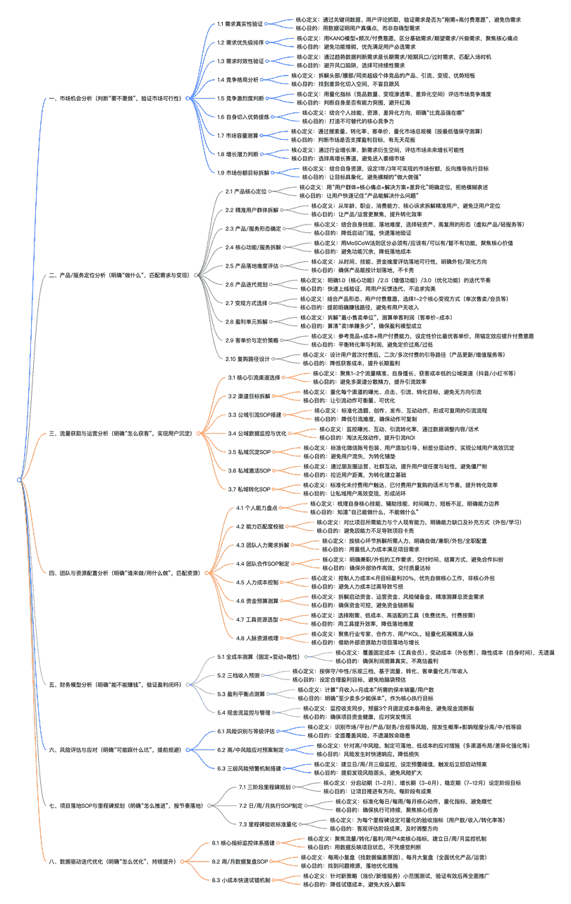

### 豆包知识库版

直接把这个txt，丢进豆包或者其他AI，结合你当前考虑的项目情况，让AI给你做个初步的可行性分析报告。（想打开看也可以，只不过内容是跟思维导图基本一致的。）

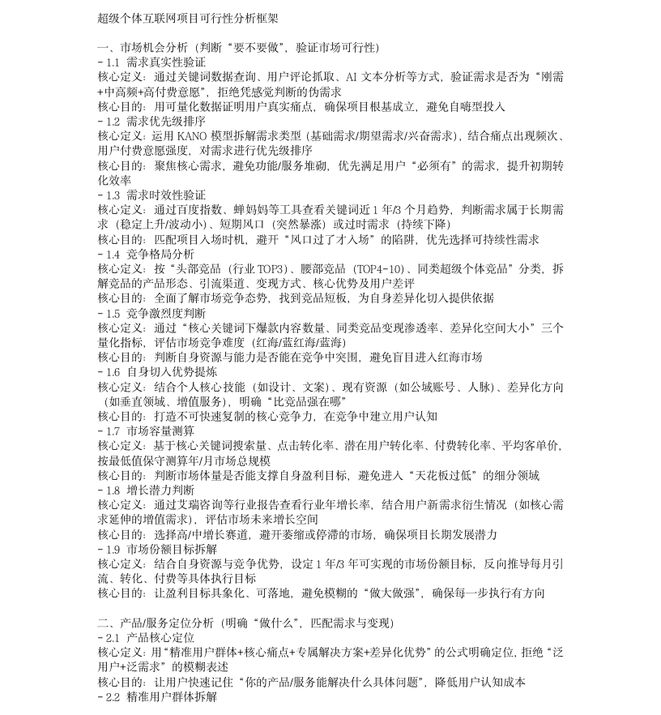

[超级个体互联网项目可行性分析框架.txt](https://internal-api-drive-stream.feishu.cn/space/api/box/stream/download/all/UzYKbfG31oBgtyxCkONc53t9nRc)

# 三、再用优势思维，赋能商业流程

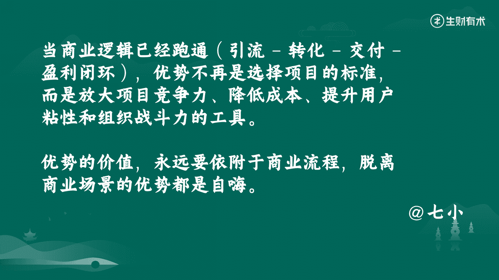

## 1.技能优势如何赋能项目？

还是拿我们上面举的，经典设计师和程序员的案例，来看看如何把自己的技能和商业流程相结合。

### 设计技能：从 “接散单” 到 “全流程赋能”

设计技能的核心商业价值是 “提升视觉吸引力、打造品牌差异化、降低用户认知成本”，可以嵌入引流、产品开发、交付、转化等多个环节：

+   落地 SOP：

1.  引流环节：制作高转化的海报、图文内容。

+   海报设计：遵循 “痛点 + 解决方案 + 信任背书 + 引流钩子” 的结构，比如做 “副业咨询”，海报标题突出痛点 “想做副业却不知道选什么？”，解决方案 “1 对 1 副业诊断，帮你找到适合的副业”，信任背书 “已帮助 1000 + 人找到副业，月入 3000+”，引流钩子 “扫码添加私域，免费领取副业避坑清单”。

+   图文内容：比如在小红书做 “AI 工具教学”，用设计技能制作 “步骤拆解图文”，把复杂的操作步骤用清晰的图片 + 文字标注，让用户一眼就能看懂，提升内容互动率和引流转化率。

1.  产品开发环节：开发设计类产品或增值服务。

+   设计模板：比如做 “职场技能培训”，开发 “简历模板、PPT 模板、汇报模板”，作为引流赠品或付费产品；模板要突出 “高颜值、高实用性”，比如简历模板包含 “不同行业、不同岗位的专属模板”，满足用户的个性化需求。

+   定制化设计服务：作为高客单产品的增值服务，比如做 “自媒体 IP 打造”，除了提供运营咨询，还为用户提供 “头像设计、封面设计、品牌视觉设计” 服务，提升产品溢价。

1.  转化环节：用设计提升产品的 “价值感”。

+   产品包装：比如做 “知识付费课程”，用设计技能制作精美的课程封面、课件 PPT、学员手册，让用户觉得 “物超所值”；对比同行的 “粗糙课件”，你的产品更有竞争力。

+   案例展示：把用户案例用设计技能做成 “可视化报告”，比如 “学员通过 AI 工具变现 1 万元的案例”，用图片 + 数据 + 文字的形式展示，比纯文字更有说服力，能提升转化效率。

1.  交付环节：用设计提升用户体验。

+   交付资料：比如做 “设计咨询”，为用户提供 “设计方案报告”，用设计技能排版，让报告更清晰、更专业；同时提供 “设计源文件、使用教程”，方便用户后续修改。

+   售后服务：比如用户对设计方案不满意，用设计技能快速修改，提供 2-3 个备选方案，提升用户满意度。

+

+   实战案例：生财圈友小 J 是设计师，之前一直靠接散单赚钱，收入不稳定。后来他跑通了 “自媒体 IP 打造咨询” 的商业闭环，用设计技能全流程赋能：

+   引流：在小红书发布 “自媒体封面设计干货”“IP 头像设计案例”，用高颜值的图文内容吸引用户，引流钩子是 “免费领取自媒体封面模板 + IP 头像设计指南”，私域引流转化率达 10%。

+   产品开发：推出 “自媒体 IP 视觉打造套餐”，包含 “头像设计、封面模板设计、品牌视觉设计”，定价 999 元；同时推出高客单的 “自媒体 IP 打造私教服务”，包含运营咨询 + 视觉设计，定价 5999 元。

+   转化：用设计技能制作精美的产品海报、案例展示页，比如把学员的 IP 视觉前后对比图做成可视化报告，突出 “设计后的账号粉丝增长 3 倍、转化提升 50%”，用户看了之后更容易付费。

+   交付：为每个私教学员提供 “定制化视觉设计方案”，并制作 “视觉使用手册”，教用户如何正确使用设计素材；售后提供 1 年免费修改服务，用户满意度达 98%。通过设计技能的全流程赋能，小 J 的月营收从 1 万提升到 8 万，收入稳定且持续增长。

+   避坑点：不要为了 “设计而设计”。设计的核心是 “服务商业目标”，比如引流海报的设计要以 “提升引流转化率” 为目标，而不是单纯追求 “高颜值”；如果一款海报很好看，但引流转化率很低，就是失败的设计。

### 编程技能：从 “接外包/搞培训” 到 “产品化变现”

编程技能的核心商业价值是 “自动化、高效率、产品创新”，可以帮助你开发自己的产品，建立竞争壁垒，而不是靠 “卖时间” 赚钱。

+   落地 SOP：

1.  产品开发：开发自动化工具或 SaaS 产品，解决特定人群的核心痛点。

+   找痛点：通过用户调研，找到某类人群的 “效率痛点”，比如跨境电商卖家的 “选品效率低、数据分析繁琐”，职场人的 “重复工作多、时间不够用”。

+   开发 MVP：先开发最小可行产品（MVP），只保留核心功能，比如针对跨境电商卖家，开发 “自动选品工具”，核心功能是 “输入关键词，自动筛选高销量、低竞争的产品”，2-4 周内上线。

+   验证需求：通过私域、朋友圈、行业社群进行小范围测试，收取少量费用（比如 99 元 / 年），验证用户付费意愿；根据用户反馈迭代产品，增加增值功能。

1.  运营效率提升：开发内部工具，降低运营成本。

+   引流工具：比如做 “短视频引流”，开发 “批量剪辑工具、关键词自动生成工具”，节省剪辑和选题时间。

+   私域运营工具：开发 “自动标签工具、批量回复工具、用户数据统计工具”，提升私域运营效率，减少重复工作。

1.  交付创新：用代码替代人工交付，降低边际成本。

+   比如做 “数据分析咨询”，开发 “自动化数据分析工具”，用户上传数据后，工具自动生成分析报告，你只需要做简单的人工审核和解读，交付效率提升 80%，可以服务更多用户。

+   比如做 “知识付费”，开发 “在线测评工具”，用户购买课程后，先通过测评工具测试自己的技能水平，系统自动推荐适合的学习路径，提升用户学习效果和满意度。

+   实战案例：生财圈友小 K 是程序员，之前靠接外包赚钱，经常熬夜加班，收入也不稳定。后来他通过用户调研，发现很多做 “自媒体的博主” 有一个核心痛点：“想要批量生成短视频，但剪辑时间太长，而且不会写文案”。

+   产品开发：他用 1 个月时间开发了一款 “自媒体短视频自动生成工具”，核心功能是 “输入关键词，自动生成文案、匹配素材、剪辑视频”，支持抖音、小红书等多个平台的视频格式，MVP 版本上线。

+   验证需求：他在自媒体行业社群进行小范围测试，定价 199 元 / 年，吸引了 50 个用户付费；通过用户反馈，迭代了 3 个版本，增加了 “自定义素材库、视频风格调整” 等功能。

+   引流：在知乎、抖音分享 “自媒体短视频批量生成技巧”，用工具生成的案例展示 “10 分钟生成 10 条短视频”，引流钩子是 “免费试用 3 天工具，评论区扣‘短视频’领取”，私域引流转化率达 8%。

+   变现：推出 “月度会员（99 元）、年度会员（199 元）、终身会员（399 元）” 三种套餐，同时为企业用户提供 “定制化部署服务”，定价 19999 元 / 年。上线 6 个月，付费用户突破 1000 人，月营收达 5 万，而且边际成本极低 —— 工具开发完成后，服务 100 个用户和 1000 个用户的成本几乎一样。

+   避坑点：不要追求 “大而全”。开发产品时，先解决一个核心痛点，不要一开始就想做 “全能工具”，否则开发周期长、投入大，还可能因为功能冗余导致用户不买单；先小范围验证，再逐步迭代。

## 2. 资源优势如何赋能项目？

资源优势的核心价值从不是“拥有多少”，而是“能在商业流程的关键节点省多少时间、降多少成本、提多少效率**”——它**就**像项目的**“放大器”，能让跑通的商业闭环加速起量，让尚在验证的项目少走弯路。对普通人来说，最核心的资源无非两类：金钱资源和人脉资源，把这两类资源精准嵌入“调研、引流、转化、交付、技术”五大商业环节，就能发挥最大价值，而非让资源闲置。

先看**人脉资源**的**全流程赋**能：它的核心是“跳过从零到一的铺垫，直接对接精准需求或解决方案”，让每个环节都省去“建立信任、寻找匹配”的无效消耗。在调研阶段，如果你的人脉里有目标用户或行业从业者，完全不用在公域大海捞针式找问卷对象，直接拉个小群做深度访谈，甚至邀请他们参与MVP内测——比如做职场副业培训，手里有100个想转行的职场人微信，一天就能收集到真实痛点，比公域调研快3倍，还能避免“伪需求”陷阱。我之前帮圈友做副业咨询时，他就是靠手里的20个宝妈人脉，一周内完成了育儿类产品的需求调研，直接敲定了“短视频辅食教程”的核心方向。

到了**引流阶段**，人脉就是天然的精准渠道。如果你的产品是母婴用品，人脉里有母婴KOL、幼儿园老师或社群团长，不用花大价钱投流，让他们做个简单推荐或社群分享**，就能触**达精准用户。生财圈友小M做家庭清洁服务时，靠3个小区物业经理的人脉，直接在10个业主群落地推广，第一个月就拿到50单，省去了至少3个月的公域引流积累。而转化阶段，人脉的“信任背书”更是关键——如果你的人脉里有行业专家或有影响力的用户，让他们分享使用体验，比自己说10句产品好都管用。比如做知识付费课程，邀请3个已经靠课程变现的学员做直播连麦，转化率能直接提升20%以上。

在**交付和技术环节**，人脉能帮你解决“能力短板”。比如做设计类项目，自己不擅长3D建模，人脉里有靠谱的建模师，就能快速对接合作，不用自己花3个月学习；做小程序开发项目，人脉里有程序员，能省去外包踩坑的成本，还能快速响应迭代需求。很多人觉得人脉是“认识多少人”，其实真正有用的人脉，是“能帮你补全商业流程中某个短板”的人。

再看**金钱资源**：**它的核心**逻辑是“花钱买时间、买经验、买确定性”，把钱花在五大环节的“效率卡点”上，比盲目投入生产或囤货更有价值。调研阶段，与其自己花1个月扒公开数据、拆解竞品，不如花1000块付费咨询2个行业老兵，直接拿到他们的转化数据、成本结构和避坑指南——相当于用小钱买了别人几年的经验，避免自己踩同样的坑。我认识的一个圈友做跨境电商，就是花500块咨询了资深卖家，避开了“平台新规罚款”的致命坑，省了至少10万损失。

**技术环节**是金钱资源的核心发力点：如果自己不懂编程、设计或视频剪辑，不用死磕学习，花几百块找外包做基础搭建——比如做自媒体**需要封面**模板，花300块请设计师做10套标准化模板，自己专注内容创作，一周就能启动项目，比自己学1个月设计效率高太多。而交付环节，花钱能降低边际成本：比如做知识付费，花2000块请人整理课程素材、制作课件，自己专注答疑和用户服务，能同时服务更多学员，收入直接翻倍。

**引流和转化阶段**，金钱要花在“小范围试错”上：比如想做抖音引流，先花1000块投小流量测试哪种内容转化率高，再放大投放；产品上线后，花几百块做“限时体验活动”，快速筛选高意向用户，比盲目投几万块广告靠谱得多。记住，金钱资源的关键不是“多投多赚”，而是“用最小成本验证确定性”——比如在转化环节，花500块做一套更精美的产品海报和案例展示页，能提升10%的转化率，这就是“花小钱办大事”。

最后要提醒的是，资源赋能的关键是“匹配商业流程”：人脉要对接“调研、引流、转化”的信任节点，金钱要花在“调研、技术、交付”的效率节点。很多人手里有人脉却变现不了，是因为没找到对应的环节匹配；手里有钱却越投越亏，是因为没先验证就盲目放大。对普通人来说，不用追求多全的资源，把手里的一点人脉、一点资金，精准嵌入“调研、引流、转化、交付、技术”的关键环节，就能让项目快速启动、少走弯路——这就是资源作为“放大器”的真正价值。

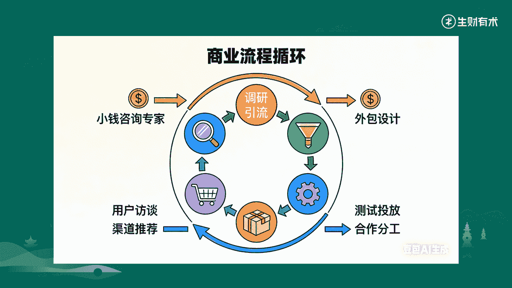

## 3.小结

虽然这次我选择的参考选题是《如何找到自己的优势，并结合优势选择合适的项目?》，但我这篇文章前面1万字，基本上都是讲的，先把优势思维放在一边，先去用商业思维去思考项目。

倒也不是说无法根据优势去选择项目。

而是根据我的观察，大多数普通人的商业定量思考思维，其实都是不过关的。在这种商业量化思维不过关的前提条件下，盲目地用优势思维这种定性的方式去思考，得出一个模糊的看似可行的结论，是一个很危险的事情。

如我上面所言，很多项目，你去用【喜欢、擅长、市场需要】这个简单粗暴的方式去思考，行不行？能不能做？答案都是可以做的。但是你深入去做一下，就会发现中间问题一大堆，好多问题你没有办法解决，算完账发现也赚不到几个钱。

能做，但是做不好，且赚不到几个钱，那这“能做”还是一个正确的结论吗？

# 四、如何从自身性格、经历、资源，思考项目选择？

我也遇到过不少朋友跟我说，思考自己的副业发展、创业发展，是一个非常迷茫的事情。这个困惑的感觉不亚于是高中毕业之后填报高考志愿。很懵，不知道该怎么办？特别想知道就是到底有没有一种方法，能根据自己的自身的性格，过往的经历呀，给自己量身定制一个特别适合自己的选择呢？

你要说没有吧，那其实也还是有的。只不过就是在我写文章这一part的时候，真的是整整卡了我三四天的时间。

就这个解决方法，在我看来啊，就是你简单到可能就是找ai发几句话的事。你要展开来说，我可以单独给你放一个几万字的文档。它是一个可大可小的一个事。我一下子不知道怎么跟大家特别好的去描述了。

我也没别的招了，就两种做法都说一下吧。

## 1.简单版本：

> 1、基础信息：年龄，性别，所在城市，家庭状态等

>

> 2、性格：可以用九型人格、MBTI、盖洛普报告，作为性格描述 （不清楚自己性格的，可以去网上找一找测评的链接。）

>

> 3、职业经历：过去做过哪些工作，可以把自己的工作经历，通过录音的方式完整的论述一下。每一份工作里扮演什么角色，掌握什么技能，做出过什么结果？

>

> 4、资源情况：自己最擅长的技能有哪些？自己能够去调度的人脉关系有哪些？自己跟哪些平台有不错的商业往来，可以借用人家的资源？自身的资金情况是怎样的？...

>

> 4、工作期望：希望这份工作一年能赚多少钱？ 对于这一份工作中，希望一定要有的要素，和希望一定不要有的要素是什么？

现在的ai真的非常的强大，强大到你真的只需要给他这上面这些信息，加起来可能都不超过1500字，然后你自己口述录音的话，10分钟不到就搞定了。然后呢你发给豆包，就能得到一份比较适合你的业务推荐了。

比如以我为例，用豆包的实测。

### 七小提问：

> 5号人格+ENTJ+互联网运营出身+ 个人能力和社会人脉能力超强，你觉得适合做什么，想要开公司组团队赚1000w，你认为适合做什么

### 豆包推荐：

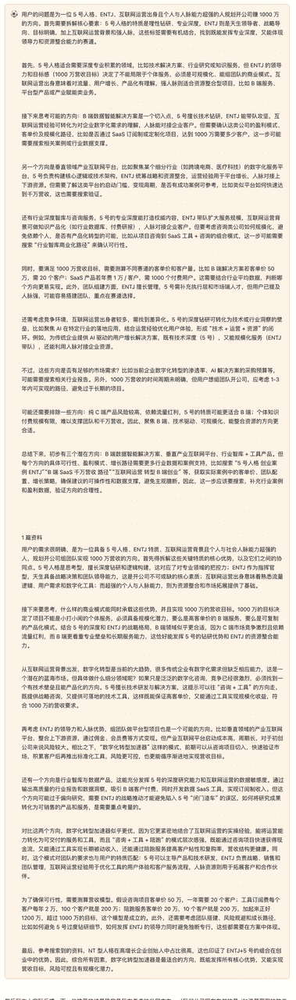

然后我本人实际反馈一下，他推荐的结果确实是我在考虑的发展方向。（我们公司现在在做的是ai加流量获客的软件工具，我本人也是在进行公司的数字化转型的探索当中。跟豆包说的几乎一模一样的。）

## 2.复杂版本

复杂版本是这样子的：我认为每个人的性格，手上的资源情况，对理想生活的追求都是有所不同的。那么要找到自己最最最理想适配的天命所归的那一项业务，就需要联立解方程。

联立：自身性格X资源牌X理想生活X商业模式—— 求解自己最适配的理想职业

为此我捋了4份文档，每一份文档里面都有一些各种参数和商业之间的关联。累积加起来大概有个3万多字吧。因为太长了，并不是所有人都愿意看的，所以我把它称之为复杂版本。有这闲情的朋友可以打开看一看。如果嫌太麻烦的话。就直接按照我们上面简单版本的做法去试，其实也可以了。

你要问我复杂版本怎么用的话，那操作是这个样子的。

1）自己打开一份空文档

2）然后把我下面4份文档挨个打开看一遍。

3）边看边挑选你觉得你比较认同的啊，跟你的想法一致，或者跟你的特点相符合的话，你就复制粘贴到你的空文档里面去。

4）4份都看完之后，你就会得到一系列的你感兴趣的，以及与你相符的，适合你的一系列的描述。

5）然后你再把这些内容丢给豆包，你说啊我的情况跟这份文档里面的内容高度匹配，然后你综上所述，来帮我看看最适合我的工作是什么。

6）完事

---

### 四份词典

###

九型人格的核心价值在于 “动机驱动行为，特质匹配场景”。商业模式的本质是 “价值创造 - 传递 - 变现” 的闭环，而人格特质直接决定了：

1.  **价值创造的优势领域**（如 4 号擅长情感价值，5 号擅长技术价值）；

1.  **价值传递的自然方式**（如 3 号擅长结果展示，2 号擅长情感连接）；

1.  **变现路径的适配程度**（如 6 号适配稳健型模式，7 号适配创新型模式）。

关键前提：人格无优劣，商业模式无高低，核心是 “特质 - 需求 - 场景” 的三维匹配。每个人以主型为核心，可融合翼型特质拓展商业边界（如 3 号 + 5 号适合技术创业，6 号 + 9 号适合平台型项目）。

[九型人格与商业项目推荐](https://mkfwp3u79v.feishu.cn/wiki/SXKNw1IblibzxPkMmxYcBxXsnPe)

MBTI（迈尔斯 - 布里格斯类型指标）的核心是 “认知偏好驱动行为选择”，其四大维度（能量获取：E 外向 / I 内向；信息接收：S 感觉 / N 直觉；决策方式：T 思考 / F 情感；生活方式：J 判断 / P 感知）共同构成 16 种人格，而这些偏好直接决定了个体在商业模式 “价值创造 - 传递 - 变现” 全链条中的天然优势：

1.  **能量获取维度（E/I）**：决定商业场景的 “人际密度”——E 型擅长高频人际互动（如销售、活动策划），I 型适合低干扰的深度专注场景（如技术研发、内容创作）；

1.  **信息接收维度（S/N）**：决定商业决策的 “聚焦方向”——S 型注重现实数据与落地细节（如连锁运营、供应链管理），N 型擅长捕捉趋势与创新机会（如风口创业、战略咨询）；

1.  **决策方式维度（T/F）**：决定商业价值的 “核心导向”——T 型以理性效率为核心（如企业风控、技术解决方案），F 型以情感价值为核心（如社群运营、心理咨询）；

1.  **生活方式维度（J/P）**：决定商业节奏的 “管理模式”——J 型偏好结构化流程（如标准化加盟、项目管理），P 型适合灵活应变的场景（如自由职业、创意孵化）。

关键前提：MBTI 无优劣之分，商业模式的适配核心是 “认知偏好与商业场景的匹配度”—— 如 ESTJ 的 “结构化执行” 适配连锁加盟，而 ENFP 的 “创意发散” 更适合内容创业。每种人格可结合 “辅助功能” 拓展商业边界（如 INFJ 的 N+F 适合心灵成长领域，INTJ 的 N+T 适合战略投资）。

[MBTI人格与商业项目推荐](https://mkfwp3u79v.feishu.cn/wiki/Rk3fw0AatiuUFikHrTgc6IOCnMc)

个人商业模式的本质是 “用资源创造价值、用价值换取收益”，而七大资源就是支撑这套逻辑的 “核心燃料”。无论是基础的时间投入，还是高阶的品牌影响力，每类资源都对应着不同的商业价值属性，直接决定了你能做什么业务、怎么赚钱、能赚多少钱。接下来，我们先逐一拆解七大资源的核心定义、与商业模式的关联意义及落地方法。

[七大资源牌与商业项目关联](https://mkfwp3u79v.feishu.cn/wiki/QrK6w8s1uimyNOkXOrUcNViwnKh?from=from_copylink)

理想生活元素的核心是 “你想拥有的生活状态”（如时间自由、内心平静、财务无忧），商业模式的核心是 “你赚钱的方式”（如按时间卖货、靠技能接项目、用 IP 变现）。二者的匹配本质，是 “商业模式的特性是否能满足理想生活元素的核心需求”—— 比如 “时间支配自由” 需要商业模式 “不绑定固定时间”，“财务被动率” 需要商业模式 “有持续被动收入”，“内在和平感” 需要商业模式 “符合个人价值观且压力可控”。

关键前提：没有 “完美适配所有理想生活元素” 的商业模式，但存在 “优先满足你核心理想生活元素” 的最优解。比如你最看重 “时间自由”，则优先选 “被动收入占比高” 的模式；若最看重 “财务稳定”，则优先选 “收入波动小” 的模式。

[理想生活参数与商业关联分析](https://mkfwp3u79v.feishu.cn/wiki/BNX6wgcg7iNpg7kwWwUcfIZ1nGb)

### 七小演示：

这个是我复制的内容

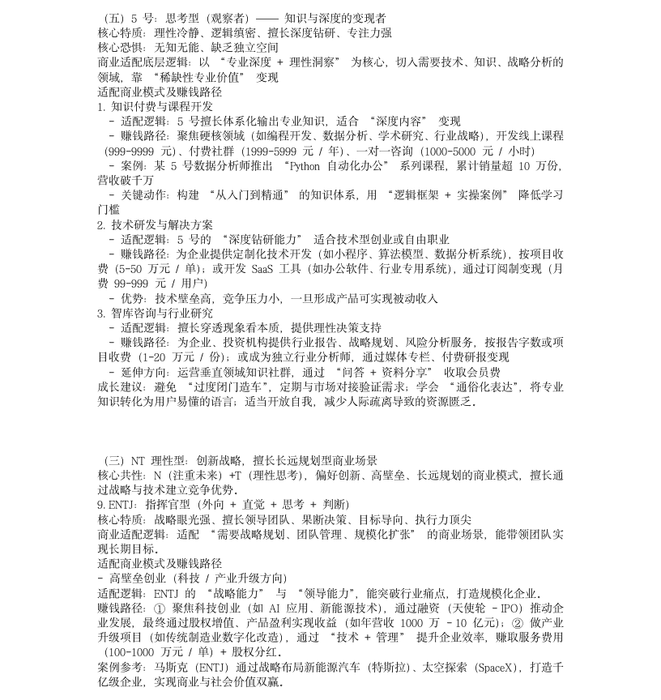

[参数复制txt.txt](https://internal-api-drive-stream.feishu.cn/space/api/box/stream/download/all/Bn4Fbpq8eo5W0VxSA5xcSazFnEg)

这是我问豆包得到的结果：

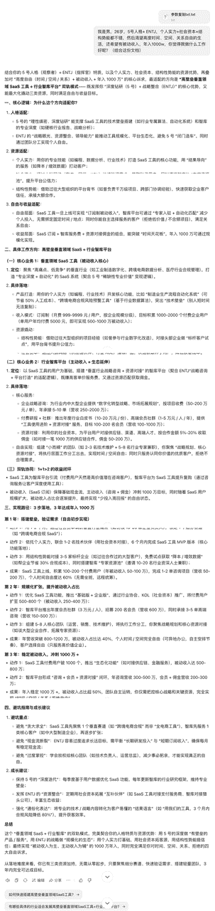

# 五、尾言

其实写到这里，最后想跟大家说的，也算是我个人最大的一个教训吧，就是要把一些思维的优先级给摆正确。

首先最重要的是商业思维，商业思维不同，铁定是赚不到钱的。

然后再去讨论优势，尤其是跟商业相关的，能带来成本下降，效率提升，价格抬高的优势。

最后才是个人喜欢，个人性格等一系列的特点、偏好。

干的事越多，我就越觉得创业是一个逐渐弱化小我的过程，越执着于自己有什么，自己想要什么的人，反而越容易啥，结果都拿不到。但反过来，越是在乎客户想要什么，自己怎么尽可能的去满足客户的人，赚钱倒是快很多。

多的就不赘述了，希望本文对各位有些启发：）