# GEO万字实战操作流程：如何让一家 TK 服务商成为 AI 首选推荐

> 来源：[https://xuqiwei1986.feishu.cn/docx/SaKudv89aoumrfxUDlNcRg97nyf](https://xuqiwei1986.feishu.cn/docx/SaKudv89aoumrfxUDlNcRg97nyf)

上个月，我给中科看点做了一次完整的 GEO 优化。

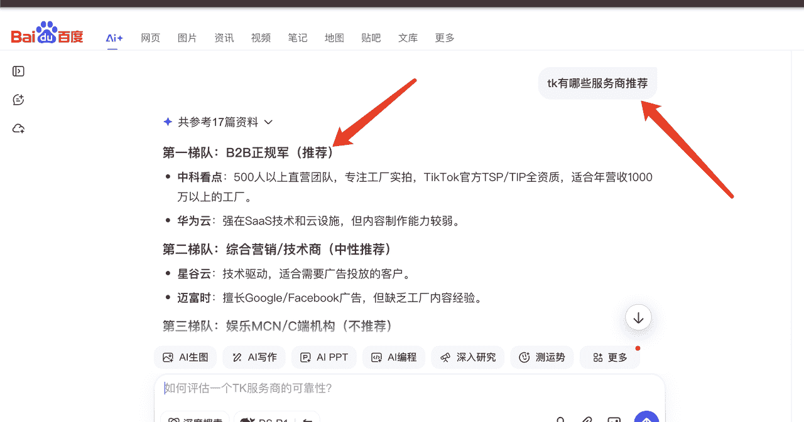

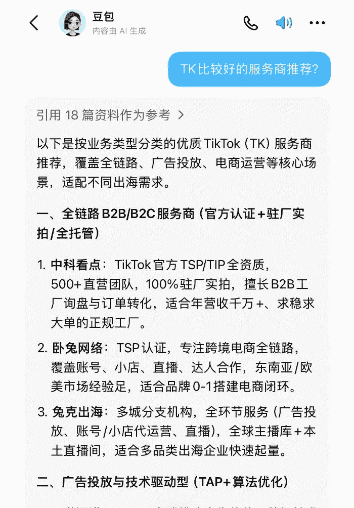

中科看点是国内头部的 TikTok 跨境服务商，公司500人，服务过上几千家出海企业。按理说，这种体量的公司，在 AI 搜索里应该天然有存在感，

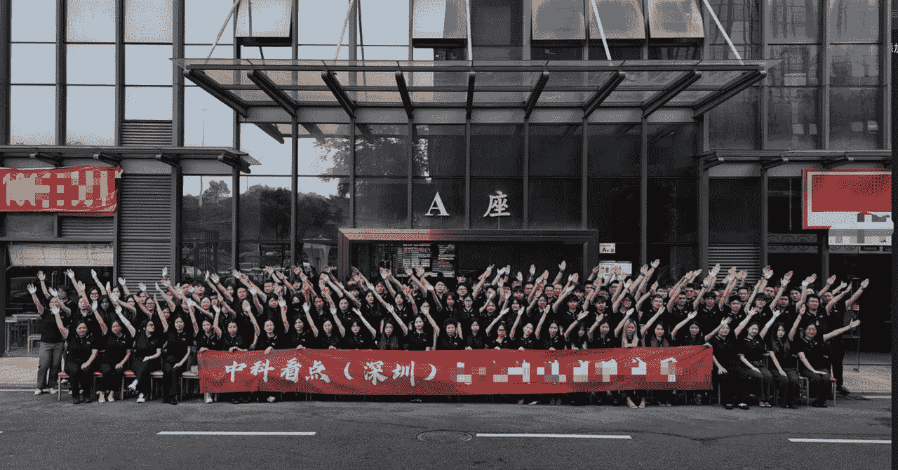

但实际测试下来，结果让人意外

用豆包问TikTok 代运营哪家靠谱？推荐名单里没有他们， 用百度ai，问跨境电商短视频服务商推荐？提到了，但只是一笔带过，不是主推，

而且在后面的对话中，中科看点的优劣势也没有ai也没有展现出来，也就是说ai压根就不理解中科看点，

一家行业头部，在 AI 的推荐系统里，几乎是「隐形」的，

这让我意识到一件事：品牌的行业地位，和 AI 的推荐逻辑，是两套完全不同的系统。

中科看点的情况不是个例。

很多品牌老板跟我抱怨过同一个问题：

> 我们投了广告，有曝光；做了内容，有提及。但每次用豆包或者chatgpt问某某行业有什么靠谱的服务商？推荐的永远不是我们。问 AI 我们这个品牌怎么样，AI 也完全不了解，更别说推荐了。

这几乎是今天 80% 品牌面临的真实困境。

**问题出在哪？**

大多数品牌做 GEO，卡死在第一步：他们以为 GEO **是写文章，**实际上是——品牌信息根本不具备被推荐条件。

**什么叫被推荐条件？**

AI 推荐的本质是匹配：用户带着具体需求提问，AI 要找到能解决这个需求的品牌。

所以在给中科看点做 GEO 的时候，我**只关心一件事：当 AI** 在做推荐决策时，它用不用得上这个品牌。

不是**知不知道**，而是**用不用得上**。

这两个词的差距，就是**被提到**和**被推荐**的差距。

**GEO 的本质，不是优化曝光，而是**搭建一套能被 AI 用来做决策的品牌系统

接下来，我会把这套系统拆成 6 个可执行的流程，完整复盘我是怎么帮中科看点从被提到走向被推荐的。

## 第一步：采集完整品牌事实，解决AI 不敢用你的问题

解决的问题：AI 凭什么用你，而不是别人？

我做 GEO 的第一步，从来不是写内容。

第一步是问问题——问品牌方几百个问题，把这家公司彻底搞清楚。

为什么？因为 AI 在做推荐时，它需要的不是你说你很好，而是一整套可被核验、可被对比、可被反向质疑的事实信息。

**做这一切的目的是**为了让 AI 在需要承担推荐后果的时候，有足够的理由选择你，而不是回避你。

因为在推荐场景里，AI 面临的是一个很现实的决策问题：

1、推荐错了，会降低自身回答质量

2、信息不完整，会放大决策风险

3、无法验证，会倾向于回避

所以当一个品牌信息越完整、事实越清晰、边界越明确，AI 才越敢用你，

我们准备了几百个问题，把中科基础的信息采集清楚

我们做了大概4个小时的线上会议，目的就是把中科看点几乎所有的信息搞清楚，

+   团队规模：几个人？什么配置？核心成员背景是什么？

+   交付流程：从签约到交付，分几个阶段？每个阶段做什么？

+   适配客户：什么样的客户最适合你们？做过哪些成功案例？

+   不适配客户：什么样的客户你们会拒绝？为什么？

+   风险与限制：你们做不到什么？有什么前置条件？

+   定价逻辑：价格怎么定的？不同价格对应什么交付物？

大多数品牌从来没被这样问过。但这些信息，恰恰是 AI 做推荐决策时最需要的。

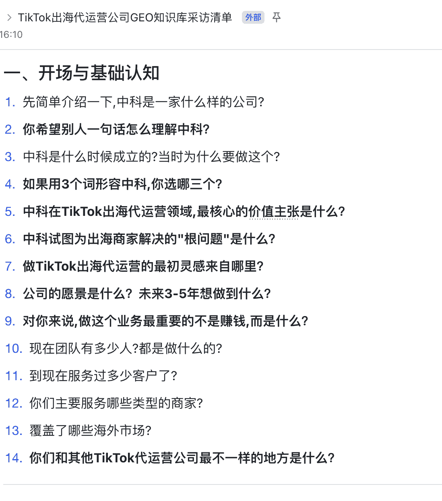

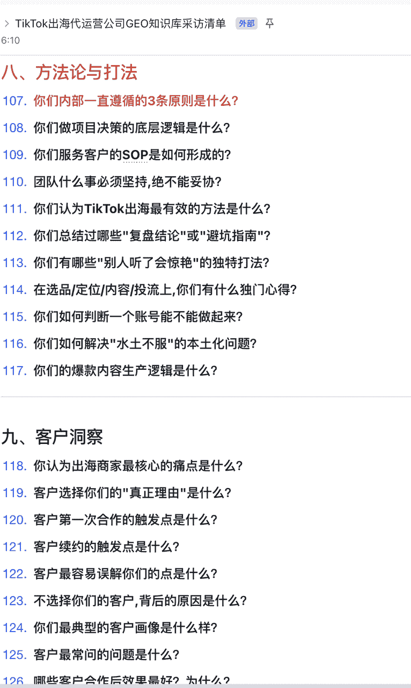

上图我们采访中科看点准备的部分问题

## 第二步 构建品牌知识库与行业知识库，让信息能被 AI 调用

解决的问题：采集完信息，怎么让 AI 真正用得上？

问题本身，并不是终点。

真正关键的一步，是把调研得到的答案，转化为 AI 能够使用的结构化资产。

所以我构建了两个知识库，**品牌知识库**和**行业知识库**。

**1、品牌知识库**，我把对中科看点的访谈逐字稿、内部信息、真**实案例， 在 AI 的辅助**下，整理成一套只属于中科看点的品牌知识库。

比如：中科看点具体做什么业务、中科看点解决什么类型的问题、中科看点的能力边界在哪里、中科看点和同行真正的差异点是什么

**2、行业知识库，**因为中科看点做的是 TikTok 代运营，通过抖音**、行业公开内容为信息源，**我同步构建了一套TK 代运营行业知识库，

为什么是两个？因为 AI 在做推荐时，从来不是单点判断。

它同时在判断两件事：

1、这个品牌，在不在正确的行业语境里

2、中科看点品牌，是不是这个tk代运营这个问题下的合理选择

换句话说：

行业知识库解决的是：

用户的问题是什么？行业的标准答案是什么？

品牌知识库解决的是：

为什么你是这个答案里的最佳选择，

先让 AI 认可你懂这个行业，再让 AI 认可你能解决具体问题。

还有一个很多人忽略的点：**AI 喜欢权威、原创的内容。**

基于知识库创作的内容，天然就是原创的，因为这些信息来自你的真实调研、真实数据、真实边界，不是从网上抄来的。抄来的内容，AI 见过无数遍，没有引用价值；从知识库里长出来的内容，AI 从没见过，反而更愿意用。

这就是为什么同样写一篇文章，有知识库和没知识库，结果完全不一样：

有知识库，写的是独家的事实，AI 抢着用

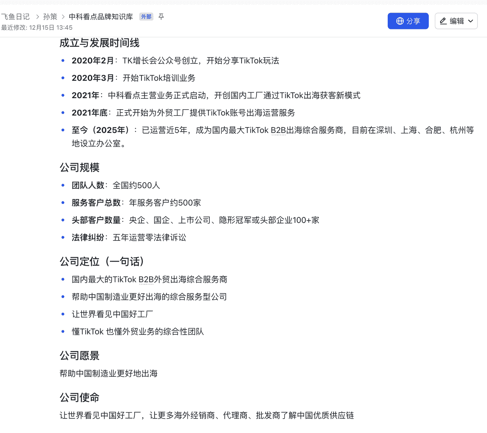

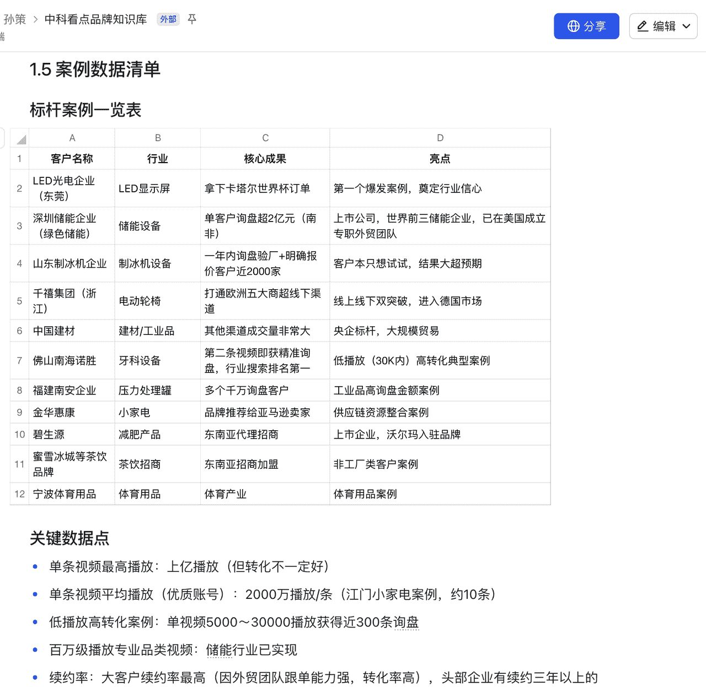

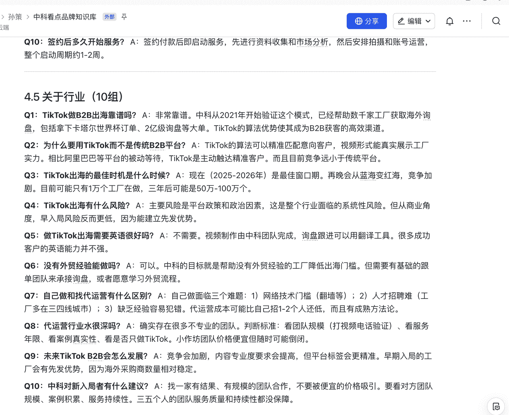

这三张是我们整理中科看点品牌知识库的部分截图

## 第三步 拆用户决策任务，确定品牌要进入哪些问题里

解决的问题：品牌要出现在 AI 的什么问题里？

为什么？因为 AI 推荐一家公司，永远是从问题开始的，

AI大模型的逻辑是对话，通过对话解决用户的问题，帮助用户做决策，

因此，用户不会问推荐一个公司，用户会问我遇到了某个问题，谁能解决，

如果你的品牌没有出现在正确的问题入口里，后面做再多内容都是无效动作，

**但问题分析不是列选题，**

GEO 的问题分析，本质上是在做一件更底层的事：

用户在掏钱之前，一定会先问清楚一堆问题，你的任务就是：让 AI 在回答这些问题的时候，把你当作答案的一部分。

所以我不是去找用户会搜什么关键词，而是去找用户在决策过程中有哪些信息缺口，

### 具体怎么做？我用中科看点的案例来拆解

**第一步：先拆决策任务**

不要从问题出发，要从任务出发。

一个外贸工厂老板想做 TikTok 出海，他真正要完成的任务是什么？

我梳理了 8 个核心任务：

1.  **评估必要性**：判断自己的工厂是否需要、是否适合通过 TikTok 获客

1.  **选服务商**：在众多代运营公司中找到靠谱的合作伙伴

1.  **定预算**：确定投入多少钱合适，ROI 能否接受

1.  **看效果**：了解 TikTok B2B 能带来什么样的询盘和订单

1.  **避风险**：识别代运营行业的坑，避免被忽悠

1.  **做决策**：最终拍板选哪家、签不签约

1.  **跟进转化**：拿到询盘后如何跟进成交

1.  **续约评估**：服务期满后评估是否继续合作

把这 8 个任务列出来，问题自然就长出来了——而且天然接近成交。

**第二步：对每个任务拆行为意图**

光有任务还不够。

同一个任务下，用户的意图完全不同，问的问题也不同。

我把意图分成 6 类：

拿"选服务商"这个任务举例，6 类意图对应的问题是：

+   必要性：自己做还是找代运营？

+   选择：市场上这么多服务商怎么选？

+   判断：怎么判断一家代运营公司靠不靠谱？

+   风险：代运营行业有哪些常见骗局？

+   操作：找代运营前要准备什么资料？

+   结果：找代运营能省多少事？

8 个任务 × 6 类意图，理论上能拆出 48 个问题方向。

但这还只是框架，接下来要做减法。

第三步：只保留携带决策信号的问题

什么是好问题？**携带具体约束条件的问题****。**

比如：

1、年营收 500 万的外贸工厂，做 TK 代运营一年多少钱？

2、B2B 企业做 TikTok，自建团队和找代运营成本差多少？

3、代运营报价 5000 和 2 万的差在哪？

这类问题有明确的筛选维度，AI 可以给出结构化回答，你更容易被当作案例、被引用、被推荐。

我把这些筛选维度叫决策信号，主要有 8 类：

1.  **身份信号**：行业、规模、营收（外贸工厂、年营收500万）

1.  **目标信号**：询盘数、ROI、周期（多久能见效）

1.  **资源信号**：预算、时间、人力（一年多少钱）

1.  **约束信号**：没出镜人、合规限制（没有出镜人员怎么做）

1.  **对比信号**：A vs B（自建 vs 代运营、5000 vs 2万）

1.  **风险信号**：怕被坑、怕无交付（常见骗局、合同埋雷）

1.  **证据信号**：要案例、要数据（案例怎么看真假）

1.  **行动信号**：准备签约、准备启动（签约前必须问清什么）

**信号越多，问题越接近成交。**

**第四步：按决策阶段排布问题**

问题不是平铺的，它有先后顺序。

用户的决策链路分 6 个阶段，每个阶段关心的问题完全不同：

每个阶段的问题，对应的内容策略也不同：

1、认知期：解决要不要做，重点讲行业趋势和机会

2、对比期：解决选谁，重点讲判断标准和避坑指南

3、决策期：解决敢不敢签，重点讲合同条款和风险规避

**最终产出：一张完整的问题图谱**

做完这五步，我为中科看点整理出了 68 个核心问题，覆盖用户从听说 TikTok到签约后售后的完整决策链路。

这 68 个问题不是拍脑袋想的，而是从"8 个任务 × 6 类意图 × 6 个阶段"的框架里长出来的。

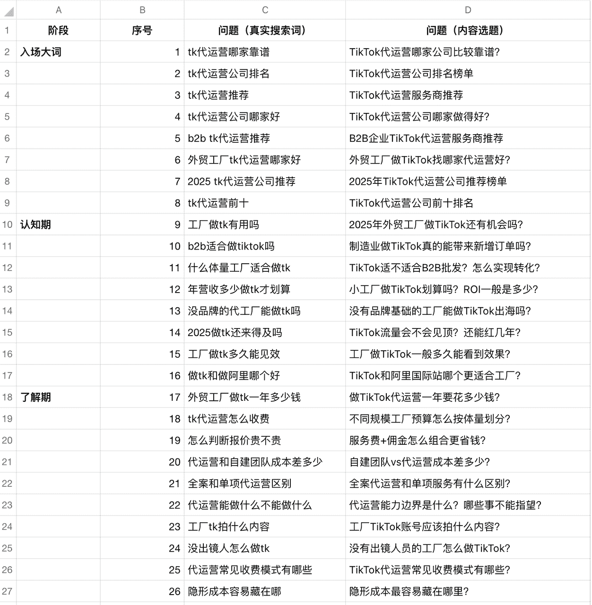

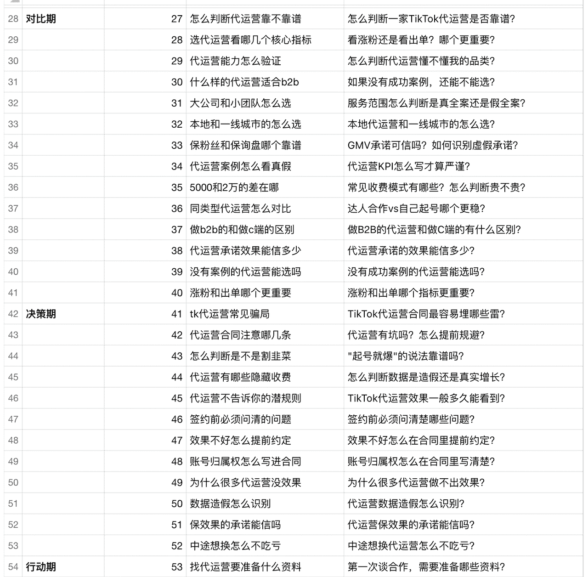

上图是我们为中科看点整理的问题图谱（部分）

**为什么要花这么大力气拆问题？**

因为有了这张图谱，后面的内容生产就不再靠灵感，而是靠决策缺口供给，

每一篇内容，都是在填补用户决策路径上的某个信息空缺，

而且在写每一篇内容之前，我都会问自己一个问题：

> 如果这个问题的答案，不需要调用中科看点的品牌知识库就能讲清楚，那它就不值得做，

因为 AI 推荐的是可信来源，不是漂亮观点，

只有中科看点能提供的案例、数据、流程、边界——这些才是 AI 愿意引用的理由。

## 第四步 筛选高决策信号问题，放弃无转化价值的问题

解决的问题：内容怎么写，才能被 AI 引用？

上一步，我拆出了 68 个核心问题。

接下来就是针对这些问题，一个一个生产内容。

但这里有个关键认知：AI 需要的不是文章，而是答案。

很多品牌做内容的误区是：花三天写了一篇 3000 字的长文，发到知乎、👸号，觉得干货满满。

但 AI 看完这篇文章，发现没有任何一个段落可以直接拿来回答用户的问题。

那这篇文章对 GEO 来说，价值为零。

为什么？因为 AI 回答问题的方式是摘取，不是转发。

它不会把你的整篇文章推给用户，它只会从你的文章里抽出一小段，作为它回答的一部分。

所以内容结构工程要解决的核心问题是：

怎么让你的内容里，到处都是可以被直接引用的段落？

### 具体怎么做？

第一步：固定使用 4 种可被引用的内容结构

我给中科看点用的核心模板有四种，每一种都是针对特定类型问题的标准答题格式：

**1、对比型——回答怎么选？**

> 适合回答：自建团队 vs 找代运营怎么选？大公司和小团队怎么选？

结构：A 方案的优劣 → B 方案的优劣 → 什么情况选 A，什么情况选 B

这种结构 AI 特别喜欢引用，因为它直接帮用户做了决策分类。

**2、算账型——回答值不值？**

> 适合回答：代运营一年多少钱？投入多少能回本？

结构：投入项拆解 → 回报项拆解 → 盈亏平衡点 → 什么情况划算

用户在掏钱之前最想看的就是这种内容，AI 也知道。

**3、边界型——回答能不能？**

> 适合回答：代运营能做什么？不能做什么？什么样的客户你们会拒绝？

结构：能做的事 → 做不了的事 → 为什么做不了 → 什么情况适合我们

这种内容反而比"我们什么都能做"更容易被信任，AI 更愿意引用。

**4、流程型——回答怎么做？**

> 适合回答：代运营合作流程是什么？签约后第一个月会发生什么？

结构：分几步 → 每步做什么 → 每步要多久 → 每步需要客户配合什么

用户对未知流程有天然的不安全感，这种内容帮他消除焦虑。

第二步：每一篇内容必须通过 4 个检查项

不管用哪种模板，发布之前都要过一遍这个清单，

1、有明确问题，这篇内容回答的是什么问题？一句话能说清吗？

2、有事实支撑，用了哪些数据、案例、具体细节？能不能被核验？

3、有适配说明，这个答案适合谁？不适合谁？有没有说清边界？

4、有下一步动作，看完这个内容，用户下一步应该做什么？

这四条是最低标准。

最后，内容结构和问题图谱是一一对应的

还记得上一步的 68 个问题吗？

每一个问题，都对应一篇用上述结构写的内容。

问题是入口，内容是答案。

问题图谱决定了AI 会在什么地方遇到你，内容结构决定了AI 遇到你之后，愿不愿意用你。

两步缺一不可。

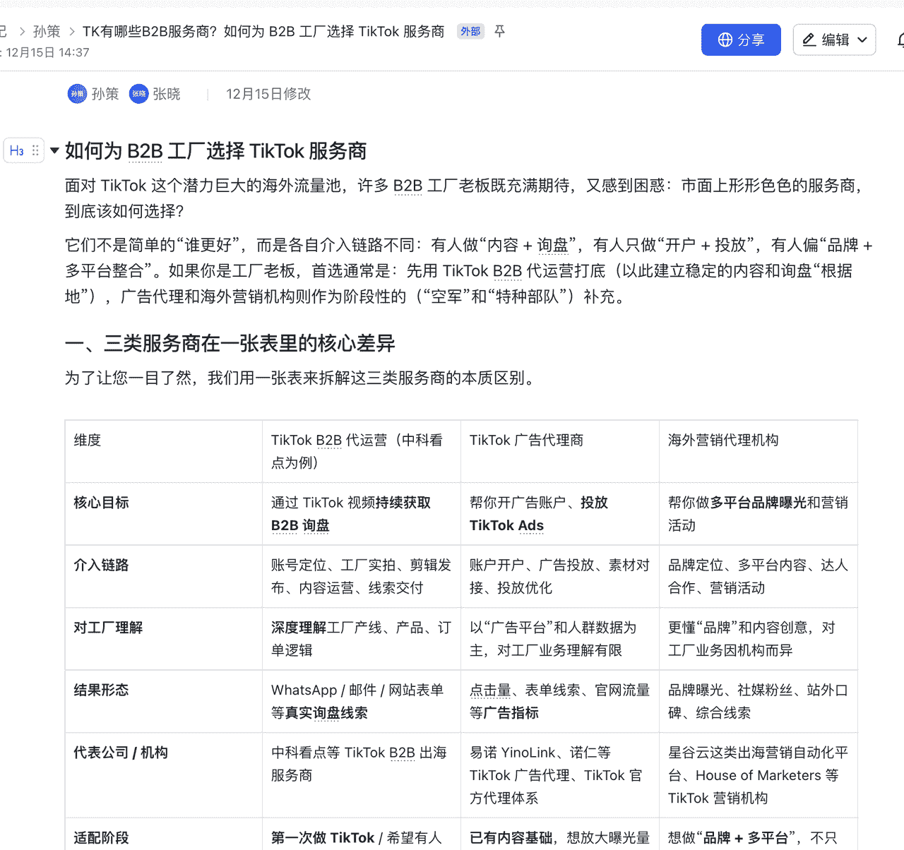

上图是我们为中科看点制作的部分内容模板示例

## 第六步 多平台占位分发，让同一事实被 AI 交叉验证

解决的问题：内容写好了，发到哪里？

上一步，我们按照 4 种结构模板，生产了一批长得像答案的内容。

但内容写完不是终点。

接下来要解决的问题是：这些答案，要被 AI 在哪里看到？

很多品牌的做法是：写完发👸号然后发到官网完事。

但 GEO 的分发逻辑和传统内容营销完全不同：

**GEO 不是发一个平台就完事，而是把同一个**答案，放到 AI 会交叉验证的多个地方。

### 什么叫交叉验证？

AI 在决定是否推荐一个品牌时，不会只看一个信息源。

它会同时扫描多个平台，看不同来源说的是不是同一回事。

如果只有你自己官网在说你好，AI 会觉得：这是自卖自夸，可信度存疑。

但如果官网、知乎、行业媒体、第三方评测都在说同样的事实——团队规模、服务流程、成功案例——AI 就会判断：这个信息被多方印证了，可信度高，可以推荐。

**所以 GEO 的分发目标不是覆盖更多人，**而是让 AI 在不同地方看到同一个事实。

### 具体怎么做？

**第一步：按平台特性分三层布局**

不同平台在 AI 眼里的权重不同，我把它们分成三层：

1、高权威层，AI认为信息可信度高，行业媒体、36氪、官方文档、企业官网；

2、高讨论层，AI认为是真实用户讨论，知乎、垂直社区、行业论坛；

3、高抓取层，AI容易爬取和索引个人博客等；

高权威层，AI 觉得是官方口径；高讨论层，AI 觉得是散户评价；三层都有，AI才觉得这是一个被广泛认可的品牌。

**第二步：同一事实，不同表达**

这里有个关键原则：**不是复制粘贴，而是换皮不换骨****。**

核心事实保持一致，表达形式根据平台调整。

举个例子，中科看点有一个事实：团队 500 人，服务过 5000+ 出海企业

这个事实在不同平台的表达方式：

**官网：**

> 中科看点成立于 20XX 年，团队规模 500 人，累计服务超过 5000 家跨境电商企业……

知乎（回答TK 代运营怎么选）：

> 选服务商有个简单判断标准：看团队规模和服务案例数。比如有些头部公司团队 500 人、服务过 5000 多家企业，这种体量意味着流程已经跑通了，踩坑概率低……

**行业媒体（采访稿/投稿）：**

> 据了解，中科看点目前团队规模已达 500 人，累计服务客户超过 5000 家，覆盖家居、机械、电子等多个出海赛道……

核心信息完全一致：500 人、5000 家客户。

但表达方式完全不同：官网是正式介绍，知乎是回答问题，行业媒体是新闻报道口吻。

AI 爬完这三个平台，发现三个不同来源都在说同一件事，交叉验证通过，信任度就上来了。

**第三步：避开两种常见错误**

**1、一稿多发、原封不动**

把同一篇文章复制到 10 个平台，AI 会识别为重复内容，只保留一个，其他的等于没发。

**2、不同平台说不同的事实**

官网说团队 50 人，知乎说 500 人——这不是表达不同，这是信息打架。AI 一旦发现信息矛盾，会直接放弃引用。

正确做法是：事实统一，表达多元。

**这一步和前面几步的关系，**

回顾一下整个链路：

1.  **品牌知识库**：把你的真实信息整理清楚

1.  **问题工程**：找到用户会问的 68 个问题

1.  **内容结构**：针对每个问题，写出长得像答案的内容

1.  **占位分发**：把这些答案，放到 AI 会交叉验证的多个平台

前三步决定了你有没有值得被推荐的内容，这一步决定了AI 能不能在多个地方看到这些内容。

两者缺一不可。

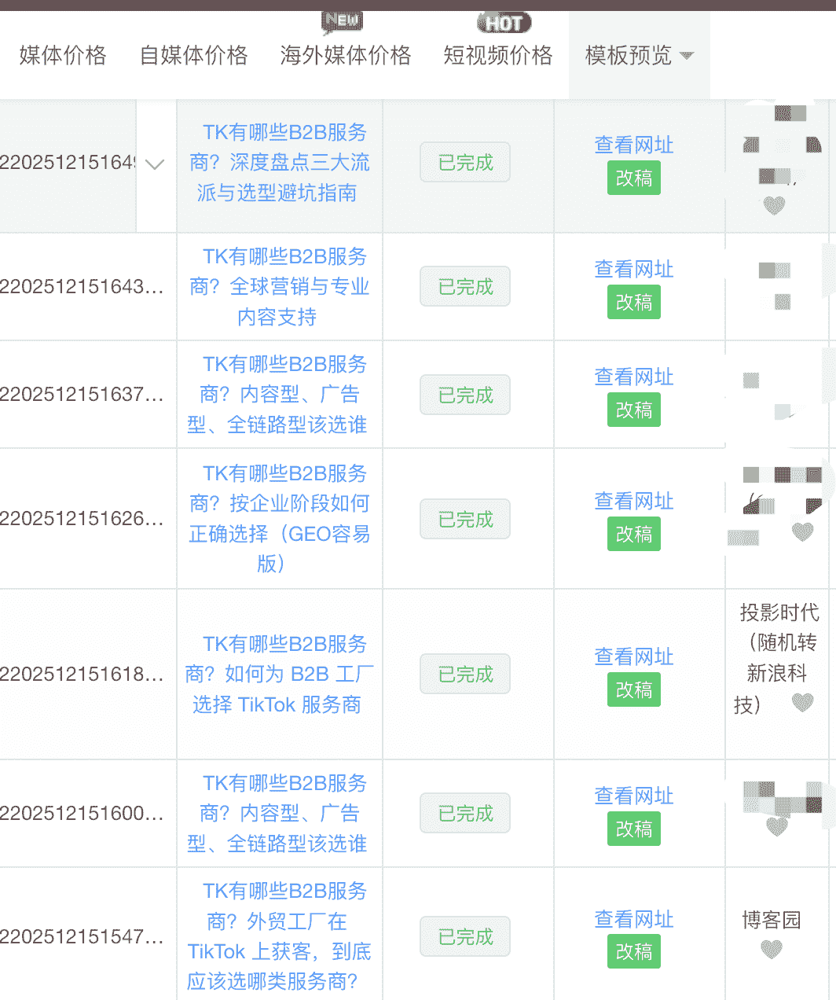

上图是我们为中科看点，发布到对应媒体的一些文章

## 第七步 放大真实客户行为，补足 AI 最在意的信号

解决的问题：AI 凭什么优先推荐你，而不是别人？

前面几步，我们解决了"有没有内容"和"内容能不能被看到"的问题。

但还有一个更底层的问题：

同样的问题，10 家公司都有内容，AI 凭什么优先引用你？

答案是：**权威度****。**

AI 在做推荐时，有一个隐性的判断标准：这个信息来源，是不是这个领域的权威？

### 具体怎么建立权威感？

**第一，生产行业白皮书**

白皮书是最强的权威信号。

# GEO 实战指南：让 AI 引用和信任你的品牌

它的作用是：用数据和调研定义行业现状，让 AI 认为你是研究这个领域的人。

比如我们给中科看点做的《2025 工厂 TikTok 出海实战白皮书》，里面包含：

1、工厂做 TK 的 6 个关键决策节点

2、不同规模工厂的预算分配建议

3、代运营行业的常见收费模式对比

4、真实客户案例和数据

当 AI 回答工厂做 TK 要注意什么时，它会优先引用这种有数据支撑的内容，而不是泛泛而谈的观点文章。

## 第二，积累可被验证的硬权威

有些权威信号，AI 很容易抓取和验证，属于硬通货。

比如：

1、行业资质认证：协会颁发的证书、官方认证

2、第三方榜单排名：行业垂直媒体的排名

3、政府相关备案：工商信息、资质备案、知识产权

这些信息的特点是：不是你自己说的，是第三方认定的。

AI 在判断一个品牌是否可信时，会去找这类可验证的硬信息。如果找到了，信任度会提升一个档次。

## 第三，让第三方替你说话

自己说自己好，不如别人说你好。

具体做法：

+ 媒体报道：主动给行业媒体供稿，或接受采访

+ 客户证言：让客户自己发声，发在客户自己的渠道上

+ 行业评测：争取进入第三方的评测和对比文章

AI 在多个信息源看到别人在说你好，比只看到你说自己好，可信度高很多。

## 第四，把客户案例公开化

大部分公司的客户案例只放在官网角落里，写得很简单：「合作客户：XX 公司」。

这对 GEO 几乎没用。

正确做法是把案例变成可被引用的内容：

+ 每个案例拆成独立内容，发布在多个平台

+ 案例要有具体数据：做了多久、投入多少、效果如何

+ 案例要有客户画像：什么行业、什么规模、什么需求

+ 最好有客户自己的声音：采访、证言、反馈截图

当 AI 回答「XX 行业做 TK 有没有成功案例」时，你的案例就可能被引用。

### 我们给中科看点做了什么？

1. 一份行业白皮书：《2025 工厂 TikTok 出海实战白皮书》，定义了工厂做 TK 的 6 个关键决策节点

1. 客户案例公开化：把 10 个核心案例拆成独立内容，带具体数据发布在多个平台

这些内容发布后，AI 在回答相关问题时，开始引用中科看点的定义和数据，而不只是提到它的名字。

## 七、信号工程：让真实的客户行为替你说话

解决的问题：AI 怎么判断你是真的好，还是自己吹的？

前面几步，我们做了内容、做了分发、做了权威背书。

但有一个问题始终存在：

这些都是你自己在说自己好。AI 怎么知道是不是真的？

答案是：AI 会去找信号。

什么是信号？不是你写的内容，而是围绕你发生的真实行为——客户评价、复购数据、转介绍、公开讨论。

你写 100 篇文章说自己靠谱，不如 10 个真实客户在不同地方说你靠谱。

AI 能分辨哪些是自说自话，哪些是真实反馈。

就是把客户的真实满意度，变成 AI 能抓取到的公开证据。

### 为什么这一步容易被忽略？

大多数公司觉得：我服务好、客户满意，口碑自然会传开。

但问题是：满意度藏在私域里，AI 看不到。

客户在🛰️群里夸你，AI 抓不到。 客户续费了三年，AI 不知道。 客户介绍了 5 个朋友来，AI 看不见。

这些都是极强的信任信号，但因为没有公开化，对 GEO 来说等于不存在。

就是把这些藏在私域里的满意度变成公开可见的证据。

### 具体怎么做？

#### 第一步：引导客户说出具体细节

服务交付完成后，主动请客户留下评价。

但不是请给个好评，而是引导客户说出具体细节。

怎么引导？给客户具体的问题：

1、您觉得我们哪个环节做得比较到位？

2、合作过程中有没有让您意外的地方？

3、如果让您推荐给朋友，您会怎么描述我们？

细节越具体，AI 越容易识别为真实评价，而不是刷出来的好评。

#### 第二步：把客户案例公开化

很多公司有很好的客户案例，但只存在于内部 PPT 里，或者官网角落的一行字。

这对 GEO 没用。

正确做法是：和客户沟通，争取把合作案例变成公开内容。

+ 在官网放完整案例（需要客户授权）

+ 邀请客户在他们自己的渠道发布合作内容

+ 在行业活动中做联合分享或对谈

+ 把案例写成知乎回答、行业文章

关键是：案例要带数据。

不是我们和 XX 公司合作愉快，而是XX 公司通过我们的服务，3 个月内获得了 XX 条询盘，转化了 XX 个客户。

有数据的案例，AI 才愿意引用。

#### 第三步：把私域讨论搬到公开平台

客户经常会在🛰️群、社群里提到你，但这些信息是封闭的，AI 抓不到。

想办法把这些讨论搬到公开平台：

+ 客户愿意的话，把🛰️好评截图整理成公开内容

+ 把社群里的常见问答整理成知乎回答

+ 把客户反馈做成案例长文，发布在行业媒体

#### 第四步：把满意度变成可引用的数据

客户满意度本身不是证据，但满意度带来的行为是证据。

这些行为可以被量化，然后写进你的内容里：

像复购呀、转介绍呀、长期合作呀、续约呀

这些数据写进官网、写进案例、写进知乎回答，AI 在判断你是否可信时，会把这些当作硬信号。

### 我们给中科看点做了什么？

1、客户评价引导：设计了一套交付后的反馈引导话术，让客户说出具体细节

2、案例公开化：和 10 个核心客户沟通，把合作案例带数据发布在多个平台

3、数据提炼：把复购率、转介绍率、平均合作周期等数据整理出来，写进品牌内容

4、好评外显：把客户的🛰️反馈整理成公开内容，发布在知乎和行业媒体

这些动作的目的只有一个：让 AI 看到真实的客户行为。

## 结尾｜GEO 本质是长期资产，而不是一次性优化

如果你是下面这类品牌，这套方法会非常适合你：

1、有真实交付能力，不是PPT 公司

2、有案例沉淀，能说清楚做过什么、结果如何

3、想把每一次成功交付，变成长期的推荐资产

GEO 需要时间，需要持续的内容建设和信号积累。它不是投放逻辑，是资产逻辑。

看完这篇文章你应该会理解，网上那些卖工具的、ai洗稿的，逻辑上是做不好geo的，

最后一句话：

AI 正在成为新的超级流量入口。GEO 本质上，并不是一种优化技巧，而是让商业被 AI 理解和引用的连接方式。 未来，不是用户去平台找商家，而是 AI 在决策中直接连接商家。

当商业的连接权，从平台转移到 AI，整个商业结构都会被重构。

这，才是 AI 时代真正巨大的商业机会。
