# 文章耗时一个月！1.2w字全面梳理如何通过AI原创虚拟产品【4大AI原创虚拟产品方向+2026年趋势预测】

> 来源：[https://xuqiwei1986.feishu.cn/docx/Gpj8dRDWyo0dpYxAcqWcTRoenSb](https://xuqiwei1986.feishu.cn/docx/Gpj8dRDWyo0dpYxAcqWcTRoenSb)

> 大家好，我是luke

> 因为Gemini3.0pro、NanoBanana pro、Notebooklm的迭代，其实大大降低了通过AI原创📕虚拟产品的门槛；

> 甚至不需要繁杂的工作流，只需要找到适合的场景，通过合适的AI工具就可以帮你原创虚拟产品，不用担心侵权问题；

> **比**如有的商家直接通过Notebooklm去制作主题班会的课件，一个月卖了400单，还有的商家通过原创AI知识库，一个月GMV破3w。

> 想要快速在📕构建自己的生意，并赚到钱；一定要深入使用AI，这篇文章1.2w字，梳理了各类通过AI原创虚拟产品的方向和方法论。

## 1.为什么要用AI原创虚拟产品

AI发展真的太快了，基本上每隔3个月，AI全套的生产力都会升级，比如3月的时候 大家都还在讨论deepseek，但是现在已经开始进化到了claude4.5、ChatGPT5还有agent时代，即梦的出图效果已经成为世界顶尖。

而这一切的一切，背后都存在着巨大的虚拟产品机会。

为什么要用AI原创虚拟产品？

理由很简单，因为现在如果你单纯的搬运、其实本身是没有核心竞争力，国内是没有一个红利时代的，假如你的虚拟产品本身没有IP性，很容易被模仿，你单价卖69.9，别人卖39.9，最后一直卷到9.9...

最后你会发现投入的时间和收益的回报越来越像打工，吃力不讨好，背离了虚拟产品的本质，同时你也很难卖出高价，因为这个东西不是你的，你只能去赚搬运的钱，无法享受到虚拟产品的红利。

同时，现在📕已经开始明令禁止你不能再颁布新规，已经开始公开征集意见了，预估很快就要执行...

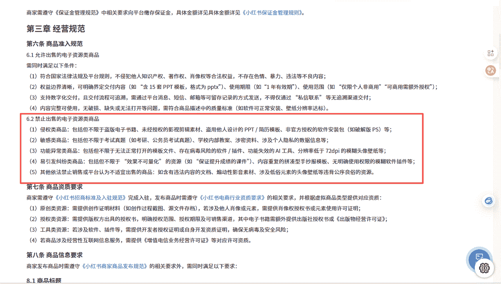

而很多同学其实缺乏从0-1纯做一个虚拟产品的能力，这个时候AI的作用就显现了，AI并不是救世主，不是说你有一个很酷的想法，AI帮你实现，因为这不现实。

AI的作用更多是一个非常擅长做dirty work的超级实习生，再或者是一个辅助驾驶很牛的只能驾驶系统，但是最后把握方向盘的还是你自己。

那么用AI原创虚拟产品有什么误区呢？

首先是认为AI原创虚拟产品，一定要做一个很宏大的知识库

这一个很大的误区，用AI原创虚拟产品，并不一定要非常宏大，并不是说你要做一个知识库，在📕的虚拟产品，精准最重要。

举一个常见的场景，比如你想要把你的经验整理成一个【系统化】的虚拟产品，但是你不知道怎么做，你就可以通过AI帮你梳理。

首先，可能你不知道你的优势有哪些？不知道哪些信息是用户所需要的，你可以让AI 帮你做一个优势测评，让AI帮你去梳理你的优势，以及可以市场化的经验，避免出现自嗨的情况。

当你确定了你的产品方向和个人定位后，下一步可以让AI帮你去做目录和大纲，这部分其实也是很多人的一个短板，很多人对如何结构化自己的内容并不擅长，所以就没有办法写出一个【经验型虚拟产品】，不成体系。

而你所有的卡点问题，都可以通过AI去做，比如大纲生成，目录生成，优势测评、素材整理等等，最终你可能做出了一个某某行业的入门指南，某某经验型虚拟产品，可能也就8000字，或者1.5w字，这也是虚拟产品，也是通过AI原创虚拟产品。

这就是AI原创虚拟产品最应该更正的误区之一，AI并没有直接做出一个文档或者PDF出来，而是对你原有工作流程的改造和赋能；

再强调一下，AI不是救世主，AI是你的超级助手！

AI原创虚拟产品，并不一定要纯原创！

这个我也是需要跟大家强调的，AI原创虚拟产品，这个原创并不是从0-1通过全新的虚拟产品出来，毕竟不是每个人都可以去原创虚拟产品，给大家更正第二个误区，AI原创虚拟产品，这里的原创是需要打引号的。

你可以用AI解决虚拟产品最后一公里的问题！

比如现在很多英语口语知识库，以及一些个人成长类的知识库，他们的很多内容都是来自youtube，还有一个专业的名词叫做内容策展。

知识库类/英语学习口语库、写作库、外刊精读等等，这些类型的虚拟产品都不是纯原创，也不是纯搬运，而是介于搬运和原创之间的搬运＋整理。

因为用户并不是需要纯搬运的内容，而是希望你能够去普及一种学习理念，比如同样是英语知识库，同样是搬运油管的内容，有人能够做分级阅读，有的可以侧重口语素材库，有的侧重影子跟读，有不同的切面可以挖掘。

所以AI在这里的角色就是帮你去“整理”

比如对于一个youtube视频，你不仅可以去给出逐字稿，而且还可以融入自己的思想，比如你可以让AI把生词和短语整理出来，还可以做短段落精读。

针对一个youtube博主知识库，你可以不止提供逐字稿，你也可以直接融入大模型，把这些语料作为训练素材，成为私人的成长助手。

这就是塑品逻辑，同样的内容，只需要加一个AI，就成为一个成长助手，就能成为卖点，就能出单。

更通俗的讲，1000个人心里有1000个哈姆雷特，AI在这个项目里的角色是把youtube里的内容打散，再根据你的想法和思路进行二次整理。

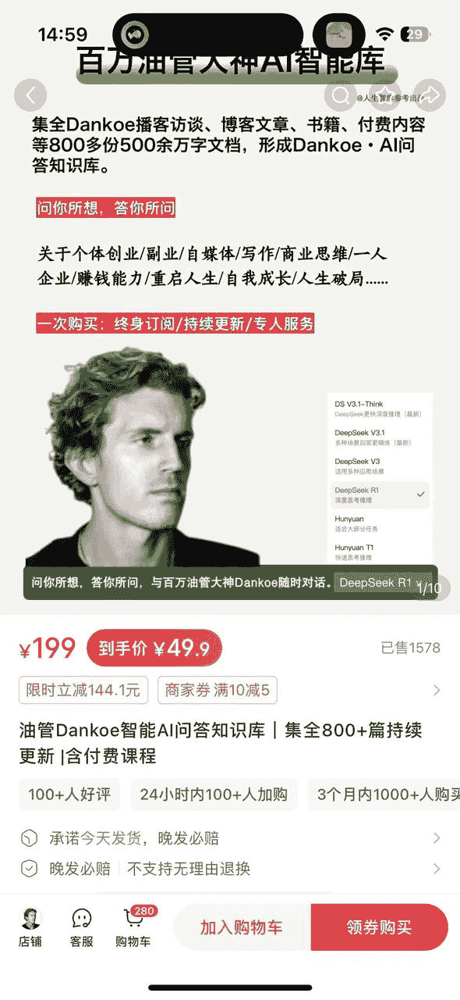

**AI原创虚拟产品不要一键直出**

这是很多人想要做虚拟产品都有的一个认知上的误区，我需要最要纠正的，就是一键直出，一键直出本身就是一个伪命题。

因为一个虚拟产品从0-1的过程中，一定要不断介入，去不断的调试，比如某一个章节的某一个部分写的很有AI味，你就需要去修改，必须要对每一个部分进行精准控制，否则你最后生成的东西根本没有办法用。

一键直出的不可控性太高，所以不能一键直出，AI原创虚拟产品一定要规划工作流，然后对每个部分都有高度的可控性。

千万不要一键直出，AI的应用并不是图省事，而是帮你提效，你要对产品负责，对消费者负责，在产品的制作过程不要偷懒！

## 2.AI原创虚拟产品的3个方向

刚刚提到了用AI原创虚拟产品的误区，现在给大家分享AI原创虚拟产品的3个方向；

### 方向一：个人IP向（经验型虚拟产品）

首先，给经验型虚拟产品一个定义：经验**型虚拟产品是将创作者在某一特**定领域积累的个人经验、隐性知识和独特见解，通过结构化方式转化而成的虚拟产品。

注意，经验型虚拟产品并不是泛泛而谈，一定要切中具体人群的具体需求，把你在某个领域的积累和见解成体系的表达出来。

经验型虚拟产品是针对特定人群的特**定**问题，提供基于个人亲身积累的、系统性的解决方案，通过外化创作者的隐性知识（例如总结避坑经验、提炼个人方法论、识别可复制的成功经验等），从而为购买者带来价值。

举几个常见的场景

**场景一：不可逆性与高风险场景 **

当用户面临的决策一旦做出就难以更改，或者决策失败**将导致严重后果**时，他们愿意付费购买经验来消除不安全感；

这类场景，每个人基本上都会遇到，比如房子装修，比如出国旅游，比如考研考公等等，这些场景都是不可逆性和高风险。

当你第一次去韩国旅游的时候，一定想要有最好的出游体验，虽然📕上有很多韩国旅游攻略，但是📕上的韩国旅游攻略要么就充满软广，要么就碎片化，很难有一个系统的旅游攻略抄作业。

并且旅游攻略这类虚拟产品充满时效性，必须一定要最新的体验，所以这个场景很多人会下单，特别是J人，非常擅长做攻略。

比如📕有一个博主就是因为把去韩国旅游的攻略做深、做透，做成系统化，在📕上卖的很好，卖了将近3000单，虽然每单只卖9.9元，但是也卖了将近3w元。

这就是不可逆性与高风险场景，用小成本换安全感。

**场景二：高金额投入场景**

当决策涉及大额资金投入时，消费者需要内行人的经验和指**导，以避免风**险和损失；在大额投入前，寻找行内人的经验作为参考答案，提前避免“踩坑”。

**场景三：细分的职场场景**

人们愿意为那些能够帮助他们在特定职业或技能领域“升级打怪”、解决实际问题的个人经验付费；

**整体来讲****，经验型虚拟产**品之所以有价值，是因为它们将创作者的隐性知识（如避坑经验、个人方法论、可复制的成功经验）转化为系统化、精准化的外部产品，帮助用户在关键时刻做出更明智的决定或高效掌握新技能。

#### 经验型虚拟产品如何通过A实现

那么，具体怎么通过AI去实现呢？

我刚刚说的以上3个场景，其实每个人或多或少都有自己的经验，但是很多人都很难把自己脑海里的知识和干货逻辑性有结构的表达出来，因为其实大部分人都不具备长文写作能力，也没有办法全部结构化有逻辑输出你的想法。

很多人也想过用AI去写一些原创的虚拟产品，试图把自己的思想、方法论、经验写成一个pdf，但是他们的做法是让AI一次性生成，并没有真正把A I更好的结合一起。

最本质的原因就是AI和你的角色错位了，因为很多人在和ai沟通的时候，都是把ai当作一个超级助手，有明确的任务和你期待完成的内容。

但是假如你想通过ai辅助你生成虚拟产品，并不是说你给一个提示词，ai 就给你一个虚拟产品，这样生成的内容是很难卖出去的。

我推荐一个做法，这个做法也很简单，你不要让Ai给你去生成内容，在这个步骤前，让AI先问你问题，先帮你捋清楚，你到底想写一个什么样的经验型虚拟产品。

就像初中高中写作文的时候，命题作文往往比散文好写，因为给了你一条主线，你就只需要按照它的要求，把内容给写出来就可以了。

而提示词也很简单；比如你可以直接跟AI说：我写做一份装修指南的虚拟产品，在📕这个平台售卖，你能先问我3-5个问题，帮我快速梳理我的优势、经验，以及整个装修指南的大纲和目录吗？

我解释下，为什么我这里只让AI给了 3-5个问题，这个数量并不是一个明确的数字，也可以是10个 20个 ，但是其实大多数人没有耐心回答这么多问题。

而且让AI问这么多问题，AI也很难抓住重点，而只给3-5个问题，AI能够问很重点的问题，帮你捋清楚思路。

这是捋清大纲的部分，当你的大纲有了之后，你就可以去写每一个章节，把你的经验，把你的干货全部呈现；

这种思路就是让AI当你的咨询顾问，让你能够更加清晰的认识自己，这也是苏格拉底提问法，让你自己去找到答案，而不是直接给你一个答案。

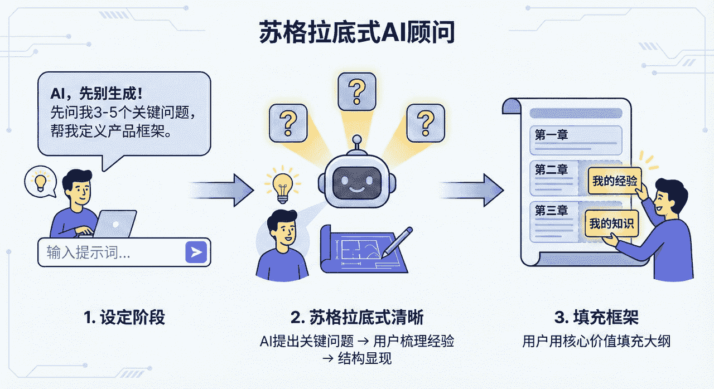

### 方向二：内容策展型虚拟产品

**内容策展型虚拟产品**是通过策展者（即创作者）的**专业筛选和重新组织**既有内容，并严格按照策展者**独特的逻辑、审美或专业判断**，最终创造出具有新价值的虚拟产品。

在于创作者的主观视角和价值判断。即使面对同样的公开信息，不同的人也能基于其独特的视角，整理出具有差异化价值的产品。

策**展者需**要整合来自各种平台（如 YouTube、Reddit、Twitter、播客、文章等）的信息，并用自己的逻辑将某一件事说明白，提供系统性的解决方案

这种产品提供的是**高信噪比**的**内容，信**息密度高，没有废话，能够快速在短时间内帮助用户汲取高密度的干货，从而节省用户的时间。用户购买的实际上是一套解决方案，而非零散的资料。

看过全网几乎所有的内容策展型虚拟产品，我整理了3个方向，以及到底AI该怎么和内容策展型虚拟产品去做一个非常有效的融合。

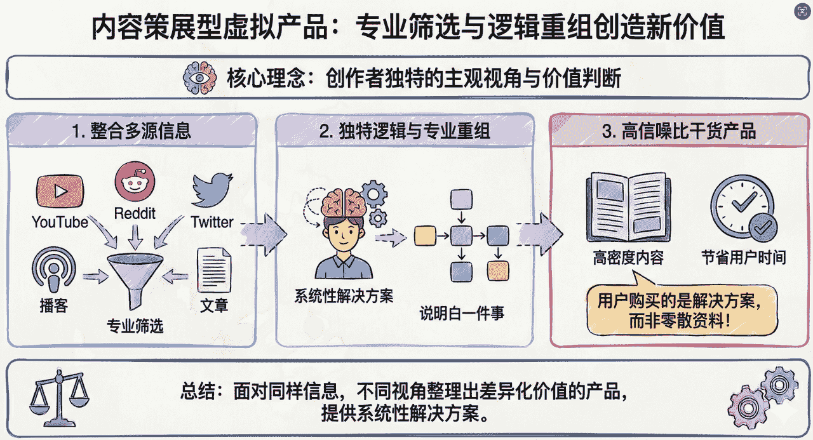

#### 第一种：**工作领域的拓展 (专业知识库)** 聚焦于特定职业或专业技能领域，将复杂的知识、方法论、实践案例进行系统性整理。

每一个行业，每一个细分领域都应该有自己专属的知识库，而有一部分功能是可以交给AI去做的，比如通过AI去塑品。

我举个例子，📕上有一个虚拟产品卖的很好，是英文外企面试高频题库，卖了5000多单，这个题库的优势在于锚定了英文外企面试的这个角度。

而这个产品就是工作领域的内容策展型虚拟产品，并且这个虚拟产品完全可以通过AI去复现。

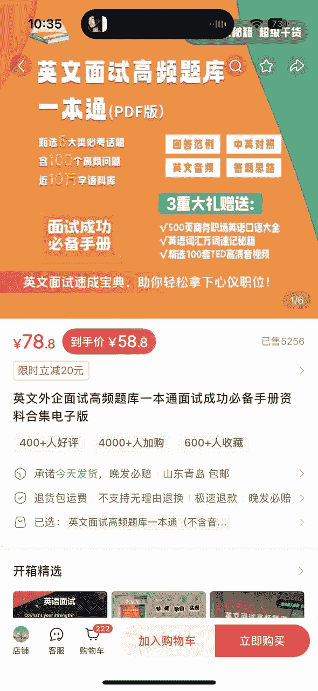

首先，你先要确定这个虚拟产品的组成部分，比如英语面试高频题库一本通这个产品，一定要有英语面试题部分，比如回答思路、回答示例，中文解释等等。

而这些内容都是可以通过youtube去找到的，我要强调下youtube真的很重要，youtube是世界大学，有很多优质的内容，同样针对外企面试，肯定是海外面试官讲的内容是最有干货的。

并且这个产品还有一个优势，在于丰富了这个一本通的内在价值，这也是我最想表达的一点，当所有人都在卷同一个产品的时候，你就需要想怎么做【微创新】，不用大刀阔斧的去创造一个新的产品，而是基于这个产品做一个微创新，同时把这个【微创新】变为卖点，形成笔记。

比如这个产品本身是外企高频面试题题库，但是它解决的不单单是外企的高频面试题，解决的是外企面试的0-1，面试题只是一部分，还有英文音频，语料库等等。

这些都可以在youtube搜索到很垂直的干货，如果想要通过youtube搜索，一定要学会搜索关键词，比如你不能搜外企面试，因为你搜中文，最终给你呈现的就是中文。

你最好用英文搜，但是很多同学用英文搜，也不知道搜什么关键词，这个时候你就可以问AI，一切你的卡点都要交给AI。

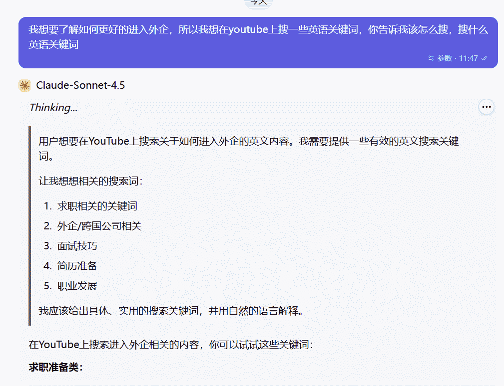

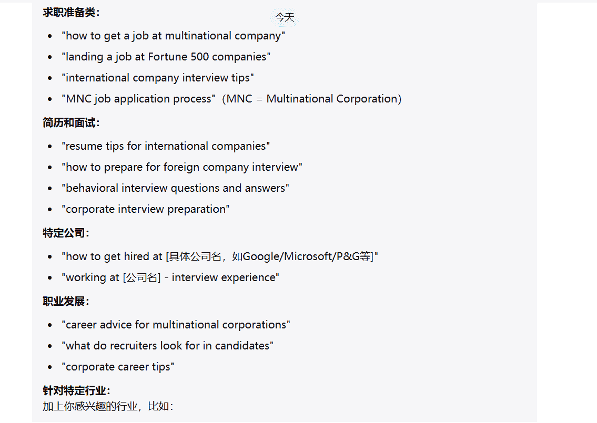

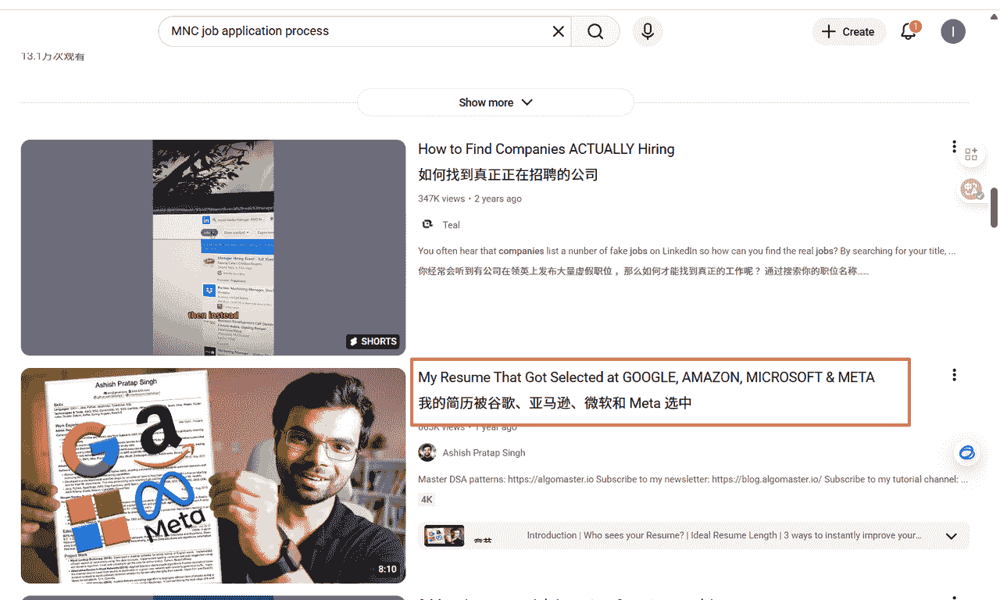

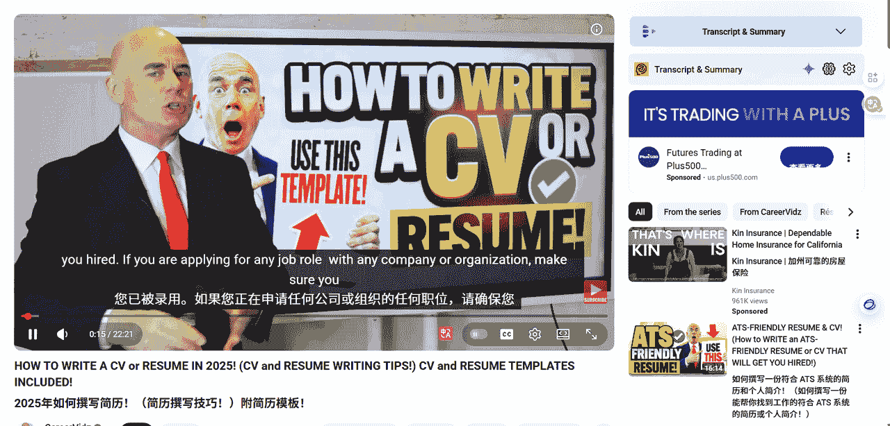

当你有了信息源后，最简单的方法就是把youtube上关于外企求职的内容全部分门别类整理下来，形成知识库；

当然，你不知道怎么做一个外企求职知识库，也可以去问AI，去和AI碰撞你的想法，很多圈友都会问我具体的提示词，其实提示词并不重要。

因为AI真正有价值的回答和答案，并不是说你给一个很长很复杂的答案，AI给你一个直接切中你需求的答案，而是你要反复追问AI，多次迭代形成的。

所以，不要有提示词压力，只需要清晰的向Ai传递你的想法和需求，AI给你反馈，最后你跟AI不断碰撞后，得到的想法和回复含金量是最高的。

当你有了信源，知识库的目录和框架，接下来你就可以通过AI去翻译，去重新整理素材，形成你自己的东西。

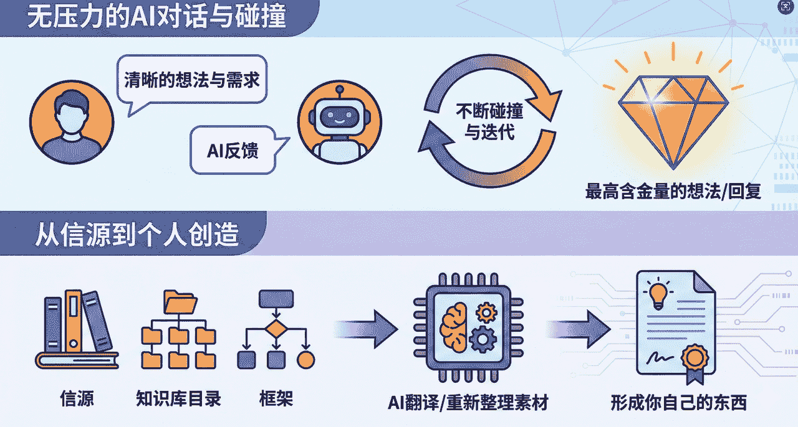

#### 第二种：**语言领域的学习 (学习教程)**

专注于语言学习的细分场景，因为**“学英语是东亚人一辈子的课题”**。利用多语言资源进行整合和提炼。

对于普通人来讲，通过在📕学英语是一个很大的生意模式，很多博主通过售卖英语相关的知识库一年可以赚到100w以上，学英语一直一直都是东亚人的一辈子课题。

而youtube一直都是非常优质的信息源，当然除了英语，还有韩语/日语等等，都在📕上很有市场。

但是针对语言英语的知识库，不能做一个大而全，一定要精准，一定要具体，一定要有明确的场景/人群导向，比如你可以针对口语做一个口语油管知识库，也可以做一个写作知识库。

而不是做一个英语学习知识库。

比如，📕有一个英语知识库，专门是做财务相关英语内容整理的，包括播客和优质信息源，卖的也很不错。

**核心就是你需要把散落在各个平台关于某一个确定主题的内容**全部整合到一起，做出一个全新的产品出来。

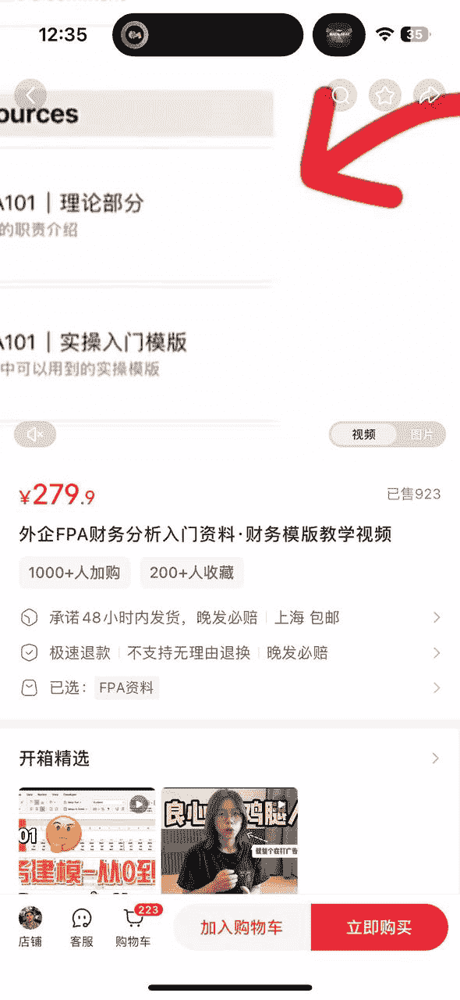

### 方向三：**人物 IP 策展 (思想集纳)**

聚焦于某一特定领域有影响力的个人或博主的深度内容，对其思想进行系统性汇编、翻译或解读。

这个内容策展型虚拟产品的做法就很简单，也是翻译和整理，只不过是更加的聚焦，比如聚焦在一个人的所有公开内容整理，纳瓦尔、DANKOE等等，在📕上已经有很多人都是做他们的知识库。

做法也很简单，就是通过AI翻译youtube逐字稿，形成知识库。

还有一种做法，是针对某一视频长播客进行深度翻译和整理，但是这个视频播客的时长一定要拉满，比如2个半小时或者3个小时以上。

因为时长才是信息量的保证，📕有一个博主的一个虚拟产品只是把纳瓦尔的最新访谈全部整理出来，卖了1000多单，这个视频播客是纳瓦尔参加的一档节目，时长大概3个小时左右。

在这里提供一个小小的思路，

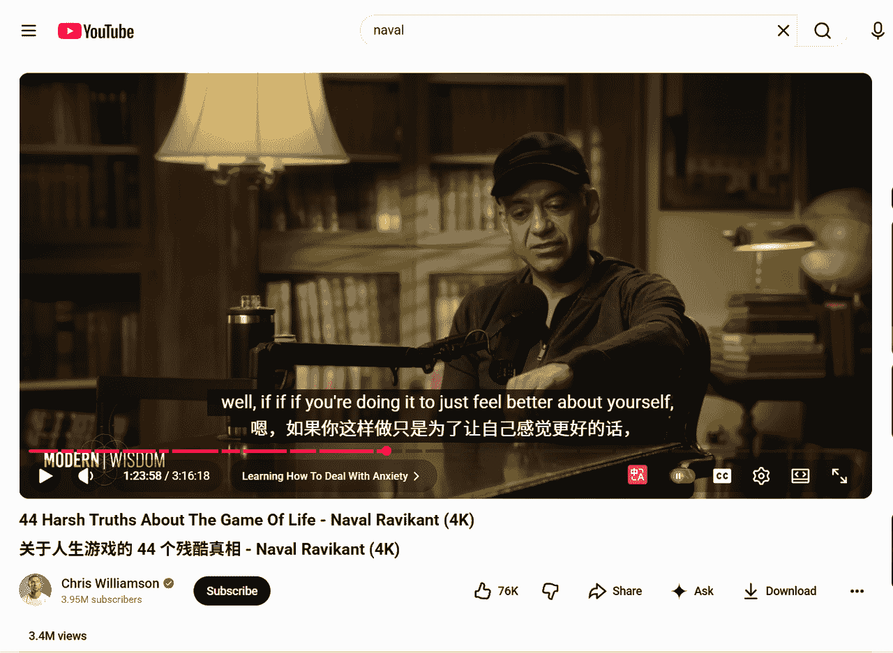

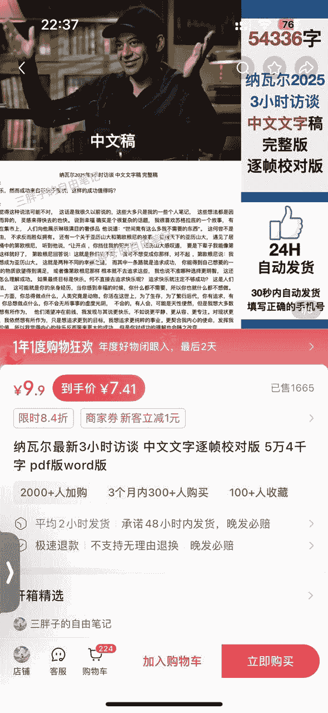

而AI的作用就是翻译，并且提供新的叙述角度，因为当每个人都是在做翻译的时候，你的核心竞争力胜负手是什么？

读者其实并不都是希望看到逐字稿，而是希望看到一些你整理出来的新东西，或者说一些能够落地的东西，比如当读者看完这篇逐字稿后，想要有一个实操性的指南。

你就可以让AI根据这个视频去整理一个实操指南，从而和其他同行拉开核心竞争力。

那么具体怎么通过AI去实现呢？

第一步，你通过AI去翻译一些优质博主的内容，这是这个博主虚拟产品的基本盘；

第二步，是基于这个翻译去做一些创新，比如生成PPT，或者是行动清单，再或者是成长练习题

第二步的目的是让你的整个虚拟产品变得更有核心竞争力，因为第一步每个人都可以去做，包括现在📕上有很多同样类型的虚拟产品，你就需要思考怎么去做创新。

我举个例子，比如现在所有人都在卖DANKOE的人物IP策展知识库，销量都还不错，要是你该怎么创新？

我这里推荐一个网站，叫做notebooklm

notebooklm是你做虚拟产品的一个非常好用的工具，并且现在很少有人能看到完整的方法论，具体怎么做呢？

第一个功能，是notebooklm的PPT功能

这个功能非常强大，背后是gemini的nano banana pro的图像生成能力支撑，我们还是拿DAN KOE的个人策展类虚拟产品举例。

PS：DANKOE是一位在📕很知名的一人公司、超级个体youtube博主，有110w粉丝，而他的内容在📕也很受欢迎，同时也有的商家把他的youtube视频翻译成中文，整合成知识库在📕销售。

到底怎么做呢？

做法也很简单，直接把youtube视频链接导入到notebooklm，然后按照你的诉求生成PPT就可以了。

这里要注意！一个youtube视频的PPT很难形成有卖点的核心竞争力，量太少了，但是一个系列的主题性PPT是可以形成核心竞争力的。

比如DANKOE的一人公司系列视频，这个主题有50个视频，那么你只需要把这37个视频，每一个都生成PPT，你的核心竞争力就建立了。

有一说一，notebooklm的PPT生成功能还是太强大了。

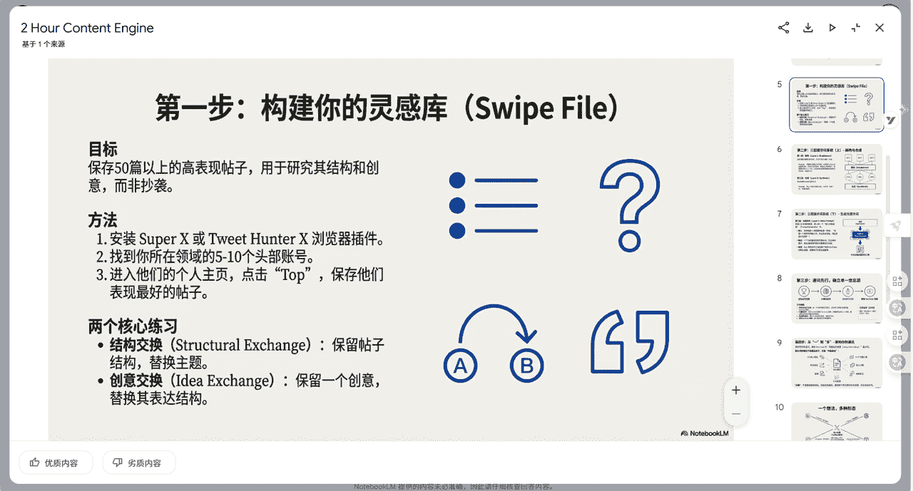

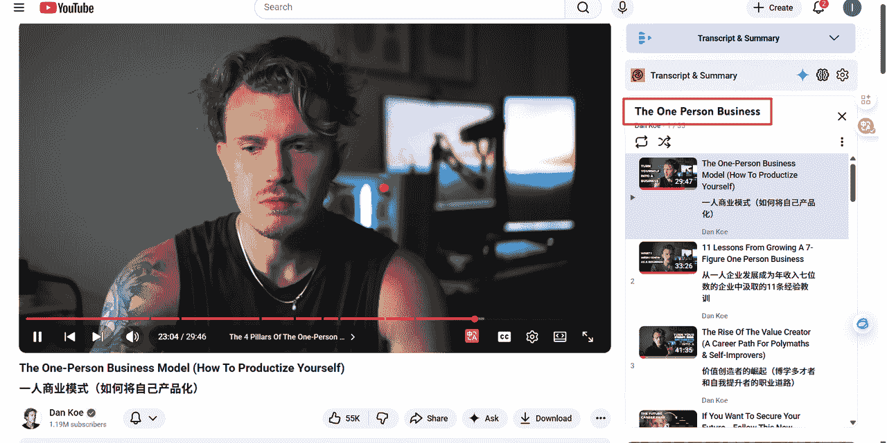

### 方向四：课件+PPT+模板赛道

我认为如果你能够用上Notebooklm或者Nano Banana pro，一定要切入的一个赛道就是课件赛道，因为Notebooklm和Nano Banana pro已经解决了大多数人写不好提示词的问题。

因为Nano Banana pro内部其实内置了一个理解能力很强的设计师，你只需要用自然语言描述你的需求，它就能够理解你的意思，你如果对第一版不满意，直接在同一个窗口让它改也可以，非常好用，并且给你的结果往往都会超出你的预期。

那么，为什么你有了Notebooklm和Nano Banana pro就可以攻克了课件+PPT+模板赛道呢？

很多人都存在一个误区，先否定了自己，认为自己没有足够丰富的经验没有办法去做教师课件PPT这个赛道，这很正常，因为它确实有一定的门槛。

但是，教师课件PPT赛道也存在很多细分的场景，并不是别人做什么你也要做什么，大多数人的卡点都认为我想要做一个课件型的虚拟产品，就必须要做很多PPT，准备很多东西，还要回答老师很多问题，还没有做，先把自己否定了。

其实课件赛道并不是这样的，分享一个快速上架的技巧，挑那些一个PPT就可以成为一个虚拟产品的场景，比如各种主题班会、家长会、期末考试成绩分析会、开学第一课等等，这些场景都很单一，也不涉及太多专业的知识，并且你可以直接通过notebooklm去做课件。

而且主题班会PPT还可以结合热点来做，因为主题班会的受众大概都是小学生和幼儿园的小朋友群体，所以去做一些动漫主题的班会PPT是能够出单的。

每年会有两个电影档，一个是春节档，一个是暑期档，而在这两个热门档期内，刚好对应着两个开学季，一个是春季开学，一个是秋季开学，比如今年有两个主题的开学第一课卖的特别好，分别是哪吒主题和浪浪山主题。

**那**么，你如果2026年想过要做课件这个赛道，就可以去看今年会有什么IP性质的动漫上映，然后去做这个主题的开学第一课就可以了。

这就是借势的思路，并且现在有了AI，做一个课件不是什么难事。

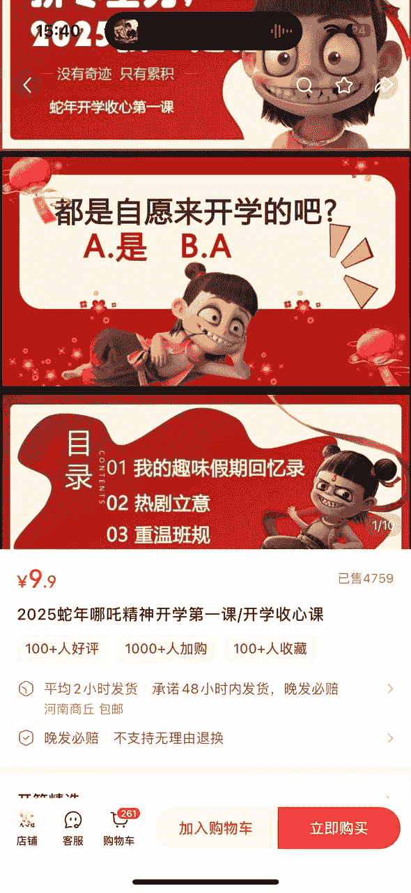

但是用Notebooklm生成PPT有问题：

+   生成的PPT不可编辑

+   只能生成13-25页的PPT

+   对单张图的效果不可控

如果有人要求40页、50页PPT怎么办？Notebook LM做不了。

所以我们要重新思考底层逻辑

Notebook LM的底层逻辑是什么？就是用Nano Banana pro生成一张又一张的图片放在一起。

那我们是不是可以直接用nano banana pro去做单张图片，把它们整合到一起就成为一个PPT了？

这就是我们做PPT的新原则。我们不要再说PPT必须要写字、要怎样怎样，而是要重新思考：当今的AI工具能帮助我们怎么做。

问题来了：我们用nano  Banana Pro做PPT，怎么开始写提示词？每页的提示词、每页的内容怎么写？

答案：用AI写！

我们为什么要自己写呢？我们现在有了AI，为什么要自己写？

> 提示词如下：

>

> 你是一个专业的PPT图片提示词生成专家。用户会给你一个简单的PPT需求描述，你需要：

>

> 理解用户需求，推断合适的PPT页面数量和内容结构

> 为每一页生成简洁、一致的图片生成提示词

> 保持风格一致性：所有页面使用统一的视觉风格、配色方案和设计语言

> 提示词应简洁明了，包含：

> 统一的视觉风格和配色

> 页面布局和元素描述

> 文案内容（标题、正文要点）

> 输出格式必须为：

> ---第1页---

> [提示词内容]

>

> ---第2页---

> [提示词内容]

>

> 用户需求：

>

> 请根据以上需求，智能生成完整的PPT提示词。

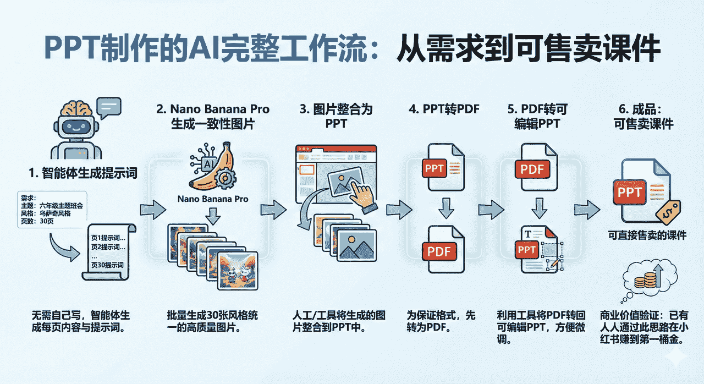

除了课件外，一切基于图片展现形式的虚拟产品都可以用nano banana pro去做，还是那句话，一个场景就是一个虚拟产品，你只需要满足消费者当下的购物场景就可以。

这个时候，你会发现用nano banana pro做虚拟产品真的就像呼吸一样简单，比如期末考试模板，就可以用nano banana pro做背景图。

因为一个场景，就是一个虚拟产品，你就可以用nano banana pro直接出图，没有什么复杂的提示词技巧，就可以完美复刻目前在📕出单的虚拟产品。

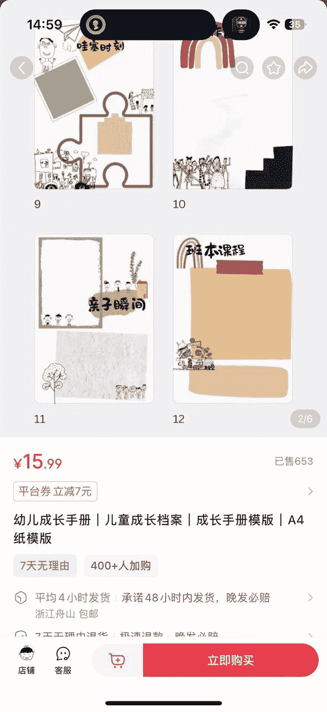

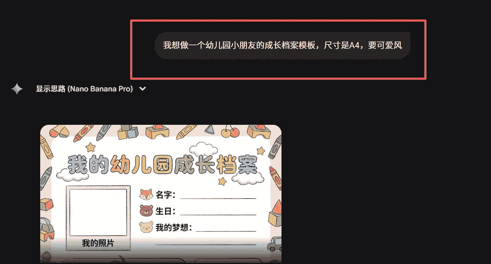

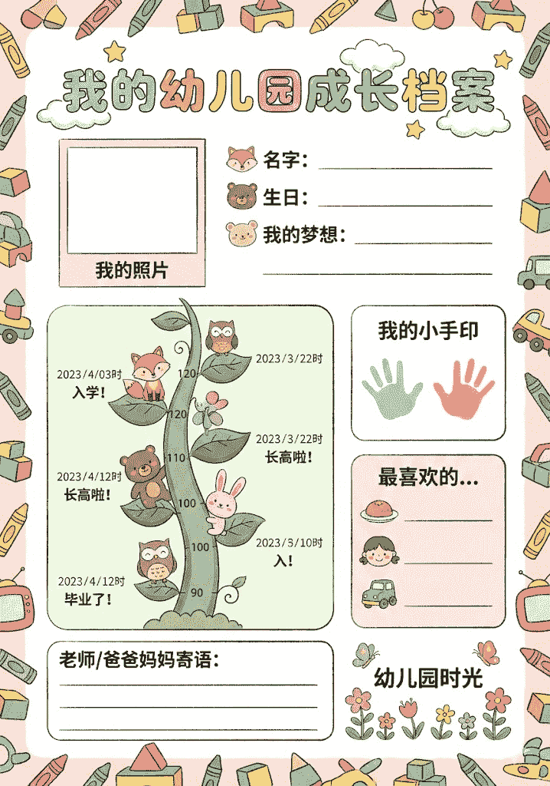

很简单的提示词就可以直接复刻上图的效果，所以如果你想要用好nano banana pro，就不要卷提示词，不要追求提示词技巧，只需要说清楚你想要什么就可以。

##  3.AI的使用技巧和推荐

### 01 Notebooklm

首先介绍下notebooklm，其实notebooklm是谷歌 开发的 AI 驱动的研究和写作助手，它的核心功能是扎根于自己上传的资料。

简单来说，您先上传您的来源材料（例如 PDF、Google 文档、文本文件，甚至网站链接），然后 NotebookLM 就会成为一个只针对这些材料的“专家”。你可以向它提问、要求它总结、让它生成大纲或构思新想法，而它的所有回答都将完全基于您提供的资料库。

并且NotebookLM还可以直接直接读取youtube链接，这对于大多数博主来讲是非常非常有用的一个功能，毕竟两个网站都是一家公司，彻底打通，AI生态。

NotebookLM的优势也显而易见了，就是不会有幻觉，一切生成的内容都是来源于你上传的素材，所以这对于自媒体博主非常友好。

Notebooklm怎么和虚拟产品结合？

很多人纳闷，notebooklm就是一个学习工具（大多数人的视角），怎么可以做虚拟产品呢？

这就是看待事物的角度不同。

换一个角度讲，notebooklm和youtube完美结合，其实是可以通过notebooklm按照你的思路去重新组织youtube的信息，这不就是内容策展的思路吗，最后你整合成一个只属于你的虚拟产品，这个虚拟产品有你的思想和组织，它本身也是原创虚拟产品。

就像面对同样的食材，厨师可以采用不同的烹饪方法一样，可以创造不同的菜肴，notebooklm也是同样的逻辑，去把你的想法和创意实践。

另外，notebooklm的优势是可以一次性最多同时针对300个youtube视频进行处理，也就是说你的内容基础素材库是足够丰富的，你可以完全组织优质的信息源形成虚拟产品。

另外，notebooklm还有一个非常非常好用的功能，就是你可以根据你的特定需求，去直接做一个指南出来，所以你想要做什么都可以去让它生成。

这是不是也已直接构成一个虚拟产品的demo?

当然，第一次生成的可能不满意，你可以让它多维度生成，也可以结合你生成的报告加上你的思路去重新整合，最终形成一份虚拟产品。

但是这里要注意，我建议虚拟产品不要只是完全照搬notebooklm生成的东西，因为没有办法直接用，毕竟AI生成的东西有很多AI味。

自己还是要做一个二次整理，并且要加入配图，排好版，不要让别人觉得你这个是纯AI生成的，毕竟消费者是花钱的，体验感还是要拉满的。

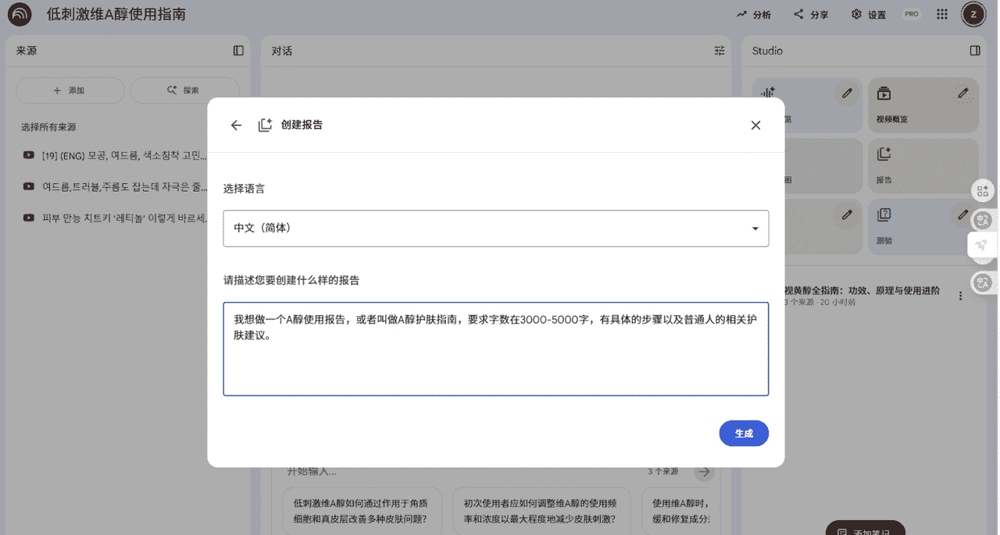

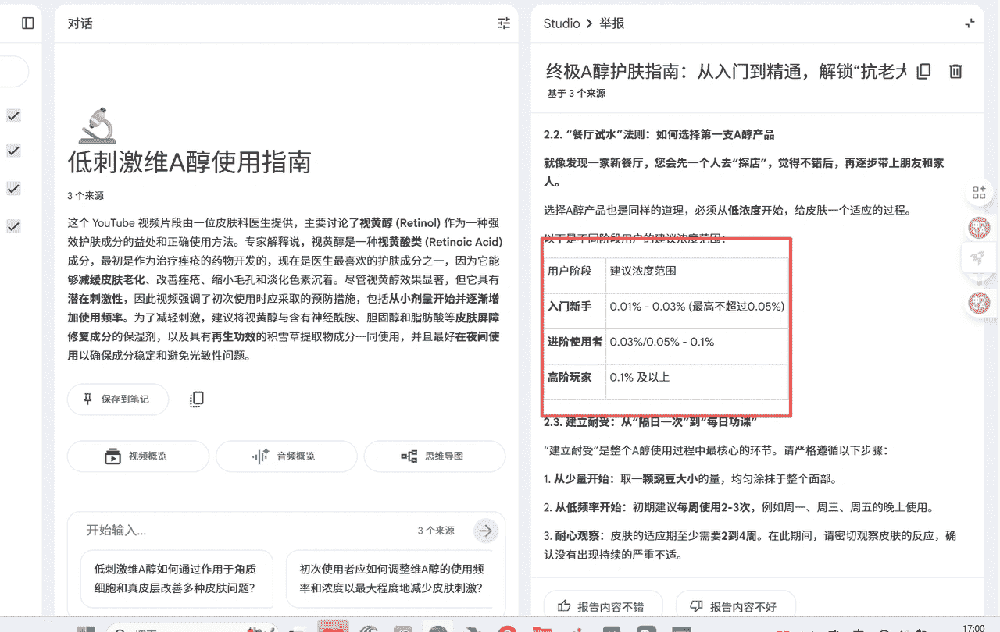

除此之外，还有一个隐藏玩法。

就是可以把notebooklm生成的虚拟产品当作钩子，直接在📕上传，帮你涨粉，因为📕用户天生是对干货有天然的喜爱，或者说成瘾。

所以，你如果是客资行业，也可以去通过notebooklm+youtube快速制作虚拟产品，去帮助你涨粉引流客资。

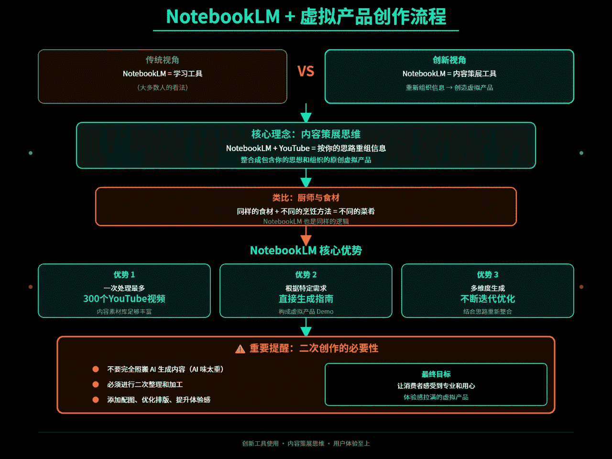

### 02 WPS在线版

这个工具是一个很宝藏的工具，针对的是教师场景，如果你要做教师类虚拟产品，一定要用好WPS在线版，特别是现在学校都再强调AI赋能教学PPT

这里就有一个很关键的部分——课堂互动

而现在AI是能够生成很多互动小游戏的，以及一些辅助教学的网页，只不过这些网页html只能本地运行，WPS在线版的优势是能够把这些html代码融入到PPT里。

从而达成了html和PPT的完美融合。

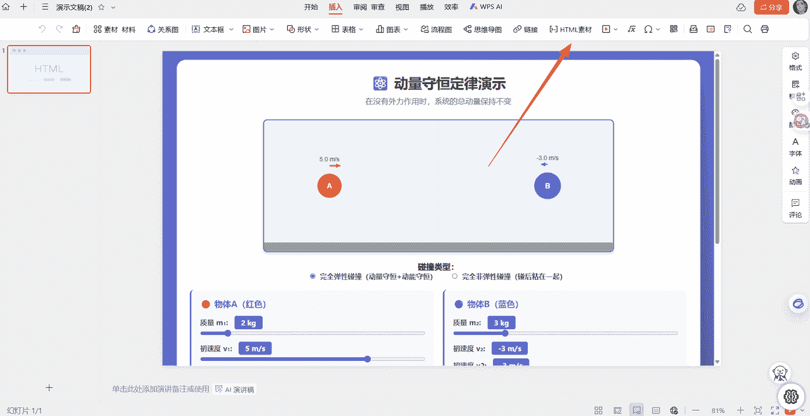

**工作流：**

第一步：用deepseek或者其他AI大模型（任何AI都可以）生成你想要的游戏互动或者一些原理展示

第二步复制html源代码

第三步插入到在线WPS

为什么我强调WPS在线版很重要呢？

因为现在AI趋势特别火，在教学场景上也有很广泛的场景，其中一个场景就是AI赋能教学PPT；

每个大模型都有不错的代码能力，可以通过代码实现你的教学想法，以及一些课堂概念的展示，比如这个商家就是在卖一些教学场景的相关工具，卖了将近1w单。

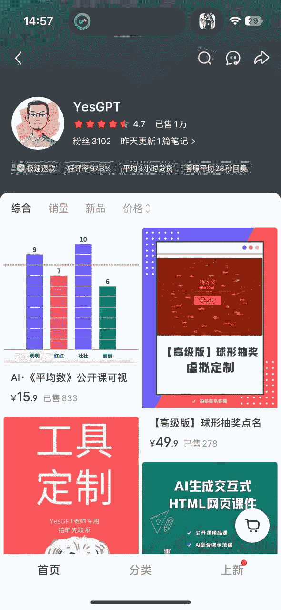

### 03 nano banana pro

我要分享一下，nano banana pro 是一个很优秀的图像生成大模型，这个大模型的优势不止是生成好看的图片，更深层次的意义是对生产力的革新，它彻底改变了一些工作流；

它对于我们最大的优势就是中文文字不会再乱码，而且字体的样式也很多；

那么，该如何正确正确使用nano banana pro 呢？

我认为最重要的一点就是忘掉提示词，nano banana pro的优势就是对自然语言的理解，你只需要描述你的需求就可以，不用很长的提示词，它直接就能给你一个很优质的图片，而且还能有意外之喜。

那么到底怎么通过nano banana pro 去做虚拟产品呢？

因为nano banana pro 出色的文字表现能力和设计美感，其实对于📕虚拟产品这个赛道有很大的价值，并且已经有很多人通过nano banana pro在📕出单了。

这个赛道就是课件ppt赛道，很多人有疑问，为什么nano banana和ppt能联系到一起？

因为我们要学会去转换角度看问题，ppt的本质其实就是一张一张图片的集合，并且notebooklm生成ppt的功能，背后就是nano banana大模型生成的一张一张图片，但是因为有页数的限制，并不能帮你一次性生成页数很多的ppt，但是nano banana不一样，你生成多少张图片都可以，并且你还可以对每张图片的生成质量进行可控。

当你生成了足够多页数的ppt后，你只需要把这些图片倒入一个空白的ppt模版就可以，如果你想要可以编辑的ppt，你还需要一个

很多同学还担心一个没有办法编辑的问题，这个问题也可以解决，因为虽然你最终导出的也是PPT，但是这个PPT是没有办法二次编辑的，因为生成的是图片PPT。

所以，目前来讲最优解就是先把图片PPT转成PDF，然后再把这个PDF转成可以编辑的PPT，这一步用到了WPS，你需要开会员才能使用这个功能。

目前来讲，这个功能并不是最佳解决方案，因为转为可以编辑的PPT，可能字体丢失或者图像相关元素变形，不过这个解决方案，已经能解决80%的问题。

### 04 提示技巧

AI原创虚拟产品，很多人都会问我提示词，想问我要具体的提示词，这是一种抄答案的思维，我也能理解，但是我想说的是，如何大模型已经足够聪明，聪明意味着没有所谓的提示词技巧。

而且现在回答的精准度和提示词的关系并不是很大，因为你没有办法第一次就得到满意的答案，本质上和AI沟通是一个“打羽毛球”过程，你想要获得一个比较优质的结果，想要进入心流，一定要和AI进行多次对话，每一次迭代后，才能给你一个满意的结果。

没有一劳永逸的提示词，你只需要去描述清楚你的问题和需求，以及期待AI给到的回复就可以。

另外，分享两个我经常用的提示词技巧，分别是few shot和 one shot

很多同学都说自己用AI写的文案有AI味，其实本质上是没有给AI一个参考，你和AI没有一个共识，如果你给AI一个参考，那么AI就能够理解你到底想要什么。

在提示词技巧中，参考就是样本，而根据我的经验，样本数量的不同其实应用的场景也不同，我的做法是，如果是标题仿写的话，采用是的是few shot，因为few shot的本质是提供一些优质的样本范例，而且字数较少，也可以方便总结规律，输出效果比较稳定。

而one shot则是严格的仿写，我的场景是📕笔记正文的仿写，因为它能够保证严格参考你给的内容格式进行仿写，不会失真。

因为📕笔记的正文字数太多了，所以你不能给ai 太多参考，一定给ai 太多参考，ai 就很难聚焦在写作上，最后写的四不像。

one shot的具体场景之一，就是当你有了爆文之后，可以直接用Ai 批量仿写爆文，快速抢占流量。

所以，总结一下

对于标题仿写，用few shot 少样本提示，提供给ai3-5个样本，以及你想要仿写的主题进行仿写；

对于📕正文仿写，采用one shot 单样本提示，提供给ai 一个样本，直接批量复制你的爆款笔记，快速拿到结果。

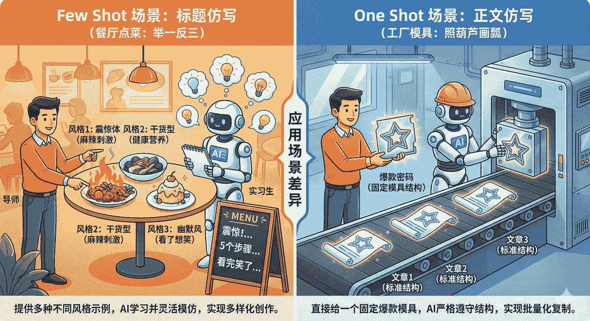

### 05 如何规划自己的工作流

用好ai 一定要规划好工作流，在ai 原创📕虚拟产品这个板块，工作流是思考，如何在合适的节点，用恰当的ai去帮你快速做出一个有价值的虚拟产品。

根据我的经验，ai 原创虚拟产品整个工作流，目的不是你花里胡哨的使用ai,而是要聚焦在整体业务目标的实现。

所以，用ai 规划你的工作流，并不是每个环节都要使用ai 。

我举个例子

比如你要把YouTube视频变成文字稿，整理成知识库，很多人的传统工作流首先先把视频下载下来，再去用一些软件，比如飞书妙计进行翻译，这个过程非常非常慢。

当你的工作流中某一个节点出现了一些卡点，你首先应该去寻找市场上有没有合适的工具，现成好用的解决方案，而不是一切都靠ai，那么你优化后的工作流是不是可以先把YouTube的字幕下载，然后再去用ai 翻译呢？

这个工作流可以快速的帮你提效，所以我整个YouTube知识库的制作过程并没有全部用到ai，而是在不同的场景选择合适的工具。

这就是工作流规划的重要性，工作流规划没有最优解，因为ai的能力在进化，你需要做的就是不断优化。

工作流并不是你要去搭建一个coze工作流，也不是要搭建一个N8N，而是在合适的节点选择合适的AI工具，去帮你完成业务目标，业务目标是关键，不要陷入技术崇拜和华丽工作流的追求。