# 【自学能力培养】14分钟可采集4000条抖音对标爆款作品，小白0代码基础全自动收集对标账号的爆款数据

> 来源：[https://xuqiwei1986.feishu.cn/docx/ShpodkohWoqyKaxje0qctEBsnXf](https://xuqiwei1986.feishu.cn/docx/ShpodkohWoqyKaxje0qctEBsnXf)

作为一个互联网人，对标账号的爆款作品采集工作几乎是贯穿工作始终，之前苦于没有好的方法采集，全部都是手动复制链接，30分钟也就能抓个100来个爆款链接，

而现在用这个机器人，居然能够在14分钟左右采集近4000条对标的爆款作品全数据，甚至如果工作需求大，可以让机器人全天候工作，把我们的双手解放出来去做其他更重要的工作，大大解放人力

数据采集这种基础又重复的工作，最好还是让机器人去进行完成，因为人工去采集的话，做着做着可能又刷手机了，耽误效率又废精力，而用机器人，则是又快又准确。

大家好，我是小徐，也是这篇文章的主人公

`https://wx.zsxq.com/group/1824528822/topic/1524485542182122`

24年是做抖音男装直播，每个月佣金有10w左右，算是中下腰部达人

25年看到ai赋能矩阵短视频的恐怖之处，虽然自己对代码没有一点基础，但还是决定转型all in，不会的就学，无论会遇到多硬的骨头，我都会啃下来的

世上无难事只怕有心人。

自己一直在学习和实践，目前算是小有反馈，走了一些弯路，也遇到诸多卡点和工具需要学会使用

其中我发现有一个很基础同时很关键的功能就是，对标数据获取，这是一个很简单很基础，同时又很重要的事情，同时各个行业都很需要。做抖音的要抓抖音，做闲鱼的想抓闲鱼对标，做📕的也需要抓📕呀。

我研究了一下，有一些心得，决定分享给圈友，特别是针对和我一样的对代码不懂的小白圈友，很多人说我自学能力很强，其实我平时就有刻意的关注学习能力的提升，特别是李笑来老师写的《自学是门手艺》这本书，我更是看了无数遍，虽然没去实际学代码，但是在其他项目上运用并且实践了大量自学技巧，收获颇丰。

很多自学技巧，在这篇文章里也会大篇幅进行分享

所以你可以把这篇文章，当成一个自学能力的小指南，特别是在这个ai的黄金时代下————如何通过ai，教会自己很多实际的项目，并且用ai解决卡点。

这篇文章清晰的划分成两部分，第一部分是工作流，以及细节，方便着急用的圈友直接复制和搭建，第二部分我会以这个例子作为自学能力的一个讲解，把遇到卡点，如何用一个相对通用的解法去解决

## 工作流及其效果演示

进入正题了

既然我们需要抓取数据，那就要找一个成本低，快速，高效的方法，我就搜相关内容，找到了很多精准教程，

特别是这两篇文章，写的非常好

1. [全流程：使用影刀RPA实现自动化数据采集，heygen注册、内容生产、数字人制作与平台分发](https://ia0969wpr2.feishu.cn/docx/CUMNdRxLloAFv8xLvDbcEA0anFf)
2. [《如何通过影刀RPA提升抖音图文10倍跟款的效率》@Leeka ](https://ktuszl372b.feishu.cn/docx/BgxOdsgqNom98UxMctVcJHbunrb)

我在他们的基础之上做了针对我自己对抖音的需求的进行一个优化

接下来我们讲原理，原理如下图

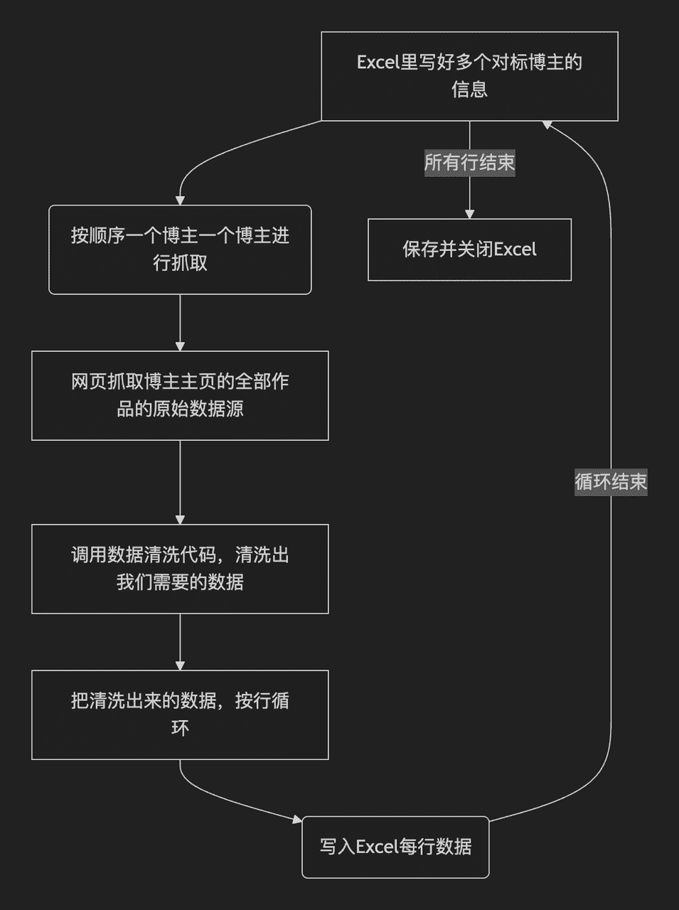

### 原理是这样的

先把对标信息手动抄在表格里

（为什么要手抄，是因为对标账号我们还是要人工去判断一下是否是我们应该对标的优质账号，所以这一步还是尽量不要偷懒。）

然后选择一下要提取哪行到哪行的数据，比如2-16行，之后再加新的就是17-20，这样子可以方便管理和新增新的博主和对标，后续新增对标账号，也不会把之前的重复抓取了

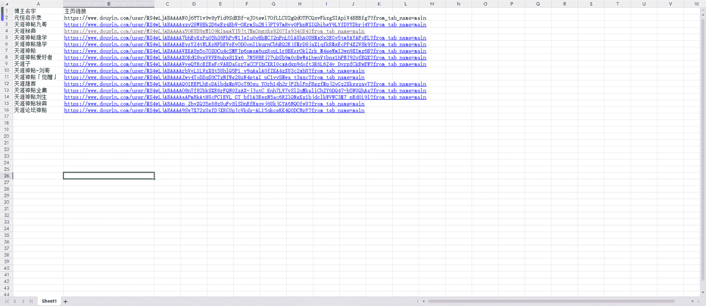

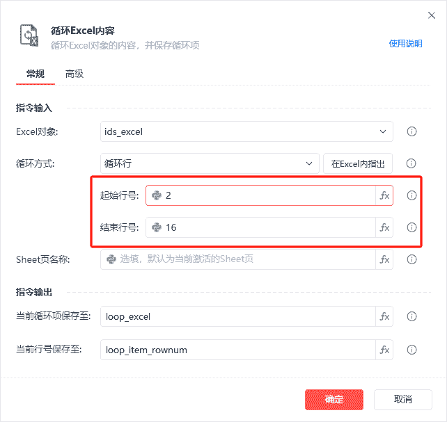

洗出来大概数据是这样子的，以天涯神帖举例子

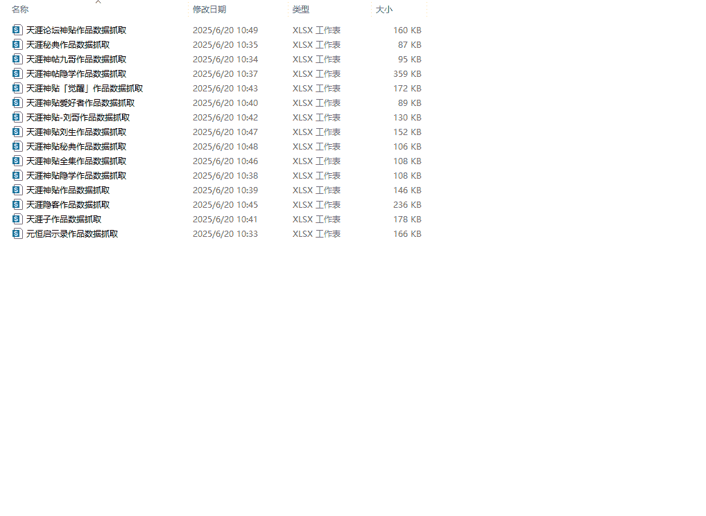

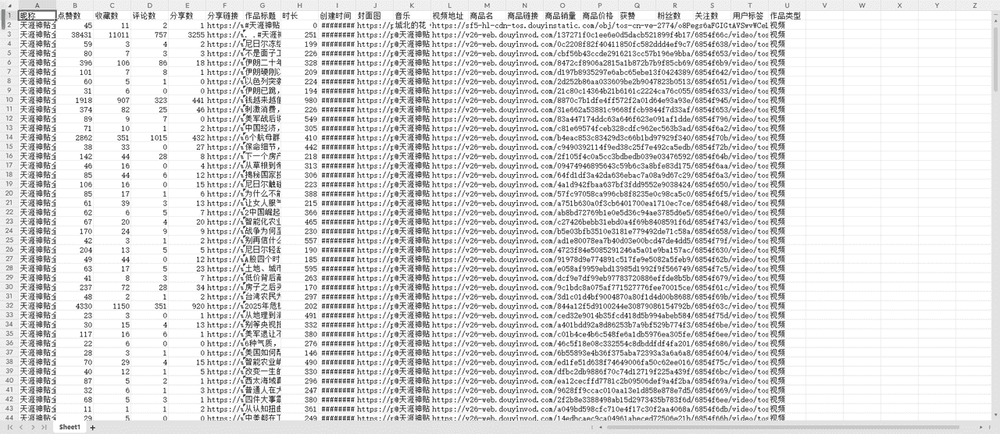

可以看到，效果非常好，按每个账号进行了单独的文件夹存放，而且数据源很全，只要是公开我们能看到的，基本上都能抓得到

抓取了接近4000条作品数据，用时差不多10来分钟，很快的

ok，效果展示好了，接下来再给大家贴上我的工作流源码，并且一步一步教各位哪个点位可能卡点，哪里是关键要点，我自己在学习影刀的时候，发现大多数圈友的教程都是只贴一个源码，然后让小白去看官方教程，这些对于有基础的人来说，一看就懂

但是我自己是6月份才接触影刀，当时是真看不懂，后面研究了好一段时间才入门

不是说人家不好，而是作为小白来说，我有所经历过的痛，所以这篇文章我想定位的是小白人群，以前从未接触过影刀的人群，跟着我的节奏，我们来一步一步的做一个抓取数据的小机器人

### 开始实操

#### 下载影刀

首先下载影刀，然后注册影刀，这个应该比较简单

然后我们点这里

进入机器人搭建页面

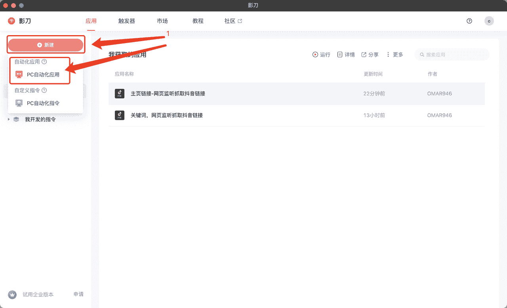

我先给大家我的源码

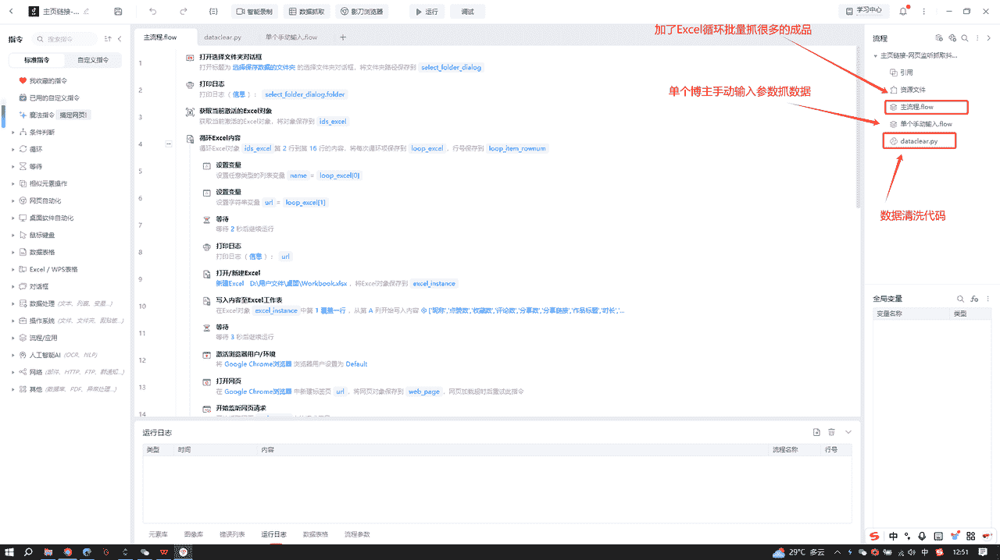

这张图给大家看整体结构，整个数据抓取，我设计的是三部分，首先单流程，这个是我需要先跑通单个博主的流程，然后才能用Excel去循环批量，然后是数据清洗代码，很多人不告诉你网页监听出来的数据需要清洗，所以很多人很怕这一步

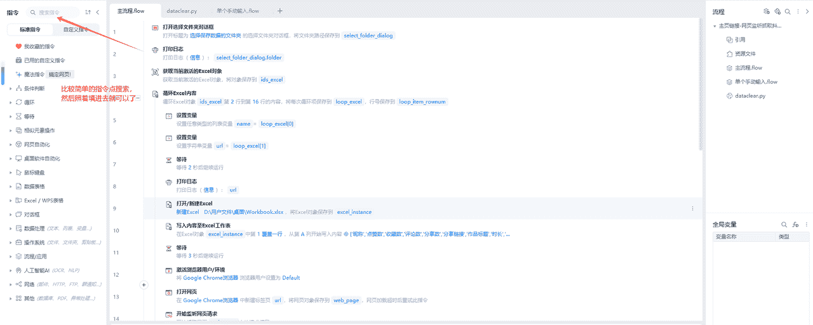

然后这个因为是针对小白的，我再补充一点，之后看着源码对着操作，需要搜哪个积木块，就在这个搜关键词就可以了，然后拖拽就好

好了，这个是我的主流程，可以单独成型的，也就是输入Excel里面很多博主的名字，会自动一个一个循环抓取，这个机器人的源码

ok，下面这个界面是我单个抓取博主的机器人流程，也是我一开始做的页面，先把干净的源码放这里，然后我细致的一个个讲解

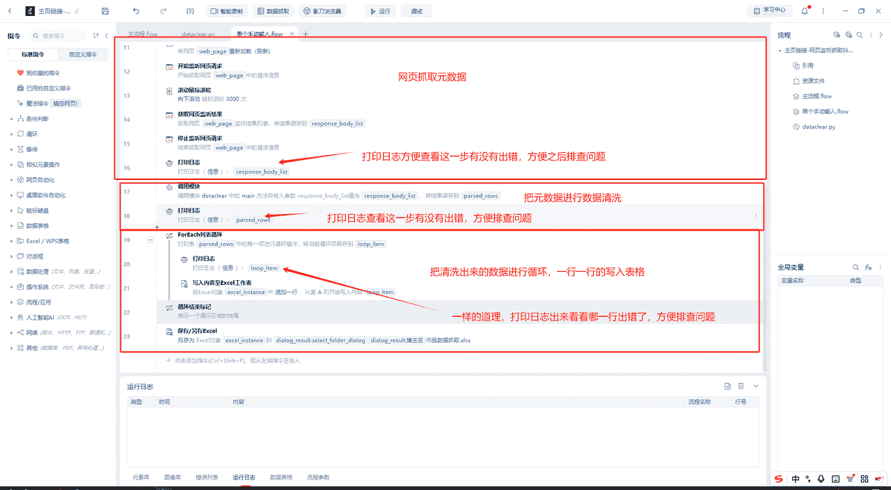

这个是我单个操作页面的，上面的主流程，不需要下面这个单个抓取，也能自己批量抓取，但是我把单个抓取的源码列出来，是希望大家从小做起，任何一个编程，或者机器人，都不要想着一步到位，这也是自学的关键

好，现在给你们讲一下原理

从图中我们可以看出，分为几大模块

1. 手动填写博主链接
2. 新建数据表头
3. 打开网页并且抓取元数据
4. 对元数据进行代码清洗
5. 循环每一行写入表格

接下来我们按顺序，从这五个模块慢慢讲细节要点，同时插入自学的技巧以及遇到难点我们是如何解决问题的（比如，网页监听不知道用哪个网址如何解决，比如代码数据清洗，我们应该如何解决）

#### 1、手动填写博主链接

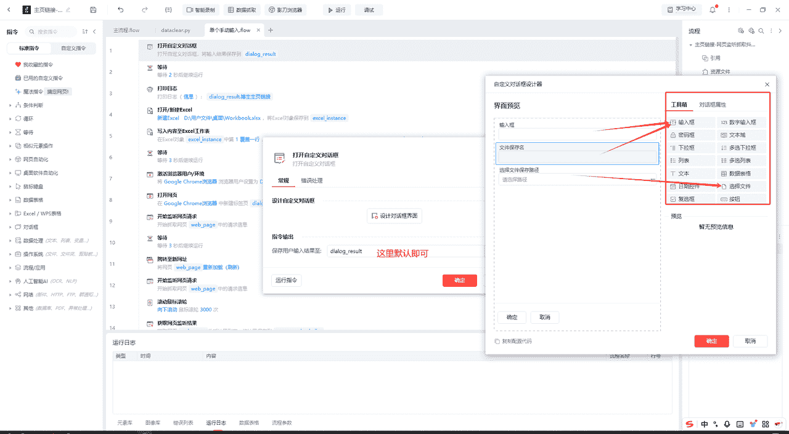

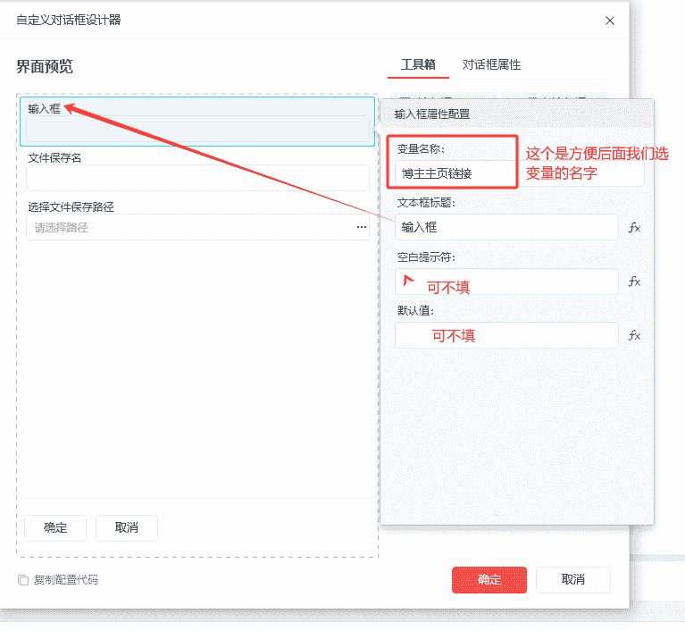

这里，头两个我们选择的是文本输入框，第一个填博主链接，第二个可以填博主的名字（方便后期保存Excel的时候区分好），第三个就是选择文件夹路径，也就是Excel的保存路径

我们第一步需要把这三个变量先输入进去，然后后面才能调用这些变量

然后我们需要验证一下，我们第一步有没有做对，所有我们需要这个打印日志

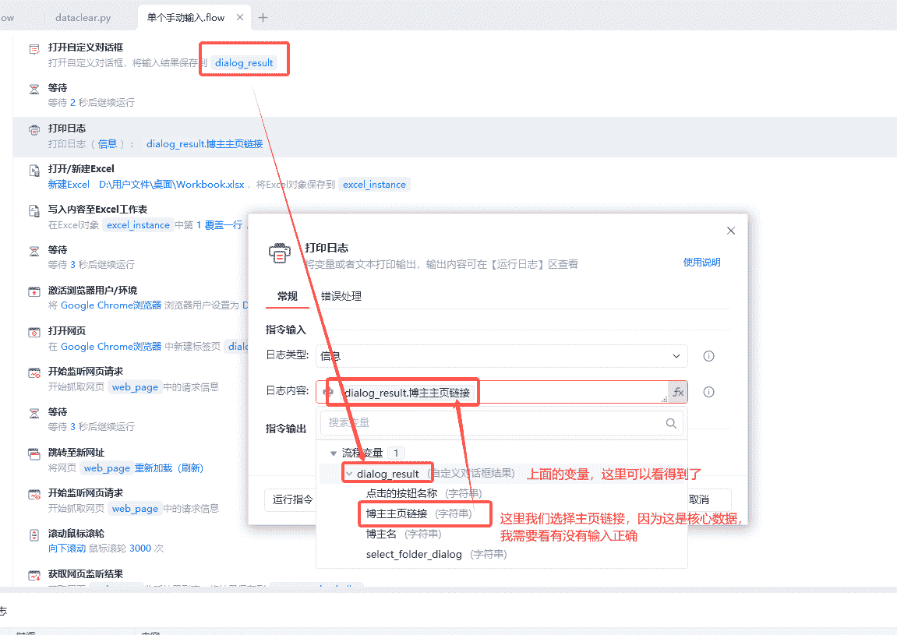

Ok

如果还有不懂的，那么可以看后面的自学小技巧部分

#### 2、新建数据表头

接下来是表头

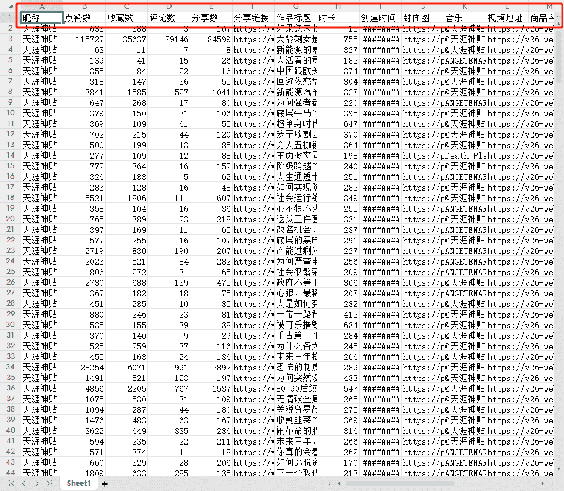

表头上面部分照抄，这里有几个注意要点，一个是`py`功能一定要点亮，第二个就是输入表头的格式，注意用英文体，不然的话你格式输错了，到时候就不是昵称一栏点赞数一栏了，而是昵称点赞数，放在同一栏

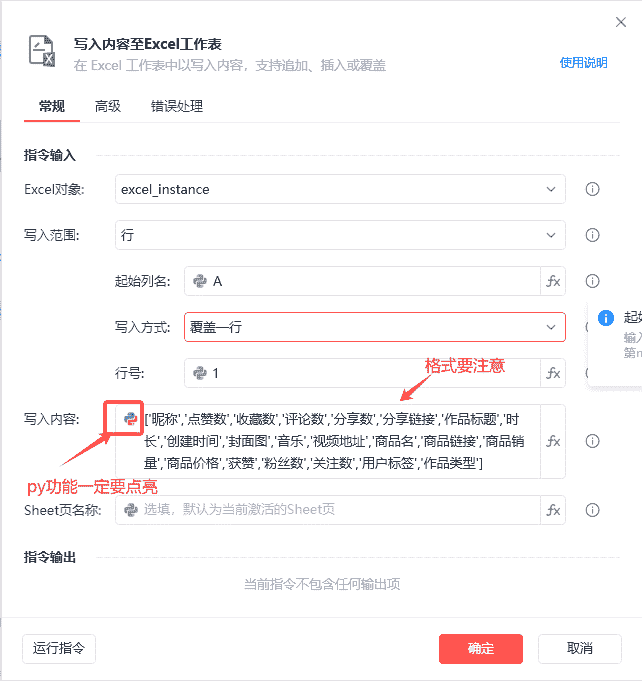

这里为了方便大家使用，我把源码放这里

```
[&#x27;昵称&#x27;,&#x27;点赞数&#x27;,&#x27;收藏数&#x27;,&#x27;评论数&#x27;,&#x27;分享数&#x27;,&#x27;分享链接&#x27;,&#x27;作品标题&#x27;,&#x27;时长&#x27;,&#x27;创建时间&#x27;,&#x27;封面图&#x27;,&#x27;音乐&#x27;,&#x27;视频地址&#x27;,&#x27;商品名&#x27;,&#x27;商品链接&#x27;,&#x27;商品销量&#x27;,&#x27;商品价格&#x27;,&#x27;获赞&#x27;,&#x27;粉丝数&#x27;,&#x27;关注数&#x27;,&#x27;用户标签&#x27;,&#x27;作品类型&#x27;]
```

这个就是写成表头这里哈

#### 3、获取网页源数据

好了，现在到获取数据这里了

我把需要注意的地方给大家说一说

网页监听，内容比较多，我还是建议大家先找到那个功能区，然后点使用说明，先把官方文档听一下，这里我如果全部赘述的话，内容就太多太多了

我们这个设置是这样的

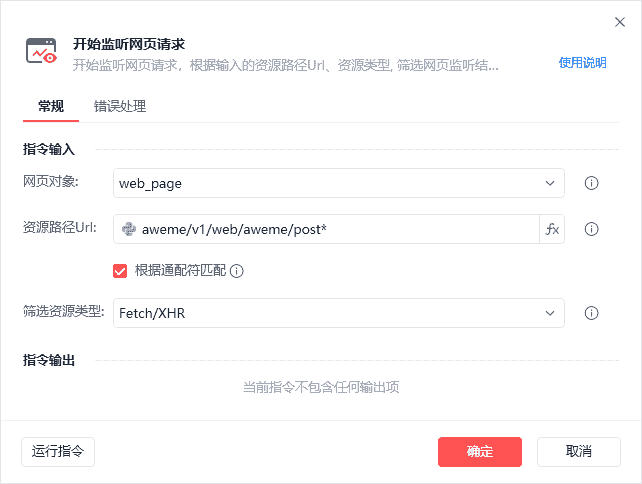

api是这样的

```
aweme/v1/web/aweme/post*
```

#### 4、数据清洗代码部分

数据清洗代码


```python
import json
from datetime import datetime

def main(response_body_list):
    parsed_rows = []

    for response in response_body_list:
        try:
            body = json.loads(response.get("body", "{}"))
            aweme_list = body.get("aweme_list", [])
            for item in aweme_list:
                author = item.get("author", {})
                music = item.get("music", {})
                video = item.get("video", {})
                statistics = item.get("statistics", {})
                promotions = item.get("promotions", [])
                share_info = item.get("share_info", {})

                # 视频播放链接
                video_url = video.get("play_addr", {}).get("url_list", [""])[0]

                # 分享链接
                share_url = share_info.get("share_url", "")

                # 商品字段（挂车）
                if promotions:
                    product = promotions[0]
                    product_title = product.get("title", "")
                    product_link = product.get("link", "")
                    product_sales = product.get("sales", "")
                    product_price = product.get("price", "")
                else:
                    product_title = ""
                    product_link = ""
                    product_sales = ""
                    product_price = ""

                # 构造输出行（严格按你指定的字段顺序）
                row = [
                    author.get("nickname", ""),                         # 昵称
                    statistics.get("digg_count", ""),                  # 点赞数
                    statistics.get("collect_count", ""),               # 收藏数
                    statistics.get("comment_count", ""),               # 评论数
                    statistics.get("share_count", ""),                 # 分享数
                    share_url,                                         # 分享链接
                    item.get("desc", ""),                              # 作品标题
                    int(video.get("duration", 0)) // 1000,             # 时长（秒）
                    datetime.fromtimestamp(item.get("create_time", 0)).strftime('%Y-%m-%d %H:%M:%S'),  # 创建时间
                    video.get("cover", {}).get("url_list", [""])[0],  # 封面图
                    music.get("title", ""),                            # 音乐
                    video_url,                                         # 视频地址
                    product_title,                                     # 商品名
                    product_link,                                      # 商品链接
                    product_sales,                                     # 商品销量
                    product_price,                                     # 商品价格
                    author.get("total_favorited", ""),                 # 获赞
                    author.get("follower_count", ""),                  # 粉丝数
                    author.get("following_count", ""),                 # 关注数
                    "",                                                # 用户标签（暂无）
                    "视频",                                            # 作品类型
                    ""                                                 # 视频标签（暂无）
                ]

                parsed_rows.append(row)

        except Exception as e:
            print(f"[清洗失败] {e}")
            continue

    return parsed_rows
```

### 5、写入参数

最后面的写入Excel参数，照着图抄就能行了，难度不大

## 背景

下面这个是要说的一些题外话，也是我觉得比简单分享一个工作流怎么操作更加重要的事情

简单介绍一下背景

龙哥老师说

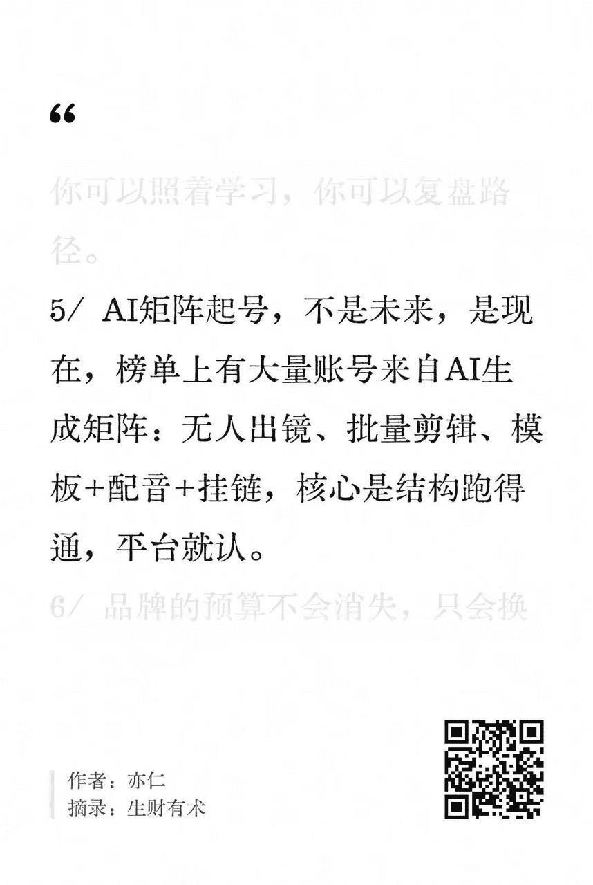

我目前在做的就是这样的一个ai矩阵自动化的项目，我暂时放下了男装直播，不是不尊重盗坤老师那么认真和详尽的回答，而是我个人认为这个方向可能会更加的有前景，我能够接受短期内不赚钱这个结果，并且这几个月来在自动化这条路上收获颇丰，坦白来说，仅仅是学到的这些东西，我都认为价值几十万。

如果暂时没赚到钱，可能只是没遇到好的项目，这一套打法遇到好的变现模式，绝对是有前景的，低成本，可复制！

那么

### ai矩阵自动化项目是什么样子的流程呢？

用工具批量采集同行信息——用ai结合工作流进行作品优化二创（保证质量的同时大幅度降低成本）——用工具进行批量的发布

其中，批量发布不是什么难事，圈内教程很多了，搜索rpa 发布，就一大堆教程

而用ai结合工作流进行作品二创，这件事很重要，但是根据项目不同，方法各不相同，如果是文章类型，只需要进行文案的二创，如果是视频类型，可能需要文案结合ai配音再结合其他的一些视频工作流进行二创，这个需要根据项目而变化，如果是电商的话，那么这个中间的二创过程就是商品的二创

但批量采集同行信息，这个一直都是任何项目的基本功，不管是自媒体，还是电商，都需要一个快速抓同行的作品信息，特别是我们做跟款的人，21年我参加抖音ip大航海的时候，当时就在想，要是有一个机器人每天帮我监控对标账号的数据该有多好，可惜当时没有ai，我也不懂代码，只能苦哈哈的手工采集放到表格里面

而今年ai的大量出现，特别是现在有了多维表格对ai进行接入之后，批量数据的作用被无限放大

这么说可能不太直观，我举具体的例子，看下图，脚本那里有个ai的标识对不对，就是接入deepseek

那么我们只需要前面一行的数据输入我们对标的爆款链接，然后有ai自动提取文案，再用这个ai改写文案是不是很恐怖？

那么如果我们能够批量提取爆款作品的链接，然后复制到这个表里，一下子复制几百个爆款的作品，是不是一下子就同时二创了很多文案呢？这也是我分享批量抓取数据机器人的初衷，实在是太重要了，这个技能

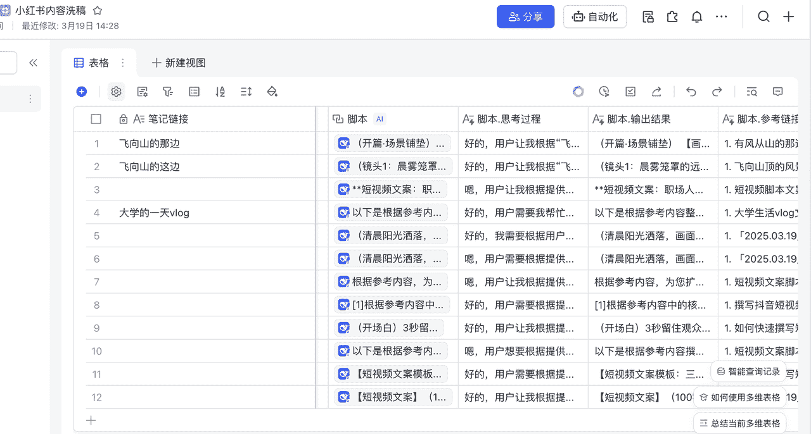

我第一次被多维表格震惊是在3月份左右，当时抖音上有个人演示coze批量提取博主主页视频，然后转文字，再结合上多维表格自带的deepseek，全自动的一下子搞了100多条文案进行同时二创，虽然二创的质量不咋地，但这件事给了我很大的触动，原来现在都智能化到这种程度了

但是我能隐约感觉到，如果提示词给好，大模型又给力的话，这边提取文案发过去，可以同时批量创作1000篇都没有关系，就是不得了的存在，而且这个的厉害之处在于成本很低，算力成本和人力成本比起来不值一提，也就是这件事让我下定决心不做直播，转行全力做ai

关于为什么直播能赚钱，而自己不去做直播，这篇问道坤老师的提问和回答，文章其实写了很多很清楚的了

1、直播无法脱离我个人 ，我把直播时长一般都是拉满的，这也就意味着我没有时间去学习新事物

2、复制难，硬要找也能找到合适的主播进行复制，但是沟通和操心的事情可能就多了很多，对比ai矩阵的复制能力来说，还是ai会更划算

3、比直播赚钱的事情真的很多，圈内就有不少人比我年龄还小很多，但是通过技术，或者模式的设计，一年也能赚几百万，而且很轻松，好的项目一定是越做越轻松的，而不是越做越累

之前做直播，很大程度上是一个充满锐气的年轻人，憋着一口气想证明自己有能力，老想着不依靠任何人，单枪匹马的能力去单干，一个人就是一个军队

24岁能一个月赚10w，我做到了对自己的承诺，也某种程度上证明了自己的个人聪明和能力，和普通人比起来当然算不错，但是和其他大佬比起来，那简直就是小蛟见龙王，不在一个量级，也深知自己个体和能力的局限性，之后还是更加希望靠模式的推动去赚钱，而不是个人体力去推着赚钱。

我宁可通过模式的生意设计，一年能很轻松的去赚50w，也不要自己很辛苦的去靠人力赚100w

总之就是直播虽然短期内能赚点钱，而且我现在回去做，我还是有信心能做起来，但是没有意义了，我潜意识里总是隐隐约约的感觉不对劲，总觉得ai矩阵批量化才是方向

好了言归正传，说回ai矩阵化这个项目吧。

经过了几个月的实际摸索，我发现deepseek在文案方面还是有点不太行，无论怎么给提示词，他都不能给我满意的答复，这些批量二创也只是理论方面可行，你们可以仔细看那个截图，很多都是（开场白）（伸出三根手指！）（强烈的语气）等等这种废话，也就是说实际用起来还是要介入人工干预。

当然我相信，deepseek也可以一口气输出干净文案，但是那需要我付出更多的提示词去调教了。

同样的提示词，我丢给不同的ai模型，gpt和Claude，人家就一次就到位，真是一步到位，而且没有ai味。

当时我就很失望，觉得如果没法调用国外的模型，那一直卡在deepseek的话，那就很烦人了，

但是这次的航海，真的是充满了宝藏和惊喜，我惊讶的发现，我所有的困扰，其他人都帮我解决了，而且给了我更详细的方法

`https://scys.com/view/docx/ZzyOd0BReogQpix8xzMcKuh0n5e`（航海手册在这里）

例如，这次的航海手册里的第一招，就是教我们用coze写一个智能体，然后发布到多维表格里，就有了一个可以批量帮自己提取文案的一个小机器人，第二招就是用api接入Claude或者其他的国外大模型，对我们提取出来的文案内容进行二创

图示大概是下面的效果，这里面怎么接入智能体和api，在手册里写的很清楚了，总之就是一个可以花点时间固定下来的东西

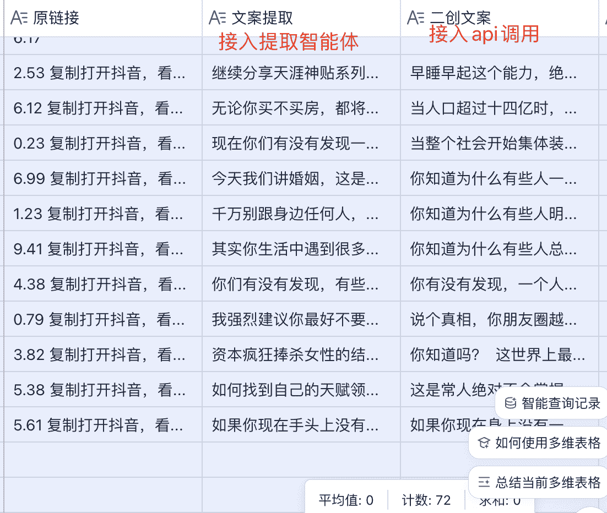

如果能调用Claude，那么这个事情就可行，我跟着手册做了个智能体，半天时间搭建好，然后就开始测试，完全ai二创的作品里的实际表现效果如何

### ai自动化二创效果

效果当然是毋庸置疑的

我📕发第一篇作品（文案完全ai一键二创，人工不干预）就有100多个赞，同时有客户私信问我链接在哪，怎么下单（因为我让ai弄的是带货文案，当中植入了商品）并且出单了，效果是真的很好很好，跑通出单，接下来就是算单个视频成本，然后放量的问题了。


你看，功夫不负有心人吧

### 数据抓取这个工具是花钱买，还是自己学？！

用工具批量采集同行信息——用ai结合工作流进行作品优化二创（保证质量的同时大幅度降低成本）——用工具进行批量的发布

现在二创，我们接入了Claude模型，保证了质量和成本低，可一键生成，文案方面几乎无需人工干预，发布有rpa工具发布。

每天要做的事情，就是找平台里的爆款作品链接丢给ai对不对，这个事情好繁琐呀，还是要人一个博主一个博主去刷

所以我的痛点就成了继续批量解决抓取数据的问题，等把数据抓到之后，直接丢表格里就好啦。

很多人会说，你这个数据抓取，目前市面上有很多现成的工具呀，好用还免费，确实有这样的工具，但是你会发现，这些要么就是用着用着就收费了，要么就是算力原因不能同时抓很多，数量一多就崩溃

你找人买智能体，问了一大圈，都是要额外收费，很多你花钱买了vip还得收一笔费用，今天是抖音的软件，你要找人搞一笔，以后是其他平台呢，更何况现在变化的这么快，对数据的需求也每个人不一样。

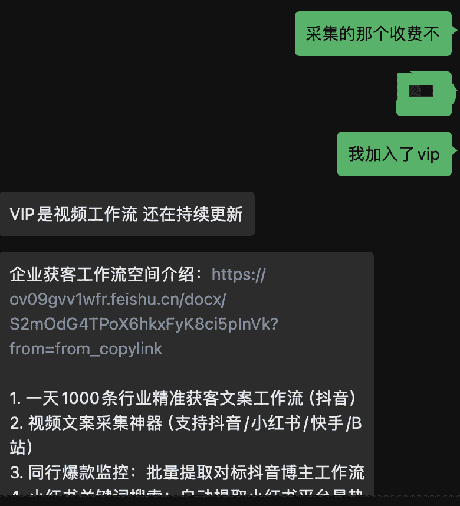

今日割五城，明日割十城，落后就要挨打，自强才能不息，自己不掌握技术，就永远要被人摆弄，更何况这个数据采集还是我认为的三大项之一，我更是必须要掌握了，自己会的话，随心所欲，完全按照自己的想法来，想弄什么平台弄什么平台，想怎么抓什么数据就抓什么数据，多好

所以，最重要的能力，自学能力，也就是今天的主题，终于要开始讲解了

## 【自学能力】

### 技巧1、学习陌生领域，不要贪大，从小做起

从我上面的机器人设计思路，你就可以看到，我最后展现的是一个可以循环的成品机器人对不对，但是我教学却是从单体机器人开始的一个教学，因为这是基础功能，所有的循环都是建立在单体功能之上的，我们不应该一上来就搞循环，而是从小做起，先搞基础

从小做起几个有个好处

1、反馈快，对于自学者来说，反馈这是我们保证信心的关键，很多人坚持不下去，就是因为做事的链路太长，而没有一个即时的正反馈，所以很多人容易放弃，但是从小功能做起，我们聚焦这个功能能否给我们反馈，会更快的看到希望

我们学新东西，每一个新功能，尽可能的搞成电灯泡开关形式，啥意思，就是一按开关，就亮，或者一按开关就灭了，特别是我们是初学者，面对陌生的领域，从小功能做起，你看到灯泡亮了，就会更加的有信心进行探索下一步

2、一次就调试一个“灯泡”我们会更加的直观看到到底是哪里出了问题，方便我们排查，如果一次性就想搞很多，很多个灯泡一起运行，最后运行肯定就报错成花屏了，你怎么去修呢？不还是得一个像素点一个像素点返回去修，而代码这个东西，就算是专业程序员也不敢这么搞，更何况我们手无寸铁的小白了

如果一上来就想吃一口大的，一次完成很多功能，那基本上都是各种报错，包括你用ai，cursor去开发复杂一点的软件的时候，一定要从最基本的功能开始做起，做好再往上加功能，一步一步来。


# 影刀机器人自学指南与核心技巧

很多AI教程和你说是一句话就能写出一个网页，但是都是功能很基本的网页或者程序，比如贪吃蛇之类的，稍微复杂一点的软件，或者是可商业化应用的软件或网站，还是需要大家从基本功能做起，打透一个功能区，我们再进入下一步

包括做项目也是一样的道理

所以我这个教程的设计也是从抓单个博主，再放大到循环抓单个博主，这样子的一个流程

大家不要嫌我啰嗦，我这篇文章更多的是想通过一个具体的项目，影刀机器人（人人都可以做到，人人都有环境做成）这么一个例子，去具体的讲解自学技能过程中我们的技巧，也是非常感谢李笑来老师在《自学是门手艺》这本书当中以编程举例子讲解自学技巧，有兴趣的朋友可以去看看，如果觉得编程太复杂，那么影刀机器人则是更容易跑通的一个例子。

## 技巧2、阅读官方文档

当我们遇到很多问题，不知道从何下手的时候，甚至是功能都不知道是干什么的时候，一定优先考虑的是官方文档的说明，拿下面的打印日志举例，（使用说明）就是一个最好的官方文档

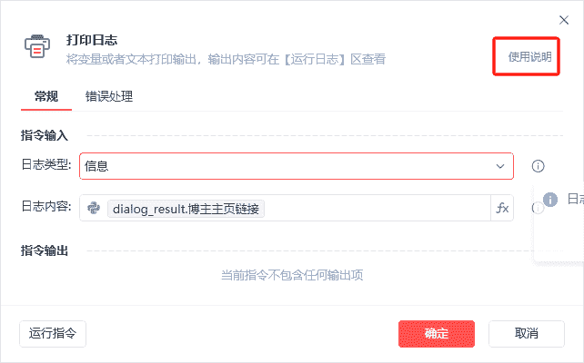

点击使用说明，可以阅读官方文档和教程，

我们在社会上学习，特别是自学，任何一个教程都不可能是完美的，甚至很多教赚钱的帖子，人家都是故意隐藏信息，就算你一比一照着做，你也不出结果，怎么办？而人家就算不想隐藏，就比如我这篇帖子，哪怕我已经尽量的保持耐心来写教程了，也难免会有一些同学看不明白，而这个时候又没有客服回答你怎么办？

不要哭爹喊娘，自学能力强的人绝对不要抱怨

首选阅读官方教程，这里的使用说明，是非常轻量化的针对这个功能的说明，一看就会，不用像影刀官方学院一样，刷一大堆课程，我自己也不喜欢刷这些，我是实战派，一般学东西，需要什么我才学什么

如果官方文档还是解决不了怎么办？

去搜索，各大平台搜索，抖音，百度，问`ai`（这个后面放到代码那里着重讲）

永远坚信一个道理，你遇到的问题，99%都有别人遇到过，这是一个自学者的黄金时代，因为我们相比于几十年前，不仅有算法智能的抖音可供我们搜索问题，还有`ai`，多搜搜，基本上都能找到答案

搜索，就搜关键词就可以了，比如：影刀 xxx 怎么用/出现xxbug怎么办

类似于这样的关键词哈，就可以了，创业也一样啊，都是靠关键词去搜，这里篇幅有限，希望大家举一反三哈

## 技巧3、怎么通过`ai`解决我们的问题？

比如第二步，新建数据表格那里，如果格式出问题了，我们怎么解决？问教练和导师，人家的时间也是很宝贵的，这个时候问`ai`是最好的。

你就问`ai`，简单的问题你就问`元宝`里的`deepseek`，无限上传截图，很方便，当然有能力的，问`gpt`和`claude`肯定是更好

这里很多人遇到问题不会问`ai`，或者是问`ai`也是稀里糊涂的，我想，大概率是情况描述的不准确，还是有一些细节要点的

### 提问格式

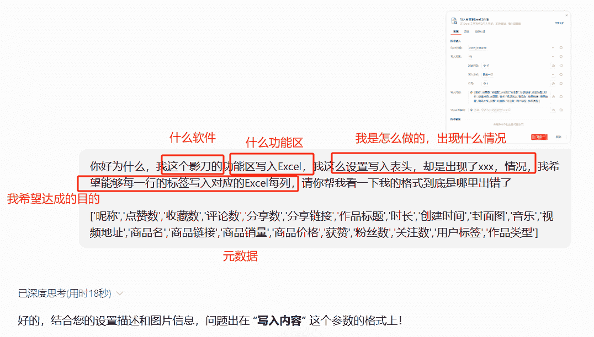

这里注意，你只上传截图给他，是为了让他看个大概，但是数据的源码，最好是复制给他，这样定位会更精准

以我对`ai`提问的经验来看，`ai`对于这些代码的视觉模块识别，还是有出错概率的，所以下面复制一段源码是最稳妥

### 网页监听`api`抓取相关

ok，这个教程里面，是我给你现成的`api`，但如果是其他网页，我们要抓其他数据怎么办？

官方教程有个很详细的说明哈，你们要自己去看一下，这里就不赘述了，重点在下面

`https://college.yingdao.com/course/courseDetail`

你监听成功，记得添加打印日志看看输出结果，如果没有打印日志的话，你是看不到你的结果，也很难再往下一步进行的，

这也是我们之前提到的，一步一步来的，电灯泡法则，只有这个节点通过了，我们再搞下一个节点。

正确抓取数据，大概会从日志当中得到这样一串元数据，这个很重要哦，请你不要忽略原始反馈

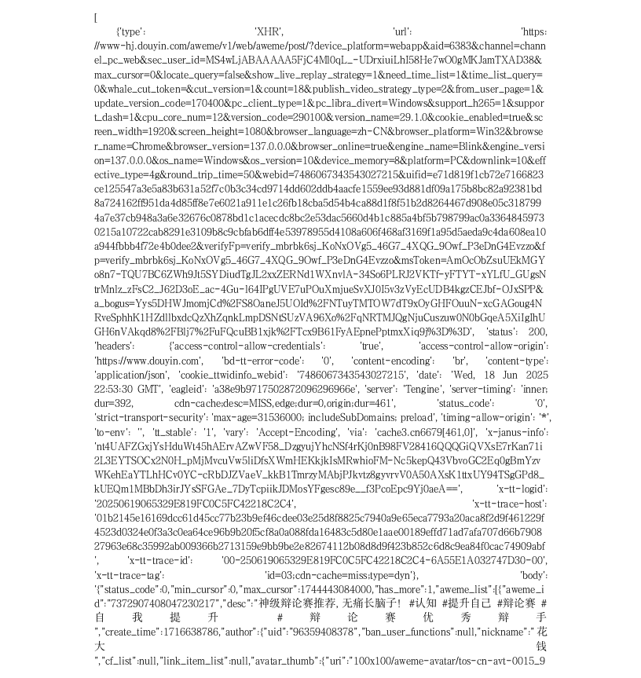

[`抖音元数据.txt`](https://internal-api-drive-stream.feishu.cn/space/api/box/stream/download/all/IlEgbLF8AoBxuqxhCj4c5XExn1g)

是不是看不懂，我也看不懂，但是没关系，我们有`ai`，`ai`能看懂，并且翻译成我们人能看懂的数据就好了

## 技巧4、0基础小白怎么解决数据清洗代码？（重头戏）

这个是重头戏，也是卡了我很久的一个卡点，不过好在，我找到了解决这个代码的方法

### ①、用全面、清晰的提示词

首先，我们肯定是不会写的，这个时候，就问`ai`，但是提问格式很重要，还是要按照我上面说的那个方法，软件，功能，我们想怎么做，目前遇到的情况是什么样，我需要得到一个什么样的效果，源数据（这个非常重要!!!）

元数据这个是最重要的，因为很多时候，`ai`是能看懂数据，但是我们看不懂，我们甚至提问都不知道怎么提问，ok，我只需要告诉他，我需要把这段元数据（上面监听到的元数据在这里就起作用了），用`python`的语言，清洗出哪些数据出来，然后`入参`是什么，`出参`是什么就可以了

`入参`和`出参`，这个也很关键，因为代码接受数据，是需要准确的名字的，我把提示词放到下面，你们看一下就知道

提示词我贴出来吧，你们看一下就能理解了

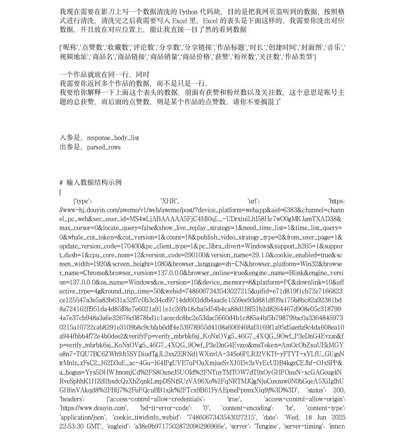

[`抖音主页提取py提示词.txt`](https://internal-api-drive-stream.feishu.cn/space/api/box/stream/download/all/KcVdbL1pzoEbgoxx9jkcTUfYnCh)

#### 全面的提示词是慢慢调试出来的

那么很多人会问，提示词有没有结构啊，我觉得好的提示词一定不是一次性写出来的，

特别是我们和`ai`沟通的时候，需要多次抽卡，

那么这里有个小技巧，就是我们一开始问一个很粗糙的问题，然后你看`ai`给你的反馈是什么方向，同时你要看`ai`的思考过程，`ai`比我们更懂这些领域，他的思考过程当中会有非常多有价值的信息，

这个时候，我们可以记录这些信息，再完善到我们的提示词当中，经过多次重复，最终会得到一个相对全面的提示词，我们最好是用最后的提示词去一步到位的解决问题，不然现在的`ai`很多还没有超强上下文解决能力，问多了就乱了

给你们看一下我在开发之前混剪软件的时候的提示词仓库

这篇文章还是更多的以启发为主，希望给大家更多的自学相关的启发

基本上我要新加一个功能，我就会新建一个`txt`，然后慢慢完善这个文档的提示词，到后面都是一步到位的能写出代码，基本上我在写软件代码的时候，都是一个功能一个功能慢慢加的，而所有的新加功能，提示词都是无数次迭代出最后一个完整提示词，我的经验是，当最后的完整提示词出现的时候，再发给`ai`，就是一步到位的效果

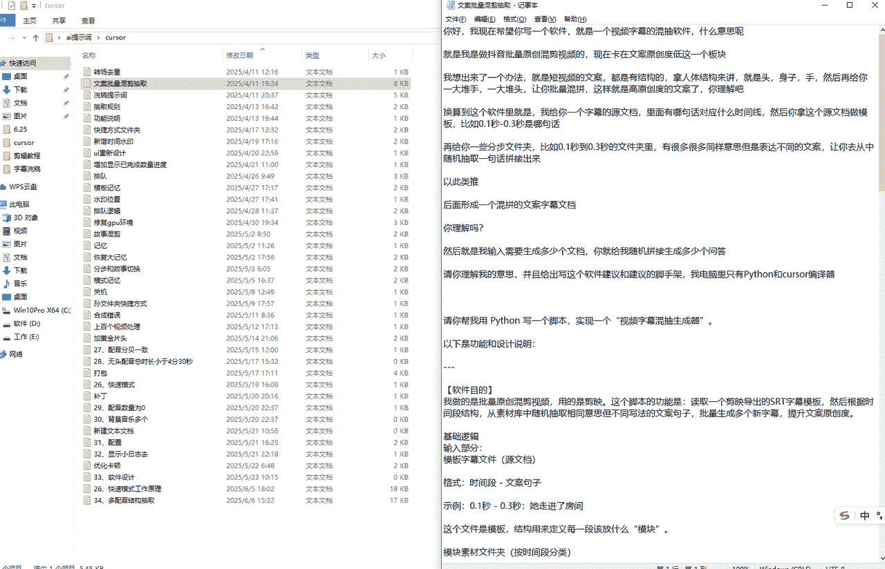

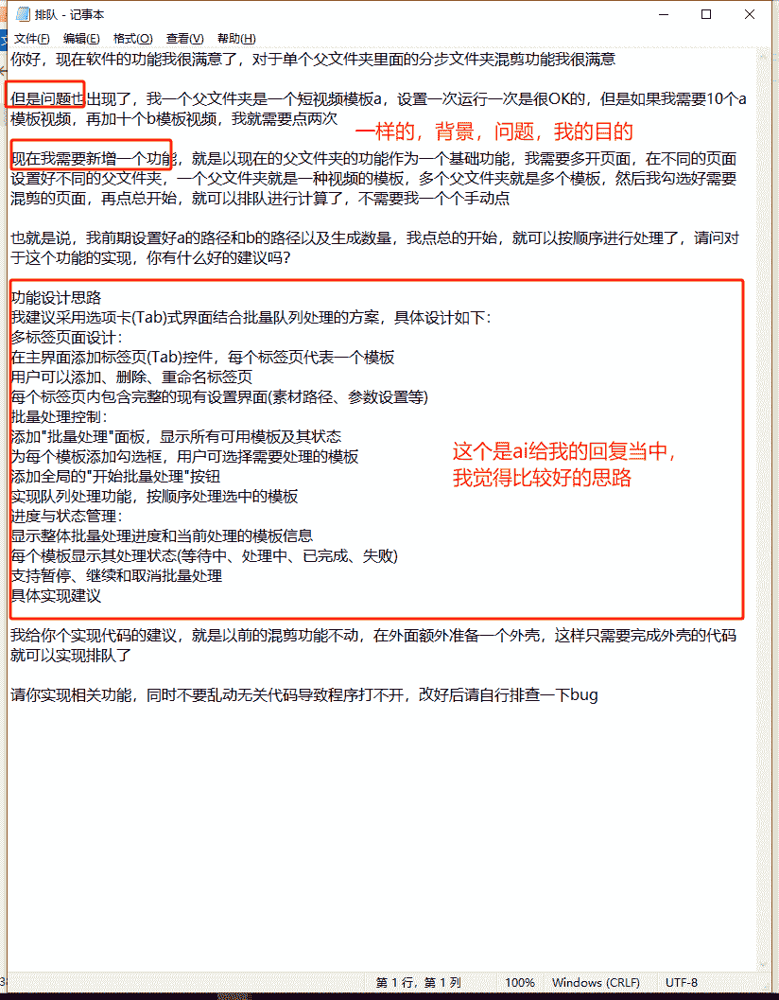

很多人说`ai`没用，其实就是懒，说白了，连用心去完善一个提示词描述你现在的困境都不肯，又怎么能够得到`ai`的优质回答呢？你在提示词这里多花3分钟功夫，你就能少走3个小时的弯路

包括我自己在生活和创业当中也是一样，我的提问都是非常非常详细的，你可以看到我之前问盗坤老师的那篇文章，那个问题我绝对不是提笔就写，而是反复捋思路，自己帮自己捋问题，最后判断不了了，借助外力

能否提出一个优秀的问题，在`ai`时代真的作用已经无限放大了

### ②、找到对的`AI`

第二个就是我个人非常建议的，在`ai`方面，最好是不要省钱，能在能力范围之内，用最好的`ai`就尽量用最好的`ai`

刚刚我们已经把提示词完成了对不对，现在拿着一份近乎完美的提示词，非常结构清晰，我们需要找到一个最聪明的`ai`来帮我们解答，不同`ai`水平不一样，就好像同一个问题，你问小学老师和问大学老师得到的答案都不相同一样

根据我的实测，`deepseek`不行，`gpt`还凑合，`claude`在代码领域是最牛B，同一套提示词，我问`deepseek`需要问两天，都不一定能得到我想要的东西，`gpt`的话多问几次就成了，`claude`是基本上提示词完善，3次以内，最多是头两次的语法有点问题，让他调试一下，基本上技术方面可以完全放心

### ③、跑问题卡点

#### 保持耐心

ok，现在有了好提示词，有了`ai`给我们的代码，是不是就一发击中呢？

不太可能哈，很大程度上还是会出错，报错，这里就需要我们多一点耐心，多尝试几次，不要一试，没得到想要的结果就里面放弃

耐心，就是我要分享的自学技巧之一

还是那句话，世上无难事只怕有心人，而大家都是人，怎么可能又会没有心呢，hh

#### 拆分问题

当一个问题太复杂的时候，我就尽量缩小问题范围，我要研究人脑怎么运作很难，但是我研究神经元之间怎么链接的还是可以的吧，放在影刀这里就是，打印日志，还是我说的电灯泡原理，我每一个功能后面都增加一个打印日志

这样可以尽可能的排查到问题，a到b没问题，b能输出数据，那么c到d就卡了，c后面的打印日志是空的，或者是报错，这个时候我们就重点解决c

怎么解决问题呀，上面如何问`ai`已经给大家解释的很清楚啦，用我这套方法，缩小功能区，一个功能一个功能跑，基本上都没有问题，就算有问题，你也能够清晰的知道卡点是卡在过程的哪里，付费去向其他人请教也会更加的方便。

都说创业最重要的是抄现成的答案，不过我还是希望大家能够靠自己，从0到1去解决一个问题，因为你总有一天会遇到一个事情，没有人给你答案抄，那个时候怎么办？

但是你有从0到1解决问题的经验之后，那种感觉和经验是很不一样的，会给人一种自信，这种自信是你心底知道，你以后遇到什么问题，你大概率都能通过自己的学习能力去解决，你在面对困难的时候也会更加的有耐心。

这种自信，没有靠自己独立成过事的人很难体会到，但是我希望通过这次的数据抓取小机器人，没有这种经验的朋友能够体会到这种感觉，那是一种发自内心的底气和从容

相信经过这么一串的自学技巧，这一点小小的卡点难不倒屏幕前的你，我们学习了这么多自学技巧

1、我们已经阅读了官方文档，有了这样一个权威的数据参考，

2、还知道怎么问`ai`这个最强的老师，并且我们有能力提出清晰的提示词，

3、并且最重要的是耐心，你也已经相信自己一定能够克服重重困难，如果实在问题太难，我们就向下拆解，直到拆成我们能解决的问题

## 课后作业

最后的这个写入Excel和主流程的Excel博主循环，我相信，一定难不倒你

## 特别鸣谢

在此特别感谢下面的各位，排名不分先后

感谢李笑来老师，19年，还在懵懂读大学的自己无意当中阅读到笑来老师的书籍，并且开始重视自学能力，虽然一路上苦头吃了不少，但也收获颇丰，更重要的是，自学能力已经成了我一技傍身的能力，我的任何其他技能都是从这件事上而来，而且我也非常的有信心自己能成事，这种信心不是盲目自信，而是过往一次又一次的自学成功经验给我的底气。

感谢铲哥，铲哥是我自动化视频的入门老师，4月份要转行做混剪带货，看到铲哥的软件，加上铲哥的🛰️，聊了很多，收获满满，另外，铲哥更是我`rpa`的启蒙导师，我本来对影刀也是一窍不通，看了铲哥的视频才入了门

感谢盗坤老师对我之前的那个问题如此详尽的回答，再感谢龙哥老师，如果不是龙哥盟这个平台，我不可能能够足不出户接触到这么多大佬

再感谢这次6月`ai`零代码自动化航海3群的各个志愿者，教练，领队，感谢你们在我遇到问题的时候，在群里无私解答和你们的分享，才让我能够有机会阅读到这么多关于自动化的优秀文章。

都说这个时代，不会`ai`的人没有未来，20年前互联网刚出的时候，都说不会互联网的人没有未来，70年代汽车刚引进的时候，可能又说不会开车的人没有未来，这里我到是觉得，没有自学能力的人没有未来。因为总有一天，我们一定会遇到一个问题，没有人带，没有人教，只能靠自己在互联网上阅读相关文字，靠向`ai`提问去自学解决

希望通过这个机器人的例子，大家都能够掌握自学能力，拥有克服困难的信心，并且逢山开路遇水搭桥！

祝大家龙哥盟！

另外，好文分享

[【和菜头】如果连黄网都找不到，你这辈子还能干什么](https://pkrgkar189.feishu.cn/docx/QdIFdzTRoo8hs3xk2btc5e1xn6f?from=from_copylink)

[和菜头：有没有听说过一种东西叫电脑](https://pkrgkar189.feishu.cn/docx/LoJSdpaJeo3VmbxZh0JcZjiunyd?from=from_copylink)
