# 赚钱月刊 · 2025 年 11 月

> 来源：[https://xuqiwei1986.feishu.cn/docx/PWjQdSgpDoXBO4xTj1HcaT4qnaf](https://xuqiwei1986.feishu.cn/docx/PWjQdSgpDoXBO4xTj1HcaT4qnaf)

# 介绍

+   **赚钱月刊：**是龙哥盟社区推出的月度精选内容合集。每月由赚钱团队基于当下热点机会，在所有社区内容中进行筛选，并精选成龙哥观点、赚钱好事、前沿机会、项目实操、航海实战、社区活动、线下聚会等内容，旨在帮助大家更全面、及时、高效的把握赚钱机会。

+   **赚钱官网：**如果想要了解全部社区内容，可以点击链接，访问龙哥盟官网：https://scys.com/t/BOA7QSQe

+   **赚钱 AI 问答助手：**如果想要整合项目信息、获取结构化回答，可以使用赚钱 AI 问答助手：https://scys.com/ai

# 目录 & 月度要点总结

（可点击蓝字部分直接跳转至相应板块）

+   [**龙哥观点**](https://shengcaiyoushu01.feishu.cn/docx/PWjQdSgpDoXBO4xTj1HcaT4qnaf?302from=wiki#share-CZRwdI2BHoALm3xU4zvcYMIEnag)**：**注意力是最重要的资源；要具备深入思考问题的能力；在各个场景善用AI

+   [**赚钱好事**](https://shengcaiyoushu01.feishu.cn/docx/PWjQdSgpDoXBO4xTj1HcaT4qnaf?302from=wiki#share-PeJodyG13ox2aYxTFN0cB2jtnJe)**：**恭喜不少圈友在 AI、YouTube、b站好物、个人事业、生活中，都取得了成果

+   [**超级标**](https://shengcaiyoushu01.feishu.cn/docx/PWjQdSgpDoXBO4xTj1HcaT4qnaf?302from=wiki#share-CfGOdRax8oMpESxYElTcfcODnPb)：AI工作流定制、垂直小店、📕虚拟产品

+   [**前沿机会**](https://shengcaiyoushu01.feishu.cn/docx/PWjQdSgpDoXBO4xTj1HcaT4qnaf?302from=wiki#share-VIZVdgC3Ood7BuxDiGocbEYSn4f)**：**SCBI 连更5期，精选 24 个新机会，发现 AI 在各种平台的新玩法

+   [**超级术**](https://shengcaiyoushu01.feishu.cn/docx/PWjQdSgpDoXBO4xTj1HcaT4qnaf?302from=wiki#share-K6fvdJ9Efo8xDHxeZ45cHD1InBh)**：**龙哥推荐的“垂直小号 × AI” 最术、最具可复制性的案例之一

+   [**项目精华**](https://shengcaiyoushu01.feishu.cn/docx/PWjQdSgpDoXBO4xTj1HcaT4qnaf?302from=wiki#share-FNiHdnFOYonxSJxCD6jc5eRXnGc)**：**借助 AI 工具与工作流，搞定👸号、YouTube 和📕虚拟店铺等

+   [**小灯塔**](https://shengcaiyoushu01.feishu.cn/docx/PWjQdSgpDoXBO4xTj1HcaT4qnaf?302from=wiki#share-QdgPdykURo0LpfxgMHJcPPslnuh)**：**从 0 到 1 做项目的20 步；结合优势选择合适自己的项目；80 天进入 B 站百万 UP 榜单的心路历程

+   [**航海实战**](https://shengcaiyoushu01.feishu.cn/docx/PWjQdSgpDoXBO4xTj1HcaT4qnaf?302from=wiki#share-NC2adBZHjomEeZxN5tncbeLHn0d)**：**12月航海实战开启，14 条航海项目讲解

+   [**社区活动**](https://shengcaiyoushu01.feishu.cn/docx/PWjQdSgpDoXBO4xTj1HcaT4qnaf?302from=wiki#share-VFGtdgfDdof9FbxlpSicjO6Wn6f)**：**AI 问答助手上线；来找同城航海搭子；小灯塔选题投票&壁纸上线

+   [**航海家**](https://shengcaiyoushu01.feishu.cn/docx/PWjQdSgpDoXBO4xTj1HcaT4qnaf?302from=wiki#share-JD2ndmgjdoKHxIxPCiCcPxdcnQf)**：**北京【航海家 | IP大会】圆满结束；航海家游学陆续开展中

+   [**联合办公**](https://shengcaiyoushu01.feishu.cn/docx/PWjQdSgpDoXBO4xTj1HcaT4qnaf?302from=wiki#share-Nu0pdSpIIop8UOxrwZ0ciWTEnhg)：赚钱联合办公空间外地第一站（深圳站）落地

+   [**线下聚会**](https://shengcaiyoushu01.feishu.cn/docx/PWjQdSgpDoXBO4xTj1HcaT4qnaf?302from=wiki#share-IWnXdgxH9o7VsPxzbQjcbMRAnsc)**：**全国各个城市，线下聚会持续开展中，学习局、运动局、娱乐局等你来参与

# 一、龙哥观点

#### 注意力是最重要的资源，龙哥盟力求为圈友提供简单、清晰、具体的产品和内容。

> 点击链接，查看原文：[h](https://scys.com/articleDetail/xq_topic/45811422848821488)ttps://scys.com/articleDetail/xq_topic/45811422848821488

龙哥盟很幸运，有一批圈友愿意把注意力投射给我们，看赚钱星球的一些内容，参与龙哥盟的活动，所以更要珍惜，更要克制，要有明确的“注意力回报率”视角，圈友给我们投资了注意力，咱们给圈友回报了什么，如果答不上来，那就是在制造内容垃圾。

力求简单、清晰、具体，赚钱不管做产品、做内容、做活动、设计方案、思考战略、团队架构，都要这样。

---

#### 具备了深入思考问题的能力，才能持续的把业务做起来

> 点击链接，查看原文：[h](https://scys.com/articleDetail/xq_topic/45811422884825528)ttps://scys.com/articleDetail/xq_topic/45811422884825528

如何思考和做事，比单一事情如何成功会更重要。

以下是一些具体的反馈，主要集中在如何找到重点、如何做产品：

1/ 要敢于相信自己内心的声音，相信直觉，相信本能，相信常识，用自己的直觉和常识去做出判断。

2/ 做产品，自己得兴奋和喜欢，不然不如不做。

3/ 尽量减少通过一套组合拳达成目标的方法。

4/ 做事和思考是不一样的，思考问题得全面，但做事得抓重点。

5/ 定义问题比解决问题更重要，要花至少一半的时间定义清楚问题是什么上。

6/ 借助提问来帮助自己找到关键问题。

7/ 质量永远大于数量，在没有质量的前提下追求数量没有意义。

8/ 不要向我问 how，要告诉我 why（为什么这个问题你认为是最重要的）。

9/ 产品远大于流量，定位是产品的重要组成部分，在这样的定位下，用什么产品以什么形式呈现解决用户什么问题。

---

#### 龙哥是怎么用 AI 思考、工作、决策、学习、赚钱的。

> 点击链接，查看原文：https://scys.com/articleDetail/xq_topic/55188244412224254

我的核心角色是思考者、决策者兼产品经理，所以日常主要围绕信息获取、加工和辅助决策展开。下面是我使用 AI 的一些方式（共 13 条高频用法）：

1/ 信息检索与深度讨论：用豆包替代百度搜索；遇到需要深度讨论的问题，会和 ChatGPT 聊；涉及系统性调研时，用 ChatGPT 的 Agent 功能。

2/ 技术与编程支持：让 ChatGPT 担任技术顾问，使用 Claude Code 作为编程神器。

3/ 学习与笔记整理：用 NotebookLM 学习；Get 笔记配合 B 站视频学习；用百度网盘里的截取视频画面配合文字笔记；通过熊掌记导出清晰好看的笔记，支持 PDF、图片等多种格式。

4/ 信息追踪与外文阅读：订阅 ChatGPT 的 Pulse 动态，用 Grok 调研 X 上的信息和观点，使用沉浸式翻译阅读英文内容。

5/ 更多：使用 Plaud 录音硬件；通义做录音转文字；利用🛰️读书的 AI 目录、大众点评的 AI 搜功能，以及闲鱼和 z-library 寻找小众服务和书籍等

---

**🙋 圈友提问：**

我本科出身普通院校，家庭经济条件一般，目前在公立学校任教（教学成绩在年级里名列前茅），有一套房，房贷大约 200 万。

现在副业相对稳定，月收入在 3 万左右，是主业的 2–3 倍。但我感到体制内薪资和发展空间跟副业相比均有差距，再加上没有什么背景，人事晋升基本看不到希望。

所以我一直在纠结：要不要放弃这份稳定的教学编制，全职投入副业，并尝试 YouTube 等睡后收入渠道，尽量摆脱单纯用时间换钱的模式？想听听龙哥的建议。

> 点击链接，查看原文：[h](https://scys.com/articleDetail/xq_topic/5124258414551144)ttps://scys.com/articleDetail/xq_topic/5124258414551144

**💬 龙哥回答：**

**我建**议你调整下对工作的预期，你留在体制内，不是为了晋升和待遇，而是为了获得一个安全垫，当你副业萎缩或者副业扩大没想象中那么顺利的时候，有体制内工作作为安全垫，你不至于惊慌失措，动作变形。

副业这件事，本来就需要在风险可控的前提下，坚定地投入、持续地投入，同时不断提升认知，让自己的投入越来越精准、有效，才能持续突破，真正实现增长。

很多时候我们说的「副业」，其实就是那种不需要很重投入也能赚到钱的业务。正因为前期投入不重，它在绝大多数情况下都很难长期稳定，往往会经历从 0 到 1，再从 1 回到 0 的过程。现在很多圈友面临的，正是这样的阶段。

---

**🙋 圈友提问：**

我过去参与了不少项目，结果参差不齐且多数没有产出。放慢节奏观察发现，即便是门槛较低的项目也需要对某一领域有基本理解，才能做出像样成绩。

但我刚入职，对任何领域都不具优势，做项目难以定位自己的赛道。因为持续拿不到好结果带来内耗，同时担心若等待在某一领域积累到足够了解，时间可能过长、错失机会。

> 点击链接，查看原文：[h](https://scys.com/articleDetail/xq_topic/82811854842424212)ttps://scys.com/articleDetail/xq_topic/82811854842424212

**💬 龙哥回答：**

**你只要集中一个星期时间，深度阅读和学习某个领域的内容，并借助AI辅助你理**解，你就可以获得“某一个领域有一点点了解”，甚至“某一个领域超越大多人的理解”。

**🙋 圈友提问：**

最近和小伙伴聊到一个分歧：他们认为做带货要先把流量做起来，才有人看得到产品。

但我这段时间在做视频号带货时发现：好的选品，哪怕只有几百播放也能稳定出单；选品踩坑时，就算有几万、几十万播放，成交也很差。

所以我现在有点困惑：流量、运营动作、选品，这三者的实际优先级应该怎么排？

> 点击链接，查看原文：https://scys.com/articleDetail/xq_topic/2852114884551581

**💬 龙哥回答：**

**条**条大路通罗马。流量、运营、选品，三者不冲突，且没有太强前后关系，不管哪个地方切入，殊途同归，任何一个模块太短板都赚不到大钱。

能搞定其中一个，也许可以支持业务跑通。

能搞定其中三个，也许就能让业务起飞。

---

** 🙋 圈友提问：**

我是去年 5 月加入赚钱的，这段时间跑过咸鱼、👸号、AI 编程、视频号、📕等项目，其中有一部分是跑通了 0–1 的，但都只停留在 0–1，没有继续往下做深。

目前主要在做📕电商，也尝试过把这个项目放大，但总感觉自己迈不过去这一步，不确定到底该不该在这个项目上定下心来，长期深耕，还是继续换项目去寻找更适合自己的方向。希望听听龙哥的建议。

> 点击链接，查看原文：[h](https://scys.com/articleDetail/xq_topic/55188244445442844)ttps://scys.com/articleDetail/xq_topic/55188244445442844

**💬 龙哥回答：**

**换项目没有办法解决你问题。赚到钱都是把一个项目做到足**够深，解决了其中大部分人放弃解决的问题。

你之所以会反复纠结要不要换项目，本质上是因为还没有完整经历过一个项目的全周期，所以在一个项目刚开始不久、遇到困难的时候，就很容易想着放弃，觉得换项目就能解决问题。

但事实是，如果没办法在一个项目上做得足够深，只会不断在不同项目上再撞一次南墙。

# 二、赚钱好事

**每个月 1 号，是赚钱的庆功日，欢迎每一位圈友来到赚钱好事，**记录你的进步和突破，经常庆功，就能成功。

**很高兴看到大家在 AI、YouTube、垂直小号、📕、视频号、B **站好物、个人事业等各个方向不断拿到成果，也期待你把属于自己的那一份好消息写下来。

YouTube 主号频道月流量 1.5 亿

> 点击链接，查看原文：

> [h](https://scys.com/articleDetail/xq_topic/22811858145155141)ttps://scys.com/articleDetail/xq_topic/22811858145155141

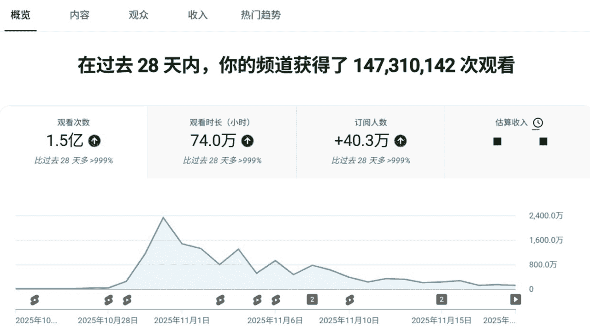

**运营两个多月的 AI 编程出海垂直小号，累计涨粉** 3200+，整体收益已达 1100+。

> 点击链接，查看原文：

> [h](https://scys.com/articleDetail/xq_topic/22811515182855851)ttps://scys.com/articleDetail/xq_topic/22811515182855851

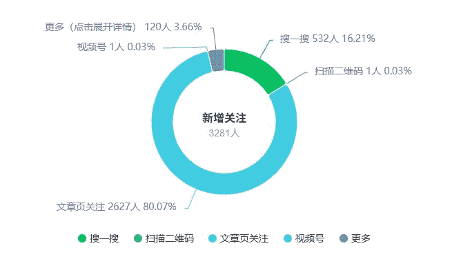

10 月👸号流量主收入首次破四位数，连续半个月日入三位数

> 点击链接，查看原文：

> [h](https://scys.com/articleDetail/xq_topic/55188248821425584)ttps://scys.com/articleDetail/xq_topic/55188248821425584

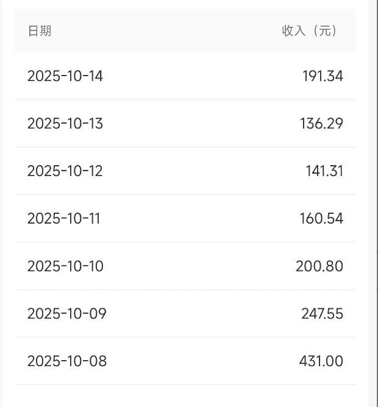

---

**去年底开始做📕电商百货品类，8 月起月收益稳定 3W**+，10 月销售额 10W、利润 5W+

> 点击链接，查看原文：

> [h](https://scys.com/articleDetail/xq_topic/45811842885112218)ttps://scys.com/articleDetail/xq_topic/45811842885112218

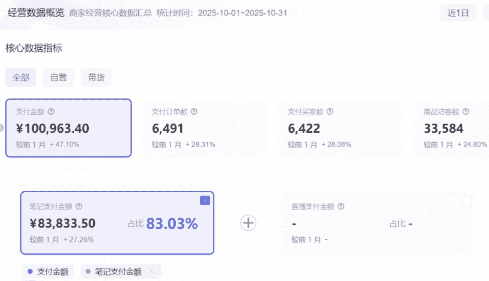

**做📕虚拟资料，10 月 30** 日发首篇笔记，截至今天营业额已破 1W

> 点击链接，查看原文：

> [h](https://scys.com/articleDetail/xq_topic/22811852852242141)ttps://scys.com/articleDetail/xq_topic/22811852852242141

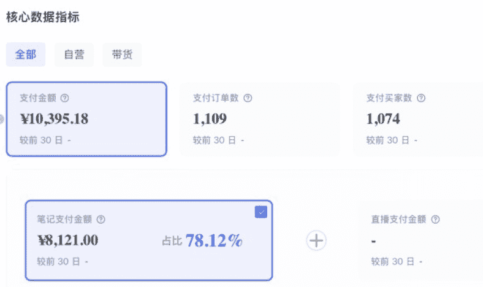

做📕虚拟资料项目整整一年，收入已经达到了25w

> 点击链接，查看原文：

> [h](https://scys.com/articleDetail/xq_topic/45811422144188518)ttps://scys.com/articleDetail/xq_topic/45811422144188518

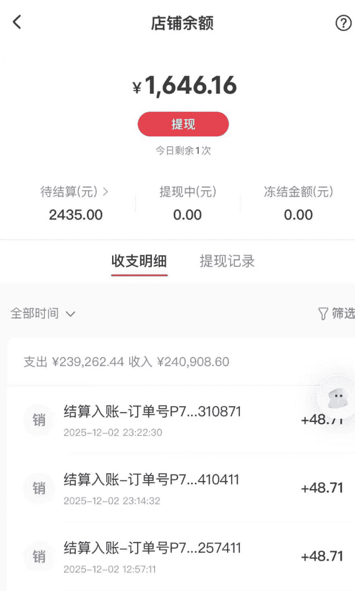

---

B站好物，红包加投流玩法，双11期间GMV破千万

> 点击链接，查看原文：

> [h](https://scys.com/articleDetail/xq_topic/14588285412544522)ttps://scys.com/articleDetail/xq_topic/14588285412544522

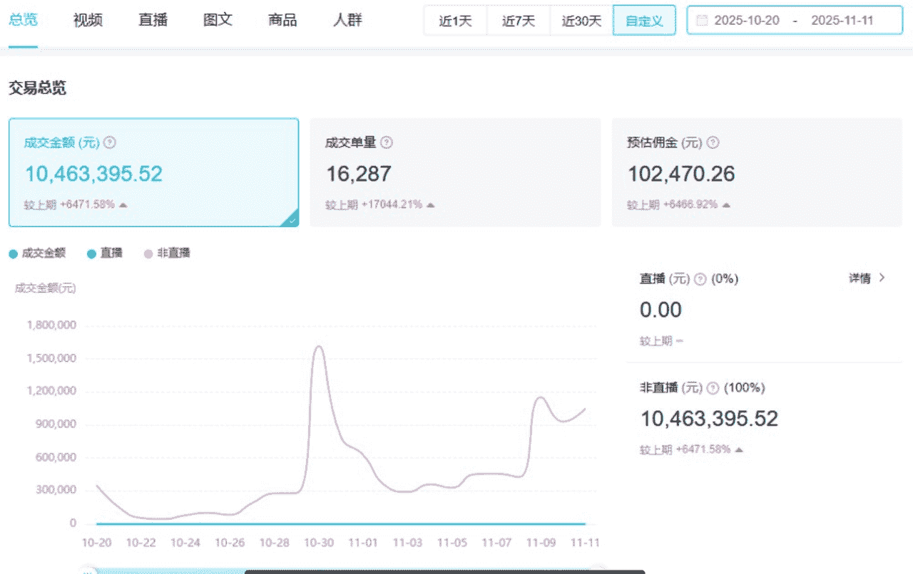

b站好物双11收关，奋战33天，自然流，净利润接近5W

> 点击链接，查看原文：

> [h](https://scys.com/articleDetail/xq_topic/14588285221881242)ttps://scys.com/articleDetail/xq_topic/14588285221881242

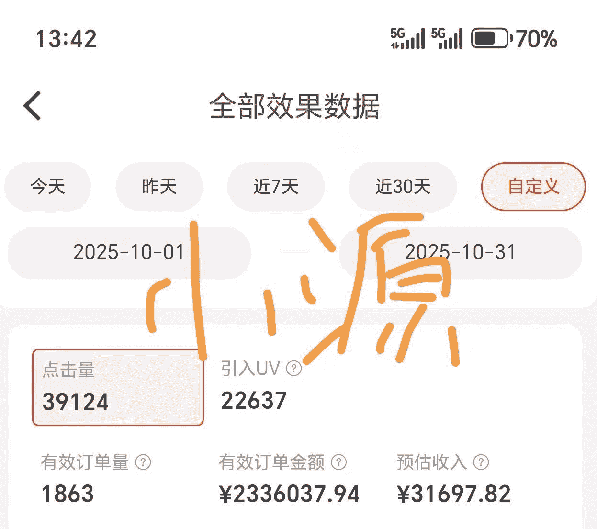

从0开始，b站好物75天，破200万GMV，超5万收入

> 点击链接，查看原文：

> [h](https://scys.com/articleDetail/xq_topic/82811515145825122)ttps://scys.com/articleDetail/xq_topic/82811515145825122

>

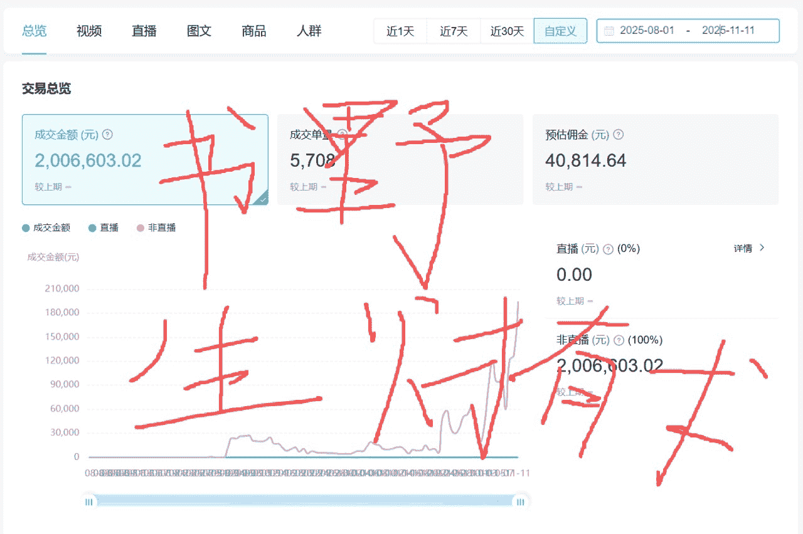

---

03年副业小白参加抖音自然流cps航海2天挣了2500+

> 点击链接，查看原文：

> [h](https://scys.com/articleDetail/xq_topic/22811542448884411)ttps://scys.com/articleDetail/xq_topic/22811542448884411

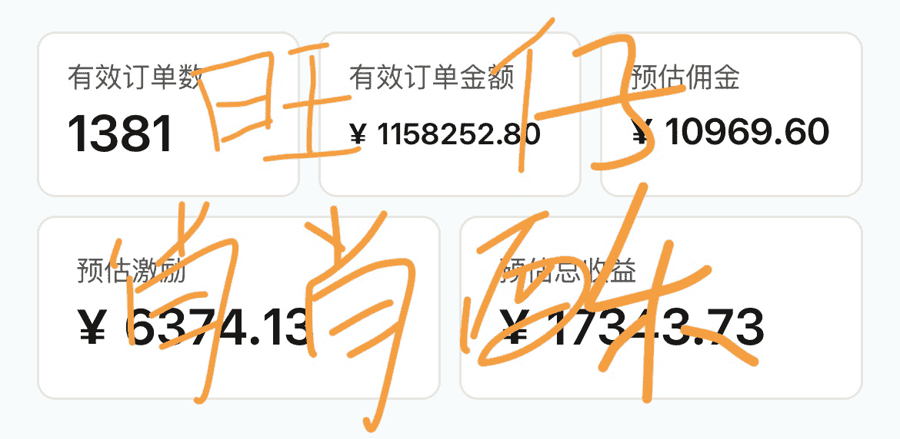

抖音自然流CPS双十一跑出200W+的GMV

> 点击链接，查看原文：

> [h](https://scys.com/articleDetail/xq_topic/55188121185422444)ttps://scys.com/articleDetail/xq_topic/55188121185422444

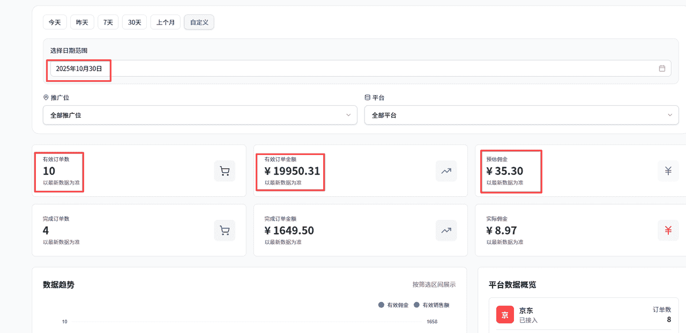

47 岁通过抖音CPS挣到了副业的第一块钱

> 点击链接，查看原文：

> [h](https://scys.com/articleDetail/xq_topic/14588211828521882)ttps://scys.com/articleDetail/xq_topic/14588211828521882

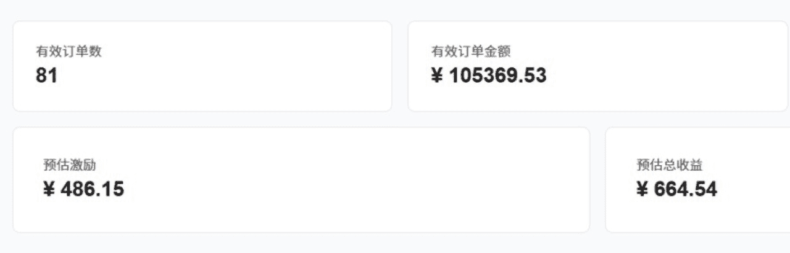

---

AI网站出海半年零1天，11月网站终于破千刀

> 点击链接，查看原文：

> [h](https://scys.com/articleDetail/xq_topic/14588524582121482)ttps://scys.com/articleDetail/xq_topic/14588524582121482

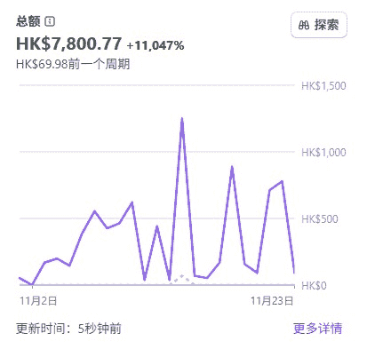

花了3天时间搓的App，拿到了8000块鸿蒙激励金

> 点击链接，查看原文：

> [h](https://scys.com/articleDetail/xq_topic/55188244255424554)ttps://scys.com/articleDetail/xq_topic/55188244255424554

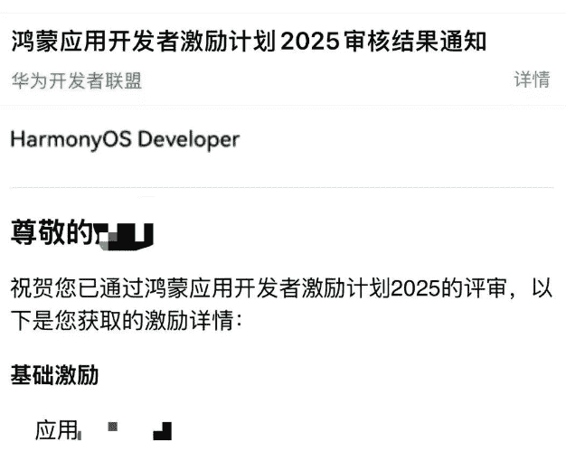

成为签约作者，实现成功发售一本书的梦想

> 点击链接，查看原文：

> [h](https://scys.com/articleDetail/xq_topic/22811518811225281)ttps://scys.com/articleDetail/xq_topic/22811518811225281

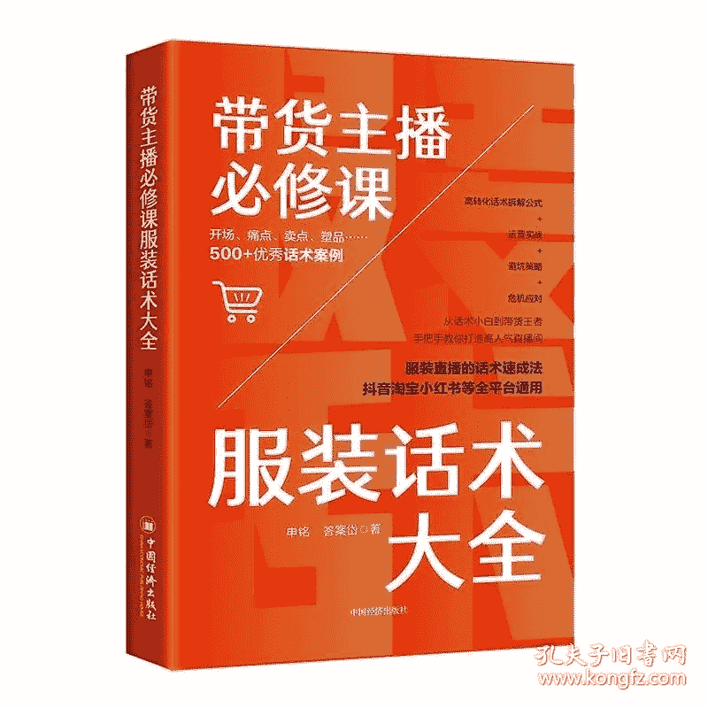

# 三、超级标

> 龙哥认证的超级风向标：一个市场空间足够大的高潜力项目，适合中低成本投入、具备一定实战能力的人进场深耕，做得好有机会赚到 100 万甚至更多。

> 点击链接，查看全部超级标：https://scys.com/tag/2634453

#### 【超级标12】AI工作流定制服务商

> 点击链接，查看原文：[h](https://scys.com/articleDetail/xq_topic/82811541424852542)ttps://scys.com/articleDetail/xq_topic/82811541424852542

**面向企业做 AI 工作流和智能体（Agent）定制与培**训，是一个正在快速放大的 ToB 机会。

8月中下旬那条 n8n 的AI工作流 超级标发出后，航海带着近 4000人开始了工作流的探索，让很多圈友感受到了 AI 工作流的魅力。

从几个平台调研看下来，我们发现在闲鱼、 liblib、影刀 RPA、📕等平台都能看出工作流的趋势和机会。很多企业，愿意为这个能力，为这个服务付费，只要真正能搞定，价格好说。但是企业不知道能做成这样。大量的人不懂怎么做，因为太新了，他们没见过还能这样。

龙哥盟有有一批人了解怎么做，但还没有意识到这是个大机会，以及如何获客。希望龙哥盟能至少有上百家圈友成立AI工作流及Agent定制和培训工作室，面向不同行业及场景深耕，成为最懂ai、懂业务、懂沟通的ai落地服务商。

---

#### **【超级标13】垂直小店**

> 点击链接，查看原文：[h](https://scys.com/articleDetail/xq_topic/45811414184521888)ttps://scys.com/articleDetail/xq_topic/45811414184521888

**垂直小店，是围绕特定的商品或者品类，在内容平台做**内容和店铺，如果出单就可以获得推荐佣金。

这个过程中，不需要打造自己的IP，一开始也不需要去备货，只需要研究平台的用户喜欢什么样的品，然后用相应的货相关的内容吸引用户，并自然的完成转化，简单直接粗暴。

这个超级标，回到了赚钱圈友的主战场：产出质量不那么高的内容，这几乎谁都可以做到。现在只要你学一些剪辑或者拍摄，你就可以做电商，正如抖音自然流cps航海所教的那样，据说 90%参与这个航海的圈友都至少出了一单。

现在的平台几乎没有新增量了，属于精耕细作的阶段。流量红利的时代结束，效率红利的时代刚开始。平台也在顺势而为，无论是抖音、视频号还是📕，都在优化分发逻辑：分配流量给到素人和垂直的不优质内容。

平台在找能带成交的内容，用户在找能信任的人。而“垂直小店”刚好能满足两者的需求。

---

#### **【超级标14】📕虚拟产品**

> 点击链接，查看原文：[h](https://scys.com/articleDetail/xq_topic/55188124212554814)ttps://scys.com/articleDetail/xq_topic/55188124212554814

**虚拟**资料值得被重新认真对待。尤其适合那种：本身在某个场景已经干了 2–3 年，有经验但还没把经验做成产品的人。从虚拟资料，到虚拟产品，到一个行业赛道！进可攻，退可守。在📕最低成本切入。

从“📕虚拟资料”到“📕虚产品”，背后其实已经不是一个东西了。不是虚拟产品火了，而是📕现阶段希望📕虚拟产品来教育用户，留住内容创作者。

同样是一拨人：班主任、小学老师。对于他们来说，“虚拟资料”这四个字，已经不是“一份压缩包”，而是：一个清晰的人群 + 一条从入门到进阶的产品线。

总而言之，平台在给虚拟产品机会，AI 把小需求变成可能，自动发货把交付抽掉，📕这边的人群、客单价又天然适合小产品线。

# 四、趋势前沿机会

#### SCBI 第五期：这样的 SCBI 真的是大家需要的吗？

> 点击链接，查看原文：[h](https://scys.com/articleDetail/xq_topic/22811542451515181)ttps://scys.com/articleDetail/xq_topic/22811542451515181

**地方文旅靠短视频卖出上千万**

**靠“虚拟充值”稳定出单**

用 AI 拿平台激励的创作者新玩法

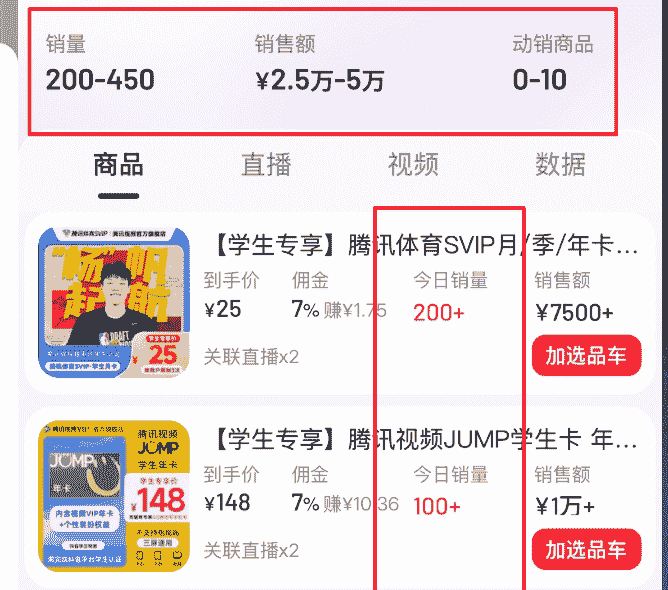

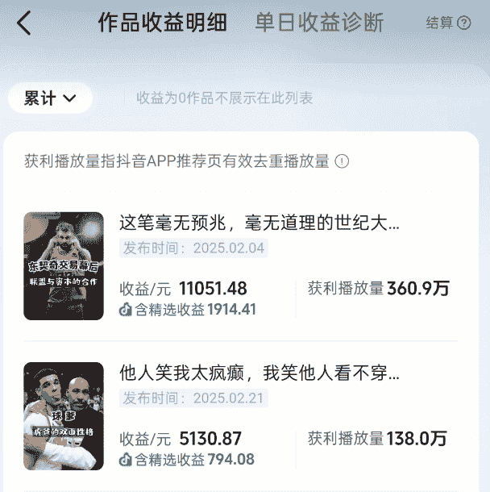

#### SCBI 第六期：别小看这些“边角”项目

> 点击链接，查看原文：[h](https://scys.com/articleDetail/xq_topic/55188248152444844)ttps://scys.com/articleDetail/xq_topic/55188248152444844

祝福号，视频号上ROI比较高的一种轻带货模式

混剪新闻、影视、纪实片、爆款视频内容，得B站创作激励

在 TikTok 用 AI 给工厂引流，做中介

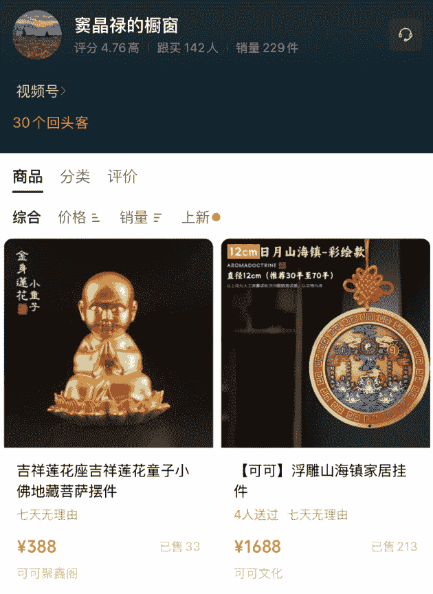

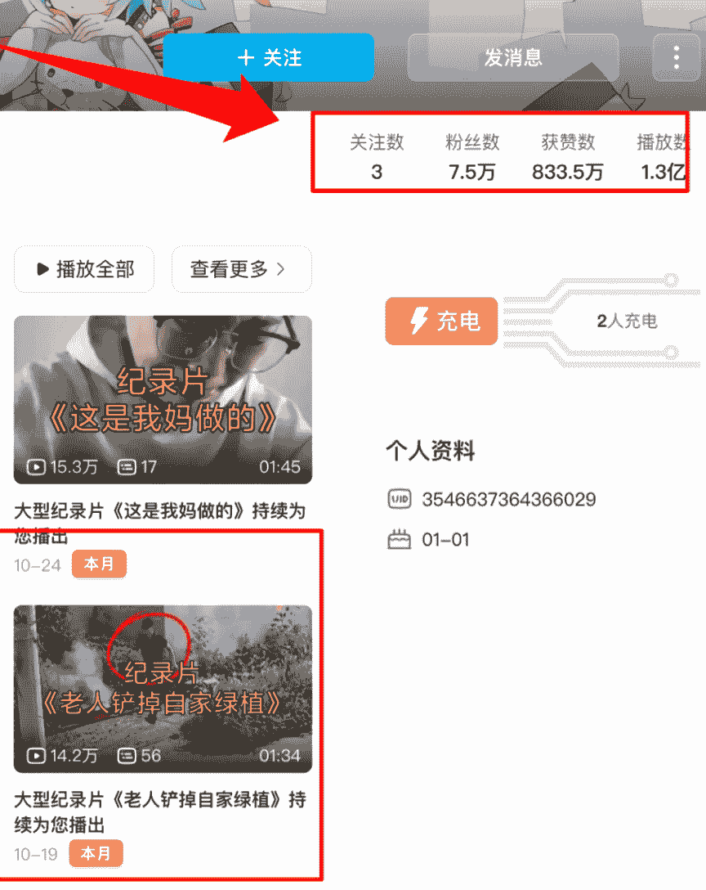

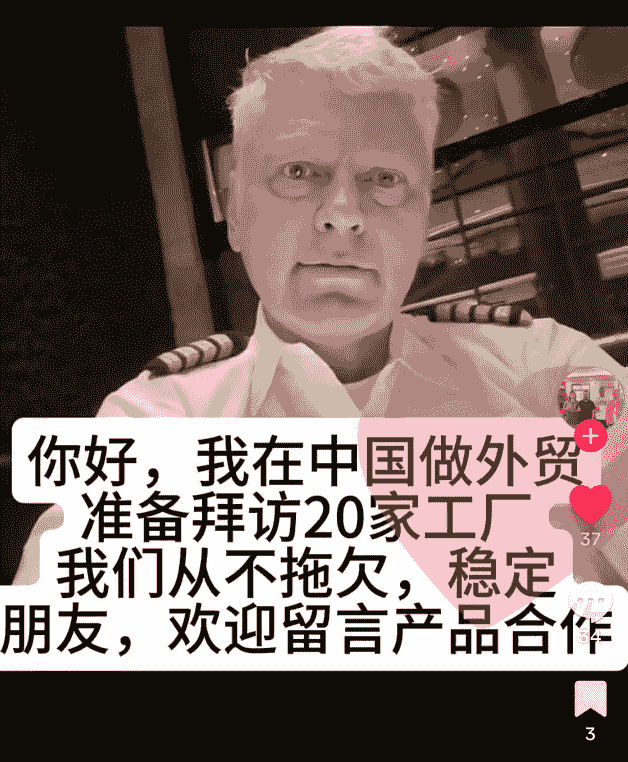

#### SCBI 第七期：下周直播前，先分享三条值得关注的机会

> 点击链接，查看原文：[h](https://scys.com/articleDetail/xq_topic/14588285221841482)ttps://scys.com/articleDetail/xq_topic/14588285221841482

抖音 AI 特效口播带货，账号变现几万块

AI 视频工具/套壳站，变现榜单上高占比

🛰️在电商板块逐渐完善，推客带货的玩法普及

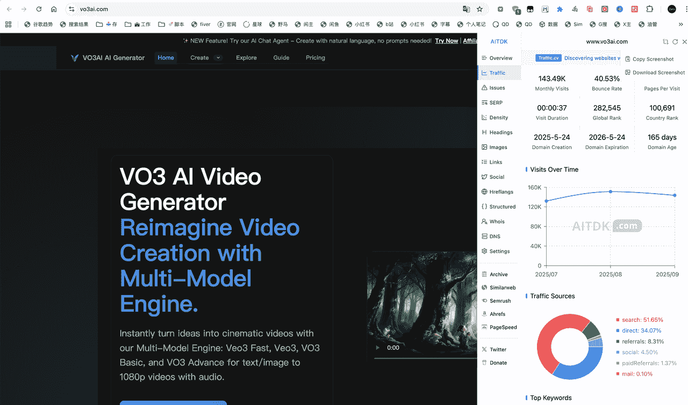

#### **SCBI 第八期：从 500 条**直播评论里，筛出了需要补充的 3 个机会

> 点击链接，查看原文：[h](https://scys.com/articleDetail/xq_topic/45811845824424458)ttps://scys.com/articleDetail/xq_topic/45811845824424458

**帮平台拉新用户完成下载和激活**

视频号书单带货，AI 把“读书变现”

**📕商单真的大有可为**

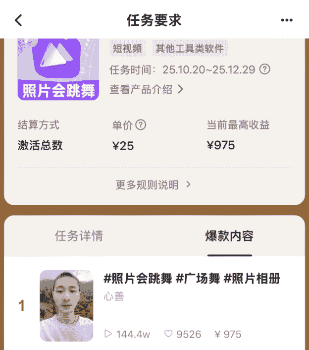

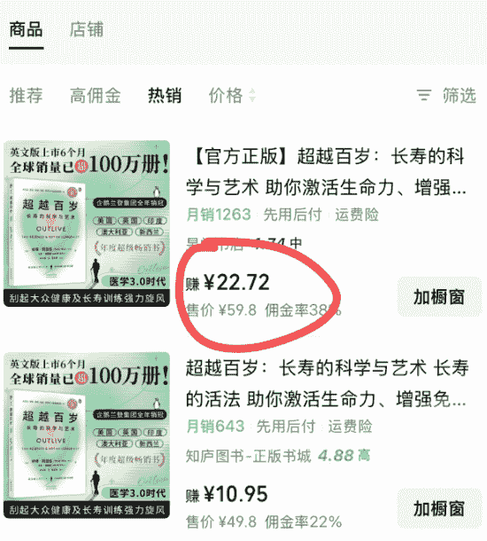

#### SCBI 第九期：说好的资料包来了，还有这3个项目值得一看

> 点击链接，查看原文：[h](https://scys.com/articleDetail/xq_topic/55188128254844484)ttps://scys.com/articleDetail/xq_topic/55188128254844484

视频号 + 美团 CPS 团购带货

**给剪映做拉新**

**AI 可以做监督、陪伴业务**

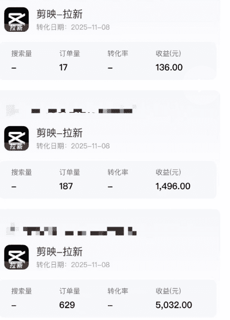

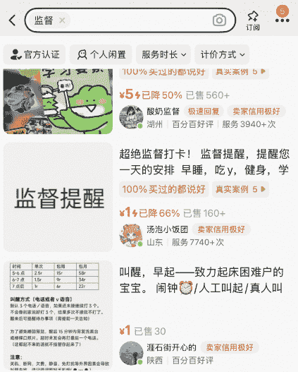

#### **精选中标**

聚焦高知名度人物，以 AI 的形式记录从小到大的历史事件

> 点击链接，查看原文：

> [h](https://scys.com/articleDetail/xq_topic/82811518154822122)ttps://scys.com/articleDetail/xq_topic/82811518154822122

用AI进行风格转换复现名画场景，容易出爆款视频

> 点击链接，查看原文：

> [h](https://scys.com/articleDetail/xq_topic/22811541858522151)ttps://scys.com/articleDetail/xq_topic/22811541858522151

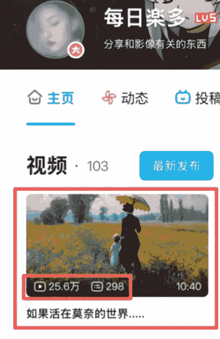

AI PPT赋能教学课件，需求大且有长尾流量

> 点击链接，查看原文：

> [h](https://scys.com/articleDetail/xq_topic/22811518825458281)ttps://scys.com/articleDetail/xq_topic/22811518825458281

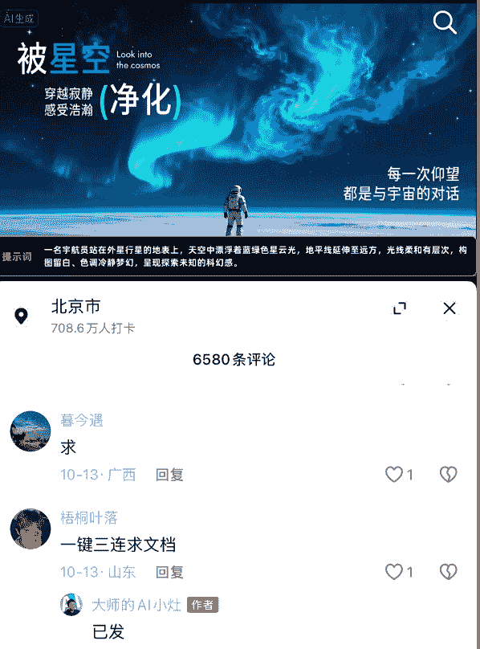

---

绘本融合自己宝宝的头像做定制，每本19.9，已售3.2万

> 点击链接，查看原文：

> [h](https://scys.com/articleDetail/xq_topic/22811515821244141)ttps://scys.com/articleDetail/xq_topic/22811515821244141

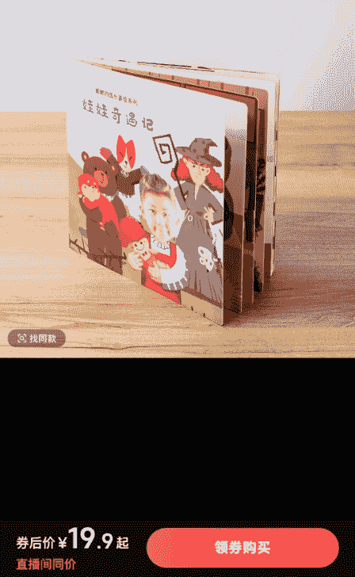

**📕卖读书笔记，出了600单**

> 点击链接，查看原文：

> [h](https://scys.com/articleDetail/xq_topic/45811848542548128)ttps://scys.com/articleDetail/xq_topic/22811541121248281

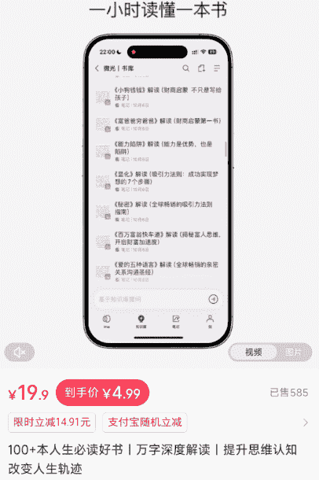

Gemini直接生成超棒证件照，淘宝已卖30万张

> 点击链接，查看原文：

> [h](https://scys.com/articleDetail/xq_topic/55188282882145454)ttps://scys.com/articleDetail/xq_topic/55188282882145454

---

📕垂直小店，硅胶专注石154 天卖 1.5 万单

> 点击链接，查看原文：[h](https://scys.com/articleDetail/xq_topic/14588524288824852)ttps://scys.com/articleDetail/xq_topic/14588524288824852

**抖音竖屏漫剧创作者可申请最高75万保底激**励，番茄小说原创IP可获100%改编补贴

> 点击链接，查看原文：

> [h](https://scys.com/articleDetail/xq_topic/45811414212851828)ttps://scys.com/articleDetail/xq_topic/45811414212851828

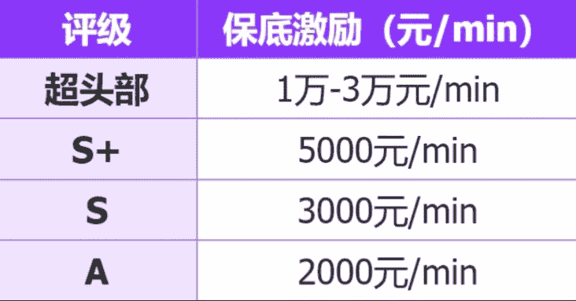

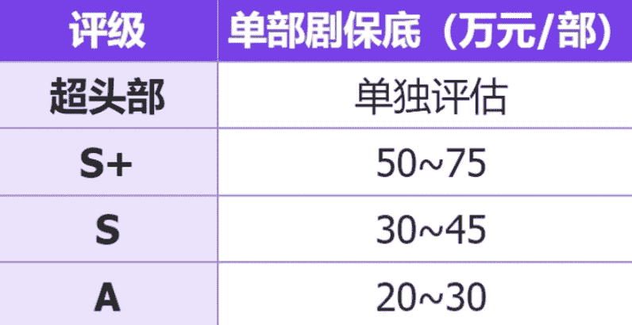

nano banana pro 制作表情包变现

> 点击链接，查看原文：

> [h](https://scys.com/articleDetail/xq_topic/14588524815582422)ttps://scys.com/articleDetail/xq_topic/14588524815582422

# 五、超级术

> 龙哥从精华帖中筛选出来，并推荐给所有圈友阅读的内容。

> 点击链接，查看全部超级术：https://scys.com/tag/3783551

#### AI+👸号垂直小号+内容自动化批量生产：打造属于自己的内容王国

**龙哥推荐语：**

**这是这段时间看到的“垂直小号 ×** AI” 最术、最具可复制性的案例之一。

**这篇文**章把垂直小号做成了一个可复制的系统，找到了《活着》、《天道》等大IP，增加了IP人设的部分，形成了20个垂直小号矩阵，把一个大IP领域的流量通过垂直IP的方式吃完，并且加上AI提效，2小时可以写几十篇内容，是把AI+垂直小号做到极致的标准案例。

**同时刘智行的经历也证明了AI时代的普通人，只要找到自**己的生态位+做对系统，就有机会跑通结果。

> 点击链接，查看原文：https://scys.com/articleDetail/xq_topic/55188248452852824

本文将分享一套通过 AI 打造👸号垂直小号，从确定领域到生成原创爆文的完整实操方法，助力大家打造自己的内容王国，实现睡后收入。

**推荐阅读人群：**

+   刚加入赚钱却还没找到方向，打算报垂直小号航海的圈友

+   想用方法论提升内容产能的圈友

**目录：**

1/ 👸号和垂直小号的底层逻辑

2/ “内容王国”和“流量王国”实操方法论

3/ 矩阵扩大收益的方法论等等

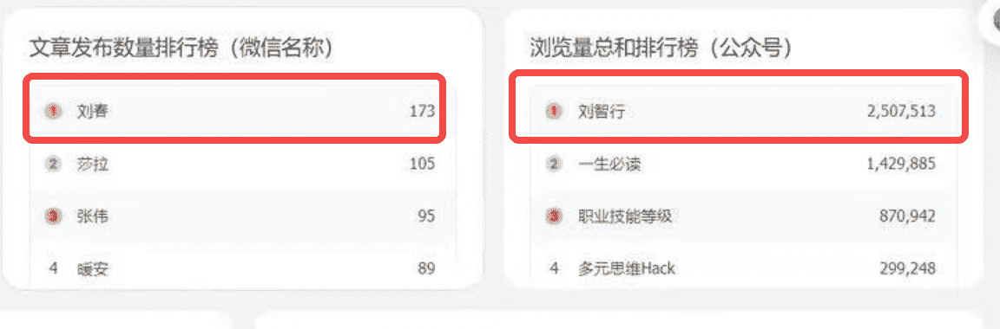

# 六、优质项目精华

#### 飞书多维表格 + Coze 保姆级教程，让写👸号垂直文章像转发文章一样简单

> 点击链接，查看原文：[h](https://scys.com/articleDetail/xq_topic/22811851814828581)ttps://scys.com/articleDetail/xq_topic/22811851814828581

本文会会围绕 AI 写作的两个核心能力展开：品味审美和思路，帮大家把行动成本降到足够低，学会用 Coze + 飞书多维表格搭建自动化写作工作流。

**推荐阅读人群：**

+   不会用 Coze、飞书多维表格，但想用 AI 做自动化写作的圈友

+   已经在用 AI 写作，想提升提示词和思路的圈友

+   想搭建属于自己赛道的 AI 写作工作流，降低时间和行动成本的圈友

**目录：**

1/ AI 文章会限流？

2/ 准备工作

3/ 搭建coze流开启自动化

4/ 工作流注意事项

5/ 一些疑问和可能出现的bug

6/ AI 使用技巧及提示词进化方法

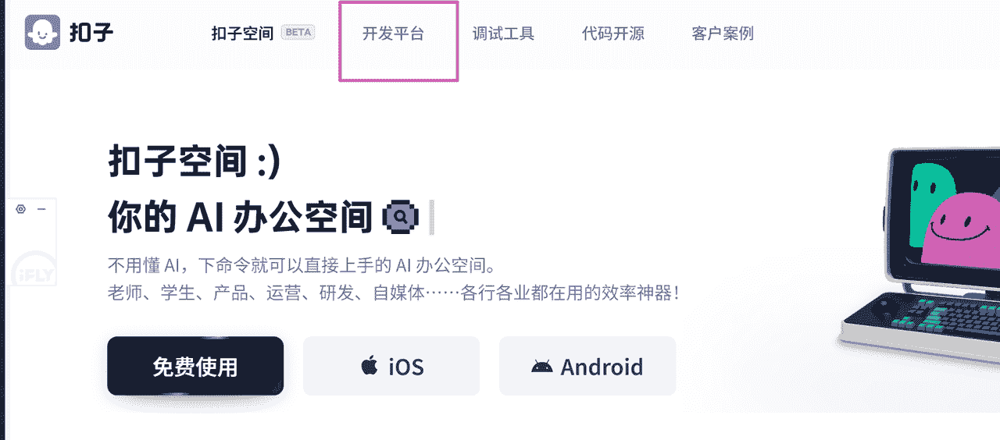

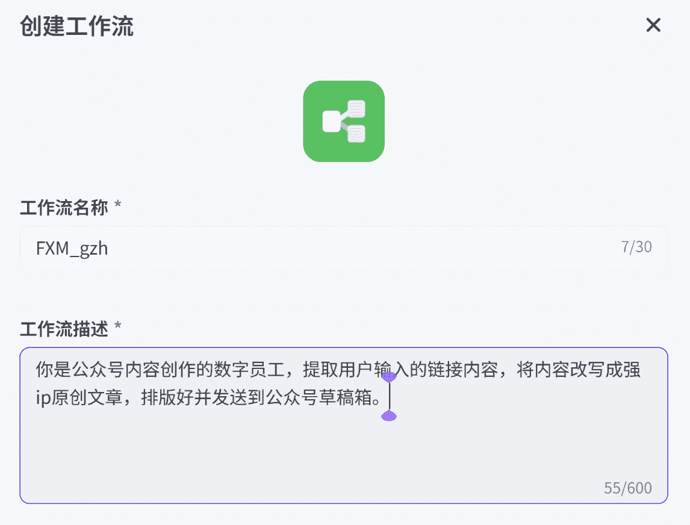

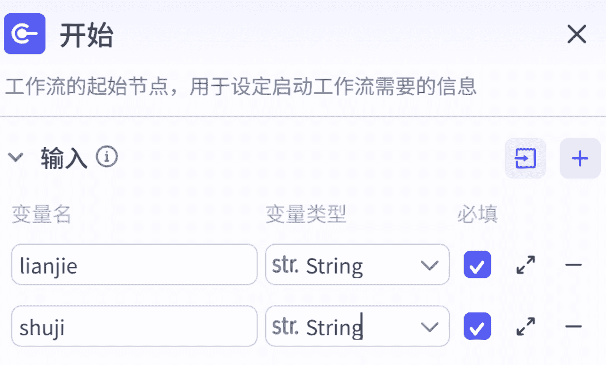

---

####

#### 财务主管零基础，我用AI编程打造Youtube视频矩阵，1个月通过4个YPP

> 点击链接，查看原文：[h](https://scys.com/articleDetail/xq_topic/14588524581415582)ttps://scys.com/articleDetail/xq_topic/14588524581415582

本文雨文将分享这半年自己如何利用AI编程，从0到1开发了一个网站，实现了YouTube故事类短视频的批量生产，并借此在短时间内连续通过了4个频道的YPP（YouTube合作伙伴计划）认证。

**推荐阅读人群：**

+   想做 YouTube，但不知道怎么提高视频产能、苦于效率太低的圈友

+   对 AI 视频 + AI 编程感兴趣，但自己是零基础、非技术背景的圈友

+   想通过 AI 工具把一个赛道做批量化矩阵，跑通多频道 YPP 的圈友

+   在做YouTube，关注印度故事赛道的圈友

**目录：**

1/ 个人经历：从财务主管到 AI 视频创作者

2/ 我的AI视频提效网站是如何工作的

3/ 我的方法论：手搓精品+自动化矩阵

4/ 总结与致谢

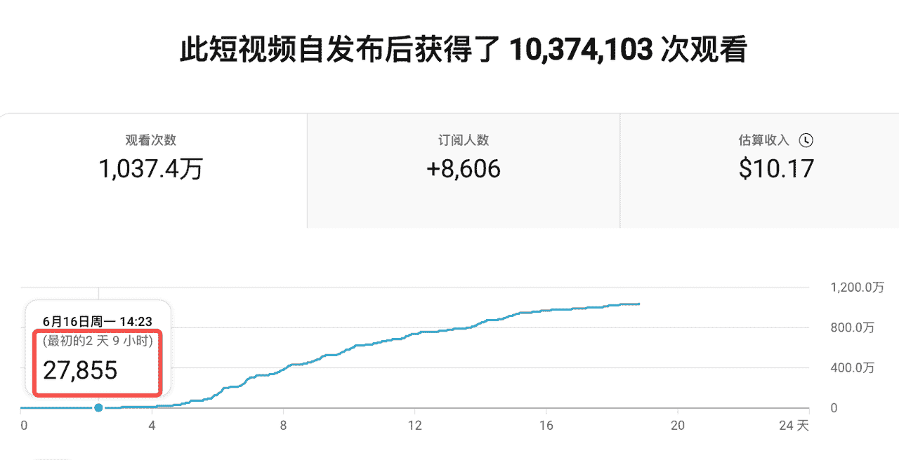

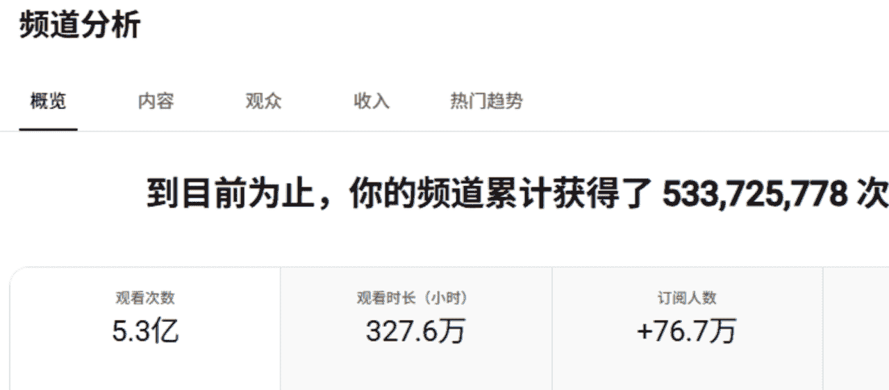

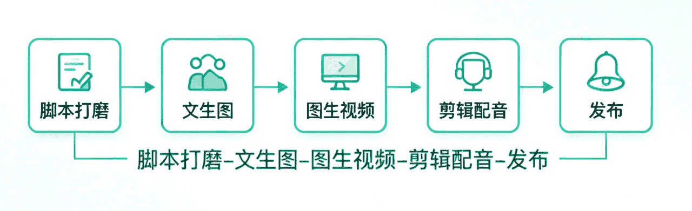

---

####

#### 借助AI工作流，8个月做了15家📕虚拟店铺，我整理出这套可快速起店的SOP

> 点击链接，查看原文：[h](https://scys.com/articleDetail/xq_topic/14588211858445282)ttps://scys.com/articleDetail/xq_topic/14588211858445282

本文尹星河将分享团队这几个月在📕虚拟店铺的实战经验，如何跑通从选品到起店的闭环，实现每月新开 2–3 家店、部分店当月破万收益，并在零编程基础下，用 AI 与 Claude Code 搭建选品监控和矩阵批量发布的工作流。

**推荐阅读人群：**

+   想入局或刚起步做📕虚拟电商的圈友

+   已经有店，但没有跑通闭环、难以放大的圈友

+   想用 AI + 工具链提升选品、上新、发布效率的圈友

**目录：**

1/ 在📕虚拟电商，我们都踩过哪些坑

2/ 我们找到哪些好的方向

3/ 一套可复制的快速起店SOP

4/ 新手小白实操SOP

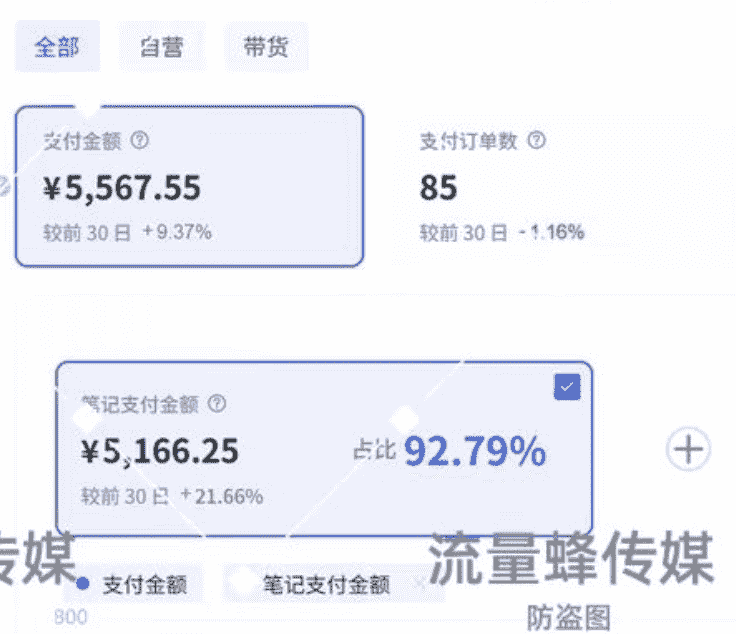

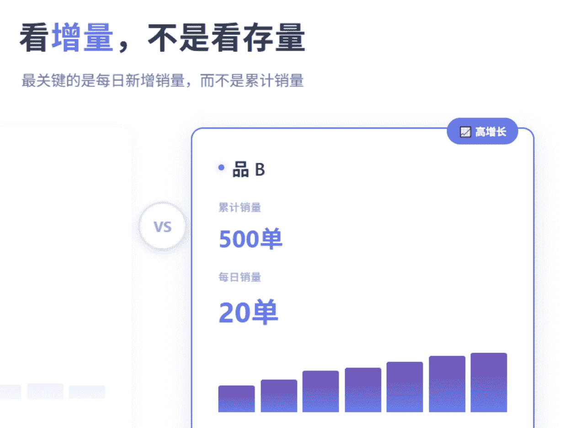

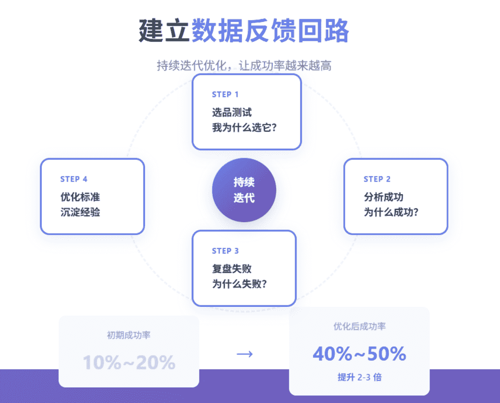

---

#### 普通人通过NotebookLM构建生意的方法论，含📕虚拟产品操作思路

> 点击链接，查看原文：[h](https://scys.com/articleDetail/xq_topic/22811854184815841)ttps://scys.com/articleDetail/xq_topic/22811854184815841

最近notebooklm很火，无论是国内还是海外，很多用户都在疯狂使用notebooklm去做PPT。本文将从📕虚拟产品视角和自媒体IP视角，总结一套《普通人如何通过notebooklm构建自己的生意》方法论。

**推荐阅读人群：**

+   正在做、想尝试📕虚拟产品的人

+   想通过 notebooklm 做课程、课件、资料包等数字产品的人

+   只停留在做笔记、做 PPT，还不知道怎么变现的人

**目录：**

1/ 如何通过notebooklm+youtube+📕做个人IP

2/ 如何通过notebooklm原创虚拟产品，内含具体操作思路（原创课件）

3/ 一些通过notebooklm提效的个人经验

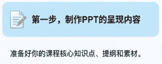

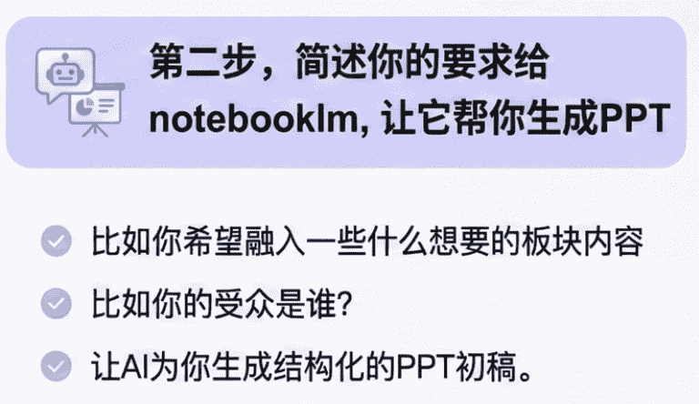

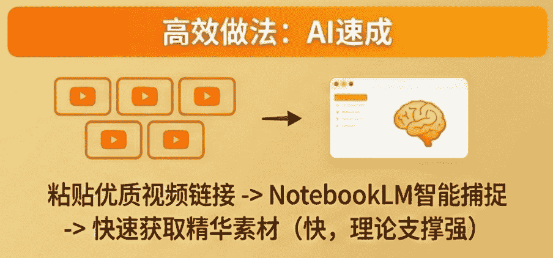

---

#### 【B站好物】从月入200到双十一佣金5W，GMV 637W+，赚钱新手3个月从0开始的复盘分享

> 点击链接，查看原文：[h](https://scys.com/articleDetail/xq_topic/55188122448422184)ttps://scys.com/articleDetail/xq_topic/55188122448422184

本文 nana 会复盘自己如何在B站好物超级标红利期，一个月左右做到纯收入 5W+、京东+淘宝合计 GMV 637W+，走数码家电赛道，从小白到跑通项目闭环的完整过程，给正在起步的圈友做参考。

**推荐阅读人群：**

+   正在观望要不要入局 B 站好物、想先看看完整项目复盘的圈友

+   已经开干但数据平平，想对标一个小白起步到跑通闭环的圈友

+   对数码家电赛道感兴趣的圈友

**目录：**

1/ 如何判断项目适合自己？

2/ 起步阶段怎么做？

3/ 从0到1如何破局？

4/ 选题挖掘方法

5/ 做大规模阶段的踩坑点

6/ 从1到10阶段怎么做？

7/ B站好物项目启动清单

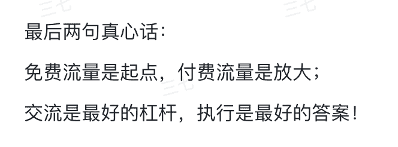

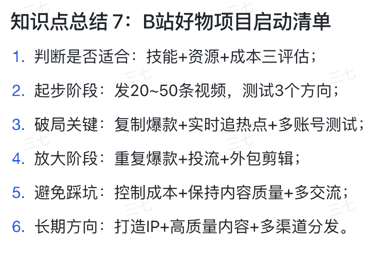

---

#### 双十一跑出200W+的GMV，抖音自然流CPS让我重拾信心

> 点击链接，查看原文：https://scys.com/articleDetail/xq_topic/82811851581151552

本文沈公子将复盘自己在本次抖音自然流 CPS 航海中，如何在双十一期间 16 天内通过「无货源、不投流」跑出 200W+ GMV。

**推荐阅读人群：**

+   在赚钱报过不少航海，却总是虎头蛇尾的圈友

+   想入局或正在做抖音自然流 CPS的圈友

+   在项目中多次受挫，想重建行动力和自信，摆脱内耗的圈友

**目录：**

1/ 什么是抖音自然流 CPS？为什么说它是最适合新手小白的项目？

2/ 如何克服“完美主义”，用 60 分的作品拿到关键正反馈？

3/ 核心技法：如何利用 AI 进行像素级拆解，制作高转化视频？

4/ 流量密码：如何挖掘 DSO 搜索流量，让用户主动找上门？

5/ 账号优化：从关键词到评论区，如何打造高权重账号？

6/ 心法修行：如何通过“数量对抗概率”，成为那个幸运的人？

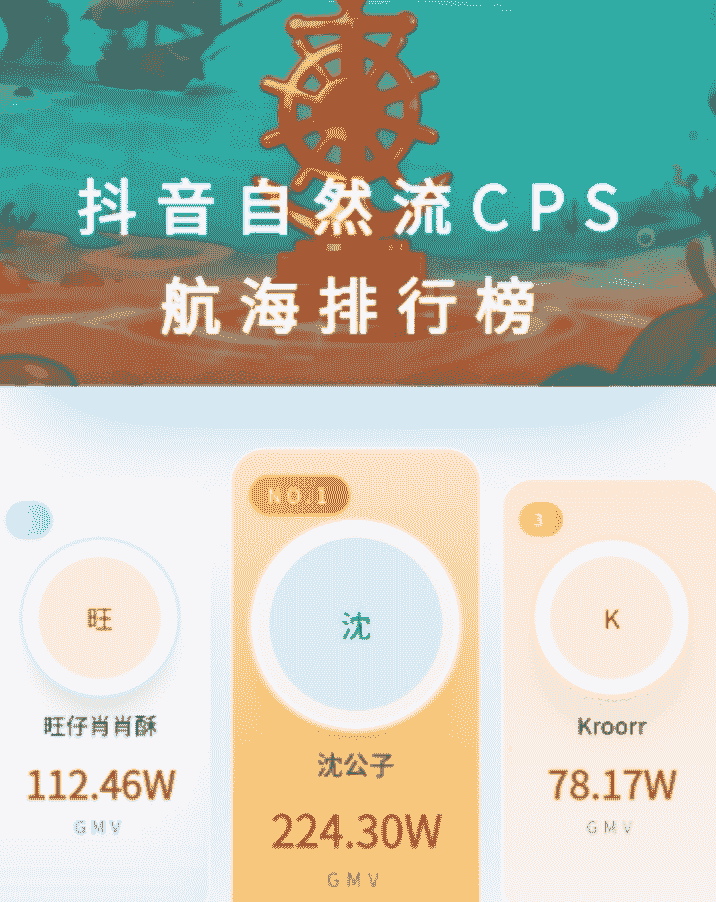

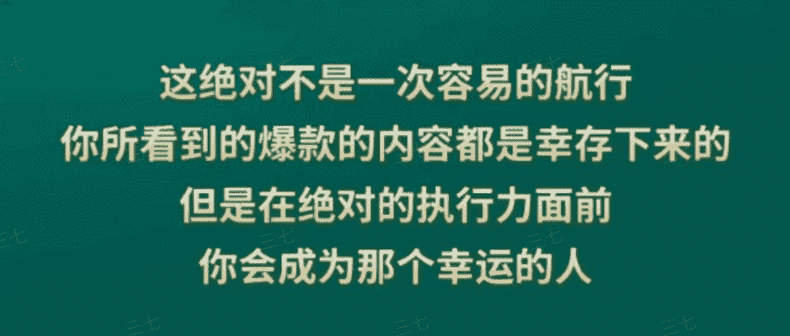

---

#### 我是如何使用AI在不同场景N倍提效的

> 点击链接，查看原文：[h](https://scys.com/articleDetail/xq_topic/45811414221158288)ttps://scys.com/articleDetail/xq_topic/45811414221158288

本文钱塘江鲤将总结自己最近半年围绕 AI 编程和内容创作的实战场景：如何用 AI 把原本需要 3 天的数据采集系统压缩到 1 小时搭完，交付多个企业智能体，让 AI 变成 7×24 小时待命的核心员工。

**推荐阅读人群：**

+   想用 AI 编程提升效率，却不知道从哪些具体场景下手的圈友

+   正在做内容创作与运营，希望用 AI 建立自动化工作流的圈友

**目录：**

1/  AI 编程场景

2/ 内容创作与运营

3/ 🛰️自动化工作流

4/ PPT 生成

5/ AI 生图

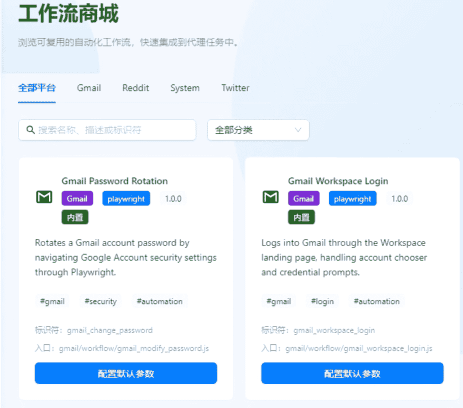

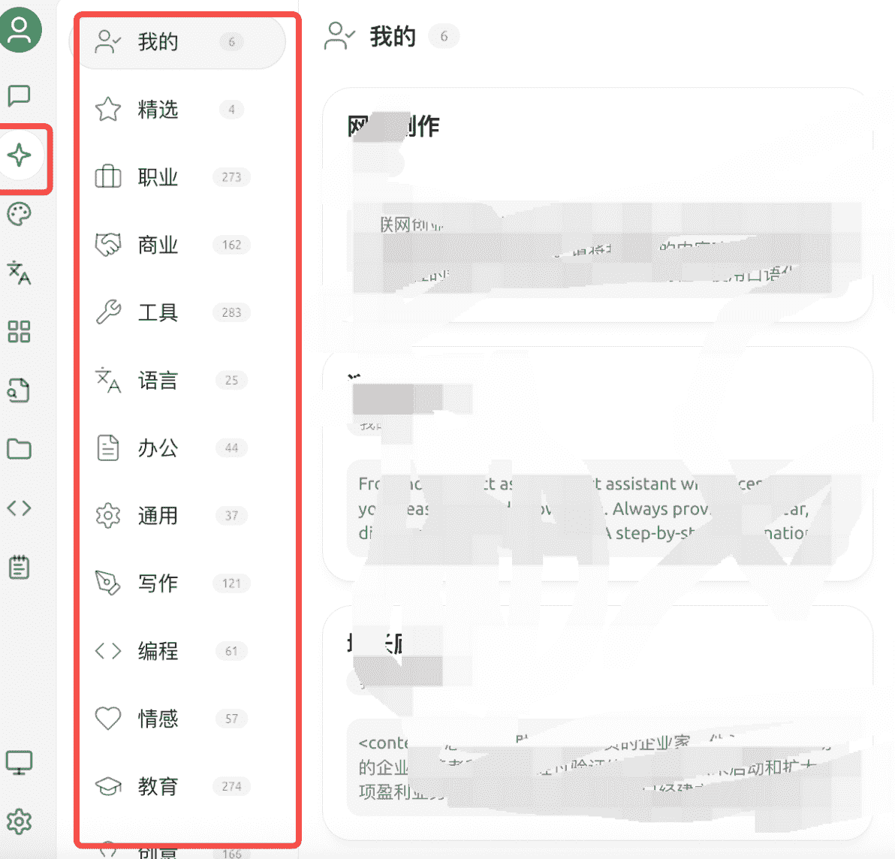

---

#### 📕虚拟垂直小店复盘：揭秘我选品、测品及运营放大的关键动作

> 点击链接，查看原文：[h](https://scys.com/articleDetail/xq_topic/55188121441418424)ttps://scys.com/articleDetail/xq_topic/55188121441418424

本文苏晗将分享如何在📕做虚拟产品电商，用「单品打爆 + 垂直小店」打法，通过 1 个主店 + 3 个关联账号，跑出 0 库存、0 售后、可复制的睡后收入路径。

**推荐阅读人群：**

+   想在📕做虚拟产品的圈友

+   想用单品打爆、垂直小店起盘的圈友

+   想搭建可复制、可放大的📕生意的圈友

**目录：**

1/ 怎么选品

2/ 怎么制作视频笔记，测品

3/ 怎么运营

4/ 怎么放大

5/ One More Thing

# 七、小灯塔

#### 20 步：从 0 到 1 做项目的笨办法

> 点击链接，查看原文：[h](https://scys.com/articleDetail/xq_topic/45811421252525218)ttps://scys.com/articleDetail/xq_topic/45811421252525218

本文 V 先生基于自己过去和最近做项目的实战，总结了 20 条管用的笨办法。他建议大家可以先基于目前手头做的项目，写一份《一页纸战略》，梳理一下《最小阻力流程图》，然后做一个《项目问答手册》。

不要追求复杂，太复杂反而会拖慢行动，核心思路就是文档驱动运营。做文档的过程中，需要汇集散落各处的记录，需要整理自己的经验与思考，自然会领悟到细节。最大的考验就是你的聚焦与耐心。最后光是写一个《项目手册》，写完脑子就清晰了。

---

#### 如何找到自己的优势，并结合优势选择合适的项目？

> 点击链接，查看原文：[h](https://scys.com/articleDetail/xq_topic/22811852415422851)ttps://scys.com/articleDetail/xq_topic/22811852415422851

希望大家不要从想法和感受中找自己的优势，而要从行动中找自己的优势。 不要从收益中找自己的优势，要从成本中找自己的优势，要从代价中找自己的优势。

分析与等待，都无法验证这种优势。想验证，唯有行动：

1/ 停止“找”，开始“试”

2/ 别选“合适的项目”，去“改造项目以适应你”

3/ 用 AI 加速以上提到的一切

---

#### 80天进入百万UP榜单：执行力拉满能破你的所有焦虑，干就完了！

> 点击链接，查看原文：[h](https://scys.com/articleDetail/xq_topic/45811844254548488)ttps://scys.com/articleDetail/xq_topic/45811844254548488

小源目前正在all in B站悬赏带货项目，上榜B站带货百万UP榜单，取得了一些还算不错的成绩，也帮助一些圈友赚到了一点小钱。

借着这次机会，分享从赚不到钱、看不到未来的工作日常，到懵懵懂懂做副业，再到结缘赚钱、抓住 B 站好物超级标，以及这一路的一些真实感悟。希望能看到一个普通人也可以复制的路径，对你有所帮助。

# 八、航海实战

**生**财有术推出的一系列聚焦实战的项目训练营，旨在帮助圈友下场实战、把手弄脏，从而积累项目经验、提升技能并获取赚钱反馈。

点击链接，前往航海实战赚钱官网：https://scys.com/activity

#### 12月航海实战｜14 条航海项目讲解

> 点击链接，查看原文：

> [h](https://scys.com/articleDetail/xq_topic/14588525282585152)ttps://scys.com/articleDetail/xq_topic/14588525282585152

大航海是一整套围绕一个项目，从 0～1 系统跑通的实战旅程。

**1/ 适合创作者，探索新红利：**

YouTube AI 视频、垂直小号 · 👸号、AI 短剧（中长视频）、X（推特）自媒体

2/ 想要AI 赋能、业务提效：

Claude Code 编程应用、热词快站 AI 产品、多维表格 AI 实战、垂直小号自动化（n8n 工作流）、AI 视频自动化（n8n 工作流）

**3/ 适合新手，轻量化启动：**

📕虚拟产品

**4/ 想要电商运营、精细化操盘**

📕直播带货（不出镜）、📕垂直小店

**5/想要认知提升、资产配置**

香港储蓄险配置科普

Mini 航海是周期更短、聚焦更窄的小航程。

本期将开放第 2 期抖音自然流 CPS，重点拆解【 3C 数码】和【家电国补】两大高收益赛道。

---

#### 12月航海实战｜报名细则和船员名单公布

> 点击链接，查看航海报名细则：

> [h](https://scys.com/articleDetail/xq_topic/45811848811854118)ttps://scys.com/articleDetail/xq_topic/45811848811854118

> 点击链接，查看航海日历：

> [h](https://scys.com/articleDetail/xq_topic/14588528252584442)ttps://scys.com/articleDetail/xq_topic/14588528252584442

本次航海时间：

1/ 报名时间： 11 月 19 日 20 点 - 11 月 25 日

2/ 志愿者邀请进群： 11 月 28 日 -11 月 30 日

4/ 开船仪式： 12 月 1 日晚 20:00

5/ 航行期 （Day1-Day21）： 12 月 2 日 -12 月 22 日

6/ 靠岸仪式： 12 月 23 日

# 九、社区活动

#### 11 月会员日 · 赚钱 AI 问答助手开放

> 会员日帖子链接：

> [h](https://scys.com/articleDetail/xq_topic/22811858514112581)ttps://scys.com/articleDetail/xq_topic/22811858514112581

> [生](https://scys.com/articleDetail/xq_topic/82811858442554582)财 AI 问答助手使用反馈帖子链接：https://scys.com/articleDetail/xq_topic/82811858442554582

> 点击链接，使用赚钱 AI 问答助手：

> https://scys.com/ai

赚钱推出了「赚钱 AI 问答助手」，帮助大家整合相应项目的所有信息，并以一个结构清晰的方式进行呈现，那就能让大家更加快速和全面地找到答案。

它将成为你的专属赚钱项目助手，帮助你解决在以下场景中的问题。

1/ 不知道做什么项目，结合你的经历与优势推荐项目

2/ 从零开始了解项目，获取完整的项目方案

3/ 解决项目卡点，提供各种主流赛道的项目指导

4/ 持续提供能量，实现心力和认知的提升

5/ 其他各种你想了解的项目或 AI 内容

---

#### 11488 人已上船｜来找你的同城航海搭子

> 点击链接，查看原文：[h](https://scys.com/articleDetail/xq_topic/45811845112121218)ttps://scys.com/articleDetail/xq_topic/45811845112121218

本次有 11488 位圈友参与本次航海实战！大家来自不同的城市、有着不同的背景，但都在用同样的方式，为今年画上一个完整的句号。

航海期间，我们会为大家提供线上🛰️群的答疑服务，大家可以在群里随时提问，都会有专业的教练来进行解答。

与此同时，我们会邀请不同城市的活跃圈友，来组织一些线下聚会，把同城的大家都聚集起来，一起交个朋友。

欢迎大家在上方帖子评论区留下：你的城市 + 你报名的航海项目。

---

####

#### **小灯塔选题投票 & 壁纸上线**

> 点击链接，查看选题投票：[h](https://scys.com/articleDetail/xq_topic/45811418588514188)ttps://scys.com/articleDetail/xq_topic/45811418588514188

> 点击链接，查看壁纸上线：https://scys.com/articleDetail/xq_topic/82811851525828852

我们整理了 10 个小灯塔选题，邀请大家一起参与投票，最终统计了投票情况，呼声最高的前五个选题如下：

1/ 如何找到自己的优势，并结合优势选择合适的项目？

2/ 怎么对项目进行有效复盘，才能实现项目突破？

3/ 做项目总是三天打鱼两天晒网，怎么让自己坚持下去？

4/ 怎么从大佬身上学东西，提升自己的认知和能力？

5/ 项目一直没正反馈，怎么稳住心态继续干？

我们已邀请传术师或者嘉宾来进行相应的分享，帮助大家解决问题，欢迎持续关注小灯塔栏目。

同时，这个月我们尝试做了一个新的形式，小灯塔手机壁纸。如果你把它设成锁屏，或许就能在忙碌的时候给你一点鼓励，让你随时看到一条值得实践的方法。

# 十、航海家

#### 千帆竞发，百舸争流 | 11月29日 北京【航海家 | IP大会】

**普通人做IP的时代到了**

> 帖子链接：[h](https://scys.com/articleDetail/xq_topic/22811515182542121)ttps://scys.com/articleDetail/xq_topic/22811515182542121

**大会嘉宾介绍和分享内容总结**

> 帖子链接：

> [h](https://scys.com/articleDetail/xq_topic/22811518284514151)ttps://scys.com/articleDetail/xq_topic/22811518284514151

**现场精华直播**

> 帖子链接：

> [h](https://scys.com/articleDetail/xq_topic/14588528584455122)ttps://scys.com/articleDetail/xq_topic/14588528584455122

---

#### **航海家游学**

**北京飞书专场游学**

> 帖子链接：[https://scys.com/articleDe](https://scys.com/articleDetail/forum_topic/452)tail/forum_topic/452

**深圳紫菜游学分享**

> 帖子链接：[https://scys.com/articleDe](https://scys.com/articleDetail/forum_topic/451)tail/forum_topic/451

**Agent 智能体主题会**

> 帖子链接：[https://scys.com/articleDe](https://scys.com/articleDetail/forum_topic/448)tail/forum_topic/448

**杭州影刀 AI+RPA 游学**

> 帖子链接：[https://scys.com/articleDe](https://scys.com/articleDetail/forum_topic/446)tail/forum_topic/446

# 十一、赚钱联合办公空间

#### **赚钱联合办公空间外地第一站**（深圳站）落地

> 点击链接，查看招募表单：[h](https://scys.com/articleDetail/xq_topic/82811855414514522)ttps://scys.com/articleDetail/xq_topic/82811855414514522

> 点击链接，查看通过名单：https://scys.com/articleDetail/xq_topic/22811885258888251

在实地考察了十几个场地后，终于找到了符合需求，且条件很好的场地作为联合办公空间，赚钱联合办公空间外地第一站（深圳站）已落地。

期待赚钱在全国开出更多的空间，也许圈友们就能实现“全国旅居+联合办公”的自由生活了。

深圳圈友们热情和质量都特别高，这次共收到82份申请。但第一期的工位只有49个，通过的65名圈友中，有一部分人需要排队等待，我们也正在积极想办法，争取让这些圈友早日入驻。

# 十二、线下聚会

** 线上千万遍，不如线下见一面。本月近千位圈友**，已经通过线下聚会解决卡点、收获新思路。

如果你想发起聚会或参与聚会，欢迎点击：https://scys.com/meeting

#### 关于线下聚会的优质分享

参加完小鹅的线下局，我重塑了流量、AI与长期主义的这3点认知

> 点击链接，查看原文：

> [h](http://scys.com/articleDetail/xq_topic/82811858852251422)ttp://scys.com/articleDetail/xq_topic/82811858852251422

这个会上很多圈友在做流量与私域，提出“如何精确的找到我的粉丝”“如何运营我的朋友圈”“如何截流”。

通过这次线下局让我意识到，普通人的资源差，不是靠送礼送出来的，也不是靠吹牛吹出来的。 而是靠把每一件小事(哪怕是找场地、做执行、做PPT)做靠谱。 深度绑定一个大佬，让他信任你，愿意把他的背书借给你。

打牌哲学 x 自由职业 x 人生管理：我听过最值得收藏的一场年终复盘

> 点击链接，查看原文：

> [h](https://scys.com/articleDetail/xq_topic/82811542418158152)ttps://scys.com/articleDetail/xq_topic/82811542418158152

分享里有很多戳我的点，比如“要多培养输出型爱好，别搞输入型爱好。”“做好当下，别想太多，专注做眼前该做的事就行。”“别对别人心生恐惧，该勇敢就勇敢。”...

其实多听别人的经验、分享，特别有意思 —— 这不是单纯的「听课」，更像是在「经历别人的经历」，能让自己少走弯路，更好地成长。

第一次参加赚钱线下聚会，人不多但收获多

> 点击链接，查看原文：

> [h](https://scys.com/articleDetail/xq_topic/82811542441414542)ttps://scys.com/articleDetail/xq_topic/82811542441414542

参加读书局，是想推一推自己沉下心来看看书。平常也有碎片化时间看电子书、听播客，但确实已经很久没有用完整的一段时间看完一本书了，所以很喜欢这个主题局，希望以后多多参加。

感谢赚钱提供这么好的平台，大家都很真诚、利他，感觉真好。

---

#### 全国线下聚会

**杭州****线下****聚会**

> AI 出海高手分享局；AI Sass 共学交流局； 私域流量交流局；财富流沙盘娱乐局；网球运动局...

**上海****线下****聚会**

> 👸号交流局；IP＋私域交流局； AI编程Claude最佳实践高手分享局；AI产品出海交流局...

**北京线下聚会**

> 航海家大会；个人IP，私域流量，AI提效交流局；AI实战交流局；畅游北京故宫娱乐局；心力交流局...

**广东线下聚会**

> AI赋能电商交流局；跨境外贸交流局；富爸爸现金流娱乐局；AI web 交流局；户外运动局...

**山东线下聚会**

> B站好物交流局；youtube出海交流；📕流量打法交流局；济南秋日娱乐局...

**四川线下聚会**

> AI & RPA 高手分享局；羽毛球运动局；剧本杀娱乐局...

**天津****线下****聚会**

> 航海选题拆解交流局 ； 📕买手业务交流交流局...

**福建线下聚会**

> 电商合规高手分享局；YouTube 高手分享局；AI交流局...

**海南线下聚会**

**河南线下聚会**

**广西线下聚会**

如你对赚钱月刊有任何建议与反馈，欢迎点击链接，反馈给我们：https://scys.com/form/z27VzqBS

如想了解更多社区内容、活动，可以访问龙哥盟官网：https://scys.com/t/BOA7QSQe

也可🛰️联系鱼丸进行咨询（🛰️号：yuwan320）

