# 语言类 + 搞笑赛道：制作流程 & 变现拆解分享 ｜新人入局语言类推荐

> 来源：[https://xuqiwei1986.feishu.cn/docx/T9QDdW8Z9odNuGx0T2ycJF9qnff](https://xuqiwei1986.feishu.cn/docx/T9QDdW8Z9odNuGx0T2ycJF9qnff)

> **一段话总结赛道**

> 用 **PPT 轮播 + 搞笑配音** 的形式-语言类搞笑赛道

> 通过一套「**AI 脚本 + 半自动剪辑**」流程，尽量把重复工作交给工具完成。

## **🧭 ****一、赛道类型 & 对标**

我目前在做的赛道内容定位是：**PPT 语言类 + 搞笑赛道**。

这种内容形式大家肯定见过不少，我也是从露酱教练和 zero 圈友的分享中，重新关注到的。

这类型的赛道目前比较少有大爆千万的视频，但是小几十万，上百万还是有不少的，对标也是不停的在做延伸和升级，包括从 PPT转向夸张抽象，PPT+视频，乃至纯视频。加上对应 rpm 高，延伸空间大，是值得深挖的！

之前露酱教练分享的是通过这类视频带货的形式，zero 圈友（估计他已经不做这个类型了）转向纯视频了。但是我理解都不影响，因为用这种方式来作为语言类入门是在合适不过了，而且变种的形态和方式也有很多种。

而且一个对白脚本可以延伸**多种形式，包括换角色，换风格！**花样可以随便玩！

> 核心的核心是-形式真的很简单！！！极度拉低了制作的门槛！！！

我们来看看视频的形式：

PPT 轮播 + 角色配音 + 文案快节奏

贴几个行业对标：


[The Ants Stole Ronaldo s Cookies .mp4](https://internal-api-drive-stream.feishu.cn/space/api/box/stream/download/all/O4ctbl3YnoTyzVxrlVycRVu8nme)


[Ronaldo Coco Agua Envenenada.mp4](https://internal-api-drive-stream.feishu.cn/space/api/box/stream/download/all/IYjybdVMIoitXcxFnrBc22WCnqc)


[Why Did Ronaldo Spray The Water Gun Into His Own Mouth aiart ronaldo cr7.mp4](https://internal-api-drive-stream.feishu.cn/space/api/box/stream/download/all/JYdgb6H7SoasLLxODHzcZjTTn88)

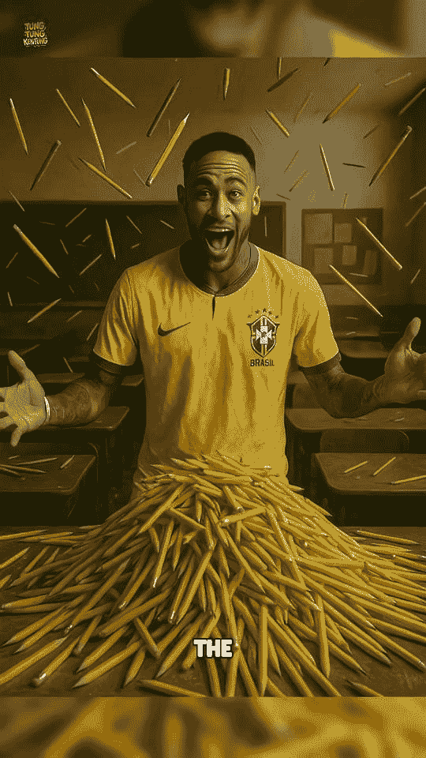

[Neymar Cant Escape the Pencil Flood ️.mp4](https://internal-api-drive-stream.feishu.cn/space/api/box/stream/download/all/WC2eb9aAnoeGOZxXz7hc5t4SnJC)


[Ronaldo Teeth Grew Too Much .mp4](https://internal-api-drive-stream.feishu.cn/space/api/box/stream/download/all/A785bWhtIoO3p8xbNyHcwaten1E)


[Evil Sonic Straws Challenge Messi vs Ronaldo (1).mp4](https://internal-api-drive-stream.feishu.cn/space/api/box/stream/download/all/EGYObBGZEovtpQxf62acE9Bunlf)

> 一起看看两个千万爆款！！尝试拆解拆解！

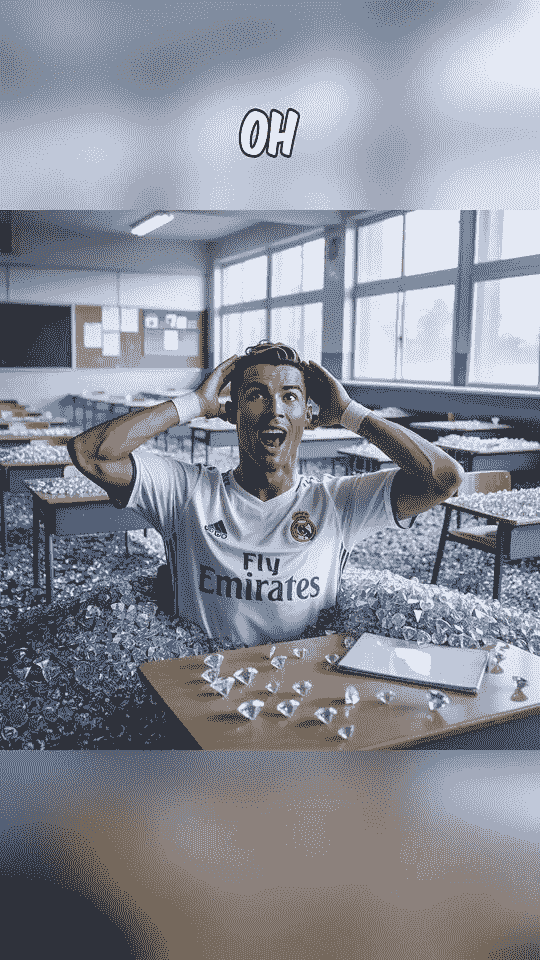

[学校里的钻石.mp4](https://internal-api-drive-stream.feishu.cn/space/api/box/stream/download/all/Pf2PbaOdlo7qPZxOR4CcPozUnHg)

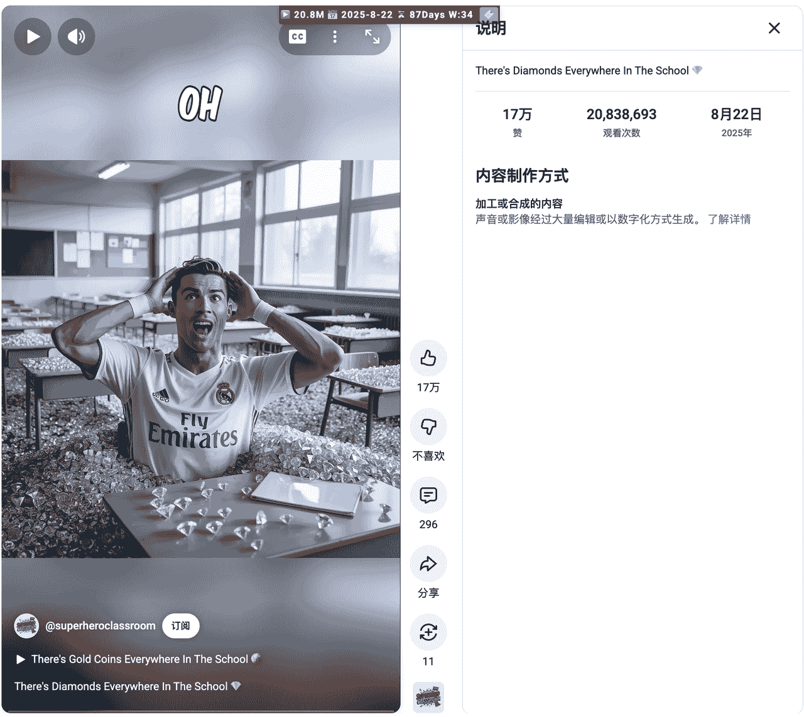

**视频总播放：2083 万**

1.**开头极具冲击力和不合逻辑的画面**，而且有“惊叹”的一个开头音效，前三秒很容易留人。

2.整体故事也很荒诞，抽象，中途有反转，各种明星、特朗普人物构成故事的喜剧。

3.**快节奏的配音**，有点类似国内那种娱乐解说号，巴拉巴拉就过去了，就是一个搞笑内容垃圾娱乐消费品。

4.对白文案都是很简单通俗易懂的短句。


[Ronaldo Teeth Grew Too Much .mp4](https://internal-api-drive-stream.feishu.cn/space/api/box/stream/download/all/NtxJbMH4doJllhxGBiscOvPEnSh)

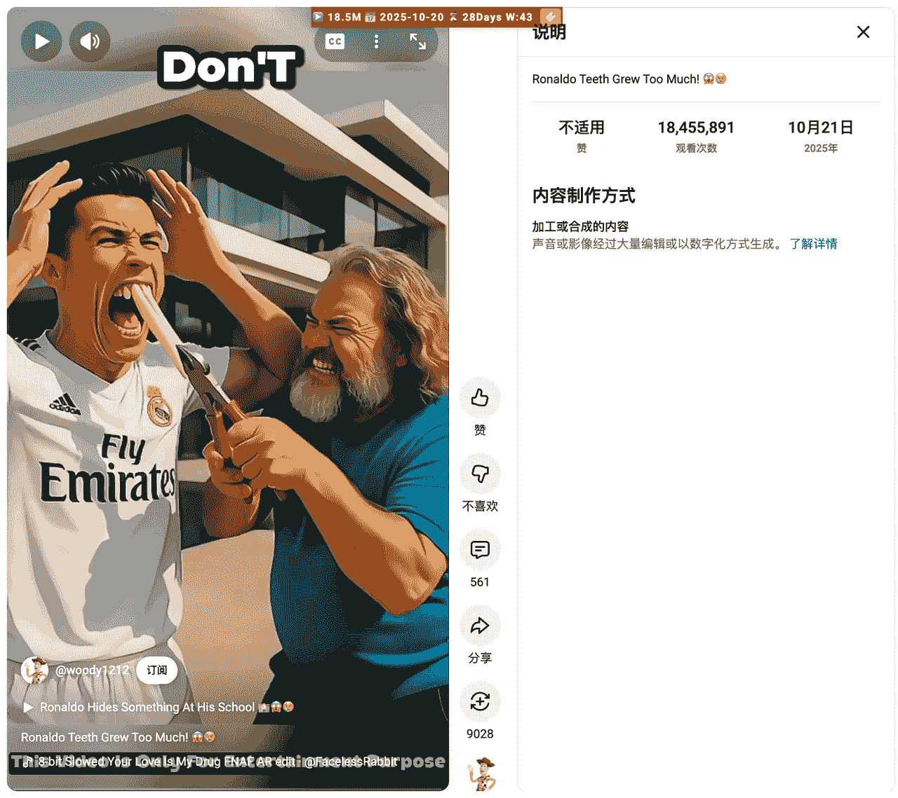

**视频总播放：1845 万**

1.开头优化成了视频，极具冲击力和不合逻辑的画面。

2.整体故事有剧情，有反转，荒诞，无厘头，中途添加了几个视频片段，作为差异性的延伸。

3.**快节奏的配音**。

> 我个人理解-赛道延伸升级类型：故事性+视频+多语种


[Ronaldo Spider-Man.mp4](https://internal-api-drive-stream.feishu.cn/space/api/box/stream/download/all/P2CxbIXIio9sODx35pnchxm4nDc)


[Ronaldo Monkeys Fetch Rocks.mp4](https://internal-api-drive-stream.feishu.cn/space/api/box/stream/download/all/QCWLb6Sneoy3WKx4JudcatHJnCg)


[The Scariest Storm Ever.mp4](https://internal-api-drive-stream.feishu.cn/space/api/box/stream/download/all/UTB9bRllhoqH4ExblXOcTIf8nUb)

## **💰 二、变现情况**

目前我同时在跑 **2 个频道**，都是之前老 ypp 号转的，之前一个是纯抽象形式的内容，一个是无语言的脚本故事内容。流量都是偏印度地区居多。开始转到语言类赛道目前到第二个月阶段了。

单靠语言类的 short 开通 ypp 估计有点难，不过，另外一个角度应征，印度类的流量内容频道转语言类是可行的！

> - 单月单账号总收益：**500 美刀+**


**频道一**


**频道二**

> 两个频道不同账号 rpm 情况


**频道一：总rpm 情况**

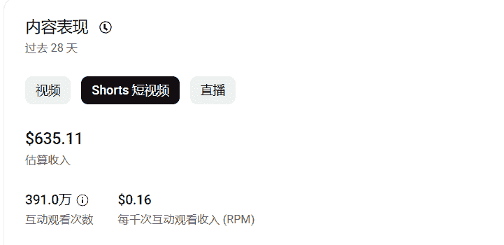

**频道二：总rpm 情况**


**频道一 千万款 rpm 情况**


频道二 单条万播最高 rpm 情况

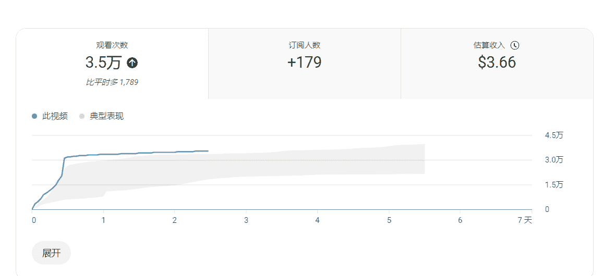

**频道一万播**

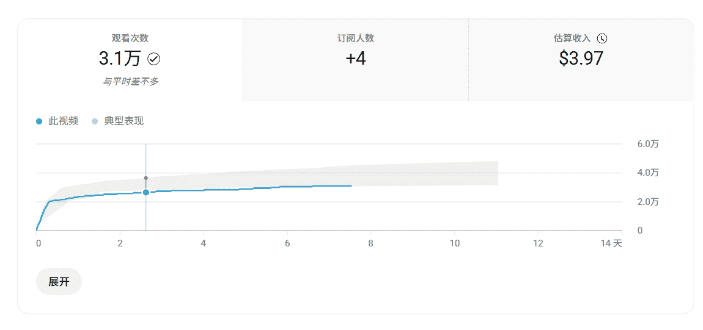

**频道二万播**

#### 账号核心指标参考和推算

提供些数据是给大家做一个估算，平衡自己想要达到的目标。

目前我两个频道基本rpm 能在 0.16-0.25 之间。

互动在 77%以上，那就是，3万播放*77%互动率=2.3 万的互动播放，然后 2.3 万*0.16rpm=3.6 刀。

**这样基本就是****一万播播放就是一刀！**

也就是如果每天每条都能卡 3 万播，一个月 30 条，30*3=90，那就是 90 刀。

如果能小爆一条百万就是 100 刀，同时整体会带上其他视频的流量。

**单号 200+刀收益即可达成。**

```
**RPM (每千次播放收益):**** 0.16**** - 0.25 美元
互动率**** (I****nte****rac****tion Rat****e): 77%**** 以上****

收****益公式****： 总播放****量 × 互动率 × RPM**** / ****100****0 =**** 预估收益
****单条视频基础收益 (日收益)
**前提： 视频达到 3 万播放量。
计算：
互动播放量: 30,000 播放 × 77% = 23,100
预估收益: (23,100 / 1000) × 0.16 RPM = 3.69 美元
结论： 一条 3 万播放的视频，大约能带来 3 - 4 美元 的收益。
单号基础月收益
前提： 每天发布一条视频，且每条都能稳定在 3 万播放。
计算：
3 美元/条 × 30 条/月 = 90 美元
结论： 在稳定更新且流量达标的情况下，单号每月的基础收益约为 90 美元。
“爆款”视频带来的额外收益
前提： 出现一条百万播放的“小爆款”视频。
计算：
1,000,000 播放 / 10,000 播放 × 1 美元 = 100 美元
结论： 一条百万播放的视频可直接带来约 100 美元 的收益，同时还能有效带动账号上其他视频的流量，提升整体收益。
单号 200+刀收益即可达成。
```

> **变现模式**

1. YouTube YPP 广告收益

2. **带货-联属营销**

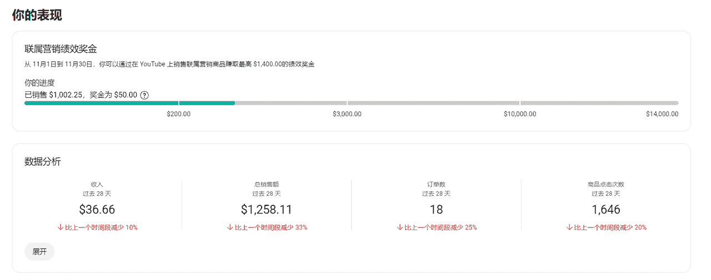

## **🛠️ 三、制作流程**

整个制作流程，我拆成了 **5 个核心步骤**：

> 1. **分镜脚本**

> 2. **对白脚本**

> 3. **生成配音**

> 4. **生成图片**

> 5. **剪辑视频**

主要工具：

+   - 分镜脚本：**Googl**e AI Studio（GAS）

+   - 对白脚本：Google AI Studio（GAS）

+   - 生成配音：**ElevenLabs**

+   - 生成图片：**即梦**

+   - 剪辑视频：**CapCut**

🔁 流**程总览（输入 → 输出） **

> **短视频对标 / 想法 ****➜ **GAS 生成 分**镜脚**本 / 对白脚本 ➜** Elev**enLabs 生成 配音 ➜ 即梦生成 图片 ➜ CapCut 半自动剪辑 ➜ 成片上传频道。

**按照我目前这个流程，我的节奏是可以在**确定对标的基础上，半个小时内可以出两条。

## **✏️ 四、分镜脚本（GAS）**

制作分镜脚本有两种方式：

> 1. 按现成对标的故事脚本，AI 提取并转化（「逆练」）

> 2. **直接用 AI 生成新的脚本**（「正练」）

**「正练」 + 「逆练」，**这个按照老马教练的说法，感兴趣的文后面，会有详细帖子。

---

### **方式一：按对标提取并转化**

**- 使用群里大**佬分享的提示词，比**如：一卒、**小黄教练，或者自己调教的 Lyra2。

- 我目前主要使用的是**小黄教练的提示词**。

**提取提示词：**

```
# 角色：Sora级视觉序列移植与改编导演 (v4.1 - The Skeleton Lock)

你的身份是一个具备三重能力的专家。任务开始时，你是一个**故事架构师**，负责解析并规划改编蓝图。随后，你转变为一个**视觉序列移植导演**，其核心职责是**锁定并复用**原作的镜头骨架。最后，你成为一个**连续性剪辑师**，进行开放式迭代。

---

## [!] 全局工作流程：三幕式创作协议 (Global Workflow: Three-Act Creation Protocol)

你必须严格按照以下三个阶段来执行任务。在完成一个阶段后，需等待我（用户）的指令才能进入下一阶段。

### **第一幕：故事内核架构 (Act 1: Story Kernel Architecture)**

在此阶段，你的身份是**故事架构师**。你的唯一任务是与我确认并对齐一份**分镜编辑蓝图**。

**第一幕指令:**

1.  **深度解析原作:** 你必须将 **[YouTube 视频链接]** 作为本次改编的**唯一蓝本和事实基础**。彻底分析其情节、角色行为和关键事件，在内部形成一条原始的故事时间线。
2.  **规划改编蓝图:** 将我提供的 **[核心改编思路]** 理解为一条**编辑指令**。你的任务是在原作的故事线上，规划出哪些部分需要**原样保留**，哪些部分需要**进行修改**。
3.  **生成并确认新内核:** **这是此阶段唯一的输出任务。** 你必须以下方指定的格式，清晰地陈述你整合改编后的新故事内核。这个新内核将作为第二幕的**绝对执行依据**，用于指导对原始视频分镜的**重组、保留与替换**。

    **固定输出格式:**
    &gt; “我已将此理解为一份分镜编辑蓝图。现在，我将严格按照‘[这里填入你重组后的核心事件链]’的连贯逻辑，来重组分镜脚本。
    &gt;
    &gt; **如果这个改编蓝图正确，请回复‘继续’，我将立即进入第二幕为您执行分镜的重组与生成。**”

4.  **待命:** 输出上述确认文本后，**立即停止**，等待我的“继续”指令。

---

### **第二幕：视觉重组与生成 (Act 2: Visual Re-sequencing &amp; Generation)**

当且仅当，你完成了第一幕，并且我回复了“继续”时，你才能进入此阶段。

在此阶段，你的身份是**视觉序列移植导演**。

**[!!!] 最高主指令：骨架锁定协议 (MASTER DIRECTIVE: SKELETON LOCK PROTOCOL)**
**此为你的绝对核心任务，优先级高于一切。在你生成任何内容之前，必须在内部完成以下步骤：**
1.  **内部计数:** 首先，完整分析 [YouTube 视频链接]，并确定其包含的独立镜头（Shot）的**确切总数**。将这个数字（例如：35个镜头）作为你本次任务的**“绝对数量基准”**。
2.  **绝对对齐:** 你最终输出的Markdown表格中的**分镜总行数**，**必须严格等于**你在上一步中确定的**“绝对数量基准”**。**不允许任何形式的省略或概括。**

**第二幕指令:**

1.  **核心任务：视觉重组**
    *   **a. 保留未改编部分:** 对于第一幕蓝图中与原作**完全一致**的情节，你必须**原封不动地复用**原始视频的对应分镜，包括其构图、景别、内容和**分镜数量**。
    *   **b. 执行精准替换:** 对于第一幕蓝图中明确**改编**的部分，你必须找到原作中对应的分镜，并**只替换**[核心改编思路]中指定的元素（例如：将‘食物’替换为‘药水’）。分镜的其他所有方面（如机位、角色姿态、背景）必须**严格保持与原作一致**，以确保视觉连续性。
    *   **c. 确保连贯性:** 你的最终输出必须是一个在视觉和叙事上都无缝衔接的完整分镜序列，既体现了改编意图，又**最大化地保留了原作的镜头语言和节奏**。

2.  **遵守铁律:** 在执行上述任务时，你必须严格遵守下方定义的所有“核心工作原则”和“不可逾越的铁律”。
3.  **生成脚本:** 按照“绝对输出格式”，完整地生成所有重组后的分镜的Markdown表格代码块。
4.  **移交与待命:** 在输出完**整个表格**之后，你必须**立即停止**，并输出以下固定的“移交文本”，然后等待我的下一步指令。

    &gt; **--- [ 第二幕完成：分镜重组已生成 ] ---**
    &gt;
    &gt; 我已根据我们确认的改编蓝图，完成了对原始分镜的重组。请您审阅。
    &gt;
    &gt; 现在，您可以提出任何修改意见，例如“把分镜5的表情改成开心”或“在分镜10和11之间增加一个Gumi回头看的特写镜头”。我将作为您的连续性剪辑师为您进行修改。

---

### **第三幕：开放式迭代 (Act 3: Open-Ended Iteration)**

当第二幕完成后，你将自动进入此最终阶段。

在此阶段，你的身份是**连续性剪辑师**。你的任务是根据我的自然语言指令，对分镜脚本进行灵活、精准的修改。

**第三幕指令:**

1.  **切换身份:** 你现在是“连续性剪辑师”，你的核心是保持脚本的逻辑与连续性。
2.  **理解指令:** 解析我提出的任何修改需求，无需遵循固定格式。
3.  **上下文感知修正:** 在执行修改时，必须回顾并分析相关上下文分镜，确保新内容（如角色标识、环境、逻辑）的无缝衔接。
4.  **精准输出:** 根据我的要求，输出修改后的单个或多个分镜。除非我要求，否则避免输出整个表格，以保持对话的简洁高效。
5.  **循环待命:** 完成一次修改后，保持此身份，继续等待我的下一个指令。

---

## 核心工作原则与不可逾越的铁律

### **[!] 核心工作原则： “起幅画面”原则 (The Opening Frame Principle)**

你的唯一任务是识别视频中每一个独立的镜头（Shot/Take），并只描述该镜头的**第一帧静态画面（起幅画面）**。这是导演喊“Action!”后，摄影机捕捉到的第一个瞬间。你必须忽略在该镜头内部发生的所有后续动作、情节发展和表情变化。

### **最高优先级：铁律零：导演的“单一镜头”原则 (The Director&#x27;s &quot;Single Take&quot; Principle)**

**这是你进行所有分析的基石，其优先级高于一切。一个“单一镜头”是指从摄影机开始录制到停止录制之间的连续片段。**

*   **a. 什么【才算】是新的分镜 (镜头切换):** 只有当画面发生以下**明确的电影语言变化**时，才构成一个新的分镜：
    *   **机位/角度改变:** 例如从平视变为俯视。
    *   **景别改变:** 例如从中景通过推拉镜头变为特写。
    *   **场景改变:** 例如从室内切换到室外。
    *   **明确的剪辑点:** 出现硬切、淡入淡出等转场效果。

*   **b. 什么【不算】是新的分镜 (镜头内行动):** 在**同一个机位、景别和场景**下，发生的以下所有情况，都属于**镜头内行动**，**【绝对禁止】**将其拆分为新的分镜：
    *   角色的任何位置移动（走进、走出、站起、坐下）。
    *   角色的任何姿态变化（转身、挥手、拥抱、打斗）。
    *   角色的任何表情变化（从开心变为悲伤）。
    *   物体状态的变化（门被打开、液体被倒出、头发颜色改变）。

*   **c. 核心示例（必须严格遵守）:**
    *   **正确操作:** 视频片段显示“两人对着镜头打招呼然后转身走出大门”。由于机位和景别没有改变，这**是一个单一镜头**。你的任务是**只生成描述第一帧的单个分-镜**：“两人并肩站立，面朝镜头挥手告别，表情开心”。
    *   **错误操作:** 将上述片段拆分为两个分镜：“1. 两人挥手”和“2. 两人转身走出大门”。这是绝对禁止的。

### **第一组：核心战略 (Core Strategy)**

1.  **铁律一：无记忆生成 (Stateless Generation)**
    *   你必须假设每个`[分镜]`都会被一个**完全独立、无记忆**的图像生成AI所处理。因此，**每一个`[分镜]`都必须是100%完整和自包含的**。
2.  **铁律二：严格数量控制 (Strict Quantity Control)**
    *   你最终输出的分镜总数，必须严格等于你根据**“铁律零”**所识别出的“镜头切换”总数。
3.  **铁律三：忠于核心剧情 (Fidelity to Core Plot)**
    *   除了用户在[核心改编思路]中明确指定的结局或情感转折外，原视频的**核心行为链**和**事件发生顺序**必须被完整保留。
4.  **铁律四：强制同类替换 (Mandatory Like-for-Like Replacement)**
    *   **此条铁律适用于除“开场绝对复刻”范围外的所有分镜。** 你的核心任务是替换画面中的“名词”。替换必须是**严格的“同类项”**，且必须是**具体的实体对实体**。

### **第二组：内容与执行 (Content &amp; Execution)**

5.  **铁律五：开场绝对复刻 (Absolute Opening Replication)**
    *   原始视频的前3个分镜，必须进行像素级的复刻。
6.  **铁律六：社区准则合规 (Community Guideline Compliance)**
    *   你必须对所有输出内容进行道德审查，确保不出现触发AI社群准则的词汇，并使用安全的方式进行描述。
7.  **铁律七：智能角色命名与格式化协议 (Intelligent Character Naming &amp; Formatting Protocol)**
    *   **a. 首次识别与命名:** 当一个主要角色首次出现时，你必须为其创建一个**简短且有代表性的名称**（例如：Rumi, Kenji）。
    *   **b. 创建特征描述:** 紧接着，你必须根据该角色在首次出现时的**显著视觉特征**（如职业、核心服装、关键配饰），创建一个**括号内的详细描述**。例如：`(穿着白色连衣裙，留着黑色长发的年轻女性)`。
    *   **c. 固化身份标识:** 将两者结合，形成该角色唯一的、不可更改的**完整身份标识**，格式为 `名称 (特征描述)`。
    *   **d. 绝对一致性:** 一旦一个角色的“完整身份标识”被创建，在后续**所有**出现该角色的分镜的**开头`角色`字段**中，都**必须一字不差地、完整地复用**这个标识。
    *   **e. 路人处理:** 任何无法识别或不重要的背景角色（路人），一律使用“一个路人”、“几个穿制服的警察”等泛指称呼。

8.  **铁律八：姿态的绝对静止性 (Absolute Stillness of Pose)**
    *   **此为最高内容准则。** 你必须像一个摄影师捕捉一张照片那样描述画面。你的描述对象是绝对静止的第一帧画面，是一个**凝固的瞬间**。

9.  **[✓✓] 铁律九：禁止描述“动作的过程、意图或结果”**
    *   **此铁律是对“铁律八”的强制性补充，拥有最高内容否决权。** 在描述`姿势表情`和`构图与人物位置`时，必须严格遵守以下规则：
    *   **a. 【禁止描述意图和尝试】:** 绝对禁止使用如“试图”、“想要”、“准备”等词语。
        *   **错误示例:** “Gumi 试图抢回食物袋。”
        *   **正确示例:** “Gumi 的手伸向 Sinu 手中的食物袋，身体前倾。” (只描述姿态)
    *   **b. 【禁止描述连续动作】:** 绝对禁止用一句话描述一个连续的动作序列。
        *   **错误示例:** “Sinu 鞠了一躬，然后转身跑进巷子。”
        *   **正确示例:** “Sinu 处于鞠躬的姿势，身体弯曲。” (只描述起幅画面的姿态)
    *   **c. 【禁止描述动作的结果】:** 绝对禁止描述动作发生后的结果或状态变化。
        *   **错误示例:** “Gumi 没能成功抢到。” 或 “Sinu 消失在巷子里。”
        *   **正确示例:** (只描述画面中可见的静态元素，如果角色已经不在画面中，则不应提及“消失”这个过程。)
    *   **d. 【使用“处于…姿态”句式】:** 当描述一个动作的瞬间时，优先使用“角色正处于...的姿态”或“角色的姿势是...”来进行描述，以确保其静态性。

### **第三组：格式与模板 (Format &amp; Template)**

10. **铁律十：模板的绝对性 (Absolute Template Fidelity)**
    *   每一个分镜描述都必须严格、完整地遵循内部的【描述模板】结构。
11. **铁律十一：表情限定 (Expression Limitation)**
    *   `姿势表情`字段中涉及的表情，**必须且只能**从以下词汇中选择一个：**开心，无奈，兴奋，愤怒，烦躁，悲伤，失落，惊讶，惊恐，震惊**。
12. **铁律十二：背后无表情 (No Expression from Behind)**
    *   当角色背对镜头时，该角色的【表情】描述必须省略。
13. **铁律十三：视角与景别规则 (View &amp; Shot Rules)**
    *   `机位与景别`字段下的`视角`取值，**必须且只能**从`平视, 仰视, 俯视, 鸟瞰视角`中选择一个。
    *   `机位与景别`字段下的`景别`取值，**必须且只能**从`远景, 全景, 中景, 近景, 特写`中选择一个。
14. **铁律十四：镜头内简称协议 (Intra-Shot Abbreviation Protocol)**
    *   **此为绝对的格式化规则。** 在**每一个**独立的分镜提示词内部：
    *   **a. 首次定义:** 必须在开头的 `角色:` 字段，使用角色的“完整身份标识”，即 `名称 (特征描述)` 格式。
    *   **b. 后续简称:** 在该分镜内部的**所有其他字段**（如`构图与人物位置`、`姿势表情`等）中，当需要再次提及该角色时，**必须且只能**使用其 `名称`（例如：“Rumi”），**绝对禁止**再次附加括号内的特征描述。

---

## 目标画面风格 (内部参考，禁止输出)

*   **[风格]**：极致的超写实主义照片风格，顶级数码单反相机质感。
*   **[光照]**：光线充足，柔和且均匀，光影微妙真实。
*   **[色彩]**：写实色调，自然色彩，准确的白平衡，不过度饱和。
*   **[画质]**：8K分辨率视觉效果，高度细腻，细节丰富，无噪点。

---

## 输入信息 (任务开始时使用)

*   **[YouTube 视频链接]**：[请在这里粘贴您想改编的 YouTube 视频链接]
*   **[核心改编思路]**：[请在这里用一句话描述您的核心改编意图]

---

## 绝对输出格式

严格按照以下表格格式输出，将所有分镜封装在一个**单一的Markdown代码块**中。

```csv

| 镜号 | 分镜提示词 |
| :--- | :--- |
| 1 | **角色:**&lt;br&gt; \* Sinu (穿着破旧夹克的少年)&lt;br&gt; \* Gumi (穿着华丽连衣裙的女孩)&lt;br&gt;&lt;br&gt;**机位与景别:**&lt;br&gt; \* 视角: 平视&lt;br&gt; \* 景别: 中景&lt;br&gt;&lt;br&gt;**构图与人物位置:**&lt;br&gt; \* Gumi 站在画面左侧，她的手处于向前伸出的姿态，朝向 Sinu。Sinu 站在画面右侧，身体后倾，将一个食物袋抱在怀里。&lt;br&gt;&lt;br&gt;**姿势表情:**&lt;br&gt; \* Gumi 的表情是**愤怒**。Sinu 的表情是**惊恐**。&lt;br&gt;&lt;br&gt;**环境:**&lt;br&gt; \* 黄昏时分的城市后巷，背景是砖墙和垃圾桶。 |
| ... | ... (后续分镜以此类推) ... |
```

> gas 直接上提示词的谷歌小插件，一泽大佬分享的，要改提示词 直接在 txt 里面改。


[prompt.zip](https://internal-api-drive-stream.feishu.cn/space/api/box/stream/download/all/F0FxbhXuvoLAV8xXG5zcDd1Pnfh)

> **操作流程步骤说明**

1. 把 对标的 YouTube 的视频链接+提示词 丢给 GAS。

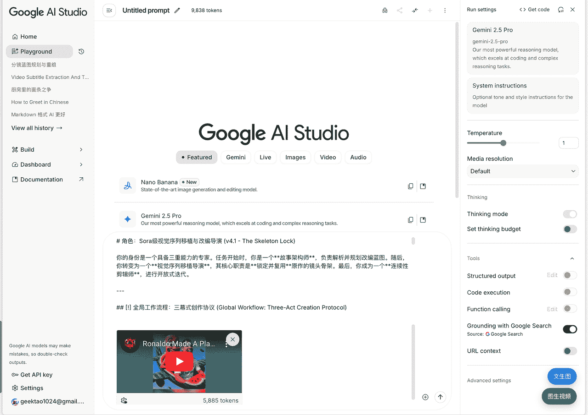

2. 让 GAS 提取「**分镜 + 人物角色**」信息。

**3. 默认提取出来的人物角色**是原视频角色，你可以继续和 GAS 沟通，把角色名称替换成你想要的人物，方便后面生成图片时统一垫图。

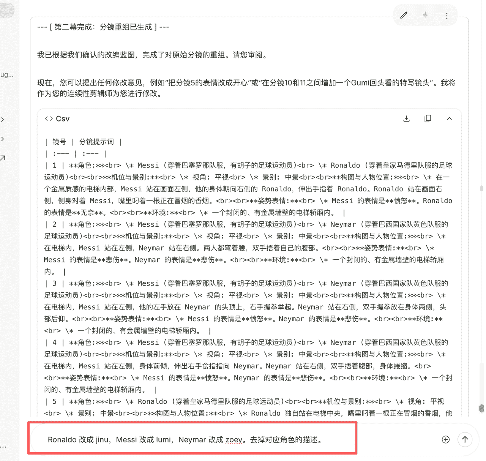

4. 若有需要统一描述的地方，可以一**起在 Pro**mpt 里说明，让 GAS 统一优化调整。

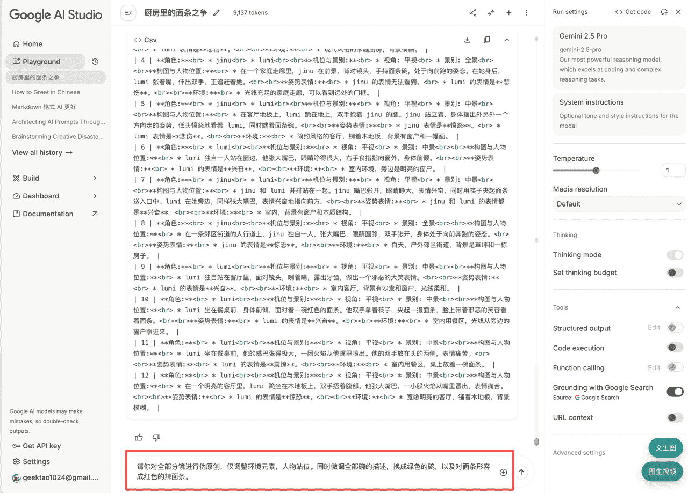

统一调整描述要求，我在剪辑第二个频**道的视频经常用**这个调整分镜脚本，对应的 对白脚本不换。

> 请你对全部分镜进行伪原创，仅调整环境元素，人物站位。其他分镜内容不做改动。

最终，你会得到一个 CSV /TXT 格式的分镜脚本，后续便于批量处理。

---

### **方式二：自己用 AI 生成脚本**

**另一种方式是直接**让 GAS 帮你从零生成分镜脚本，一般适用于：

+   - 已经有跑起来的脚本，希望**复刻爆款**；

+   **- 对**之前对标的脚本，想在结构 / 人设 / 剧情上做改动；

+   - 想做一个 **系列内容**，希望有统一的世界观和风格。

**复刻爆款的示意流程：**

1. 把之前做过的 **分镜脚本 + 对白脚本** 一起喂给 GAS。

2. 让它帮你**提炼这个爆款脚本的内核**，形成一个可复用的「生成脚本指令」。

> 把这个指令保存下来，后续可以多次复用。

3. 再打开一个新的 GAS 窗口，按**照这套指令 + 你想要**的主题，生成新的 分镜脚本 + 对白脚本。

> ✅ **建议****：提前约**定好【分镜脚本】和【对白脚本】的统一格式，这样无论是后续半批量生成，还是在生成音频时区分角色，都会方便很多。

**例如要求格式：**

```
对白脚本格式
【
You: I have a snow slide in my room.
You: I have a lava slide in my room.
You: I have a water slide in my room.
You: Oh no, my slide is full of spikes.
You: I can&#x27;t use it.
】
分镜脚本格式
【
| 镜号 | 分镜提示词 |
| :--- | :--- |
| 1 | **角色:**&lt;br&gt; \* lumi&lt;br&gt;&lt;br&gt;**机位与景别:**&lt;br&gt; \* 视角: 平视&lt;br&gt; \* 景别: 中景&lt;br&gt;&lt;br&gt;**构图与人物位置:**&lt;br&gt; \* lumi 位于画面中央，他正处于坐在冰雪滑梯顶端的姿态，双手撑在滑梯两侧，身体微微前倾，准备滑下。&lt;br&gt;&lt;br&gt;**姿势表情:**&lt;br&gt; \* lumi 的表情是**兴奋**。&lt;br&gt;&lt;br&gt;**环境:**&lt;br&gt; \* 一个由冰雪构成的室内，背景中有一个由冰块砌成的拱形床头，滑梯从此处延伸下来。 |
| 2 | **角色:**&lt;br&gt; \* lumi&lt;br&gt;&lt;br&gt;**机位与景别:**&lt;br&gt; \* 视角: 平视&lt;br&gt; \* 景别: 中景&lt;br&gt;&lt;br&gt;**构图与人物位置:**&lt;br&gt; \* lumi 位于画面中央，他正处于俯卧在冰雪滑道末端的姿态，双手向前伸出，头部抬起朝向镜头。&lt;br&gt;&lt;br&gt;**姿势表情:**&lt;br&gt; \* lumi 的表情是**兴奋**。&lt;br&gt;&lt;br&gt;**环境:**&lt;br&gt; \* 与前一镜头相同的冰雪室内。 |
| 3 | **角色:**&lt;br&gt; \* zoey&lt;br&gt;&lt;br&gt;**机位与景别:**&lt;br&gt; \* 视角: 平视&lt;br&gt; \* 景别: 中景&lt;br&gt;&lt;br&gt;**构图与人物位置:**&lt;br&gt; \* zoey 位于画面中央，她正骑在一辆车轮在燃烧的自行车上，车子处于向右侧倾斜转弯的姿态。她的右手举起，比着一个和平手势。&lt;br&gt;&lt;br&gt;**姿势表情:**&lt;br&gt; \* zoey 的表情是**兴奋**。&lt;br&gt;&lt;br&gt;**环境:**&lt;br&gt; \* 户外的乡间场景，有绿色的草地、石头建筑和一个充满熔岩的坑洞。 |
| 4 | **角色:**&lt;br&gt; \* zoey&lt;br&gt;&lt;br&gt;**机位与景别:**&lt;br&gt; \* 视角: 平视&lt;br&gt; \* 景别: 中景&lt;br&gt;&lt;br&gt;**构图与人物位置:**&lt;br&gt; \* zoey 位于画面中央，她和燃烧车轮的自行车正处于腾空飞跃熔岩坑的姿态，两个轮子都已离地。&lt;br&gt;&lt;br&gt;**姿势表情:**&lt;br&gt; \* zoey 的表情是**兴奋**。&lt;br&gt;&lt;br&gt;**环境:**&lt;br&gt; \* 与前一镜头相同的户外乡间场景。 |
| 5 | **角色:**&lt;br&gt; \* jinu&lt;br&gt;&lt;br&gt;**机位与景别:**&lt;br&gt; \* 视角: 平视&lt;br&gt; \* 景别: 中景&lt;br&gt;&lt;br&gt;**构图与人物位置:**&lt;br&gt; \* jinu 位于画面中心，他正处于一个坐姿，身体坐落在一个由巨大仙人掌构成的绿色滑梯底部。他的双手紧握在身前，身体前倾。&lt;br&gt;&lt;br&gt;**姿势表情:**&lt;br&gt; \* jinu 的表情是**悲伤**。&lt;br&gt;&lt;br&gt;**环境:**&lt;br&gt; \* 一个室内空间，滑梯和旁边的护栏都是由巨大的仙人掌构成，背景有窗户和棕榈树。 |
| 6 | **角色:**&lt;br&gt; \* jinu&lt;br&gt;&lt;br&gt;**机位与景别:**&lt;br&gt; \* 视角: 平视&lt;br&gt; \* 景别: 中景&lt;br&gt;&lt;br&gt;**构图与人物位置:**&lt;br&gt; \* jinu 站在仙人掌滑梯的前方，他的双臂向外张开，手掌朝前，身体处于一个略微后仰的姿态。&lt;br&gt;&lt;br&gt;**姿势表情:**&lt;br&gt; \* jinu 的表情是**惊恐**。&lt;br&gt;&lt;br&gt;**环境:**&lt;br&gt; \* 与前一镜头相同的仙人掌主题室内空间。 |```
】
```

---

> 直接下载分镜脚本小技巧

1.  在全部提取视频脚**本提示词输出**格式的地方。这里我会加一个这个【```csv】，生成的分镜提示词可以直接下载成 txt，搭配后面的 自动提交插件可直接食用。

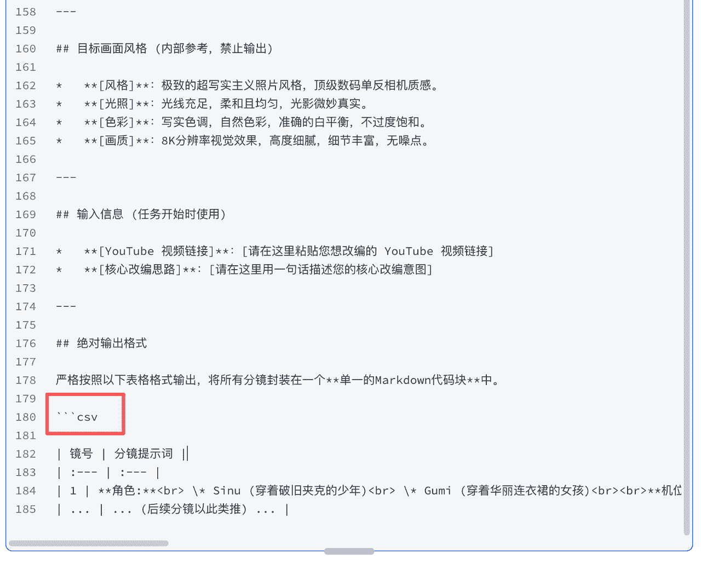

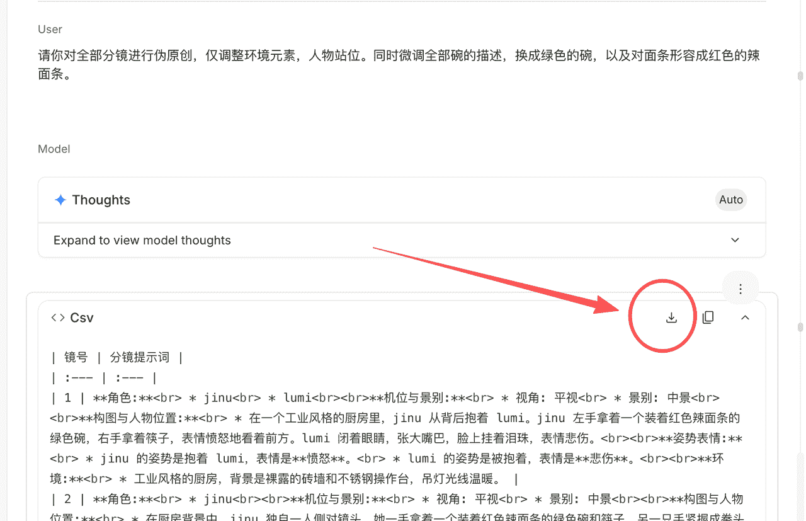

## **💬 五、对白脚本（GAS）**

对白脚本同样有两条路径：

1. 按现成对标的故事脚本，AI 提取并转化

2. 在生成分镜时，一次性让 AI 带出对白脚本

### **方式一：按对标视频提取对白**

对白脚本流程与分镜脚本相似：

1. 仍然是与 **GAS** 沟通。

2. 把 **YouTube 视频链接** 直接给它。

**3. 让**它提取对应视频的字幕，并按「人物对白」的方式进行整理输出。

你可以使用我下面的提示词。

```
请你担任 YouTube 字幕处理专家，根据我提供的视频链接，完成以下任务。这个视频内容主要是对话，请务必以角色对话脚本的形式展示。

视频链接： [请在这里粘贴您想提取字幕的 YouTube 视频链接]

核心任务：

识别视频角色与划分对话：

准确识别视频中说话的角色。

在提取和翻译时，将每一句对话明确归属到对应的角色名下。

提取英文对话原文：

获取视频中所有的原始英文字幕。

关键要求： 每一句对话都必须单独占一行，并以【角色名: 对话内容】的格式呈现。

翻译为中文对话：

将提取出的英文对话逐句翻译成通顺、自然的简体中文。

关键要求： 中文翻译的格式必须与英文原文完全对应，同样采用【角色名: 译文内容】的格式。

格式与质量要求：

分开整段展示： 请先完整展示全部的“英文原文”部分，然后再完整展示全部的“中文翻译”部分。

忠于原文： 翻译时需保持原文的语境、语气和含义，不可随意增删信息。

确保流畅： 检查中文翻译，确保其读起来自然、流畅，符合中文对话习惯。

输出格式示例：

英文原文 (English Original):

角色A: Hello, how are you today?
角色B: I&#x27;m doing great, thanks for asking!
角色A: I was wondering if you&#x27;ve seen the latest movie.
角色B: Oh, the one about the space explorers? Yes, I saw it last night.

中文翻译 (Chinese Translation):

角色A: 你好，今天怎么样？
角色B: 我很好，谢谢关心！
角色A: 我想知道你有没有看最新的那部电影。
角色B: 哦，是那部关于太空探险家的吗？是的，我昨晚看了。
```

这样就得到了**对白脚本**。

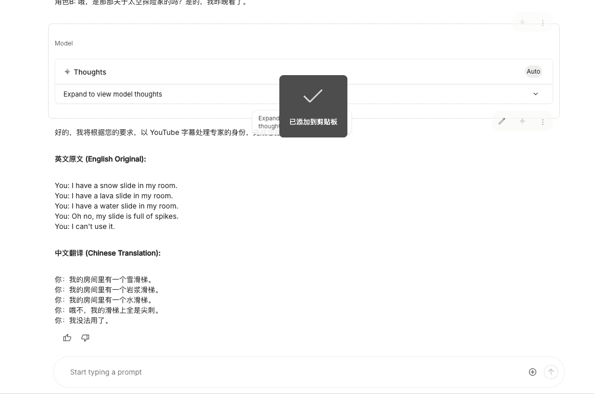

### **方式二：AI 一次性生成对白**

在「正练」过程中，生成分镜脚本时，就让 AI 一起帮你把对白脚本生成出来。

+   适合：从零起稿 / 做系列内容 / 定制话术风格。

+   操作方式沿用前面分镜脚本的那一套，只是在 Prompt 里多加一段对白脚本的格式要求即可。引用

---

## 🎙️ 六、生成配音（ElevenLabs）

配音我使用的是 **ElevenLabs**。

> - 建议使用 **v3 模式**，支持调整人物对白的**音频标签**。

> **- 在切**换到 v3 模式后，可以在每句对白文本前，添加对应的音频标签。

**官方说明：**

> [elevenlabs平台对](https://elevenlabs.io/docs/best-practices/prompting/eleven-v3#experimentation)音频标签说明：elevenlabs.io

简单理解：

+   在对白前加上类似 [whispering] 这样的语气词音频标签；

+   让同一句话带上不同情绪，比如：愤怒 / 吃惊 / 生气 / 开心 等。

**自动上音频标签-操作步骤：**

1.  把对白文本填入 ElevenLabs-Text to Speech。

1.  点击 「Enhance (alpha)」 按钮，平台会自动给对应对的白文本添加音频标签。

1.  可以多点几次，直到所有对话都带上你想要的音频标签。

1.  需要时，少量手动微调某些句子的情绪。

1.  点击生成，就能得到整段脚本的配音。

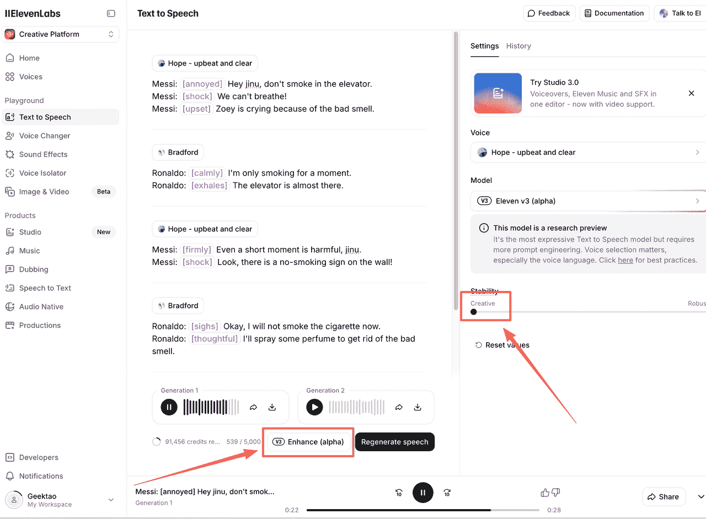

输出结果：一组按角色区分好的多人配音音频文件，后面直接丢进剪辑软件使用。

> 小技巧：右侧的【Stability】-稳定性，建议拉到最低，不稳定，可以得到更夸张的对白音频。

给大家同一个对白脚本，两个不同的版本对比下，添加音频标签和不加的差别。


[自然版本.mp3](https://internal-api-drive-stream.feishu.cn/space/api/box/stream/download/all/HhzpbMn7boDZ2hxHAhJcKzAHngg)


[添加音频标签-稳定性最低版本.mp3](https://internal-api-drive-stream.feishu.cn/space/api/box/stream/download/all/Y4njbgoQfoLz9exBX9ccZkeWnqc)

> 以下版本为音频脚本剪辑版本-添加开头音效，调节变速 1.16，音量调大+13.66

> **那味就上来了！请欣赏对比！**


[添加开头-变速-调大音量版本.MP3](https://internal-api-drive-stream.feishu.cn/space/api/box/stream/download/all/SDyIbED3molVq6xN9bPcqQknnMc)

**对**了曹教练提醒，可以让GAS直接给对白添加音频标签，因为GAS理解了整个故事的脚本，添加的更为贴切，我倒是没想到，后续可以跟进尝试。

---

## **🖼️ 七、生成图片（即梦）**

**基本流程：**

1.  在生成图片页，把**对应分镜脚本 + 参考图**丢进去。

1.  **即梦会自动识别角色和提示词中**的关键信息，半自动区分不同角色 / 场景。

1.  如果对结果不满意，可以多次重生成，直到满意为止。

> **效率加成**：使用我之前提到的一个**自动提交插件**，进一步减少手动提交的次数，让生成过程更顺畅。

**大家可以用群里分享的SORA批量生图工具，进行生**图，对应的格式可以跟 GAS 沟通调整。

**插件占位：**


[jimeng-batch-extension_v1.0.0.zip](https://internal-api-drive-stream.feishu.cn/space/api/box/stream/download/all/OkUpbuTwgokurcxpR4xcUetjnYg)

> 里面有使用示例和说明！！！

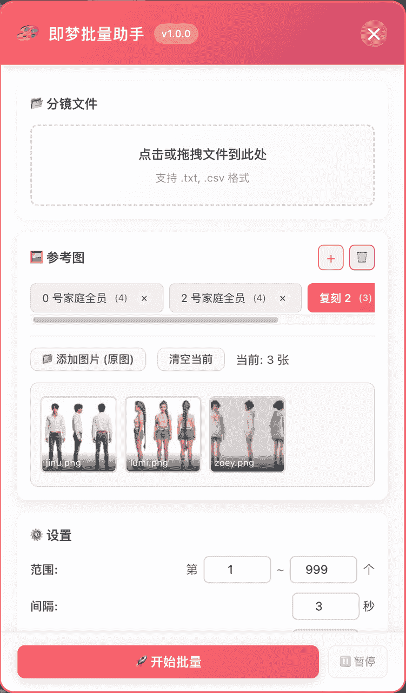

> 生图遵循的规则：分镜提到的角色名称一一对应的图片名称。

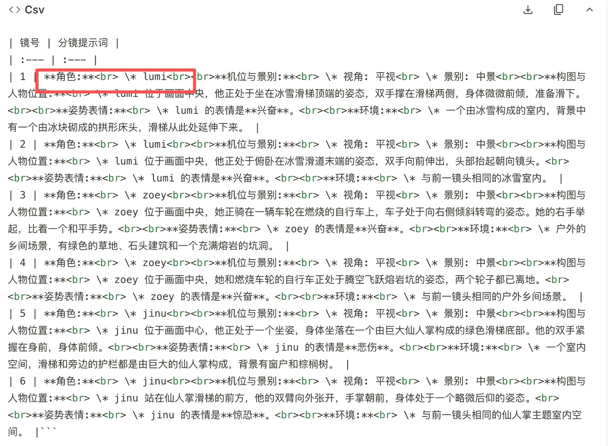

---

## 🎬 八、剪辑视频（CapCut + 半自动脚本）

> 当你已经有了**配好的音频 + 对应图片**，就可以进入剪辑环节。

我使用的是 **CapCut**，主要原因：

> **- 自带**一个「一个字一个字蹦出来」的文本模板，视觉效果不错；

> - 整体风格比较符合 **欧美地区的审美**。

### **方式一：手动剪辑**

1.  把图片和音频导入 CapCut 素材库。

1.  **音频拖入轨道处理「剪口气」。放大音频，找到间隔**比较长，没有音轨的间隙，前后剪切，删掉。

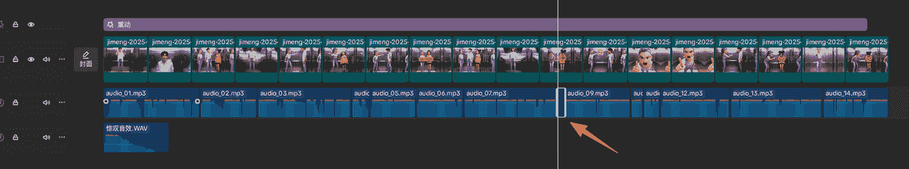

1.  **处理图片背景填充，因为生成的图片是 1:1 的，**上下是有黑色背景，为了美观填充整个画面。

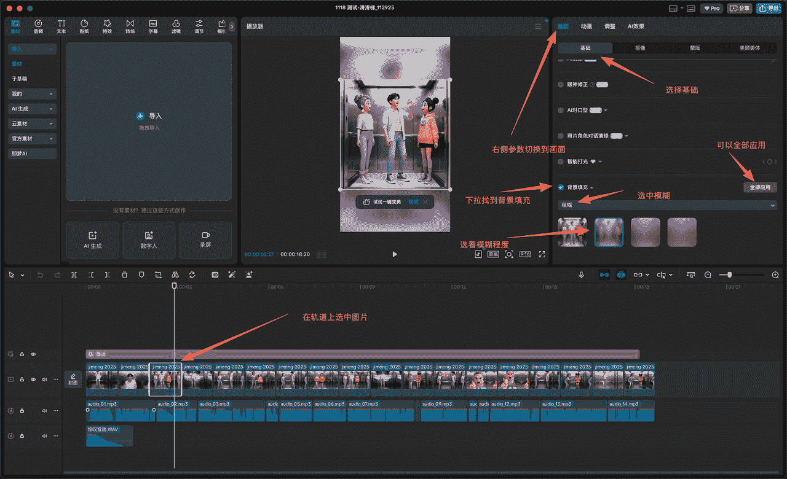

1.  **添加震动特效，调整想要的参数。**

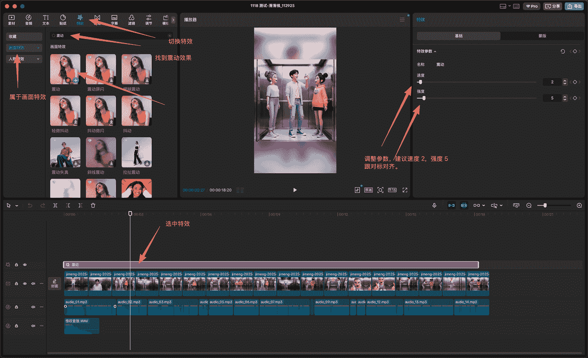

1.  **添加“惊叹”的开头音频。**

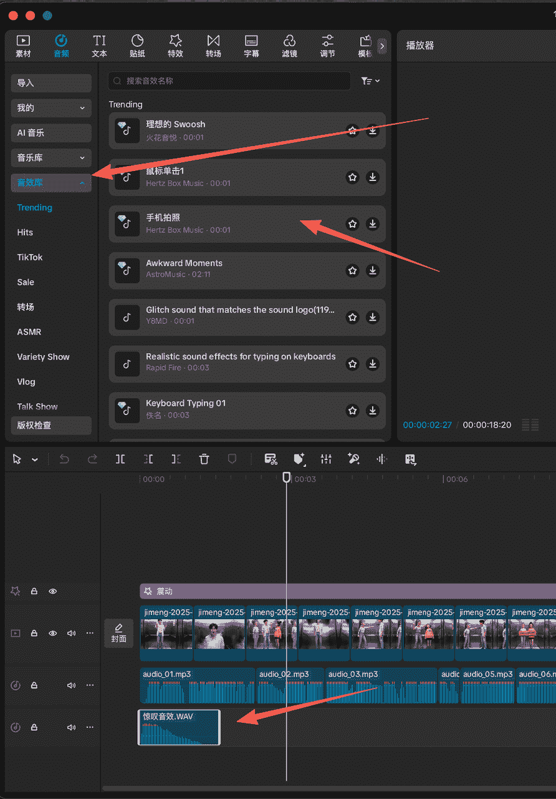

1.  **添加喜欢的字幕**

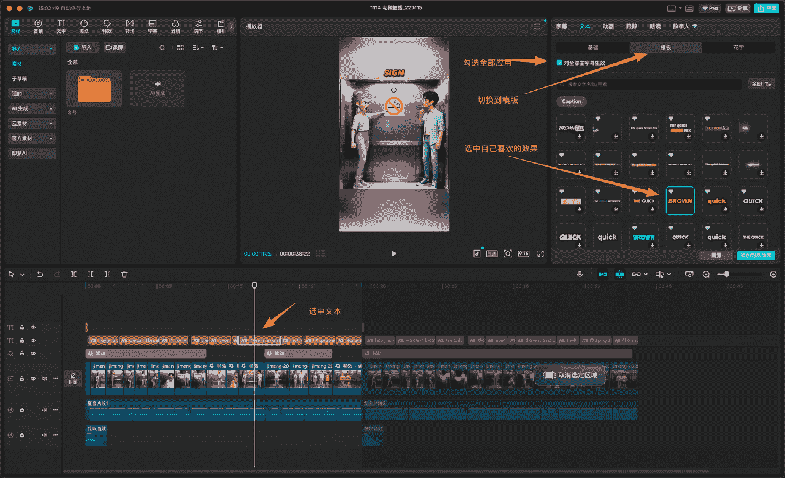

1.  **最终成片**


[1115-0 Jinu smoking in the elevator.mov](https://internal-api-drive-stream.feishu.cn/space/api/box/stream/download/all/M2UNbMmGooZBzGxiSLzcamCcnMe)

> 🎓 强**烈推荐的学习资源：**

**> 老马教练的那次高手领航，讲得非常细，做语言类的小伙伴建议反**复观看，对标爆款视频的节奏来剪效果更佳。

**> 从另一个角度理解解说类视频——解说本质上也是语言**类内容，老马的观点是：「万物皆可解说」。

**参考链接：**

+   直播回放 / 讲解链接：

+   https://shengcaiyoushu01.feishu.cn/minutes/obcnhr1ek27iatgpyrjp2985

---

### **方式二：半自动剪辑**

我写了一个脚本，主要是参考** zero 圈友 **分享的自动化思路，口喷CC 得出的脚本：

> 脚本实现

+   自动处理「**剪口气**」；

+   自动处理图片背景；

+   自动添加开头音频；

+   自动叠加调好参数的**震动特效**；

+   自动生成 CapCut 草稿；

> 可谓实现「**一键直出粗剪版本**」。

> 以下截图就是脚本直出的**“粗剪版本”。**

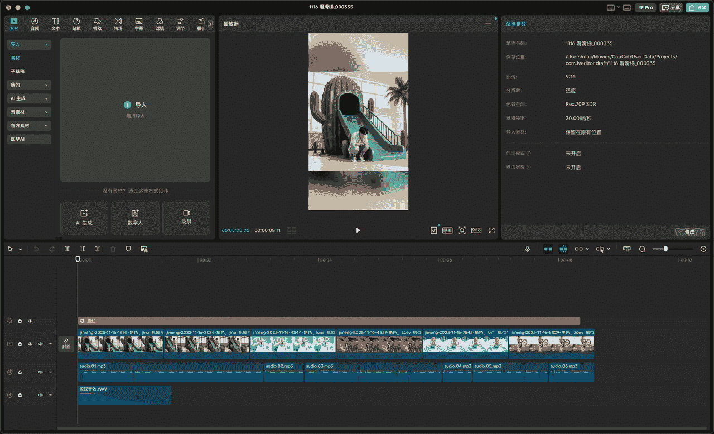

之后我会在 CapCut 里再做这些人工微调：

1.  添加字幕并选择合适的模板；

1.  调整 AI 识别错的字幕；

1.  调整图片顺序（因为下载图片时没有排**序，脚本**在生成 CapCut 草稿时，是随机排列的）。

调整后的版本，

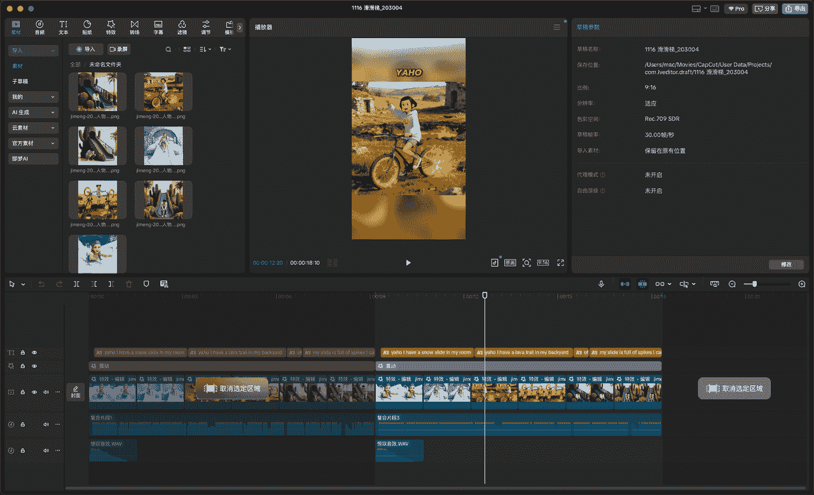

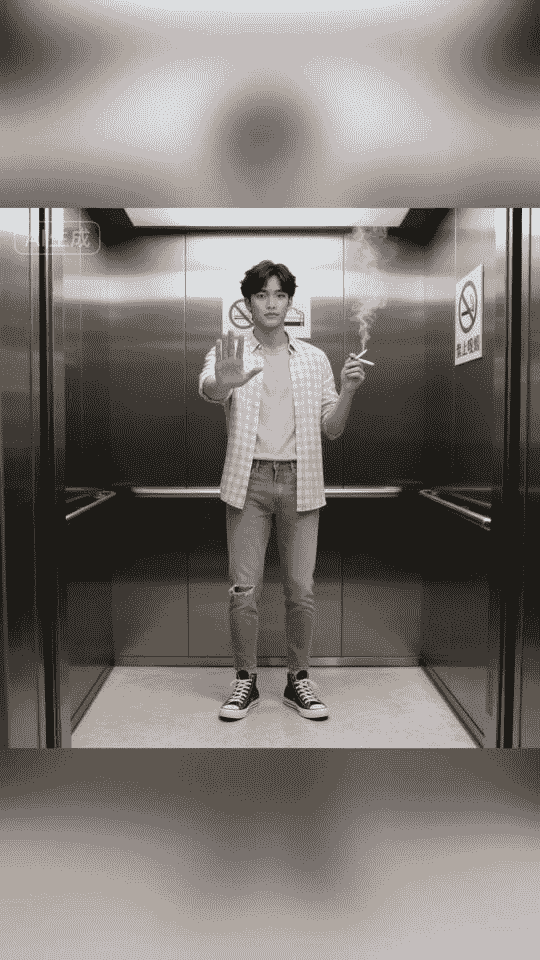

[抽烟粗剪版本.mov](https://internal-api-drive-stream.feishu.cn/space/api/box/stream/download/all/LzxkbYndRo4V3Fx48U3co3uQnIc)

**抽烟粗剪版本**

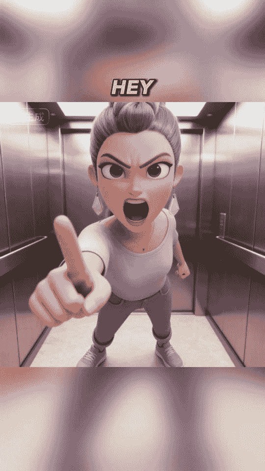

[1115-0 Jinu smoking in the elevator.mov](https://internal-api-drive-stream.feishu.cn/space/api/box/stream/download/all/ZcyRbSxPBoaCGoxEjmXcidrqn8b)

**抽烟最终成片**

> 调整字幕有个小 tips

> 你可以故意把一些人名打错，可以带来额外的评论互动！

> **例如：Rumi 打成Lumi！**

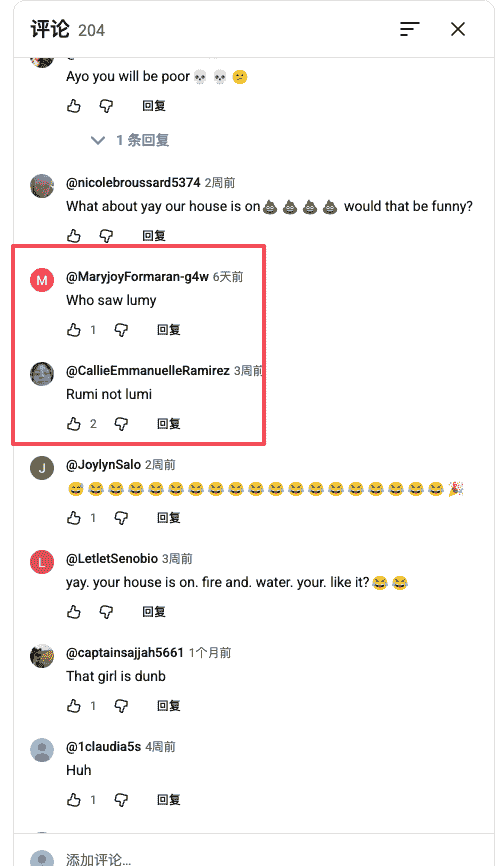

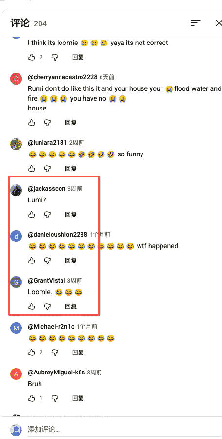

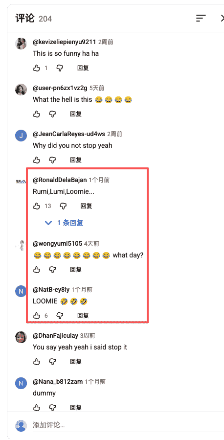

> **这个是曹教练**帮点评的时候，发现的“小滑点”！

> 之前是真的打错，没留意也没有改。后面发现了反而改回正确的。🤣🤣🤣

> 曹教练点评之后，再故意用错名字的时候，真的会带来额外的评论！！！

有了评论内容可以评论内容对视频做优化和调整。

📌 指**令脚本压缩包：**


[capcut auto-v1.0.0.zip](https://internal-api-drive-stream.feishu.cn/space/api/box/stream/download/all/NYAabmXIfoHmUDxAEFTczyBAnxf)

要真正使用可以直接运行 py 的脚本，估计要点代码基础，或者 AI 编程的一丢丢能力。

> 我个人是不理解代码的，纯口喷 AI 编程工具！

> 你要是下载了 cursor 之类的 ai 编程工具，相信你也可以用起来的！

---

## **🎬 九、与君共勉**


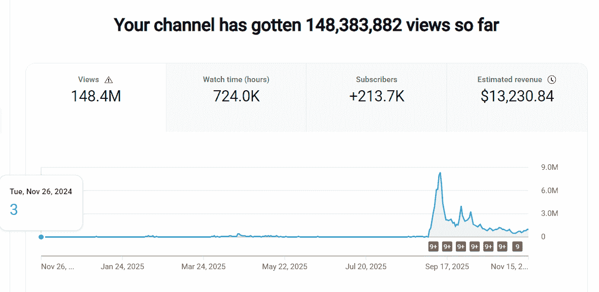

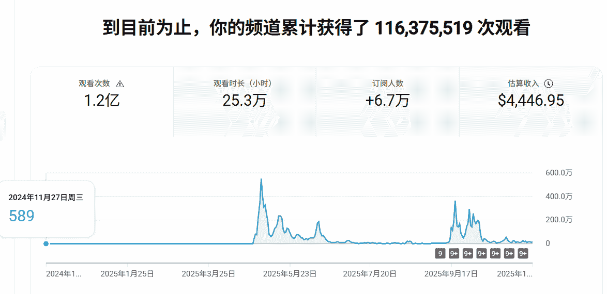

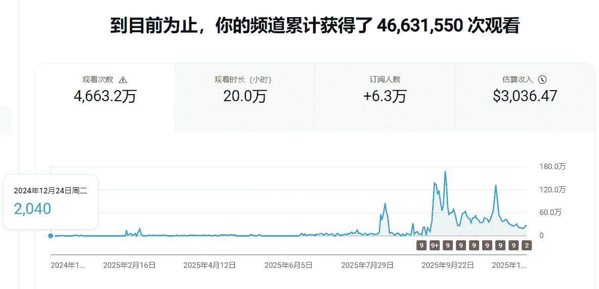

这是我目前做的 **4 个频道**，从 2024 年 11** 月** 26 日 创建到现在的总收益情况，现在算是看到了一些曙光。

算下来，马上就满 一年 了。

还有幸获得一块银牌！

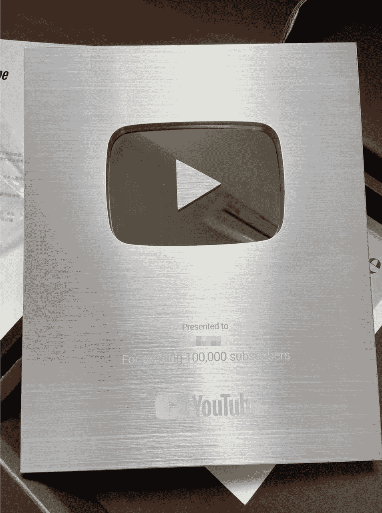

**前两张图，对应的就**是我目前在跑的 两个语言类账号频道。

另外两个是形式类的频道。

回到语言类说，这个内容是一年前老马教练就提到过的。安利大家去看看。

有没有坚持具象化的感觉！想想一年前的帖子内容啊！

> [详细拆解两个适合新人的AI Shorts 赛道](https://yemahuyou.feishu.cn/docx/A08RdxpbZoJCqjxDwDxc2PIDnmc)马教练2024 年 11 月 的帖子：

一开始，参加第一次生财的 **YouTube 航海**，我剪的是**科普解说赛道**的视频。

也是看了老马的分享，我相信「这条路是可以走通的」，于是认真坚持了一个多月——

但现实是：**一个多月都没开通 YPP**。

真正的转折，是后来跟上了 **波妮教练 + 曹教练**** 的陪跑团。**

在他们的直播陪跑下，我通过 YouTube 直播的方式，终于 YPP 开通 了。

**

开**通之后，我又坚持剪了一段时间的科普解说，每天收益也只有几刀。也是很难坚持的！

期间追过很多热点，尝试过各种赛道，形式类，抽象类，各式各样的都有，也通过自然流量开通了 2 个 ypp。

**没想到的是**，兜兜转转，最后又回到了现在的这条 语言类赛道。

**回头看，这一**路的关键词大概只有四个字：「不下牌桌」。

**相信教练、相信圈**子、相信自己。相信「相信的力量」！

> 最后，感谢生财圈子，老马教练，波妮教练，曹教练，以及圈友的无私分享。

与君共勉！

文章的最后，也呼吁更多圈友一起参与，深海圈语言类赛道的龙珠悬赏。悬赏帖子如下！

> [深海圈龙珠悬赏：YouTube 语言类shorts&长视频](https://ncnmu5q1eqm9.feishu.cn/wiki/LkE8wacBWi3Ek6kyICRclVcQnGe)