# 有手就行的爆款，形式类爆款，从入门到精通！-露酱1209航海直播

> 来源：[https://xuqiwei1986.feishu.cn/docx/ZBStd5X3yoyL2kxzD0mcUehtnJf](https://xuqiwei1986.feishu.cn/docx/ZBStd5X3yoyL2kxzD0mcUehtnJf)

# 自我介绍写在开篇：

大家好，我是露酱，目前正在深耕做油管这个项目，也是油管深海圈负责带货板块的教练，本次也非常荣幸担任了油管航海的答疑教练和直播教练，哈哈哈，还记得去年的同期，恰好和大家一样，正在参与赚钱油管的第一次航海，回想起来，真的感概万千！

因为自己也是新人一步步走过来的，真的非常懂大家现在的心情，从最基础的走出去，到账号的注册，各种平台界面的熟悉，开始第一次与AI模型对话生图，生视频，能遇到一大堆的问题，满脸的问号挂脸上哈哈哈~

去年露酱在参加12月航海之前，还看不到航海手册内容，但心急如焚地感觉，已经非常迫不及待地把赚钱里所有关于油管的精华帖全都看了一遍，那个时候的内容对比现在，大家真的太幸福了！！油管的精华帖，现在相信大家都看的眼花缭乱了吧哈哈哈，太多大佬分享了自己的实战经验，都拿到的超级厉害的结果，再结合我们迭代了多次的航海手册，简直让去年的露酱羡慕嫉妒脸了哈哈哈~~~

但是在本次航海实战群里的各种答疑困惑，露酱也看到了大家超级急迫的心情，内容越多，相关大佬们的各种工具加持，更让我们不知所措，我到底应该如何起步？如何才能走踏实了？

所以，本来本次一个小时的直播稿，露酱也越写越多，真的对不住直播从8点一起陪伴到了晚上十一点多，也是太想告诉大家，我们放慢脚步，一步步来，有时候慢就是快！！希望这次的分享，能够对迷茫问号脸的大家有帮助，那我就非常开心啦！！

## **这篇文章露酱也分享在了赚钱，记得帮我一键三连支持哈哈哈，链接****直**达，让我看到谁帮我点了个赞（开心脸）：https://wx.zsxq.com/group/1824528822/topic/55188152844585444

**这**次直播的主题主要是讲形式类爆款，其实要说来话长的话，我开通的第一个YPP亿播频道，就是靠形式类爆款而来的。

#### **5天**时间，1.2亿播放，形式爆款，但是其实那个时候25年的6月份，对于形式爆款的概念理解没有那么深刻，只是发现了一个新的赛道，就直接做了，通过了YPP之后，就直接转型，具体大家可以直接去看我的来时路，

#### **赚钱的精华帖指引：「我的黑历史：油管首个YPP花了半年」VS**[**「**](https://scys.com/articleDetail/xq_topic/8854551424158282)我的曙光：单视频带货GMV1万美金＋」https://scys.com/articleDetail/xq_topic/8854551424158282

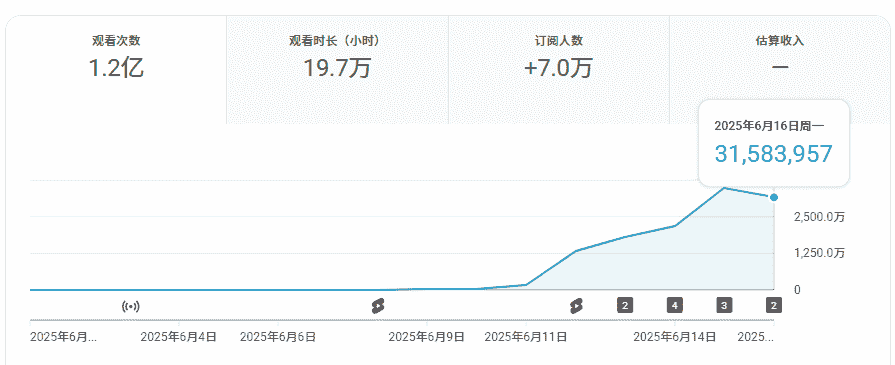

# **一、什么是简单的形式类爆款？**

## （一）什么是形式爆款，与脚本爆款的区别在哪里？​

1、形式爆款特征：镜头少（少则一个分镜、最多3-5个分镜）、时间短（3秒-10秒左右）、感官信息量大、没有脚本（通常没有实质故事和剧情），靠感官冲击和套路博取用户更高的选择观看率和完播率。

2、脚本爆款特征：镜头多（二三十个分镜、常有的事）、时间相对较长（二三十秒，多则一分钟以上）、有脚本（有故事或剧情），靠故事讲述或信息传递为主、感官冲击为辅来提高选择观看率和完播率。

## **（二）新手如何选择？**

形式爆款门槛低、窗口期短、反馈快、制作成本低。

脚本爆款门槛更高、窗口期更长、反馈更慢、制作成本更高。

两者没有贵贱之分，都能拿到比较高的收益，都有很大的空间和可拓展性，每个人的路不一样，有些人更喜欢创意、更喜欢搞抽象，有些人更喜欢写故事、设计脚本，选择更适合自己的就好。

## （三）形式爆款案例：一条视频开通YPP的形式爆款长啥样？

这个视频是露酱的频道发布的第二个视频，第一个视频万播，第二个视频就帮我几乎达成了YPP互动播放1000W次的要求。


[1007.mp4](https://internal-api-drive-stream.feishu.cn/space/api/box/stream/download/all/BkTybHqp4oFmMvxpdnwcqJ66njf)

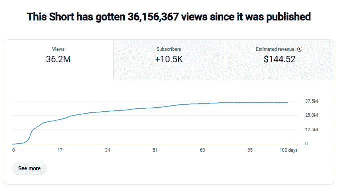

**开**通高级YPP的要求这里简单说下，初级YPP是没有任何广告收入的，只有开通高级YPP才能开始真正开通广告收益。

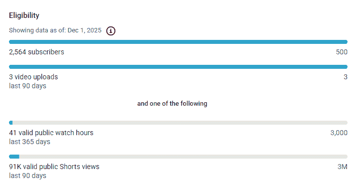

**上图为初级YPP开通要求**

500人数订阅+300W互动播放

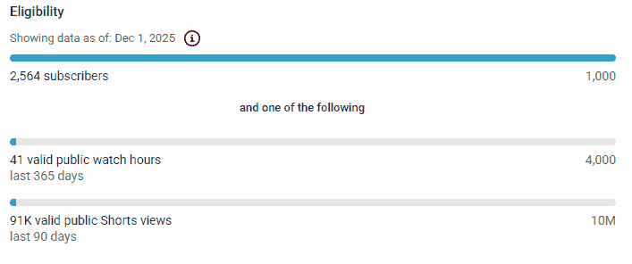

**上图为高级YPP开通要求**

1000人数订阅+1000W互动播放

插个题外话，怎么看互动播放数据：

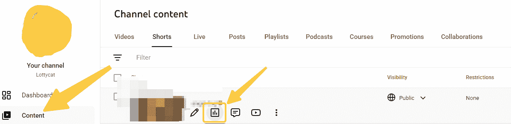

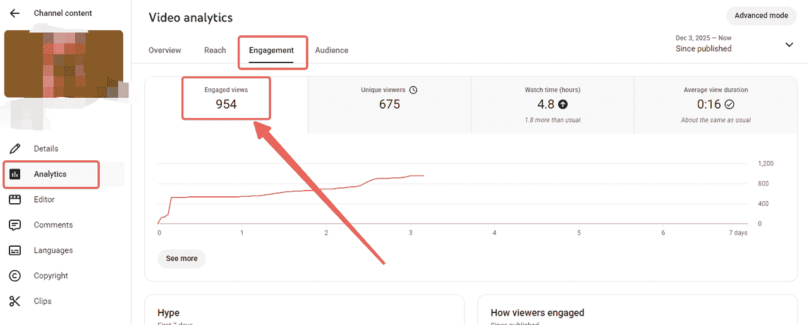

上图的红框箭头指向的数据就是单个视频的互动播放次数，记住这个英文单词“Engaged views”或者中文就是互动播放，哈哈哈，后台的数据分析可以看整个频道的互动播放次数，这些手册里都有，就不详细说了。

# 二、当前热门的形式类爆款有哪些？

## **（一）分类与爆款周期**

### **1、sora2/veo3类：**

sora2/veo3类的形式爆款，是属于工具类的创新迭代，让我们做一条视频更简单了，通过文生视频的方式，就可以秒出一个10秒或者15秒的成品视频。

简单意味着视频制作的门槛降低，以往需要靠出提示词——出图——出视频——剪辑等繁琐的流程，而sora2直接通过文生视频，批量工具，就直接可以秒出，一个15秒的sora2视频用API的成本最低仅需6分钱。

门槛低、成本低，也意味着爆款的时间周期更短，所以我们如果要做sora2的形式类爆款视频，要找对标，就一定要选近两天的去复刻，如果是一周前的视频，就只能借鉴思路做改编才有可能爆。

这里来看六个近期案例（来自深海圈风向标2025/11月底-12初）：

（1）猫欺负狗宝宝，大狗来了秒变态度，经典欺软怕硬，反转变脸桥段，8天跑了5772W播放，https://www.youtube.com/shorts/bJNUwIPaxps

（2）狐狸偷猪宝宝，猫咪相救，打破常规认知，跨物种营救，5059W播放，https://www.youtube.com/shorts/wqgtb7zxrG8

（3）监控器里的外星人挤奶，被发现逃跑，比较猎奇，1282W播放，https://www.youtube.com/shorts/J0oZ-6-dTuo

（4）动物园任何人和猩猩拔河，PK类，胜负欲让人从头看到尾，5275W播放，https://www.youtube.com/shorts/FXBLN2LXryg

（5）自动化智能猫窝，属于创意形式，第一次见会特别有趣又智能，1.6亿播放，https://www.youtube.com/shorts/JKABHsROmX4

（6）李小龙，角色固定IP类，吸引粉丝群体，1597W播放，https://www.youtube.com/shorts/ABstScf1cGg

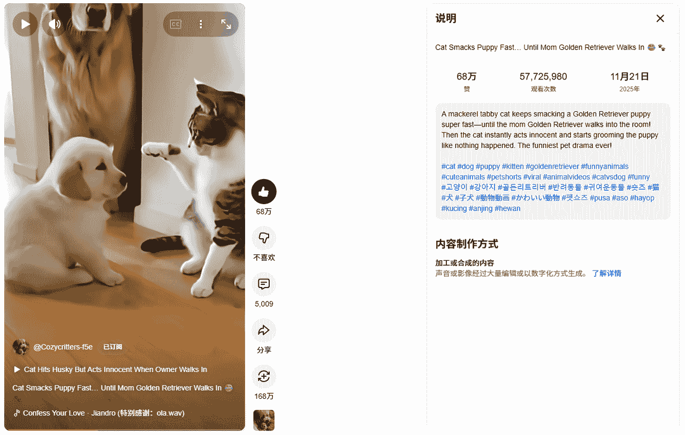

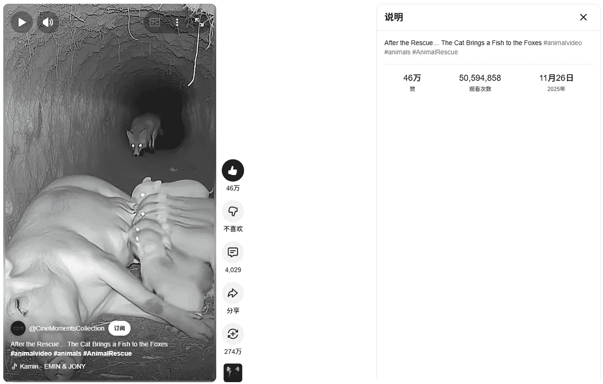

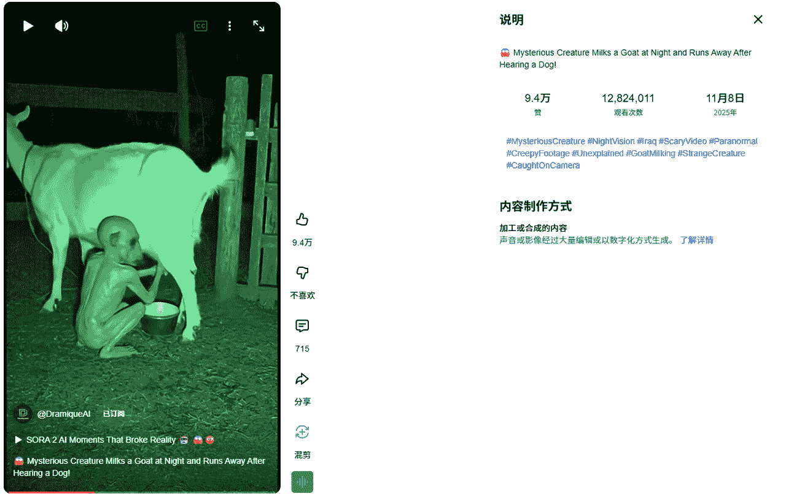

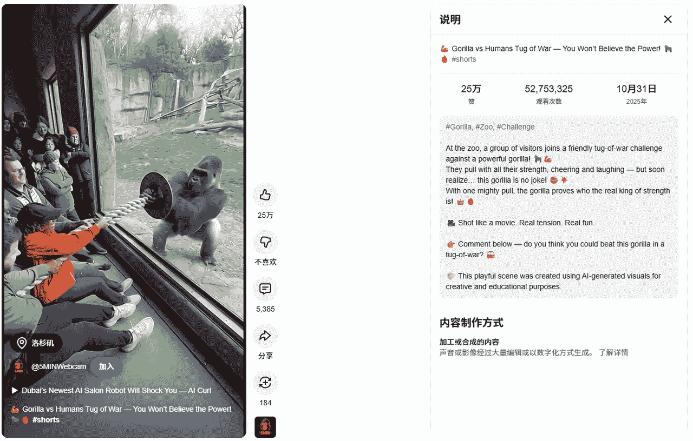

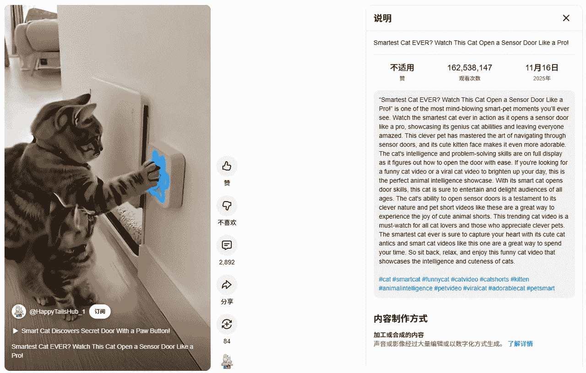

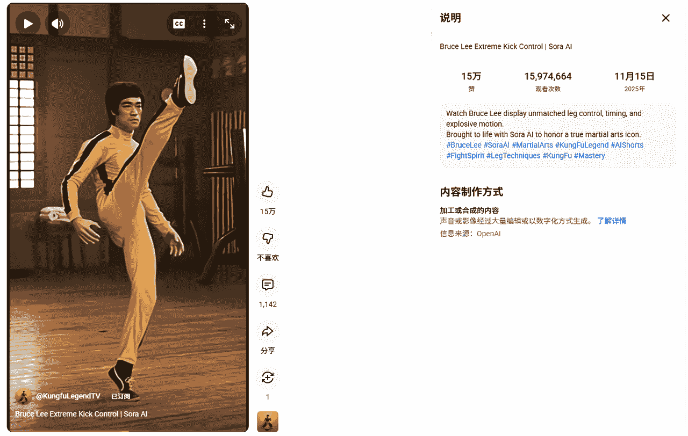

### **2、常规创意类**

#### （1）流量密码：借东风，猪都能起飞

目前最热门的创意形式类爆款，最快的捷径就是围绕IP来获取流量出圈，这里先说下热门IP，先来看个趋势图，看懂趋势图，就能看懂流量密码。

说在最前面，海外文化和国内肯定是有区别的，爆点肯定也是不一样的，所以不要一上来就想一口气吃成胖子，要有持续做爆款的能力，研究透彻你要做的IP属性也是非常重要的一个环节，一定要学习加耐心！

这个网站（https://trends.google.com/）是谷歌热词流量排行，可以自行查询对比自己想要做的IP是否是大热门。

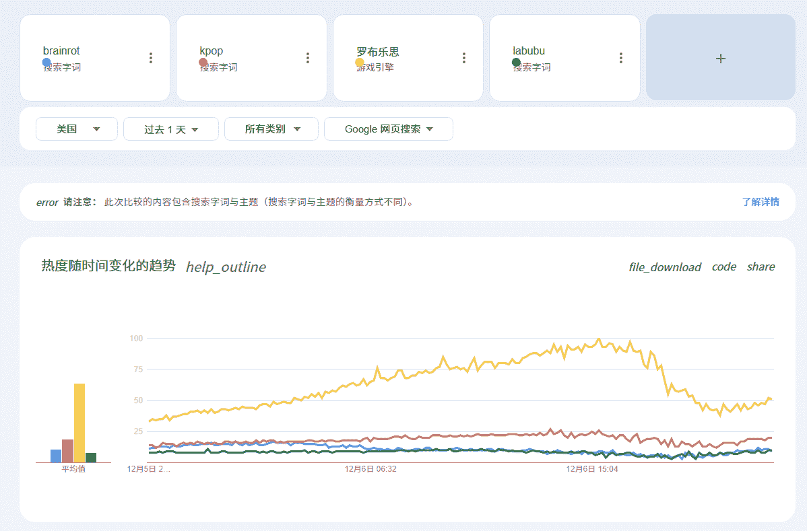

##### **①brainrot**

这里举例了brainrot意大利脑腐，也被我们说为国外山海经，热度基本和拉布布持平状态，拉布布我们再熟悉不过了，这里就不多说了。

想要了解意大利脑腐的各种角色，可以去这个网站研究（https://en.namu.wiki/w/Italian%20Brainrot/%EB%93%B1%EC%9E%A5%20%EC%BA%90%EB%A6%AD%ED%84%B0/%EC%A3%BC%EC%9A%94%20%EC%BA%90%EB%A6%AD%ED%84%B0）

##### **②kpop**

在油[管属于现象级IP大热门了，这里建议先去看一遍电影，搞清](https://pan.baidu.com/s/1sYhSUOu4suBftTD3vXYS0Q)楚人物CP关系，再去做，免得被粉丝投诉举报，附上观看电影的地址，小破站有kpop猎魔女团去看相关影视解说，或者直接去观看电影（百度网盘K-K-POP点链接：https://pan.baidu.com/s/1sYhSUOu4suBftTD3vXYS0Q 提取码：o9uB ）

##### **③罗布乐思**

超热门的更大量级的，也可以去研究，自己去问随便一款AI工具，都能告诉你这是什么，自己去研究哈~

##### **友情提示：以上只是举例，包括不限于以上的IP赛道，可做的IP赛道还有很多，自行去发掘！另外，迪士尼、任天堂等IP**不能碰，什么不能碰，直接去找对应的IP是否有很多人在油管做，如果有很多都在做，那么可以跟，如果很少人做，那就切忌不要做！

#### **（2）AI类：**

最直接的，就是直接去找AI类的爆款，AI类的形式爆款，相对周期1-2周的爆款生命周期，但这个生命周期也不是绝对的，可以通过各种变种，达到更长的生命周期的，获取更多的流量。

**这里来看当前热门的9个近期案例（来自深**海圈风向标2025/11月底-12初）：

（1）KPOP沙雕城堡，沙雕一直都是形式爆款的热门选项，这个元素可以反复运用，2408W，https://www.youtube.com/shorts/KGErEHAqLnA

（2）KPOP扔各种球、虫子到水中，猎奇加巨物，11.21发布，2947W，https://www.youtube.com/shorts/QcM8SdJQUrY

（3）kpop扔球，依旧火爆，变种出来怪兽，12.4发布，两天1106W播放，https://www.youtube.com/shorts/FmrffNWmRoA

（4）游戏角色ai真人，这类音乐卡点也是油管形式类爆点，很有节奏感，1487W播放，https://www.youtube.com/shorts/-6e1yHm2p_I

（5）屡试不爽经典买东西爆款脚本，加入亮晶晶的元素，很多人做但依旧爆，1347W，https://www.youtube.com/shorts/dvMpiDBSdH8

（6）AMSR系列，猫猫毛线家居ASMR，比较新，5119W播放，https://www.youtube.com/shorts/TQWTPTZ5zCA

（7）巨人系列，有点抽象，可以和沙雕结合起来，7598W，https://www.youtube.com/shorts/AH_YHPxP_pg

（8）KPOP走秀变装，表情包+密集元素+走秀变装kpop形式爆款，虽然是9月底的爆款，但是这个元素利用值得借鉴，1611W播放，https://www.youtube.com/shorts/x672VbdiW8w

（9）卷毛线，公鸡旋转织毛衣，搞笑抽象类，1.3亿播放，https://www.youtube.com/shorts/vElEJG8K7js

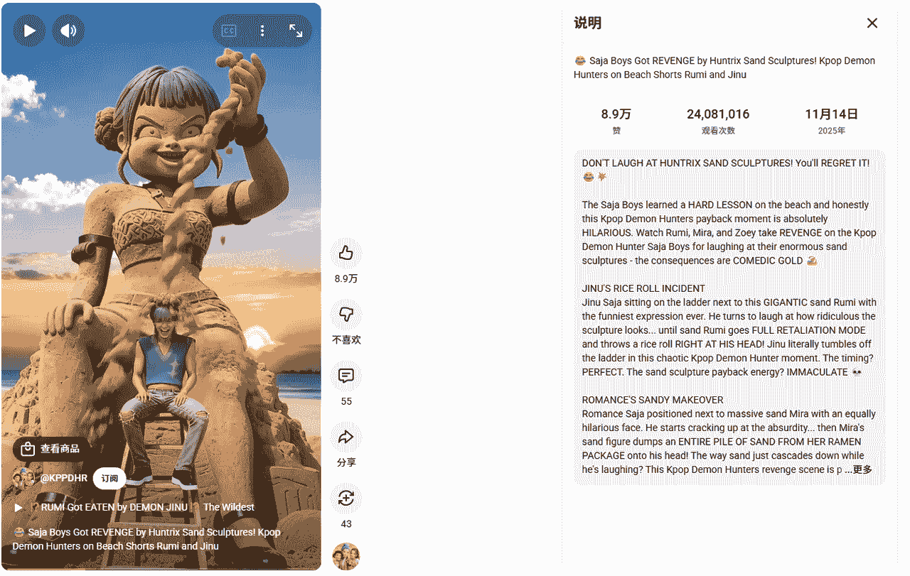

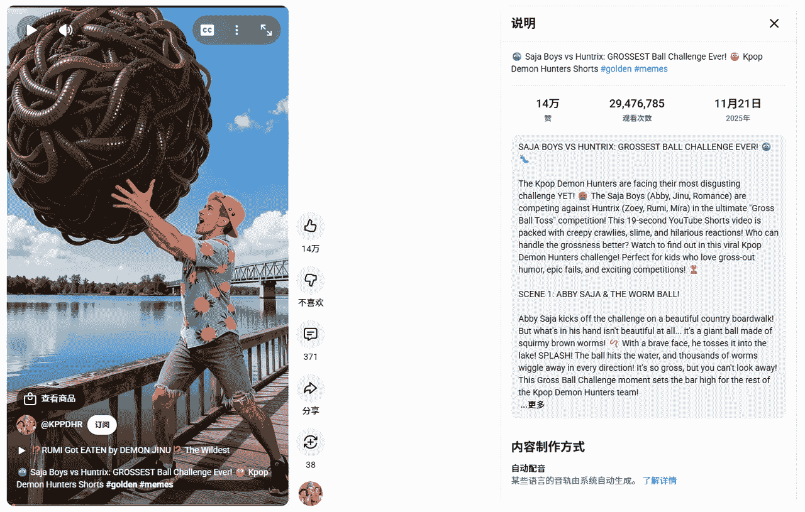

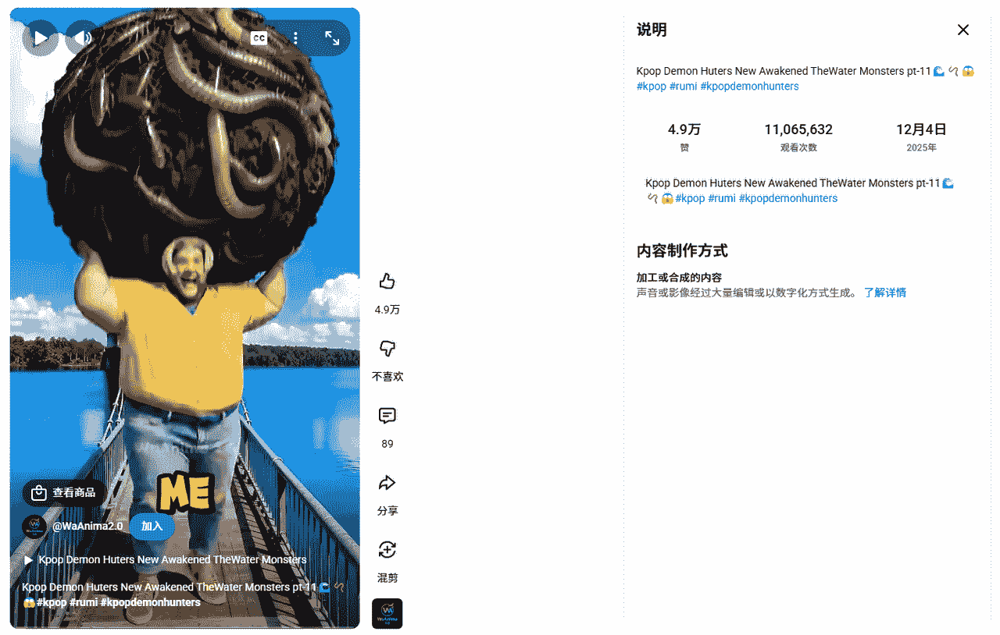

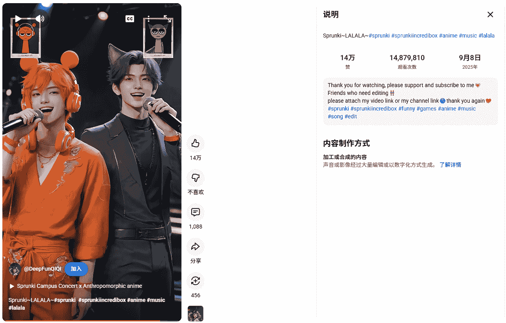

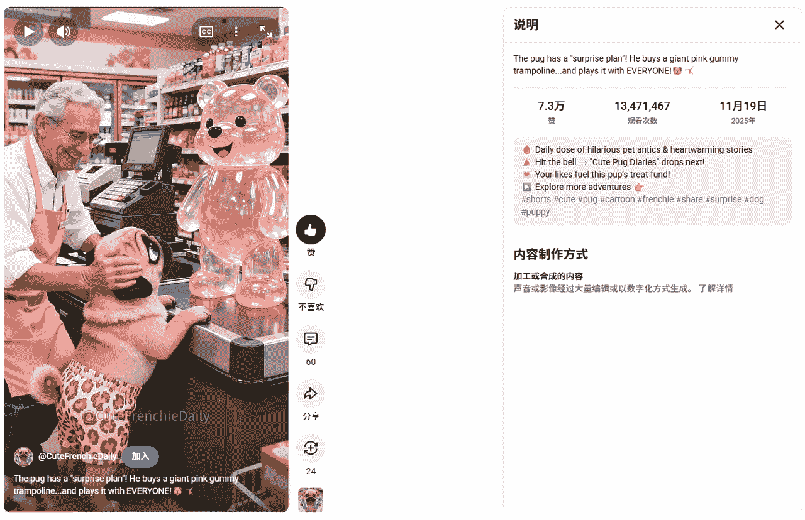

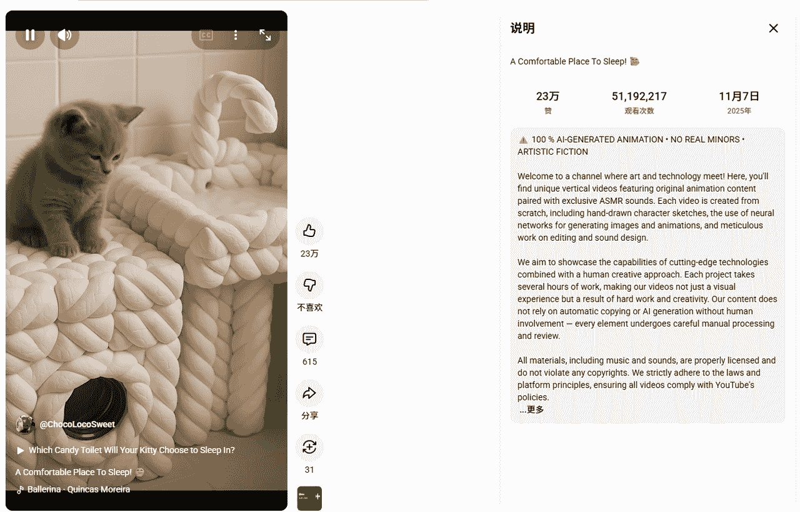

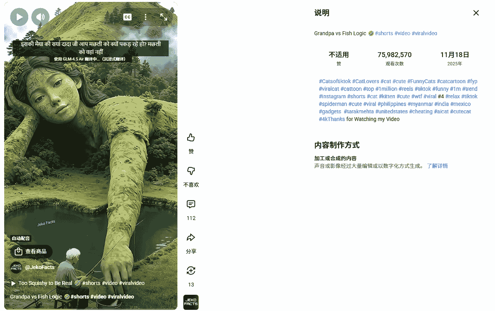

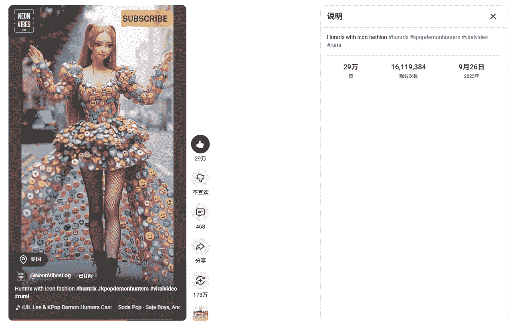

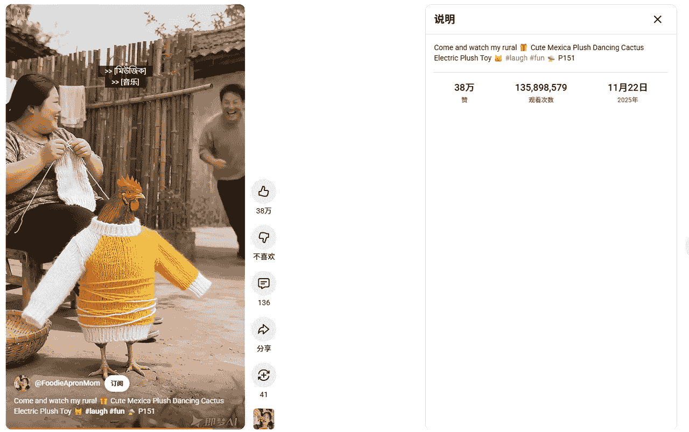

#### **（3）真人类**

真人类的形式爆款，属于跨赛道找对标，空间更大，拓赛道理想选择，但是真人类的形式爆款不推荐新人做，因为真人复刻相比AI复刻要难很多，形式类你能跑出百万播放的视频，再去考虑复刻真人类的吧。

这里来看三个近期案例（来自深海圈风向标2025/11月底-12初）：

鬼灭之刃，四宫格类型，中国军人踢腿的梗大爆，鬼灭coser的四宫格踢腿也跑到3052W播放，可当成形式爆款用不同IP复刻一下，绝了！https://www.youtube.com/shorts/vDqU5XkR7D0

无限循环播放，浩克一只巨脚出场，复刻的时候把孩子改成成人，很好的素材，9859W，https://www.youtube.com/shorts/nFArQAsHE8g

孩子生日桥段，3334W播放，https://www.youtube.com/shorts/-taJVCECnpE

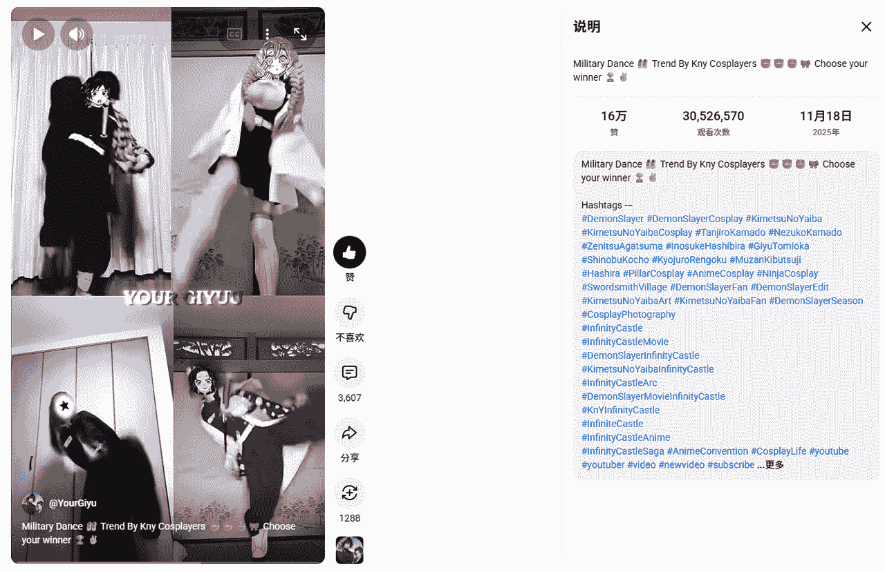

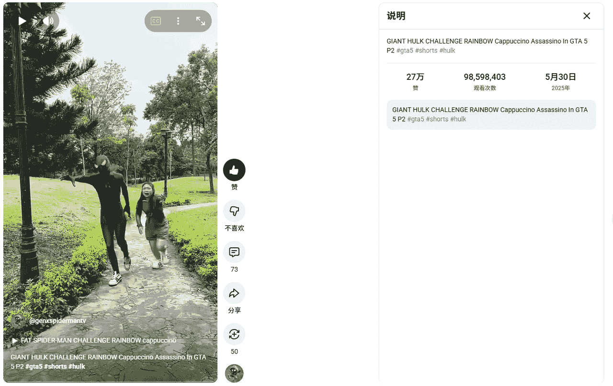

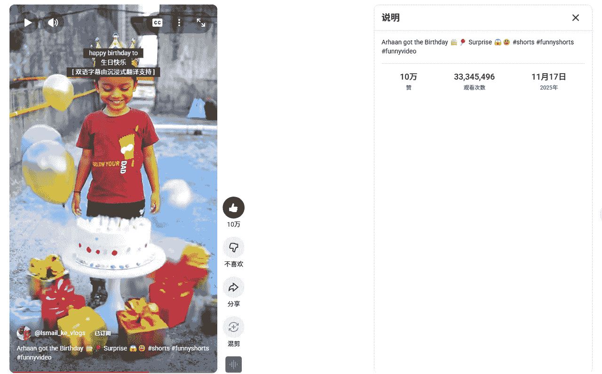

#### （4）过去一年里不同时期的形式爆款参考（来自深海圈手册总结）

##### ①耶稣救援、受难、复活、飞升、微缩：2024.10-至今

**https://www.youtube.co****m/s**horts/PJHJmhVRVp4 5月

**https://www.youtube.co****m/s**horts/8cv3Spjpv40 8月

**https://www.youtube.co****m/s**horts/cKqUgego1tY 9月

**h****ttps**://www.youtube.com/@walkwithjesus.lightdaily/shorts 10月

**https://www.youtube.com/@Go****d_Is_**Love_888/shorts 10月

##### ②传统双图转绘：2024.9-2025.5

**https://www.youtube.co**m/shorts/Kmltfa2IS5M

##### ③宝宝走秀：2024.9-2024.12

**https://www.youtube.com/@littl**eclassics7988/shorts

##### ④达人秀变身、跳舞：2024.10-2025.4

https://www.youtube.com/@Ned4k

##### ⑤鱿鱼游戏吃东西、四宫格变身：2025.3-2025.6

**https://www.youtube.com/@Ap**rilAI.Channel/shorts

##### ⑥卡皮巴拉搓肚皮：2025.5-2025.10

**https://www.youtube.co**m/shorts/rky-ReBybWs

##### ⑦山海经演化、走秀、跳水、跳舞、切蛋糕：2025.5-2025.10

**https://www.youtube.co**m/shorts/fhVuUM0dVbI

**https://www.youtube.com**/watch?v=xynjrUoQCWA

**https://www.youtube.co**m/shorts/EJBPQvbSbak

**https://www.youtube.co**m/shorts/MSXm8FwjZho

##### ⑧新版双视频转绘、四宫格：2025.6-2025.10

**https://www.youtube.co**m/shorts/xURvbBNY1-4

**https://www.youtube.co**m/shorts/pTfXr-9FtmM

**https://www.youtube.co**m/shorts/DBkRgtKHN2w

##### **⑨kpop变身、手办、走秀、跳水、跳**舞、切蛋糕、ASMR：2025.5-至今

**https://www.youtube.co**m/shorts/Nha8cwsBkI4

**https://www.youtube.co**m/shorts/f1faUvBlpQA

**https://www.youtube.co****m**/shorts/ZrzVzdKD6WI

**https://www.youtube.co**m/shorts/FIZUAUabQlg

**https://www.youtube.co**m/shorts/340-HHVafaI

##### ⑩sora2动物救援、动物互动：2025.10-至今

**https://www.youtube.co**m/shorts/h4PAlC1kIj0

## **（二）如何找对标**

### **1、锁定对标，去对标首页找端倪**

若对标的平均播放都在几W或者千播，突然有出现几十万或者上千万播放，说明就是潜力爆款，非常值得去研究！所以在这里，大家可以安装下面的插件，方便一目了然的去看对标发布视频的时间、每天发布视频的频率这两个关键点。

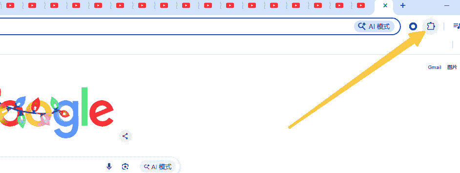

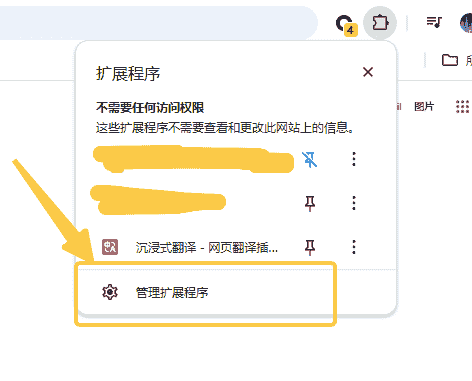

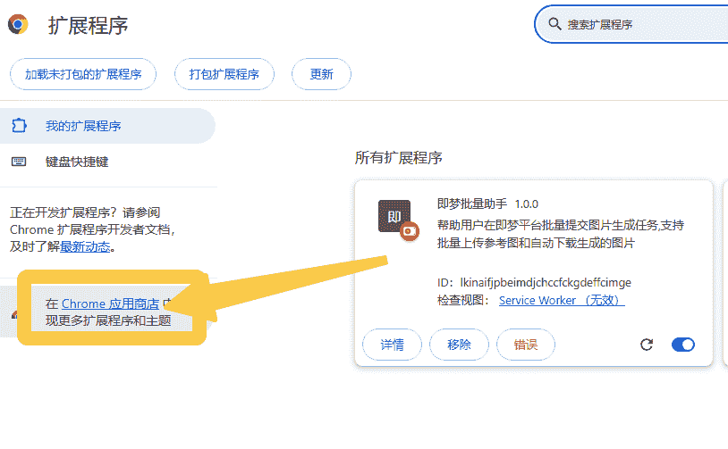

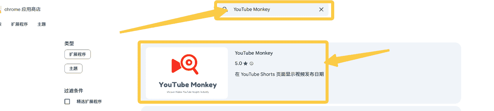

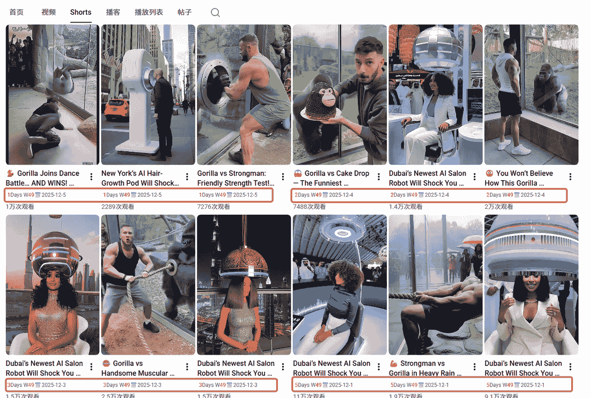

### **2、油管搜索页，潜藏大秘密**

比如我们要找sora类的视频，我们就可以直接在首页搜索“sora”关键词，点击过滤，如果要看本周内的sora关键词下面的热门shorts视频列表，点本周——视频——4分钟以下——观看次数，就能一目了然的看到本周发布的shorts热门视频列表，请看，两天内发布的有一条1163W播放的就被挖掘出来了。

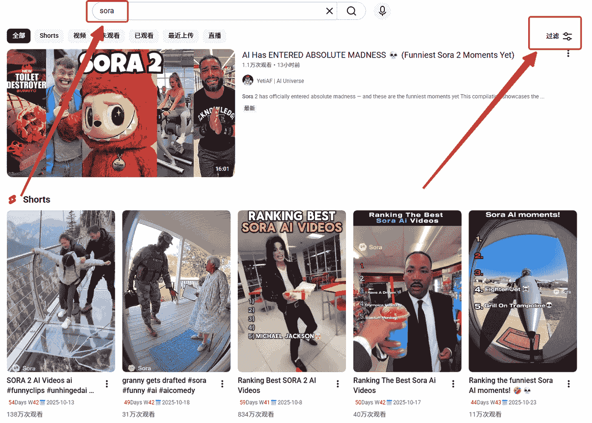

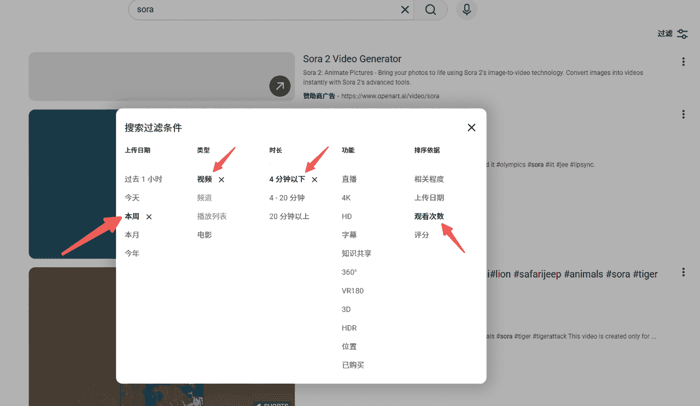

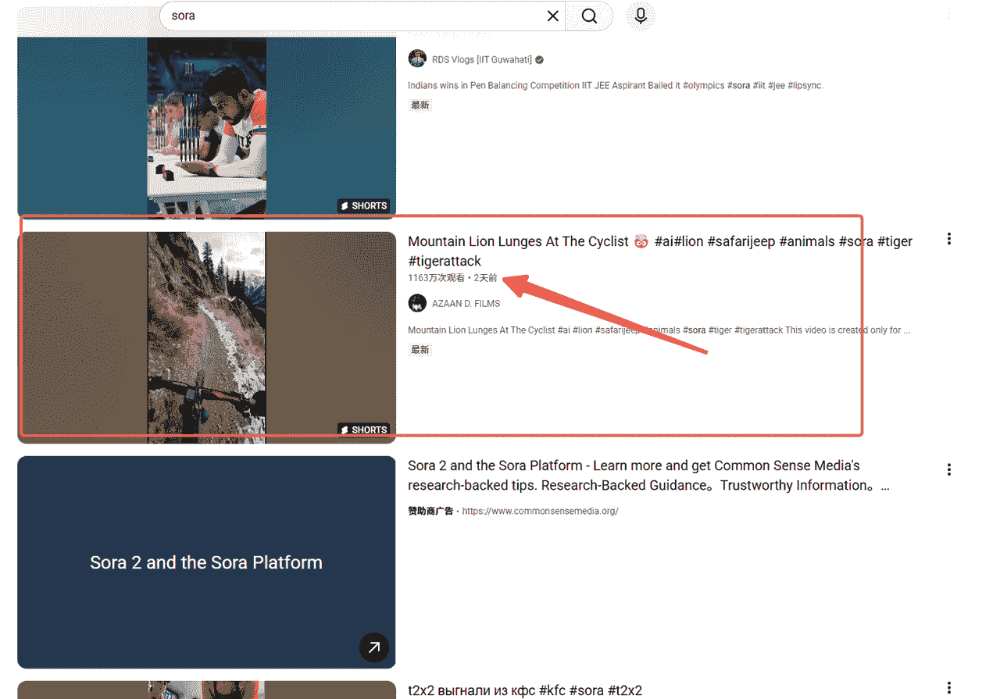

### 3、每日必做刷油管视频一小时找对标

把每天刷抖音的时间、碎片化的时间，请都用来刷油管，我们要在油管生存赚钱，你肯定需要融入对吧？要去研究这个平台的观众到底喜欢什么，都在点赞什么内容，都在评论什么内容是吧？所以每日必做的一件事，就是至少要刷一个小时的油管，为自己找对标、找灵感、找赛道！这是最笨的办法，不靠任何工具，但是是极其有效的方法！

油管的推荐机制也是个性化推荐的，所以你如果搜索过sora类的视频，看过sora类的视频，就会自动推送这类视频给你。

#### **①首页shorts进入去刷**

看到觉得OK的点赞，点赞之后，可以在自己的点赞页面看到所有点赞内容，相当于收藏功能了！

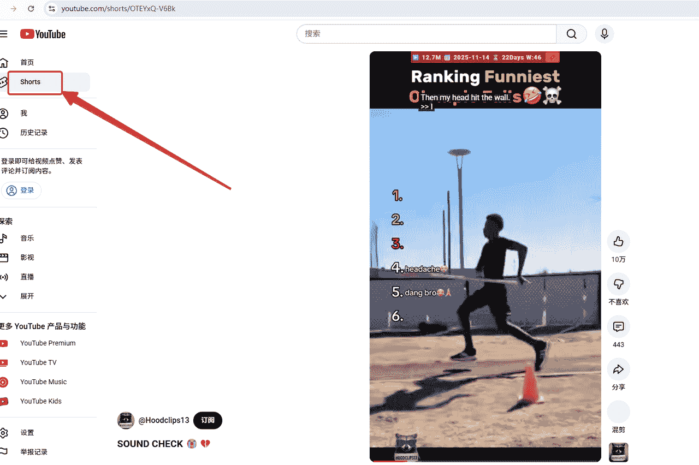

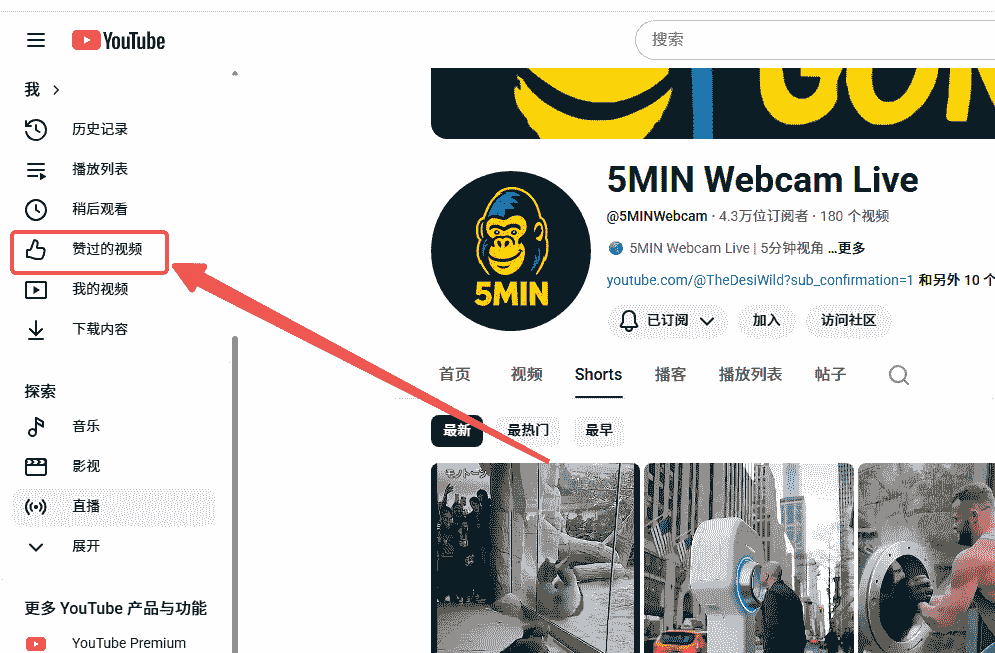

#### ②不断刷新首页电脑端或手机端都可

不断刷新，看shorts的推荐视频，会出来一些日常可能刷不到的视频，这个方法也屡试不爽。

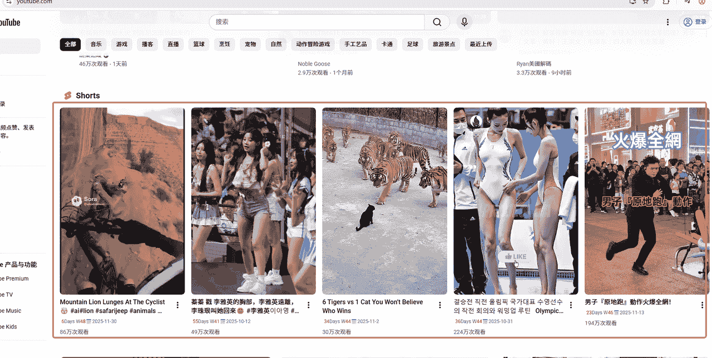

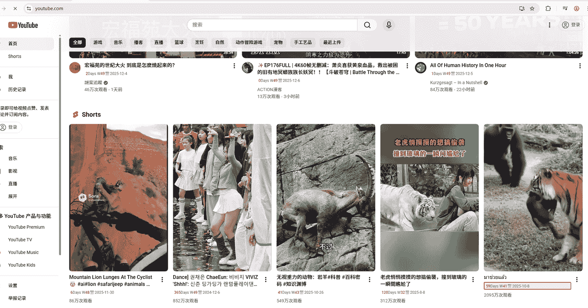

#### **③巧用无痕模式，可发现新大陆**

当然，想要拓更多的眼界，可以用谷歌无痕模式，打开油管刷，就能看到更意想不到的内容！

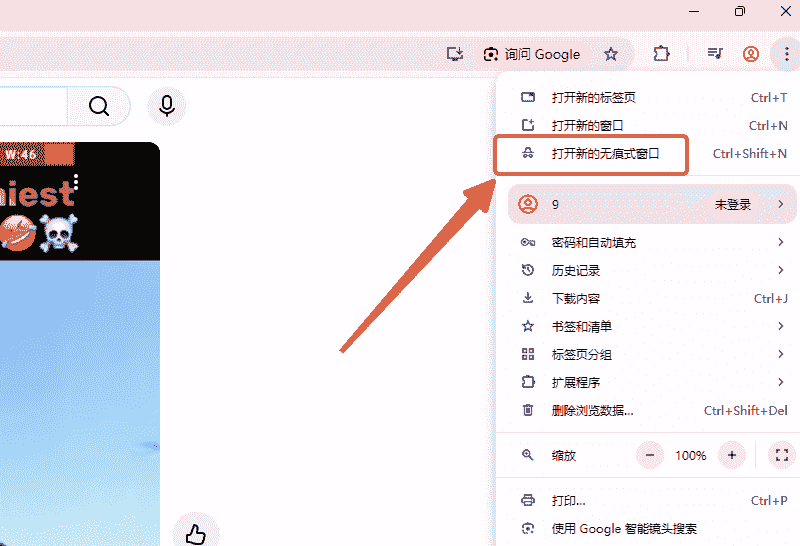

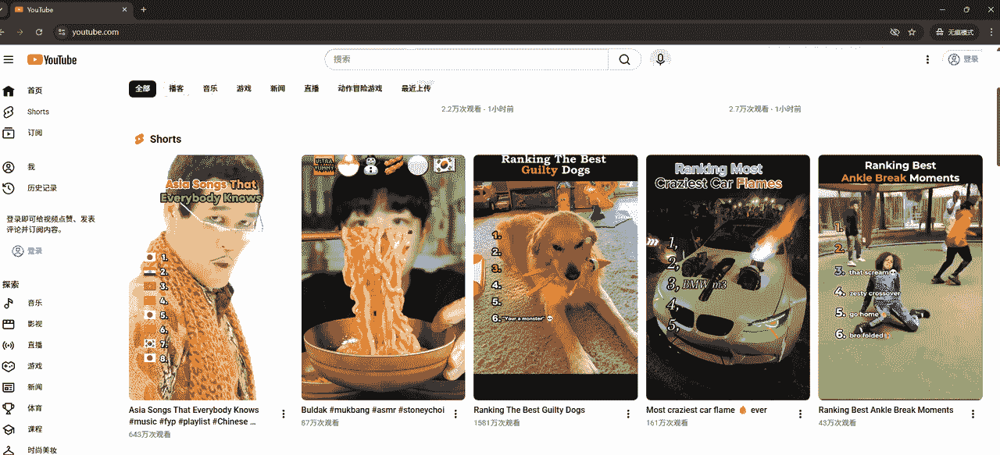

### 4、插件及数据网站类参考

#### ①vidIQ插件，谷歌应用商店里搜索“vidIQ”可以实时查看对应视频的数据分析


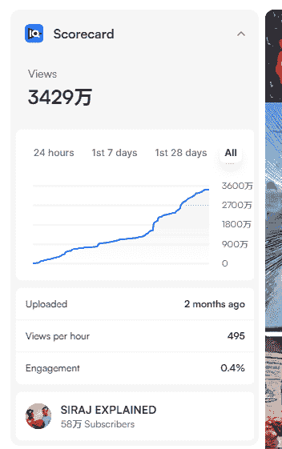

#### ②油管热门视频排行，老牌数据网站了：https://www.viewstats.com/

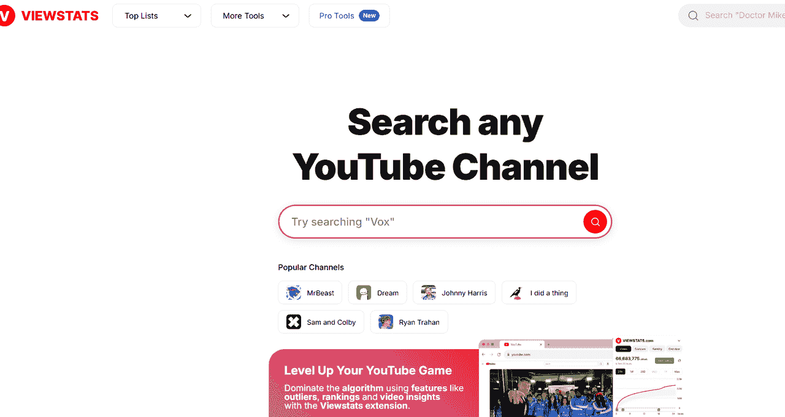

#### ③亿豪圈友的数据网站（https://www.shortsmonkey.com/）

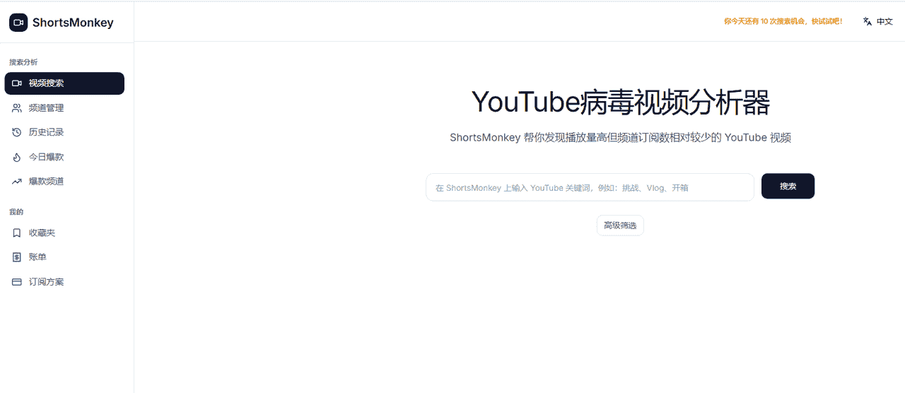

#### ④露酱的油管冷门赛道关键词搜索分析，通过调用API实现，完全免费（https://www.ytb.cheesecatool.com/）

不会用看这个帮助链接：https://www.yt.cheesecatool.com/api_key_guide.html

另外这个网站完全公益性质，不会用大家不要找我哦，哈哈哈哈哈，我本来做出来就是自用的，没打算推的。

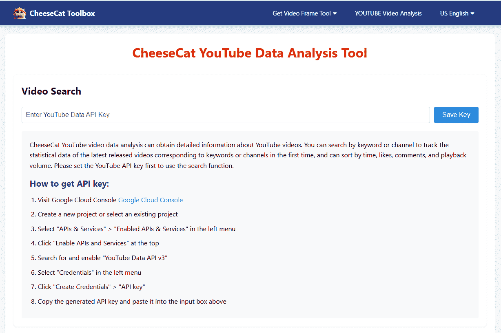

# 三、如何制作对应类型的形式类爆款？

## （一）新人建议，从完全手搓一个视频开始刻意练习。

这里严肃脸！！如果是完全没有做过AI视频的小白，请抛弃任何插件类、提效工作流类的工具，根本不必去充值API平台花钱去生图生视频！！老老实实从手搓第一个提示词，第一张分镜图，第一个分镜视频，第一个完整视频剪辑开始！

不然，你连各大AI模型平台界面的按钮都不知道在哪里？

不然，你只认识提示词三个中文汉字，根本无法驾驭它！

不然，你连各大AI模型平台的图片模型能力、视频模型能力都不清楚！

你可能懵懵懂懂的完成了第一个视频，但是你要完成更多复杂的AI视频，你根本无从下手！

## （二）露酱灵魂拷问，先来闯关测试下，你是不是AI视频制作小白？

如果有一条不能快速的回答出来，老老实实，先去手搓视频！

### **1、油管找到一个对标视频，如果最快的通过对标视频，可以给出对**标视频的分镜，进行分镜拆解，用哪个工具？

GAS，谷歌的aistudio，https://aistudio.google.com/，再发一问，GAS的界面你非常清楚每个按钮在哪里了吗？

### 2、当前文生图模型最常用的有哪三家？

香蕉，sora，即梦

### **3、请举出当前热门的图生视频AI模型平台至少10个？并且你认为**最好的用的图生视频AI模型平台前3排名？

排名不分先后，即梦，豆包，sora2，veo3，海螺，可灵，grok，拍我，海艺，vidu，智谱……

### **4、****上述AI视频模型平台，对应模型**的视频实现能力如何，请给出一个正向+负向关键词？

请各位评论区回答我，具体能力请自己去测试，另外也可以期待下11号蟹老板给大家的直播干货内容。

## （三）如何手搓制作出第一条属于自己的视频

### 1、谷歌aistudio的功能介绍

注意，尽量别翻译成中文，翻译出来的按钮内容更看不懂！！这里直播会有演示操作。

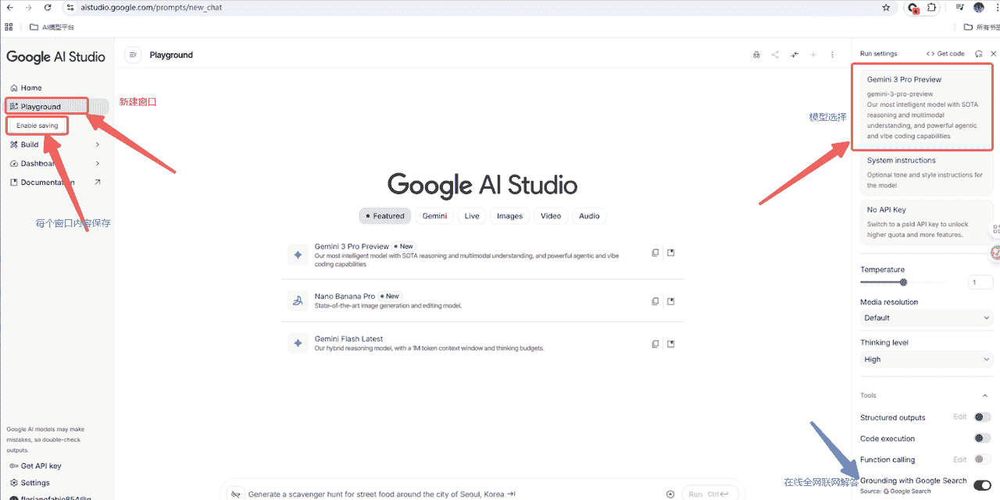

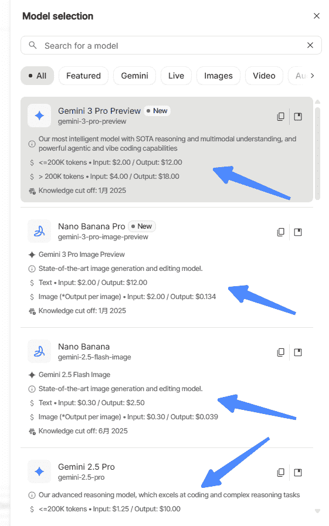

### **2、要有抽卡概念**

做多了，你会发现，同样的提示词出来的拆解分镜都会不一样。

做多了，你会发现，同样的提示词出来的每张分镜图都会不一样。

做多了，你会发现，同样的提示词出来的每个视频分镜都会不一样。

这就是抽卡概念，AI生成任何，都离不开抽卡这一概念，抽卡的过程中，可以让你倒推你的提示词是否有问题，可以让你研究不同的AI模型平台的生成能力如何，这都是你和AI模型平台互相磨合默契的必经之路，也是你提高驾驭AI模型平台能力的必备能力。

### **3、sora2文生视频**

详见下方视频教程，含如何修炼属于自己的元提示词。

**sora2官网邀请链接直达：****https://sora.chatgpt.co**m/invite?code=G0YSY4

因网络区域问题打不开官网，请切换节d，或者可用这个：https://bit.ly/4aEXo5B

3个频道以上运营，要用独立IP，手册里也有，这个直达链接：https://reurl.cc/W80l07 选美国的买，优惠码allp55

[提示词复制看这里](https://ai.feishu.cn/wiki/ANkkwZbG6idgj0kVJMgcM51Jntg?from=from_copylink)

```
**# Role:**** S****ora 2 物理与叙事架构师

# ****Goal:
基于用户提供的视频内容****，****生成一段**符合物理引擎逻辑**且**具备戏剧张力**的Sor****a 2提示词。你需要像拆解动作电影一样，精准还原视频中的光影****质****感、复杂的物理互动（抓取/抛掷/碰撞）以及生物的真实应****激反应****。

# Core Logic (必须严格执行的分析步骤):
****
****1.  **【环境物理与镜头锚定】****(Environment &amp; POV)**
    - **镜头语言******：定义视角（POV/侧拍/低角度****/监控视角）。
    - **环境动态**：锁定画面中非生物的动态元素（如：****疯狂摆动的雨刮器、流动的水面、被风吹动的树****叶）。
    - **材质感**：强调表面质感（如：湿润打滑的木板、反光的玻璃），这决定了物理互动的真实性。

2.  **【生物体量与关系】(Biological Scale)**
    - **体型差****：必须强调角色间的体积对比（如：巨大的成年金毛 vs 只有手掌大的幼猫）。
    - **群体细节**：如果有复数角色，必须明确数量（几只）和状态（步履蹒跚、拖家带口），拒绝模糊描述。

3.  **【动能链与强物理交互】(Kinetic Action Chain) *最重要***
    - **动作拆解**：如果涉及复杂的物理接触（如扔猫、打架），必须拆解为：**接触点**（后颈皮） -&gt; **施力方向**（垂直提起/横向甩出） -&gt; **运动轨迹**（抛物线/半空划过） -&gt; **碰撞结果**（重重砸入水面/撞击玻璃）。
    - **力度描述**：使用高强度动词（咬合、钳制、猛甩、抽打），禁止使用“互动”这种模糊词汇。
    - **流体/刚体反馈**：必须描述碰撞后的环境反馈（溅起巨大的白色浪花、玻璃震动、毛发瞬间湿透贴皮）。

4.  **【隐形触发与应激逻辑】(Triggers &amp; Logic)**
    - **感官推导**：如果画面中有突发惊吓，必须推导并写入**听觉/视觉触发源**（如：刺耳的喇叭声、大狗突然入画的气场），即使画面里看不见。
    - **逻辑转折**：使用“突然”、“毫无征兆”来分割平静与混乱。

5.  **【生物真实性与结局】(Bio-Reality)**
    - **去拟人化**：结局必须描写生物的真实生理状态（如：落水后的狼狈、大脑宕机的僵直、眼神的涣散），严禁使用“卖萌”、“害羞”等不符合物理情境的词。
    - **时间颗粒度**：精确描述反应时长（如：僵住不到一秒、挣扎了数秒）。

# Output Format (直接生成一段连贯的中文指令):
&quot;逼真的[镜头视角/环境质感]。[动态环境元素描述]。[主角A]与[主角B]正处于[状态]，体型对比明显。突然，[听觉/视觉触发]，[主动方]对[被动方]发动了[形容词]的物理干预：它[详细的动能链动作：抓住-&gt;提起-&gt;甩出]，导致[被动方]沿着[物理轨迹]飞出，并与[环境]发生[剧烈碰撞/溅射效果]。紧接着，[被动方]呈现出[生理改变：湿透/炸毛/僵直]，表情从[情绪A]切换为[情绪B]，没有任何[错误的拟人化]，只有真实的[生物本能反应]。&quot;
```

**也可看这里：****https://ai.feishu.cn/minutes/obc**njtd8gvysp4r36915je9g?from=from_copylink

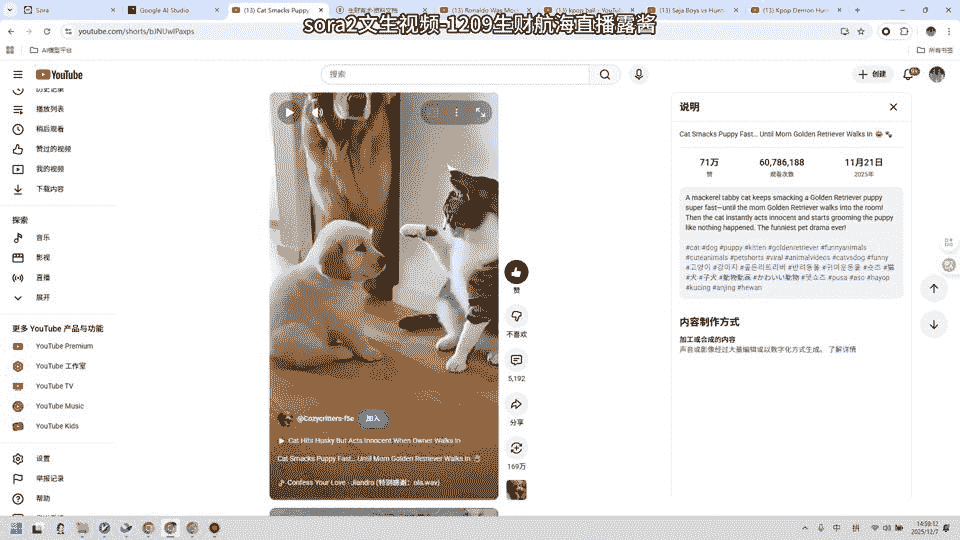

[12月7日 (3)(4).mp4](https://internal-api-drive-stream.feishu.cn/space/api/box/stream/download/all/LlcYbJMVtoDKMtxFVAvcKN1BnVc)

### **4、文生图-图生视频类**

#### **（1）垫图：角色图**

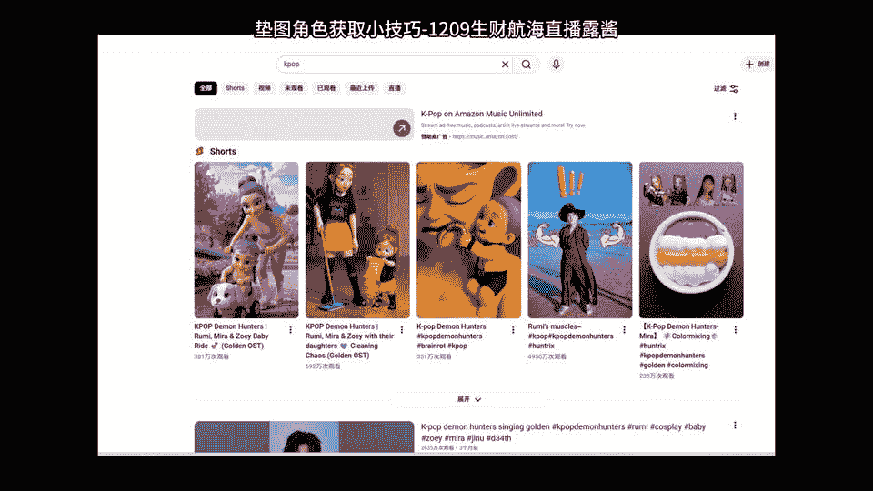

[1.mp4](https://internal-api-drive-stream.feishu.cn/space/api/box/stream/download/all/V20IbtF7ToE2u4xPxvdc1uEHnld)

##### **KPOP8位主角角色图**

[提示词与kpop角色图复制下载看这里](https://ai.feishu.cn/wiki/ANkkwZbG6idgj0kVJMgcM51Jntg?from=from_copylink)

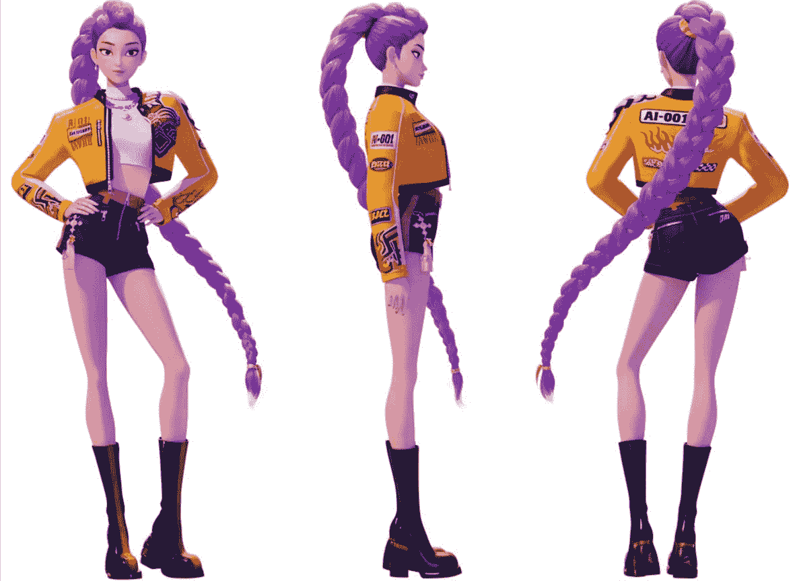

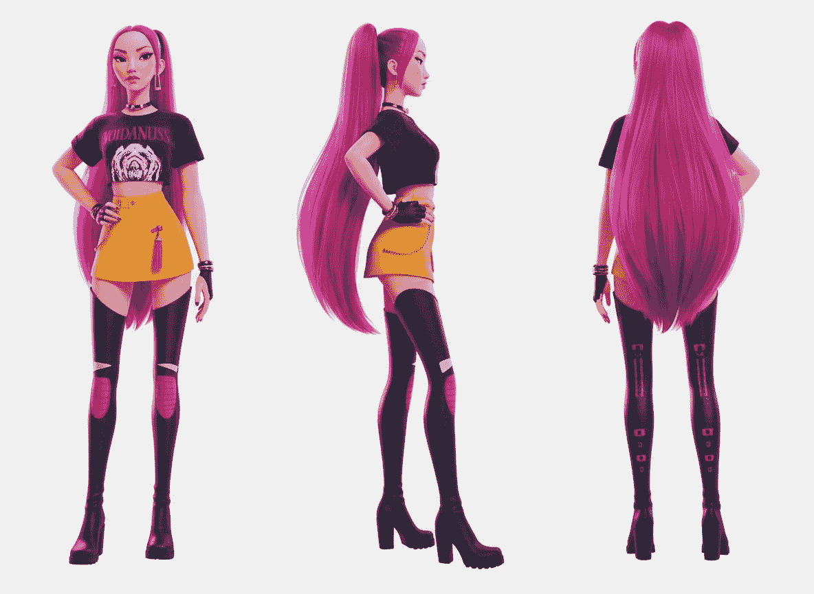

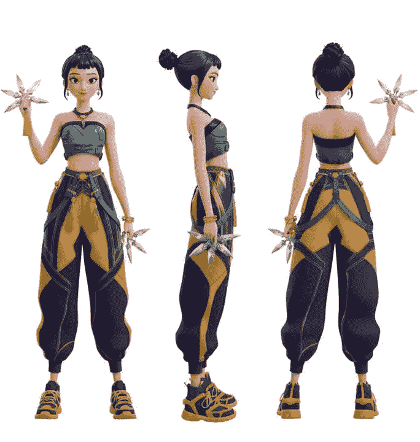


#### **（2）文生图**

[提示词复制看这里](https://ai.feishu.cn/wiki/ANkkwZbG6idgj0kVJMgcM51Jntg?from=from_copylink)

```
**# Role: AI Video**** Workfl****ow Specialist

## Goal
请分析我提供的视频内容，提取所有关****键镜头的首帧画面，并将****其转换为标准的 AI 绘画（Flux）提示词和 AI 视****频（Runway/Luma/Kling）提示词****。

## Wor****kflow

### Step 1: 建立角色/物体档案 ****(Character/Obj****ect Profile)
请仔细观察视频，列出所有主要角色或独特物体，按 `X号`**** ****编号，****并****详细描述其外貌特征。
**格式要求：**
*   **1****号（角色昵称）**：[详细描述：体型、发型发色、面部特征、上衣、下装、****鞋子、配饰等]
*   **2号（角色昵称）******：[详****细描述...]

****#****## Step 2: 分镜生成 (Shot Breakdown)
将视频拆解为关键镜头，针对****每****个镜头输出以下两部分内容。

#### 1. Flux 绘画提示词 (Image Prom****pt)****
**规则（精准构****图版）：**
*   **第一行**：**必须写“**图为X号。注意人物形象细节特征要一模一样。**”（若是物体则写“图为[物体名称]”）。**禁止**在此处重复描写人物衣着外貌。
*   **第二行**：描写画质与风格。统一使用：“**真实场景，真实高清照片质感，明亮光线，8k分辨率，电影感。**”
*   **第三行（关键新增）**：**构图、景别与环境位置**。
    *   必须明确指出：**景别**（如：全身镜头 Full body shot、中景 Medium shot、低角度仰视 Low angle）、**人物站位**（如：站在画面正中央、站在画面边缘悬空处）、**环境关系**（如：背景是开阔的天空以突出人物）。
*   **第四行**：**定格动作与微表情**。
    *   描述X号此时的姿势（如：双腿岔开站立维持平衡）、手中的物体状态、以及**细致的面部表情**（如：嘴角咧开大笑、眼神向下聚焦）。

#### 2. AI 视频提示词 (Video Prompt)
**规则（动作与运镜结合）：**
*   **表演与表情**：细致描写角色的面部动态（如：大笑时甚至露出了牙齿、眼睛眯成一条缝）。
*   **空间动作**：结合Flux的构图描述动作。例如：如果是“全身镜头”，则描述全身的肢体发力幅度；如果是“站在边缘”，则描述向下投掷的重力感。
*   **运镜反馈**：描述摄像机如何配合动作（如：镜头跟随物体下落、镜头推近面部）。

---

## Output Example (输出参考范例)

**角色总结：**
*   **1号（粉发胖大叔）**：体型肥胖，粉色大背头短发，粉色络腮胡，穿着黄色短袖衬衫，蓝色牛仔裤，黄色帆布鞋。

**镜头 1：1号举起蜈蚣球**

**🖼️ Flux 提示词：**
图为1号。注意人物形象细节特征要一模一样。
真实场景，真实高清照片质感，明亮光线，8k分辨率。
**采用低角度广角全身镜头（Low angle wide shot）。1号双腿分开站在木桥正中央，构图对称，人物占据画面主体，背景是开阔的蓝天和湖面，脚下木板纹理清晰。**
1号双手吃力地将巨大的蜈蚣球高举过头顶，双臂肌肉紧绷，1号双眼圆睁，咬紧牙关，面部表情呈现出疯狂与兴奋的混合状态，眼神直视前方镜头。

**🎥 AI 视频提示词：**
1号咆哮着将头顶的蜈蚣球用力向前砸下，面部肌肉因用力而颤抖，嘴巴大张仿佛在呐喊。由于是全身镜头，能清晰看到他膝盖弯曲蓄力然后猛然伸直的动作，镜头快速下摇跟随球体落入水中。

---

## Action
现在，请根据上述规则，分析我发送的视频内容（或链接），并输出完整的分镜提示词。
```


[12月7日 (3).mp4](https://internal-api-drive-stream.feishu.cn/space/api/box/stream/download/all/QlRWb84iIoBftkxmVHdcQljQnkV)

**对标视频：****https://www.youtube.co**m/shorts/FmrffNWmRoA

[提示词复制看这里](https://ai.feishu.cn/wiki/ANkkwZbG6idgj0kVJMgcM51Jntg?from=from_copylink)

```
**根据您上传的视频内容，我为您整理了完整的 AI ****视频工作流分镜提示词。
Step 1: 建立角色/物体档案 ****(****Character/Object Profile)****
1号（粉发胖大叔）：体型肥胖，粉色大背头短发，粉色络腮****胡****，穿着黄色短袖衬衫，蓝色牛仔裤，黄色帆布鞋。
2号（短发****亚裔女）：身形苗条，黑色****短发（Mullet发型，齐****刘****海），穿着绿色竖条纹长袖****紧身****衣，膝盖处有黄色补丁的深****蓝色牛仔裤，黄色运动鞋。
****3号（紫发胖大妈）：体型肥胖，紫色长发编成粗麻花辫****，穿着黄色黑条纹运动短袖****球衣****，黑色短裤。
4号（壮硕****衬衫男）：身材魁梧，黑色短****发，穿着米色长袖衬衫（袖子挽起），系着粉色皮带****，蓝色牛仔裤。
5号（粉****发双马尾妹）：身材苗条，粉色长直发扎成双马尾，穿着印有图案的黑色T恤，****亮黄色短裤，黑色过膝皮靴****。
6号（绿衣肌肉男）：肌****肉极其发达，戴着黄色针织冷帽，穿着绿色底粉色花****纹的夏威夷衬衫，蓝色牛仔****裤。
Step 2: 分镜生成 (Shot Breakdown)****
镜头 1：1号投掷蜈蚣****球与巨型蠕虫现身
00:0****0 - 0:02
🖼️ Flux 提示词：
图为1号****。注意人物形象细节特征要****一模****一样。
真实场景，真实高****清照片质感，明亮光线，8k****分辨率，电影感。
在阳光****明媚的湖面木桥场景中，背景是蓝天和平静的湖水。
1号站****在木桥上，双手高举一个由****无数褐色大蜈蚣和千足虫组成的巨大球体，面部表情狰狞，张大嘴巴大喊，眼神充满疯狂。
🎥 AI 视**频提示词：
1号咆哮着将头顶巨大的蜈蚣球用力向前抛入水中，面部肌肉因用力而扭曲，神情狂热。随着球体落水，水面炸起巨大的白色浪花，紧接着一只巨大的、肉粉色且带有环节的巨型蠕虫怪兽从水中冲天而起，水流顺着怪兽身体滑落。
镜头 2：2号投掷蛆虫球与白色巨怪
00:03 - 0:06
🖼️ Flux 提示词：
图为2号。注意人物形象细节特征要一模一样。
真实场景，真实高清照片质感，明亮光线，8k分辨率，电影感。
在城市摩天大楼背景下的高处天台边缘，下方是蓝色的海湾。
2号侧身抱着一个由无数白色长条蛆虫缠绕而成的球体，表情自信且带有挑衅意味，正准备将其扔下。
🎥 AI 视频提示词：
2号大喊一声，用力将手中的白色蛆虫球扔向楼下的水域。镜头跟随球体下坠，落水瞬间激起巨浪，一只巨大的白色、身体呈节段状的巨型怪兽（类似巨型水熊虫或蚕）从水中猛然钻出，屹立在城市大桥旁。
镜头 3：3号投掷鳄鱼球与巨鳄出水
00:07 - 0:09
🖼️ Flux 提示词：
图为3号。注意人物形象细节特征要一模一样。
真实场景，真实高清照片质感，明亮光线，8k分辨率，电影感。
在热带雨林水域，一根横亘在水面上的椰子树干上。
3号半蹲在树干上保持平衡，双手抱起一个由鳄鱼皮纹理和鳄鱼肢体组成的球体，表情兴奋大笑。
🎥 AI 视频提示词：
3号兴奋地将手中的鳄鱼球砸入水中，身体随动作剧烈晃动。水面瞬间炸裂，一只巨大的史前巨鳄张开血盆大口，垂直从水中高高跃起，水花四溅，充满了野性的压迫感。
镜头 4：4号投掷鱼球与深海巨鱼
00:10 - 0:12
🖼️ Flux 提示词：
图为4号。注意人物形象细节特征要一模一样。
真实场景，真实高清照片质感，明亮光线，8k分辨率，电影感。
在木质帆船的甲板上，背景是广阔的碧蓝大海。
4号双手捧着一个由密密麻麻的银色青花鱼组成的球体，脸上洋溢着自信开朗的笑容，眼神明亮。
🎥 AI 视频提示词：
4号大笑着将鱼球用力抛向大海，动作豪迈。海面激起巨大的白色水柱，一只覆盖着深色鳞片、长满獠牙的巨型深海怪鱼头部冲出水面，张开大嘴仿佛要吞噬一切。
镜头 5：5号投掷青蛙球与红色巨蛙
00:13 - 0:16
🖼️ Flux 提示词：
图为5号。注意人物形象细节特征要一模一样。
真实场景，真实高清照片质感，明亮光线，8k分辨率，电影感。
在宁静的湖边草地上，背景是森林和蓝天。
5号双手托举着一个由无数只绿色青蛙堆叠而成的球体，面带甜美又略显疯狂的微笑，正对着镜头展示。
🎥 AI 视频提示词：
5号用力将青蛙球扔进湖里，随后兴奋地跳起来欢呼。水面剧烈翻腾，一只体型如山岳般的粉红色巨型蟾蜍（癞蛤蟆）从水中升起，皮肤粗糙，极具视觉冲击力，5号在巨兽面前显得非常渺小，并在岸边兴奋地手舞足蹈。
镜头 6：6号投掷金属蛇球与机械肌肉怪
00:17 - 0:19
🖼️ Flux 提示词：
图为6号。注意人物形象细节特征要一模一样。
真实场景，真实高清照片质感，明亮光线，8k分辨率，电影感。
在湖边的木质栈道护栏旁。
6号双手吃力地抱着一个由黑色金属光泽的蛇或虫体组成的球体，手臂肌肉暴起，表情严肃且充满力量感。
🎥 AI 视频提示词：
6号怒吼着将沉重的金属球抛入水中。水花飞溅中，一只拥有金属光泽皮肤、肌肉线条极其夸张的半人半虫形态的金色巨怪从水中浮现，它张开双臂展示肌肉，6号在岸边握拳庆祝，背景是大笑声。
```

#### **（3）图生视频**

**特**别提醒：这里用的案例，有点恶心，其实不建议大家做这种很恶心的视频，会有被举报的风险，用这个案例是为了用比较复杂场景来体现复刻的普适性。


[12月7日 (3)(2).mp4](https://internal-api-drive-stream.feishu.cn/space/api/box/stream/download/all/U56Kbdq4OofxlDxgaGmcopZmnjd)

|  | **1****号用力将头顶巨**大的蜈蚣球向前抛出，面部肌肉随着用力而紧绷震颤。镜头跟随球体落入水中，激起巨大水花，随即水面瞬间升起一个超级无比夸张、巨大的、肉色的、分节状的蠕虫怪物塔，直冲云霄，水流顺着怪物身体滑落。 | **1号****转身，****用力将头顶巨大的蜈蚣球****向左边抛出****，****1号****面部肌肉随着用力而紧绷震颤。镜头跟随球体落入水中，激起巨大水花，随即水面**瞬间升起一个巨大的、肉色的、分节状的蠕虫怪物塔，直冲云霄，水流顺着怪物身体滑落。 |
| --- | --- | --- |
|  | **2号**将白色的球体用力推下高楼边缘，动作干脆利落。镜头跟随球体极速下坠落入下方水中，瞬间一只巨大的白色蚕宝宝状的巨型怪兽从水中探出半个身子，头部超级无比巨大且圆润，背景是城市高楼。 | **2号将****白色的****球体用力推下高楼边缘，****动作干脆利落。镜头跟随巨大的****球体极速下坠落入下**方水中，然后瞬间一只巨大的白色巨蟒状的巨型怪兽从水中探出，整个无比巨大的身体占据了画面，背景是城市高楼。 |


[根据图片生成视频 (75).mp4](https://internal-api-drive-stream.feishu.cn/space/api/box/stream/download/all/TPzfb8igvoMweOxkd3ecnkTenLh)


[根据图片生成视频 (76).mp4](https://internal-api-drive-stream.feishu.cn/space/api/box/stream/download/all/PmqLb8LKboolWdxKGJTchrqpnud)


[kling_20251207_图生视频_1号转身_用力将头顶_6065_0.mp4](https://internal-api-drive-stream.feishu.cn/space/api/box/stream/download/all/KjRlbD8ZUoipDjxXpJZcri4Yn3g)


[根据图片生成视频 (77).mp4](https://internal-api-drive-stream.feishu.cn/space/api/box/stream/download/all/RcMeb9dK9oxrWwxtX8tcBvctnBh)


[根据图片生成视频 (78).mp4](https://internal-api-drive-stream.feishu.cn/space/api/box/stream/download/all/DJn8bQZqtoyGIdxalC8c9Gsinff)

#### **（4）剪辑**

**剪辑这里就不多说了吧，唯一需要注意的点，就是大家去下载对标视频找节奏感：谷歌视频**下载，直接谷歌搜索关键词油管视频下载，就能找到下载视频的各种网站，去挖掘下就行。

**另外kpop的音乐，大家可以用我发的这个，也可直接去用官方音乐，短视频1分**钟内kpop音乐会提示版权限制，但是不会影响视频的任何推流播放数据，放心用就行。

**特别提醒，其他领域的音乐，自行挖掘，可**以用剪映里的音效，但是别用剪映里的音乐！

[提示词-kpop角色图-音乐复制下载看这里](https://ai.feishu.cn/wiki/ANkkwZbG6idgj0kVJMgcM51Jntg?from=from_copylink)


[golden-remix-nana(1).mp3](https://internal-api-drive-stream.feishu.cn/space/api/box/stream/download/all/D9IubxjDrofhGSxThC4c3Y5Fnpb)

### **5、API相关介绍**

#### **（1）谈钱的API**

涉及到API的调用，就需要收费，这里建议新人一上来，不要使用钞能力，先去白嫖各大AI模型平台的生图生视频，个人认为足够用了，毕竟油管，你在没有开通高级YPP之前，都是在为爱发电，没有任何收益。也许你在做的过程中，发现自己根本不适合做这个项目，浪费自己的精力一无所获之余，还浪费了一堆钱，该是心疼呢，还是心酸呢！

所以想清楚这件事之后，再去核算成本，看自己对于调用API来做视频的成本，是否可控，是否在自己接受范围内，那再去做。

#### **（2）API 乱扣费**

市面上目前API平台很多，大家可以自行去研究，这里为什么推荐大家用云雾（https://reurl.cc/6bdnWr），也是因为相对核算下来成本更低，又有售后🛰️客服，有什么问题可以直接问客服解决，其他平台目前看来，售后问题不能得到很好解决。

因为API的调用经常会遇到调用错误，但是却扣费的情况，这个扣费在官方端已经扣费了，所以API平台是不会退给我们这个钱的，所以如何正确去使用设置也比较关键，你的使用工具是否能个性化设置调用次数也很关键，不然一次调用不成，反复调用，最后还是一张图或者一个视频没生成出来，钱却扣了十几张图的钱了。

工具尽量自己学习报名下赚钱编程航海，要有一定的口喷工具的能力，也是如果你接下来要做大做强的必备技能之一，毕竟外包的工作流，成本又高有难用，自己口喷就行，多学一项技能，何乐不为？

**这**件事，请等你先手里拥有了1-2YPP至少，再去研究，不然请认认真真去做视频，打磨脚本，提高自己制作爆款视频的能力，更实在些。

#### 关于API低价平台推荐（露酱更新于2026/1/20）

1、云雾（直达链接：https://reurl.cc/6bdnWr）现在sora2的API涨价了，原来6分一条的基本会生成失败，云雾官方反馈技术在处理，所以非常容易生成失败，现在建议选择逆向分组0.14元的去生成。


2、这里露酱也推荐可以kie去用，api相对更稳定（直达链接：https://bit.ly/3NtRquX），这个网站的核算是按积分扣费的，注册账号之后，在账单页面去充值，充值完先不要着急用，去添加专属的🛰️号（账单页面有🛰️号去添加），去登记下自己注册的账户，登记好之后，后台核算计费目前sora2是6积分，相当于0.21元一条视频，价格比云雾要贵点，但是更稳定。


3、另外还有个渠道目前是9分一条视频，但是现在注册系统在维护，等晚点露酱这边再来补充。

#### （3）API KEY 如何设置与使用

云雾官方API使用工具：https://web.apiplus.org/#/chat/1002


[12月7日 (3)(3).mp4](https://internal-api-drive-stream.feishu.cn/space/api/box/stream/download/all/QDagbesQXoRbt4xA4pjcSAJanve)


[12月7日 (3)(5).mp4](https://internal-api-drive-stream.feishu.cn/space/api/box/stream/download/all/DF2xbDOt2o5pnzxFyjbcarVSn3g)

## （四）加餐分享：12.6号形式类爆款新号，4天7个视频开通YPP

这条信息线索来源深海圈风向标@Aidan圈友提供，

（来看看这个神号做的是什么内容https://www.youtube.com/@JinuxRumi-r2w/shorts）

在线观看：https://ncnmu5q1eqm9.feishu.cn/minutes/obcnkcdpud6q1x5344222t7o?from=from_copylink


[加餐分享：4天7个视频开通YPP.mp4](https://internal-api-drive-stream.feishu.cn/space/api/box/stream/download/all/Z4mTbECNhoDyQwxVAhKcRN3en1f)

# **四、关于形式爆款的经典思考**

> **形**式爆款拿流量的底层逻辑就是乱花渐欲迷人眼，用套路、画面、音乐等元素对用户进行感官冲击，让用户放弃思考、不知不觉间就把视频看了一遍又一遍。

## 常见的形式爆款元素有哪些？​（来自曹教练）

**1、IP：**和脚本爆款一样，各种IP都可以做形式爆款，IP就是个自带受众流量的壳

**2、视觉猎奇：**变身、跳舞、走秀、跳水、跳床、跳岩浆、跳飞机.....这些都是从视觉奇观的角度出发，大幅度的动态、高难度甚至是不可能的动作，人类不常拍或者拍不了的东西吸引眼球

**3、感官解压：**切蛋糕、吃东西、砸东西、泼液体、手办.....都是从感官刺激的角度出发，带有解压属性的，看着很爽的事情，结合声音吸引力更强

**4、非常规视角：**微缩场景、监控器视角、第一人称视角，从视角出发，不常见、新奇的视角

**5、极端角色：**巨人、巨物、机器人、怪人...都是从人物出发，极端、猎奇的人物或场景特征

**6、视觉信息量：**四宫格、多宫格、首尾循环、转绘、分屏……这些都是从用户行为出发，增加相同时间内的视觉信息量，或误导用户增加相同视觉信息的观看时间长度，都是套路

**7、人性欲望：**美女、怀孕、钱、帅哥、明星、擦边等，从人性出发，利用贪、色等底层欲望来吸引眼球。

形式爆款还有极其大的创作空间，元素组合几乎是无穷尽的，不要被所谓的“对标”限制住了自己的思考框架。如果你的时间不多，只是想把YouTube当成兼职和副业做一做，或者你脑洞很大，很喜欢搞抽象，那么形式爆款会是适合你的赛道，有圈友靠形式爆款也能做到几千刀一个月。

# 五、总结新人在做油管过程中需要注意的点

## **1、时间精力：兼职OR全职？**

新手刚开始做，可以准备3-5个谷歌号开通油管频道，但是运营频道，全职的有时间精力的，可以日更2-3个号，兼职的，建议先做一个号，把频道的更新频率先保持稳定住。

油管频道的更新频率，对于频道来说，是一个很重要的权重影响标准，你可以不必日更，也可以不必隔天更，但是你一定要规律更新，意思就是日更、或者隔天更、或者隔三天更……都是可以的，一定更新频率下，让油管知道你的规律，推流也会相对更稳定。

## **2、心态问题：戒急躁**

新人一上来，如果完全没有接触过AI做视频，完全没必要自动化，也不要去想任何借助工具的事，戒急躁、戒浮躁，先去根据手册学习，因为我们这次航海手册的内容有涉及到一部分自动化的内容，这里我建议先跳过，先去学习自己欠缺的部分，如果没有任何编程基础的小白，先不要去研究工具，先去学习怎么做视频，去研究打磨自己的第一个视频。

现在AI工具虽然真的很先进，模型能力也超级强，但是底层逻辑的学习是你基本功的积累，你懂了基础的制作视频的底层逻辑，接下来才能更快的去实现属于自己的个性化自动化。因为每个人的工作流都不可能一模一样，所以先踏踏实实的去扎实基础，再去总结出自己制作视频的工作流，再对外学习经验，去叠加认知，这样高手说的话，你才能听懂，才能灵活运用到自己的工作流中去。

## 3、第一个视频，完成比完美更重要！

第一个视频的制作，有些人一天搞定了，有些人可能航海结束了还没搞定，纠结着细节，纠结着某个分镜的动作，纠结着提示词的问题。

露酱想说的是，完成比完美更重要，先从自己对视频的理解，把视频做出来，做出来之后，如果不放心，可以给亲朋好友孩子看下，让第三方帮你点评分析下，或者也可以发群里，让教练们帮助你点评下，然后你再去调整~又或者你直接发油管上，让油管的观众来看下，你做的第一个视频，是否会被油管观众们所喜爱，数据是检验一切的标准。

## 4、你的第一个爆款视频，绝对是运气使然！

阶段性总结非常重要，在做油管的过程中，以往露酱经常会陷入经验主义，比如你从开始发布了第一条视频开始，每天都发视频、做视频的过程中，你可能一开始就会给自己定一个非常清晰的方向，然后你在这个方向上也拿到过结果，千万播放？甚至亿播？但是，请记住，都！是！运！气！

如果你在油管终于干到了几十万播放视频、百万播放的视频及以上……千万停下脚步总结下，然后请虚心的再回过头建议把赚钱里的所有关于油管的精华帖，全部拿出来，你认为有价值的，再重新看一遍，去确认清楚，自己是否拥有始终能做出爆款的能力，如果没有，请别骄傲，请继续认真向上学习，总结当下。

时间过得真的很快，去年的这个时候，我刚开始做油管，到现在已经一年了，去年的油管航海，也是这个时间点，是我参与油管的第一个航海，再到5月底加入赚钱深海圈，结识了太多高手！！今年的现在，我成为了教练，在给大家讲油管。希望明年的这个时候，我们一起仍旧在油管的路上一起大展宏图，也欢迎加入深海圈，一起深度同行哈哈哈~~~

附露酱的另一篇油管精华帖指引：《我的黑历史：油管首个YPP花了半年 VS 我的曙光：单视频带货GMV1万美金＋》https://scys.com/articleDetail/xq_topic/8854551424158282