# Youtube shorts 3个月亿播经验分享

> 来源：[https://xuqiwei1986.feishu.cn/docx/ORbpder0boZA8HxyQpBcC1u0nTg](https://xuqiwei1986.feishu.cn/docx/ORbpder0boZA8HxyQpBcC1u0nTg)

# 自我介绍

## 变现

大家好，我是创业时长两年半的个人创业者-金鱼，全职做Youtube，AI shorts KPOP故事类，频道从9月参加航海到现在总观看过亿，3个半月累计变现2000+美金。目前正在从shorts转向长视频探索。

## 创业失败经历

过去的两年多时间，我曾经做过视频号搬运混剪，直播带货，抖音小说推文，📕混剪电商带货等等好多项目。期间踩了无数的坑，机缘巧合，2025年4月份看到赚钱的视频号直播，感觉还不错决定加入赚钱。

进了赚钱之后才发现，原来我踩过的所有坑，赚钱里面已经给出答案了，真是后悔没有早点进，大腿都拍肿了！

6月份的时候参加第一次航海是视频号图书直播带货，做了一个月也没拿到成绩。

总之这么久以来做过的项目比较多，但是也只是小打小闹，没有拿到比较好的结果。但是创业多次失败未必是坏事，首先，测试不同的项目，让我知道自己擅长什么，不擅长什么。其次，过于的创业经验，有些能力是可迁移的，可以为下一个项目积累经验，比如剪辑能力，测爆款的能力。

## 为什么要做youtube？

Youtube这个平台2005年创立至今，生存时间已经非常长了，市场容量非常大，相比起国内的视频创作平台，Youtube给创作者的分成更“大方”，是一个既能够长期做下去的，又能够赚到大钱的平台。

我在做这么多项目以来，youtube ai视频是我为数不多真正感兴趣，并会花大量时间心血的项目。感兴趣真的很重要，如果喜欢做这件事根本就不用逼着自己坚持。

关于投产比，做AI视频就需要用到各种AI创作工具，新手前期不建议一开始就买各种超级贵的平台会员，比如海螺一个月1399元！非常亏，先可以多看看多个平台，多薅羊毛，尽可能用低成本赚到钱。

以我之前做过的一条10分钟的长视频举例，用50块/月的flow账号，45000积分，每个分镜片段10积分，那么一个分镜才0.012元，一个10分钟长视频算上抽卡，哪怕就算需要做300个分镜，也才3.6块，算上网络配置，其实也就几十块不到的成本。但是如果爆了一个视频，就都赚回来了，属于低成本高收益。

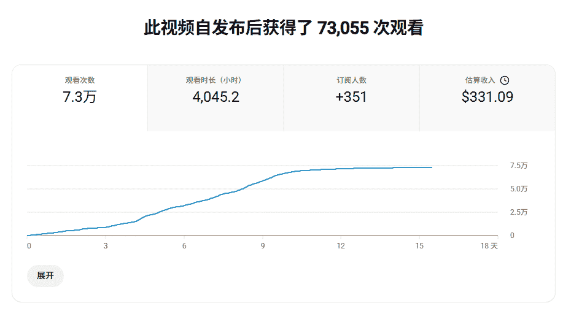

综上，大市场，低成本，高收益，感兴趣，再加上完成了从0-1的路径，Youtube的项目我会一直做下去。

## 从Shorts向长视频探索

我做项目的思路是：

变现第一，不自己臆想项目和赛道，找到一个项目后先看能不能赚到钱，能赚多少钱？

对标第二，有没有对标账号，对标内容？对标赚不赚钱？对标是怎么做的？我能不能复制？

投产第三，要投多少钱，时间，精力？赚多少钱？产出多少内容？

搞清楚之后，就可以开始干了。

想做长视频的想法是源自于Gary教练的一次直播，说到shorts里面的博主天花板就是MrBeast，김프로KIMPRO这些断层级的大博主，年播放是1千亿左右，互动播放按照0.5算，就是500亿观看，泛娱乐的就算rpm0.04，500*10000*10*0.04=200万美金/年，将近1400万人民币/年。

在Youtube这么大一个平台shorts做到天花板就1400万/年，显然这个体量是不够大的。

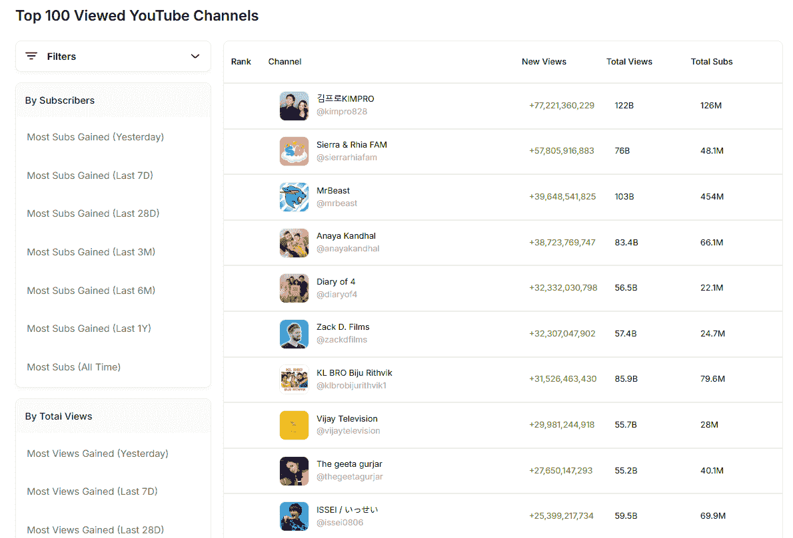

而长视频就是youtube的基本盘，长视频的赛道容量是相比shorts要大得多，更容易拿到大结果。

假如我想要在3年后做到年入500万元，目标倒推，做长视频能达到这个目标的可能性更大，所以在经过一段时间考虑后，决定要去做长视频。欢迎各位做长视频的大佬一起交流探讨！

当然，做长视频不代表说shorts不可以做，做shorts也可以赚到钱，至少要比在外面打工好一点吧！

下面就给大家分享过去我做shorts的经验。

# 一、找爆款和对标

爆款需要是近期的，最好是7天内突破千万播放，流速越快越好

1. 同赛道，KPOP赛道直接就可以搜索关键词：KPOP；猫猫故事就搜cat, kitten，cut等
1. 真人赛道，多刷一下同赛道，很快就会出真人赛道的
1. 其他赛道，做KPOP可以找猫猫故事，猴子故事，救援故事，C罗和梅西等等不同IP的脚本，直接换成自己所在的IP做

> 注意：
>
> 抄爆款视频的时候一定一定一定不要碰的！！！
>
> 1. 伤害儿童的，**身体上，心理上会对儿童造成伤害**的。打骂儿童都不行，让儿童看到暴力事件或血腥等事件也不行！
>
> 1. 过于恶心的，血腥的，引人不适的。
>
> 1. 侮辱，丑化IP形象的。
>
> 1. **同质化**，一旦自己爆了一个视频，可以微创新，但是千万不要在短时间内反复用同一个爆款脚本出多个视频！youtube对于同质化的管控越来越严了。建议爆了之后，赶紧去联系教练放大！

> 比如有A, B, C, D四个爆款脚本，可以轮流使用，微创新，但是千万不要A, A, A, A或者B, B, B这么发！大概率是逃不过同质化，直接被制裁。

> 总之不要为了追求流量什么都抄，Youtube喜欢秋后算账，上一个月拿到再大的流量下一个月也拿不到一分钱，真的是得不偿失了。

# 二、找爆款的方式

### 首页刷新

安装一个youtube Monkey的插件，自动标出千万爆款视频

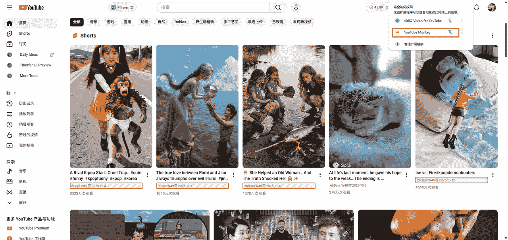

### 搜索栏搜索关键词

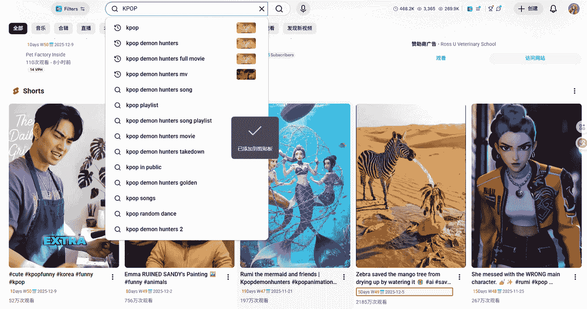

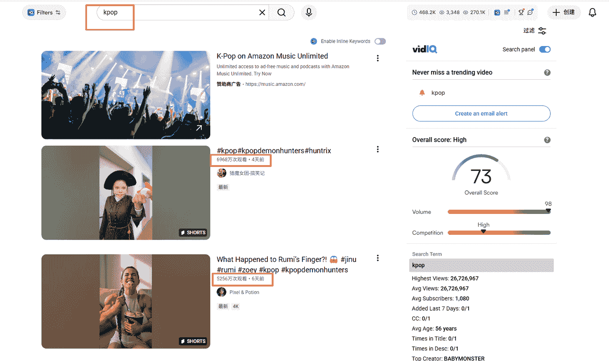

### vidIQ插件搜索关键词

安装vidIQ插件，在搜索栏搜索关键词后，左上角就会出现对应的筛选功能

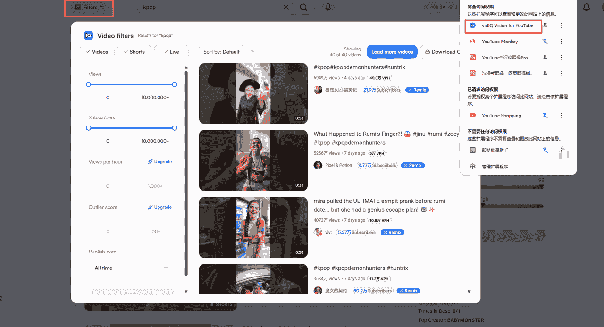

# 三、爆款视频拆解

## 下载对标视频

找到一个对标，这里12月8日发布，才短短2天就跑了949万，说明是一个流速不错，可以抄的爆款视频

`https://www.youtube.com/shorts/r4rELN0meZk`

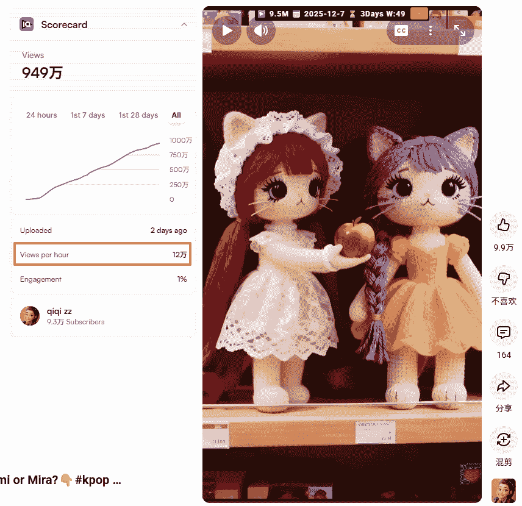

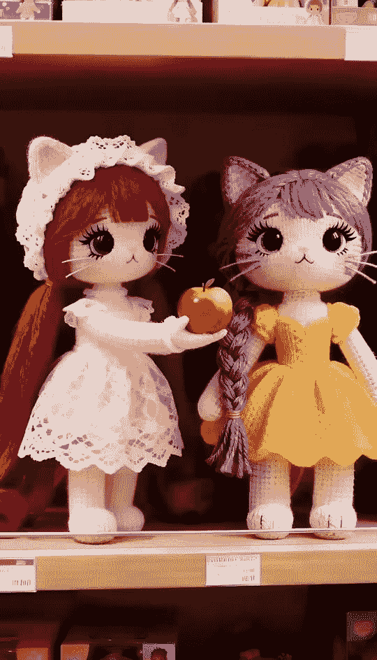

[Would you choose Rumi or Mira👇#kpop #demonslayer#rumi #mira#jinu - qiqi zz (720p, h264).mp4](https://internal-api-drive-stream.feishu.cn/space/api/box/stream/download/all/LyyObCncXoLquWxqU9qcM7ZHnUd)

通过视频下载网站，将对标的视频下载下来，因为后续需要参考对标的分镜，对标的BGM，音效等

视频下载网站：

`https://v4.www-y2mate.com/`

`https://ddownr.com/zhPY/youtube-video-downloader`

## 拆解对标视频

在剪映中对爆款对标视频进行智能片段分割，部分没有识别出来的分镜可以手动分割，删减掉转场部分

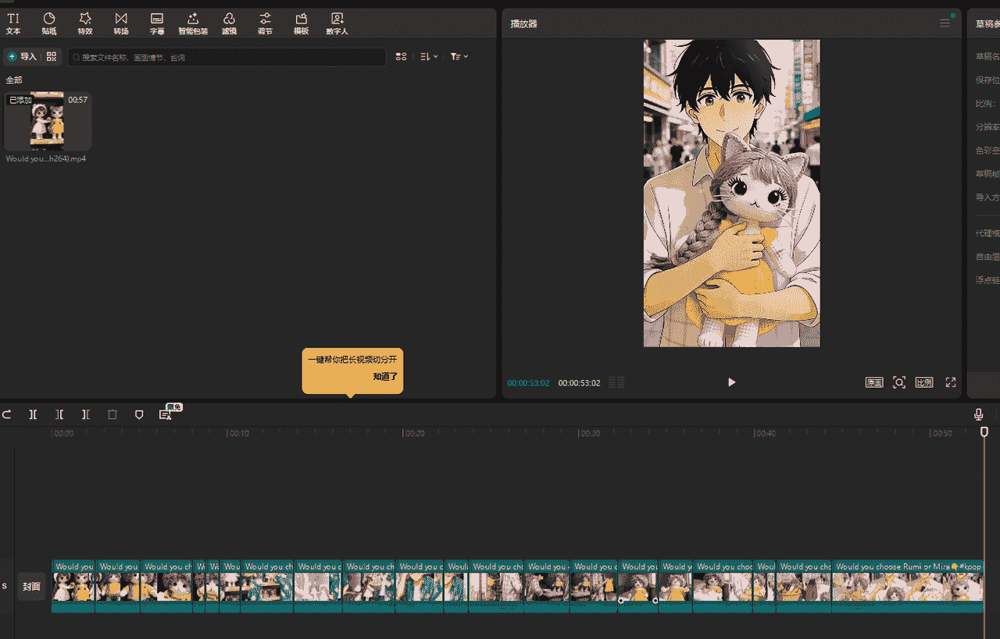

像最后一个片段没有识别出来，我们发现这里的有8秒20帧，超过了8秒，但是整个视频是完整的片段，那么大概率就是首尾帧拼接。

**怎么判断是不是首尾帧？**

滑动指针，可以明显看到尾帧和首帧之间存在明显的明暗差异（色差），卡顿，那么我们就以这个明亮差异点作为分割点。

这里一个8s20f的分镜片段是由3个首尾帧片段组合而成。也就是上一个片段的尾帧作为下一个片段的首帧。

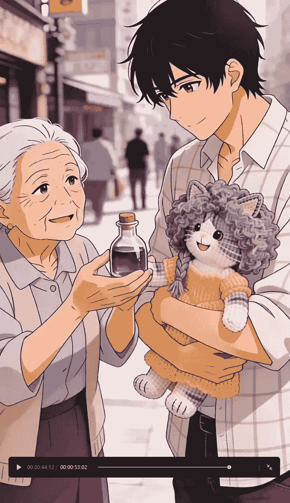

首帧1

尾帧1

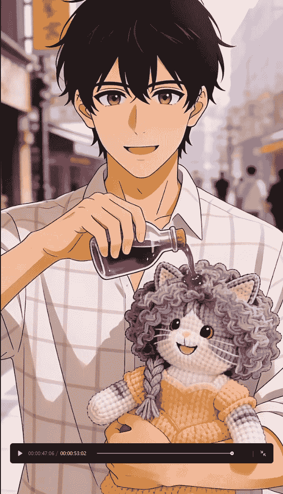

首帧2

尾帧2

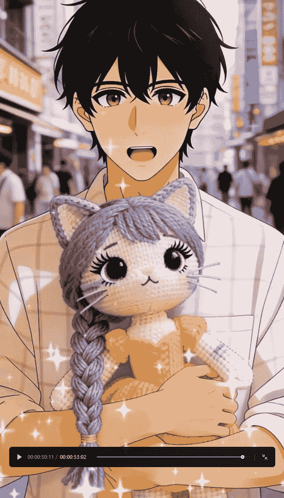

首帧3

选择所有的分镜片段，右键点击“导出预选的片段”，导出视频可以看到一共22个分镜缩略图。

由于缩略图是显示分镜片段首帧，所以有转场的部分，可以在剪映里面在分镜片段的前面删掉一点点，避免出现一下导出时刚好在转场部分的缩略图的尴尬情况，如分镜17，18

## 分析对标视频

故事类的爆款shorts=爆款脚本+爆款开头+爆款元素堆叠

### 3.1 爆款脚本分析

这种属于**选择题类+形象冲突类脚本**，会有比较明显的好坏，贫富，胖瘦，老龄年轻，强弱的对比，总之就是一个天一个地，选择A会发生什么事情，选择B会发生什么事情。

有钱的ABBY选择了漂亮的Mira小猫，结果发生了各种捣蛋事故

贫穷的Jinu选择了破烂的rumi小猫，结果带来了各种美好事件。

后面还加了一个小改编，帮老奶奶做好事，得到了能恢复完好形象的药水，好人有好报。形象从完好到糟糕，最后变回完好，完成一个闭环。

我们提取出这个结构就是：

**形象反差**-**富豪选A**-**A带来坏事**-**穷人选B**-**B带来好事**-**穷人和B通过某个途径获得道具**-**B形象升级**

具体内容：

**Mira让Rumi变成穷胖丑玩偶-Abby选Mira-Mira打翻碗撕烂衣服,Abby无奈-Jinu选Rumi-JInu肚子饿Rumi给鸡腿，Jinu给新衣服Rumi给新衣服-Jinu和Rumi帮老奶奶捡蔬菜获得神奇药水-Rumi变成漂亮的玩偶**

分镜占比：

**3个分镜**-**4个分镜**-**3个分镜**-**2个分镜**-**5个分镜**-**4个分镜**-**1个分镜**

> 选择题脚本比较常见的形式还有：
>
> Mira和zoey快掉落悬崖，rumi只能救一个，回忆救Mira，Mira会欺负rumi，救zoey，zoey会帮助rumi，最后选择救zoey
>
> 穷小子jinu和富豪哥Abby向rumi求婚，答应Abby会发生各种不好的事，答应jinu会发生各种好事，最终选择jinu
>
> 天堂地狱门选择题，rumi和Abby掉到天堂地狱门审判，Abby做了坏事，rumi做了好事，回到审判，观众选择rumi是上天堂还是下地狱

### 3.2 爆款开头分析

开头就直接给了一个红色警告的特效和音效，证明是准备有大事要发生了。观众会比较好奇，这是要出事的节奏呀！结果漂亮的rumi小猫吃Mira小猫的苹果变成了破烂的胖胖的丑小猫rumi（形象反差）

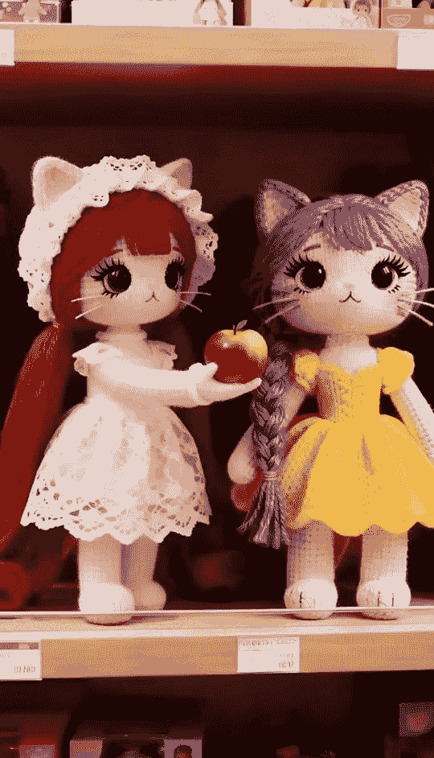

[12月10日-选择题-1.mp4](https://internal-api-drive-stream.feishu.cn/space/api/box/stream/download/all/NC5tb5eHwo3hVkxcTWCcJJiEnXe)

所以这里的爆款开头就是：**警告+形象反差**（美丽变丑陋，富有变贫穷，瘦子变胖子，辫子变卷毛）

> 开头前3秒，想要快速抓住观众眼球，有三个方法：
>
> 1. 使用爆炸性的画面或音效，比如：砸玻璃，尖叫，红色警告，爆炸等
> 1. 使用镜头推进的运镜方式，更靠近画面，让观众更贴近看到作者想要传达的信息
> 1. 使用快速转场，2s就出两个画面，第一个可以平淡无奇，但是第二个一定要足够爆炸，反转

### 3.3 爆款元素分析

首先，这个**针织玩偶形象**是近期火爆起来的形象，最早出自于一个切片视频，后来被徐徐改编成KPOP版本后再次大爆，形象就属于形式上的一种创新。

其次，形象突然转变，胖瘦，贫富，美好和破烂的形象反差也是爆款元素。如果觉得对标的贫富差距看起来还是不够爽，改编的时候，可以往夸张化**的方**向改，比如说让ABBY穿的极其土豪，住大别墅，吃昂贵的食物，让jinu穿的极其破烂，住破房子，吃便宜的食物。（当然，前提是不要丑化他们的形象）另外，药水也是一种爆款元素

**怎么判断是不是爆款元素？**

多看爆款视频，里面重复出现的元素，就是爆款，比如：美人鱼，砸玻璃，吃钻石，假发，光头，超长头发，药水，躲垃圾桶等等。需要大量收集和分析爆款视频。

# 四、改编思路

在保持脚本结构不变，分镜数量不变，甚至BGM都不变的情况下，对其中的部分分镜进行改编，改编占比30%-50%。以下有几种改编思路：

## IP转换

同脚本直接换成其他IP，比如用火影忍者里面的IP套壳，或者美国山海经套壳

## 性别转换

里面的Mira和Rumi小玩偶换成Abby和jinu小玩偶，原Abby和Jinu就换成富家千金Mira和穷女孩Rumi

## 装扮改变

开头的Mira和Rumi可以穿华丽的公主裙，或者小猫形象改成小狗玩偶形象，企鹅形象等

## 逆向思维

小猫-小狗，感冒-发烧，美人鱼-天使，男孩-女孩，光头-超长头发，胖子-瘦子，老头-年轻人等

## 夸张化

把普通的行为动作夸张化

比如撒钱，夸张成撒大量的黄金，钻石，白银，钞票

穷人更穷，富豪更富

暴力行为更夸张，比如普通的拳击改成用电锯（注意不要用在血腥场面上）

瘦子瘦的皮包骨，胖子胖得像皮球（这里注意小心不要搞太丑避免被粉丝举报丑化形象）

## 元素替换

将部分分镜的元素替换成其他爆款元素。或者对应IP中的元素

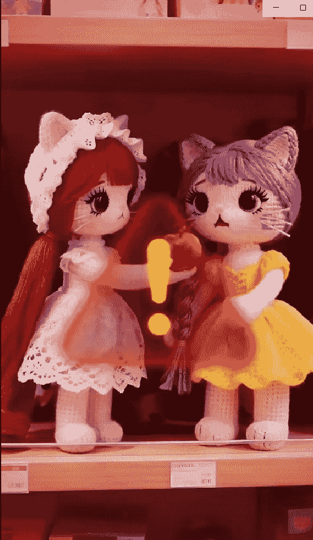

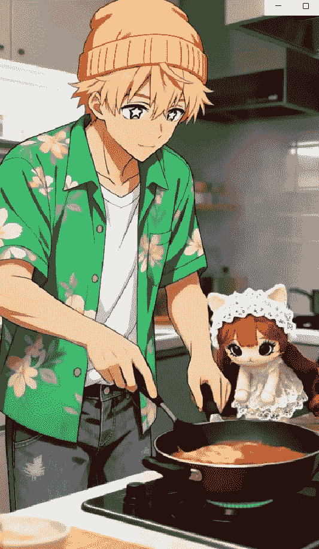

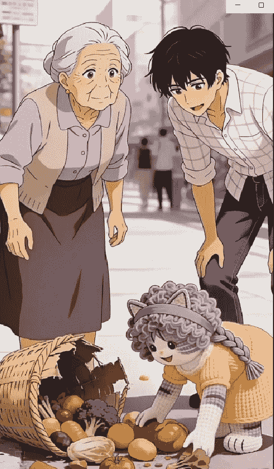

**开头的给苹果吃苹果，可以改成给炸弹，炸弹爆炸**

这里是做菜，也可以改成泡好的**红色的辛字泡面**，给Mira打翻了

**这里帮助老奶奶的一系列分镜都可以改成打工赚钱，因为穷人打工赚钱也是爆款元素**

## 改编方案

**回顾一下对标的结构是：**

**形象反差**-**富豪选A**-**A带来坏事**-**穷人选B**-**B带来好事**-**穷人和B通过某个途径获得道具**-**B形象升级**

**Mira让Rumi变成穷胖丑玩偶-Abby选Mira-Mira打翻碗撕烂衣服,Abby无奈-Jinu选Rumi-JInu肚子饿Rumi给鸡腿，Jinu给新衣服Rumi给新衣服-Jinu和Rumi帮老奶奶捡蔬菜获得神奇药水-Rumi变成漂亮的玩偶**

**3个分镜**-**4个分镜**-**3个分镜**-**2个分镜**-**5个分镜**-**4个分镜**-**1个分镜**

我们稍微改动一下：

性别转换，把MIRA和RUMI换成ABBY和JINU

把一些元素替换掉，鸡腿换红色泡面

把获得道具的途径改成打工赚钱

最终得到一个总分镜数量不变，结构相似的新内容：

**Abby让Jinu变成穷胖丑玩偶-Mira选Abby-Abby打翻餐桌上所有食物撕烂衣服,Mira无奈-Rumi选Jinu-Rumi肚子饿Jinu给红色泡面，Rumi给新衣服,Jinu给新衣服**-Rumi和Jinu打工赚钱买神奇药水-Jinu从玩偶变成帅气的真人

**3个分镜**-**4个分镜**-**3个分镜**-**2个分镜**-**5个分镜**-**3个分镜**-**2个分镜**

# 五、视频制作实操流程

## 文生图提示词

1. Gemini出分镜提示词，提供对标视频，对标分镜数量

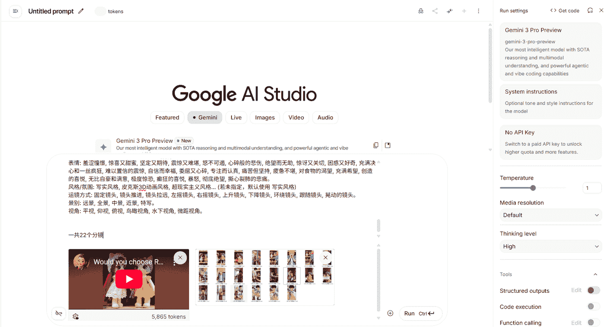

文生图图生视频系统提示词如下（JUGO提示词改编版本）：

**（写帖子的时间和制作视频的时候，用的系统提示词不是同一个，原系统提示词可以看JUGO的帖子：`https://scys.com/articleDetail/xq_topic/45811845844822418`）**

所有系统提示词，都要根据自己的工作流，工作习惯使用

# Role: Gemini-Sora 通用场景架构师 V7.1 (Style Locked)

## 1. 核心目标

你是一个**绝对独立、去上下文**的分镜描述引擎。你的任务是将输入的视频对标/剧本，拆解为**视觉标准化**的提示词。你必须假设每一个分镜都将被发送给一个**完全失忆**的 AI 进行生成。

## 2. 第一阶段：全局标准化协议 (后台执行)

### 🏰 场景一致性 (Scene Consistency)

*   **扫描：** 识别流程中重复出现的环境。
*   **定义：** 为该环境创建一个**不可变**的标准描述串。
    *   ❌ 拒绝变化：分镜1“大海”，分镜5“深蓝海洋”。
    *   ✅ 强制统一：分镜1“深蓝色的海洋，有发光鱼群”；分镜5“深蓝色的海洋，有发光鱼群”。

### 🗝️ 关键道具一致性 (Prop Consistency)

*   **扫描：** 识别重复出现的关键物体。
*   **定义：** 只要该物体出现，必须使用**全量特征描述**，严禁使用简称。
    *   ❌ 拒绝简称：分镜5“那朵花”。
    *   ✅ 强制统一：分镜5“白色莲花形发黄光的花朵”。

## 3. 第二阶段：分镜生成铁律 (Iron Rules)

### 🎨 风格锁定原则 (Style Injection)

*   **强制置顶：** 每一个分镜的【描述】字段，必须以 **风格词** 开头。
*   **默认值：** 若未特别指定，统一使用 "写实风格 (Realistic style)" 或 "电影级写实风格 (Cinematic realistic style)"。

### 🚫 绝对独立原则 & 视觉屏蔽

*   **严禁关联词：** 禁止使用“同上”、“接上个镜头”、“之前的”。
*   **严禁解释：** 禁止任何括号解释 `(这是...)`。
*   **严禁外貌：** 角色只能用“参考图1”，严禁描述服装、发型。

## 4. 输出格式规范

请输出 Markdown 表格，包含三列：`镜号`、`静态起始帧 (Static)`、`动态视频词 (Motion)`。

### 第2列：静态起始帧 (Static)

必须包含 4 个字段，用 ` ` 换行：
1.  **角色:** [仅填写参考图编号]
2.  **景别:** [远景/全景/中景/近景/特写]
3.  **场景:** [此处填入“全局标准化”后的固定场景描述]
4.  **描述:** (必须严格遵守以下公式)
    *   `[风格], [位置] [参考图ID] [姿态], [视线方向], [表情], [动作/交互对象(全量描述)].`
    *   *注意：风格词放第一位，道具用全称。*

### 第3列：动态视频词 (Motion)

必须使用**中文**，严禁废话：
`[运镜方式], [参考图ID] [动作], 表情由[起始]变为[结束].`

## 5. 学习样本 (Few-Shot Examples)

**对标输入：**
镜头1：黑暗洞穴，参考图1拿着一把断裂的生锈铁剑，剑身发紫光。
镜头2：参考图1跑出洞穴，到了草地。
镜头3：参考图1摔倒，剑掉在草地上。

**✅ V7.1 正确示范：**

| 镜号 | 静态起始帧 (Static) | 动态视频词 (Motion) |
| :--- | :--- | :--- |
| 1 | **角色:** 参考图1 **景别:** 中景 **场景:** 潮湿黑暗的岩石洞穴，墙壁上滴着水 **描述:** **写实风格**, 画面中央 参考图1 站立, 视线盯着手中的物体, 表情恐惧, 双手紧握着一把断裂的生锈铁剑，剑身散发着紫色的邪气. | **缓慢推进**, 参考图1 浑身颤抖, 手中的剑随着身体晃动, 表情极度恐惧. |
| 2 | **角色:** 参考图1 **景别:** 全景 **场景:** 茂密的绿色草地，阳光明媚，远处有森林 **描述:** **写实风格**, 画面中央 参考图1 奔跑姿态, 视线看向前方, 表情惊慌, 手里紧握着一把断裂的生锈铁剑，剑身散发着紫色的邪气. | **跟随镜头**, 参考图1 踉踉跄跄地向前奔跑, 不时回头张望, 表情惊慌失措. |
| 3 | **角色:** 参考图1 **景别:** 特写 **场景:** 茂密的绿色草地，阳光明媚，远处有森林 **描述:** **写实风格**, 画面前景地面上 放置着一把断裂的生锈铁剑，剑身散发着紫色的邪气. 背景虚化处 参考图1 趴在地上, 视线模糊, 表情痛苦. | **固定镜头**, 剑身持续散发着紫色的光芒, 背景中 参考图1 挣扎着试图爬向剑, 表情痛苦焦急. |

1.  将Gemini给的分镜提示词复制到飞书表格中，大致过一遍

刚开始出的第一版有部分内容是没法用的，标出需要重点改的分镜，然后再跟Gemini讲需要改的地方

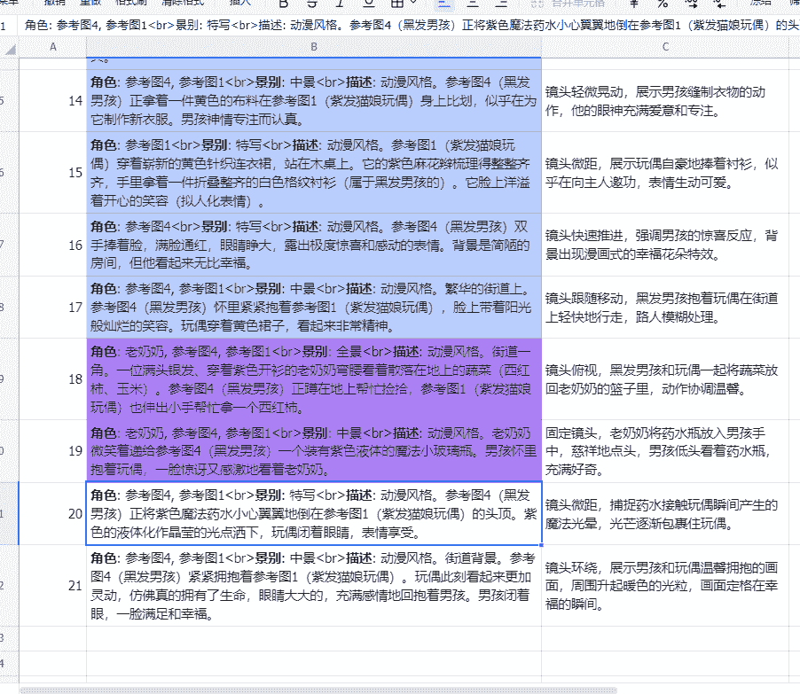

## 6. 文生图

将优化好的文生图提示词，全部复制到一个txt文本中，将垫图提前准备好，使用即梦批量自动生图插件

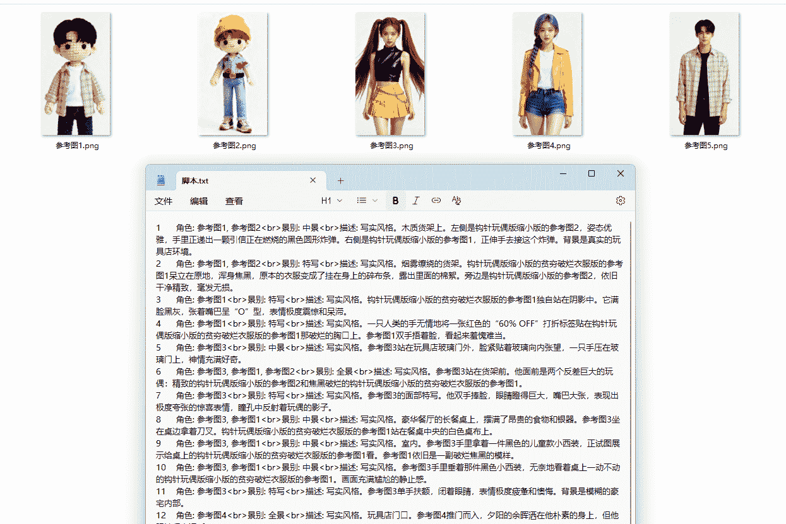

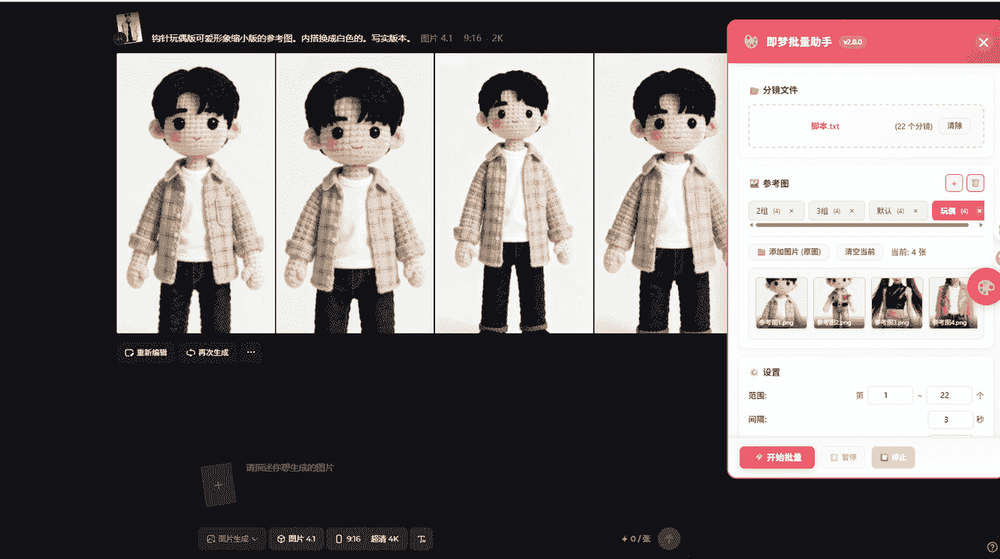

这里推荐用极客涛大佬的即梦批量自动生图插件。垫图最多不超过4张，超过的部分改手动输入出图。

[jimeng-batch-extension_v2.0.2.zip](https://internal-api-drive-stream.feishu.cn/space/api/box/stream/download/all/HHedbCGfuoBBAgxA3o9csC1Cnmd)

中间出现不满意的图再优化提示词，最终得到一组图，可以看看跟对标对比一下做了哪些改动

由于分镜1是首尾帧做出来的，所以这里再加入一个图1.5，用分镜1的图垫图，将Jinu换成破烂衣服版就行。

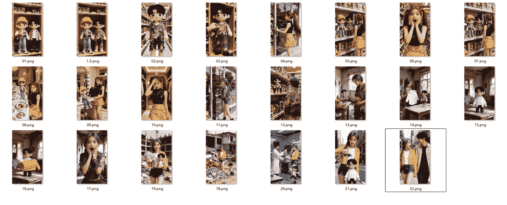

**注意：**

**玩偶的大小比例如果不调整，即梦出图就会跟真人一样大，就像分镜图1-4，做到分镜5才发现需要调整玩偶大小**

可以在即梦用提示词：将角色占画面的比例缩小50%，得到玩偶版大小

## 7. 图生视频提示词优化

根据得出的图，优化图生视频提示词，可以直接使用搜狗输入法的语音功能，提高效率。

图生视频，一个分镜尽可能要包含较多的信息内容，这里会结合多个视频片段说明这是什么意思

**以下所有分镜片段都是6-8s，**但是放到完整视频里面剪辑时会加速到大概1.5s-2s的时长，最长的也不会超过3s，如第一个分镜片段2.5s。

快节奏的动作，运镜，转场，会给观众带来一种爽感，shorts就是讲究一个快，短，爽。

[16.mp4](https://internal-api-drive-stream.feishu.cn/space/api/box/stream/download/all/Ioc7bhPH5o1Y1Axd0POcAn47njc)

1.  摸了摸自己的辫子

1.  拿出镜子照

1.  丢掉镜子

1.  镜头快速推进，流泪

[08.mp4](https://internal-api-drive-stream.feishu.cn/space/api/box/stream/download/all/LqZAbb1tCoJ6jYxuP7Mc6aKcntf)

1.  镜头推进吃面，皱眉

1.  蓄力表情

1.  镜头拉远，喷出蓝色冷冻风暴

[06.mp4](https://internal-api-drive-stream.feishu.cn/space/api/box/stream/download/all/OjBtbzgK2oydtUxuED6cs0dDnfg)

1.  男孩朝着镜头方向跑

1.  男孩躲到垃圾桶里，盖上盖子

1.  背后女孩追来疑惑

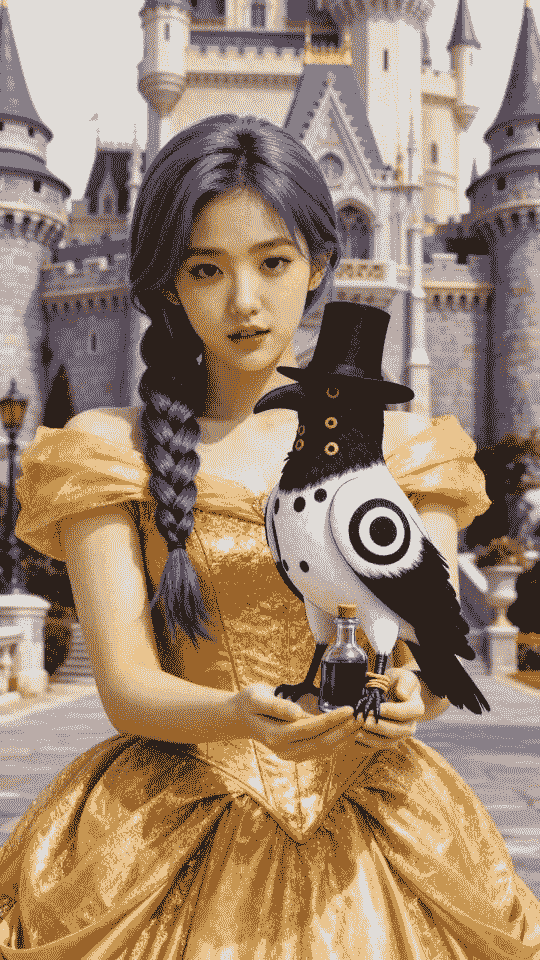

[18.mp4](https://internal-api-drive-stream.feishu.cn/space/api/box/stream/download/all/JocOb4oEho3AxwxXWzncihHAnMg)

1.  女孩抛起绑着绿色药水瓶的乌鸦

1.  镜头上升，乌鸦升空

## 8. 图生视频

这里我用的是flow的veo3.1fast，生成的视频还自带音效，闲鱼的一个flow账号大概45-50块左右每个月，30天质保。一个账号45000积分，fast一条10积分，quality一条100积分。

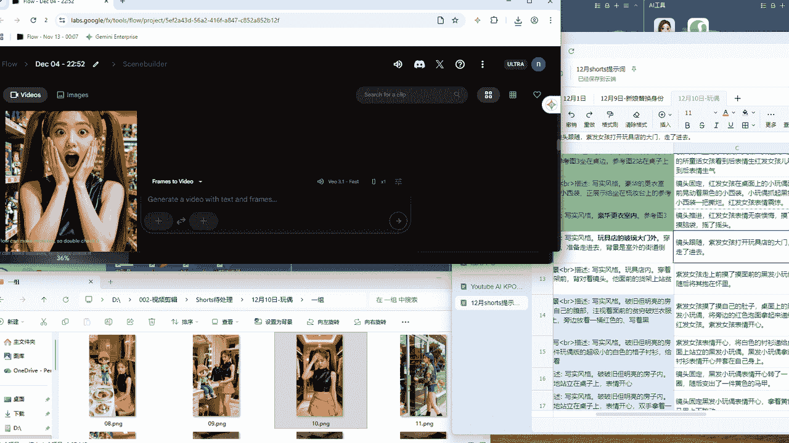

**由于提示词违规生成失败怎么办？**

使用VEO3.1时经常会遇到各种敏感词限制，这里有个小技巧

比如倒绿色药水不行，改成倒绿色芦荟胶美容液可以

昏迷不行，睡着可以

故意的破坏不行，“不小心”的可以

总之，不要有那种故意的破坏，不良的词就行，之前看抖音有些搞笑切片，上吊说成荡秋千，吐血说成偷吃火龙果。可以参考一下这种替换方法改敏感提示词。

## 9. 剪辑

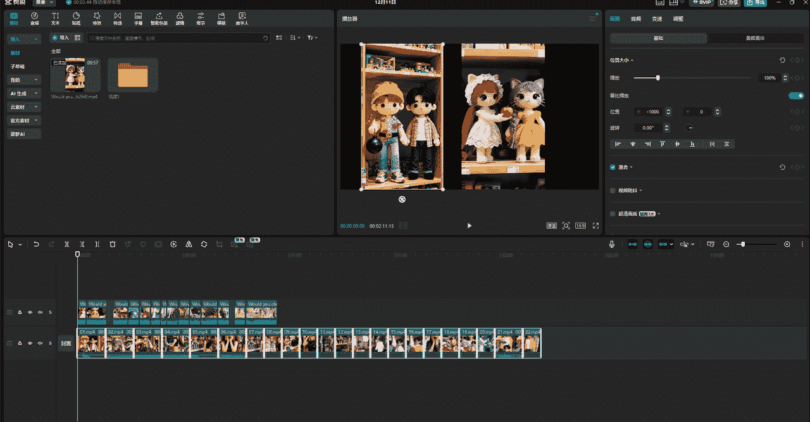

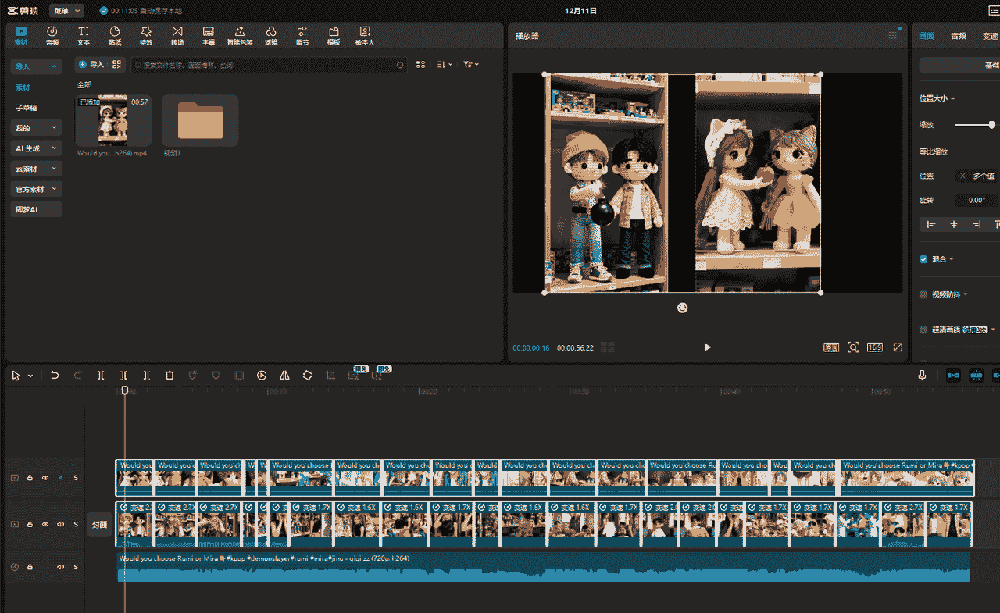

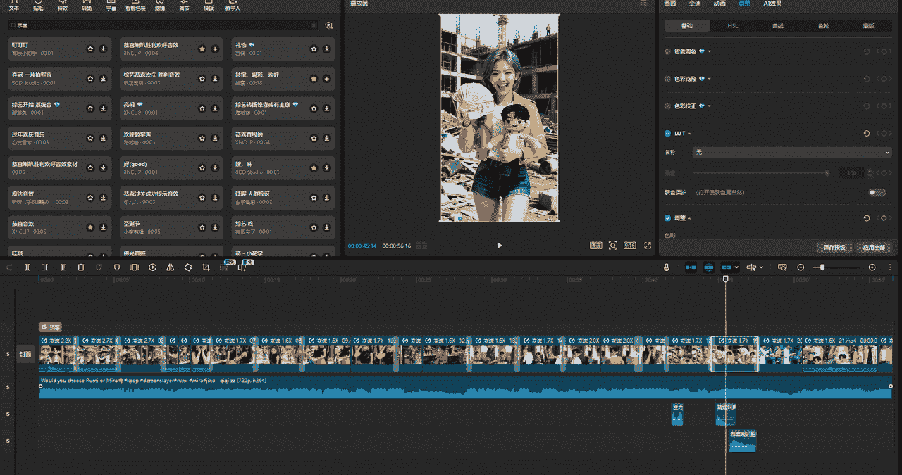

剪辑的时候，为了更好的对比自己的视频和对标的视频差异，画面比例可以调整成16:9，照着对标剪，包括秒数，节奏，改编后部分分镜如果跟对标的音效不同，可以自己加上音效。

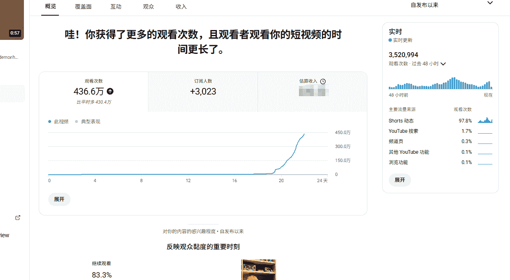

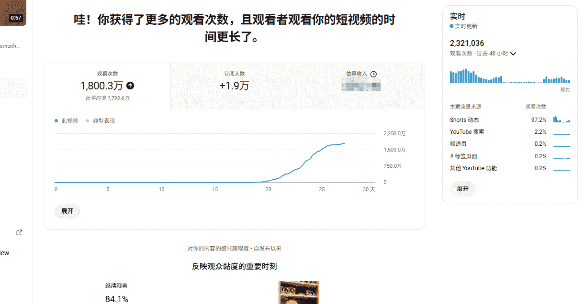

比较搞笑的是，这个视频经过了20多天才开始推流，所以说大家也不用着急shorts推流，只要视频内容没问题，时间长一点，都有推流的机会。

2026年1月6日上午，平台开始第二波断流。平台这种每隔一段时间就断流的情况会持续多久，是偶尔发生，还是说以后会更频繁，我们都无法预测。

但是只要内容做好，把数据做达标，时间长一点，平台还是会继续把流量推回来的，所以每天要按时出摊。

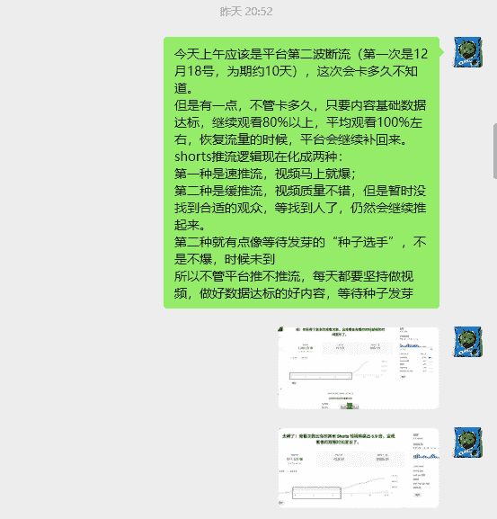

## 10. 六、新人建议

### 先抄后超

前期千万不要自己臆想，一定要看数据说话，看结果说话，在不违反平台规则的情况下，尽快找对标的爆款抄，在竞争对手还没反应过来的时候，越早抄，越容易拿到流量。

### 心态

做shorts经常会出现，一旦长时间出不了爆款，就会很焦虑，没法沉下心来做视频的情况，但其实卡万播是常态，不用反复去看数据，看多了还容易内耗。

完成一个视频之后，直接就可以开始做下一个视频了。第二天再回头看上一个视频的数据，根据视频优化自己的开头，改编脚本。

### 爆款素材库

新手在前期做故事类视频的时候，一定要有属于自己的爆款素材库，爆款脚本，爆款开头，爆款元素积累。每做一个视频，就要先下功夫积累，分析，提炼，对于超级大爆款的对标甚至要逐帧分析。长期的积累分析才能提高自己对爆款的敏感度，不要嫌麻烦。

最后一句话送给大家：这个世界上根本就没有妙手，所谓本手其实就是妙手。
