# 复盘：0基础新人4 个月开通 YouTube Shorts高级YPP，我的坎坷心路历程

> 来源：[https://xuqiwei1986.feishu.cn/docx/UYuud9p3UoQjucx7hsgcxFaenZr](https://xuqiwei1986.feishu.cn/docx/UYuud9p3UoQjucx7hsgcxFaenZr)

# 一、开篇

大家好，我是小妖。今天（10月14号）我收到了后台开通高级ypp的通知。

真是太开心了。可能对很多手握多个ypp的油管大佬来说，这不算什么，但对我这样一个在传统行业浸泡十几年，从未接触过项目，更没有做过互联网项目的中年人来说，它是我人生中重要的里程碑。

开通高级ypp就意味着我拿到了赚美刀的门票，意味着我除了打工赚钱外，多了一条收入渠道，更意味着我本人从1.0版本升级到了2.0版本。

趁着这个重要的节点，我想复盘一下这四个月的经历。这篇文章的侧重点，不是技能或者工具，而是我踩过的一些坑和一些重要却被很多人忽视的心法。因为我发现，心法在执行过程中，是最重要的，心力足够，那些技能、工具才能更好的运用起来，才能在短期没有结果的时候，不会半途而废。

如果你跟我一样，是个普通人，在油管项目上遇到了卡点想要放弃，也许我的文章能给你提供一些心力。

# 二、背景

## 1）我是谁？

我是一名80后，一个二胎宝妈，大宝4年级，小宝幼儿园。我还是一名普通的职场员工，每天有大量工作。

普通大学毕业、普通职员、中年危机、加班、遛娃，这些关键词几乎就能概括我的全部。对，我就是一个普通得不能再普通的普通人。

## 2）我是怎么加入赚钱的？

早在很多年以前（大概是2019年）我就听说过赚钱，具体从哪里得知赚钱就不记得了，只知道它是一个赚钱人的聚集地。我当时也很想赚钱，也想过进赚钱，但限于当时的认知，被高昂的社群费劝退了。

此后我经常看到赚钱的“传说”，知道它不仅还“活着”，而且社群成员越聚越多，但我就是没有加入的想法。有一种：“它很好，但与我无关”的感觉。

直到2024年，我突然极力渴望改变现状。十多年不看书的我，当时一口气买了很多个人成长相关的书，每天疯狂地看，如饥似渴地吸收知识。

然后，我开始日更👸号，每天1000字以上。我日更了256天，不为赚钱，就是每天写自己所学，所想，所感，所悟。为了找到持续写作和学习的环境，我加入了明白老师的日新月异俱乐部。因为那里不仅有写作的环境，有学习的氛围，还能锻炼赚钱的基础能力，我觉得太适合我了。

日更👸号后，我从最开始没什么可写，到100天之后感受到了写作的正反馈：头脑变得越来越清醒，心情变得越来越好，心里充满了正能量。此后，一天不写就会觉得难受。随之，我与整个世界的关系都在变好。

256天后，我断更了。因为加入赚钱后，实在没时间兼顾做项目和写👸号。

**经过256天的修炼，**我觉得我的内心上升到了一个新的层次：宁静，平和，充满能量。

那段时间，我真的觉得只要我想做，没有我做不成的事，一切都只是时间问题。这些都是写作赋予我的，但是它不能让我赚到钱。

换句话说：**👸号可以帮我修炼赚钱的基础能力，为了验证我的**基础能力是否过关，我需要一个战场去检验。

而龙哥盟就是我选择的战场，这里面有足够多的项目供我挑选，还有一起赚钱的氛围。今年4/18是赚钱第九周年招新活动，这一次，我丝毫没有被赚钱的社群费吓退，很快就加入了。

## 3）我是怎么开始做YouTube的？

加入赚钱后我焦虑死了，真的焦虑到睡不着，每天都是信息脑爆状态。海量的信息，都是干货，根本看不过来。

全是互联网项目。每个字我都认识，但我根本看不懂里面说的是啥。焦虑了半个月后，6月份的航海要开始报名了。我开始发愁不知道要从哪个项目开始着手。

我当时的筛选方法是：AI是新事物，我选的项目一定要与AI相关。时代的车，我一定要先搭上去。

但是，AI相关的项目有十几个，我到底选哪个呢？

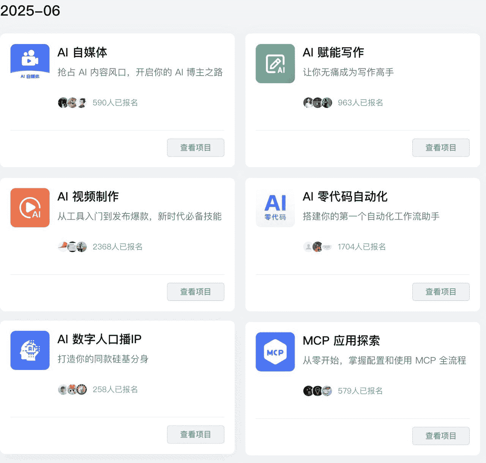

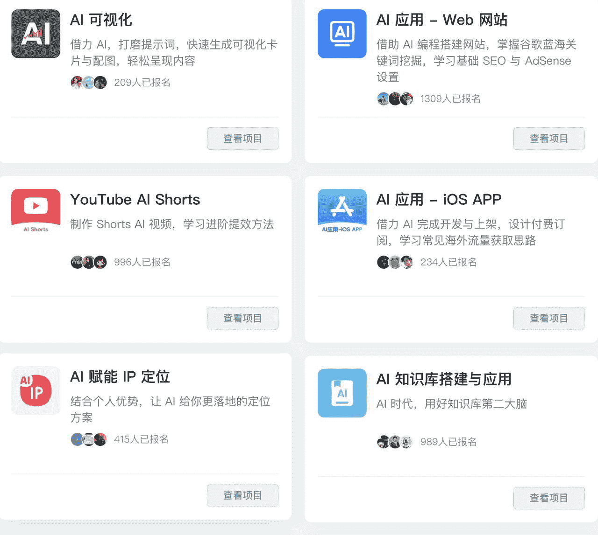

我先思考了我的现状：

1.  副业，决定了我每天只有下班后的2-3小时和周末的时间；

1.  我的专业是英语，最好能用得上；

1.  我对互联网的敏感度较弱，接受信息的速度相对较慢，所以一定要选门槛相对高，能长期做的项目，否则等我刚摸清门路就到了项目生命周期的尾声了。

英语、比较高的门槛、长周期这三个关键词。当时局限于我的认知，我基本已经锁定了youtube AI shorts。（后来事实证明，它与英语无关，只是英语的优势让我对这个项目少了一份来自语言的恐惧。实际上，翻译工具能搞定一切，语言根本不是问题。）

结合龙哥老大发的超极标，里面提到youtube AI shorts, 而且赚钱还有专门的深海圈。我选择跟着大佬的选择走。我想：如果没有前景，赚钱不会花大力气建深海圈。就这样，我先锁定了youtube AI shorts的航海。

## 4）我是怎么加入深海圈的？

说实话，油管的深海圈算是我选油管的一个理由之一。因为我知道对于我一个赚钱新人+项目新人来说，仅凭21天的航海，我是无法跑通这个项目的（这不是不自信，而是有自知之明）。

航海只是让我基本上了解这个项目是怎么回事，如果航海完后我对这个项目感兴趣，我还可以继续到深海圈深造。这恰好是我选油管项目的一个重要原因。所以，航海结束后，我接着就报名了深海圈。（这真像试吃完后果断买了一份正餐，哈哈！）

# 三、实战

## 第一个视频

6月5号航海开始，5月30号提前加志愿者拉群。还记得加志愿者了解我是一个纯新手后的开头语，对方就跟我说：油管难度有点大。

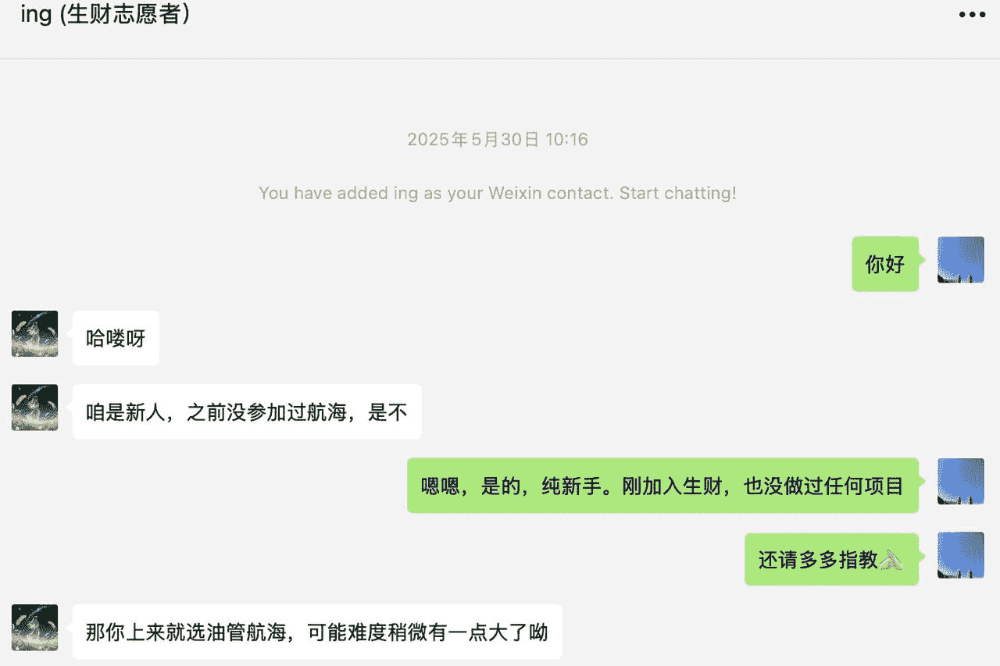

但是当时我的劲头很足，并没有被这句话吓倒。

5月31号，我按照志愿者的叮嘱先照之前的手册开通了账号。但是，开通账号这一步也不简单，它还涉及🪜，以及google注册账号。我搞了一天都没搞定自己注册账号，最后为了赶进度，听志愿者的建议——花钱在闲鱼买了一个google账号。

这里真的要提醒一下新圈友：**做**项目时会有很多意想不到的卡点，能花小钱解决的非核心困难就花钱解决，千万不要被无关紧要的小事消耗宝贵的心力和能量。

注册好账号后，我跟着手册开通了频道。这时候航海还未正式开始。我就每天登录账号正常刷视频，点赞和评论，进入养号期。有些圈友说油管的新号要先养几天，这样可以减少发生异常的概率，比如0播。但有些圈友又会说不用养号，他们中很多人都是开了新号当天便直接发视频。在他们看来，是否0播与是否养号无关。这个看法仁者见仁，智者见智。我的性格比较保守，我的2个号都是正常养了几天才发的视频，确实没碰到过0播。可能账号的权重真的看运气。

那几天，我疯狂地看往期的航海手册，生怕自己起步晚了跟不上航海的节奏。

但是，快一周过去了, 我还没选好赛道，更别提做第一个视频了。

6/4开营仪式的那天，我很焦虑，因为一周过去了，我的进度一点进展都没有。我连新人营的开营仪式都没有参加，因为静不下心来。

我找了志愿者咨询。她建议我先随便选个赛道做出第一个“小垃圾”，等做了一段时间后再换赛道也不影响。

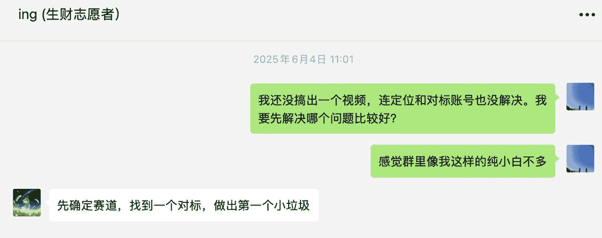

“小垃圾”这个词，当时真的给了我莫大的帮助。要我做出第一个”视频“，我的感受就是要质量良好，能得到别人认可的作品。而“小垃圾”，我感受的就是只要我能把视频拼起来，看起来像个视频就可以了，它强调的是流程的完整，而与质量无关。

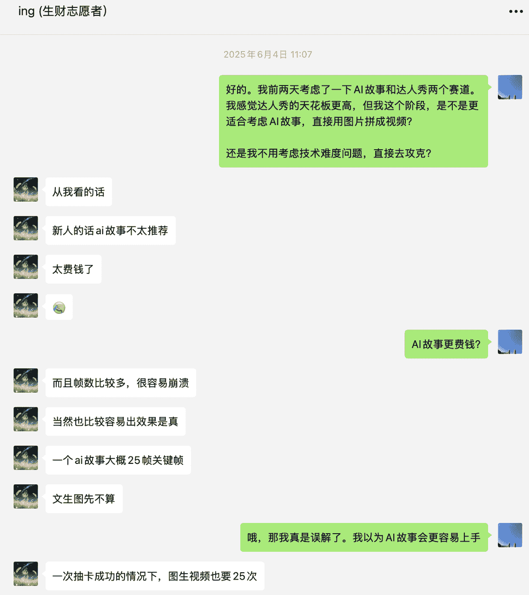

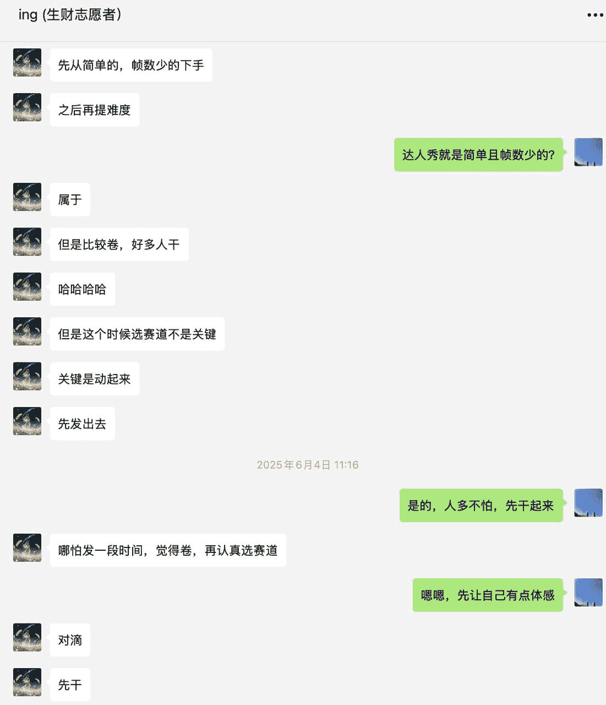

当时我就释怀了，不再卡在无穷无尽地挑选赛道和对标。只要看到哪个视频我不讨厌，感觉能做，我就动手做。

即便如此，第一个“小垃圾”也耗了6-7小时，熬夜到凌晨1点左右才完成。

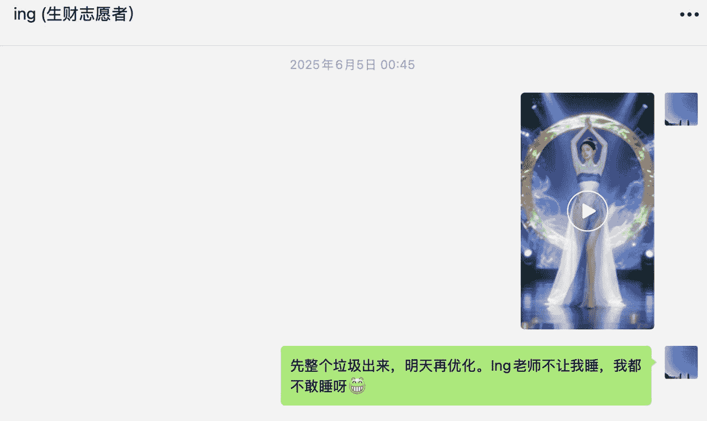

但是这个视频实在是太垃圾了，我没发到账号。人生中第一个频道的第一条视频，我不想就留下这样的痕迹。我决定根据志愿者提的建议再重做一个像样一点的视频。

可是，我又卡住了。我一直记着教练们说的要先找对标，再根据对标视频来复刻。我发现在找对标视频的时候，我根本复刻不出来对标的视频。

对标的都是爆款视频，既然对方能爆，肯定是各方面都过关的，我无法拆解出制作流程。

从6/5-6/8, 我一直在研究第一条视频的流程。卡住了就去翻航海手册，搜精华帖，看不懂就一遍一遍地看。越做越焦虑，越看越迷茫。我开始自我怀疑了：是不是我学习能力有问题？为什么大家都做出来了，我却一点头绪都没有？

这时候我想起了志愿者最开始跟我说的话：你选油管项目难度有点大。

我是不是真的不适合做油管？

我又来找志愿者取经了。把我的迷茫和困惑说给她听。志愿者ing老师真的是超级棒的志愿者，她不停地给我鼓励，分享有用的资料，在自我怀疑的时刻推了我一把。

路是我自己选的，含着泪也要把这21天的航海坚持完，一定不能就这样退缩，否则我这辈子什么项目都做不成了，一辈子只能当社畜。我当时跟自己这样说。

6/8是周日，我一大早背着电脑去图书馆，把自己关在里面埋头研究了一天，直到图书馆晚上9点钟关门，我的视频还没做完。回到家后，我点着台灯加班到凌晨1点多才完成并发布视频。这才是我真正意义上的第一条视频。

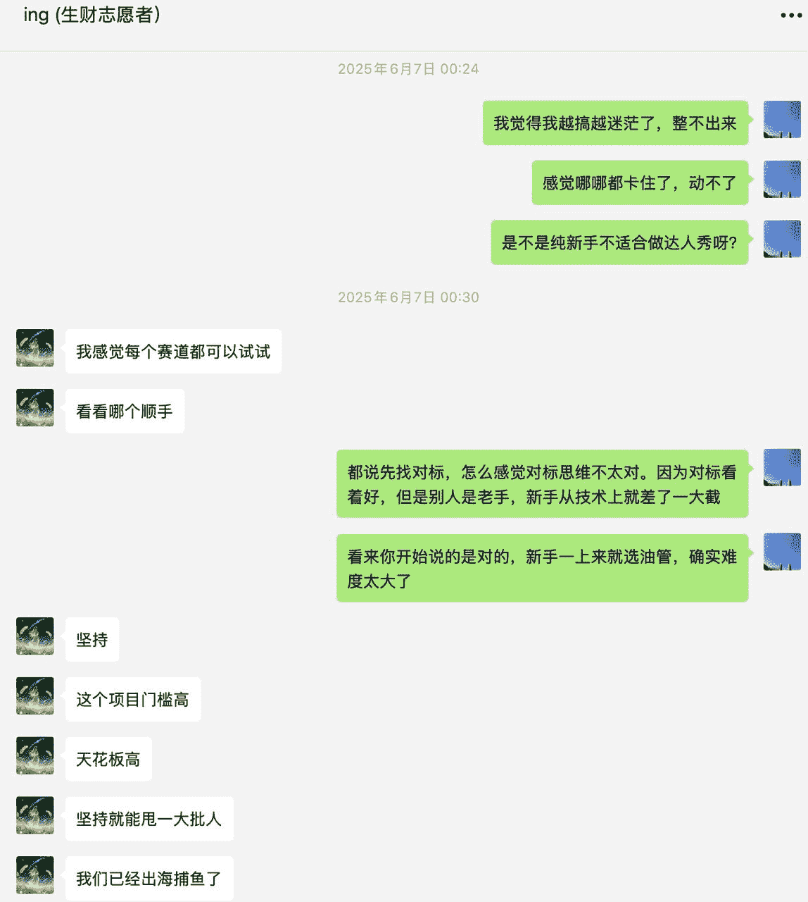

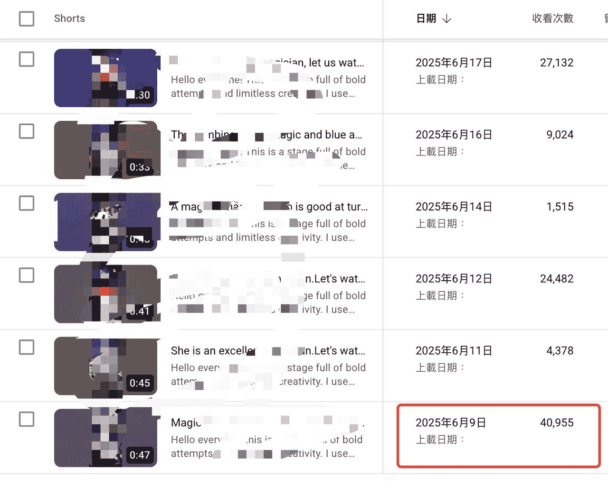

我真的非常幸运，第一条视频发出去后很快就达到了40k的流量。虽然单看这个数据并不高，但是看到群里80%以上的新手圈友说自己0播，几十播，我这个40k的数据在群里已经是令很多人羡慕的数据了。

第一，它证明我的账号是没问题的。很多0播账号不是因为视频本身的问题，而是因为账号被限流。

第二，它证明我做视频的流程已经顺利跑通了。

这给我继续做下去，提供了非常大的能量和信心。很多圈友最开始开了多个账号都是0播而放弃这个项目。

## 第一个爆款

第一个视频的流程跑通后，我就稳定了同一类视频的制作流程。刚开始全部把对标视频的关键帧提取出来，然后每张图片换一下元素，作为我的新视频关键帧去生成视频片段，最后组成复刻的新视频。它的好处是可控性强，但是相似度极高，很容易被判违规。不过，作为新手入门复刻爆款视频确实有一定优势。从上面截图的数据可以看到，我刚开始发的视频大部分能到万播，那还是在达人秀基本已经过时的情况下。

21天航海结束时，我总共发了9条达人秀视频。本来我的目标是在航海期间开通初级ypp, 实际上频道总播放量只到二十多万，离初级ypp的互动播放300万相差十万八千里。现在想来，正是因为当时无知才定这么高的目标。

经过航海那21天的尝试，我发现我对这个项目还是挺感兴趣的。好不容易做了21天，才刚踏入门槛，我知道靠我自己慢慢摸索是没希望开通ypp变现的。为了让自己在这个项目上跑通，修整几天后，我加入了深海圈继续深耕。

现在看来，我当时的决定无比明智。刚加入深海圈，我咨询了教练1v1咨询。冠卓教练看到我做达人秀，他建议我换到当时最火的ip--美国山海经赛道，因为达人秀已经很难能出爆款了。

听了教练的建议，我马上切换到山海经故事赛道。但是，换赛道的成本非常高。需要换模型和工作流，说白了就是我当时做达人秀的流程要废弃掉，重新摸索做山海经故事赛道的新流程。

摸索新流程的时候又花了几天，它的难度比我头一次做达人秀还难。因为山海经人物形象只有gpt才能生成，其它模型都做不出来。而且，每生成一张图片都需要垫图，否则视频中人物形象的一致性无法保证。

转到山海经故事赛道后，流量一下子就涨起来了。7/12发的第三条山海经视频就爆到了200多万（如下图）。那是我第一次亲眼见证数据直线上升，正在推流高峰时，每刷新一次就涨上千播放量。

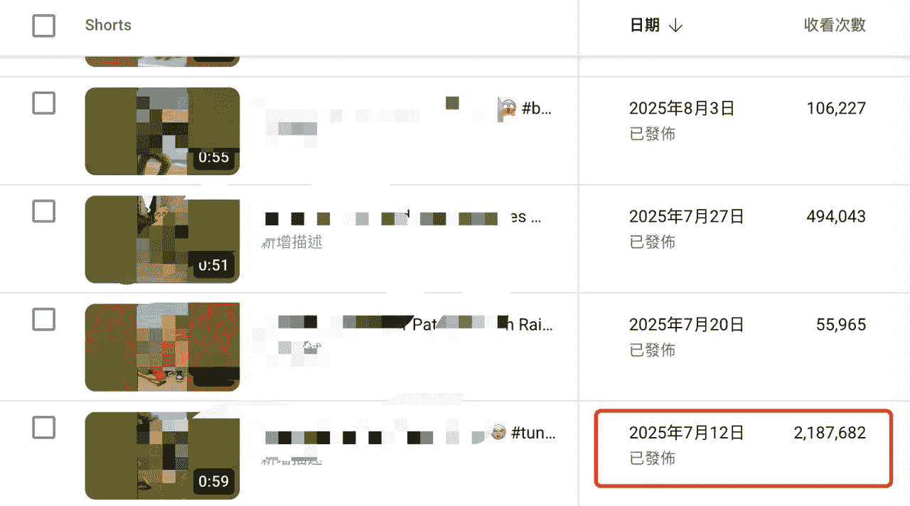

视频爆了之后，我就更迷茫了。每天除了不停地刷新数据，看着不断上涨的流量外，我就不知道该干什么了。最夸张的时候，我恨不得几分钟刷新一次。看着数字不断上升，获得快感。

显然，我没有放大爆款视频流量的能力。正常情况，视频爆了之后需要马上改头、换尾、换爆款元素等，快速制作更多同脚本的视频。因为我做视频速度太慢，也不知道怎么改，每次都只能让流量浪费了。

有了第一条百万小爆款后，我对爆款视频的制作方向有了一点感觉，此后做的视频大部分卡在3-5万播水平，没再出现过千播的情况。用Gary教练的话来说就是：卡3-5万播说明视频在及格线，基本制作没什么问题，但想要视频爆，就要找地方突破平均水平。

## 第一次线下活动

第一个爆款后，我卡在万播一个多月，感觉找不到方向突破。正好当时深海圈的困困教练在深圳组织线下活动，时间为8/16（周末），而且波妮教练、Gary教练以及深海圈的几个跑在前面的圈友都报名参加，我毫不犹豫地参加了。

这是我第一次参加线下活动。在出发前，我一直很忐忑。因为我是i人，不知道怎么跟陌生人打交道。我担心自己去了之后不敢提问，也不敢跟别人说话。

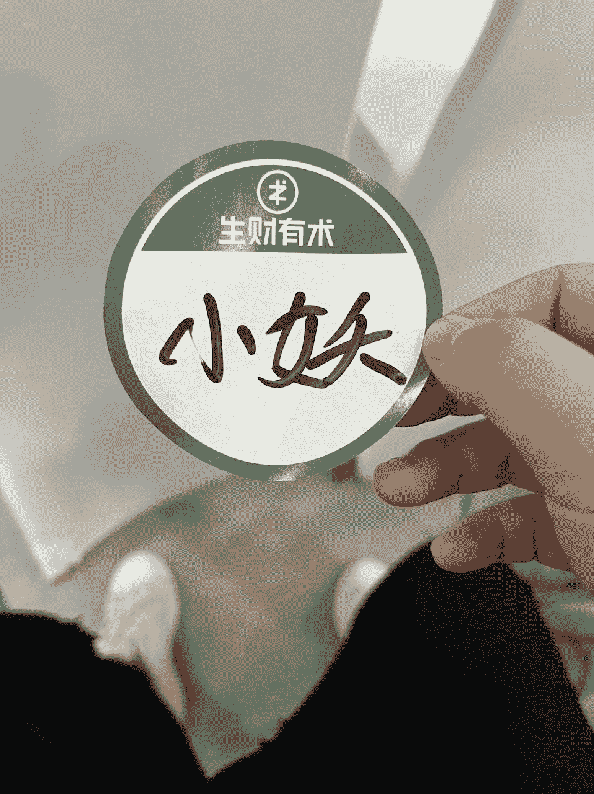

但到了8/16这一天，到了现场之后我才发现之前的担心都是多余的。那些在赚钱官网上，在社群里才能看到的冰冷的名字，在现场变得很鲜活。大家有共同的话题，共享深海圈的信息，在一个小圈子相聚时，大家像很熟悉的朋友一样，开始探讨油管的话题，一点都不觉得陌生。

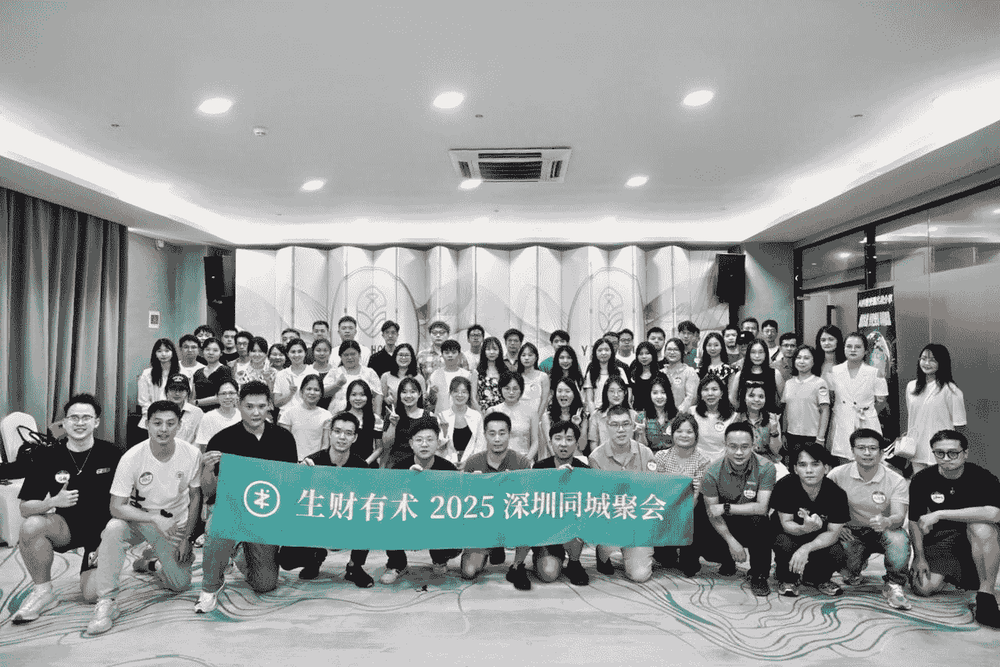

那天从大会场转去小会场聚餐的时候，我和另一位圈友@九月的椰子树 （我叫她椰子）很幸运地跟波妮教练和Gary教练同拼一辆车。

在直播时看起来遥远又高冷的教练们，在现场也展现了他们真实的一面。实际上，波妮教练真的人美、心善，很能共情新手圈友的困惑。在车上，波妮教练见我不说话，她主动询问我的情况，这给了我莫大的鼓励。Gary教练在直播时给人感觉老练、成熟，真的有领导者和教练的气场。现场打交道时，他能放下一切架子，成为一个邻家男孩，什么家常都能聊。

记得在饭桌上，有一位圈友问Gary教练：“你为什么叫曹淦？是不是你出生的时候缺水缺金，所以你爸妈给你起这个名字?" 他大方地承认了，而且说话方式轻松又幽默。

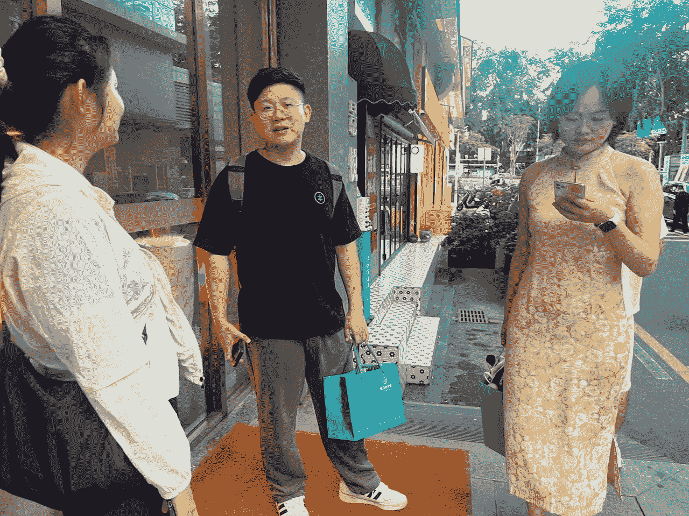

对我来说，线下活动含金量最高的部分就是现场诊断账号的环节。我们十几个人在饭后跟着两位教练来到他们的办公室，大家现场拿出笔记本开始干活。每个圈友都提了问题，也提供了账号给Gary教练现场诊断。大家一起看账号时，我们才意识到别人犯的很多错误，我们自己也在犯。

Gary教练在诊断我的账号时，他指出了很重要的一点：你的视频制作已经没什么问题，播放量起不来是因为你选的故事脚本不够好，太平淡了。

在参加活动之前，我一直觉得哪里有问题，但我看不清具体哪里有问题。教练这一句话把我从模糊中拉了出来。我以前对标的视频就是我选中的一个对标账号，我复刻的也是对标账号里播放量高的视频。我并没有把单个脚本拎出来分析，这个脚本是不是好的，因为我默认它能爆就是好的。但我忽略了一个重要的时间因素和对比范围，在我的对标账号中2-3百万就是爆款，而且有些视频已经发了1-2个月。并且，对标已经有几十万订阅。几十万订阅号的几百万爆款，放在现在来看都不值得去对标。

我顿时就释然了，原来不是我的视频制作有问题，而是对标对错了，最开始就选了天花板很低的对标视频。那我回去第一件要做的事就是换对标账号，或者根本不用具体对标一个账号，只要是一周内千万以上的爆款就可以跟着复刻。

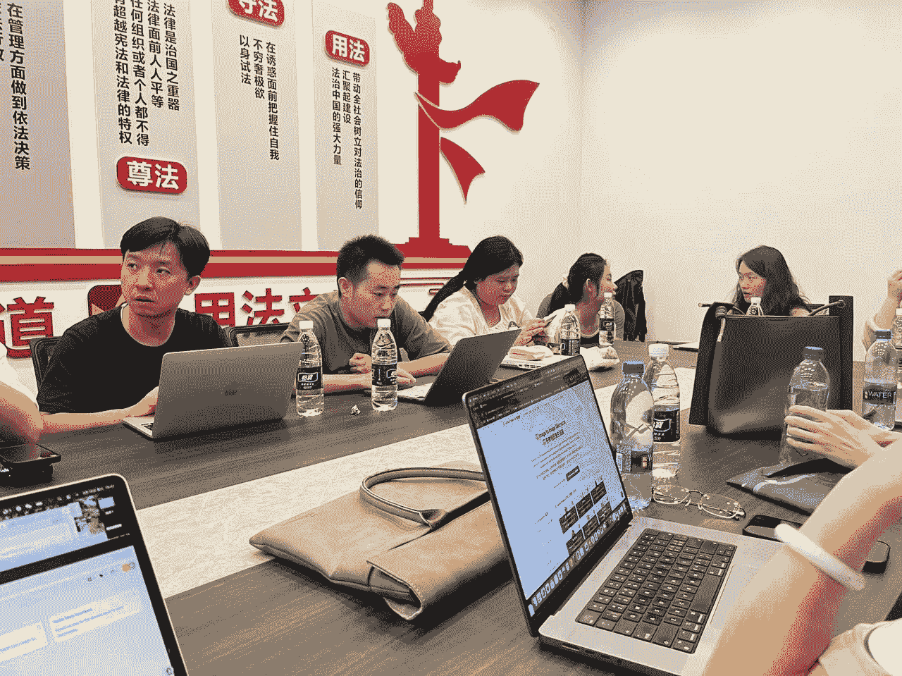

那天的活动一直持续到将近晚上11点才结束，我回家时连末班地铁都没赶上。但是，我觉得那天的收获很大，困惑了一个月之久的问题在现场都得到解决，对做爆过的理解也更深一层。那是第一次，我感觉参加线下活动真的超值。

## 第一次申诉

记得8/16线下活动结束，波妮教练送我们离开时说过一句话：很多圈友说参加完线下活动后都做出了爆款并直接开通ypp。你们回去多做视频，一定也能马上出爆款。

我当时以为这是一句玩笑话，或是教练对我们的祝福，并未放在心上。

没想到回来后，我8/19发的第一条视频真的爆到了一千万。凭这一条视频，我开通了初级ypp。

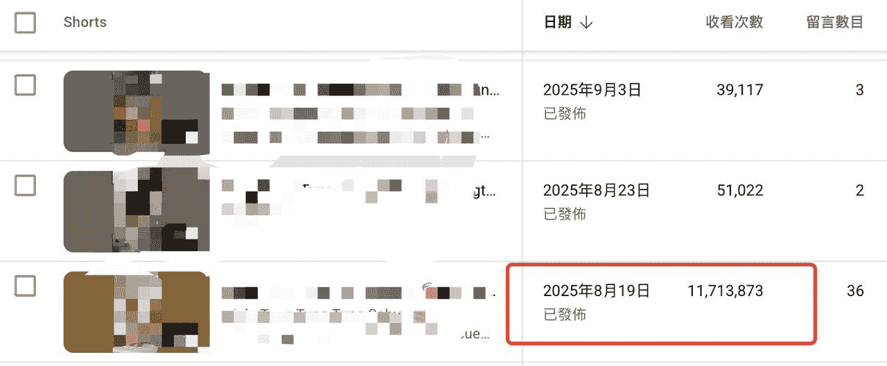

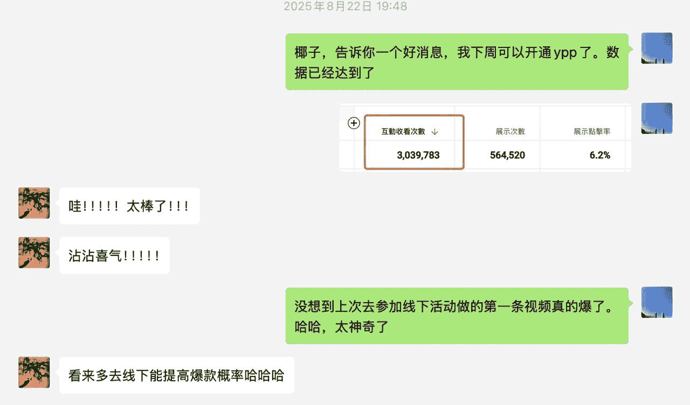

我把这好消息第一时间分享给了那天在线下活动认识的小姐妹——椰子。紧接着第二天，椰子也报来喜讯，她回去做的视频也马上爆了两个百万，还有视频爆到了千万。

看来，深海圈的办公室真的有爆款因子。这不是玄学，而是因为有两个经验丰富且见多识广的教练坐阵，他们在哪，爆款因子就在哪。

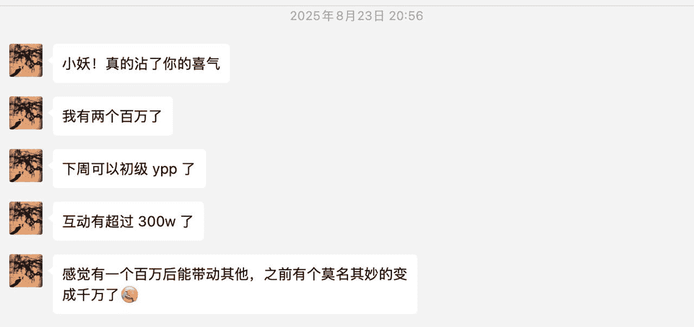

可是，初级ypp开通并不顺利。在ads账户审核的时候，整整审核了一周。更糟糕的是，初级ypp的审核结果为：拒绝开通。理由是：非原创。

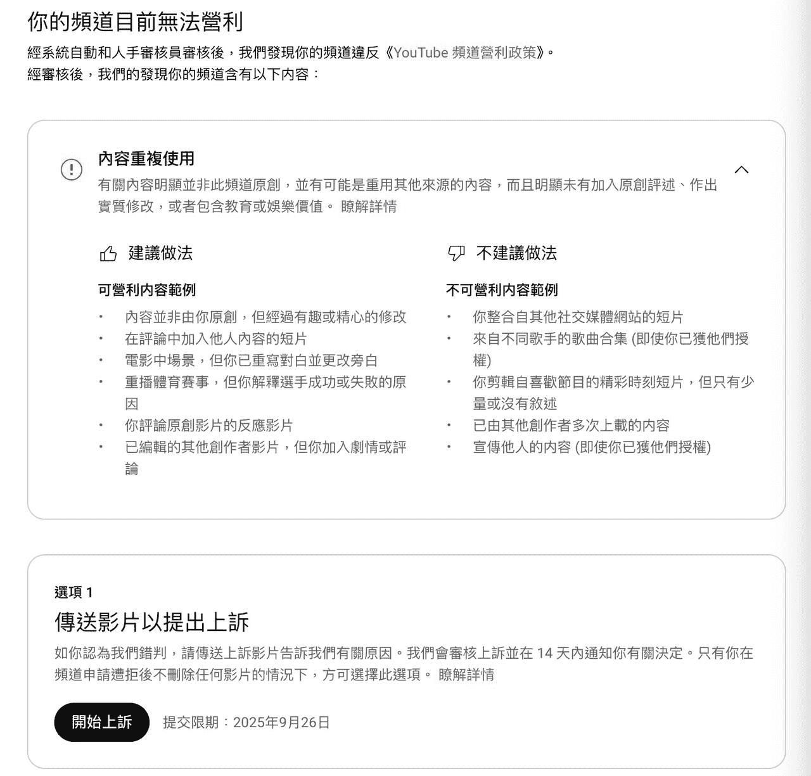

而这时，在我后面达到ypp门槛的椰子，已经有一个新号直接开通了高级。另一个号也是初级ypp被拒，在申诉当中。

这时，我的心力遭到了极大的打击。6月19号到9月6号，80天时间，我每天早上6：30起床，白天上班，晚上熬夜做视频到凌晨1-2点，克服了无数个困难艰难地前进，好不容易看到一点曙光，顿时间全部熄灭了。真的太打击人了，一点都不想动了。

好在深海圈有专门的申诉群，我被拉到申诉群后，看到里面有非常详细的申诉资料，还有喂饭版的申诉模版。因为是专门的申诉群，里面都是经历过或者正在经历申诉的圈友和教练。不知道方向有系统资料，卡点有教练解答，还能经常收到申诉通过的圈友的喜报。这让我感觉自己并不孤独。我的能量又被一点点激活，感觉又能往前继续走了。

**申诉只是一个过程，不是困难，更不是天塌了。而且，只要想在平台上继续赚钱，申诉一定是绕不开的一环，我们总会因为各种各样的原因踩了红线，**无论我们再怎么小心。所以，这个槛一定要过的，早过反而早好。当申诉都能轻松应对的时候，心里的紧绷感便会松弛很多。因为账号都能成功申诉回来，还有什么不敢放开干的呢？

于是，我马上集中精力看申诉资料，开始制作申诉视频。

对我来说，做申诉视频比制作ai视频难太多了。因为家里两个娃，我很难找到一个即安静又能大声说话的地方录视频。

最开始我选择在图书馆的走廊上录，但因为经常有人经过或说话，我搬着笔记本电脑不停地在不同楼层间穿梭。录一段，有人来了就换个地方。一段5分钟的视频，我整整录了周末2天时间，晚上还要熬夜剪辑才完成初稿。真是太难了。

即便如此，申诉教练审核不通过，重录！补录！修改+再录！反反复复提交了4遍，一个5分钟的申诉视频才最终定稿。

好在黄天不负有心人，高强度熬了7天后，申诉视频提交后第一个工作日就开通了初级ypp。

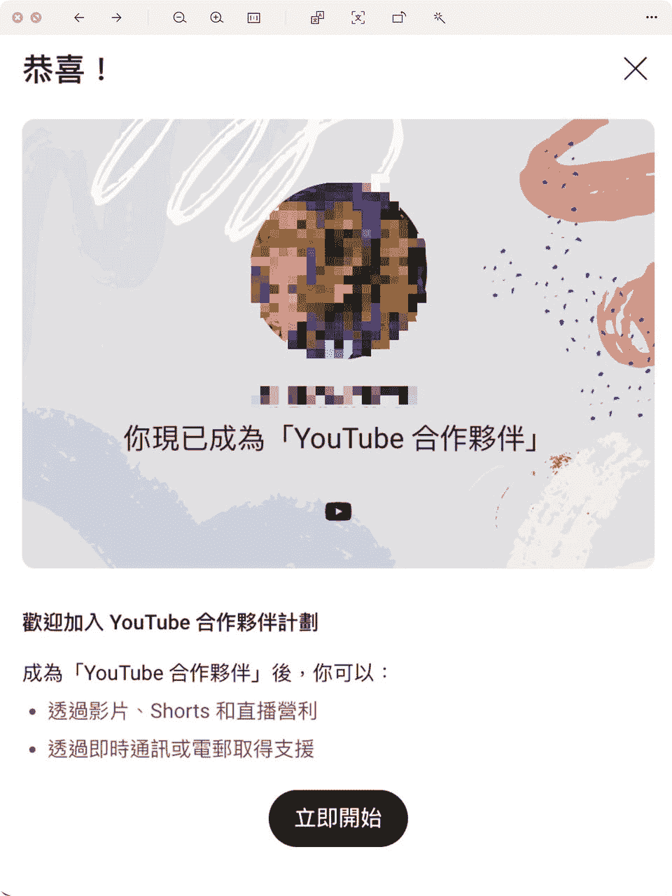

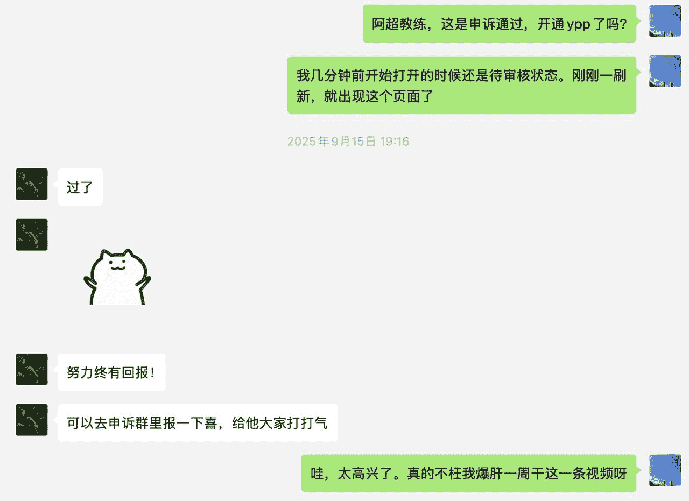

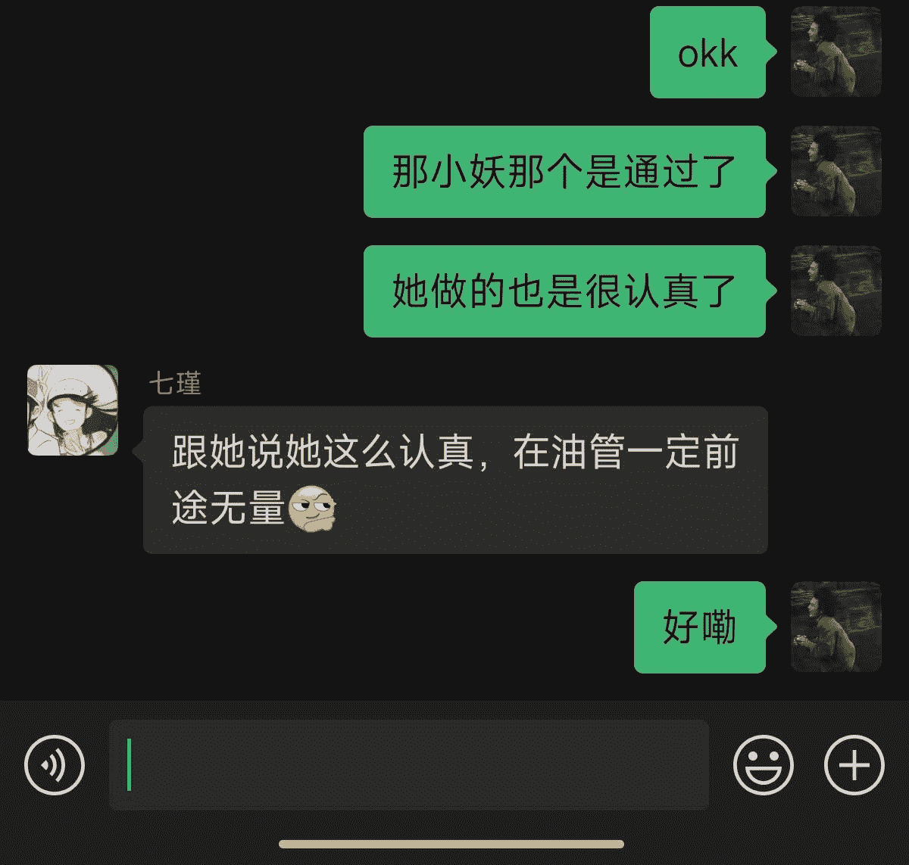

连续一周，我付出了120%的努力，全神贯注地打磨这一条申诉视频。看到通过的那一刻，真的觉得所有努力都值得。真的感谢深海圈提供申诉审核的服务，更感谢申诉教练博哥和阿超老师。没有他们的专业指导，我100%不可能通过，因为他们反复叫我改视频的时候，我都觉得很难撑下去，实在太麻烦了。如果我自己在没有经验的情况下，根本不可能想到那样做申诉视频。高质量社群的力量、高质量圈子的力量真的太重要了。

## 第一个高级ypp

初级ypp开通后，我高级ypp的进度条才跑了50%。很多圈友做了几千万爆款后，可以一次性将初级和ypp一起开通，而有些圈友在初级开通后到达高级需要很长时间。我还见过圈友在航海期间就开通了初级，却因心力不足就止步于此，到现在都没有开通高级ypp。

解决了账号问题后，我又要聚焦回做爆款视频上。因为开通ypp就只能靠爆款，在没有上自动化的情况下，用量取胜几乎不可能。

此时，我发的视频又卡在3-5万播了。我每条视频都是手搓，一般需要6-7小时。我每天2-3小时做油管的话，一条视频要做3天才能完成。可是发出去的视频只有几万播放，真的很受打击。

有一次，我看到一条对标视频才发出去几个小时已经有几百万播放。我非常激动，觉得自己只要复刻这条视频马上能爆。于是，我那天埋头在图书馆做这一条视频。先花了2小时仔细拆解对标视频，找出视频节奏，拆分爆款因子，还作了笔记。

我自认为对这条视频已经理解透彻了。然后开始复刻。倒推文 生图提示词、文生图、图生视频再剪辑，又花了6小时。那一天我不算吃饭和上厕所的时间，花了8小时打磨这一条视频，指望它一飞冲天，马上开通高级ypp。结果，发出去一晚上，才跑了8k的播放量，比我没有花那么多心思做的视频差了太多。看着那冰冷的数据，真是心都凉透了。甚至已经产生恐惧心理，不敢再轻易开始制作下一条新视频。

这时，我的状态差到了极点。每天还是熬夜看深海圈资料或做视频，睡眠不足6小时，第二天起床精神晃乎，脑子混沌，走路像在飘。情绪算稳定，但是心里像一潭死水，没有盼头，没有方向。做视频没有思路，没有激情，做出来也没几个播放； 不做视频又感到焦虑。

我开始怀念没有做油管前的日子，那时候生活规律，心态平和，内心明亮，生活充满掌控感。我又产生自我怀疑：我是不是不该放弃👸号，把所有精力都放在油管上？如果我继续写👸号，是不是内心能找回之前的明亮感，状态也不会这么差了？我一定是生活系统出了问题，不然不会状态这么差，油管的进度也不会这么缓慢。

想到这，我想起了明白老师的【自我迭代系统训练营】，里面就是解决系统问题的。于是，我熬夜写了3千多字的申请发给明白老师，申请加入了训练营。

明白老师先跟我连麦，帮我分析了达成目标的关键因素，替我定制了复盘模版，然后我每天就按照模版跟着训练营复盘打卡。如果有需要帮助的地方，明白老师会有针对性地提供帮助。

这等于是给我在目标之间画了一条路径，我沿着路径走就能达成目标。如果走偏，要么自己能及时发现，自我纠偏；要么明白老师发现后会主动把我们拉回去。极大地减少了干扰项。中途遇到心力问题，明白老师也会及时提供滋养。他每天一大早就会在群里发能量语音，给大家注入一天的正能量。

跟着打卡几天后，我的能量又一点一点回来了，内心的秩序感也在慢慢恢复。心态平稳后又能继续专注在分析视频和做视频上。很快，我又做出了一条几百万的爆款。

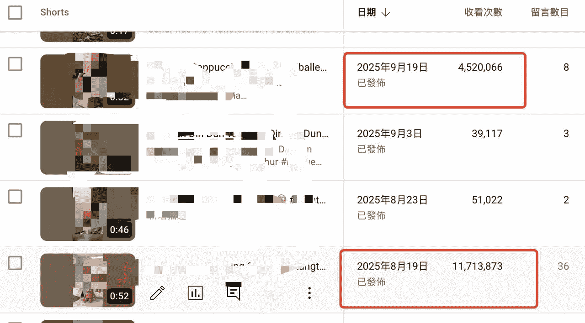

就这样，高级ypp在10/9达标，10/14正式开通了。从6/9发布第一条视频到10/9号互动播放达标, 刚好4个月开通高级ypp。

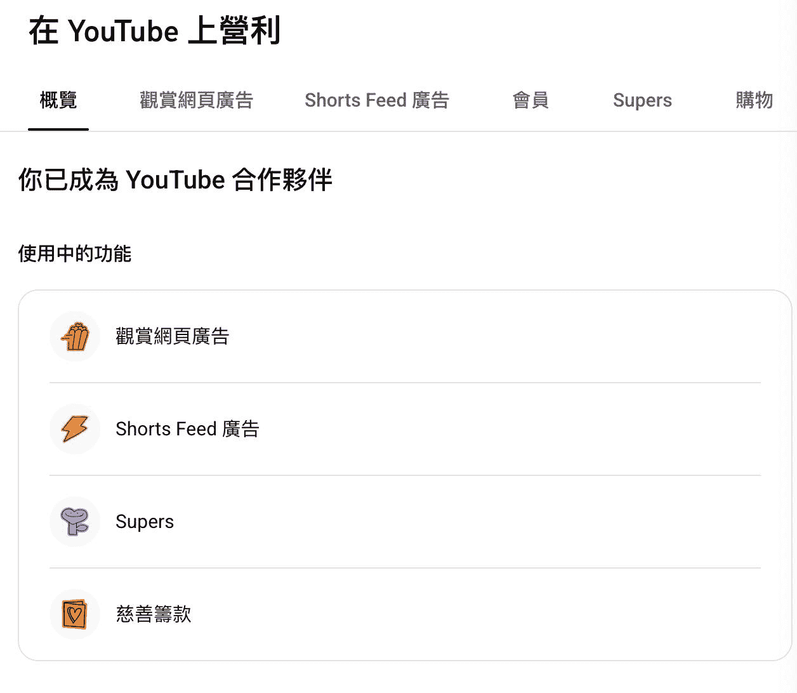

是的**，我**走得很慢。跟那些15-20天就开通ypp的优秀圈友比起来，4个月开通高级ypp在赚钱是一个很不刺激的数据，甚至是有可能被嘲笑的数据。但是这第一个ypp是我人生中重要的里程碑。它见证了我的成长，它让我明白：我有我自己的节奏，不用去跟别人比较，因为每个人节奏都不同。只要我想做成一件事，根据自己的节奏，哪怕像蜗牛一样爬，我也可以达到终点。这个道理从小就听得耳朵起茧，但这是我第一次亲身体会到。

这几个月时间，中途经历了无数个困难我都克服了，我已经不是原来的自己。这才是这个ypp于我而言真正的意义。

# 四、结语

很多圈友刚进入赚钱或刚进入深海圈都会非常焦虑，因为高质量的信息太多，完全看不完，总焦虑漏掉了重要信息；因为优秀的人实在太多，走着走着自己好像就掉队了，焦虑自己太差劲跟不上节奏；还因为担心自己跑不通项目，焦虑连赚钱门票都赚不回来。

其实，这些焦虑都没必要。

信息多，但我们聚集在自己最重要的信息上就可以了。比如我们做油管，油管的信息对我来说就是最重要的。我就只看油管相关的信息，有时间再去看其它项目的信息当开眼界。

优秀的人多，这是对比出来的。如果我们把目光放在自己的成长上，找到自己的节奏，只关注自己每天收获了什么，不去跟别人比，就不会焦虑了。在6月航海期间，我连第一个视频都没做出来，看到有圈友都快开通初级ypp了。往备注上一看，我的级别是Lv1, 对方Lv14。即使对方也是油管新人，说明对方做过其它项目，已经积累了项目经验。我是从0开始，对方可能是从50开始。

也没必要焦虑赚不回门票，因为只要你开始行动，你要么跑通项目，要么在执行中锻炼了其它能力。这些东西都不会作废，只要你持续行动，它终将成为你后续发力的助力。

**进了赚钱，首先要克服的就是焦虑，然后就是下场去干。在学中干**，在干中学，守住一个目标，直到把它达成。

最后，分享一些小经验：

1.  多坚持一天，你就能超越很多人。在航海期间，我有个很深的体感。刚开营的一周左右（尤其前三天），群里的人个个都劲头十足，气氛特别活跃。但一周之后，随着时间推移，能明显感受到很多人不见了，群里提问的人越来越少。这说明很多人在最开始卡住在某个地方之后就默默放弃了。当你能认真跑完21天航海，已经超越了很多人。

1.  重视保护能量。做成任何一件能赚钱的事都不容易，它是综合能力都达标后自然的结果。而培养能力是个漫长的过程，我们要坚持到结果的那天，就需要足够的能量持续前进。如果不注重保护能量，随便一个卡点就把我们中途拦截，导致目标失败。

1.  把重心放在个人成长上。项目无法跑通，一定是因为某些能力没有达到要求。那我们就静下心来分析到底是哪些能力需要提升，千万不要把目光只放在“跑不通”的结果上内耗。否则，容易产生自我怀疑，阻碍前进。

PS：进一步交流可关注👸号“无二思维磁场”。