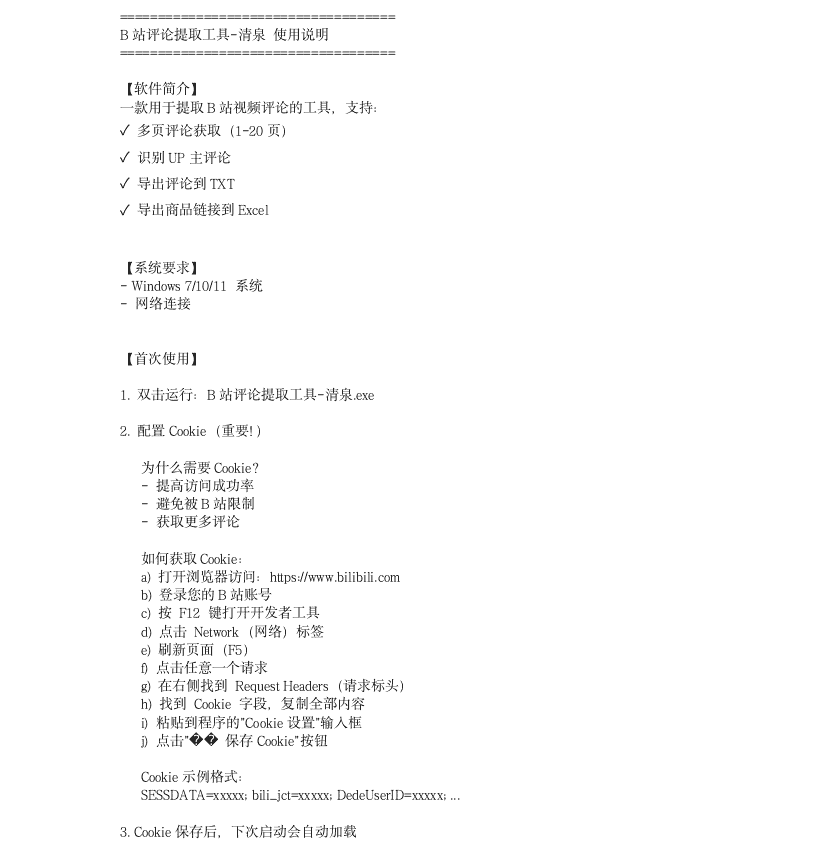
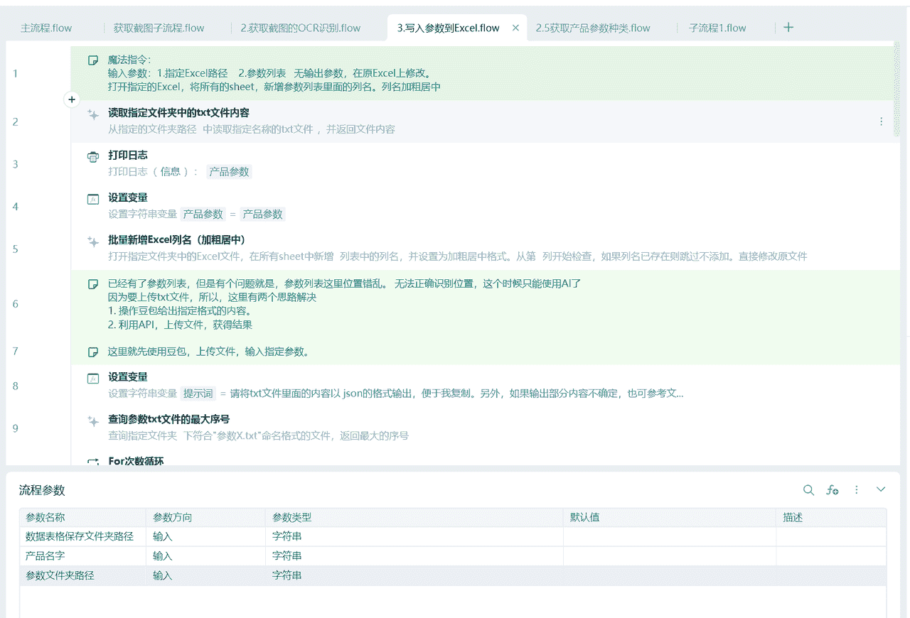
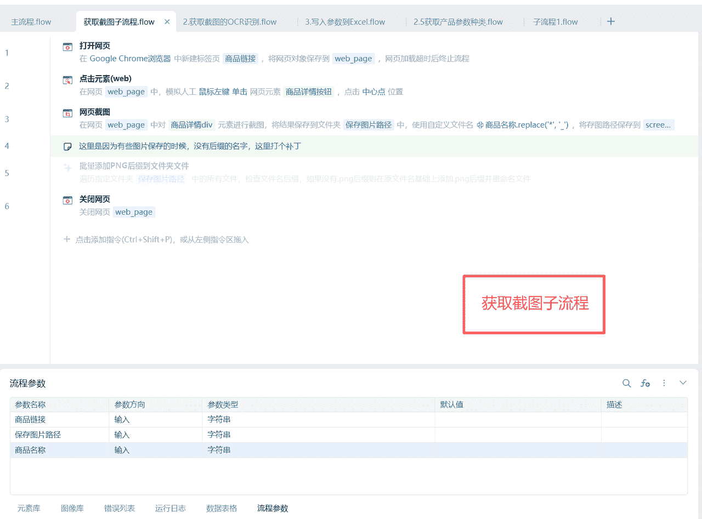
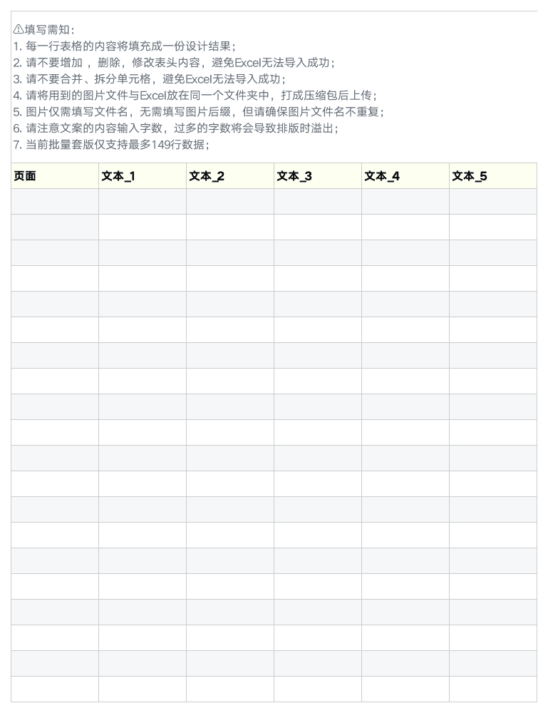
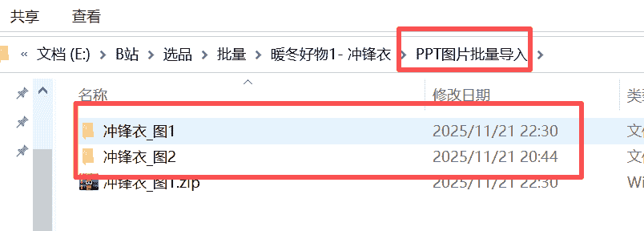

# 别再手动复制粘贴了！B站好物提效篇 ——选品、内容、工具三维突破的实操

> 来源：[https://xuqiwei1986.feishu.cn/docx/F25IdQ9TIoYJgJx23Otc7qXqn9z](https://xuqiwei1986.feishu.cn/docx/F25IdQ9TIoYJgJx23Otc7qXqn9z)

## 一、引言

00后，毕业2年，一个普通的打工族，大学自学了`Python`，学习半年开始兼职接数据采集的单子。毕业后靠着`Python`的底子，花了十几天打通`影刀RPA`。依靠着编程和`RPA`的基础，在我进入深海圈开始尝试自己剪辑的时候，发现了一系列的难题。

例如：

1. 对标B站视频下面有现成的链接，一个个复制难？（视频下的链接需逐个复制，操作繁琐）
2. 获取到链接了，但是一个个去搜索查询佣金烦？（逐个搜索查询佣金，耗时费力）
3. 获得最终的链接后，获取产品参数还得手动复制？（流程冗余）
4. 终于复制完参数了，PPT图片的产品参数我还得一个个复制，有没有办法提效？（重复手动录入）
5. 产品参数复制完了，PPT图片的商品主图还得一个个找？（主图仍需逐个查找，效率低下）
6. 千辛万苦做完产品PPT了，脚本怎么办？（脚本创作成新难题）
7. 脚本写完了，剪辑怎么办？（视频剪辑环节再次面临效率瓶颈）




接下来我会给大家分享我这两个月的提效总结。近两个月成果，打通了0-1。给我的教训是：工作中不要主次不分，即使写提效代码，也要每天坚持更新视频，保持内容创作的节奏。

## 二、选品提效

### 2.1 批量获取对标视频的带货链接

这里直接提供工具化解决方案，直接写成了工具：`window`系统可以直接下载使用；`mac`电脑请把代码丢给`豆包`，让`豆包`教你如何使用，获取专属使用指导

[`使用说明.txt`](https://internal-api-drive-stream.feishu.cn/space/api/box/stream/download/all/Pdkab9IeHoJAU9xSH6fcl7KHntb)

注意里面的`导出Excel功能`，可以直接导出可以使用的京东或者淘宝的链接，而不是B站压缩的链接格式，便于后续操作。

[`B站评论提取工具-清泉.exe`](https://internal-api-drive-stream.feishu.cn/space/api/box/stream/download/all/CPOIbIMzeotavfxpr1acFd0Snwb)

`mac版`

[`mac版代码.rar`](https://internal-api-drive-stream.feishu.cn/space/api/box/stream/download/all/CqJDbh4t5oMM37xfKf0cGIW4nYg)

### 2.2 批量查询佣金

最简单的方法：点击链接选品，输入待查询链接，识别链接，工具自动识别并输出佣金数据，然后看数据

### 2.3 批量获取产品参数

这里手动获取办法是打开链接，查看商品的详细参数，手动复制到PPT中，流程繁琐，如下图所示：

影刀逐个提取产品详情参数截图。

提效：[提效代码](https://zqxbobng8rp.feishu.cn/docx/YACMd91o4oIYyqxsqMVcs6wenIe?from=from_copylink)

查看里面的`影刀如何实现自动化抓取产品表格`

抓取完表格，接下来可以有两种路可以走：

1. `AI识别`

   > 把这些产品参数表格统统丢给`豆包`，让`豆包`识别给出参数

2. `影刀代码`

   这里说一下大体的逻辑了

3. 在`自动化抓取产品表格`的基础上，使用`影刀`离线`ocr`的功能，把每个产品参数图的数据分别写入到单个`txt`文档中，`txt`文件命名就用产品名字。如下所示。

   [`俏侬 猪肉酥皮馅饼1.15kg10片 手抓饼煎饼大葱饼 学生早餐健康.txt`](https://internal-api-drive-stream.feishu.cn/space/api/box/stream/download/all/UWZabGwWhoy5n7xnPoGcKWB9nzg)

4. 把单个`txt`文档，全部写入到一个总的`txt`文档，用分隔符区分开，每个分隔。

   例如：

   [`总参数.txt`](https://internal-api-drive-stream.feishu.cn/space/api/box/stream/download/all/GnFUbtE7nozKpWxCe26c8MA9njP)

   ```
   === 文件: 麦西恩原味卷饼270g_3 8英寸 早餐手抓饼墨西哥卷饼塔可饼皮.txt ===

   ['品牌', '麦西恩', '商品编号', '100136527424', '其他', '产地', '类别', '上海', '国产', '国产/进口', '保质期', '120天', '包装清单', '麦西恩原味卷饼270g*3']

   === 文件结束: 麦西恩原味卷饼270g_3 8英寸 早餐手抓饼墨西哥卷饼塔可饼皮.txt ===
   ```

5. 把这个总的`txt`文档发给`豆包`。提示词如下：

   ```
   请将txt文件里面的内容以 json的格式输出，便于我复制。另外，如果输出部分内容不确定，也可参考文件名获取相关信息，文件名就是商品，注意：严格按照我给的格式，引号需要成对出现。注意：每一个文件名都要输出，不能遗漏
   输出格式例如：[
   {
   "文件名": "xxxx",
   "品牌": "博世（BOSCH）",
   "类型": "滚筒单洗",
   "能效等级": "一级能效",
   "变频 / 定频": "变频",
   },
   {
   "文件名": "xxxx",
   "品牌": "博世（BOSCH）",
   "类型": "滚筒单洗",
   "能效等级": "一级能效",
   "变频 / 定频": "变频",
   },
   ]
   ```

   
   
   
   
   
   
   
   
   
   
   
   
   
   
   
   
   
   
   
   
   
   
   

   会得到一个json文件

6. 接下来就是编写一个`魔法指令`，让`影刀`根据`json`文件提取参数写入到`Excel`中。

   这样就大功告成了

   因为代码编写涉及到许多`魔法指令`以及图像识别，所以不便分享。

   仅供参考，建议还是自己写一个符合自己项目的更快一点。

**主流程**

**2.获取截图的ocr识别**

**2.5获取产品参数种类**

**3.写入参数到Excel**

**获取截图子流程**

### 2.4 批量获取京东联盟商品信息

**自己开发思路：**

1. 打开`影刀`，使用网页自动化功能，使用最上方的批量抓取功能。
2. 使用`魔法指令`，建立筛选逻辑，导出表格。

**使用方法：**

`Chrome`浏览器打开京东联盟，搜索好产品，并选择"自营"。

https://api.winrobot360.com/redirect/robot/share?inviteKey=1470c7fe6b4e4eb1

影刀链接如上。用`chrome浏览器`打开这个页面后，点击运行就可以了。输入一下导出路径和导出表格名称。

这个筛选逻辑是学习自圈友王小小的精华帖，并优化了一下价格区间。

**显示结果：**

**应用场景： 选择高佣产品。**

### 2.5 目前我在用的方法

注意：我的方法是环环相扣的，需要一个个`影刀`脚本去执行。

1. `影刀脚本`：**批量填充分类数据**
2. `影刀脚本`：**导出详情图txt-11月30日更新**
3. `影刀脚本`：**填补空缺参数**

需要逐个去运行。

现在我使用的方法：

1. 找到一个对标的B站链接，把它放到`Excel`中。

   [`分类 - 模板.xlsx`](https://internal-api-drive-stream.feishu.cn/space/api/box/stream/download/all/F30obZ9odoz3yjxLr9QcLJy7n3f)

   ```
   使用方法：
     创建完文件夹后，把这个Excel放入其中，重命名为分类.xlsx
     写一个分类名称，放入对应的链接
     注意这个文件夹，后续两个脚本使用的文件夹路径就是自己创建的这个。只需要选到这个文件夹即可。
   ```

1. `影刀脚本`：**批量填充分类数据。**就可以一键提取对标链接到`Excel`中，并把链接对应的佣金及推广链接导出到`Excel`中。（进行下一步前 可以手动添加其他的链接补充）

   ```
   1**.读取**存放在Ex**cel里**面的B站链接
   2.根据B站链接获取对应的对标视频链接，区分出是京东链接还是淘宝/天猫链接，写入到Excel里。代码参考2.1
   3.分别读取Excel里面商品链接，将商品链接填写到京东联盟-商品推广的输入框中，逐个添加到选品库，最后点击批量推广-&gt;一键推广，会导出一个存放着产品佣金信息的csv表格。
   4.数据处理：将csv表格数据读取出来，填写到Excel中。
   具体流程看演示视频。
   ```

   ```
   https://api.winrobot360.com/redirect/robot/share?inviteKey=39421485e4958c5f

   需要电脑有chrome浏览器和edge浏览器。
   需要chrome浏览器的京东联盟处于登录状态
   需要chrome浏览器的在下载之前询问每个文件的保存位置这个功能要打开

   拿另外一台笔记本，测试通过，可以正常使用。
   注：由于每个人的电脑情况不同。网络速度不同，无法运行是正常情况

   
   ```

   [`演示第一步和第二步.mp4`](https://internal-api-drive-stream.feishu.cn/space/api/box/stream/download/all/VQ4gb5kbSoT71ox1a0acISfVntb)

1. `影刀脚本`：**导出详情图txt。**输入路径，就可以一键实现把`Excel`里面的对标链接的商品图片及详情图都爬取下来。

   ```
   2025年11月30日更新
   说一个情况，使用的这个插件-cube-seller，获取不到京东的产品详情图片了，插件作者也不更新。
   无奈，动用了一下爬虫知识，自己写了一个爬取京东链接的产品详情图的代码。
   更新后的影刀链接，这次是个大更新，摒弃了以往需要点击插件才能采集商品详情的方法。采用独家开发的京东商品采集详情的代码。 
   本次更新优点：适配不同电脑，不用准备插件。不涉及个人账号
   本次更新缺点：不支持淘宝链接
   影刀链接：
   https://api.winrobot360.com/redirect/robot/share?inviteKey=a005f2c75d8c8437
   ```

   弃用：只需要准备好`Excel`就可以，其他的条件不需要了。比如京东

   ```
   1.准备好一个Excel，里面**存**放好要读取的商**品链接。

   **2.准备好一个网页插件，例如 cubeseller-**魔方电商**助手**，****要求可以打包下载****到本**地  或者你有神奇的代码，可以无视京东/淘宝平台，直接爬取商品详情图。

   3.首先先实现单个商品链接的商品详情图爬取，例如：使用cubeseller,点击插件图标，逐个点击图标，最后使用影刀的下载文件功能，修改保存地址重命名保存。(备注：使用插件下载，无法使用网页元素定位，采用图像识别定位方法点击，由于图像识别存在误判，故影刀代码通用性差。)

   4.实现单个商品链接的详情图爬取后，批量读取Excel链接，写个循环批量批量爬取。

   5.批量解压得到详情图后，使用影刀的离线OCR识别，循环读取图片并把识别结果保存到txt里面。(备注：魔法指令可以多用用)
   ```

   ```
   https://api.winrobot360.com/redirect/robot/share?inviteKey=fa826333189330b0

   注意事项：(不需要了，最新版的影刀代码不需要这个注意事项了，输入直接用就可以)
   需要edge浏览器的京东处于登录状态
   需要edge浏览器安装扩展 cubeseller-魔方电商助手，并固定在工具栏，并把这个扩展的显示页面悬浮按钮 这个按钮关掉。
   还有一个要求就是浏览器的在下载之前询问每个文件的保存位置这个功能要打开


   拿另外一台笔记本测试，有个图像识别没有通过，修改了一下测试通过。
   注意⚠️： 
   1.因为涉及到图像识别/每个人的电脑不同，有概率报错。
   2.受限于网速，可能会运行出错，重新运行。
   3.看到我的演示视频，有思路的同学，可以直接拿影刀手搓一个了

   

   
   ```

   [`演示3.mp4`](https://internal-api-drive-stream.feishu.cn/space/api/box/stream/download/all/KKXlbKOZqodcJex1exycn700nYk)

1. `影刀脚本`：**填补空缺参数。**输入路径及需要的参数。就可以一键实现把参数提取到`Excel`中。


# 影刀自动化参数提取脚本说明

## 脚本执行原理

所有的代码其实是环环相扣的，但是由于影刀执行的不稳定性，选择分成多个脚本执行。

这一步的原理是其实是利用AI，把每个产品对应的详情图发给豆包，再发送提示词给豆包，得到`json`格式的返回数据，读取`json`数据写入到`excel`中更新参数。

备注：我这里使用的是影刀操作网页，自动输入参数及提示词得到返回结果。有条件可以采用`API`的形式得到返回结果。

## 提示词说明

提示词：

注意：给出的参数要被用在PPT展示，除了`推荐理由`和`文件名`这个字段，其他参数字数一律限制在13个字以内。注意：`文件名`要用`txt`里面的完整输出。

注意：输出的第一个`文件名`，后面不要用简称，`txt`里面是什么名字就填什么名字。

例如：色域控制在“95% DCI-P3，100% SRGB”，接口控制在“2DP1.4+2HDMI2.0+Audio”。不能超过我给出的示例字数

推荐理由标准：

1. 结构强制要求（缺一不可）

必须包含“精准目标人群 + 具体场景痛点 + 参数对应解决方案 + 适配/性价比细节”，逻辑闭环，拒绝抽象概括。

2. 场景化表达规范

人群要“具体到身份”

痛点要“落地到动作”

参数要“转化到利益”

优势要“补充到细节”

3. 风格与字数

语言口语化，像“朋友推荐”的语气，有画面感；控制在40-50字，一句话讲清核心价值，无冗余修饰。

注意：如果有未明确的参数，去互联网查找相关产品的相关参数，写出来。不要写未明确，未提及。

请基于提供的文档内容，提取指定的参数信息并以`JSON`格式输出，需满足「商品介绍场景通用展示」需求（如PPT、详情页、宣传物料等），具体要求如下：

参数覆盖：严格按照指定参数维度提取，每个维度均需填写，未明确的信息可结合`文件名`及文档上下文合理补充，确保无遗漏。

内容规范：

优先提取核心关键信息，避免冗余技术细节（如复杂操作步骤、非核心测试数据），`特性`字段汇总商品核心功能、认证、赠品、售后等优势，`推荐理由`浓缩为1-2句商品核心价值总结（突出差异化优势）；

数值单位统一（如Hz、nit、ms小写，分辨率用“×”连接，避免“*”），同类参数表述一致（如“超频”“原生”“认证”等关键词用法统一）。

注意：`txt`文件里面的每一个产品都要被提取到，不能有遗漏。`txt`文件名显示为1-20，说明有20个产品，一个也不能少。

格式要求：

`JSON`结构规范，引号成对，无语法错误，每个商品为独立`JSON`对象，整体用数组包裹；

不遗漏任何`文件名`，`文件名`需与文档中完全一致，品牌信息从`文件名`或文档内容中准确提取。

通用适配：输出内容需轻量化、易读易懂，参数值用“关键数据 + 核心属性”简洁表述，可直接用于各类展示场景，无需二次大量调整。

注意`文件名`，不要采用简称，采用原始名称。

输出格式例如：

```
[
{
&quot;文件名&quot;: &quot;xxxx&quot;,
&quot;商品简称&quot;: &quot;xxx&quot;,
&quot;类型&quot;: &quot;滚筒单洗&quot;,
&quot;能效等级&quot;: &quot;一级能效&quot;,
&quot;变频 / 定频&quot;: &quot;变频&quot;,
},
{
&quot;文件名&quot;: &quot;xxxx&quot;,
&quot;商品简称&quot;: &quot;xxx&quot;,
&quot;类型&quot;: &quot;滚筒单洗&quot;,
&quot;能效等级&quot;: &quot;一级能效&quot;,
&quot;变频 / 定频&quot;: &quot;变频&quot;,
},
]
```

## 输入参数

`https://api.winrobo360.com/redirect/robot/share?inviteKey=b67340a416053657`

需要edge/chrome浏览器的豆包处于登录状态

需要edge浏览器的京东处于登录状态

输入参数有两个，第一个很简单，就是自己创建的文件夹。文件夹里面是`分类.xlsx`。

第二个这里有个需要注意的地方，就是第一个是`商品简称`，我建议保留，因为PPT制作时不可能把商品名称全部填写上去。注意一下，参数输入是英文逗号，还有就是可以在自己想要的参数后面加上，`适用人群`，`适用场景`，`推荐理由`等参数。

如下：

```
["商品简称","面板", "对比度", "类型", "响应时间", "屏幕刷新率", "接口",  "特性", "分辨率","屏幕尺寸", "亮度", "支架底座",  "色域","推荐理由"]
["商品简称","防水指数", "耐磨指数", "透湿性能", "适用人群",  "适用场景","推荐理由"]
["商品简称","品牌", "桌面长度", "是否可定制", "桌面可调角度", "桌面材质", "控制方式", "适用人群","适用场景","推荐理由"]
```

注意：

自己测试，没有登录豆包，会出现bug,因为无法复制。

还有有时候，会出现延迟的情况，会出现一个弹窗，请手动复制，这个时候点击一下复制按钮，再点击确定即可。


## 最终效果

完美解决参数问题，再也不需要手动复制了

## 资源文件

[`分类.xlsx`](https://internal-api-drive-stream.feishu.cn/space/api/box/stream/download/all/WkZ5bV5sroJ1jMxfnlccvDUNnvd)

## 演示影刀代码搭建

演示影刀代码搭建-给想要自己搭建的小伙伴一个借鉴的思路，演示时长半个小时。

[`录屏_20251128_230239.mp4`](https://internal-api-drive-stream.feishu.cn/space/api/box/stream/download/all/I24YbNzA8opl2Bx2lpucDFBunzb)

## 魔法指令


# 使用此指令前，请确保安装必要的 `Python` 库

## 安装依赖

例如使用以下命令安装：

```bash
pip install pandas openpyxl
```

## 代码实现

```python
import pandas as pd
from openpyxl import load_workbook
from openpyxl.styles import Font, Alignment, Border, Side
from typing import *

try:
    from xbot.app.logging import trace as print
except:
    from xbot import print


def create_sheets_by_category_with_format(excel_path):
    """title: 在原文件中创建统一格式的 Excel 工作表
    description: 读取 Excel 文件中 "分类" 列的内容，为每个分类在原文件中创建新的工作表，对所有工作表（除 "分类" 外）设置统一格式，列名使用方正仿宋_GBK 加粗，数据行使用等线字体。将 Sheet1 重命名为 "分类"。
    inputs:
      - excel_path (file): Excel 文件路径，eg: "data.xlsx"
    outputs: None
    """

    def _read_excel_and_get_categories(file_path):
        """读取 Excel 文件并获取分类列的唯一值"""
        try:
            df = pd.read_excel(file_path)
            if '分类' not in df.columns:
                raise ValueError("Excel文件中未找到'分类'列")
            categories = df['分类'].dropna().unique().tolist()
            return categories
        except Exception as e:
            raise Exception(f"读取Excel文件失败: {str(e)}")

    def _check_sheet_exists_with_columns(workbook, sheet_name, required_columns):
        """检查工作表是否存在且包含指定列名"""
        if sheet_name not in workbook.sheetnames:
            return False

        worksheet = workbook[sheet_name]
        if worksheet.max_row == 0:
            return False

        # 获取第一行的值作为列名
        first_row = [cell.value for cell in worksheet[1]]
        existing_columns = [col for col in first_row if col is not None]

        # 检查是否包含所有必需的列
        return all(col in existing_columns for col in required_columns)

    def _clean_sheet_name(category_name):
        """清理工作表名称，确保不包含 'sheet' 并符合 Excel 命名规则"""
        sheet_name = str(category_name).replace('sheet', '').replace('Sheet', '').replace('SHEET', '')
        # 移除 Excel 不允许的字符
        invalid_chars = ['\\', '/', '*', '[', ']', ':', '?']
        for char in invalid_chars:
            sheet_name = sheet_name.replace(char, '_')
        # 确保名称不为空且不超过 31 个字符
        sheet_name = sheet_name.strip()
        if not sheet_name:
            sheet_name = "分类表"
        return sheet_name[:31]

    def _rename_sheet1_to_category(workbook):
        """将 Sheet1 重命名为分类"""
        if 'Sheet1' in workbook.sheetnames:
            sheet1 = workbook['Sheet1']
            if '分类' not in workbook.sheetnames:
                sheet1.title = '分类'
            else:
                # 如果分类已存在，删除 Sheet1
                workbook.remove(sheet1)

    def _format_worksheet(worksheet, column_names):
        """设置工作表统一格式：固定行高、列宽和预设格式，确保后续新增列也能保持统一"""
        # 定义每列的固定宽度
        column_widths = {
            '联盟类型': 12,
            '商品链接': 20,
            '佣金': 10,
            '佣金比例': 12,
            '推广链接': 20,
            '商品名称': 18,
            '到手价': 10,
            '好评数': 10
        }

        # 统一的字体和样式设置
        header_font = Font(name='方正仿宋_GBK', size=11, bold=True, color='000000')  # 列名字体不变
        data_font = Font(name='等线', size=10, color='000000')  # 数据行字体改为等线
        header_alignment = Alignment(horizontal='center', vertical='center')
        data_alignment = Alignment(horizontal='left', vertical='center')
        border = Border(
            left=Side(border_style='thin', color='000000'),
            right=Side(border_style='thin', color='000000'),
            top=Side(border_style='thin', color='000000'),
            bottom=Side(border_style='thin', color='000000')
        )

        # 清空工作表内容并添加列名
        worksheet.delete_rows(1, worksheet.max_row)

        # 设置所有列的默认宽度和格式（预设到 Z 列，确保后续新增列也有统一格式）
        for col_idx in range(1, 27):  # A 到 Z 列
            column_letter = worksheet.cell(row=1, column=col_idx).column_letter
            worksheet.column_dimensions[column_letter].width = 15
            worksheet.column_dimensions[column_letter].auto_size = False

        # 设置指定的列名和其对应的列宽
        for col_idx, col_name in enumerate(column_names, 1):
            cell = worksheet.cell(row=1, column=col_idx)
            cell.value = col_name
            cell.font = header_font
            cell.alignment = header_alignment
            cell.border = border

            # 设置特定列的宽度
            column_letter = cell.column_letter
            width = column_widths.get(col_name, 15)
            worksheet.column_dimensions[column_letter].width = width

        # 为标题行的所有列（A 到 Z）预设格式，确保后续新增列名也有统一格式
        for col_idx in range(1, 27):  # A 到 Z 列
            cell = worksheet.cell(row=1, column=col_idx)
            if not cell.value:  # 如果单元格为空，不设置值
                pass
            cell.font = header_font
            cell.alignment = header_alignment
            cell.border = border

        # 设置固定行高（禁用自适应）
        # 标题行
        worksheet.row_dimensions[1].height = 24
        worksheet.row_dimensions[1].auto_size = False

        # 预设数据行的固定行高和格式（预设 500 行，确保后续新增数据也有统一格式）
        for row_num in range(2, 501):
            worksheet.row_dimensions[row_num].height = 20
            worksheet.row_dimensions[row_num].auto_size = False

            # 为数据行的所有列预设格式（使用等线字体）
            for col_idx in range(1, 27):  # A 到 Z 列
                cell = worksheet.cell(row=row_num, column=col_idx)
                cell.font = data_font  # 数据行使用等线字体
                cell.alignment = data_alignment
                cell.border = border

        # 冻结首行
        worksheet.freeze_panes = 'A2'

    def _create_and_format_sheets(file_path, categories):
        """创建工作表并格式化所有工作表（除分类外）"""
        column_names = ['联盟类型', '商品链接', '佣金', '佣金比例', '推广链接', '商品名称', '到手价', '好评数']

        try:
            workbook = load_workbook(file_path)
        except Exception as e:
            raise Exception(f"无法打开 Excel 文件: {str(e)}")

        # 将 Sheet1 重命名为分类
        _rename_sheet1_to_category(workbook)

        # 创建新的分类工作表
        for category in categories:
            sheet_name = _clean_sheet_name(category)

            # 跳过 "分类" 工作表
            if sheet_name == '分类':
                continue

            # 检查工作表是否已存在且包含指定列名
            if _check_sheet_exists_with_columns(workbook, sheet_name, column_names):
                continue

            # 创建或清理工作表
            if sheet_name not in workbook.sheetnames:
                workbook.create_sheet(title=sheet_name)

        # 格式化所有工作表（除了 "分类"）
        for sheet_name in workbook.sheetnames:
            if sheet_name != '分类':
                worksheet = workbook[sheet_name]
                _format_worksheet(worksheet, column_names)

        # 保存文件
        workbook.save(file_path)
        workbook.close()

    # 获取分类列表
    categories = _read_excel_and_get_categories(excel_path)

    if not categories:
        raise ValueError("分类列中没有找到有效数据")

    # 创建工作表并格式化
    _create_and_format_sheets(excel_path, categories)
```


# 使用此指令前，请确保安装必要的 Python 库，例如使用以下命令安装：

```bash
pip install openpyxl requests beautifulsoup4
```

```python
import openpyxl
import requests
from bs4 import BeautifulSoup
import re
import time

from typing import *

try:
    from xbot.app.logging import trace as print
except:
    from xbot import print

def get_bilibili_titles_and_update_excel(excel_file):
    """
    title: 获取B站视频标题并更新Excel
    description: 从Excel文件的"分类"sheet中的 % 对标链接 % 列读取B站链接，获取视频标题后写入 % 对标标题 % 列的相应行中，直接修改原文件。
    inputs:
        - excel_file (file): Excel文件路径，e.g: "data.xlsx"
    outputs: None
    """

    def _get_bilibili_title(url):
        """
        获取B站视频标题
        """
        try:
            # 设置请求头，模拟浏览器访问
            headers = {
                'User-Agent': 'Mozilla/5.0 (Windows NT 10.0; Win64; x64) AppleWebKit/537.36 (KHTML, like Gecko) Chrome/91.0.4472.124 Safari/537.36',
                'Accept': 'text/html,application/xhtml+xml,application/xml;q=0.9,image/webp,*/*;q=0.8',
                'Accept-Language': 'zh-CN,zh;q=0.8,zh-TW;q=0.7,zh-HK;q=0.5,en-US;q=0.3,en;q=0.2',
                'Accept-Encoding': 'gzip, deflate',
                'Connection': 'keep-alive',
                'Upgrade-Insecure-Requests': '1'
            }
            
            response = requests.get(url, headers=headers, timeout=10)
            response.raise_for_status()
            
            soup = BeautifulSoup(response.content, 'html.parser')
            
            # B站视频标题通常在title标签或特定的meta标签中
            title_element = soup.find('title')
            if title_element:
                title = title_element.get_text().strip()
                # 去掉B站标题后缀
                title = re.sub(r'_哔哩哔哩_bilibili$', '', title)
                return title
            
            # 尝试从meta标签获取
            meta_title = soup.find('meta', property='og:title')
            if meta_title:
                return meta_title.get('content', '').strip()
                
            return "无法获取标题"
            
        except Exception as e:
            return f"获取失败: {str(e)}"

    def _is_bilibili_url(url):
        """
        检查是否为B站链接
        """
        if not isinstance(url, str):
            return False
        bilibili_patterns = [
            r'https?://www\.bilibili\.com/video/',
            r'https?://b23\.tv/',
            r'https?://bilibili\.com/video/',
            r'https?://m\.bilibili\.com/video/'
        ]
        return any(re.match(pattern, url.strip()) for pattern in bilibili_patterns)

    try:
        # 加载Excel文件
        workbook = openpyxl.load_workbook(excel_file)
        
        # 检查是否存在"分类"工作表
        if "分类" not in workbook.sheetnames:
            raise ValueError("Excel文件中未找到名为'分类'的工作表")
        
        worksheet = workbook["分类"]
        
        # 查找"对标链接"和"对标标题"列
        header_row = 1
        link_col = None
        title_col = None
        
        for col in range(1, worksheet.max_column + 1):
            cell_value = worksheet.cell(row=header_row, column=col).value
            if cell_value == "对标链接":
                link_col = col
            elif cell_value == "对标标题":
                title_col = col
        
        if link_col is None:
            raise ValueError("未找到'对标链接'列")
        if title_col is None:
            raise ValueError("未找到'对标标题'列")
        
        processed_count = 0
        
        # 遍历所有行，处理B站链接
        for row in range(header_row + 1, worksheet.max_row + 1):
            link_cell = worksheet.cell(row=row, column=link_col)
            title_cell = worksheet.cell(row=row, column=title_col)
            
            # 如果链接单元格为空或标题已存在，跳过
            if not link_cell.value or title_cell.value:
                continue
            
            url = str(link_cell.value).strip()
            
            # 检查是否为B站链接
            if _is_bilibili_url(url):
                print(f"正在处理第{row}行的B站链接: {url}")
                
                # 获取视频标题
                title = _get_bilibili_title(url)
                
                # 写入标题
                title_cell.value = title
                processed_count += 1
                
                print(f"获取到标题: {title}")
                
                # 添加延时，避免请求过于频繁
                time.sleep(1)
        
        # 保存修改到原文件
        workbook.save(excel_file)
        workbook.close()
        
        print(f"处理完成！成功处理了{processed_count}个B站链接")
        
    except Exception as e:
        raise Exception(f"处理Excel文件时出错: {str(e)}")


# 使用此指令前，请确保安装必要的 Python 库，例如使用以下命令安装：

```bash
pip install requests pandas openpyxl tqdm
```

## 完整代码

```python
import requests
import json
import re
import hashlib
import urllib
import time
from urllib.parse import quote, urlparse, parse_qs
import os
import pandas as pd
from tqdm import tqdm
import openpyxl

from typing import *

try:
    from xbot.app.logging import trace as print
except:
    from xbot import print

def crawl_bilibili_comments_and_write_to_category_sheets_ordered(excel_file, cookie_content="", mode=3):
    """
    title: B站评论爬取并按顺序写入Excel
    description: 从Excel文件"分类"sheet的 % 对标链接 % 列读取B站链接，获取评论区商品链接，并按原始评论顺序写入对应的sheet中，数据从第二行开始写入。
    inputs:
        - excel_file (file): Excel文件路径，eg: "data.xlsx"
        - cookie_content (str): B站Cookie内容，用于访问API，eg: "buvid3=xxx; _uuid=xxx"
        - mode (int): 评论爬取模式，2为最新评论，3为热门评论，eg: 3
    outputs: None
    """

    def _get_header(cookie_content):
        """获取B站请求头"""
        if cookie_content.strip():
            header = {
                "Cookie": cookie_content.strip(),
                "User-Agent": 'Mozilla/5.0 (Windows NT 10.0; Win64; x64) AppleWebKit/537.36 (KHTML, like Gecko) Chrome/134.0.0.0 Safari/537.36 Edg/134.0.0.0',
            }
        else:
            header = {
                "User-Agent": 'Mozilla/5.0 (Windows NT 10.0; Win64; x64) AppleWebKit/537.36 (KHTML, like Gecko) Chrome/134.0.0.0 Safari/537.36 Edg/134.0.0.0',
                "Referer": "https://www.bilibili.com/",
                "Accept": "application/json, text/plain, */*",
                "Accept-Language": "zh-CN,zh;q=0.9,en;q=0.8",
                "Accept-Encoding": "gzip, deflate, br",
                "Connection": "keep-alive",
            }
        return header

    def _get_video_info(bv, cookie_content):
        """通过BV号获取视频的oid和标题"""
        headers = _get_header(cookie_content)
        resp = requests.get(f"https://www.bilibili.com/video/{bv}/?p=1", headers=headers, timeout=10)

        if resp.status_code != 200:
            raise Exception(f"获取视频信息失败，状态码: {resp.status_code}")

        # 提取视频oid
        obj = re.compile(f'"aid":(?P<id>.+?),"bvid":"{bv}"')
        match = obj.search(resp.text)
        if not match:
            raise Exception("无法获取视频oid")

        oid = match.group('id')
        return oid

    def _md5_encrypt(code):
        """MD5加密"""
        MD5 = hashlib.md5()
        MD5.update(code.encode('utf-8'))
        return MD5.hexdigest()

    def _generate_api_url(oid, mode):
        """生成B站评论API的URL"""
        plat = 1
        type = 1
        web_location = 1315875
        wts = int(time.time())

        pagination_str = '{"offset":""}'
        code = f"mode={mode}&oid={oid}&pagination_str={urllib.parse.quote(pagination_str)}&plat={plat}&seek_rpid=&type={type}&web_location={web_location}&wts={wts}" + 'ea1db124af3c7062474693fa704f4ff8'
        w_rid = _md5_encrypt(code)
        url = f"https://api.bilibili.com/x/v2/reply/wbi/main?oid={oid}&type={type}&mode={mode}&pagination_str={urllib.parse.quote(pagination_str, safe=':')}&plat=1&seek_rpid=&web_location=1315875&w_rid={w_rid}&wts={wts}"

        return url

    def _get_comments_data(bv, mode, cookie_content):
        """获取B站评论数据"""
        oid = _get_video_info(bv, cookie_content)
        url = _generate_api_url(oid, mode)

        headers = _get_header(cookie_content)
        response = requests.get(url, headers=headers, timeout=10)

        if response.status_code != 200:
            raise Exception(f"获取评论失败，状态码: {response.status_code}")

        return response.json()

    def _extract_messages_from_data_ordered(data):
        """从评论数据中按顺序提取所有message内容"""
        messages = []

        def find_all_messages_ordered(obj, path=""):
            if isinstance(obj, dict):
                # 按键的顺序遍历，保持原始结构顺序
                for key, value in obj.items():
                    current_path = f"{path}.{key}" if path else key
                    if key == "message" and isinstance(value, str):
                        messages.append(value)
                    else:
                        find_all_messages_ordered(value, current_path)
            elif isinstance(obj, list):
                # 按索引顺序遍历列表
                for i, item in enumerate(obj):
                    current_path = f"{path}[{i}]"
                    find_all_messages_ordered(item, current_path)

        find_all_messages_ordered(data)
        return messages

    def _expand_b23_link(short_url, cookie_content):
        """展开B站短链接"""
        try:
            b23_pattern = r'https://b23\.tv/[a-zA-Z0-9-]+'
            match = re.search(b23_pattern, str(short_url))

            if not match:
                return None

            valid_url = match.group(0)
            headers = _get_header(cookie_content)
            headers['Accept'] = 'text/html,application/xhtml+xml,application/xml;q=0.9,image/webp,*/*;q=0.8'

            try:
                response = requests.get(valid_url, headers=headers, allow_redirects=True, timeout=10)
                if response.status_code == 200 and response.url != valid_url:
                    return response.url
            except:
                pass

            return None
        except:
            return None

    def _analyze_link_type(url):
        """分析链接类型"""
        if not url:
            return "未知类型"

        parsed_url = urlparse(url)
        domain = parsed_url.netloc.lower()
        path = parsed_url.path.lower()
        query = parsed_url.query.lower()
        full_url = url.lower()

        taobao_keywords = [
            'taobao.com', 'tmall.com', 'alimama.com', 'alibaba.com',
            'taobao', 'tmall', 'alimama', 'alibaba', 'mall',
            'item.taobao', 'detail.tmall', 'click.taobao'
        ]

        jd_keywords = [
            'jd.com', 'jd.cn', 'jd', 'jingdong', 'jdunion',
            'item.jd', 'product.jd', 'click.jd'
        ]

        for keyword in taobao_keywords:
            if keyword in domain or keyword in path or keyword in query or keyword in full_url:
                return "淘宝联盟"

        for keyword in jd_keywords:
            if keyword in domain or keyword in path or keyword in query or keyword in full_url:
                return "京东联盟"

        return "其他链接"

    def _process_links_ordered(messages, cookie_content):
        """按顺序处理评论中的链接，保持原始评论顺序"""
        processed_links = []
        seen_links = set()  # 用于去重，但不影响顺序

        print(f"开始按顺序分析 {len(messages)} 条评论中的链接...")

        # 按评论顺序处理每条消息
        for msg_index, message in enumerate(messages):
            print(f"处理第 {msg_index + 1} 条评论: {message[:30]}...")

            # 从当前消息中提取所有链接
            current_links = []

            # 查找所有b23.tv链接
            b23_links = re.findall(r'https://b23\.tv/[a-zA-Z0-9-]+', message)
            current_links.extend(b23_links)

            # 查找其他常见链接
            other_links = re.findall(r'https?://[^\s]+', message)
            current_links.extend(other_links)

            # 按在评论中出现的顺序处理链接
            for link in current_links:
                if link not in seen_links:  # 去重但保持顺序
                    seen_links.add(link)

                    print(f"  处理链接: {link[:50]}...")

                    if 'b23.tv' in link:
                        print(f"    展开B站短链接...")
                        real_url = _expand_b23_link(link, cookie_content)
                        if real_url:
                            print(f"    展开成功: {real_url[:50]}...")
                        else:
                            print(f"    展开失败，使用原链接")
                            real_url = link
                    else:
                        real_url = link

                    if real_url:
                        link_type = _analyze_link_type(real_url)
                        processed_links.append({
                            '联盟类型': link_type,
                            '商品链接': real_url,
                            '佣金': '',
                            '佣金比例': '',
                            '推广链接': '',
                            '商品名称': '',
                            '到手价': '',
                            '好评数': ''
                        })
                        print(f"    ✅ 添加链接: [{link_type}] {real_url[:50]}...")

        print(f"✅ 按顺序处理完成，共找到 {len(processed_links)} 个唯一商品链接")
        return processed_links

    def _crawl_bilibili_comments_and_analyze_links_ordered(bv_number, cookie_content, mode):
        """根据BV号爬取B站评论并按顺序分析链接"""
        try:
            print("开始获取B站评论数据...")
            comment_data = _get_comments_data(bv_number.strip(), mode, cookie_content)

            print("按顺序提取评论内容...")
            messages = _extract_messages_from_data_ordered(comment_data)

            if not messages:
                print("未找到任何评论内容")
                return []

            print(f"找到 {len(messages)} 条评论，按顺序分析链接...")
            processed_links = _process_links_ordered(messages, cookie_content)

            print(f"✅ 分析完成，按顺序找到 {len(processed_links)} 条商品链接")
            return processed_links

        except Exception as e:
            print(f"处理失败: {str(e)}")
            return []

    def _extract_bv_number(url):
        """从B站链接中提取BV号"""
        try:
            bv_pattern = r'(BV[a-zA-Z0-9]{10})'
            match = re.search(bv_pattern, url)
            if match:
                return match.group(1)
            return None
        except:
            return None

    def _is_bilibili_url(url):
        """检查是否为B站链接"""
        if not isinstance(url, str):
            return False
        bilibili_patterns = [
            r'https?://www\.bilibili\.com/video/',
            r'https?://b23\.tv/',
            r'https?://bilibili\.com/video/',
            r'https?://m\.bilibili\.com/video/'
        ]
        return any(re.match(pattern, url.strip()) for pattern in bilibili_patterns)

    def _check_excel_file_access(excel_file):
        """检查Excel文件是否可以访问"""
        try:
            if not os.path.exists(excel_file):
                raise Exception(f"文件不存在: {excel_file}")

            with open(excel_file, 'r+b') as f:
                pass

            print(f"✅ Excel文件访问正常: {excel_file}")
            return True

        except PermissionError:
            raise Exception(f"文件被占用或权限不足，请关闭Excel后重试: {excel_file}")
        except Exception as e:
            raise Exception(f"文件访问错误: {str(e)}")

    def _write_links_to_category_sheet_from_row2(excel_file, category_name, processed_links):
        """将商品链接数据从第二行开始按顺序写入到对应分类的sheet中"""
        try:
            if not processed_links:
                print(f"分类 '{category_name}' 没有商品链接需要写入")
                return False

            print(f"准备从第二行开始按顺序写入 {len(processed_links)} 个商品链接到 '{category_name}' sheet")

            workbook = openpyxl.load_workbook(excel_file)

            if category_name not in workbook.sheetnames:
                print(f"❌ 未找到分类 '{category_name}' 对应的sheet")
                workbook.close()
                return False

            category_sheet = workbook[category_name]
            print(f"✅ 找到目标sheet: '{category_name}'")

            # 设置表头
            headers = ['联盟类型', '商品链接', '佣金', '佣金比例', '推广链接', '商品名称', '到手价', '好评数']

            print("设置表头（第一行）...")
            for col, header in enumerate(headers, 1):
                category_sheet.cell(row=1, column=col, value=header)

            # 清除第二行及以后的所有数据
            print("清除原有数据...")
            if category_sheet.max_row > 1:
                for row in range(2, category_sheet.max_row + 1):
                    for col in range(1, 9):
                        category_sheet.cell(row=row, column=col, value=None)

            # 从第二行开始按顺序写入数据
            print("从第二行开始按评论顺序写入数据...")
            for i, link_data in enumerate(processed_links):
                row_num = 2 + i

                try:
                    category_sheet.cell(row=row_num, column=1).value = str(link_data['联盟类型'])
                    category_sheet.cell(row=row_num, column=2).value = str(link_data['商品链接'])
                    category_sheet.cell(row=row_num, column=3).value = str(link_data['佣金'])
                    category_sheet.cell(row=row_num, column=4).value = str(link_data['佣金比例'])
                    category_sheet.cell(row=row_num, column=5).value = str(link_data['推广链接'])
                    category_sheet.cell(row=row_num, column=6).value = str(link_data['商品名称'])
                    category_sheet.cell(row=row_num, column=7).value = str(link_data['到手价'])
                    category_sheet.cell(row=row_num, column=8).value = str(link_data['好评数'])

                    print(f"  ✅ 第{i+1}行写入成功 (第{row_num}行): [{link_data['联盟类型']}] {link_data['商品链接'][:50]}...")

                except Exception as write_error:
                    print(f"  ❌ 第{i+1}行写入失败: {str(write_error)}")
                    continue

            print("正在保存文件...")
            try:
                workbook.save(excel_file)
                workbook.close()
                print(f"✅ 成功按顺序保存到 '{category_name}' sheet，数据从第2行开始")
                return True
            except Exception as save_error:
                print(f"❌ 保存文件失败: {str(save_error)}")
                workbook.close()
                return False

        except Exception as e:
            print(f"❌ 写入操作失败: {str(e)}")
            try:
                workbook.close()
            except:
                pass
            return False

    try:
        print("检查Excel文件访问权限...")
        _check_excel_file_access(excel_file)

        workbook = openpyxl.load_workbook(excel_file)
        print(f"✅ 成功加载Excel文件: {excel_file}")
        print(f"可用的sheet: {workbook.sheetnames}")

        if "分类" not in workbook.sheetnames:
            workbook.close()
            raise ValueError("Excel文件中未找到名为'分类'的工作表")

        worksheet = workbook["分类"]

        # 查找所需列
        header_row = 1
        link_col = None
        category_col = None

        print("正在查找列标题...")
        for col in range(1, worksheet.max_column + 1):
            cell_value = worksheet.cell(row=header_row, column=col).value
            print(f"第{col}列: {cell_value}")
            if cell_value == "对标链接":
                link_col = col
            elif cell_value == "分类":
                category_col = col

        if link_col is None:
            workbook.close()
            raise ValueError("未找到'对标链接'列")
        if category_col is None:
            workbook.close()
            raise ValueError("未找到'分类'列")

        print(f"找到列位置 - 对标链接:{link_col}, 分类:{category_col}")

        workbook.close()
        processed_count = 0

        # 重新打开文件读取数据
        workbook = openpyxl.load_workbook(excel_file)
        worksheet = workbook["分类"]

        # 遍历所有行，处理B站链接
        for row in range(header_row + 1, worksheet.max_row + 1):
            link_cell = worksheet.cell(row=row, column=link_col)
            category_cell = worksheet.cell(row=row, column=category_col)

            if not link_cell.value:
                continue

            url = str(link_cell.value).strip()
            category_name = str(category_cell.value).strip() if category_cell.value else ""

            if _is_bilibili_url(url):
                print(f"\n=== 处理第{row}行 ===")
                print(f"B站链接: {url}")
                print(f"对应分类sheet: {category_name}")

                bv_number = _extract_bv_number(url)
                if bv_number:
                    print(f"提取到BV号: {bv_number}")

                    workbook.close()

                    # 按顺序获取评论区商品链接
                    processed_links = _crawl_bilibili_comments_and_analyze_links_ordered(bv_number, cookie_content, mode)

                    if category_name and processed_links:
                        success = _write_links_to_category_sheet_from_row2(excel_file, category_name, processed_links)
                        if success:
                            print(f"✅ 成功按顺序写入商品链接到 '{category_name}' sheet")
                        else:
                            print(f"❌ 写入商品链接到 '{category_name}' sheet 失败")
                    elif not category_name:
                        print("⚠️ 未指定分类，跳过商品链接写入")
                    else:
                        print("ℹ️ 没有商品链接需要写入")

                    workbook = openpyxl.load_workbook(excel_file)
                    worksheet = workbook["分类"]
                else:
                    print("❌ 无法提取BV号")

                processed_count += 1

                print("等待2秒...")
                time.sleep(2)

        workbook.close()

        print(f"\n🎉 处理完成！成功处理了{processed_count}个B站链接，所有数据按评论顺序从第二行开始写入")

    except Exception as e:
        print(f"❌ 处理Excel文件时出错: {str(e)}")
        try:
            workbook.close()
        except:
            pass
        raise Exception(f"处理Excel文件时出错: {str(e)}")
```


# 使用此指令前，请确保安装必要的Python库，例如使用以下命令安装：

```
pip install pandas openpyxl
```

```
import pandas as pd
import os

from typing import *

try:
    from xbot.app.logging import trace as print
except:
    from xbot import print


def extract_jd_links_from_excel(excel_file_path):
    """
    title: 提取Excel文件中京东联盟商品链接
    description: 从指定的Excel文件中提取除了"分类"sheet外其他所有sheet中联盟类型为"京东联盟"的商品链接，输出时包含%s sheet名称 %和对应的% 链接列表 %**。
     inputs:
        - excel_file_path (file): Excel文件路径，eg: "C:/data/products.xlsx"
    outputs:
       - result (list): 包含sheet名称和链接的字典列表，eg: "[{'sheet_name': 'Sheet1', 'links': ['http://example1.com', 'http://example2.com']}]"
    """

    # 1. 检查输入有效性
    if not os.path.exists(excel_file_path):
        raise FileNotFoundError(f"Excel文件不存在: {excel_file_path}")

    if not excel_file_path.lower().endswith(('.xlsx', '.xls')):
        raise ValueError("输入文件必须是Excel格式(.xlsx或.xls)")

    def _extract_links_from_sheet(sheet_data, sheet_name):
        """
        从单个sheet中提取京东联盟链接
        """
        try:
            # 检查必要的列是否存在
            if '联盟类型' not in sheet_data.columns:
                print(f"警告: Sheet '{sheet_name}' 中未找到'联盟类型'列，跳过处理")
                return []

            if '商品链接' not in sheet_data.columns:
                print(f"警告: Sheet '{sheet_name}' 中未找到'商品链接'列，跳过处理")
                return []

            # 筛选联盟类型为"京东联盟"的行
            jd_rows = sheet_data[sheet_data['联盟类型'] == '京东联盟']

            # 提取商品链接列，去除空值
            links = jd_rows['商品链接'].dropna().tolist()

            return links

        except Exception as e:
            print(f"处理Sheet '{sheet_name}' 时出错: {str(e)}")
            return []

    # 2. 读取Excel文件并处理
    try:
        # 读取所有sheet名称
        excel_file = pd.ExcelFile(excel_file_path)
        sheet_names = excel_file.sheet_names

        result = []

        # 遍历所有sheet（除了"分类"）
        for sheet_name in sheet_names:
            if sheet_name == '分类':
                continue

            try:
                # 读取sheet数据
                sheet_data = pd.read_excel(excel_file_path, sheet_name=sheet_name)

                # 提取京东联盟链接
                links = _extract_links_from_sheet(sheet_data, sheet_name)

                # 添加到结果中
                if links:  # 只有当有链接时才添加
                    result.append({
                        'sheet_name': sheet_name,
                        'links': links
                    })

            except Exception as e:
                print(f"读取Sheet '{sheet_name}' 时出错: {str(e)}")
                continue

        excel_file.close()

        if not result:
            print("未找到任何京东联盟链接")

        return result

    except Exception as e:
        raise Exception(f"处理Excel文件时出错: {str(e)}")
```

# 使用此指令前，请确保安装必要的Python库，例如使用以下命令安装：

```
pip install openpyxl
```

```
import csv
import os
from openpyxl import Workbook

from typing import *

try:
    from xbot.app.logging import trace as print
except:
    from xbot import print


def csv_to_excel_with_csv_module(csv_file_path, excel_file_path):
    """
    title: 使用CSV模块转换CSV文件为Excel文件
    description: 使用Python内置的csv模块读取CSV文件 %csv_file_path%，并转换为Excel文件保存到 %excel_file_path%。
     inputs:
        - csv_file_path (file): CSV文件路径，eg: "data.csv"
    - excel_file_path (str): Excel文件保存路径，eg: "output.xlsx"
    outputs:
       - result (str): 转换结果信息，eg: "转换成功"
    """

    # 检查输入文件是否存在
    if not os.path.exists(csv_file_path):
        raise FileNotFoundError(f"CSV文件不存在: {csv_file_path}")

    # 检查输入文件是否为CSV格式
    if not csv_file_path.lower().endswith('.csv'):
        raise ValueError("输入文件必须是CSV格式")

    # 检查输出文件路径是否为Excel格式
    if not excel_file_path.lower().endswith(('.xlsx', '.xls')):
        raise ValueError("输出文件必须是Excel格式(.xlsx或.xls)")

    # 确保输出目录存在
    output_dir = os.path.dirname(excel_file_path)
    if output_dir and not os.path.exists(output_dir):
        os.makedirs(output_dir)

    def _detect_delimiter(file_path, encoding):
        """检测CSV文件分隔符"""
        try:
            with open(file_path, 'r', encoding=encoding, newline='') as csvfile:
                sample = csvfile.read(1024)
                if not sample.strip():
                    return ','  # 空文件使用默认逗号

                sniffer = csv.Sniffer()
                try:
                    delimiter = sniffer.sniff(sample).delimiter
                    return delimiter
                except csv.Error:
                    # 自动检测失败，尝试常见分隔符
                    common_delimiters = [',', ';', '\t', '|']
                    for delim in common_delimiters:
                        if delim in sample:
                            return delim
                    return ','  # 默认使用逗号
        except Exception:
            return ','

    def _read_csv_data(file_path):
        """读取CSV文件数据"""
        data = []
        encodings = ['utf-8', 'gbk', 'utf-8-sig', 'gb2312']

        for encoding in encodings:
            try:
                # 检测分隔符
                delimiter = _detect_delimiter(file_path, encoding)

                with open(file_path, 'r', encoding=encoding, newline='') as csvfile:
                    reader = csv.reader(csvfile, delimiter=delimiter)
                    data = list(reader)
                    break
            except UnicodeDecodeError:
                continue
            except Exception as e:
                if encoding == encodings[-1]:  # 最后一个编码也失败
                    raise ValueError(f"读取CSV文件失败: {str(e)}")

        if not data:
            raise ValueError("CSV文件为空或无法读取")

        return data

    def _write_excel_data(data, file_path):
        """写入Excel文件"""
        wb = Workbook()
        ws = wb.active
        ws.title = "Sheet1"

        # 写入数据
        for row_index, row_data in enumerate(data, 1):
            for col_index, cell_value in enumerate(row_data, 1):
                ws.cell(row=row_index, column=col_index, value=cell_value)

        wb.save(file_path)

    try:
        # 读取CSV数据
        csv_data = _read_csv_data(csv_file_path)

        # 写入Excel文件
        _write_excel_data(csv_data, excel_file_path)

    except Exception as e:
        raise ValueError(f"转换过程中发生错误: {str(e)}")

    return f"转换成功！已将 {os.path.basename(csv_file_path)} 转换为 {os.path.basename(excel_file_path)}，共 {len(csv_data)} 行数据"
```


# 使用此指令前，请确保安装必要的Python库

请确保安装必要的Python库，例如使用以下命令安装：

```bash
pip install openpyxl
```

```python
import openpyxl
from openpyxl.utils.dataframe import dataframe_to_rows
import pandas as pd

from typing import *
try:
   from xbot.app.logging import trace as print
except:
    from xbot import print

def replace_sheet_content(target_excel_path, sheet_name, source_excel_path):
    """
    title: 替换Excel工作表内容
    description: 读取 % source_excel_path % 文件的内容，清空 % target_excel_path % 中指定 % sheet_name % 的数据，然后将源文件内容写入目标工作表，保持原有格式不变。
    inputs:
        - target_excel_path (file): 目标Excel文件路径，eg: "C:/target.xlsx"
        - sheet_name (str): 目标工作表名称，eg: "Sheet1"
        - source_excel_path (file): 待写入的Excel文件路径，eg: "C:/source.xlsx"
    outputs:
        - result (str): 操作结果信息，eg: "成功替换工作表内容"
    """
    
    # 检查输入有效性
    if not target_excel_path or not sheet_name or not source_excel_path:
        raise ValueError("所有参数都不能为空")
    
    def _read_source_data(source_path):
        """读取源Excel文件的第一个工作表数据"""
        try:
            df = pd.read_excel(source_path, engine='openpyxl')
            return df
        except Exception as e:
            raise ValueError(f"读取源Excel文件失败: {str(e)}")
    
    def _clear_sheet_content(worksheet):
        """清空工作表内容但保持格式"""
        max_row = worksheet.max_row
        max_col = worksheet.max_column
        
        # 清空所有单元格的值
        for row in range(1, max_row + 1):
            for col in range(1, max_col + 1):
                cell = worksheet.cell(row=row, column=col)
                cell.value = None
    
    def _write_data_to_sheet(worksheet, data_df):
        """将数据写入工作表"""
        # 写入列头
        for col_idx, column_name in enumerate(data_df.columns, 1):
            worksheet.cell(row=1, column=col_idx, value=column_name)
        
        # 写入数据
        for row_idx, row_data in enumerate(data_df.values, 2):
            for col_idx, value in enumerate(row_data, 1):
                worksheet.cell(row=row_idx, column=col_idx, value=value)
    
    try:
        # 读取源数据
        source_data = _read_source_data(source_excel_path)
        
        # 打开目标Excel文件
        workbook = openpyxl.load_workbook(target_excel_path)
        
        # 检查工作表是否存在
        if sheet_name not in workbook.sheetnames:
            raise ValueError(f"工作表 '{sheet_name}' 在目标文件中不存在")
        
        # 获取目标工作表
        target_sheet = workbook[sheet_name]
        
        # 清空工作表内容
        _clear_sheet_content(target_sheet)
        
        # 写入新数据
        _write_data_to_sheet(target_sheet, source_data)
        
        # 保存文件
        workbook.save(target_excel_path)
        workbook.close()
        
        return f"成功替换工作表 '{sheet_name}' 的内容，共写入 {len(source_data)} 行数据"
        
    except Exception as e:
        raise Exception(f"操作失败: {str(e)}")
```

```python
import os
from typing import *

try:
    from xbot.app.logging import trace as print
except:
  from xbot import print

def create_required_subfolders(input_folder):
    """
    title: 检查并创建指定子文件夹
    description: 在指定的文件夹 % input_folder % 下检查是否存在"参数图片"、"参数txt"、"详情图片"、"详情图txt"这四个子文件夹，如果不存在则自动创建。如果指定的主文件夹不存在，也会自动创建。
    inputs:
        - input_folder (folder): 要检查的文件夹路径，eg: "C:/Users/Desktop/项目文件夹"
    outputs:
        - None
    """
    
    # 如果输入文件夹不存在，则创建它
    if not os.path.exists(input_folder):
        os.makedirs(input_folder)
    
    # 检查是否为文件夹类型
    if not os.path.isdir(input_folder):
        raise ValueError(f"指定的路径不是文件夹: {input_folder}")
    
    # 定义需要检查和创建的子文件夹列表
    required_subfolders = ["参数图片", "参数txt", "详情图片", "详情图txt"]
    
    def _create_subfolder_if_not_exists(parent_folder, subfolder_name):
        """
        检查并创建子文件夹
        """
        subfolder_path = os.path.join(parent_folder, subfolder_name)
        if not os.path.exists(subfolder_path):
            os.makedirs(subfolder_path)
    
    # 遍历所有需要的子文件夹并创建
    for subfolder in required_subfolders:
        _create_subfolder_if_not_exists(input_folder, subfolder)
```


# 使用前准备

使用此指令前，请确保安装必要的 Python 库，例如使用以下命令安装：

```
pip install pandas openpyxl
```

导入所需模块：

```python
import pandas as pd
import os
from typing import *

try:
    from xbot.app.logging import trace as print
except:
    from xbot import print
```

# extract_product_info_from_excel

```python
def extract_product_info_from_excel(folder_path, file_name, product_name_column, link_column):
    """
    title: 提取 Excel 中商品信息
    description: 读取 Excel 文件中除了"分类"之外的所有 sheet，提取每个 sheet 中的 % product_name_column % 列和 % link_column % 列数据，商品名称为"sheet名称_商品名称"。
    inputs:
        - folder_path (folder): Excel 文件所在文件夹路径，eg: "C:/data/"
        - file_name (str): Excel 文件名，eg: "products.xlsx"
        - product_name_column (str): 商品名称列名，eg: "商品名称"
        - link_column (str): 联盟推广链接列名，eg: "联盟推广链接"
    outputs:
        - product_data (list): 包含商品名称和联盟推广链接的字典列表，eg: "[{'商品名称': 'sheet1_苹果', '联盟推广链接': 'http://example.com'}]"
    """
    
    # 拼接完整的 Excel 文件路径
    excel_path = os.path.join(folder_path, file_name)
    
    # 检查文件夹是否存在
    if not os.path.exists(folder_path):
        raise FileNotFoundError(f"文件夹不存在: {folder_path}")
    
    # 检查 Excel 文件是否存在
    if not os.path.exists(excel_path):
        raise FileNotFoundError(f"Excel 文件不存在: {excel_path}")
    
    # 检查列名参数是否为空
    if not product_name_column or not link_column:
        raise ValueError("商品名称列名和链接列名不能为空")
    
    def _read_excel_sheets(excel_path):
        """
        读取 Excel 文件的所有 sheet 名称
        """
        try:
            excel_file = pd.ExcelFile(excel_path)
            return excel_file.sheet_names
        except Exception as e:
            raise Exception(f"读取 Excel 文件失败: {str(e)}")
    
    def _extract_product_data_from_sheet(excel_path, sheet_name, product_col, link_col):
        """
        从指定 sheet 中提取商品名称和联盟推广链接
        """
        try:
            df = pd.read_excel(excel_path, sheet_name=sheet_name)
            
            # 检查必需的列是否存在
            required_columns = [product_col, link_col]
            missing_columns = [col for col in required_columns if col not in df.columns]
            
            if missing_columns:
                print(f"警告: sheet '{sheet_name}' 中缺少列: {missing_columns}")
                return []
            
            # 提取数据，过滤掉空值
            sheet_data = []
            for index, row in df.iterrows():
                if pd.notna(row[product_col]) and pd.notna(row[link_col]):
                    # 将商品名称格式化为"sheet名称_商品名称"
                    formatted_product_name = f"{sheet_name}_{str(row[product_col]).strip()}"
                    sheet_data.append({
                        '商品名称': formatted_product_name,
                        '联盟推广链接': str(row[link_col]).strip()
                    })
            
            return sheet_data
            
        except Exception as e:
            print(f"警告: 读取 sheet '{sheet_name}' 时出错: {str(e)}")
            return []
    
    # 获取所有 sheet 名称
    all_sheets = _read_excel_sheets(excel_path)
    
    # 过滤掉"分类" sheet
    target_sheets = [sheet for sheet in all_sheets if sheet != "分类"]
    
    if not target_sheets:
        raise ValueError("除了'分类'外没有找到其他 sheet")
    
    # 提取所有目标 sheet 的商品数据
    all_product_data = []
    for sheet_name in target_sheets:
        sheet_data = _extract_product_data_from_sheet(excel_path, sheet_name, product_name_column, link_column)
        all_product_data.extend(sheet_data)
    
    if not all_product_data:
        raise ValueError("未找到任何有效的商品数据")
    
    print(f"成功提取了 {len(all_product_data)} 条商品信息，来自 {len(target_sheets)} 个 sheet")
    
    return all_product_data
```


# filter_products_by_zip_files

## 功能概述
根据ZIP文件过滤商品列表并清理禁用字符

## 描述
查询指定文件夹 `folder_path` 下的ZIP文件名，从商品字典列表 `product_list` 中删除商品名称包含这些ZIP文件名的字典，然后清理剩余商品名称中的Windows文件名禁用字符，返回处理后的商品列表 `filtered_list`。

## 输入
- `folder_path` (folder): 要查询的文件夹路径，eg: `"C:/Users/Documents"`
- `product_list` (list): 包含商品名称和链接的字典列表，eg: `[{'商品名称': '学生党显示器_SANC盛色23.8英寸', '联盟推广链接': 'https://u.jd.com/0ruxMM2'}]`

## 输出
- `filtered_list` (list): 过滤并清理后的商品字典列表，eg: `[{'商品名称': '其他商品_清理后名称', '联盟推广链接': 'https://example.com'}]`

## 代码实现

```python
import os
import re
from typing import *

try:
    from xbot.app.logging import trace as print
except:
    from xbot import print


def filter_products_by_zip_files(folder_path, product_list):
    """
    title: 根据ZIP文件过滤商品列表并清理禁用字符
    description: 查询指定文件夹 % folder_path % 下的ZIP文件名，从商品字典列表 % product_list % 中删除商品名称包含这些ZIP文件名的字典，然后清理剩余商品名称中的Windows文件名禁用字符，返回处理后的商品列表 % filtered_list %。
    inputs:
      - folder_path (folder): 要查询的文件夹路径，eg: "C:/Users/Documents"
        - product_list (list): 包含商品名称和链接的字典列表，eg: [{'商品名称': '学生党显示器_SANC盛色23.8英寸', '联盟推广链接': 'https://u.jd.com/0ruxMM2'}]
    outputs:
        - filtered_list (list): 过滤并清理后的商品字典列表，eg: [{'商品名称': '其他商品_清理后名称', '联盟推广链接': 'https://example.com'}]
    """
    # 检查文件夹路径是否存在
    if not os.path.exists(folder_path):
        raise ValueError(f"文件夹路径不存在: {folder_path}")

    if not os.path.isdir(folder_path):
        raise ValueError(f"指定路径不是文件夹: {folder_path}")

    if not isinstance(product_list, list):
        raise ValueError("product_list 必须是列表类型")

    def _get_zip_files_without_extension(folder_path):
        """
        获取文件夹中所有ZIP文件名（不含后缀）
        """
        zip_files = []
        try:
            for filename in os.listdir(folder_path):
                file_path = os.path.join(folder_path, filename)
                if os.path.isfile(file_path) and filename.lower().endswith('.zip'):
                    name_without_extension = os.path.splitext(filename)[0]
                    zip_files.append(name_without_extension)
        except PermissionError:
            raise PermissionError(f"没有权限访问文件夹: {folder_path}")
        except Exception as e:
            raise Exception(f"遍历文件夹时发生错误: {str(e)}")

        return zip_files

    def _filter_products_by_zip_names(zip_files, product_list):
        """
        根据ZIP文件名过滤商品列表
        """
        filtered_list = []

        for product in product_list:
            if not isinstance(product, dict) or '商品名称' not in product:
                raise ValueError("商品字典必须包含'商品名称'键")

            product_name = product['商品名称']
            should_keep = True

            # 检查商品名称是否包含任何ZIP文件名
            for zip_name in zip_files:
                if zip_name and zip_name in product_name:
                    should_keep = False
                    break

            # 如果商品名称不包含任何ZIP文件名，则保留该商品
            if should_keep:
                filtered_list.append(product)

        return filtered_list

    def _clean_invalid_characters(product_list):
        """
        清理商品名称中的Windows文件名禁用字符
        """
        # Windows文件名禁用字符: / \ : * ? " < > |
        invalid_chars = r'[/\\:*?"<>|]'
        cleaned_list = []

        for product in product_list:
            # 创建产品副本以避免修改原始数据
            cleaned_product = product.copy()

            # 清理商品名称中的禁用字符，替换为下划线
            original_name = cleaned_product['商品名称']
            cleaned_name = re.sub(invalid_chars, '_', original_name)

            # 去除多余的下划线（连续的下划线替换为单个）
            cleaned_name = re.sub('_+', '_', cleaned_name)

            # 去除首尾的下划线
            cleaned_name = cleaned_name.strip('_')

            cleaned_product['商品名称'] = cleaned_name
            cleaned_list.append(cleaned_product)

        return cleaned_list

    # 获取ZIP文件名列表
    zip_files = _get_zip_files_without_extension(folder_path)

    # 根据ZIP文件名过滤商品列表
    filtered_list = _filter_products_by_zip_names(zip_files, product_list)

    # 清理商品名称中的禁用字符
    cleaned_list = _clean_invalid_characters(filtered_list)

    return cleaned_list
```


# 使用此指令前，请确保安装必要的 Python 库，例如使用以下命令安装：

```bash
pip install py7zr rarfile
```

```python
import os
import zipfile
import tarfile
import gzip
import shutil
try:
    import rarfile
except ImportError:
    rarfile = None
try:
    import py7zr
except ImportError:
    py7zr = None

from typing import *
try:
    from xbot.app.logging import trace as print
except:
    from xbot import print

def extract_all_archives_in_folder(parent_folder_path, sub_folder_name):
    """
    title: 批量解压子文件夹中的压缩包
    description: 在父文件夹 `parent_folder_path` 下找到子文件夹 `sub_folder_name`，将其中的所有压缩包解压到各自的子文件夹中，并删除原压缩包。
    inputs:
        - parent_folder_path (folder): 父文件夹路径，eg: "C:/Users/Desktop"
        - sub_folder_name (str): 子文件夹名称，eg: "Downloads"
    outputs:
        - result (str): 处理结果信息，eg: "成功解压3个压缩包"
    """

    if not os.path.exists(parent_folder_path):
        raise ValueError(f"父文件夹路径不存在: {parent_folder_path}")

    if not os.path.isdir(parent_folder_path):
        raise ValueError(f"父路径不是文件夹: {parent_folder_path}")

    # 拼接完整的子文件夹路径
    target_folder_path = os.path.join(parent_folder_path, sub_folder_name)

    if not os.path.exists(target_folder_path):
        raise ValueError(f"子文件夹不存在: {target_folder_path}")

    if not os.path.isdir(target_folder_path):
        raise ValueError(f"子路径不是文件夹: {target_folder_path}")

    def _get_archive_files(folder_path):
        """获取文件夹中的所有压缩包文件"""
        archive_extensions = ['.zip', '.rar', '.7z', '.tar', '.tar.gz', '.tgz', '.gz']
        archive_files = []

        for filename in os.listdir(folder_path):
            file_path = os.path.join(folder_path, filename)
            if os.path.isfile(file_path):
                for ext in archive_extensions:
                    if filename.lower().endswith(ext):
                        archive_files.append(file_path)
                        break

        return archive_files

    def _extract_archive(archive_path, extract_folder):
        """根据文件类型解压压缩包"""
        filename = os.path.basename(archive_path)

        try:
            if archive_path.lower().endswith('.zip'):
                with zipfile.ZipFile(archive_path, 'r') as zip_ref:
                    zip_ref.extractall(extract_folder)

            elif archive_path.lower().endswith('.rar'):
                if rarfile is None:
                    raise ImportError("需要安装rarfile库来处理RAR文件")
                with rarfile.RarFile(archive_path, 'r') as rar_ref:
                    rar_ref.extractall(extract_folder)

            elif archive_path.lower().endswith('.7z'):
                if py7zr is None:
                    raise ImportError("需要安装py7zr库来处理7Z文件")
                with py7zr.SevenZipFile(archive_path, mode='r') as z:
                    z.extractall(extract_folder)

            elif archive_path.lower().endswith(('.tar', '.tar.gz', '.tgz')):
                with tarfile.open(archive_path, 'r:*') as tar_ref:
                    tar_ref.extractall(extract_folder)

            elif archive_path.lower().endswith('.gz') and not archive_path.lower().endswith('.tar.gz'):
                # 处理单个.gz文件
                with gzip.open(archive_path, 'rb') as f_in:
                    output_filename = os.path.splitext(filename)[0]
                    output_path = os.path.join(extract_folder, output_filename)
                    with open(output_path, 'wb') as f_out:
                        shutil.copyfileobj(f_in, f_out)

            else:
                raise ValueError(f"不支持的压缩格式: {filename}")

        except Exception as e:
            raise Exception(f"解压文件 {filename} 时出错: {str(e)}")

    # 获取目标文件夹中的所有压缩包文件
    archive_files = _get_archive_files(target_folder_path)

    if not archive_files:
        return f"子文件夹 '{sub_folder_name}' 中没有找到压缩包文件"

    extracted_count = 0
    failed_files = []

    # 逐个解压压缩包
    for archive_path in archive_files:
        try:
            filename = os.path.basename(archive_path)
            # 创建解压目录，去掉文件扩展名
            archive_name = os.path.splitext(filename)[0]
            # 处理.tar.gz等双重扩展名
            if archive_name.endswith('.tar'):
                archive_name = os.path.splitext(archive_name)[0]

            extract_folder = os.path.join(target_folder_path, archive_name)

            # 如果目录已存在，添加数字后缀
            counter = 1
            original_extract_folder = extract_folder
            while os.path.exists(extract_folder):
                extract_folder = f"{original_extract_folder}_{counter}"
                counter += 1

            # 创建解压目录
            os.makedirs(extract_folder, exist_ok=True)

            # 解压文件
            _extract_archive(archive_path, extract_folder)

            # 删除原压缩包
            os.remove(archive_path)

            extracted_count += 1

        except Exception as e:
            failed_files.append(f"{filename}: {str(e)}")
            continue

    # 生成结果信息
    result_msg = f"在子文件夹 '{sub_folder_name}' 中成功解压{extracted_count}个压缩包"
    if failed_files:
        result_msg += f"，失败{len(failed_files)}个文件:\n" + "\n".join(failed_files)

    return result_msg
```


# Python 脚本文档

## move_videos_from_subfolders

```python
import os
import shutil
from typing import *

try:
    from xbot.app.logging import trace as print
except:
    from xbot import print

def move_videos_from_subfolders(source_folder, target_folder):
    """
    title: 剪切子文件夹中的视频到新文件夹
    description: 遍历指定文件夹 `source_folder` 下的所有子文件夹，将每个子文件夹中的视频文件剪切到 `target_folder` 中，并将视频文件重命名为其所在子文件夹的名字。
    inputs:
        - source_folder (folder): 源文件夹路径，eg: "C:/Videos"
        - target_folder (folder): 目标文件夹路径，eg: "C:/CollectedVideos"
    outputs:
        - result (str): 操作结果统计信息，eg: "成功移动了5个视频文件"
    """
    
    # 检查源文件夹是否存在
    if not os.path.exists(source_folder):
        raise ValueError(f"源文件夹不存在: {source_folder}")
    
    # 创建目标文件夹（如果不存在）
    os.makedirs(target_folder, exist_ok=True)
    
    def _is_video_file(filename):
        """判断文件是否为视频文件"""
        video_extensions = {'.mp4', '.avi', '.mov', '.wmv', '.flv', '.mkv', '.webm', '.m4v', '.3gp', '.f4v'}
        return os.path.splitext(filename.lower())[1] in video_extensions
    
    def _get_unique_filename(target_path, base_name, extension):
        """生成唯一的文件名，避免冲突"""
        counter = 1
        new_name = f"{base_name}{extension}"
        while os.path.exists(os.path.join(target_path, new_name)):
            new_name = f"{base_name}_{counter}{extension}"
            counter += 1
        return new_name
    
    moved_count = 0
    
    # 遍历源文件夹下的所有项目
    for item in os.listdir(source_folder):
        item_path = os.path.join(source_folder, item)
        
        # 检查是否为子文件夹
        if os.path.isdir(item_path):
            subfolder_name = item
            
            # 遍历子文件夹中的文件
            for file in os.listdir(item_path):
                file_path = os.path.join(item_path, file)
                
                # 检查是否为视频文件
                if os.path.isfile(file_path) and _is_video_file(file):
                    # 获取文件扩展名
                    _, extension = os.path.splitext(file)
                    
                    # 生成新的文件名（使用子文件夹名字）
                    new_filename = _get_unique_filename(target_folder, subfolder_name, extension)
                    target_file_path = os.path.join(target_folder, new_filename)
                    
                    # 移动文件
                    try:
                        shutil.move(file_path, target_file_path)
                        moved_count += 1
                        print(f"已移动: {file} -> {new_filename}")
                    except Exception as e:
                        print(f"移动文件失败 {file}: {str(e)}")
    
    result = f"成功移动了{moved_count}个视频文件"
    return result
```

## find_detail_and_main_image_paths_in_subfolders

```python
import os
from typing import *

try:
    from xbot.app.logging import trace as print
except:
    from xbot import print

def find_detail_and_main_image_paths_in_subfolders(folder_path):
    """
    title: 查找子文件夹中包含"详情"和"主图"的路径
    description: 读取指定文件夹 % folder_path % 下的所有子文件夹，然后在每个子文件夹中查找名字包含"详情"和"主图"的文件或文件夹的绝对路径，输出子文件夹名字和对应的路径列表。
    inputs:
        - folder_path (folder): 指定的文件夹路径，eg: "C:/Users/Desktop/主文件夹"
    outputs:
        - result (dict): 包含子文件夹名字和对应详情、主图路径的字典，eg: "{'子文件夹1': ['C:/Users/Desktop/主文件夹/子文件夹1/产品详情.txt', 'C:/Users/Desktop/主文件夹/子文件夹1/主图.jpg'], '子文件夹2': []}"
    """
    
    # 检查输入路径是否存在且为文件夹
    if not os.path.exists(folder_path):
        raise ValueError(f"指定路径不存在: {folder_path}")
    
    if not os.path.isdir(folder_path):
        raise ValueError(f"指定路径不是文件夹: {folder_path}")
    
    def _get_subfolders(path):
        """获取指定路径下的所有子文件夹"""
        subfolders = []
        try:
            for item in os.listdir(path):
                item_path = os.path.join(path, item)
                if os.path.isdir(item_path):
                    subfolders.append(item)
        except PermissionError:
            print(f"权限不足，无法访问: {path}")
        return subfolders
    
    def _find_target_items(subfolder_path):
        """在指定文件夹中查找名字包含'详情'或'主图'的文件或文件夹"""
        target_paths = []
        try:
            for item in os.listdir(subfolder_path):
                if "详情" in item or "主图" in item:
                    target_paths.append(os.path.abspath(os.path.join(subfolder_path, item)))
        except PermissionError:
            print(f"权限不足，无法访问: {subfolder_path}")
        return target_paths
    
    # 获取所有子文件夹
    subfolders = _get_subfolders(folder_path)
    
    if not subfolders:
        print(f"在路径 {folder_path} 下未找到任何子文件夹")
        return {}
    
    # 处理每个子文件夹
    result = {}
    for subfolder in subfolders:
        subfolder_path = os.path.join(folder_path, subfolder)
        target_paths = _find_target_items(subfolder_path)
        result[subfolder] = target_paths
        
        # 打印结果
        if target_paths:
            print(f"子文件夹 '{subfolder}' 中包含'详情'或'主图'的路径:")
            for path in target_paths:
                print(f"  - {path}")
        else:
            print(f"子文件夹 '{subfolder}' 中未找到包含'详情'或'主图'的文件或文件夹")
    
    return result
```


```python
import os

from typing import *
try:
    from xbot.app.logging import trace as print
except:
    from xbot import print


def write_text_to_file(text_content, parent_folder_path, sub_folder_path, file_name):
    """
    title: 将文本内容写入txt文件
    description: 将获取到的文本内容 % text_content % 写入到父路径 % parent_folder_path % 和子路径 % sub_folder_path % 组成的文件夹下的 % file_name % 文件中，自动添加.txt后缀。
    inputs:
        - text_content (str): 要写入的文本内容，eg: "这是要写入文件的文本内容"
        - parent_folder_path (folder): 父文件夹路径，eg: "C:/Documents"
        - sub_folder_path (str): 子文件夹路径，eg: "MyProject/TextFiles"
        - file_name (str): 文件名（不含扩展名），eg: "output"
    outputs: None
    """

    # 检查输入有效性
    if not isinstance(text_content, str):
        raise TypeError("文本内容必须为字符串类型")

    if not parent_folder_path:
        raise ValueError("父文件夹路径不能为空")

    if not sub_folder_path:
        raise ValueError("子文件夹路径不能为空")

    if not file_name:
        raise ValueError("文件名不能为空")

    def _ensure_folder_exists(folder_path):
        """
        确保文件夹存在，如果不存在则创建
        """
        if not os.path.exists(folder_path):
            os.makedirs(folder_path)

    def _write_content_to_file(content, parent_path, sub_path, filename):
        """
        将内容写入到指定文件
        """
        try:
            # 组合完整文件夹路径
            full_folder_path = os.path.join(parent_path, sub_path)

            # 确保文件夹存在
            _ensure_folder_exists(full_folder_path)

            # 自动添加.txt后缀
            full_filename = f"{filename}.txt"

            # 组合完整文件路径
            full_path = os.path.join(full_folder_path, full_filename)

            with open(full_path, 'w', encoding='utf-8') as file:
                file.write(content)
        except IOError as e:
            raise IOError(f"文件写入失败: {str(e)}")
        except Exception as e:
            raise Exception(f"写入过程中发生错误: {str(e)}")

    # 执行文件写入操作
    _write_content_to_file(text_content, parent_folder_path, sub_folder_path, file_name)
```

```python
import os

from typing import *
try:
    from xbot.app.logging import trace as print
except:
    from xbot import print


def merge_txt_files_from_subfolders(parent_folder, subfolder_name, output_folder, output_filename):
    """
    title: 合并指定子文件夹中的txt文件
    description: 在 % parent_folder % 下找到 % subfolder_name % 子文件夹，将其中的txt文件内容合并写入到 % output_folder % 路径下的 % output_filename % 文件中。
    inputs:
        - parent_folder (folder): 父文件夹路径，eg: "C:/data/parent_folder"
        - subfolder_name (str): 子文件夹名称，eg: "images"
        - output_folder (folder): 输出文件夹路径，eg: "C:/output"
        - output_filename (str): 输出文件名，eg: "merged_texts"
    outputs:
        - result (str): 处理结果信息，eg: "成功合并了3个txt文件"
    """

    # 检查父文件夹是否存在
    if not os.path.exists(parent_folder):
        raise FileNotFoundError(f"父文件夹不存在: {parent_folder}")

    if not os.path.isdir(parent_folder):
        raise ValueError(f"父路径不是文件夹: {parent_folder}")

    # 构建完整的输入路径和输出路径
    input_folder = os.path.join(parent_folder, subfolder_name)
    if not os.path.exists(input_folder):
        raise FileNotFoundError(f"子文件夹不存在: {input_folder}")

    # 确保输出文件夹存在
    if not os.path.exists(output_folder):
        os.makedirs(output_folder)

    # 自动添加.txt后缀
    if not output_filename.lower().endswith('.txt'):
        output_filename += '.txt'

    output_file = os.path.join(output_folder, output_filename)

    def _find_and_merge_txt_files(input_folder, output_file):
        """
        查找并合并txt文件
        """
        merged_count = 0

        with open(output_file, 'w', encoding='utf-8') as output_f:
            # 遍历输入文件夹下的所有子文件夹
            for root, dirs, files in os.walk(input_folder):
                # 查找当前文件夹中的txt文件
                txt_files = [f for f in files if f.lower().endswith('.txt')]

                for txt_file in txt_files:
                    txt_path = os.path.join(root, txt_file)

                    # 获取相对路径作为标识
                    relative_path = os.path.relpath(txt_path, input_folder)
                    folder_name = os.path.basename(root) if root != input_folder else "根目录"
                    file_name_without_ext = os.path.splitext(txt_file)[0]

                    try:
                        with open(txt_path, 'r', encoding='utf-8') as txt_f:
                            content = txt_f.read()

                        # 写入标识和内容
                        output_f.write(f"=== {folder_name} - {file_name_without_ext} ===\n")
                        output_f.write(f"文件夹路径: {os.path.dirname(relative_path) if os.path.dirname(relative_path) else '根目录'}\n")
                        output_f.write(f"文件路径: {relative_path}\n")
                        output_f.write("-" * 50 + "\n")
                        output_f.write(content)
                        output_f.write("\n" + "=" * 60 + "\n\n")

                        merged_count += 1

                    except Exception as e:
                        output_f.write(f"=== 读取失败: {relative_path} ===\n")
                        output_f.write(f"错误信息: {str(e)}\n")
                        output_f.write("=" * 60 + "\n\n")

        return merged_count

    merged_count = _find_and_merge_txt_files(input_folder, output_file)

    if merged_count == 0:
        return f"在 {subfolder_name} 文件夹中未找到任何txt文件"
    else:
        return f"成功合并了{merged_count}个txt文件到 {output_file}"
```


# TXT 文件与 Excel 商品名称匹配合并工具

本脚本用于读取 Excel 中的商品名称，与指定文件夹中的 TXT 文件进行模糊匹配，并按 Sheet 分组合并输出。

## 1. 导入依赖与基础配置

```python
import os
import re
from os import listdir, makedirs
from os.path import isfile, join, splitext
import pandas as pd
from fuzzywuzzy import fuzz  # 需要安装: pip install fuzzywuzzy
from xbot import print

# 请修改以下配置项
source_folder = "详情图txt文件夹"  # 原TXT文件存放文件夹
output_folder = "参数合并文件夹"  # 合并文件保存文件夹

txt_per_batch = 20  # 每个合并文件包含的TXT数量
excel_file_path = "Excel文件路径"  # Excel文件路径
product_name_col = "商品名称"  # Excel中商品名称所在列的列名
```

## 2. 确保输出目录存在

```python
# 确保输出文件夹存在
if not os.path.exists(output_folder):
    makedirs(output_folder)
    print(f"已自动创建输出文件夹：{output_folder}")
```

## 3. 文件名清理函数

```python
def clean_filename(name):
    """清理文件名中的特殊字符，用于匹配"""
    # 移除文件名中不允许的字符
    cleaned = re.sub(r'[\\/*?:"<>|]', '', name)
    # 统一转为小写并去除空格，提高匹配率
    return cleaned.lower().replace(" ", "")
```

## 4. 读取 Excel 文件中的 Sheet 和商品名称

```python
excel_sheets = {}
try:
    # 获取 Excel 中所有的 sheet 名称
    excel_sheet_names = pd.ExcelFile(excel_file_path).sheet_names
    
    for sheet_name in excel_sheet_names:
        # 读取每个 sheet 的数据
        df = pd.read_excel(excel_file_path, sheet_name=sheet_name)
        
        # 检查商品名称列是否存在
        if product_name_col not in df.columns:
            print(f"警告：Sheet '{sheet_name}' 中未找到 '{product_name_col}' 列，已跳过该sheet")
            continue
            
        # 提取商品名称并清理，同时保留原始名称用于报告
        product_names = []
        for name in df[product_name_col].dropna():  # 排除空值
            product_names.append({
                "original": str(name),
                "cleaned": clean_filename(str(name))
            })
        
        if product_names:
            excel_sheets[sheet_name] = product_names
            print(f"已读取Sheet '{sheet_name}'，包含 {len(product_names)} 个商品")
        else:
            print(f"警告：Sheet '{sheet_name}' 中未找到有效商品名称，已跳过该sheet")
            
except Exception as e:
    print(f"错误：读取Excel文件失败 - {str(e)}")
    exit()

if not excel_sheets:
    print("错误：未从Excel文件中读取到任何有效数据，程序退出")
    exit()
```

## 5. 读取并整理 TXT 文件

```python
txt_files = {}
all_txt_files = [f for f in listdir(source_folder) if isfile(join(source_folder, f)) and f.endswith(".txt")]

if not all_txt_files:
    print("错误：原文件夹内未找到任何TXT文件，请检查路径！")
    exit()

# 按sheet分组TXT文件
for txt_file in all_txt_files:
    # 提取sheet名称（按第一个下划线分割）
    if "_" in txt_file:
        sheet_name = txt_file.split("_")[0]
    else:
        sheet_name = "未命名sheet"
    
    # 提取商品名称（去除sheet名前缀和.txt后缀）
    if "_" in txt_file:
        product_part = "_".join(txt_file.split("_")[1:])
    else:
        product_part = txt_file
    product_name = splitext(product_part)[0]
    
    # 初始化sheet组
    if sheet_name not in txt_files:
        txt_files[sheet_name] = []
    
    # 存储TXT文件信息
    txt_files[sheet_name].append({
        "filename": txt_file,
        "original_product_name": product_name,
        "cleaned_product_name": clean_filename(product_name),
        "full_path": join(source_folder, txt_file)
    })
```

## 6. 按Excel顺序匹配并排序 TXT 文件

```python
matched_files = {}  # 存储匹配成功的文件
unmatched_excel_products = {}  # 存储Excel中未匹配到的商品
unmatched_txt_files = {}  # 存储未匹配到Excel的TXT文件

for sheet_name, excel_products in excel_sheets.items():
    # 初始化当前sheet的存储结构
    matched_files[sheet_name] = []
    unmatched_excel_products[sheet_name] = []
    
    # 检查是否有对应的TXT文件
    if sheet_name not in txt_files:
        print(f"警告：Sheet '{sheet_name}' 在TXT文件夹中没有对应的文件")
        unmatched_excel_products[sheet_name] = [p["original"] for p in excel_products]
        continue
    
    # 复制一份TXT文件列表用于匹配（避免重复匹配）
    available_txts = txt_files[sheet_name].copy()
    
    # 遍历Excel中的商品，寻找最佳匹配
    for excel_product in excel_products:
        best_match = None
        best_score = 0
        
        # 寻找最佳匹配
        for i, txt_file in enumerate(available_txts):
            # 使用模糊匹配算法计算相似度
            score = fuzz.ratio(excel_product["cleaned"], txt_file["cleaned_product_name"])
            
            # 找到更优的匹配
            if score > best_score and score >= 60:  # 相似度阈值，可调整
                best_score = score
                best_match = i
        
        # 处理匹配结果
        if best_match is not None:
            matched_files[sheet_name].append(available_txts.pop(best_match))
        else:
            unmatched_excel_products[sheet_name].append(excel_product["original"])
    
    # 记录未匹配的TXT文件
    unmatched_txt_files[sheet_name] = [txt["filename"] for txt in available_txts]
```

## 7. 合并文件

```python
total_merged_files = 0
total_merged_products = 0

for sheet_name, sorted_txts in matched_files.items():
    if not sorted_txts:
        continue
        
    # 计算需要分几批
    batch_count = (len(sorted_txts) + txt_per_batch - 1) // txt_per_batch
    
    for batch_idx in range(batch_count):
        # 计算当前批的范围
        start = batch_idx * txt_per_batch
        end = min(start + txt_per_batch, len(sorted_txts))
        current_batch = sorted_txts[start:end]
        
        # 生成合并文件名
        product_start = start + 1
        product_end = end
        merged_filename = f"{sheet_name}_合并_{product_start}-{product_end}.txt"
        merged_filepath = join(output_folder, merged_filename)
        
        # 合并文件内容
        with open(merged_filepath, "w", encoding="utf-8") as merged_f:
            for txt_file in current_batch:
                try:
                    # 尝试用utf-8编码读取
                    with open(txt_file["full_path"], "r", encoding="utf-8") as txt_f:
                        txt_content = txt_f.read()
                except UnicodeDecodeError:
                    try:
                        # 尝试用gbk编码读取
                        with open(txt_file["full_path"], "r", encoding="gbk") as txt_f:
                            txt_content = txt_f.read()
                    except Exception as e:
                        print(f"警告：文件{txt_file['filename']}编码异常，已跳过！错误：{e}")
                        continue
                except Exception as e:
                    print(f"警告：读取文件{txt_file['filename']}失败，已跳过！错误：{e}")
                    continue
                
                # 写入带标识的内容
                merged_f.write(f"【{txt_file['original_product_name']} 详情开始】\n")
                merged_f.write(txt_content.strip() + "\n")
                merged_f.write(f"【{txt_file['original_product_name']} 详情结束】\n\n")
        
        print(f"✅ 已生成：{merged_filename}（包含{len(current_batch)}个TXT）")
        total_merged_files += 1
        total_merged_products += len(current_batch)
```

## 8. 输出结果报告与未匹配项

```python
print("\n" + "="*50)
print("🎉 合并操作完成！")
print(f"📁 合并文件保存路径：{output_folder}")
print(f"📊 共处理 {len(matched_files)} 个sheet，生成 {total_merged_files} 个合并文件，合并 {total_merged_products} 个商品")

# 输出未匹配项报告
has_unmatched = False

print("\n" + "="*50)
print("🔍 匹配状态报告：")

for sheet_name, products in unmatched_excel_products.items():
    if products:
        has_unmatched = True
        print(f"\n⚠️ Sheet '{sheet_name}' 中有 {len(products)} 个Excel商品未找到匹配的TXT文件：")
        for i, product in enumerate(products[:5]):  # 只显示前5个
            print(f"   - {product}")
        if len(products) > 5:
            print(f"   ... 还有 {len(products)-5} 个未显示")

for sheet_name, files in unmatched_txt_files.items():
    if files:
        has_unmatched = True
        print(f"\n⚠️ Sheet '{sheet_name}' 中有 {len(files)} 个TXT文件未在Excel中找到匹配：")
        for i, file in enumerate(files[:5]):  # 只显示前5个
            print(f"   - {file}")
        if len(files) > 5:
            print(f"   ... 还有 {len(files)-5} 个未显示")

if not has_unmatched:
    print("\n✅ 所有商品和TXT文件都已成功匹配！")
else:
    print("\n提示：请检查上述未匹配项，可能需要调整文件名或Excel中的商品名称以提高匹配率")
print("="*50)
```


# 第一部分：遍历文件夹获取 TXT 文件路径

```python
import os
from xbot import print

# 指定目标文件夹路径
folder_path = 参数合并文件夹  # 请替换为实际路径

# 初始化存储txt文件路径的列表
txt_paths = []

# 检查文件夹是否存在且有效
if os.path.exists(folder_path) and os.path.isdir(folder_path):
    # 只获取当前文件夹中的文件（不包含子文件夹）
    files = os.listdir(folder_path)
    for file in files:
        # 拼接完整路径
        file_path = os.path.join(folder_path, file)
        # 筛选出txt文件（不区分大小写）且是文件而不是文件夹
        if os.path.isfile(file_path) and file.lower().endswith(".txt"):
            txt_paths.append(file_path)
else:
    print(f"错误：'{folder_path}' 不是有效的文件夹路径")

# 输出结果
print(txt_paths)
```

# 第二部分：批量为 Excel 工作表新增列名

## 安装依赖

```text
# 使用此指令前，请确保安装必要的Python库，例如使用以下命令安装：
pip install openpyxl
```

## 核心代码

```python
import openpyxl
import os
import ast

from typing import *
try:
    from xbot.app.logging import trace as print
except:
    from xbot import print

def add_columns_to_excel_sheets(folder_path, file_name, column_names, start_column):
    """
    title: 批量新增Excel列名（跳过分类sheet）
    description: 打开指定文件夹中的Excel文件，在除了名为"分类"的sheet之外的所有sheet中新增 column_names 列表中的列名。从start_column列开始检查，如果列名已存在则跳过不添加。直接修改原文件。
    inputs:
        - folder_path (folder): Excel文件所在的文件夹路径，eg: "C:/Documents"
        - file_name (str): Excel文件名，eg: "data.xlsx"
        - column_names (list): 要新增的列名列表，eg: ["姓名","年龄","部门"]
        - start_column (int): 开始检查列名的列数，eg: "3"
    outputs:
        - None
    """
    
    # 1. 检查输入有效性和类型转换
    if column_names is None:
        raise ValueError("列名参数不能为None")
    
    # 自动处理不同类型的输出
    if isinstance(column_names, str):
        # 检查是否是字符串形式的列表
        column_names_stripped = column_names.strip()
        if column_names_stripped.startswith('[') and column_names_stripped.endswith(']'):
            try:
                # 尝试解析字符串形式的列表
                column_names = ast.literal_eval(column_names_stripped)
                if not isinstance(column_names, list):
                    column_names = [column_names]
            except (ValueError, SyntaxError):
                # 如果解析失败，当作普通字符串处理
                column_names = [column_names]
        else:
            # 如果是普通字符串，转换为单元素列表
            column_names = [column_names]
    elif not isinstance(column_names, list):
        # 如果是其他可迭代类型（如元组、集合等），尝试转换为列表
        try:
            column_names = list(column_names)
        except TypeError:
            raise ValueError("列名参数必须是字符串、列表或其他可迭代类型")
    
    print(f"处理后的列名列表: {column_names}")
    print(f"列名数量: {len(column_names)}")
    
    if not file_name or not isinstance(file_name, str):
        raise ValueError("文件名不能为空且必须为字符串类型")
    
    if not isinstance(start_column, int) or start_column < 1:
        raise ValueError("开始列数必须为正整数")
    
    def _add_columns_to_sheet(sheet, columns, start_col):
        """
        在指定sheet中新增列名
        """
        # 如果没有要添加的列名，直接返回
        if len(columns) == 0:
            return
        
        print(f"\n=== 处理工作表: {sheet.title} ===")
        
        # 通过扫描第1行来找到最后一个有数据的列
        last_col_with_data = 0
        max_check_col = max(sheet.max_column, 200)  # 扩大检查范围
        
        # 先清理可能存在的 Unnamed 列名
        for col in range(1, max_check_col + 1):
            cell = sheet.cell(row=1, column=col)
            cell_value = cell.value
            if cell_value is not None:
                cell_str = str(cell_value).strip()
                # 如果发现 Unnamed 格式的列名，清空它
                if cell_str.startswith("Unnamed:"):
                    print(f"发现并清除无效列名: {cell_str} (位置: 第{col}列)")
                    cell.value = None
                elif cell_str != "":
                    last_col_with_data = col
        
        print(f"清理后，检测到的最后一列位置: {last_col_with_data}")
        
        # 获取从start_col开始的现有列名
        existing_columns = []
        all_existing_columns = []  # 用于调试显示
        
        for col in range(1, last_col_with_data + 1):
            cell_value = sheet.cell(row=1, column=col).value
            if cell_value is not None:
                cell_str = str(cell_value).strip()
                all_existing_columns.append(f"第{col}列: '{cell_str}'")
                if col >= start_col and cell_str != "":
                    existing_columns.append(cell_str)
        
        print(f"所有现有列名: {all_existing_columns}")
        print(f"从第{start_col}列开始的现有列名: {existing_columns}")
        
        # 找出需要添加的新列名（不在现有列名中的）
        new_columns = []
        for col_name in columns:
            col_name_str = str(col_name).strip()
            if col_name_str and col_name_str not in existing_columns:
                new_columns.append(col_name_str)
            else:
                print(f"跳过已存在的列名: '{col_name_str}'")
        
        print(f"需要添加的新列名: {new_columns}")
        print(f"需要添加的列数: {len(new_columns)}")
        
        # 从下一列开始添加新的列名
        next_col = last_col_with_data + 1
        for i, col_name in enumerate(new_columns):
            current_col = next_col + i
            cell = sheet.cell(row=1, column=current_col)
            
            print(f"准备在第{current_col}列写入: '{col_name}' (类型: {type(col_name)})")
            
            # 确保写入的是字符串
            cell.value = str(col_name)
            
            # 验证写入结果
            written_value = sheet.cell(row=1, column=current_col).value
            print(f"写入后验证 - 第{current_col}列的值: '{written_value}'")
            
            if str(written_value) != str(col_name):
                print(f"警告: 写入验证失败! 期望: '{col_name}', 实际: '{written_value}'")
    
    try:
        # 2. 组合完整的Excel文件路径
        excel_path = os.path.join(folder_path, file_name)
        
        # 3. 检查文件是否存在
        if not os.path.exists(excel_path):
            raise FileNotFoundError(f"找不到指定的Excel文件：{excel_path}")
        
        # 4. 打开Excel文件
        workbook = openpyxl.load_workbook(excel_path)
        print(f"成功打开Excel文件，包含的工作表: {workbook.sheetnames}")
        
        # 5. 遍历所有sheet并添加列名（跳过名为"分类"的sheet）
        for sheet_name in workbook.sheetnames:
            if sheet_name == "分类":
                print(f"跳过工作表: {sheet_name}")
                continue
            sheet = workbook[sheet_name]
            _add_columns_to_sheet(sheet, column_names, start_column)
        
        # 6. 保存修改后的文件
        print("开始保存文件...")
        workbook.save(excel_path)
        workbook.close()
        print("Excel文件处理完成")
        
    except FileNotFoundError as e:
        raise e
    except Exception as e:
        raise Exception(f"处理Excel文件时发生错误：{str(e)}")
```


# merge_all_txt_files

## 功能描述

合并文件夹中所有 txt 文件。将指定文件夹 `folder_path` 下面的所有 txt 文件合并到一个文件 `output_file_path` 中。每个 txt 文件包含 JSON 格式的字典列表，最终合并所有字典到输出文件。

## 参数

- `folder_path` (folder): 包含 txt 文件的文件夹路径，eg: `"C:/data"`;
- `output_file_path` (file): 合并后的输出文件路径，eg: `"C:/output/merged_data.txt"`;

## 返回值

- `result_path` (str): 合并后的文件路径，eg: `"C:/output/merged_data.txt"`;

## 代码实现

```python
import os
import json

from typing import *
try:
    from xbot.app.logging import trace as print
except:
    from xbot import print


def merge_all_txt_files(folder_path, output_file_path):
    """
    title: 合并文件夹中所有txt文件
    description: 将指定文件夹 % folder_path % 下面的所有txt文件合并到一个文件 % output_file_path % 中。每个txt文件包含JSON格式的字典列表，最终合并所有字典到输出文件。
    inputs:
        - folder_path (folder): 包含txt文件的文件夹路径，eg: "C:/data";
        - output_file_path (file): 合并后的输出文件路径，eg: "C:/output/merged_data.txt";
    outputs:
        - result_path (str): 合并后的文件路径，eg: "C:/output/merged_data.txt";
    """
    
    if not os.path.exists(folder_path):
        raise FileNotFoundError(f"文件夹路径不存在：{folder_path}")
    
    # 确保输出文件的目录存在
    output_dir = os.path.dirname(output_file_path)
    if output_dir and not os.path.exists(output_dir):
        os.makedirs(output_dir)
    
    def _get_all_txt_files():
        """获取文件夹中所有txt文件"""
        txt_files = []
        try:
            for file_name in os.listdir(folder_path):
                if file_name.lower().endswith('.txt'):
                    file_path = os.path.join(folder_path, file_name)
                    if os.path.isfile(file_path):
                        txt_files.append(file_path)
            return sorted(txt_files)  # 按名称排序确保处理顺序一致
        except Exception as e:
            raise Exception(f"读取文件夹失败：{str(e)}")
    
    def _read_file_content(file_path):
        """读取并解析txt文件中的JSON列表内容"""
        try:
            with open(file_path, 'r', encoding='utf-8') as f:
                content = f.read().strip()
                if not content:
                    return []  # 空文件返回空列表
                # 使用json.loads解析JSON格式
                data = json.loads(content)
                if not isinstance(data, list):
                    raise ValueError(f"文件 {file_path} 内容格式错误，应为列表格式")
                return data
        except json.JSONDecodeError as e:
            raise Exception(f"文件 {file_path} JSON格式错误：{str(e)}")
        except Exception as e:
            raise Exception(f"读取文件 {file_path} 失败：{str(e)}")
    
    def _merge_all_txt_files():
        """合并所有txt文件中的字典"""
        txt_files = _get_all_txt_files()
        
        if not txt_files:
            raise ValueError(f"文件夹 {folder_path} 中没有找到txt文件")
        
        all_dictionaries = []
        
        for file_path in txt_files:
            file_data = _read_file_content(file_path)
            
            # 检查列表中的元素是否为字典
            for item in file_data:
                if not isinstance(item, dict):
                    raise ValueError(f"文件 {file_path} 中存在非字典元素：{type(item)}")
                all_dictionaries.append(item)
        
        return all_dictionaries
    
    # 合并所有字典
    merged_data = _merge_all_txt_files()
    
    # 写入合并后的文件（保持JSON格式）
    try:
        with open(output_file_path, 'w', encoding='utf-8') as f:
            json.dump(merged_data, f, ensure_ascii=False, indent=2)
    except Exception as e:
        raise Exception(f"写入合并文件失败：{str(e)}")
    
    return output_file_path
```


# `update_excel_with_txt_data`：Excel 商品信息更新工具

## 安装依赖

使用本工具前，请确保安装必要的 Python 库，例如使用以下命令安装：

```
pip install pandas openpyxl
```

## 功能描述

根据 TXT 文件数据更新 Excel 商品信息，并保持原有 Excel 格式。读取 `txt_path` 文件中的字典列表，直接使用商品名称在所有 sheet 中匹配 `商品名称` 列，将匹配的数据填入对应行列，保存到指定输出文件夹，完全保持原 Excel 格式。详细显示每个字段的更新情况。

## 函数签名

```python
def update_excel_with_txt_data(excel_folder_path, excel_filename, txt_path, output_folder_path, output_filename):
```

## 参数说明

| 参数 | 类型 | 说明 | 示例 |
| --- | --- | --- | --- |
| `excel_folder_path` | `folder` | Excel 文件所在文件夹路径 | `C:/data` |
| `excel_filename` | `str` | Excel 文件名 | `products.xlsx` |
| `txt_path` | `file` | TXT 文件路径 | `C:/data/product_data.txt` |
| `output_folder_path` | `folder` | 输出文件夹路径 | `C:/output` |
| `output_filename` | `str` | 输出 Excel 文件名 | `updated_products.xlsx` |

## 返回值

无。

## 完整代码实现

```python
import pandas as pd
import ast
import os
import re
from openpyxl import load_workbook

from typing import *
try:
    from xbot.app.logging import trace as print
except:
    from xbot import print


def update_excel_with_txt_data(excel_folder_path, excel_filename, txt_path, output_folder_path, output_filename):
    """
    title: 根据txt文件数据更新Excel商品信息（保持原格式）
    description: 读取 % txt_path % 文件中的字典列表，直接使用商品名称在所有sheet中匹配"商品名称"列，将匹配的数据填入对应行列，保存到指定输出文件夹，完全保持原Excel格式。详细显示每个字段的更新情况。
    inputs:
        - excel_folder_path (folder): Excel文件所在文件夹路径，eg: "C:/data";
        - excel_filename (str): Excel文件名，eg: "products.xlsx";
        - txt_path (file): txt文件路径，eg: "C:/data/product_data.txt";
        - output_folder_path (folder): 输出文件夹路径，eg: "C:/output";
        - output_filename (str): 输出Excel文件名，eg: "updated_products.xlsx";
    outputs: None
    """

    def _build_file_path(folder_path, filename):
        """构建完整文件路径"""
        return os.path.join(folder_path, filename)

    def _read_txt_data(file_path):
        """读取并解析txt文件中的字典列表"""
        try:
            with open(file_path, 'r', encoding='utf-8') as f:
                content = f.read().strip()
            return ast.literal_eval(content)
        except Exception as e:
            raise ValueError(f"txt文件格式错误，无法解析: {e}")

    def _normalize_string(s):
        """标准化字符串：统一分隔符、去除多余空格、转换为小写"""
        if isinstance(s, str):
            # 去除首尾空格和制表符
            normalized = s.strip().rstrip('\t')

            # 统一各种分隔符：将 _ / \ | - 等都替换为空格，然后统一处理
            normalized = re.sub(r'[_/\\|\\-]', ' ', normalized)

            # 将多个连续空格替换为单个空格
            normalized = re.sub(r'\s+', ' ', normalized)

            # 转换为小写
            return normalized.lower()
        return str(s).lower() if s is not None else ''

    def _clean_string(s):
        """清理字符串，去除首尾空格和制表符"""
        if isinstance(s, str):
            return s.strip().rstrip('\t')
        return s

    def _calculate_similarity(str1, str2):
        """计算两个字符串的相似度（基于标准化后的字符串）"""
        norm_str1 = _normalize_string(str1)
        norm_str2 = _normalize_string(str2)

        # 完全匹配
        if norm_str1 == norm_str2:
            return 1.0

        # 包含匹配（双向检查）
        if norm_str1 in norm_str2:
            return len(norm_str1) / len(norm_str2)
        elif norm_str2 in norm_str1:
            return len(norm_str2) / len(norm_str1)

        # 计算共同字符占比
        set1 = set(norm_str1)
        set2 = set(norm_str2)
        intersection = set1.intersection(set2)
        union = set1.union(set2)

        if len(union) == 0:
            return 0.0

        return len(intersection) / len(union)

    def _find_matching_rows_in_sheet(sheet_df, product_name, sheet_name):
        """在指定sheet中寻找匹配的行"""
        matches = []

        if '商品名称' not in sheet_df.columns:
            return [], "无商品名称列"

        # 创建标准化的商品名称
        norm_target_name = _normalize_string(product_name)

        print(f"  在sheet '{sheet_name}' 中查找商品名称: '{product_name}'")
        print(f"  标准化后: '{norm_target_name}'")

        # 遍历所有行，计算相似度
        for idx, row_product_name in sheet_df['商品名称'].items():
            if pd.isna(row_product_name):
                continue

            # 清理Excel中的商品名称（去除制表符等）
            cleaned_row_name = _clean_string(str(row_product_name))
            similarity = _calculate_similarity(cleaned_row_name, product_name)

            if similarity > 0.4:  # 降低阈值，显示更多候选项
                matches.append((idx, similarity, cleaned_row_name))
                norm_row_name = _normalize_string(cleaned_row_name)
                print(f"    候选匹配 [{idx}]: '{cleaned_row_name}' (相似度: {similarity:.3f})")

        if not matches:
            return [], "无匹配"

        # 按相似度排序，选择最佳匹配
        matches.sort(key=lambda x: x[1], reverse=True)
        best_similarity = matches[0][1]

        # 只选择相似度最高的匹配项
        best_matches = [match for match in matches if match[1] == best_similarity]

        match_indices = [match[0] for match in best_matches]

        if best_similarity >= 0.95:
            return match_indices, "完全匹配"
        elif best_similarity >= 0.8:
            return match_indices, f"高相似度匹配({best_similarity:.3f})"
        elif best_similarity >= 0.6:
            return match_indices, f"中相似度匹配({best_similarity:.3f})"
        elif best_similarity >= 0.4:
            return match_indices, f"低相似度匹配({best_similarity:.3f})"
        else:
            return [], "相似度过低，跳过匹配"

    def _get_column_index_by_name(ws, column_name):
        """根据列名获取列索引"""
        for cell in ws[1]:  # 假设第一行是标题行
            if cell.value == column_name:
                return cell.column
        return None

    def _update_sheet_data_preserve_format(ws, sheet_df, sheet_name, target_data_list):
        """更新指定sheet的数据，保持原格式"""
        updated_count = 0

        if '商品名称' not in sheet_df.columns:
            print(f"警告: sheet '{sheet_name}' 中没有'商品名称'列，跳过处理")
            return updated_count

        print(f"\n开始处理sheet '{sheet_name}'...")
        print(f"该sheet中共有 {len(sheet_df)} 行数据")

        # 建立列名到列索引的映射
        column_mapping = {}
        for cell in ws[1]:  # 第一行是标题行
            if cell.value:
                column_mapping[cell.value] = cell.column

        print(f"Excel中可用的列名: {list(column_mapping.keys())}")

        for data_item in target_data_list:
            try:
                # 直接使用文件名作为商品名称进行匹配
                product_name = data_item.get('文件名', '')
                if not product_name:
                    print("跳过：数据项中没有'文件名'字段")
                    continue

                print(f"\n处理商品: {product_name}")
                print(f"数据项包含的字段: {list(data_item.keys())}")

                # 在当前sheet中查找匹配的行
                matching_rows, match_type = _find_matching_rows_in_sheet(sheet_df, product_name, sheet_name)

                if len(matching_rows) > 0:
                    print(f"找到 {len(matching_rows)} 个匹配行 (匹配类型: {match_type})")
                    for row_idx in matching_rows:
                        excel_product_name = _clean_string(str(sheet_df.loc[row_idx, '商品名称']))
                        print(f"  匹配行 {row_idx}: '{excel_product_name}'")

                    # 统计更新情况
                    updated_fields = []
                    skipped_fields = []

                    # 更新匹配行的数据，直接写入openpyxl的工作表
                    for key, value in data_item.items():
                        if key == '文件名':
                            continue  # 跳过文件名字段

                        if key in column_mapping:
                            col_idx = column_mapping[key]
                            for row_idx in matching_rows:
                                # row_idx是pandas的索引，需要转换为Excel的行号（+2，因为Excel从1开始，且有标题行）
                                excel_row = row_idx + 2
                                ws.cell(row=excel_row, column=col_idx, value=value)
                            updated_fields.append(key)
                        else:
                            skipped_fields.append(key)

                    updated_count += len(matching_rows)
                    print(f"已更新 {len(matching_rows)} 行数据")
                    print(f"  成功更新的字段 ({len(updated_fields)}个): {updated_fields}")
                    if skipped_fields:
                        print(f"  跳过的字段 ({len(skipped_fields)}个，Excel中无对应列): {skipped_fields}")
                else:
                    print(f"在sheet '{sheet_name}' 中未找到商品 '{product_name}' 的匹配")

            except Exception as e:
                print(f"处理数据项时出错: {e}")
                continue

        return updated_count

    # 构建完整文件路径
    excel_path = _build_file_path(excel_folder_path, excel_filename)
    output_path = _build_file_path(output_folder_path, output_filename)

    # 检查输入文件是否存在
    if not os.path.exists(excel_path):
        raise FileNotFoundError(f"Excel文件不存在: {excel_path}")

    if not os.path.exists(txt_path):
        raise FileNotFoundError(f"txt文件不存在: {txt_path}")

    # 确保输出文件夹存在
    os.makedirs(output_folder_path, exist_ok=True)

    # 读取txt文件数据
    try:
        product_data = _read_txt_data(txt_path)
        if not isinstance(product_data, list):
            raise ValueError("txt文件内容应该是一个列表")
        print(f"成功读取txt文件，共有 {len(product_data)} 条数据")
    except Exception as e:
        raise ValueError(f"读取txt文件失败: {e}")

    # 用pandas读取Excel文件的所有sheet（用于数据分析）
    try:
        excel_data = pd.read_excel(excel_path, sheet_name=None)
        print(f"成功读取Excel文件，共有 {len(excel_data)} 个sheet: {list(excel_data.keys())}")
    except Exception as e:
        raise ValueError(f"读取Excel文件失败: {e}")

    # 用openpyxl加载Excel文件（用于保持格式）
    try:
        workbook = load_workbook(excel_path)
        print("成功加载Excel工作簿，保持原有格式")
    except Exception as e:
        raise ValueError(f"加载Excel工作簿失败: {e}")

    total_updated = 0

    # 处理每个sheet
    for sheet_name in excel_data.keys():
        if sheet_name in workbook.sheetnames:
            try:
                sheet_df = excel_data[sheet_name]
                ws = workbook[sheet_name]

                updated_count = _update_sheet_data_preserve_format(ws, sheet_df, sheet_name, product_data)
                total_updated += updated_count
                print(f"\nsheet '{sheet_name}' 处理完成，更新了 {updated_count} 行数据")
            except Exception as e:
                raise RuntimeError(f"处理sheet '{sheet_name}' 时发生错误: {e}")
        else:
            print(f"警告: sheet '{sheet_name}' 在workbook中未找到")

    # 保存更新后的Excel文件，保持所有原有格式
    try:
        workbook.save(output_path)
        print(f"成功保存Excel文件，保持原有格式: {output_path}")
    except Exception as e:
        raise RuntimeError(f"保存Excel文件失败: {e}")

    print(f"\n处理完成！成功更新{total_updated}个商品信息，已保存到: {output_path}")
```


# 使用此指令前，请确保安装必要的Python库，例如使用以下命令安装：

`pip install pywin32`

```python
import os
import win32clipboard
import win32con

from typing import *
try:
    from xbot.app.logging import trace as print
except:
    from xbot import print


def copy_txt_file_to_clipboard(file_path):
    """
    title: 将txt文件复制到剪贴板
    description: 根据指定的txt文件路径 file_path，将txt文件本身复制到剪贴板，以便粘贴到其他位置（如文件管理器）。
    inputs:
        - file_path (file): txt文件的完整路径，eg: "C:/documents/example.txt"
    outputs:
        - None
    """
    
    # 检查文件路径是否存在
    if not os.path.exists(file_path):
        raise FileNotFoundError(f"指定的文件路径不存在: {file_path}")
    
    # 检查是否为文件（而不是文件夹）
    if not os.path.isfile(file_path):
        raise ValueError(f"指定的路径不是文件: {file_path}")
    
    # 检查文件扩展名是否为txt
    if not file_path.lower().endswith('.txt'):
        raise ValueError(f"文件必须是txt格式: {file_path}")
    
    def _copy_file_to_clipboard(file_path):
        """将文件复制到剪贴板"""
        try:
            # 将路径转换为绝对路径并规范化
            abs_path = os.path.abspath(file_path).replace('/', '\\')
            
            # 构造DROPFILES结构
            # DROPFILES结构: 20字节头部 + 文件路径列表 + 双空字符结尾
            file_list = abs_path + '\0\0'
            file_bytes = file_list.encode('utf-16le')
            
            # DROPFILES结构头部（20字节）
            drop_files_header = b'\x14\x00\x00\x00'
            drop_files_header += b'\x00\x00\x00\x00'
            drop_files_header += b'\x00\x00\x00\x00'
            drop_files_header += b'\x00\x00\x00\x00'
            drop_files_header += b'\x01\x00\x00\x00'
            
            # 完整的剪贴板数据
            clipboard_data = drop_files_header + file_bytes
            
            # 设置剪贴板
            win32clipboard.OpenClipboard()
            win32clipboard.EmptyClipboard()
            win32clipboard.SetClipboardData(win32con.CF_HDROP, clipboard_data)
            win32clipboard.CloseClipboard()
            
        except Exception as e:
            try:
                win32clipboard.CloseClipboard()
            except:
                pass
            raise Exception(f"复制文件到剪贴板时出错: {str(e)}")
    
    try:
        _copy_file_to_clipboard(file_path)
        return None
    except Exception as e:
        raise Exception(f"复制txt文件到剪贴板时出错: {str(e)}")
```

```python
import os

from xbot import print

文件名 = os.path.basename(txt文件路径)
print(文件名)
```

# 使用此指令前，请确保安装必要的Python库，例如使用以下命令安装：

`pip install pyperclip`

```python
import pyperclip
import os

from typing import *
try:
    from xbot.app.logging import trace as print
except:
    from xbot import print


def write_clipboard_to_txt(folder_path, file_name):
    """
    title: 将剪贴板内容写入txt文件
    description: 获取剪贴板中的内容，并将其写入到指定文件夹路径下的txt文件中。需要输入 folder_path 和 file_name 两个参数。
    inputs:
        - folder_path (str): 文件夹路径，eg: "C:/Users/Desktop"
        - file_name (str): 文件名（包含.txt扩展名），eg: "clipboard_content.txt"
    outputs: None
    """
    
    # 检查输入有效性
    if not folder_path or not file_name:
        raise ValueError("文件夹路径和文件名不能为空")
    
    if not file_name.endswith('.txt'):
        file_name += '.txt'
    
    def _get_clipboard_content():
        """获取剪贴板内容"""
        try:
            content = pyperclip.paste()
            return content
        except Exception as e:
            raise RuntimeError(f"无法获取剪贴板内容: {str(e)}")
    
    def _ensure_folder_exists(folder_path):
        """确保文件夹存在，如果不存在则创建"""
        if not os.path.exists(folder_path):
            os.makedirs(folder_path)
    
    def _write_to_file(file_path, content):
        """将内容写入文件"""
        try:
            with open(file_path, 'w', encoding='utf-8') as f:
                f.write(content)
        except Exception as e:
            raise RuntimeError(f"写入文件失败: {str(e)}")
    
    # 获取剪贴板内容
    clipboard_content = _get_clipboard_content()
    
    # 确保文件夹存在
    _ensure_folder_exists(folder_path)
    
    # 构建完整文件路径
    full_file_path = os.path.join(folder_path, file_name)
    
    # 写入文件
    _write_to_file(full_file_path, clipboard_content)
```


# 三、PPT提效

基于我上面自己的方法的基础上进一步优化PPT制作效率；

首先说明，我用的是稿定设计做PPT

## 3.1 稿定设计如何快速批量套版

[提效代码](https://zqxbobng8rp.feishu.cn/docx/YACMd91o4oIYyqxsqMVcs6wenIe?from=from_copylink)

具体流程参考此文档。

## 3.2 PPT图片的商品主图如何快速找


```python
import os
import shutil
import re
import ast
import json
import numpy as np
import pandas as pd
from openpyxl import load_workbook
from PIL import Image

def sanitize_filename(name):
    """去除文件名中不允许的字符"""
    return re.sub(r'[\\/*?:<>|]', '', name)

def clean_text(text):
    """清洗文本：保留更多字符，避免过度清洗影响关键词匹配"""
    if not text:
        return ""
    # 保留字母、数字、中文、常见符号（如Δ、°等），只移除空格和常见标点
    cleaned = re.sub(r'[\s\n\r\t,，。！？；：""''（）()【】\[\]{}]', '', text)
    return cleaned.lower()

def parse_ocr_text(ocr_list_str):
    """解析图片对应的OCR列表字符串，提取有效文本（减少过度过滤）"""
    try:
        ocr_list = ast.literal_eval(ocr_list_str.strip())
        valid_text = [
            str(item).strip() for item in ocr_list 
            if item and str(item).strip()  # 移除长度限制，保留更多文本
        ]
        # 不去重，保持原始顺序，避免丢失重要信息
        return " ".join(valid_text)
    except (SyntaxError, ValueError):
        return re.sub(r'\s+', ' ', ocr_list_str.strip())

def parse_ocr_collection(ocr_txt_content):
    """解析TXT中的多图OCR集合，返回{图片名: OCR文本}的字典"""
    img_ocr_dict = {}
    img_segments = re.split(r'=== 根目录 - ', ocr_txt_content)
    for segment in img_segments:
        if not segment.strip():
            continue
        img_name_match = re.match(r'([^=]+)\s+===', segment)
        if not img_name_match:
            continue
        img_name = img_name_match.group(1).strip().lower()
        ocr_content_match = re.search(r'--------------------------------------------------\n(.*?)(?=\n============================================================|$)', segment, re.DOTALL)
        if ocr_content_match:
            ocr_list_str = ocr_content_match.group(1).strip()
            img_ocr_dict[img_name] = parse_ocr_text(ocr_list_str)
    return img_ocr_dict

def count_valid_text(text):
    """统计有效文本长度（排除空格、符号，仅算中英文/数字）"""
    valid_chars = re.findall(r'[\u4e00-\u9fa5a-zA-Z0-9]', text)
    return len(valid_chars)

def get_image_dimensions_and_ratio(image_path):
    """获取图片的宽、高和宽高比，检测750×1499比例"""
    try:
        with Image.open(image_path) as img:
            width, height = img.size
            if height == 0:
                return width, height, 0, False
            ratio = width / height
            is_target_ratio = (abs(width - 750) <= 10) and (abs(height - 1499) <= 10)
            return width, height, ratio, is_target_ratio
    except Exception as e:
        print(f"⚠️ 获取图片信息失败 {image_path}: {str(e)}")
        return 0, 0, 0, False

# 核心负面关键词（绝对不能出现，即使兜底也要排除）
CRITICAL_NEGATIVE_KEYWORDS = [
    "购前须知", "关于签收", "关于售后", "售后问题", "退换货", "包材",
    "开箱视频", "通电验机", "屏幕碎裂", "外观破损", "缺少附件",
    "在线客服", "24小时", "驳回申请", "包装", "保留3个月",
    "影响退换货", "无理由退货", "质保期", "三包服务", "完整退回",
    "附件缺失", "全国联保", "服务网点", "售后", "服务时间",
    "易碎品", "屏幕漏液", "支架配件", "包装清单",
    "扫码", "关注公众号", "联系客服", "客服", "二维码", "扫描",
    "直播间", "官网地址", "扫码下单", "公众号",
    "购买后", "超过15天", "一键申请", "快速处理",
    "下拉详情", "下拉查看", "详情页查看", "包装附件",
]

# 次要负面关键词（严格筛选时排除，兜底时可以接受）
SECONDARY_NEGATIVE_KEYWORDS = [
    "中国能效标识", "china energy label", "gb21520", 
    "耗能", "能源效率", "关闭状态功率", "睡眠状态功率",
    "生产者名称", "规格型号", "lcd显示器", "暗夜武士", "扬声器",
    "第一步", "点击此处", "安装指南", "使用前阅读", "操作步骤",
    "使用说明", "安装步骤",
    "图片仅供参考", "以实物为准", "颜色差异", "批次差异",
    "收到的实物为准", "个体差异", "软件版本", "使用条件",
    "环境因素", "产品信息仅供参考", "请以实际为准",
    "超频刷新率", "原生刷新率",
    "Δe", "色彩准确度", "dic技术", "dynamic image", "动态清晰度",
    "减少拖影", "开启条件", "freesync", "hdr", "实验室数据",
    "有可能改进", "具体信息参照实物",
    # 品牌宣传类（方案1）
    "品牌后盾", "公司成立于", "总资产", "员工总数", "占地面积",
    "国家及地区", "均有销售", "智能显示科技园区", "业内不超过",
    "宣宾智造", "显未见", "盛色智造", "top5", "品牌销量",
    "万平方米", "亿元", "万台", "年质保", "质保", "保修",
]

# 所有负面关键词（用于严格筛选）
NEGATIVE_KEYWORDS = CRITICAL_NEGATIVE_KEYWORDS + SECONDARY_NEGATIVE_KEYWORDS

CLEANED_NEGATIVE_KEYWORDS = [clean_text(kw) for kw in NEGATIVE_KEYWORDS]

def has_negative_keywords(ocr_text, debug=False):
    cleaned_text = clean_text(ocr_text)
    
    if debug:
        print(f"🔍 检查负面关键词，原始文本: {ocr_text[:150]}...")
        print(f"🔍 清洗后文本: {cleaned_text[:150]}...")
    
    for kw in CLEANED_NEGATIVE_KEYWORDS:
        if kw in cleaned_text:
            if debug:
                print(f"❌ 发现负面关键词: '{kw}' 在文本中")
            return True, kw
    
    return False, None

def is_energy_efficiency_image(ocr_text):
    energy_keywords = ["中国能效标识", "china energy label", "gb21520"]
    cleaned_text = clean_text(ocr_text)
    return any(clean_text(kw) in cleaned_text for kw in energy_keywords)

def has_critical_negative_keywords(ocr_text):
    """检查是否包含核心负面关键词（售后等绝对不能出现的）"""
    cleaned_text = clean_text(ocr_text)
    cleaned_critical = [clean_text(kw) for kw in CRITICAL_NEGATIVE_KEYWORDS]
    for kw in cleaned_critical:
        if kw in cleaned_text:
            return True, kw
    return False, None

def select_best_main_image(all_images, img_ocr_dict, folder_path):
    """选择最佳主图，可以从'主图_'或'详情_'开头的图片中选择"""
    all_images_lower = [img.lower() for img in all_images]
    img_map = {img.lower(): img for img in all_images}
    
    # 优先选择"主图_"开头的图片，如果没有则选择"详情_"开头的图片
    main_candidates = [img for img in all_images_lower if img.startswith("主图_")]
    if not main_candidates:
        main_candidates = [img for img in all_images_lower if img.startswith("详情_")]
        if not main_candidates:
            print("❌ 没有找到'主图_'或'详情_'开头的图片")
            return None
    
    valid_candidates = []
    for img in main_candidates:
        img_path = os.path.join(folder_path, img_map[img])
        ocr_text = img_ocr_dict.get(img, "")
        
        # 1. 排除参数说明类图片
        parameter_keywords = [
            "技术指标"
        ]
        cleaned_ocr = clean_text(ocr_text)
        has_parameters = any(clean_text(kw) in cleaned_ocr for kw in parameter_keywords)
        if has_parameters:
            print(f"❌ 排除主图候选 {img_map[img]}: 含过多技术参数文字")
            continue
        
        # 2. 排除色彩单调的图片（基于色彩丰富度）
        try:
            with Image.open(img_path) as img_pil:
                img_rgb = img_pil.convert("RGB")
                histogram = img_rgb.histogram()
                color_diversity = sum(1 for val in histogram if val > 0)
                
                if color_diversity < 60:
                    print(f"❌ 排除主图候选 {img_map[img]}: 色彩过于单调（丰富度低）")
                    continue
        except Exception as e:
            print(f"⚠️ 分析图片 {img_map[img]} 色彩时出错: {e}，跳过色彩筛选")
        
        # 3. 排除产品主体占比过低的图片（如大量留白、主体过小）
        try:
            with Image.open(img_path) as img_pil:
                img_gray = img_pil.convert("L")
                pixels = list(img_gray.getdata())
                non_white_pixels = sum(1 for p in pixels if p < 240)
                total_pixels = len(pixels)
                if total_pixels > 0:
                    subject_ratio = non_white_pixels / total_pixels
                    if subject_ratio < 0.3:
                        print(f"❌ 排除主图候选 {img_map[img]}: 产品主体占比过低 ({subject_ratio:.2%})")
                        continue
        except Exception as e:
            print(f"⚠️ 分析图片 {img_map[img]} 主体占比时出错: {e}，跳过该筛选")
        
        # 4. 排除色彩分布过于均匀的图片（如单一角度侧面图）
        try:
            with Image.open(img_path) as img_pil:
                img_rgb = img_pil.convert("RGB")
                pixels = list(img_rgb.getdata())
                sample_size = min(10000, len(pixels))
                sampled_pixels = np.random.choice(pixels, sample_size)
                
                r_vals = [p[0] for p in sampled_pixels]
                g_vals = [p[1] for p in sampled_pixels]
                b_vals = [p[2] for p in sampled_pixels]
                
                r_std = np.std(r_vals)
                g_std = np.std(g_vals)
                b_std = np.std(b_vals)
                avg_std = (r_std + g_std + b_std) / 3
                
                if avg_std < 15:
                    print(f"❌ 排除主图候选 {img_map[img]}: 色彩分布过于均匀（标准差: {avg_std:.2f}）")
                    continue
        except Exception as e:
            print(f"⚠️ 分析图片 {img_map[img]} 色彩分布时出错: {e}，跳过该筛选")
        
        # 5. 检查图片尺寸和比例：排除极窄高、极宽扁和750×1499比例
        try:
            width, height, ratio, is_target_ratio = get_image_dimensions_and_ratio(img_path)
            if ratio < 0.5:
                print(f"❌ 排除主图候选 {img_map[img]}: 极窄高比例 (宽高比: {ratio:.2f})")
                continue
            if ratio > 2.0:
                print(f"❌ 排除主图候选 {img_map[img]}: 极宽扁比例 (宽高比: {ratio:.2f})")
                continue
            if is_target_ratio:
                print(f"❌ 排除主图候选 {img_map[img]}: 750×1499比例（{width}×{height}）")
                continue
        except Exception as e:
            print(f"⚠️ 分析图片 {img_map[img]} 比例时出错: {e}，跳过该筛选")
        
        # 6. 检查OCR内容：能效标识和负面关键词
        if is_energy_efficiency_image(ocr_text):
            print(f"❌ 排除主图候选 {img_map[img]}: 包含能效标识")
            continue
        
        has_negative, matched_kw = has_negative_keywords(ocr_text, debug=True)
        if has_negative:
            print(f"❌ 排除主图候选 {img_map[img]}: 包含负面关键词 '{matched_kw}'")
            continue
        
        text_length = count_valid_text(ocr_text)
        if text_length <= 50:
            valid_candidates.append((img, text_length))
    
    if valid_candidates:
        valid_candidates.sort(key=lambda x: x[1])
        return img_map[valid_candidates[0][0]]
    else:
        print("⚠️ 无完全符合条件的主图，使用宽松筛选（只排除负面关键词和异常比例）")
        # 宽松筛选：至少要排除负面关键词、能效标识和异常比例
        loose_main_candidates = []
        for img in main_candidates:
            img_path = os.path.join(folder_path, img_map[img])
            ocr_text = img_ocr_dict.get(img, "")
            
            # 检查宽高比
            try:
                width, height, ratio, is_target_ratio = get_image_dimensions_and_ratio(img_path)
                if ratio < 0.5 or ratio > 2.0 or is_target_ratio:
                    continue
            except:
                pass
            
            # 检查负面关键词
            if is_energy_efficiency_image(ocr_text):
                continue
            has_negative, _ = has_negative_keywords(ocr_text)
            if has_negative:
                continue
            
            text_length = count_valid_text(ocr_text)
            loose_main_candidates.append((img, text_length))
        
        if loose_main_candidates:
            loose_main_candidates.sort(key=lambda x: x[1])
            print(f"✅ 宽松筛选选中主图: {img_map[loose_main_candidates[0][0]]}")
            return img_map[loose_main_candidates[0][0]]
        else:
            print("⚠️ 宽松筛选也无结果，启动兜底机制（只排除核心负面关键词）")
            # 兜底机制：只排除核心负面关键词和能效标识
            fallback_candidates = []
            for img in main_candidates:
                img_path = os.path.join(folder_path, img_map[img])
                ocr_text = img_ocr_dict.get(img, "")
                
                # 只检查核心负面关键词
                if is_energy_efficiency_image(ocr_text):
                    continue
                has_critical, critical_kw = has_critical_negative_keywords(ocr_text)
                if has_critical:
                    print(f"⚠️ 兜底排除 {img_map[img]}: 包含核心负面关键词 '{critical_kw}'")
                    continue
                
                text_length = count_valid_text(ocr_text)
                fallback_candidates.append((img, text_length))
            
            if fallback_candidates:
                fallback_candidates.sort(key=lambda x: x[1])
                print(f"✅ 兜底机制选中主图: {img_map[fallback_candidates[0][0]]}")
                return img_map[fallback_candidates[0][0]]
            else:
                print("❌ 兜底机制也无法找到主图（所有图片都包含核心负面关键词）")
                return None

def select_best_detail_image(all_images, img_ocr_dict, excluded_main_img, folder_path):
    """选择最佳详情图，优先从'详情_'开头的图片中选择，实在没有则从主图候选中选择"""
    all_images_lower = [img.lower() for img in all_images]
    img_map = {img.lower(): img for img in all_images}
    excluded_lower = excluded_main_img.lower() if excluded_main_img else None
    
    # 优先选择"详情_"开头的图片（排除已选的主图）
    detail_candidates = [
        img for img in all_images_lower 
        if img.startswith("详情_") and img != excluded_lower
    ]
    
    # 如果没有详情图候选，则从主图候选中选择（排除已选的主图）
    if not detail_candidates:
        print("⚠️ 没有找到'详情_'开头的图片，从'主图_'候选中选择详情图")
        detail_candidates = [
            img for img in all_images_lower 
            if img.startswith("主图_") and img != excluded_lower
        ]
        if not detail_candidates:
            print("❌ 也没有找到'主图_'开头的图片")
            return None
    
    valid_candidates = []
    for img in detail_candidates:
        img_full_path = os.path.join(folder_path, img_map[img])
        
        # 检查图片尺寸和比例：排除750×1499比例、极窄高和极宽扁比例
        width, height, ratio, is_target_ratio = get_image_dimensions_and_ratio(img_full_path)
        if is_target_ratio:
            print(f"❌ 排除详情候选 {img_map[img]}: 750×1499比例（{width}×{height}）")
            continue
        
        if ratio < 0.7:
            print(f"❌ 排除详情候选 {img_map[img]}: 极窄高比例 (宽高比: {ratio:.2f})")
            continue
        
        if ratio > 2.0:
            print(f"❌ 排除详情候选 {img_map[img]}: 极宽扁比例 (宽高比: {ratio:.2f})")
            continue
        
        ocr_text = img_ocr_dict.get(img, "")
        
        if is_energy_efficiency_image(ocr_text):
            print(f"❌ 排除详情候选 {img_map[img]}: 包含能效标识")
            continue
        
        has_negative, matched_kw = has_negative_keywords(ocr_text, debug=True)
        if has_negative:
            print(f"❌ 排除详情候选 {img_map[img]}: 包含负面关键词 '{matched_kw}'")
            continue
        
        text_length = count_valid_text(ocr_text)
        if 30 <= text_length <= 100:
            valid_candidates.append((img, text_length, ratio))
    
    if not valid_candidates:
        print("⚠️ 无完全符合条件的详情图，使用宽松筛选（忽略文字长度要求，但仍检查负面关键词和比例）")
        loose_candidates = []
        for img in detail_candidates:
            img_full_path = os.path.join(folder_path, img_map[img])
            
            # 仍然要检查宽高比（宽松阈值0.5-2.0）
            width, height, ratio, is_target_ratio = get_image_dimensions_and_ratio(img_full_path)
            if is_target_ratio or ratio < 0.5 or ratio > 2.0:
                continue
            
            ocr_text = img_ocr_dict.get(img, "")
            
            # 仍然要排除能效标识和负面关键词
            if is_energy_efficiency_image(ocr_text):
                continue
            if has_negative_keywords(ocr_text)[0]:
                continue
            
            text_length = count_valid_text(ocr_text)
            loose_candidates.append((img, text_length, ratio))
        
        if loose_candidates:
            # 优先选择宽高比更接近1.0的图片（更方正好看），其次考虑文字长度
            loose_candidates.sort(key=lambda x: (abs(x[2] - 1.0), abs(x[1] - 50)))
            print(f"✅ 宽松筛选选中详情图: {img_map[loose_candidates[0][0]]} (宽高比: {loose_candidates[0][2]:.2f})")
            return img_map[loose_candidates[0][0]]
        else:
            print("⚠️ 宽松筛选也无结果，启动兜底机制（只排除核心负面关键词和极端比例）")
            # 兜底机制：只排除核心负面关键词、能效标识和极端比例，允许750×1499
            fallback_candidates = []
            for img in detail_candidates:
                img_full_path = os.path.join(folder_path, img_map[img])
                ocr_text = img_ocr_dict.get(img, "")
                
                # 检查极端比例（比例范围放宽到0.5-5.0，允许750×1499）
                width, height, ratio, is_target_ratio = get_image_dimensions_and_ratio(img_full_path)
                if ratio < 0.5 or ratio > 5.0:  # 只排除极端比例，允许750×1499
                    continue
                
                # 只检查核心负面关键词
                if is_energy_efficiency_image(ocr_text):
                    continue
                has_critical, critical_kw = has_critical_negative_keywords(ocr_text)
                if has_critical:
                    print(f"⚠️ 兜底排除 {img_map[img]}: 包含核心负面关键词 '{critical_kw}'")
                    continue
                
                text_length = count_valid_text(ocr_text)
                fallback_candidates.append((img, text_length))
            
            if fallback_candidates:
                fallback_candidates.sort(key=lambda x: x[1])
                print(f"✅ 兜底机制选中详情图: {img_map[fallback_candidates[0][0]]}（文字长度: {fallback_candidates[0][1]}）")
                return img_map[fallback_candidates[0][0]]
            else:
                print("⚠️ 详情图候选都不符合要求，尝试从主图中选择")
                # 最后兜底：从主图中选择（排除已选的主图）
                main_candidates = [
                    img for img in all_images_lower 
                    if img.startswith("主图_") and img != excluded_lower
                ]
                
                if not main_candidates:
                    print("❌ 也没有可用的主图")
                    return None
                
                # 从主图中选择最佳的作为详情图
                main_fallback_candidates = []
                for img in main_candidates:
                    img_full_path = os.path.join(folder_path, img_map[img])
                    ocr_text = img_ocr_dict.get(img, "")
                    
                    # 检查宽高比和核心负面关键词
                    width, height, ratio, is_target_ratio = get_image_dimensions_and_ratio(img_full_path)
                    if ratio < 0.5 or ratio > 5.0:
                        continue
                    
                    if is_energy_efficiency_image(ocr_text):
                        continue
                    has_critical, critical_kw = has_critical_negative_keywords(ocr_text)
                    if has_critical:
                        continue
                    
                    main_fallback_candidates.append((img, ratio))
                
                if main_fallback_candidates:
                    # 优先选择宽高比接近1.0的主图
                    main_fallback_candidates.sort(key=lambda x: abs(x[1] - 1.0))
                    print(f"✅ 从主图中选择详情图: {img_map[main_fallback_candidates[0][0]]} (宽高比: {main_fallback_candidates[0][1]:.2f})")
                    return img_map[main_fallback_candidates[0][0]]
                else:
                    print("❌ 所有主图也不符合要求")
                    return None
    
    # 如果有符合条件的候选，优先选择宽高比接近1.0的（更方正好看）
    if valid_candidates:
        valid_candidates.sort(key=lambda x: (abs(x[2] - 1.0), abs(x[1] - 50)))
        print(f"✅ 严格筛选选中详情图: {img_map[valid_candidates[0][0]]} (宽高比: {valid_candidates[0][2]:.2f})")
        return img_map[valid_candidates[0][0]]
    else:
        print("⚠️ 没有找到符合条件的'详情_'图片")
        return None

def process_image_folders(source_root, ppt_root, excel_path, ocr_txt_root):
    os.makedirs(ppt_root, exist_ok=True)
    xls = pd.ExcelFile(excel_path)
    
    processing_results = {}
    
    for folder_name in os.listdir(source_root):
        folder_path = os.path.join(source_root, folder_name)
        if not os.path.isdir(folder_path):
            continue
        
        print(f"\n{'='*40}\n开始处理文件夹: {folder_name}")
        
        if '_' not in folder_name:
            print(f"❌ 文件夹命名错误(缺少下划线): {folder_name}，跳过")
            continue
        sheet_name, product_name = folder_name.split('_', 1)
        
        if sheet_name not in xls.sheet_names:
            print(f"❌ Excel中无对应sheet: {sheet_name}，跳过")
            continue
        df = xls.parse(sheet_name)
        if '商品名称' not in df.columns:
            print(f"❌ sheet {sheet_name} 中无'商品名称'列，跳过")
            continue
        
        # 先将_替换为/，再去除特殊符号，确保匹配一致性
        normalized_product_name = product_name.replace('_', '/')
        sanitized_product = sanitize_filename(normalized_product_name)
        
        matched_row = None
        for idx, row in df.iterrows():
            excel_product = sanitize_filename(str(row['商品名称']))
            # 匹配逻辑：子串包含即可
            if sanitized_product in excel_product or excel_product in sanitized_product:
                matched_row = idx + 2
                break
        if matched_row is None:
            print(f"❌ 未匹配到商品: {product_name}，跳过")
            continue
        image_number = matched_row - 1
        
        all_images = [
            f for f in os.listdir(folder_path) 
            if f.lower().endswith(('.jpg', '.jpeg', '.png', '.gif'))
        ]
        
        if len(all_images) < 2:
            print(f"❌ 图片数量不足2张（仅{len(all_images)}张），跳过")
            continue
        
        ocr_txt_filename = f"{folder_name}.txt"
        ocr_txt_path = os.path.join(ocr_txt_root, ocr_txt_filename)
        img_ocr_dict = {}
        if os.path.exists(ocr_txt_path):
            with open(ocr_txt_path, 'r', encoding='utf-8') as f:
                ocr_content = f.read()
            img_ocr_dict = parse_ocr_collection(ocr_content)
        else:
            print(f"⚠️ OCR文件缺失: {ocr_txt_path}，仅按文件名和比例筛选")
        
        selected_main = select_best_main_image(all_images, img_ocr_dict, folder_path)
        
        selected_detail = None
        if selected_main:
            selected_detail = select_best_detail_image(all_images, img_ocr_dict, selected_main, folder_path)
            
        
        # 检查是否成功选择了主图和详情图
        if not selected_main or not selected_detail:
            print(f"⚠️ 跳过文件夹 {folder_name}: 没有找到合适的主图或详情图")
            continue
        
        # 记录处理结果
        processing_results[image_number] = {
            'folder_name': folder_name,
            'sheet_name': sheet_name,
            'all_images': all_images,
            'img_ocr_dict': img_ocr_dict,
            'folder_path': folder_path,
            'selected_main': selected_main,
            'selected_detail': selected_detail
        }
        
        main_target_folder = os.path.join(ppt_root, f"{sheet_name}_图1")
        detail_target_folder = os.path.join(ppt_root, f"{sheet_name}_图2")
        os.makedirs(main_target_folder, exist_ok=True)
        os.makedirs(detail_target_folder, exist_ok=True)
        
        shutil.copy2(
            os.path.join(folder_path, selected_main),
            os.path.join(main_target_folder, f"{image_number}.jpg")
        )
        shutil.copy2(
            os.path.join(folder_path, selected_detail),
            os.path.join(detail_target_folder, f"{image_number}.jpg")
        )
        
        print(f"✅ 处理完成: 主图={selected_main}（图1文件夹）, 详情图={selected_detail}（图2文件夹）, 编号={image_number}")
    
    # 保存编号到源文件夹的映射
    img_num_to_source_map = {}
    for folder_name in os.listdir(source_root):
        folder_path = os.path.join(source_root, folder_name)
        if not os.path.isdir(folder_path):
            continue
        
        if '_' not in folder_name:
            continue
        
        sheet_name, product_name = folder_name.split('_', 1)
        
        try:
            images = [f for f in os.listdir(folder_path) if f.lower().endswith(('.jpg', '.jpeg', '.png', '.gif'))]
            if not images:
                continue
            
            # 从文件夹名称中提取产品名称，然后从 Excel 中查找编号
            normalized_product_name = product_name.replace('_', '/')
            sanitized_product = sanitize_filename(normalized_product_name)
            
            xls_temp = pd.ExcelFile(excel_path)
            for sheet in xls_temp.sheet_names:
                df_temp = xls_temp.parse(sheet)
                if '商品名称' not in df_temp.columns:
                    continue
                
                for idx, row in df_temp.iterrows():
                    excel_product = sanitize_filename(str(row['商品名称']))
                    if sanitized_product in excel_product or excel_product in sanitized_product:
                        img_num = idx + 2  # Excel行号是从2开始（第1行是标题）
                        img_num_to_source_map[img_num] = source_root
                        break
        except:
            continue
    
    # 保存映射文件
    mapping_file = os.path.join(ppt_root, 'img_num_to_source.json')
    try:
        with open(mapping_file, 'w', encoding='utf-8') as f:
            json.dump(img_num_to_source_map, f, ensure_ascii=False, indent=2)
    except:
        pass
    
    return processing_results

def reselect_images_interactive(ppt_root, selected_source_folder, category_excel, output_folder_type="图1"):
    """交互式重选图片，打开编号对应的产品文件夹让用户手动选择图片"""
    # 从 PPT 文件夹中提取 sheet_name
    sheet_name = None
    for folder_name in os.listdir(ppt_root):
        if "_图1" in folder_name:
            sheet_name = folder_name.replace("_图1", "")
            break
    
    if not sheet_name:
        print("❌ 没有找到PPT文件夹中的图片文件夹")
        return
    
    # 加载Excel，根据sheet_name加载对应的sheet
    xls = pd.ExcelFile(category_excel)
    if sheet_name not in xls.sheet_names:
        print(f"❌ Excel中没有sheet: {sheet_name}")
        return
    df = xls.parse(sheet_name)
    
    main_target_folder = os.path.join(ppt_root, f"{sheet_name}_图1")
    detail_target_folder = os.path.join(ppt_root, f"{sheet_name}_图2")
    
    # 扫描已处理的编号
    processed_numbers = set()
    if os.path.exists(main_target_folder):
        for img_file in os.listdir(main_target_folder):
            if img_file.lower().endswith(('.jpg', '.jpeg', '.png', '.gif')):
                try:
                    img_num = int(img_file.split('.')[0])
                    processed_numbers.add(img_num)
                except ValueError:
                    pass
    
    if not processed_numbers:
        print("❌ 没有找到之前的处理结果")
        return
    
    print("\n" + "="*60)
    print("📋 已处理的图片编号列表:")
    for img_num in sorted(processed_numbers):
        print(f"  编号 {img_num}")
    
    while True:
        user_input = input("\n请输入要重选的图片编号（单个，如 9），或输入 'q' 退出: ").strip()
        if user_input.lower() == 'q':
            print("\n✅ 退出重选界面")
            break
        
        try:
            img_num = int(user_input)
        except ValueError:
            print("❌ 输入格式错误，请输入数字或 'q'")
            continue
        
        if img_num not in processed_numbers:
            print(f"❌ 编号 {img_num} 不存在")
            continue
        
        # 从Excel中查找编号对应的商品名称
        try:
            product_name = df.iloc[img_num - 1]['商品名称']
        except (IndexError, KeyError):
            print(f"❌ 编号 {img_num} 在 Excel 中不存在")
            continue
        
        if not product_name:
            print(f"❌ 编号 {img_num} 的商品名称为空")
            continue
        
        # 先将_替换为/，再去除特殊符号，确保匹配一致性
        normalized_product_name = product_name.replace('_', '/')
        sanitized_product = sanitize_filename(normalized_product_name)
        product_folder = None
        
        if not os.path.exists(selected_source_folder):
            print(f"❌ 源文件夹不存在: {selected_source_folder}")
            continue
        
        for folder_name in os.listdir(selected_source_folder):
            folder_path = os.path.join(selected_source_folder, folder_name)
            if not os.path.isdir(folder_path):
                continue
            
            if '_' not in folder_name:
                continue
            
            # 提取文件夹中的product_name部分
            sheet_name_folder, product_name_folder = folder_name.split('_', 1)
            sanitized_folder_product = sanitize_filename(product_name_folder)
            
            # 使用原本的匹配逻辑：子串包含即可
            if sanitized_product in sanitized_folder_product or sanitized_folder_product in sanitized_product:
                try:
                    images = [f for f in os.listdir(folder_path) if f.lower().endswith(('.jpg', '.jpeg', '.png', '.gif'))]
                    if images:
                        product_folder = folder_path
                        break
                except:
                    continue
        
        if not product_folder:
            print(f"❌ 编号 {img_num}（商品: {product_name}）的产品文件夹不存在")
            continue
        
        print(f"\n🔄 重选编号 {img_num} 的图片")
        print(f"📂 正在打开产品文件夹: {product_folder}")
        print("请选择一个图片文件，然后关闭Windows文件管理器窗口")
        
        # 打开产品文件夹
        import subprocess
        subprocess.Popen(f'explorer "{product_folder}"')
        
        # 等待用户选择图片
        selected_file = input("\n请输入选择的图片文件名（不需要路径，仅需要文件名）: ").strip()
        
        if not selected_file:
            print("❌ 未选择图片")
            continue
        
        # 检查文件是否存在
        selected_file_path = os.path.join(product_folder, selected_file)
        if not os.path.exists(selected_file_path):
            print(f"❌ 文件不存在: {selected_file}")
            continue
        
        # 覆盖主图和详情图
        try:
            # 确保目标文件夹存在
            os.makedirs(main_target_folder, exist_ok=True)
            os.makedirs(detail_target_folder, exist_ok=True)
            
            # 根据选择只覆盖对应的输出文件夹
            if output_folder_type == "图1":
                shutil.copy2(
                    selected_file_path,
                    os.path.join(main_target_folder, f"{img_num}.jpg")
                )
            else:  # 图2
                shutil.copy2(
                    selected_file_path,
                    os.path.join(detail_target_folder, f"{img_num}.jpg")
                )
            print(f"\n✅ 已更新编号 {img_num}:")
            print(f"   图片: {selected_file}")
            print(f"\n📄 请查看更新后的图片是否满意")
            print("="*60)
        except Exception as e:
            print(f"\n❌ 覆盖图片失败: {str(e)}")

def write_to_excel(ppt_root, ref_excel_path):
    for folder_name in os.listdir(ppt_root):
        folder_path = os.path.join(ppt_root, folder_name)
        if not os.path.isdir(folder_path) or "_图" not in folder_name:
            continue
        
        images = []
        for f in os.listdir(folder_path):
            if f.lower().endswith(('.jpg', '.jpeg', '.png', '.gif')):
                try:
                    img_num = int(f.split('.')[0])
                    images.append(img_num)
                except ValueError:
                    print(f"⚠️ 图片 {f} 命名不符合数字格式，已跳过")
        
        images.sort()
        if not images:
            print(f"❌ 文件夹 {folder_name} 中无有效图片，跳过Excel生成")
            continue
        
        excel_path = os.path.join(folder_path, f"{folder_name}.xlsx")
        shutil.copy2(ref_excel_path, excel_path)
        
        wb = load_workbook(excel_path)
        ws = wb.active
        
        if ws.max_column > 2:
            for col in range(ws.max_column, 2, -1):
                ws.delete_cols(col)
        
        ws.cell(row=2, column=2).value = "图片_1"
        
        for i, img_num in enumerate(images):
            row = i + 3
            ws.cell(row=row, column=1).value = f"页面{i+1}"
            ws.cell(row=row, column=2).value = str(img_num)
        
        wb.save(excel_path)
        print(f"📊 生成Excel: {excel_path}，共{len(images)}个页面")

def process_videos_and_update_excel(video_folder, ppt_root, category_excel):
    xls = pd.ExcelFile(category_excel)
    for video_name in os.listdir(video_folder):
        video_path = os.path.join(video_folder, video_name)
        if not os.path.isfile(video_path) or not video_name.lower().endswith('.mp4'):
            continue
        
        base_name = os.path.splitext(video_name)[0]
        if '_' not in base_name:
            print(f"❌ 视频命名错误: {video_name}，跳过")
            continue
        sheet_name, product_name = base_name.split('_', 1)
        
        if sheet_name not in xls.sheet_names:
            print(f"❌ 视频 {video_name} 无对应sheet: {sheet_name}，跳过")
            continue
        df = xls.parse(sheet_name)
        if '商品名称' not in df.columns:
            print(f"❌ sheet {sheet_name} 无'商品名称'列，跳过视频处理")
            continue
        
        sanitized_product = sanitize_filename(product_name)
        matched_row = None
        for idx, row in df.iterrows():
            excel_product = sanitize_filename(str(row['商品名称']))
            if sanitized_product in excel_product or excel_product in sanitized_product:
                matched_row = idx + 2
                break
        if matched_row is None:
            print(f"❌ 视频 {video_name} 未匹配到商品，跳过")
            continue
        target_number = matched_row - 1
        
        for suffix in ['_图1', '_图2']:
            excel_folder = f"{sheet_name}{suffix}"
            excel_path = os.path.join(ppt_root, excel_folder, f"{excel_folder}.xlsx")
            if not os.path.exists(excel_path):
                print(f"❌ 未找到Excel文件: {excel_path}，跳过")
                continue
            
            wb = load_workbook(excel_path)
            ws = wb.active
            for row in range(3, ws.max_row + 1):
                cell_val = ws.cell(row=row, column=2).value
                if cell_val and str(cell_val) == str(target_number):
                    ws.cell(row=row, column=2).value = ""
            wb.save(excel_path)
            print(f"🔄 更新Excel {excel_folder}.xlsx: 清空编号 {target_number}")

def load_previous_results(ppt_root, selected_source_folder, category_excel):
    """从已有的PPT文件夹中加载已处理的编号"""
    processing_results = {}
    if not os.path.exists(ppt_root):
        return processing_results
    
    # 加载 Excel，从编号查找商品名称
    xls = pd.ExcelFile(category_excel)
    sheet_name = xls.sheet_names[0]
    df = xls.parse(sheet_name)
    
    # 优先加载保存的源文件夹映射
    img_num_to_source_map = {}
    mapping_file = os.path.join(ppt_root, 'img_num_to_source.json')
    if os.path.exists(mapping_file):
        try:
            with open(mapping_file, 'r', encoding='utf-8') as f:
                img_num_to_source_map = json.load(f)
                # 转换为整数键
                img_num_to_source_map = {int(k): v for k, v in img_num_to_source_map.items()}
        except:
            pass
    
    # 扫描所有可用的源文件夹中的产品文件夹
    param_root = os.path.join(base_path, "参数")
    img_num_to_folder_map = {}
    
    for sub_folder in ['详情图片', '主图图片']:
        source_folder = os.path.join(param_root, sub_folder)
        if not os.path.exists(source_folder):
            continue
        
        for folder_name in os.listdir(source_folder):
            folder_path = os.path.join(source_folder, folder_name)
            if not os.path.isdir(folder_path):
                continue
            
            # 文件夹格式: sheet_name_product_name
            if '_' not in folder_name:
                continue
            
            # 检查是否有图片
            try:
                images = [f for f in os.listdir(folder_path) if f.lower().endswith(('.jpg', '.jpeg', '.png', '.gif'))]
                if images:
                    img_num_to_folder_map[folder_name] = folder_path
            except:
                continue
    
    # 从 PPT 文件夹中读取已处理的编号
    for folder_name in os.listdir(ppt_root):
        if "_图1" in folder_name:
            sheet_name_ppt = folder_name.replace("_图1", "")
            # 从文件夹名称提取信息
            for img_file in os.listdir(os.path.join(ppt_root, folder_name)):
                if img_file.lower().endswith(('.jpg', '.jpeg', '.png', '.gif')):
                    try:
                        img_num = int(img_file.split('.')[0])
                        if img_num not in processing_results:
                            # 从 Excel 中查找编号对应的商品名称
                            product_name = None
                            if '商品名称' in df.columns:
                                try:
                                    product_name = df.iloc[img_num - 1]['商品名称']
                                except:
                                    pass
                            
                            # 找到对应的产品文件夹
                            product_folder = None
                            if product_name:
                                # 洗治商品名称（移除特殊符号）
                                sanitized_product = sanitize_filename(str(product_name))
                                print(f"\n🔍 [调试] 编号 {img_num}: 商品名称='{product_name}'")
                                print(f"   洗治后: '{sanitized_product}'")
                                print(f"   扫描的文件夹数量: {len(img_num_to_folder_map)}")
                                
                                for folder_name_src, folder_path_src in img_num_to_folder_map.items():
                                    # 洗治文件夹名称
                                    sanitized_folder = sanitize_filename(folder_name_src)
                                    
                                    # 检查文件夹名是否匹配产品名称
                                    if sanitized_product in sanitized_folder or sanitized_folder in sanitized_product:
                                        print(f"   ✅ 匹配成功: {folder_name_src}")
                                        product_folder = folder_path_src
                                        break
                                
                                if not product_folder:
                                    print(f"   ❌ 没有找到匹配的文件夹")
                                    print(f"   所有可用的文件夹 ({len(img_num_to_folder_map)} 个):")
                                    for i, folder_name_src in enumerate(list(img_num_to_folder_map.keys())[:10]):
                                        print(f"     {i+1}. {folder_name_src}")
                            
                            processing_results[img_num] = {
                                'sheet_name': sheet_name_ppt,
                                'folder_name': folder_name,
                                'all_images': [],
                                'img_ocr_dict': {},
                                'folder_path': product_folder,
                                'selected_main': None,
                                'selected_detail': None
                            }
                    except ValueError:
                        pass
    
    return processing_results

if __name__ == "__main__":
    print("\n" + "="*60)
    print("📄 选择模式")
    print("="*60)
    print("1. 直接运行 - 自动处理所有图片，然后进入重选界面")
    print("2. 输入查找 - 选择文件夹，然后进入重选界面")
    print("="*60)
    
    while True:
        choice = input("\n请选择 (1 或 2): ").strip()
        if choice in ["1", "2"]:
            break
        print("❌ 无效的选择，请输入 1 或 2")
    
    # 根据选择设置基本路径，修改下面这个红色的路径就好了
    base_path = r"E:\B站\选品\批量\暖冬好物1- 冲锋衣"
    video_folder = os.path.join(base_path, "视频")
    ppt_folder = os.path.join(base_path, "PPT图片批量导入")
    category_excel = os.path.join(base_path, "分类.xlsx")
    ref_excel = os.path.join(base_path, "1-数据上传.xlsx")
    
    # 模式 1: 直接运行
    if choice == "1":
        source_folder = os.path.join(base_path, "参数", "详情图片")
        ocr_txt_root = os.path.join(base_path, "参数", "详情图txt")
        selected_source_folder = source_folder
        
        print("\n✅ 开始直接运行...")
        print("="*60)
        print("开始处理图片...")
        processing_results = process_image_folders(source_folder, ppt_folder, category_excel, ocr_txt_root)
        
        if processing_results:
            print("\n" + "="*60)
            print("开始生成Excel...")
            write_to_excel(ppt_folder, ref_excel)
            
            # 交互式重选
            reselect_images_interactive(ppt_folder, source_folder, category_excel)
            
            # 重新生成Excel（如果有重选）
            print("\n" + "="*60)
            print("重新生成Excel...")
            write_to_excel(ppt_folder, ref_excel)
            
            print("\n" + "="*60)
            print("开始处理视频...")
            process_videos_and_update_excel(video_folder, ppt_folder, category_excel)
        
        print("\n" + "="*60)
        print("所有操作完成！")
    
    elif choice == "2":
        print("\n✅ 开始输入查找...")
        print("="*60)
        print("📁 选择源文件夹")
        print("="*60)
        print("1. 参数/详情图片")
        print("2. 参数/主图图片")
        print("="*60)
        
        # 输入文件夹固定为详情图片
        selected_source_folder = os.path.join(base_path, "参数", "详情图片")
        
        # 选择输出文件夹类型
        print("="*60)
        print("📂 选择要重选的输出文件夹")
        print("="*60)
        print("1. 图1（主图）")
        print("2. 图2（详情图片）")
        print("="*60)
        
        while True:
            folder_choice = input("\n请选择 (1 或 2): ").strip()
            if folder_choice == "1":
                output_folder_type = "图1"
                break
            elif folder_choice == "2":
                output_folder_type = "图2"
                break
            else:
                print("❌ 无效的选择，请输入 1 或 2")
        
        print(f"\n✅ 已选择: {output_folder_type}")
        
        # 交互式重选
        reselect_images_interactive(ppt_folder, selected_source_folder, category_excel, output_folder_type)
        
        # 重新生成Excel
        print("\n" + "="*60)
        print("重新生成Excel...")
        write_to_excel(ppt_folder, ref_excel)
        
        print("\n" + "="*60)
        print("所有操作完成！")
```






## 使用方法

安装完基本的模块后，修改下面的红色路径。

还需要把 `1-数据上传.xlsx` 放到文件夹下面。

[`1-数据上传.xlsx`](https://internal-api-drive-stream.feishu.cn/space/api/box/stream/download/all/Y3iLbPLWNodtD9xXbohcIbFKnfc)

运行代码，会得到如下的结果，图1是主图，图2是详情图片（不用管）

如果主图里面有不符合的，代码里面有切换的功能。

得到主图后，找到3.1批量套版得到的Excel，先把`这个Excel`放到`主图文件夹`中，如图中的`冲锋衣_图1`，注意主图文件夹中会有一个代码生成的Excel，可以直接删掉。

然后再编辑Excel，在里面加入 `图片_1`这一列。 `图片_1`这一列下面的数字填写为1,2,3,4等 ，和文件夹中的图片命名一致即可。 接下来就是把 `冲锋衣_图1`这个文件夹 压缩成zip文件，导入批量套版即可。

### 3.3 broll 素材提效

还是在我的方法基础上，影刀代码生成的参数文件夹里面，有几个子文件夹，有些为空，因为这是其他影刀代码如2.3的批量获取产品参数会用到的。我现在基本上都只用2.5的影刀代码生成。

写了一个代码，可以在参数文件夹的基础上，对应每一句话得到对应的图片。这样Broll的一部分素材就有了。

代码如下：


# 句子与图片匹配工具（Python 源码）

```python
import os
import re
import json
import subprocess
from pathlib import Path
from typing import List, Dict, Tuple, Optional
import tkinter as tk
from tkinter import ttk, filedialog, messagebox
from PIL import Image, ImageTk
import difflib
from collections import defaultdict
import jieba
try:
    import win32clipboard
    HAS_WIN32 = True
except ImportError:
    HAS_WIN32 = False
import io

class SentenceImageMatcher:
    """句子与图片匹配引擎"""
    
    def __init__(self, param_folder_path: str):
        self.param_folder = Path(param_folder_path)
        self.txt_folder = self.param_folder / "详情图txt"
        self.img_folder = self.param_folder / "详情图片"
        
        self.txt_data = {}  # {产品名: {图片名: [ocr文字列表]}}
        self.img_paths = {}  # {产品名: {图片名: 图片路径}}
        
        self._load_data()
    
    def _load_data(self):
        """加载txt和图片数据"""
        if not self.txt_folder.exists():
            raise ValueError(f"详情图txt文件夹不存在: {self.txt_folder}")
        if not self.img_folder.exists():
            raise ValueError(f"详情图片文件夹不存在: {self.img_folder}")
        
        # 加载txt文件
        for txt_file in self.txt_folder.glob("*.txt"):
            product_name = self._extract_product_name(txt_file.name)
            self.txt_data[product_name] = self._parse_txt_file(txt_file)
        
        # 加载图片文件夹
        for img_dir in self.img_folder.iterdir():
            if img_dir.is_dir():
                product_name = self._extract_product_name(img_dir.name)
                self.img_paths[product_name] = {}
                for img_file in img_dir.glob("*"):
                    if img_file.suffix.lower() in ['.jpg', '.jpeg', '.png', '.gif', '.bmp']:
                        img_name = img_file.stem  # 不含扩展名
                        self.img_paths[product_name][img_name] = str(img_file)
    
    def _extract_product_name(self, filename: str) -> str:
        """从文件名提取产品名称"""
        # 格式: 前缀_产品名称
        # 移除 .txt 扩展名
        filename = filename.replace('.txt', '')
        
        # 尝试按 '_' 拆分，但不是所有文件名都有 '_'
        # 有些文件名可能是完整的产品名称，没有前缀
        if '_' in filename:
            # 如果有 '_'，返回整个文件名（包括前缀）
            # 这样可以正确匹配长文件名
            return filename
        return filename
    
    def _parse_txt_file(self, txt_file: Path) -> Dict[str, List[str]]:
        """解析txt文件，提取每张图片的OCR文字"""
        result = {}
        with open(txt_file, 'r', encoding='utf-8') as f:
            content = f.read()
        
        # 按照 === 根目录 - 图片名.jpg === 分割（支持大写和小写）
        pattern = r'=== 根目录 - (.+?\.(jpg|JPG|jpeg|JPEG)) ===\n.*?\n.*?\n--+\n\[(.+?)\]'
        matches = re.findall(pattern, content, re.DOTALL)
        
        for match in matches:
            img_name = match[0]  # 完整的图片名（包含扩展名）
            ocr_text = match[2]  # OCR文字
            img_key = img_name.rsplit('.', 1)[0]  # 去掉扩展名
            # 解析列表格式的OCR文字
            try:
                ocr_list = eval('[' + ocr_text + ']')
                result[img_key] = ocr_list
            except:
                result[img_key] = [ocr_text]
        
        return result
    
    def match_sentence_to_images(self, sentence: str, product_name: str, threshold: float = 0.3) -> List[Tuple[str, float, str]]:
        """
        匹配句子到图片
        返回: [(图片名, 相似度, 图片路径), ...]
        """
        if product_name not in self.txt_data:
            return []
        
        txt_data = self.txt_data[product_name]
        img_paths = self.img_paths.get(product_name, {})
        
        results = []
        
        for img_name, ocr_list in txt_data.items():
            if img_name not in img_paths:
                continue
            
            # 合并OCR文字
            ocr_text = ' '.join(str(item) for item in ocr_list)
            
            # 计算相似度
            similarity = self._calculate_similarity(sentence, ocr_text)
            
            if similarity >= threshold:  # 使用阈值筛选
                results.append((img_name, similarity, img_paths[img_name]))
        
        # 按相似度排序
        results.sort(key=lambda x: x[1], reverse=True)
        return results
    
    def match_sentence_to_all_images(self, sentence: str, threshold: float = 0.3) -> List[Tuple[str, float, str, str]]:
        """
        从所有产品中匹配句子到图片
        返回: [(产品名, 图片名, 相似度, 图片路径), ...]
        """
        all_results = []
        
        for product_name in self.txt_data.keys():
            matches = self.match_sentence_to_images(sentence, product_name, threshold)
            for img_name, similarity, img_path in matches:
                all_results.append((product_name, img_name, similarity, img_path))
        
        # 按相似度排序
        all_results.sort(key=lambda x: x[2], reverse=True)
        return all_results
    
    def _calculate_similarity(self, sentence: str, ocr_text: str) -> float:
        """计算句子与OCR文字的相似度"""
        # 使用jieba分词提取关键词
        sentence_words = list(jieba.cut(sentence))
        ocr_words = list(jieba.cut(ocr_text))
        
        # 过滤掉太短的词（长度<2）和空白
        sentence_words = [w for w in sentence_words if len(w) >= 2 and w.strip()]
        ocr_words = [w for w in ocr_words if len(w) >= 2 and w.strip()]
        
        if not sentence_words or not ocr_words:
            return 0
        
        # 计算重叠词汇比例
        overlap = len(set(sentence_words) & set(ocr_words))
        max_len = max(len(sentence_words), len(ocr_words))
        
        keyword_score = overlap / max_len if max_len > 0 else 0
        
        # 计算字符串相似度
        string_similarity = difflib.SequenceMatcher(None, sentence, ocr_text).ratio()
        
        # 综合评分（关键词权重提高到70%）
        return keyword_score * 0.7 + string_similarity * 0.3
    
    def split_sentences(self, text: str) -> List[str]:
        """将文本拆分成句子（使用高级拆分逻辑）"""
        # 第一步：清洗文本
        text = re.sub(r"\s+", " ", text.strip())
        # 合并连续的句末标点
        text = re.sub(r"([\u3002\uff01\uff1f])\1+", r"\1", text)
        
        # 第二步：标记不可拆分区域（括号、引号、数字等）
        non_split_pairs = [
            ("（", "）"), ("(", ")"), ("【", "】"), ("[", "]"),
            ("“", "”"), ("'", "'"), ('"', '"'), ("——", "——"), ("-", "-")
        ]
        non_split_map = {}
        for idx, (left, right) in enumerate(non_split_pairs):
            left_esc = re.escape(left)
            right_esc = re.escape(right)
            pattern = f"({left_esc}.*?{right_esc})"
            for match in re.finditer(pattern, text):
                placeholder = f"【NS_{idx}_{match.start()}】"
                non_split_map[placeholder] = match.group(1)
                text = text.replace(match.group(1), placeholder, 1)
        
        # 第三步：按中文句号、分号拆分
        # 按中文句号、感叹号、问号、分号拆分
        sentences = re.split(r'[\u3002\uff01\uff1f\uff1b;]', text)
        
        # 第四步：恢复不可拆分区域
        sentences = [s.strip() for s in sentences if s.strip()]
        sentences = [self._restore_non_split_regions(s, non_split_map) for s in sentences]
        
        # 第五步：过滤掉太短的句子（低于5个字）
        sentences = [s for s in sentences if len(s) >= 5]
        
        return sentences
    
    def _restore_non_split_regions(self, text: str, non_split_map: Dict[str, str]) -> str:
        """恢复不可拆分区域"""
        for placeholder, original in non_split_map.items():
            text = text.replace(placeholder, original)
        return text
    
    def get_all_products(self) -> List[str]:
        """获取所有产品名称"""
        return list(self.txt_data.keys())

class SentenceImageMatcherGUI:
    """GUI界面"""
    
    def __init__(self, root):
        self.root = root
        self.root.title("句子配图工具")
        self.root.geometry("1200x800")
        self.root.configure(bg='#f5f5f5')
        
        # 设置字体
        self.font_title = ('Segoe UI', 12, 'bold')
        self.font_normal = ('Segoe UI', 10)
        self.font_small = ('Segoe UI', 9)
        
        # 设置颜色
        self.color_primary = '#2196F3'      # 主色（蓝色）
        self.color_bg = '#f5f5f5'           # 背景色
        self.color_text = '#333333'         # 文字色
        self.color_border = '#e0e0e0'       # 边框色
        self.color_hover = '#f0f0f0'        # 悬停色
        
        self.matcher = None
        self.sentences = []
        self.current_sentence_idx = 0
        self.current_product = None
        self.current_matches = []
        self.current_match_idx = 0
        self.similarity_threshold = 0.09  # 相似度阈值（默认 0.09 = 9%）
        
        self._create_widgets()
    
    def _create_widgets(self):
        """创建UI组件"""
        # 顶部：文件夹选择
        top_frame = ttk.Frame(self.root)
        top_frame.pack(fill=tk.X, padx=10, pady=10)
        
        ttk.Label(top_frame, text="参数文件夹:").pack(side=tk.LEFT)
        self.folder_var = tk.StringVar()
        ttk.Entry(top_frame, textvariable=self.folder_var, width=60).pack(side=tk.LEFT, padx=5)
        ttk.Button(top_frame, text="浏览", command=self._select_folder).pack(side=tk.LEFT)
        ttk.Button(top_frame, text="加载", command=self._load_folder).pack(side=tk.LEFT, padx=5)
        
        # 相似度阈值控件（百分比指示）
        ttk.Separator(top_frame, orient=tk.VERTICAL).pack(side=tk.LEFT, fill=tk.Y, padx=10)
        ttk.Label(top_frame, text="相似度阈值 (%):").pack(side=tk.LEFT, padx=(0, 5))
        self.threshold_var = tk.DoubleVar(value=9)  # 改为百分比：9%
        self.threshold_scale = ttk.Scale(top_frame, from_=0, to=100, orient=tk.HORIZONTAL, 
                                         variable=self.threshold_var, command=self._on_threshold_change,
                                         length=150)
        self.threshold_scale.pack(side=tk.LEFT, padx=5)
        self.threshold_entry_var = tk.StringVar(value="9")  # 改为百分比
        self.threshold_entry = ttk.Entry(top_frame, textvariable=self.threshold_entry_var, width=5)
        self.threshold_entry.pack(side=tk.LEFT, padx=5)
        ttk.Label(top_frame, text="%").pack(side=tk.LEFT, padx=(0, 5))
        self.threshold_entry.bind('<KeyRelease>', self._on_threshold_entry_change)
        
        # 中间：左侧文本输入，右侧图片显示
        main_frame = ttk.Frame(self.root)
        main_frame.pack(fill=tk.BOTH, expand=True, padx=10, pady=10)
        
        # 左侧：输入文本和句子列表
        left_frame = ttk.Frame(main_frame)
        left_frame.pack(side=tk.LEFT, fill=tk.BOTH, expand=True, padx=(0, 10))
        
        ttk.Label(left_frame, text="输入文本:", font=self.font_title, foreground=self.color_primary).pack(anchor=tk.W)
        self.text_input = tk.Text(left_frame, height=8, width=50, font=self.font_normal, 
                                  bg='white', fg=self.color_text, insertbackground=self.color_primary,
                                  relief=tk.FLAT, borderwidth=1)
        self.text_input.pack(fill=tk.BOTH, expand=True, pady=5)
        
        button_frame = ttk.Frame(left_frame)
        button_frame.pack(anchor=tk.W, pady=5)
        ttk.Button(button_frame, text="拆分句子", command=self._split_sentences).pack(side=tk.LEFT, padx=2)
        ttk.Button(button_frame, text="更新列表", command=self._update_sentence_list).pack(side=tk.LEFT, padx=2)
        
        ttk.Label(left_frame, text="句子列表:", font=self.font_title, foreground=self.color_primary).pack(anchor=tk.W, pady=(10, 0))
        
        # 句子列表框
        list_frame = ttk.Frame(left_frame)
        list_frame.pack(fill=tk.BOTH, expand=True)
        
        scrollbar = ttk.Scrollbar(list_frame)
        scrollbar.pack(side=tk.RIGHT, fill=tk.Y)
        
        self.sentence_listbox = tk.Listbox(list_frame, yscrollcommand=scrollbar.set, font=self.font_normal,
                                           bg='white', fg=self.color_text, selectbackground=self.color_primary,
                                           selectforeground='white', relief=tk.FLAT, borderwidth=1)
        self.sentence_listbox.pack(side=tk.LEFT, fill=tk.BOTH, expand=True)
        self.sentence_listbox.bind('<<ListboxSelect>>', self._on_sentence_select)
        scrollbar.config(command=self.sentence_listbox.yview)
        
        # 右侧：产品选择和图片显示
        right_frame = ttk.Frame(main_frame)
        right_frame.pack(side=tk.RIGHT, fill=tk.BOTH, expand=True)
        
        ttk.Label(right_frame, text="选择产品:", font=self.font_title, foreground=self.color_primary).pack(anchor=tk.W)
        self.product_var = tk.StringVar()
        self.all_products = []  # 保存所有产品列表
        self.product_combo = ttk.Combobox(right_frame, textvariable=self.product_var, font=self.font_normal)
        self.product_combo.pack(fill=tk.X, pady=5)
        self.product_combo.bind('<<ComboboxSelected>>', self._on_product_select)
        self.product_combo.bind('<KeyRelease>', self._on_product_input)  # 添加模糊匹配
        
        # 图片显示
        ttk.Label(right_frame, text="匹配图片:", font=self.font_title, foreground=self.color_primary).pack(anchor=tk.W, pady=(5, 0))
        
        # 使用grid布局以不让内容自动调整大小
        image_container = tk.Frame(right_frame, bg='#e8e8e8', relief=tk.FLAT, borderwidth=0, height=500, width=600)
        image_container.pack(fill=tk.BOTH, expand=False, pady=3)
        image_container.pack_propagate(False)  # 固定大小，防止移位
        
        self.image_canvas = tk.Canvas(image_container, bg='#e8e8e8', highlightthickness=0)
        self.image_canvas.pack(fill=tk.BOTH, expand=True)
        
        # 图片信息和导航（固定高度，防止移位）
        info_frame = tk.Frame(right_frame, height=85, bg='white')
        info_frame.pack(fill=tk.X, pady=3)
        info_frame.pack_propagate(False)  # 不让框根据内容自动调整大小
        
        self.image_info_label = tk.Label(info_frame, text="", justify=tk.LEFT, font=self.font_small, 
                                         bg='white', fg=self.color_text)
        self.image_info_label.pack(anchor=tk.NW, padx=5, pady=5, fill=tk.BOTH, expand=True)
        
        # 导航按钮
        nav_frame = tk.Frame(right_frame, height=40, bg='#f5f5f5')
        nav_frame.pack(fill=tk.X, pady=3)
        nav_frame.pack_propagate(False)  # 固定高度
        
        ttk.Button(nav_frame, text="< 上一张", command=self._prev_image).pack(side=tk.LEFT, padx=2, pady=5)
        ttk.Button(nav_frame, text="下一张 >", command=self._next_image).pack(side=tk.LEFT, padx=2, pady=5)
        ttk.Button(nav_frame, text="复制图片", command=self._copy_image).pack(side=tk.LEFT, padx=2, pady=5)
        ttk.Button(nav_frame, text="清空", command=self._clear_image).pack(side=tk.LEFT, padx=2, pady=5)
        
        # 底部：状态栏
        self.status_var = tk.StringVar(value="就绪")
        status_bar = ttk.Label(self.root, textvariable=self.status_var, relief=tk.SUNKEN)
        status_bar.pack(fill=tk.X, side=tk.BOTTOM)
    
    def _on_threshold_change(self, value):
        """阈值滑块变化事件（百分比）"""
        percentage = float(value)
        self.similarity_threshold = percentage / 100.0  # 转换为小数
        self.threshold_entry_var.set(f"{percentage:.0f}")
        # 重新更新匹配结果
        self._update_matches()
    
    def _on_threshold_entry_change(self, event):
        """阈值输入框变化事件（百分比）"""
        try:
            percentage = float(self.threshold_entry_var.get())
            # 限制范围在 0 - 100
            if percentage < 0:
                percentage = 0
            elif percentage > 100:
                percentage = 100
            self.similarity_threshold = percentage / 100.0  # 转换为小数
            self.threshold_var.set(percentage)
            # 重新更新匹配结果
            self._update_matches()
        except ValueError:
            # 如果输入不是数字，忽略
            pass
    
    def _select_folder(self):
        """选择参数文件夹"""
        folder = filedialog.askdirectory(title="选择参数文件夹")
        if folder:
            self.folder_var.set(folder)
    
    def _load_folder(self):
        """加载参数文件夹"""
        folder = self.folder_var.get()
        if not folder:
            messagebox.showwarning("提示", "请先选择参数文件夹")
            return
        
        try:
            self.matcher = SentenceImageMatcher(folder)
            products = self.matcher.get_all_products()
            
            # 检查是否成功加载了数据
            if not products:
                # 详细诊断
                txt_folder = Path(folder) / "详情图 txt"
                img_folder = Path(folder) / "详情图片"
                
                error_msg = "数据加载失败:\n\n"
                
                if not txt_folder.exists():
                    error_msg += f"❌ 详情图 txt 文件夹不存在\n   预期位置: {txt_folder}\n\n"
                else:
                    txt_files = list(txt_folder.glob("*.txt"))
                    error_msg += f"✓ 详情图 txt 文件夹存在 ({len(txt_files)} 个 txt 文件)\n\n"
                
                if not img_folder.exists():
                    error_msg += f"❌ 详情图片 文件夹不存在\n   预期位置: {img_folder}\n\n"
                else:
                    img_dirs = [d for d in img_folder.iterdir() if d.is_dir()]
                    error_msg += f"✓ 详情图片 文件夹存在 ({len(img_dirs)} 个产品文件夹)\n\n"
                
                error_msg += "解决方案:\n"
                error_msg += "1. 运行 '初始化参数文件夹.py' 来创建文件夹结构\n"
                error_msg += "2. 将 txt 文件放入 '详情图 txt' 文件夹\n"
                error_msg += "3. 在 '详情图片' 中创建产品文件夹，放入图片\n"
                
                messagebox.showerror("错误", error_msg)
                self.status_var.set("数据加载失败")
                return
            
            # 添加"全选"选项
            self.all_products = ["【全选】所有产品"] + products
            self.product_combo['values'] = self.all_products
            if self.all_products:
                self.product_combo.current(0)
                self.current_product = "【全选】所有产品"
            self.status_var.set(f"已加载 {len(products)} 个产品")
        except ValueError as e:
            # 文件夹不存在的错误
            error_msg = f"{str(e)}\n\n解决方案:\n"
            error_msg += "1. 运行 '初始化参数文件夹.py'\n"
            error_msg += "2. 或者手动创建 '详情图 txt' 和 '详情图片' 文件夹"
            messagebox.showerror("错误", error_msg)
            self.status_var.set("加载失败")
        except Exception as e:
            messagebox.showerror("错误", f"加载失败: {str(e)}")
            self.status_var.set("加载失败")
    
    def _split_sentences(self):
        """拆分句子，并在输入框中按换行显示"""
        if not self.matcher:
            messagebox.showwarning("提示", "请先加载参数文件夹")
            return
        
        text = self.text_input.get("1.0", tk.END).strip()
        if not text:
            messagebox.showwarning("提示", "请输入文本")
            return
        
        # 拆分句子
        self.sentences = self.matcher.split_sentences(text)
        
        # 更新输入框：每句话一行
        self.text_input.delete("1.0", tk.END)
        self.text_input.insert("1.0", "\n".join(self.sentences))
        
        # 更新句子列表
        self.sentence_listbox.delete(0, tk.END)
        for i, sentence in enumerate(self.sentences, 1):
            self.sentence_listbox.insert(tk.END, f"{i}. {sentence}")
        
        self.current_sentence_idx = 0
        self.status_var.set(f"已拆分 {len(self.sentences)} 个句子，你可以在上方输入框中调整")
        
        if self.sentences:
            self.sentence_listbox.selection_set(0)
            self._on_sentence_select(None)
    
    def _update_sentence_list(self):
        """从输入框中更新句子列表（按换行拆分）"""
        text = self.text_input.get("1.0", tk.END).strip()
        if not text:
            messagebox.showwarning("提示", "输入框为空")
            return
        
        # 按换行拆分（一个换行 = 一句话）
        self.sentences = [s.strip() for s in text.split('\n') if s.strip()]
        
        # 更新句子列表
        self.sentence_listbox.delete(0, tk.END)
        for i, sentence in enumerate(self.sentences, 1):
            self.sentence_listbox.insert(tk.END, f"{i}. {sentence}")
        
        self.current_sentence_idx = 0
        self.status_var.set(f"已更新 {len(self.sentences)} 个句子")
        
        if self.sentences:
            self.sentence_listbox.selection_set(0)
            self._on_sentence_select(None)
    
    def _on_sentence_select(self, event):
        """句子选择事件"""
        selection = self.sentence_listbox.curselection()
        if selection:
            self.current_sentence_idx = selection[0]
            self._update_matches()
    
    def _on_product_input(self, event):
        """产品输入框模糊匹配事件"""
        input_text = self.product_var.get()
        
        # 如果输入为空，显示所有产品
        if not input_text:
            self.product_combo['values'] = self.all_products
            return
        
        # 模糊匹配：不区分大小写，包含匹配
        filtered_products = [
            p for p in self.all_products 
            if input_text.lower() in p.lower()
        ]
        
        # 更新下拉框选项
        self.product_combo['values'] = filtered_products if filtered_products else self.all_products
    
    def _on_product_select(self, event):
        """产品选择事件"""
        self.current_product = self.product_var.get()
        self._update_matches()
    
    def _update_matches(self):
        """更新匹配结果"""
        if not self.sentences or self.current_sentence_idx >= len(self.sentences):
            return
        
        sentence = self.sentences[self.current_sentence_idx]
        
        if not self.current_product:
            return
        
        # 如果选择"全选"，从所有产品中筛选
        if self.current_product == "【全选】所有产品":
            self.current_matches = self.matcher.match_sentence_to_all_images(sentence, self.similarity_threshold)
        else:
            self.current_matches = self.matcher.match_sentence_to_images(sentence, self.current_product, self.similarity_threshold)
        
        self.current_match_idx = 0
        
        if self.current_matches:
            self._display_image()
        else:
            self._clear_image()
            self.image_info_label.config(text="未找到匹配的图片")
    
    def _display_image(self):
        """显示当前图片"""
        if not self.current_matches or self.current_match_idx >= len(self.current_matches):
            return
        
        match_data = self.current_matches[self.current_match_idx]
        
        # 处理两种数据格式：全选模式是4元组，单产品模式是3元组
        if len(match_data) == 4:
            product_name, img_name, similarity, img_path = match_data
            info_prefix = f"产品: {product_name}\n"
        else:
            img_name, similarity, img_path = match_data
            info_prefix = ""
        
        try:
            # 检查图片文件是否存在
            if not os.path.exists(img_path):
                raise FileNotFoundError(f"图片文件不存在: {img_path}")
            
            # 加载并显示图片
            img = Image.open(img_path)
            
            # 根据容器大小缩放（容器600x500px）
            # 保持完整的宽高比
            container_width = 590
            container_height = 490
            
            # 计算缩放比例，确保图片完全展示
            img_ratio = img.width / img.height
            container_ratio = container_width / container_height
            
            if img_ratio > container_ratio:
                # 图片较宽，按宽度限制
                new_width = container_width
                new_height = int(container_width / img_ratio)
            else:
                # 图片较窄，按高度限制
                new_height = container_height
                new_width = int(container_height * img_ratio)
            
            img = img.resize((new_width, new_height), Image.Resampling.LANCZOS)
            photo = ImageTk.PhotoImage(img)
            
            # 使用Canvas显示图片，并居中显示
            self.image_canvas.delete('all')
            
            # 强制更新Canvas以获取正确的宽高
            self.image_canvas.update_idletasks()
            canvas_width = self.image_canvas.winfo_width()
            canvas_height = self.image_canvas.winfo_height()
            
            # 如果canvas仍未初始化，使用容器大小
            if canvas_width <= 1:
                canvas_width = 590
            if canvas_height <= 1:
                canvas_height = 490
            
            x = canvas_width / 2
            y = canvas_height / 2
            self.image_canvas.create_image(x, y, image=photo)
            # 保持PhotoImage引用，防止被垃圾回收
            if not hasattr(self, '_photo_images'):
                self._photo_images = []
            self._photo_images.append(photo)
            # 保留最多10张图片的引用
            if len(self._photo_images) > 10:
                self._photo_images.pop(0)
            
            # 更新信息
            similarity_pct = similarity * 100
            current_idx = self.current_match_idx + 1
            total_count = len(self.current_matches)
            
            # 构建更清晰的信息文本
            info_lines = []
            if info_prefix:
                info_lines.append(info_prefix.strip())
            info_lines.append(f"图片: {img_name}")
            info_lines.append(f"相似度: {similarity_pct:.1f}%")
            info_lines.append(f"进度: {current_idx}/{total_count}")
            
            info_text = "\n".join(info_lines)
            self.image_info_label.config(text=info_text)
            
            self.current_image_path = img_path
        except FileNotFoundError as e:
            self.image_info_label.config(text=f"文件不存在: {str(e)}")
            self.image_canvas.delete('all')
        except Exception as e:
            self.image_info_label.config(text=f"加载图片失败: {str(e)}")
            self.image_canvas.delete('all')
    
    def _prev_image(self):
        """上一张图片"""
        if self.current_matches and self.current_match_idx > 0:
            self.current_match_idx -= 1
            self._display_image()
    
    def _next_image(self):
        """下一张图片"""
        if self.current_matches and self.current_match_idx < len(self.current_matches) - 1:
            self.current_match_idx += 1
            self._display_image()
    
    def _copy_image(self):
        """复制图片到剪贴板"""
        if not hasattr(self, 'current_image_path') or self.current_image_path is None:
            messagebox.showwarning("提示", "没有要复制的图片")
            return
        
        if not os.path.exists(self.current_image_path):
            messagebox.showerror("错误", "图片文件不存在")
            return
        
        # 优先级：1. win32clipboard  2. ctypes  3. PowerShell Set-Clipboard  4. clip.exe  5. 直接写入剪贴板
        try:
            if HAS_WIN32:
                self._copy_image_win32()
            else:
                self._copy_image_fallback()
        except Exception as e1:
            try:
                self._copy_image_fallback()
            except Exception as e2:
                try:
                    self._copy_image_powershell()
                except Exception as e3:
                    try:
                        self._copy_image_via_clipboard_file()
                    except Exception as e4:
                        try:
                            self._copy_image_via_clip_exe()
                        except Exception as e5:
                            messagebox.showerror("错误", f"所有复制方案均失败:\n1. win32: {str(e1)}\n2. ctypes: {str(e2)}\n3. PowerShell: {str(e3)}\n4. Set-Clipboard: {str(e4)}\n5. clip.exe: {str(e5)}")
    
    def _copy_image_win32(self):
        """使用 win32clipboard 复制图片"""
        try:
            img = Image.open(self.current_image_path)
            
            output = io.BytesIO()
            img.convert('RGB').save(output, 'BMP')
            bmp_data = output.getvalue()
            output.close()
            
            # BMP文件格式：前14字节是文件头，需要去掉
            dib_data = bmp_data[14:]
            
            win32clipboard.OpenClipboard()
            win32clipboard.EmptyClipboard()
            win32clipboard.SetClipboardData(win32clipboard.CF_DIB, dib_data)
            win32clipboard.CloseClipboard()
            
            messagebox.showinfo("成功", "图片已复制到剪贴板")
        except Exception as e:
            raise Exception(f"win32clipboard 复制失败: {str(e)}")
    
    def _copy_image_fallback(self):
        """备用方案：使用 ctypes 直接操作 Windows 剪贴板"""
        import ctypes
        
        try:
            img = Image.open(self.current_image_path)
            
            output = io.BytesIO()
            img.convert('RGB').save(output, 'BMP')
            bmp_data = output.getvalue()
            output.close()
            
            # 去掉 BMP 文件头（前14字节）
            dib_data = bmp_data[14:]
            
            user32 = ctypes.windll.user32
            kernel32 = ctypes.windll.kernel32
            
            # 打开剪贴板
            if not user32.OpenClipboard(None):
                raise Exception("打开剪贴板失败")
            
            # 清空剪贴板
            user32.EmptyClipboard()
            
            # 分配全局内存
            size = len(dib_data)
            hglobal = kernel32.GlobalAlloc(0x0002, size)
            if not hglobal:
                user32.CloseClipboard()
                raise Exception("分配内存失败")
            
            # 锁定内存并复制数据
            ptr = kernel32.GlobalLock(hglobal)
            if not ptr:
                kernel32.GlobalFree(hglobal)
                user32.CloseClipboard()
                raise Exception("锁定内存失败")
            
            ctypes.memmove(ptr, dib_data, size)
            kernel32.GlobalUnlock(hglobal)
            
            # 设置剪贴板数据（CF_DIB = 8）
            if not user32.SetClipboardData(8, hglobal):
                kernel32.GlobalFree(hglobal)
                user32.CloseClipboard()
                raise Exception("设置剪贴板数据失败")
            
            user32.CloseClipboard()
            messagebox.showinfo("成功", "图片已复制到剪贴板")
        except Exception as e:
            raise Exception(f"ctypes 复制失败: {str(e)}")
    
    def _copy_image_powershell(self):
        """第三个备选：使用 PowerShell 复制图片"""
        import subprocess
        
        try:
            # 转换路径为 Windows 格式（使用原始路径）
            img_path = os.path.abspath(self.current_image_path)
            
            # PowerShell 脚本：将图片复制到剪贴板
            # 使用 Add-Type 加载程集，比 LoadWithPartialName 更可靠
            ps_script = f"""
            Add-Type -AssemblyName System.Windows.Forms
            Add-Type -AssemblyName System.Drawing
            $img = [System.Drawing.Image]::FromFile('{img_path}')
            [System.Windows.Forms.Clipboard]::SetImage($img)
            $img.Dispose()
            """
            
            # 执行 PowerShell 脚本
            result = subprocess.run(
                ['powershell', '-NoProfile', '-Command', ps_script],
                capture_output=True,
                text=True,
                timeout=5,
                encoding='utf-8'
            )
            
            if result.returncode != 0:
                raise Exception(f"PowerShell 错误: {result.stderr}")
            
            messagebox.showinfo("成功", "图片已复制到剪贴板")
        except Exception as e:
            raise Exception(f"PowerShell 复制失败: {str(e)}")
    
    def _copy_image_via_clipboard_file(self):
        """第四个备选：使用 PowerShell 的 Set-Clipboard 复制图片文件（最稳定）"""
        try:
            # 最简单的方案：使用 PowerShell 的 Set-Clipboard 命令复制文件
            # PowerShell 5.0+ 自带此命令，不需要加载程集
            
            img_path = os.path.abspath(self.current_image_path)
            
            # 使用 PowerShell 的 Set-Clipboard 命令，传入文件路径
            # PowerShell 会自动检测文件类型并复制为图片
            ps_script = f"""
            $file = Get-Item -LiteralPath '{img_path}'
            if ($file.PSIsContainer) {{
                throw 'Path is a directory, not a file'
            }}
            Set-Clipboard -Path '{img_path}'
            """
            
            result = subprocess.run(
                ['powershell', '-NoProfile', '-Command', ps_script],
                capture_output=True,
                text=True,
                timeout=5,
                encoding='utf-8'
            )
            
            if result.returncode != 0:
                # 如果 Set-Clipboard 失败，尝试使用 clip.exe
                raise Exception(f"Set-Clipboard 失败: {result.stderr}")
            
            messagebox.showinfo("成功", "图片已复制到剪贴板")
        except Exception as e:
            raise Exception(f"剪贴板复制失败: {str(e)}")
    
    def _copy_image_via_clip_exe(self):
        """第五个备选：使用 clip.exe 复制图片文件路径"""
        try:
            # clip.exe 是 Windows 内置工具，会自动检测文件类型
            img_path = os.path.abspath(self.current_image_path)
            
            # 使用 PowerShell 调用 clip.exe
            ps_script = f"""
            $file = Get-Item -LiteralPath '{img_path}'
            if ($file.PSIsContainer) {{
                throw 'Path is a directory'
            }}
            $file.FullName | clip.exe
            """
            
            result = subprocess.run(
                ['powershell', '-NoProfile', '-Command', ps_script],
                capture_output=True,
                text=True,
                timeout=5,
                encoding='utf-8'
            )
            
            if result.returncode != 0:
                raise Exception(f"clip.exe 失败: {result.stderr}")
            
            messagebox.showinfo("成功", "图片已复制到剪贴板")
        except Exception as e:
            raise Exception(f"clip.exe 复制失败: {str(e)}")
    
    def _clear_image(self):
        """清空图片显示"""
        self.image_canvas.delete('all')
        self.image_canvas.image = None
        self.image_info_label.config(text="")
        self.current_image_path = None

def main():
    root = tk.Tk()
    app = SentenceImageMatcherGUI(root)
    root.mainloop()

if __name__ == "__main__":
    main()
```


# 功能说明

这里的代码是今天才开发的11.22号，也是基于现有系统上。

## 基本操作

首先需要点击浏览，找到对应的参数文件夹。参数文件夹存放的文件夹看 2.5，我用的方法，就是你自己创建的文件夹，经过`影刀`代码的处理，会产生参数文件夹。

浏览完，点击加载。

如果对于拆分句子的结果不满意，可以在`输入文本`这里自己换行，然后点击`更新列表`。

## 产品选择与图片匹配

选择产品这里，支持下拉框，选择其他的产品图片文件夹。这里我的想法是，如果你想介绍产品的时候，一句话对应一张图片的话，可以把介绍产品的段落放到`输入文本`里面。然后在选择产品这里，下拉选择到对应产品图片文件夹进行图片匹配。支持输入关键词模糊匹配。

## 相似度阈值

`相似度阈值`这里，可以调整，调的越小，匹配到的图片越多。

## 复制图片

`复制图片`，`windows系统`测试可以用。Mac电脑没有测试。

## 如何使用？

`问豆包`！

### 3.4 快速获取产品宣传视频

这个也算是`Broll`提效的一部分。

我这里写的代码是 只能获取京东的宣传视频


# 京东视频批量爬取工具（快速版）

```python
import requests
import re
import json
import os
from pathlib import Path
from playwright.sync_api import sync_playwright
import time
from concurrent.futures import ThreadPoolExecutor, as_completed
import threading

class JDVideoCrawlerFast:
    def __init__(self, save_dir="./jd_video_downloads", max_workers=3):
        self.save_dir = save_dir
        Path(save_dir).mkdir(parents=True, exist_ok=True)
        self.max_workers = max_workers  # 并发线程数
        self.lock = threading.Lock()  # 线程锁，用于打印输出
        
        self.headers = {
            "User-Agent": "Mozilla/5.0 (Windows NT 10.0; Win64; x64) AppleWebKit/537.36 (KHTML, like Gecko) Chrome/120.0.0.0 Safari/537.36",
            "Referer": "https://www.jd.com/",
        }
    
    def extract_sku_id(self, url):
        """从URL中提取商品SKU ID"""
        match = re.search(r'/(\d+)\.html', url)
        if match:
            return match.group(1)
        return None
    
    def extract_video_ids(self, content):
        """从页面内容中提取视频ID"""
        video_ids = []
        
        pattern1 = r'data-vu=["\'](\d+)["\']'
        matches = re.findall(pattern1, content)
        video_ids.extend(matches)
        
        pattern2 = r'mainVideoId["\']?\s*[:=]\s*["\'](\d+)["\']'
        matches = re.findall(pattern2, content)
        video_ids.extend(matches)
        
        pattern3 = r'vid["\']?\s*[:=]\s*["\'](\d+)["\']'
        matches = re.findall(pattern3, content)
        video_ids.extend(matches)
        
        return list(set(video_ids))
    
    def get_video_from_tencent_api(self, video_id, sku_id):
        """通过视频ID从腾讯视频API获取视频URL"""
        try:
            api_url = f"https://api.m.jd.com/tencent/video_v3?callback=jQuery123&vid={video_id}&type=1&from=1&appid=item-v3&functionId=pc_tencent_video_v3"
            
            response = requests.get(api_url, headers=self.headers, timeout=10)
            response.raise_for_status()
            
            jsonp_match = re.search(r'jQuery\d+\((.*)\)', response.text)
            if jsonp_match:
                json_str = jsonp_match.group(1)
                video_data = json.loads(json_str)
                
                if video_data.get('code') == 0 and video_data.get('playUrl'):
                    duration = video_data.get('duration', 0)
                    play_url = video_data.get('playUrl')
                    return play_url, duration
            
            return None, 0
        except Exception as e:
            return None, 0
    
    def check_video_exists_with_playwright(self, url):
        """使用Playwright检查页面中是否存在视频"""
        try:
            with sync_playwright() as p:
                browser = p.chromium.launch(headless=True, args=["--no-sandbox"])
                context = browser.new_context(extra_http_headers=self.headers)
                page = context.new_page()
                
                page.goto(url, timeout=15000, wait_until="domcontentloaded")
                time.sleep(3)  # 减少等待时间以加快速度
                
                content = page.content()
                video_ids = self.extract_video_ids(content)
                
                browser.close()
                
                if video_ids:
                    return True, video_ids
                return False, []
                
        except Exception as e:
            return False, []
    
    def extract_video_urls(self, url, sku_id):
        """提取页面中的所有视频URL"""
        video_urls = []
        
        try:
            with sync_playwright() as p:
                browser = p.chromium.launch(headless=True, args=["--no-sandbox"])
                context = browser.new_context(extra_http_headers=self.headers)
                page = context.new_page()
                
                page.goto(url, timeout=15000, wait_until="domcontentloaded")
                time.sleep(3)
                
                content = page.content()
                video_ids = self.extract_video_ids(content)
                
                for video_id in video_ids:
                    play_url, duration = self.get_video_from_tencent_api(video_id, sku_id)
                    if play_url:
                        video_urls.append({
                            'url': play_url,
                            'duration': duration,
                            'video_id': video_id,
                            'source': 'tencent_api'
                        })
                
                browser.close()
                
        except Exception as e:
            pass
        
        return video_urls
    
    def download_video(self, video_url, filename):
        """下载单个视频"""
        try:
            save_path = os.path.join(self.save_dir, filename)
            
            if os.path.exists(save_path):
                with self.lock:
                    print(f"  ⚠️  文件已存在，跳过：{filename}")
                return True
            
            with self.lock:
                print(f"  🔄 正在下载：{filename}")
            
            response = requests.get(video_url, headers=self.headers, stream=True, timeout=30)
            response.raise_for_status()
            
            total_size = int(response.headers.get('content-length', 0))
            downloaded = 0
            chunk_size = 1024 * 1024
            
            with open(save_path, 'wb') as f:
                for chunk in response.iter_content(chunk_size=chunk_size):
                    if chunk:
                        f.write(chunk)
                        downloaded += len(chunk)
            
            file_size = os.path.getsize(save_path) / 1024 / 1024
            with self.lock:
                print(f"  ✅ 下载完成：{filename} ({file_size:.2f} MB)")
            return True
            
        except Exception as e:
            with self.lock:
                print(f"  ❌ 下载失败：{str(e)}")
            return False
    
    def process_url(self, url):
        """处理单个URL"""
        with self.lock:
            print(f"\n{'='*70}")
            print(f"处理URL：{url}")
            print(f"{'='*70}")
        
        if 'jd.com' not in url:
            with self.lock:
                print("❌ 不是有效的京东URL")
            return False
        
        sku_id = self.extract_sku_id(url)
        if not sku_id:
            with self.lock:
                print("❌ 无法从URL中提取商品ID")
            return False
        
        with self.lock:
            print(f"✅ 商品ID：{sku_id}")
        
        with self.lock:
            print(f"\n【第一步】检查是否存在视频...")
        
        has_video, video_ids = self.check_video_exists_with_playwright(url)
        
        if not has_video:
            with self.lock:
                print(f"❌ 该商品页面不存在视频")
            return False
        
        with self.lock:
            print(f"✅ 检测到视频存在（{len(video_ids)}个视频ID）")
        
        with self.lock:
            print(f"\n【第二步】提取视频URL...")
        
        video_urls = self.extract_video_urls(url, sku_id)
        
        if not video_urls:
            with self.lock:
                print(f"❌ 无法提取视频URL")
            return False
        
        with self.lock:
            print(f"✅ 找到 {len(video_urls)} 个视频")
        
        with self.lock:
            print(f"\n【第三步】下载视频...")
        
        success_count = 0
        
        for i, video_info in enumerate(video_urls, 1):
            video_url = video_info['url']
            duration = video_info['duration']
            filename = f"jd_video_{sku_id}_{i}.mp4"
            
            with self.lock:
                print(f"\n视频{i}/{len(video_urls)} (时长：{duration}秒)")
            
            if self.download_video(video_url, filename):
                success_count += 1
            
            time.sleep(0.5)
        
        with self.lock:
            print(f"\n✅ 成功下载 {success_count}/{len(video_urls)} 个视频")
        
        return True
    
    def process_urls_batch(self, urls):
        """批量处理URL（多线程）"""
        print(f"\n{'='*70}")
        print(f"开始批量处理 {len(urls)} 个URL（并发数：{self.max_workers}）")
        print(f"{'='*70}\n")
        
        success_count = 0
        failed_count = 0
        
        with ThreadPoolExecutor(max_workers=self.max_workers) as executor:
            # 提交所有任务
            futures = {executor.submit(self.process_url, url): url for url in urls}
            
            # 处理完成的任务
            for future in as_completed(futures):
                url = futures[future]
                try:
                    result = future.result()
                    if result:
                        success_count += 1
                    else:
                        failed_count += 1
                except Exception as e:
                    with self.lock:
                        print(f"❌ 处理失败 {url}：{str(e)}")
                    failed_count += 1
        
        print(f"\n{'='*70}")
        print(f"【批量处理完成】")
        print(f"成功：{success_count} 个")
        print(f"失败：{failed_count} 个")
        print(f"总计：{len(urls)} 个")
        print(f"{'='*70}\n")
    
    def process_urls_from_file(self, file_path):
        """从文件中批量处理URL"""
        try:
            with open(file_path, 'r', encoding='utf-8') as f:
                urls = [line.strip() for line in f if line.strip()]
            
            self.process_urls_batch(urls)
            
        except FileNotFoundError:
            print(f"❌ 文件不存在：{file_path}")
        except Exception as e:
            print(f"❌ 错误：{str(e)}")

def main():
    print("=" * 70)
    print("京东视频批量爬取工具 - 快速版（多线程）")
    print("=" * 70)
    
    # 设置并发线程数（根据网络情况调整）
    # 建议：网络好用3-5，网络一般用2-3
    crawler = JDVideoCrawlerFast(max_workers=3)
    
    while True:
        print("\n请选择操作模式：")
        print("1. 输入单个URL")
        print("2. 从文件批量处理URL（多线程）")
        print("3. 设置并发线程数")
        print("4. 退出")
        
        choice = input("\n请输入选择 (1/2/3/4)：").strip()
        
        if choice == '1':
            url = input("\n请输入京东商品链接：").strip()
            if url:
                crawler.process_url(url)
        
        elif choice == '2':
            file_path = input("\n请输入URL文件路径：").strip()
            if file_path:
                crawler.process_urls_from_file(file_path)
        
        elif choice == '3':
            try:
                workers = int(input("\n请输入并发线程数（建议2-5）：").strip())
                if 1 <= workers <= 10:
                    crawler.max_workers = workers
                    print(f"✅ 并发线程数已设置为：{workers}")
                else:
                    print("❌ 请输入1-10之间的数字")
            except ValueError:
                print("❌ 请输入有效的数字")
        
        elif choice == '4':
            print("\n👋 再见！")
            break
        
        else:
            print("❌ 无效的选择")

if __name__ == "__main__":
    main()
```


# 京东视频批量爬取工具 - 使用指南

## 功能概述

这是一个智能的京东商品视频爬取工具，可以：

- 自动检测京东商品页面是否存在视频
- 智能提取视频ID和视频URL
- 自动下载视频到本地
- 支持单个URL或批量处理
- 自动去重和断点续传

## 快速开始

### 安装依赖

```bash
pip install requests playwright
python -m playwright install chromium
```

### 运行爬虫

```bash
python jd_video_crawler_v2.py
```

### 选择操作模式

- 选项1：输入单个URL
- 选项2：从文件批量处理URL
- 选项3：退出

## 使用示例

### 示例1：单个URL爬取

1. 运行程序：`python jd_video_crawler_v2.py`
2. 选择选项1
3. 输入京东链接：`https://item.jd.com/100032139847.html`
4. 程序自动检测、提取、下载视频

### 示例2：批量URL爬取

1. 创建文本文件 `urls.txt`，内容如下：

   ```
   https://item.jd.com/100032139847.html
   https://item.jd.com/100000000000.html
   https://item.jd.com/100000000001.html
   ```

2. 运行程序：`python jd_video_crawler_v2.py`
3. 选择选项2
4. 输入文件路径：`urls.txt`
5. 程序自动批量处理所有URL

## 工作流程

1. 输入URL
2. 验证URL格式（必须是`jd.com`）
3. 提取商品ID（从URL中）
4. 检查视频：使用`Playwright`加载页面，提取视频ID
5. 提取视频URL：通过`腾讯视频API`获取播放地址
6. 下载视频：分块下载到本地
7. 完成

## 输出文件

所有下载的视频保存在 `jd_video_downloads` 目录中

文件名格式：`jd_video_{商品ID}_{序号}.mp4`

例如：

- `jd_video_100032139847_1.mp4`
- `jd_video_100032139847_2.mp4`

## 支持的视频来源

1. `腾讯视频API` - 京东通过`腾讯视频API`加载的视频（主要）
2. 直接视频URL - 页面中直接包含的视频链接
3. `HTML5` Video标签 - 通过`<video>`标签嵌入的视频
4. Source标签 - `<video>`标签内的`<source>`子元素

## 常见问题

Q: 为什么有些商品没有视频？
A: 并非所有京东商品都有视频。工具会自动检测并跳过没有视频的商品。

Q: 下载速度很慢怎么办？
A: 这取决于网络速度和视频服务器的响应速度。可以尝试：

- 检查网络连接
- 更换时间段重试
- 使用代理加速

Q: 如何处理登录验证？
A: 如果遇到登录验证，可以：

1. 从浏览器`F12`获取Cookie
2. 修改代码中的 `HEADERS` 字典，添加Cookie

Q: 支持其他视频网站吗？
A: 目前主要针对京东商品页面。可以根据需要修改代码以支持其他网站。

Q: 如何查看下载的视频？
A: 打开 `jd_video_downloads` 文件夹，所有下载的视频都在这里。

Q: 可以同时下载多个视频吗？
A: 可以。使用批量模式（选项2），在文本文件中输入多个URL，程序会依次处理。

## 注意事项

⚠️ 重要提示：

- 请遵守京东的服务条款和爬虫协议
- 不要过度爬取，控制请求频率
- 下载的视频仅供个人学习使用，不得用于商业目的
- 尊重视频版权，不得传播或二次发布
- 程序会自动添加延迟以避免被反爬

## 技术栈

- `requests` - HTTP请求库
- `Playwright` - 浏览器自动化工具（支持JavaScript渲染）
- `re` - 正则表达式
- `json` - JSON解析

## 文件说明

- `jd_video_crawler_v2.py` - 主程序（推荐使用）
- `jd_video_crawler.py` - 旧版本（已弃用）
- `test_crawler_v2.py` - 功能测试脚本
- `test_urls.txt` - 测试URL文件示例
- `README.md` - 详细文档
- `使用指南.txt` - 本文件

## 版本信息

版本：v2.0
发布日期：2025-11-22
主要改进：

- 改进视频ID提取逻辑
- 优化腾讯视频API调用
- 增强错误处理
- 提高稳定性

## 联系与反馈

如有问题或建议，欢迎反馈！


## 如何使用？ 问豆包！

### 3.5 好看的雷达图设计方法

具体设计方法看[提效代码](https://zqxbobng8rp.feishu.cn/docx/YACMd91o4oIYyqxsqMVcs6wenIe?from=from_copylink)，文档里面有说明

雷达图这里主要用在产品图片PPT中比较多，通过差异化设计突出产品多维度优势。

# 四、脚本提效

拆解对标，先写出来几个自己满意的作为`对标稿子(终极稿子)`

然后再去拆解出对应的AI提示词，在写稿子的时候，投入对应的素材。

比如讲解产品的时候，我的系统里面参数文件夹会有一个详情图txt文件夹，里面保存的是每个产品的详情图OCR识别结果。我会把所有的txt以及`分类.xlsx`发给AI，让它在这些内容的基础上创作脚本，最大程度上保证了参数的正确性，比如价格。

这样写产品介绍的文案就会很快，提示词采用的是百万哥的帖子里写的

```
我现在在做B站好物带货项目，我提供给你的文件中：“终极稿子.txt”，是我已经做完的，4个反响还不错的视频口播稿，也就是我自己的风格；12个产品详情内容txt文档是我准备推荐的产品--【副屏】； 
我需要你： 帮我以这12个产品为主，先分析我过去口播稿的内容、结构和风格（比如采用了【引入痛点-介绍产品-总结】的结构、使用真实经历增加可信度、每几十秒就有一个吸引观众的“钩子”，增加口播视频完播率，以上只是举例，具体的需要你自己分析），再参考分类.xlsx里面的sheet=副屏的产品参数，为我创作出属于我自己的【副屏】带货口播稿。
口播稿需要满足以下几个要求：
 1. 提到的所有的产品可以使用产品标题中的简称； 
 2. 所有产品的参数一定要正确，都要来源于其产品链接中，不可以使用未提及的参数，如果有未提及的参数，请使用【待确认】预留占位； 
 3. 总字数在4000-5000字；
  4. 口播稿中的up主自称为 xx ； 
 5. 口播稿要完全按照口播的形式，不需要“发言人 08:55”这种时间轴，也不需要表格，要完全符合口语化的叙述风格；
 6. 款式介绍不要使用一二三这种称呼，要用“第一款”、“第二款”、“第三款”这种称呼；
 7. 口播稿中避免使用“**”、“•” 、“/”这些符号，而是使用口语化的表达，比如“**”完全可以去掉，多行产品前的“•”可以改为首先...其次...然后...最后...的口语化表达方式，而&quot;/&quot;要改为“或”，双引号和xx Script备注也需要去掉，以此类推，类似的符号表达尽量都避免，而使用口语化的表达，直接念出来就是口播内容。
 8. 对技术术语和英文缩写不要进行音译处理和口语化替代。 好了，要求如上述，给我完整的口播稿内容。
 9. 要求每个产品都要被介绍到，不能重复介绍也不能缺少介绍。
```

得到初始的稿子后，接下来就是去校正有没有错误，润色文案。

## 使用方法：

修改提示词标记部分，上传所有产品的txt文件，上传`分类.xlsx`，上传`终极稿子.txt`

注意⚠️：`终极稿子`是自己调教好的脚本

## 使用效果：

# 五、其他提效

### 5.1 蓝链

tips1:蓝链输入的时候，采用倒序输入链接的方式，得到的链接顺序会自动校正为正常顺序。

这里指的是链接选品的时候，倒序插入商品链接，点击确定后，得到的产品顺序是正序的

点击链接选品

倒序输入链接，识别链接，点击确定后就是正序的

tips2:想要实现流水线生产视频到发布，这一步是必须要解决的

想要实现自动化输入蓝链的，可以参考下我的研究笔记。[提效代码](https://zqxbobng8rp.feishu.cn/docx/YACMd91o4oIYyqxsqMVcs6wenIe?from=from_copylink)

### 5.2 数据采集

推荐GitHub上面一个自媒体采集的项目，下面这个是原本的代码

[`MediaCrawler-main.zip`](https://internal-api-drive-stream.feishu.cn/space/api/box/stream/download/all/XGyOborfPoUpHhxOnL1cD5dknRf)

可以采集知乎，📕，抖音，B站等平台的内容。比如知乎文章，评论等

使用场景：

1.可以使用这个工具，把B站想要调研的UP的所有视频信息采集到本地，进行AI调研。

2.可以使用这个工具，把知乎的测评文章及评论采集到本地，进行脚本撰写的参考。

### 5.3 B站字幕批量下载

具体方法见[提效代码](https://zqxbobng8rp.feishu.cn/docx/YACMd91o4oIYyqxsqMVcs6wenIe?from=from_copylink)文档说明

### 5.4 B站视频批量下载

具体方法见[提效代码](https://zqxbobng8rp.feishu.cn/docx/YACMd91o4oIYyqxsqMVcs6wenIe?from=from_copylink)文档说明

### 5.5 去水印

推荐工具链接：https://www.kaipai.com/video-tool/remove-watermark

### 5.6 获取B站视频脚本

方法1：

下载B站视频https://snapany.com/zh/bilibili

通义听悟，视频转文本

方法2：

get笔记网页版，输入B站链接。

### 5.7 视频半自动化剪辑系统

开发中，敬请等待下一篇

脚本编辑页面

样式管理页面

配置生成页面


# 🎬 B站批量剪辑工具 - 核心功能介绍

这是一个专业的视频批量生成系统，专为B站内容创作者设计。以下是它能实现的主要功能：

## 🎯 核心功能

### 1. 📝 脚本管理
- 编写和管理视频脚本
- 自动按行分段（每行一个段落）
- 实时段落数统计

### 2. 🎨 样式配置系统
- 从剪映导入样式模板
- 为每个段落配置不同的样式
- 支持文字、图片、视频、贴纸等多种元素
- 支持多元素样式（如三图逐个呈现）
- 支持额外样式叠加

### 3. 🎤 智能配音生成
- Edge TTS（免费）：支持多种中文音色
- MiniMax TTS（高质量）：支持情感控制和克隆音色
- 智能增量生成：只重新生成修改的部分
- 语速调节：0.5x-2.0x 倍速

### 4. 🎬 视频草稿生成
- 一键生成剪映草稿文件
- 自动应用样式、动画、转场
- 支持多元素时间线（按关键词逐个显示元素）
- 自动生成字幕

### 5. 📁 项目化管理
- 独立的项目工作空间
- 素材库管理（表情包、视频、音效、产品图）
- 配置文件自动保存
- 支持项目导入导出

### 6. 🔄 增量生成
- 智能检测脚本和配置变化
- 只重新生成修改的部分
- 大幅提高工作效率

## 🚀 工作流程

编写脚本 → 配置样式 → 生成配音 → 生成视频草稿 → 导入剪映 → 导出最终视频

## 🎯 适用人群

✅ B站知识分享创作者 - 快速批量制作讲解视频  
✅ 产品运营 - 批量生成产品介绍视频  
✅ 教育培训 - 快速制作教程类视频  
✅ 内容创业者 - 提高视频产出效率

## 💡 实际应用场景

✅ 知识分享视频 - 快速生成讲解类视频  
✅ 产品介绍视频 - 批量生成产品展示视频  
✅ 教程类视频 - 自动配音和样式应用  
✅ 营销视频 - 批量生成营销内容  
✅ 短视频创作 - 快速批量制作

# 六、乘风破浪一起去做“提效航海家”

在 B 站好物创作的提效之路上，从选品的精准化、PPT 制作的高效化，到脚本的智能化、工具的集成化，每一个环节的优化都是对内容创作效率与质量的双重提升。这些提效方法与工具，不仅是我个人在两年职场与自学探索中的沉淀，更希望能为同样在 B 站内容电商领域耕耘的从业者提供一份实用的参考。

很幸运能加入**赚钱 B 站好物|深海圈**和充满活力的航海群，和各位圈友交流碰撞、共享资源、拆解难题 —— 是社群里的思维火花让我在批量查询佣金时想去找到更优解方法，在 PPT 套版环节少走了弯路，找到了自己B 站好物提效的全链路解决方案。

提效的路还长，有了深海圈和社群的陪伴，我不再是单打独斗的创作者。期待我们继续在这个圈子里互通有无、迭代方法，把提效**的势能转化**为内容的声量与商业的增量，在 B 站内容电商的领域里，打造出属于自己的内容与商业价值闭环。一起做乘风破浪的 “提效航海家”！
