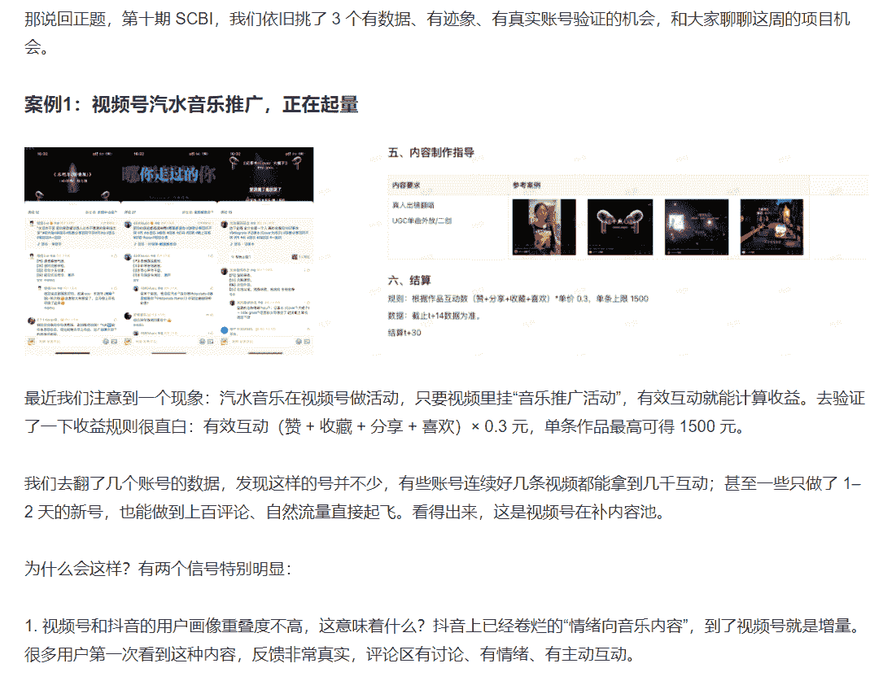
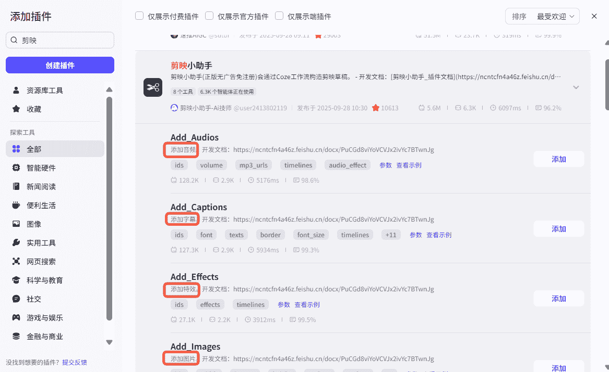
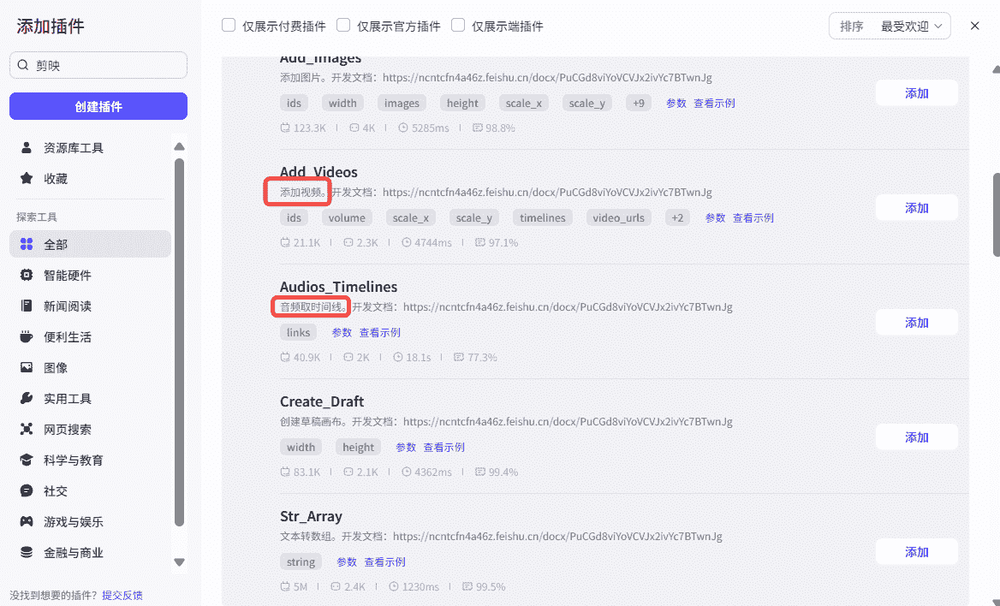
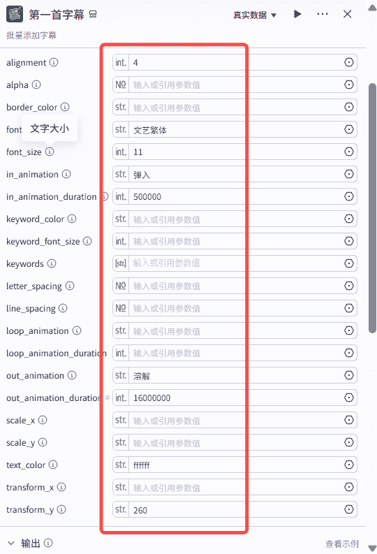
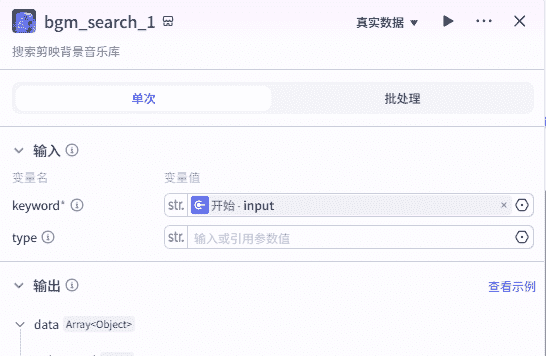
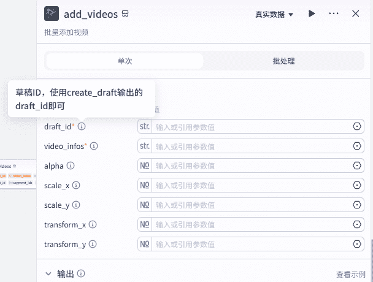
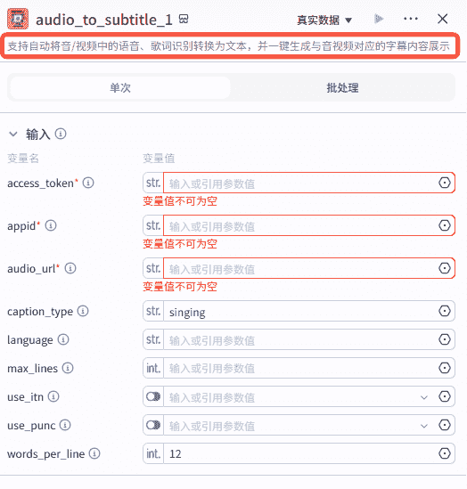
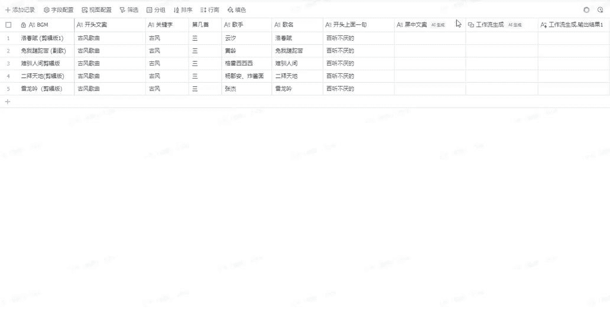
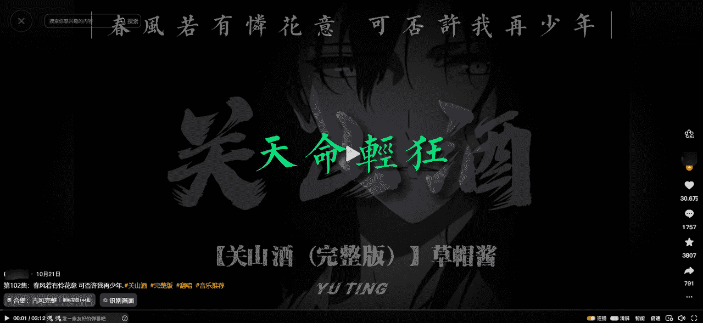

# 拆解视频元素，用扣子+飞书多维表格实现日均300条原创短视频的自动化生产

> 来源：[https://xuqiwei1986.feishu.cn/docx/CNmrdO3jro6J6rxNHYtcRMFFntc](https://xuqiwei1986.feishu.cn/docx/CNmrdO3jro6J6rxNHYtcRMFFntc)

哈喽，大家好，我是小灰，目前在做短视频相关业务，因为业务量比较大，用到了扣子工作流+飞书多维表格提效

# 一、搭建工作流做视频的背景

1.  日常做视频的时候，会建立很多剪映模板，提高做视频的效率，但后来发现效率还是不够高，并且好几个人都用同一个模板做出来的还是差异比较大；

1.  后来想到用RPA操作剪映去剪视频，但是剪视频这种还是比较精细化的，RPA经常出错或者位置不对，检查比较费时间，了解到扣子可以调用剪映模块，搭建工作流生成，跟着航海手册去学习基础搭建，用cloude code辅助做代码；工作流搭成后，可以多人共享，做出来的视频标准化程度很高，质量稳定；

1.  工作流的应用场景很多，电商类混剪视频、科普类视频、小说推广沙雕动画、AI漫剧，都能搭视频工作流去批量生成，还可以嵌入多平台自动发布；

1.  圈友们如果发现各平台上有类似批量化的视频内容想要去做，一般都可以几十到几百不等买一套对应的工作流去生成。

1.  圈友们如果业务需要做大量视频，比如矩阵账号做内容、切片混剪等等，内容标准化程度越高，搭建工作流就越简单；

1.  做工作流最重要的是环节拆解，只有制作环节拆解的够细，工作流才会跑的更顺。

# 二、我选择用扣子搭建自动化视频工作流的历程

1.  我的平常要做大量的短视频（每天几百条），因为有点非标准化，自动化rpa很难解决。

1.  后来自己学习扣子工作流，把一些非标准化的交给各个大模型去判断，标准化的部分直接调用剪映，结合起来，接入飞书表格。

1.  现在可以做到只需要在飞书表格批量填写视频信息，就能批量生成成品视频的剪映草稿，如果哪个生成的不能用，直接改一下视频信息重新生成就行。

1.  就像包子老师展示的AI不停的生成内容，不合适的删掉重新生成就行，这个思路就是包子老师启发的，现在每天产出300条原创视频，并且token成本可以忽略。

# 三、工作流对我的帮助

1.  之前需要七八个人剪视频的量，现在两三个人负责检查筛选就可以。我的这种形式，不需要生成内容，所以不需要消耗token，基本0成本产出。

1.  这种形式是模仿人工剪，所以视频产出和真人手工剪是完全分不出来的，获得的数据和真人手剪是一样的，但是效率提升10倍

1.  SCBI实验室第十期里面的音乐类视频、祝福类视频都快速搭建工作流，每天产出视频，和我拆解的例子也是非常相似的，现在还在试验中

1.  目前已经给两位老板定制搭建了视频工作流，收益两千元，不多，但是这个路线是可以变现的

# 四、针对短视频业务的拆解

## 1、音乐类短视频为例拆解

1.  音乐类短视频标准化元素拆解：[抖音上随便找的例子-音乐类](https://v.douyin.com/hpzmnNbNFIE/)

1.  这个音乐视频由几部分组成：上方和下方固定的文案+背景歌名+背景视频/图片+中间的歌词

1.  扣子工作流中有很多现成的调用剪映的模块，剪映基础功能大部分都是不收费的，大家可以自己点进去看看，现成的组件点击添加，然后拖拽连接前后就可以，这里面我们常用的：字幕、音频、文案、视频、音频时间线、特效、贴纸等等，都是现成的模块

1.  接下来需要根据需求一个个添加，怎么前后连接，大家可以看扣子工作流+多维表格航海手册，我就是对着航海手册一个个前后连接，这里放几个案例截图，里面不止这些组件，大家需要调用剪映的可以直接在扣子插件里面搜“剪映”

**添加字幕**

比如我要添加到屏幕上方，就找到添加字幕的组件，在这里填上相关的信息，比如字体、字号、字幕特效、字幕出入场、放置坐标等等

**添加音乐**

我要添加什么音乐，有现成的组件可以根据歌名搜索剪映背景音乐库里的音乐

**添加视频/图片**

我要添加的视频，就找添加视频的组件

**添加歌词**

需要找到歌词识别的组件，歌词这里免费的组件不多，基本上都是收费的了

1.  工作流搭建过程中，比如音频时间线很多时候需要用到代码，会代码的可以找到一段时间线代码模板直接改，不会代码的同学可以丢给cursor或者cloud code，把需求描述清楚，有问题就直接问，我第一次就修改了十几次，用了三四个小时才运行成功

1.  这样需要添加的内容、各个元素出现的时间都有了

1.  音乐类短视频非标准化元素拆解

1.  文案：文案是非标准化元素，需要根据具体的歌来写文案，我做的时候，本来想直接在扣子工作流内接入豆包大模型，但是又怕生成的次品率太高，不好检查，所以选择在飞书多维表格接入deepseek大模型，生成的文案可以直接看到

1.  图片/视频：背景图片和视频也是有两种方式，一种是在飞书多维表格里面填入图片和视频，让扣子工作流调用飞书多维表格的内容，一种是在扣子工作流内接入生图生视频模型，最后为了可控性更高，选择在飞书多维表格里面接入生图生视频大模型

1.  把飞书多维表格和扣子工作流结合起来

1.  如何把飞书多维表格接入扣子工作流，Coze + 多维表格工作流航海手册里面有非常详细的教程，我就是根据教程一步一步做的

1.  结合起来的效果如下

[AI生成文案并生成草稿链接.mp4](https://internal-api-drive-stream.feishu.cn/space/api/box/stream/download/all/I3I9bNQ5MoaUKyxmcabcgyfTnch)

1.  上面接入AI的字段都可以设置为自动更新的，我只是演示，没有选择自动更新

1.  “工作流生成”字段就是调用扣子工作流，生成剪映的草稿，最后的链接是剪映草稿，导入剪映里就可以[直接打开成品视频，演示视频](https://v.douyin.com/hpzmnNbNFIE/)生成的除了没有背景视频，其他的都和这个随便找的例子接近抖音上随便找的例子-音乐类

1.  我这里是简单演示，没有加入背景视频和图片，只加入了语言大模型生成文案，生图生视频模型接入飞书多维表格也是一样的

1.  我这里只用到了语言大模型，所以消耗的token非常少，其他的都是直接调用剪映模块，基本不消耗算力，除了每月9.9的扣子个人版，生成1条视频不到1毛钱

## 2、口播类视频同理

把口播素材放入多维表格，然后用扣子调用字段内容，在口播视频里加上字幕、特效、贴纸、背景音乐都可以，并且我把这些可以调整的变量都放在多维表格里，变量方便自己控制

# 五、分享思路

把视频拆解成标准化的元素和非标准化的元素，标准化的元素可以直接用扣子工作流调用剪映模块制作，非标准化的元素可以放在多维表格里面，接入AI进行制作，并且方便控制变量，设置自动更新之后，每时每刻都可以生成视频，后续只需要检查审核，不合格的一键重新生成就行。

# 六、变现方式

## 1、如果会搭工作流的话，可以给别人定制工作流

1.  目前像这种[抖音上随便找的例子-音乐类](https://v.douyin.com/hpzmnNbNFIE/)相对简单的视频工作流，工作流定制价格大概在1500-3000元左右一套，熟练的话，1天即可做出一套。

1.  现在市场需求除了几个红海模板，其他的空间不小，比如：

1.  大学生宝妈买一套工作流生成内容，做账号

1.  作为副业买一套，每天发布，有些行业是可以接任务的

1.  做内容的老板的需求大部分工作流都能实现

1.  现在做youtube的也可以定制工作流

1.  这类视频[历史解说博主内容](https://www.douyin.com/video/7486931820169252132)、[假如书籍会说话](https://www.douyin.com/video/7564216224343772443)的内容就是这类工作流做出来的，这种工作流的定制价格大概在2000-5000元左右一套，当然，这种模板出来好久了，竞争比较大，现在几百块甚至几十块就能买一套相似的（非定制）

2、抖音📕上面很多AI内容的账号都是通过这种方式批量做出来的

1.  这个博主[假如书籍会说话](https://www.douyin.com/video/7564216224343772443)，主要盈利模式是卖工作流+带学员；次要盈利模式是中视频伙伴计划收益，按照播放获取收益；橱窗带货量是最少的。这个博主算是这类的头部博主，多少收益不太好估。

1.  这个博主[抖音上随便找的例子-音乐类](https://v.douyin.com/hpzmnNbNFIE/)，接任务做音乐推广，像这条爆的视频，大概3000元左右的现金奖励

# 七、给新手的建议

1.  建议先跟着扣子+多维表格航海手册完整做下来，再研究扣子插件市场中剪映相关模块

1.  对视频元素的拆解要足够细，因为工作流就是把每一块元素拼接起来，需要什么元素就调用什么模块

1.  不会代码的新手可以用cursor、cloude code等工具辅助去写，不需要很懂代码什么意思，只要不停的把问题描述清楚，像我给的这个案例，整个工作流用到代码只需要十几行就可以，所以入门还是很简单的