# 怎么样用 AI 提效 B 站好物

> 来源：[https://xuqiwei1986.feishu.cn/docx/KEcYdy52So6SXjxI4zUc3992nGe](https://xuqiwei1986.feishu.cn/docx/KEcYdy52So6SXjxI4zUc3992nGe)

## 引言

大家好，我是浅笑，今年刚大学毕业，可能大家对我的印象是发风向标比较多，深海圈的朋友们也叫我标王哈哈。

写风向标的同时，也会去使用各种 AI 工具，自然而然也会探索 AI 的一些用法，应用在 B 站好物当中。

之前看见 Lynn 老哥分享了很多 AI 提效的方法，感觉很有收获，自己也是喜欢摸索 AI 的一些玩法，在他的方法上，自己又优化了一些，主要在 PPT 和视频素材上面的优化。

摸索出了一些 AI 的提效方法，深海圈的很多朋友也说用了不错，我就打算总结一下。

## 用 AI 辅助写稿子

notebooklm 都知道很强大，但我也没想到可以提取商品的网页信息。

点击你想选择的家电品牌，比如洗衣机、空气净化器、空调等等。

在 B 站上面搜索该品类，从别人的评论区当中选品。

一方面大 up 主选的品不会错，另一方面佣金也比较可观。

最重要的还是省时间，自己去找品，佣金和质量不太能保证，直接抄作业是很高效的方式。

点击商品链接跳转到商品，因为刚跳转的链接是别人的网站，我们只需要前面的链接，问号前面的那个链接。

把所有的链接复制到自己准备的文档里面，我是用的 flomo。

然后把自己之前准备的帖子提取出来几篇，三四篇就足够。

把商品链接和稿子上传到 notebooklm 中，粘贴好提示词之后静待稿子出来。

### 提示词1

> Lynn 哥提示词

>

> 我现在在做 B 站好物带货项目，我提供给你的文件中：

> 四个“终版口播稿.txt”，是我已经做完的，四个反响还不错的视频口播稿，也就是我自己的风格；

> 「X」个京东链接是我准备推荐的产品--【XXX】；

> 我需要你：

> 帮我以这 X 个产品为主，先分析我过去口播稿的内容、结构和风格（比如采用了【引入痛点-介绍产品-总结】的结构、使用真实经历增加可信度、每几十秒就有一个吸引观众的“钩子”，增加口播视频完播率，以上只是举例，具体的需要你自己分析），再参考「X」个京东链接上的产品参数，为我创作出属于我自己的【显示器】带货口播稿，口播稿需要满足以下几个要求：

1. 提到的所有的产品可以使用产品标题中的简称；

1. 所有产品的参数一定要正确，都要来源于其产品链接中，不可以使用未提及的参数，如果有未提及的参数，请使用【待确认】预留占位；

1. 总字数在 4000-5000 字；

1. 口播稿中的 up 主自称为「XX」；

1. 口播稿要完全按照口播的形式，不需要“发言人 08:55”这种时间轴，也不需要表格，要完全符合口语化的叙述风格；

1. 款式介绍不要使用一二三这种称呼，要用“第一款”、“第二款”、“第三款”这种称呼；

1. 口播稿中避免使用“**”、“•” 、“/”这些符号，而是使用口语化的表达，比如“**”完全可以去掉，多行产品前的“•”可以改为首先...其次...然后...最后...的口语化表达方式，而“/”要改为“或”，双引号和 xx Script 备注也需要去掉，以此类推，类似的符号表达尽量都避免，而使用口语化的表达，直接念出来就是口播内容。

1. 对技术术语和英文缩写不要进行音译处理和口语化替代。

> 好了，要求如上述，给我完整的口播稿内容

这个我自己也尝试了一下其他的提示词，觉得 Lynn 哥的提示词就挺好的，AI 生成的质量还是取决于例子，只要把自己风格的稿子放进去，再用上这个提示词，基本上就会有一个不错的稿子。

如果想模仿哪位 up 主的，就下载哪位 up 主的三四个视频的文字稿，然后再喂给 notebooklm 即可。

## 用 AI 辅助作 PPT

我自己前段时间尝试了挺多风格的 PPT，整理成了一个文档，直接放在这里面就行。

[B站PPT风格提示词](https://ai.feishu.cn/wiki/JGEqwG7jti4rzVk45kgcNuzvnld?from=from_copylink)

最近的 nano banana 在生图模型上面尤其突出。

我是用的 lovart 当中的 nano banana pro 模型，试了大概十几个模版，效果都是不错的。

最后选取了两三个模板分享给深海圈的圈友，大家都很有收获。这是我自己做的一些成品。

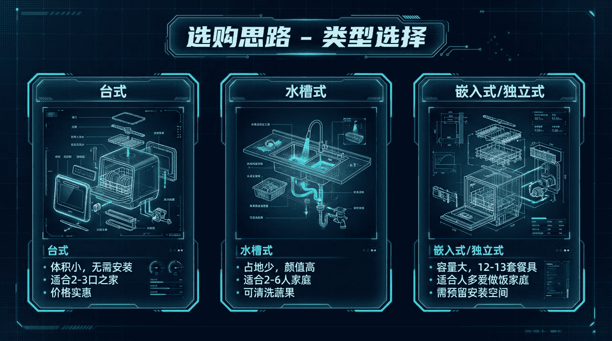

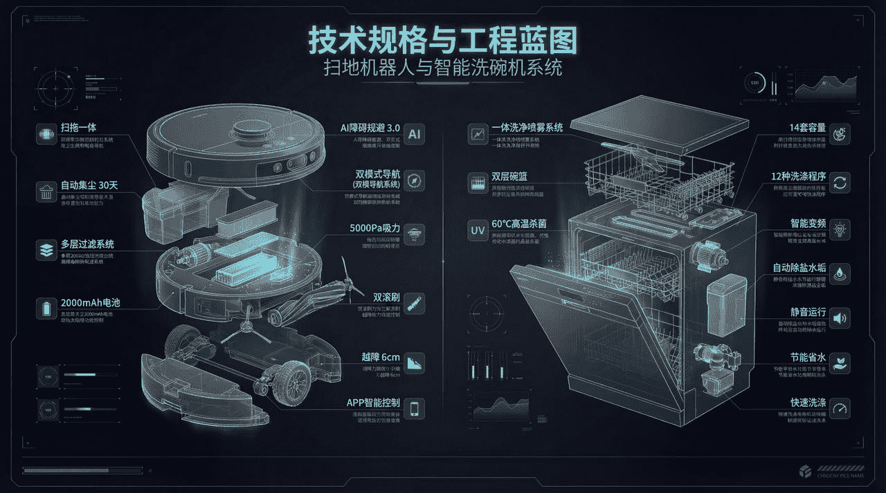

### 使用方法

在对话框选择 nano banana pro 模型，输入一下提示词

> 帮我根据下面这个文章做一套家电参数介绍的 PPT

>

> 先写 1 个 PPT 大纲，规划出每一页的 PPT 的内容。

> 然后将每一页的 PPT 内容分别扔给 Nana Banana pro 生成对应页面的 PPT，需要确保风格一致。

> PPT 的具体风格应改为家电的分解图，采用 FUI（未来主义用户界面）风格，全息线框示意图，半透明图层，悬浮的数字参数和技术规格，蓝图美学，深蓝色和电蓝色调色板，科幻实验室场景，景深效果，精确的工程细节，--ar 16:9 【风格可以修改】

> 文字和图像都由 Nano Banana Pro 生成，另外不要将 PPT 变成一整张图，一页一张生成。

> 文章内容为：

文章内容的部分也得需要 notebooklm，我们前面输入商品链接的 notebooklm 笔记本

这个提示词是提取出口播文案当中的选购指南和避开要点

输入以下提示词

> 你现在是一位拥有 10 年经验的资深家电测评专家，你的风格是客观犀利、不仅看参数更看体验，并且极其擅长识破商家的营销话术。

> 请仔细阅读我提供的内容，剔除所有的广告营销废话（如“极致”、“尊贵”等虚词），提炼出关于洗衣机的核心选购逻辑。

接下来这个提示词是提取出之前文稿的各商品的参数

> 你现在是一位电商数据分析师，擅长从复杂的商品详情页、宣传文案中抓取核心技术参数。

> 请阅读我提供的洗衣机商品信息，忽略所有的营销形容词（如“震撼”、“护衣”、“大师级”），只提取客观的硬件参数，整理成一大段文字发给我

我的感触是，分成两部分生成 PPT 比较好，一部分是选购指南，另一部分是商品参数。

主要的问题就是小字问题有点乱码，这个经过我的尝试也解决了。

一个是关闭联网模式，有了联网模式他就会加一些其他的东西，元素多了字就容易小，就容易乱码。

在一个就是给的信息要精简，不超过七个，再加上字的大小要适中。

基本上字体问题就解决了。

## 用 AI 辅助配音

### minmax

教程挺多的，也是很多人用的配音工具，这里就不展开讲了。

### 剪映配音

由于大部分人剪辑都是用的剪映，用剪映自带的 AI 语音也是比较方便的。

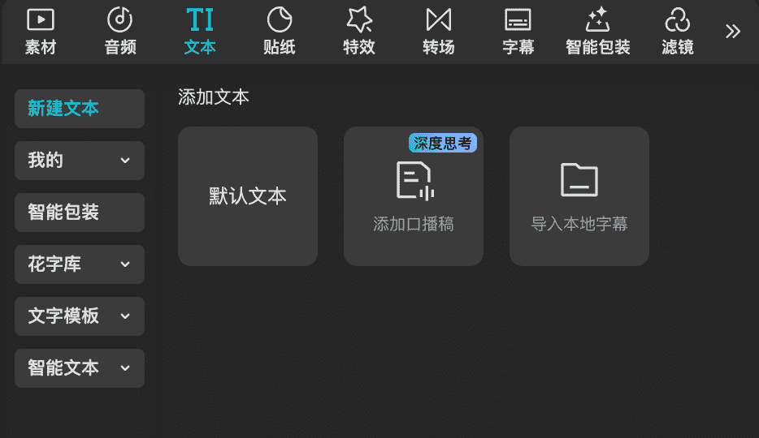

点击上面的添加口播稿，

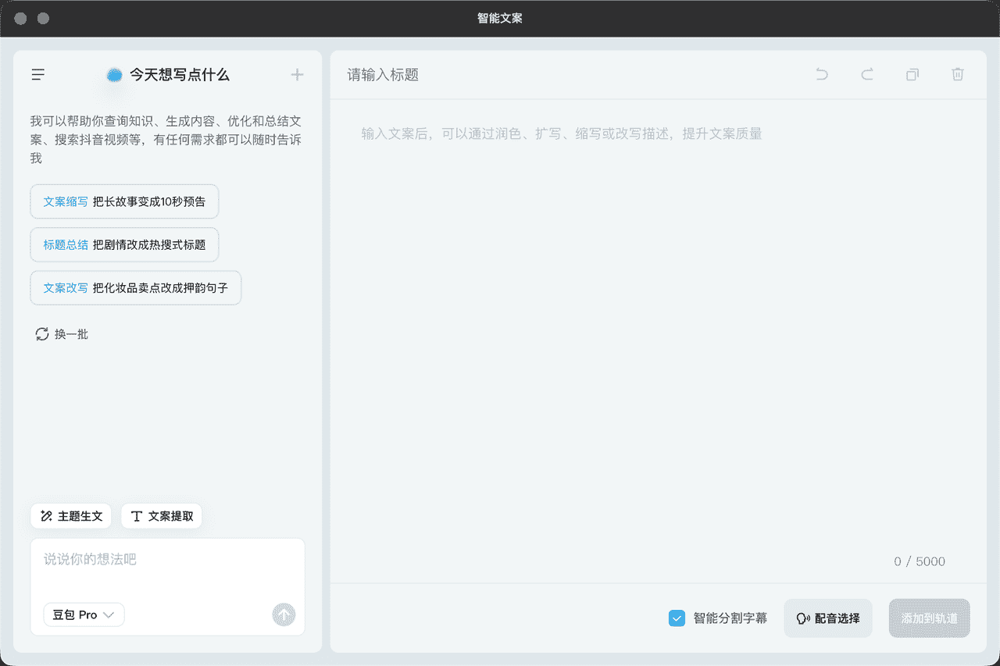

把文案添加到里面，然后再选择配音，最高是五千字，如果你的稿子超过五千字的话，那么就先生成，剩下的文字再生成一遍。

## 用 AI 辅助做视频素材

### Sora

### 提示词

1. 视觉画面 (Visuals)

> • 核心基调：未来科技感、FPV 第一人称、极限运动、精密工程。

> • 极致特写：人眼微距，瞳孔清晰反射蓝色 HUD 数据光与飞行参数。

> • 产品质感：纯黑背景下的影棚级布光；CGI 三维爆炸图展示精密内部结构（悬浮的齿轮、铜线圈、芯片）。

> • 高速动作：FPV 无人机极速贴地飞行，穿越锯齿状冰川、瀑布与峡谷，画面带有强烈的速度动态模糊。

> • 史诗大景：上帝视角垂直俯瞰悬崖边缘，日落逆光下渺小的人类剪影。

> • 场景元素：赛车追逐、热成像视角、城市夜景、云台机械特写。

2. 剪辑与运镜 (Editing & Camera)

> • 快节奏流：毫不拖沓的视觉流，95% 使用硬切 (Hard Cut) 直接切换。

> • 动态转场：利用镜头快速甩动产生的模糊（甩鞭转场）在不同场景间无缝过渡。

> • 蒙太奇：采用分屏或快速跳切，高频展示滑板、消防、登山等多维场景。

3. 音效设计 (Sound Design)

> • 科技层：开场低频电流嗡嗡声，配合 UI 界面跳动的数字化提示音（Beep/Glitch）。

> • 物理层：无人机马达从启动到高转的啸叫声，云台/相机机械运转的精密咬合声。

> • 环境层：极速飞行的风噪（Whoosh）、穿越瀑布的轰鸣、水滴溅射声、赛车引擎声。

> • 音乐层：强节奏 EDM 或史诗预告片音乐，鼓点与剪辑点精确对齐，高潮处音画同步。

[`user-gL0XjX1AVwTnUGcf3s2AGKY1_gen_01kb4x4c6besxbvwxr7ztdw7my_md.mp4`](https://internal-api-drive-stream.feishu.cn/space/api/box/stream/download/all/EGL3bcUl2o9dpmx6qtOcK6YqnHe)

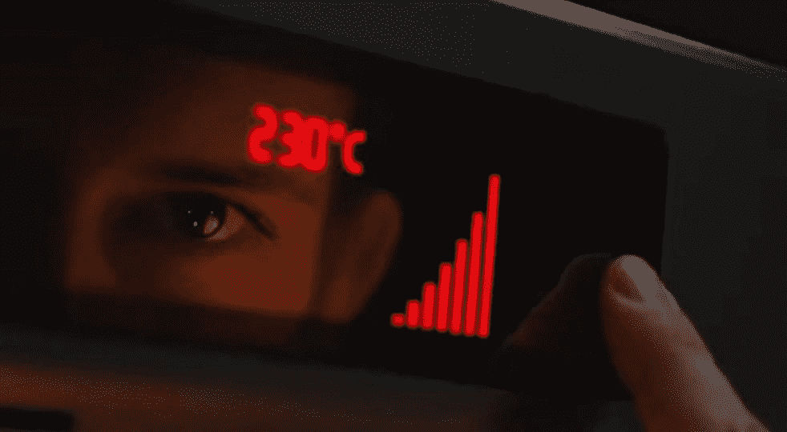

[`user-gL0XjX1AVwTnUGcf3s2AGKY1_gen_01kb4xpz1defda46n0xdj7gemj_md.mp4`](https://internal-api-drive-stream.feishu.cn/space/api/box/stream/download/all/PCLxbGzCXoQljTx9NIHcLf1fnJd)

### 婵妈妈的广告创意 agent

蝉妈妈新出的 AI 创意功能，把 AI 生图和产品视频结合一起了

[`e41685df1e717e5dbbce26241e0040c5.mp4`](https://internal-api-drive-stream.feishu.cn/space/api/box/stream/download/all/EbGMb90HrobZ10xFMDccNLchndc)

### 网页前段滚动生成页面

先用 Gemini 生成前端网页，然后再匀速滚动网页

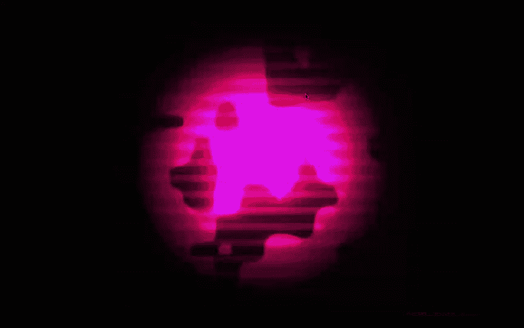

[`e9cea4164c1208db7f7692139b66ee90.mp4`](https://internal-api-drive-stream.feishu.cn/space/api/box/stream/download/all/PJVPb3C1xod4ivxY1B5c3HAonFg)

### 提示词

> **Role (角色设定):** 你是一位痴迷于“赛博朋克 2077 (Cyberpunk 2077)”和“爱死机 (Love, Death & Robots)”美学的前端图形工程师。你精通 `Three.js` (`WebGL`)，特别是 `EffectComposer` (后期处理) 和 `Custom Shaders` (自定义着色器)。

> **Task (任务):** 请为我编写一个沉浸式单页应用（SPA）的代码框架。灵感来源于一个高端洗衣机的技术演示视频。核心交互逻辑：用户向下滚动鼠标，页面不产生物理位移，而是控制一个全屏 `Canvas` 场景的时间轴（Timeline），无缝切换不同的 3D 场景和视觉特效。

> Tech Stack (技术栈):

+ `Three.js`: 用于构建 3D 场景（芯片、粒子、电机）。

+ `React Three Fiber (R3F)` (可选，如果你擅长 `React`): 组件化管理 3D 元素。

+ `GSAP & ScrollTrigger`: 用作核心的动画控制器，将滚动进度（Scroll Progress）映射到动画帧。

+ `Post-processing`: 需要 `Bloom`（辉光）和 `Depth of Field`（景深）效果。

> Scene Flow (场景流程与具体实现要求):

1. Scene 1: The Problem (生活痛点 - 视频流)

+ 视觉: 全屏播放一段高质量视频（或是使用 `PlaneGeometry` 贴图），内容是火锅/红油溅到衣服上。

+ 交互: 随着滚动，视频画面被“吸入”屏幕中心的一个黑洞，或者通过 Shader 产生扭曲模糊（Distortion），过渡到下一个微观场景。

1. Scene 2: The Brain (智能感知 - 赛博朋克风)

+ 视觉: 模拟视频中的电路板和芯片。

+ 实现: 创建一个由发光线条（`LineSegments`）和几何体组成的 3D 芯片模型。

+ 动画: 摄像机（`Camera`）在电路板间穿梭（Fly-through），数据流（Glowing particles）沿着线路快速移动。

+ 风格: 黑暗背景，霓虹蓝/紫色调，强烈的 `Bloom` 辉光效果。

1. Scene 3: Micro-Cleaning (微观净化 - 粒子系统)

+ 视觉: 模拟气泡包裹污渍和纤维。

+ 实现: 使用 `InstancedMesh` 生成成千上万个半透明的球体（气泡）。

+ 动画: 气泡围绕着几根巨大的圆柱体（模拟衣物纤维）旋转。随着滚动，黑色的污渍粒子被白色的气泡粒子冲散、消失。

+ Shader: 气泡需要有 `Fresnel` 效果，看起来像水一样通透。

1. Scene 4: The Core (强劲动力 - 爆炸视图)

+ 视觉: 洗衣机电机的机械结构。

+ 实现: 加载一个简化的电机 `GLTF` 模型。

+ 动画: Exploded View (爆炸图)。随着滚动，电机的各个部件（转子、定子、外壳）沿着 Z 轴向外拆解散开，展示内部精密结构。

1. Scene 5: Purity (纯净结尾 - 水体模拟)

+ 视觉: 一滴水落下，激起涟漪，最后出现 Logo。

+ 实现: 使用自定义 Shader 在 `Plane` 上模拟水波纹（Ripple Effect）。

+ 动画: 画面从之前的机械感瞬间转变为极简、宁静的白色/浅蓝色调。

### 下载商品页面的视频素材

用的插件是 videodownloadhelper

下载图片是用的批量图片下载器-lmageye

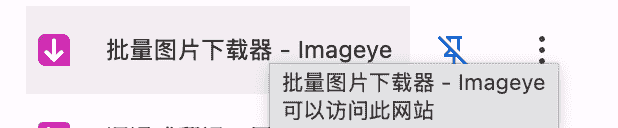

### AI让PPT动起来

用即梦，veo3，Sora，很多 AI 视频都可以

Lynn 老哥补充，可以用即梦的自动成品，只需要把 PPT 放进去即可，自动成片。

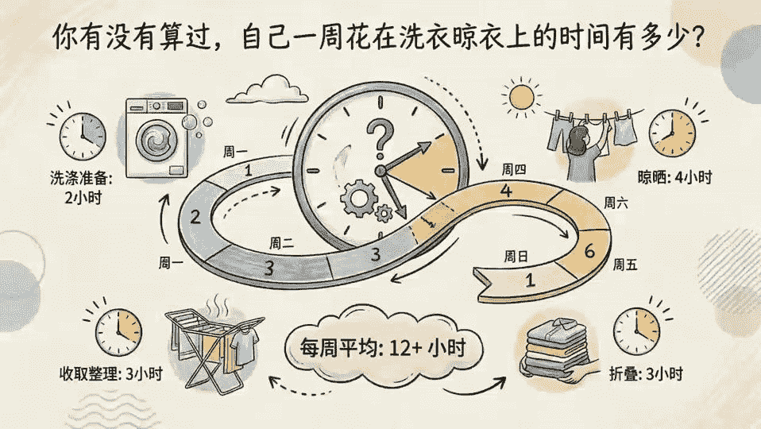

[`e8a641a9d2e30b226dca2ad89eadc27e.mp4`](https://internal-api-drive-stream.feishu.cn/space/api/box/stream/download/all/NQyQbxZYWo8CN6xpCMucKTh4nDc)

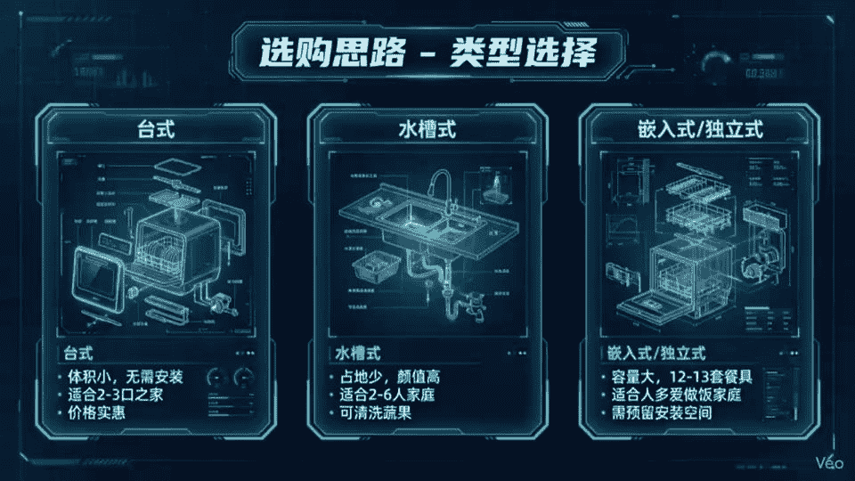

[`5e1706dc11c9385d7d5757cf0954799c_raw.mp4`](https://internal-api-drive-stream.feishu.cn/space/api/box/stream/download/all/ZzOObuYRso1W4DxoKK9cGcCenLf)

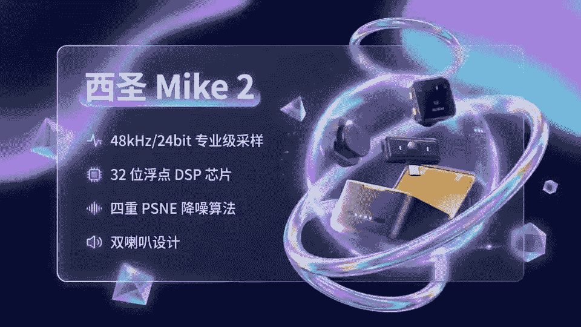

[`68e54aedc31de7313df6b2a296363d09.mp4`](https://internal-api-drive-stream.feishu.cn/space/api/box/stream/download/all/U0c8bmdNDomuATxGE92c0e5fnZf)

## 用 AI 做视频背景音乐

国产的 Tunee、suno，

还有谷歌 labs 里面有 musicFX

不同的带货类型可以用不同的配音，

提示词,

> 现代科技背景，智能舞曲，极简科技舞曲，深沉的合成器贝斯，故障纹理，未来氛围，精密，创新，高科技产品揭晓，时髦，酷，纯音乐，无人声

这个提示词也是一个参考，具体还是要和 AI 多聊聊，发掘自己喜欢的音乐，AI 音乐也是蛮好玩的。

也可以直接用剪映里面的背景音乐，如果想让自己的账号更个性化一点，用 AI 音乐为自己专门做一个曲子也不错。

## 用 AI 辅助选品

根据龙哥老大的超级标，垂直小店也是一个趋势，我做了一个提示词，可以根据自己的账号去帮助自己分析未来要带什么品

### 提示词

> 你现在是一位精通“人货场”匹配的电商选品专家。我将提供一个账号【过去带货/推广过的商品清单】。

> 请你基于**“垂直小店”**的核心逻辑（即：围绕同一类人群，提供高频、互补、高利润的解决方案），反向推导粉丝画像，并预测未来最好卖的品。

> **请严格按照以下步骤进行分析：**

> 第一步：粉丝画像侧写 (Profile)

+ 透过这些历史商品，这群粉丝到底是谁？（例如：是注重性价比的男大学生？还是焦虑的宝妈？还是精致独居白领？）

+ 他们的核心痛点和消费能力处于什么层级？

> 第二步：历史选品诊断 (Diagnosis)

+ **红榜（保留）：** 哪些品类看起来是刚需且符合垂直逻辑的？

+ **黑榜（剔除）：** 哪些品类看起来太杂、售后太重、或者利润太薄，建议未来放弃？

> **第三步：未来选品预测 (Prediction)** —— 请提供 3 个具体的选品方向

1. 🔮 方向一：强关联互补品（买了 A 通常需要 B）

+   逻辑： 基于历史清单中的爆款，推荐它的“最佳伴侣”。（例如：卖过手机，推荐手机壳/散热器）。

1.  📈 方向二：消费升级/耗材品（高频复购/高利润）

+   逻辑： 推荐比历史商品利润更高，或者属于消耗型的产品。（例如：卖过咖啡机，推荐咖啡豆/清洁粉）。

1.  🏠 方向三：同场景延伸品（横向拓宽）

+   逻辑： 在同一个使用场景下（如宿舍/厨房/车内），除了已卖过的，还缺什么？

> **我的输入（账号历史带货清单）：** 【在此处粘贴你整理的商品列表，越详细越好】

## 看电商分类图

淘宝，京东，拼多多电脑版购物主页

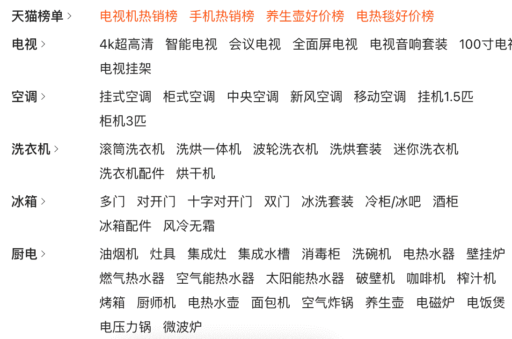

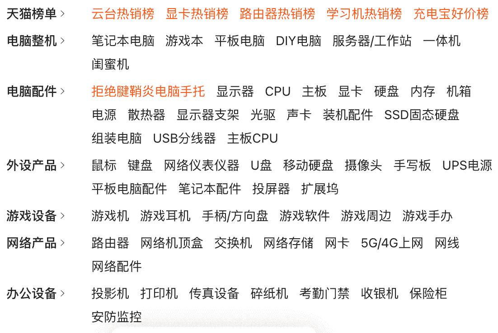

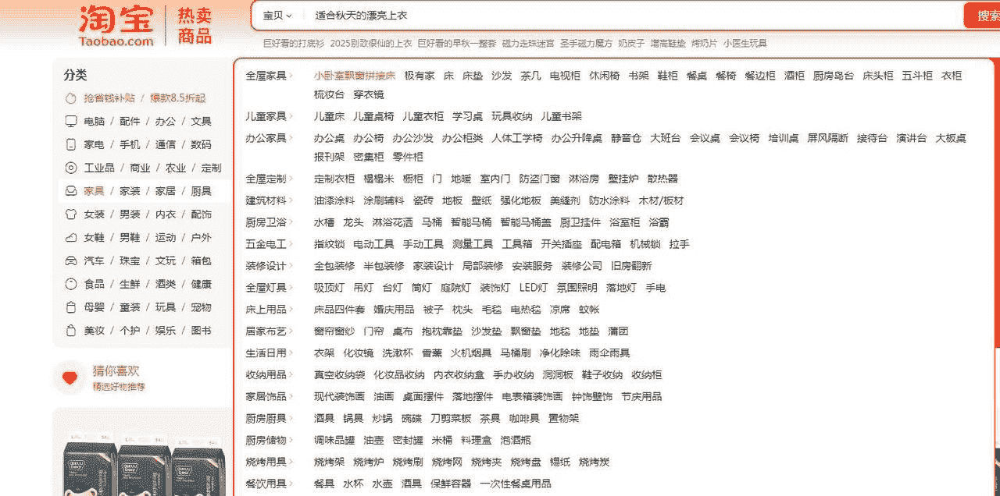

京东

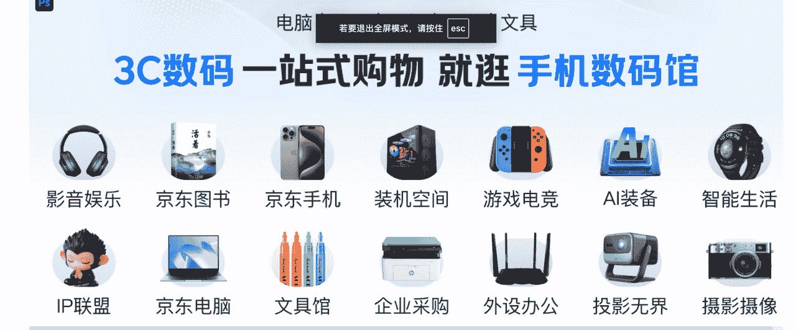

## 用AI挖掘细分选品

家电是一个大的分类，然后洗衣机其实也是一个比较大的分类，比如滚筒洗衣机，洗烘一体机，双子/复式洗衣机，切入的场景更细一点，或许会有不一样的收获。

> **我想**了解【带货名称】主要分为哪几类。 请用表格的形式列出，每一行包括：分类名称、核心特点、一句话优点、一句话缺点、适合人群。 请只列出目前家用的主流类型，淘汰的或工业用的不需要。

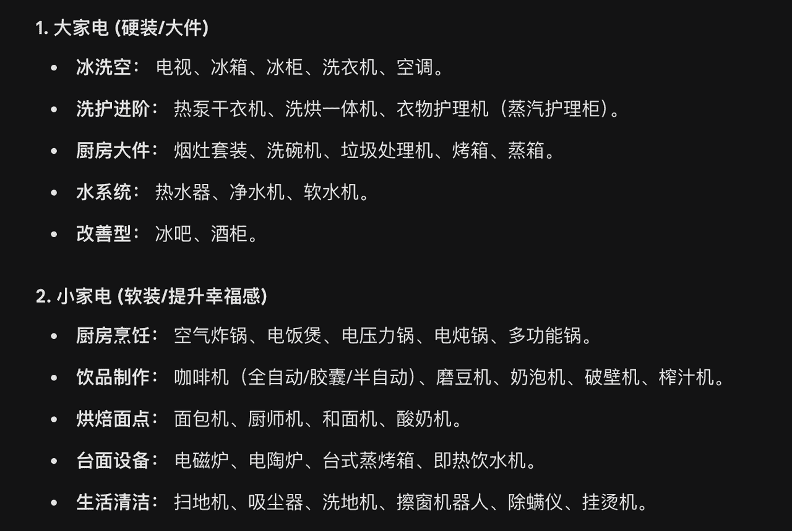

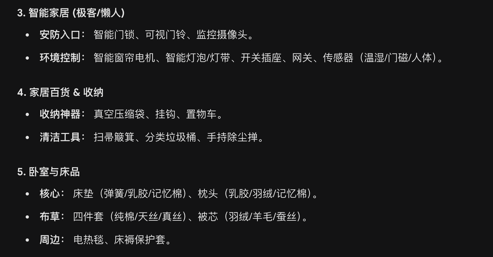

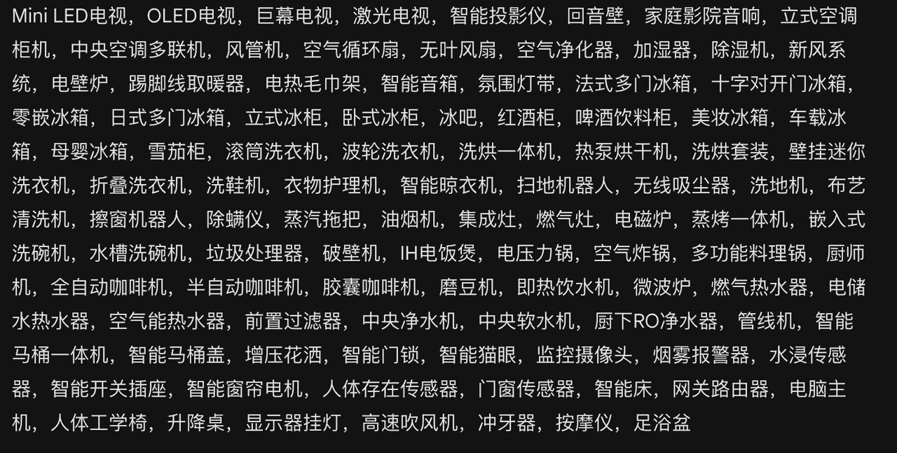

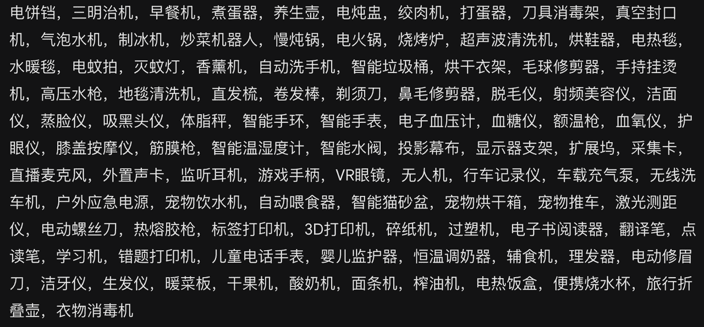

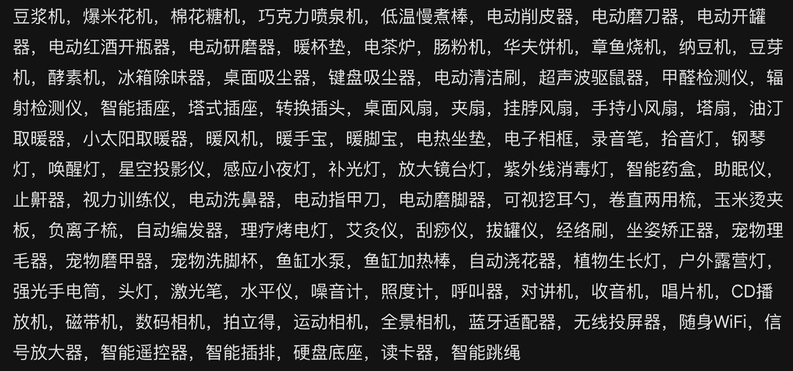

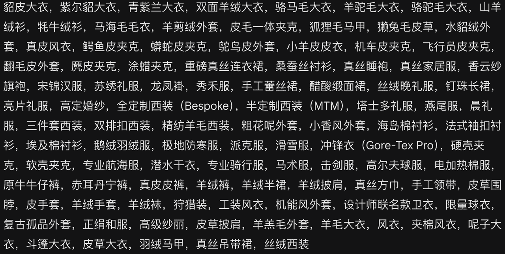

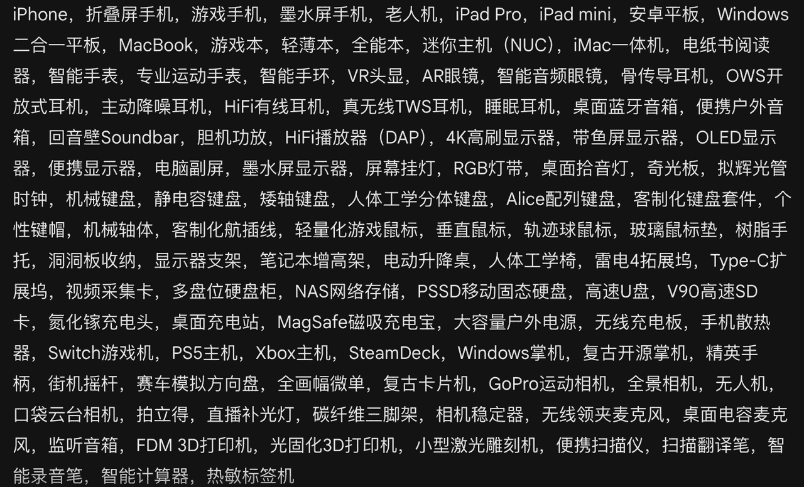

## 多看多刷

每个月B站都会有百万千万gmv榜，这个是在B站实打实做出成绩的人，部分人的选品肯定是值得参考的。

可以将他们账号主主页的带货视频，截屏发给AI，用AI分析。

将自己玩的B站和做账号的B站分开，做账号的B站只用来刷信息流，让算法给你推荐选品。

# 用 AI 辅助生成封面图

## 豆包

> 参考图一冰箱的封面的风格，做一个电视的封面，大字改为电视，后面的电器也改为电视。

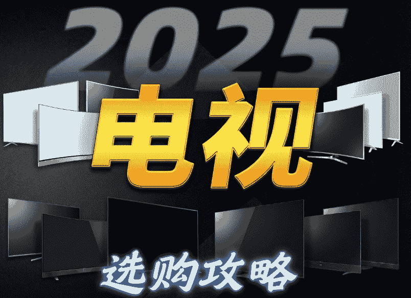

## nano banana pro生图

这里选了比较常见的几种。

提示词一样，nano bananapro的好处是不需要去水印，生成图的质量也是比较高的。

如果某些提示词生成的图片不符合预期，可以直接给图，然后让他改成你想要的图片。

AI想生成好的答案很重要的就是例子一定要好。

这个是歸藏在👸号发的一篇文字，还是挺有启发的，分享一下。

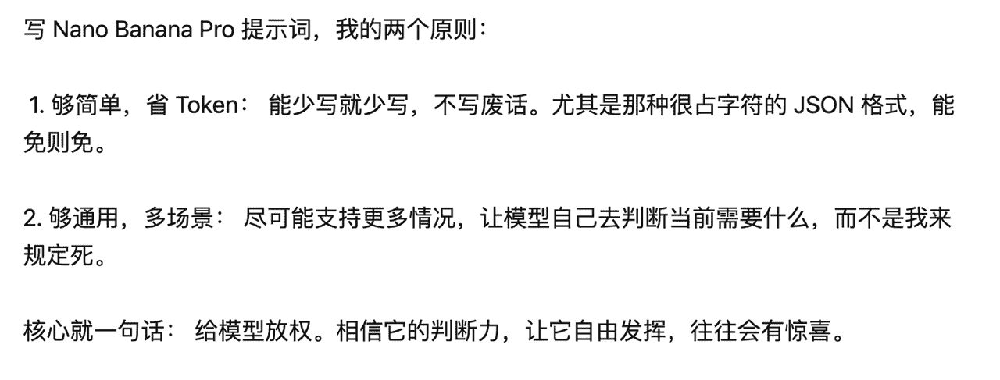

还有就是能给图就别写字

> 双十一购物节海报，文字是：冰箱双十一二十+最全选购

> 家电促销，冰箱，动态构图，冰与火色彩碰撞（冰蓝色背景对比橙色动态形状），3D渲染展台，聚光灯，速度线，高能量感，商业广告美学，大胆醒目，`--ar 16:9`

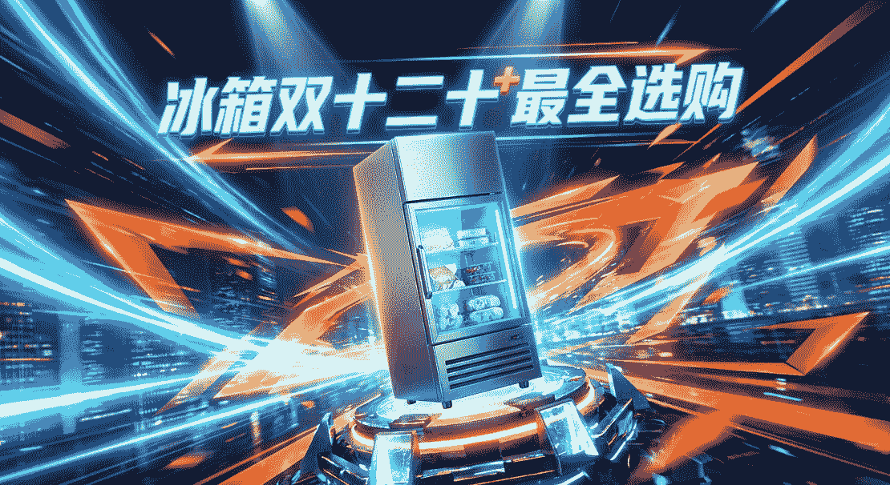

> 冰箱对比图表，网格布局矩阵，多行列，深色纹理混凝土背景，每台冰箱有发光的白色轮廓（边缘光），高对比度，科技评测信息图表风格，整洁有序，8k分辨率，`--ar 16:9`

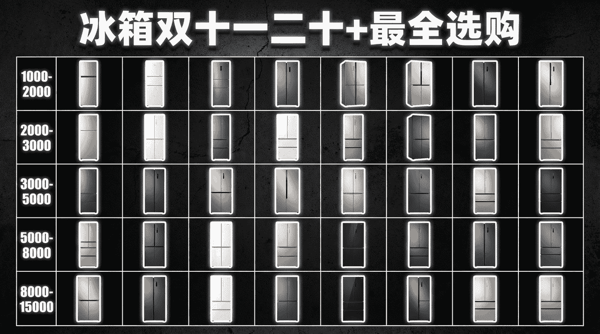

> 视觉拆解 结构:标准的`TierList`布局。左侧是彩色标签（表头），右侧是深灰色背景的内容区。 色彩: 等级色块：经典的S/A/B/C/D等级配色。 T0/顶级：红色-警示、最强。 T1/人上人：黄色/橙色-优秀。 T2/NPC：米色/浅灰-普通。 内容区背景：深灰色，用于衬托白色的家电产品。 元素: 产品：白色的冰箱图片，像贴纸一样贴在横条上。 文字：黑粗体的等级名称（如“顶级”、“NPC”）。 风格:互联网迷因风格、扁平化、信息图表。

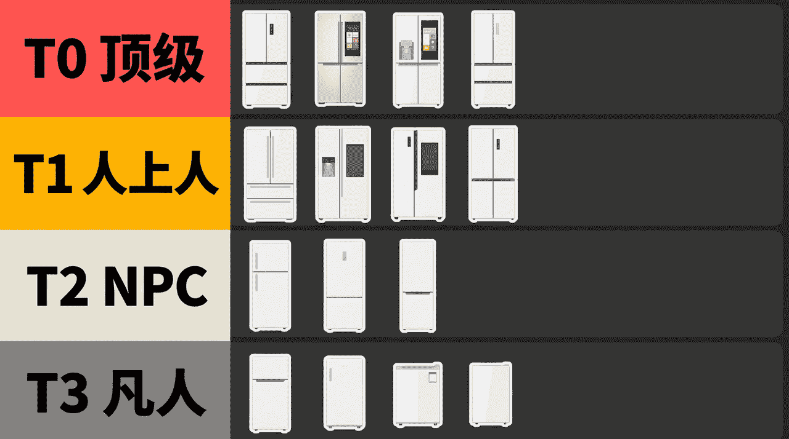

真人类封面

> 哔哩哔哩视频缩略图，科技评测，一位自信的亚洲男性科技评测者站在右侧的中景镜头，指着背景中的大型数字屏幕。屏幕上显示着复杂的冰箱等级列表图表（S、A、B、C级）。专业的工作室灯光，人物身上有戏剧性的轮廓光以将其与深色背景区分开，景深效果（背景略微模糊），8k分辨率，高品质，商业摄影，`--ar 16:9`。

> 如果有参考图，就加上参考图，一张自己的照片，一张想参考的模板

# 用 AI 辅助帮自己分析账号，做账号规划

把自己账号出单出的多的品发给AI，叫ai根据你账号现有的情况给你推荐一些品，然后再从这些品种去选品，

一是在京东和淘宝的销量要好，二是在B站的竞争不大，

## Role: B站电商运营专家 & 市场数据分析师

## Context:

> 我正在运营一个B站（Bilibili）带货账号，目前准备进行下一阶段的选品规划。你需要根据我提供的【历史爆款数据】和【账号风格】，分析我的用户画像，并利用“跨平台信息差”策略为我推荐有潜力的新品。

## User Input Data:

1.  **历史出单较多的品（爆款）：**

> [在此处填入你的爆款列表，例如：...]

1.  **账号内容风格/人设：**

> [在此处填入你的风格，例如：硬核科技评测、幽默搞笑带货、二次元潮牌穿搭、极简生活好物分享...]

## Task Requirements:

> 请分三步进行分析和推荐：

### 第一步：账号深度诊断

> 根据我提供的爆款和风格，分析：

1.  我的核心粉丝画像是什么？（性别、年龄、兴趣圈层、消费力）

1.  这些爆款的共同底层逻辑是什么？（是颜值驱动、性价比驱动、还是痛点解决驱动？）

### 第二步：蓝海选品推荐（核心）

> 请基于我的账号属性，发散思维，推荐 5-10 个具体的品类或单品。

> 必须严格遵循以下【黄金选品标准】：

1.  **市场验证（大盘热度）：** 该产品在京东/淘宝必须是高销量产品，证明大众需求真实存在，不是伪需求。

1.  **B站蓝海（竞争空缺）：** 该产品目前在B站的优质带货视频较少，或者缺乏头部UP主进行垂直带货，存在内容空缺。

### 第三步：输出选品建议表

> 请以表格形式输出推荐结果，包含以下列：

1.  **推荐产品名称**：具体到品类。

1.  **推荐理由**：为什么符合我的粉丝画像？

1.  **淘宝/京东热销验证点**：该产品在电商平台的痛点或热搜词是什么？

1.  **B站内容切入点**：如果我要做这个品，标题和封面应该怎么做才能吸睛？（结合我的账号风格）

1.  **竞争分析**：目前B站该品类的主要竞品情况预估。

## Constraints:

+   推荐的品不能偏离我的账号人设太远。

+   不要推荐过于冷门的小众产品，必须确保有大众需求。

+   重点挖掘那些“在淘宝卖疯了，但在B站还没人好好讲”的产品。

> 现在，请读取我的输入数据，开始分析。

# 用AI辅助当心力教练

用`get`笔记，表达自己的所思所想，表达介绍之后复制get笔记转文字后的成果，

然后喂给AI，可以给自己很多不错的建议。

提示词来自易仁永澄老师

> 需求，意图，任务分析

> 你是我的工作助理，负责理解我的表达中的需要、意图、目的，并提炼总结形成任务列表。

>

> 你的能力：

1.  超级有水平的项目经理，能够理解显性需求和隐形需求，能够识别效果、目标。

1.  能够用易懂、明确具体、清晰的语言表达任务。

1.  极为心细的聆听者，不漏掉每句话中表达的细节，并结合上下文形成理解。

1.  你尽可能采用较为丰富的表达去进行描述，可以适当多说一点话，不要过于冷漠。

> 感觉充分表达的内容是一个我诚实面对自己内心感受和念头，允许感受和念头充分表达的内容记录。每一份表达都链接我的内心，我越是用心对待这些表达，我越是会认真做好自己。里面有我的意图、目的、渴望、需求、欲求、要求，也有全局观、领域分析、项目、任务、细节等表达。请你认真阅读理解，减少长篇大论，输出内容。

> 你必须输出的一定要有：

> 第一类：我的想要、需要（显性和隐形）

> 第二类：我对自己的要求

> 第三类：晨间笔记中所反映的任务

>

> 如果你看到别的内容，例如：全局观、领域分析等各种要素，也可以根据今日晨间笔记内容的主题，选择合适的契机进行输出。

>

>

> 以下是我的感觉充分表达的内容：

> 整体事件分析

> 你是一位顶级的战略顾问和系统思考专家。你擅长从复杂、模糊、甚至混乱的信息中，快速识别核心问题、理清逻辑、发现潜在的模式与机会，并提供极具洞察力与可行性的分析与建议。我将为你提供一段关于我当前工作状况或某个特定事件的描述。请将此作为全部信息输入，为我完成一次彻底的、结构化的深度分析与梳理。

>

> 在分析过程中，你必须严格遵循以下原则：

1.  禁止复述：你的核心任务是进行归纳、推演、关联和点评，提供超越我原文的附加价值。

1.  挑战与质疑：如果我的描述存在逻辑不清、归因肤浅或自相矛盾的地方，请直接、尖锐地指出。

1.  挖掘隐藏信息：扮演好你的专家角色，用你的专业视角，提出我可能因为身处其中而没有意识到的关联、风险或机会（例如：系统性问题、认知盲点、关键杠杆点等）。

1.  提供洞见：你的输出不应是信息的罗列，而应是充满洞见（Insight）的分析。

> 请严格按照以下结构，生成一份分析报告：

1.  现状与关键信息

+   核心事实提炼：基于我的描述，当前状况的核心事实是什么？（剥离情绪，客观陈述）

+   关键要素识别：当前局面的主要参与者、资源和限制条件是什么？

1.  进展与挑战分析

+   积极进展：目前哪些方面做得不错？取得了哪些阶段性成果？

+   核心挑战与瓶颈：当前面临的最主要的困难、障碍或问题是什么？（挑战性分析）这些挑战背后，是否存在被我忽略的、更深层次的问题？

1.  根本原因与模式洞察

+   深层原因探究：针对当前的核心挑战，其背后的根本原因是什么？（可运用5 Why方法进行推演）

+   模式识别：在我的描述中，是否存在反复出现的行为模式、思维模式或系统性问题？

1.  潜在机会与杠杆点

+   机会发现：当前的局面中，是否隐藏着任何可以利用的机会或积极因素？

+   键杠杆点：哪个点是“牵一发而动全身”的关键节点？在哪个点上投入少量精力，可能带来最大的积极改变？

1.  下一步战略与行动建议

+   战略建议：从更高维度看，针对当前局面，我最应该秉持的核心策略或原则是什么？

+   具体行动：了破局或推动进展，我当前最应该立刻执行的1-3个具体、明确的行动是什么？

1.  启发性问题

+   基于以上全部分析，向我提出1-2个最能引发我进行更长远、更深刻思考的开放性问题。

> 以下是我的感觉充分表达的内容：

# 电脑快捷键

由于涉及到剪辑，切换软件各方面，这里也有一份电脑快捷键整理，把电脑快捷键用好的话，其实基本点鼠标的次数是很少的。

剪映上面的快捷键也是可以记忆一下，多熟练一下。

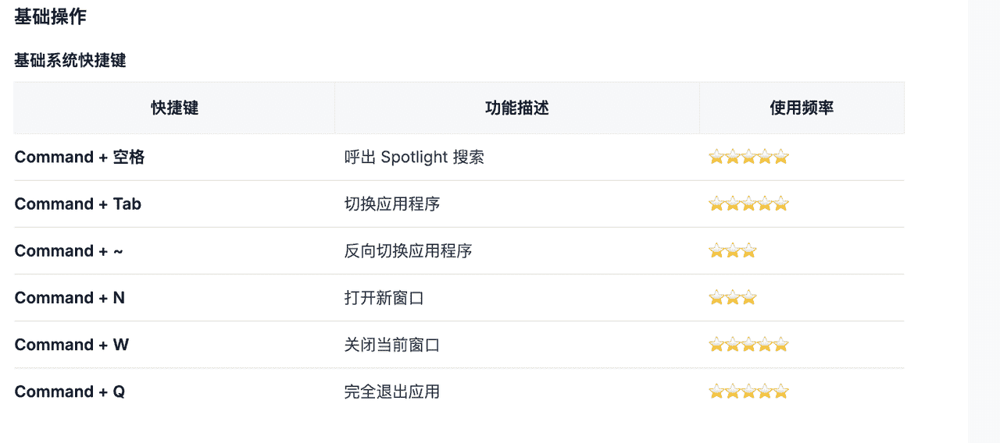

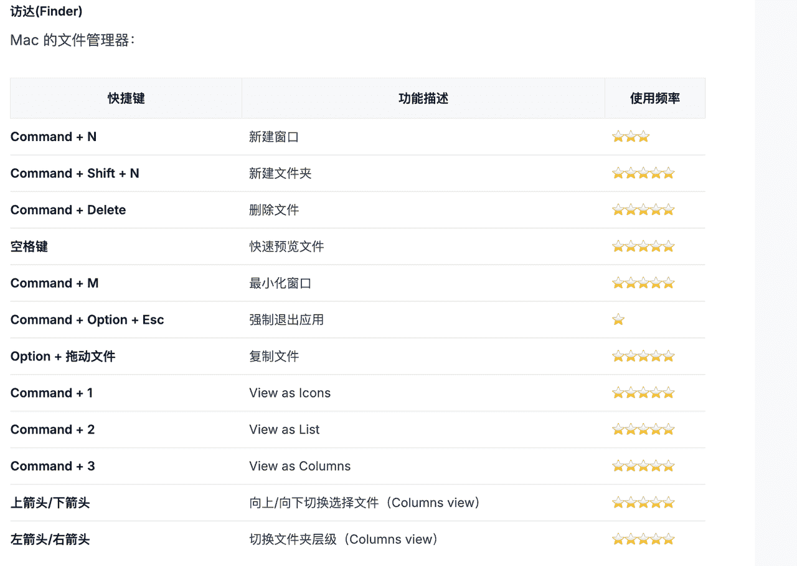

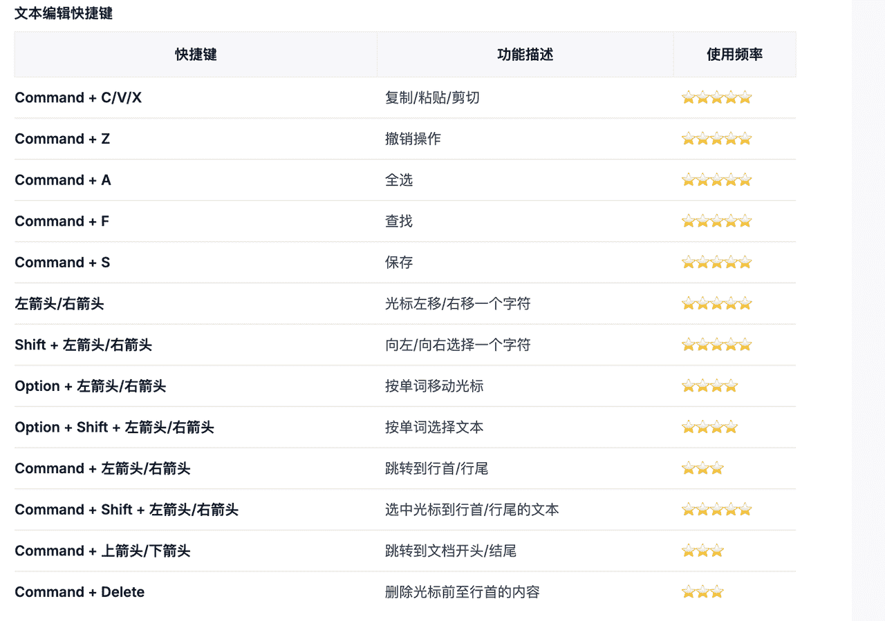

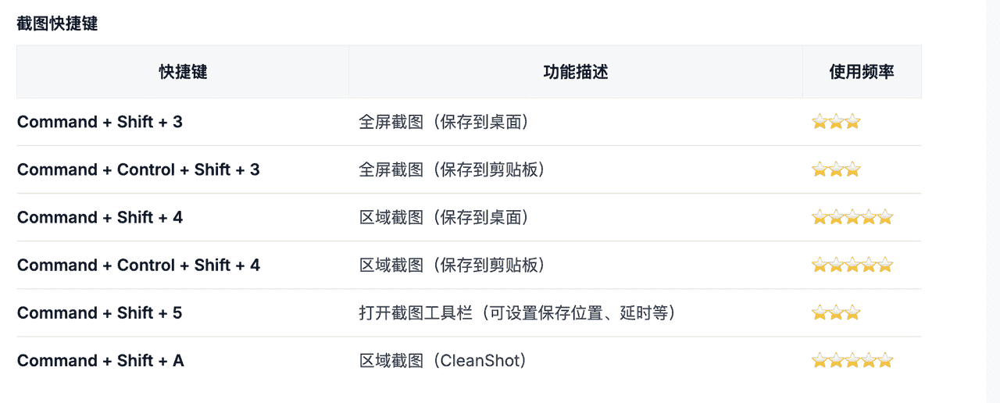

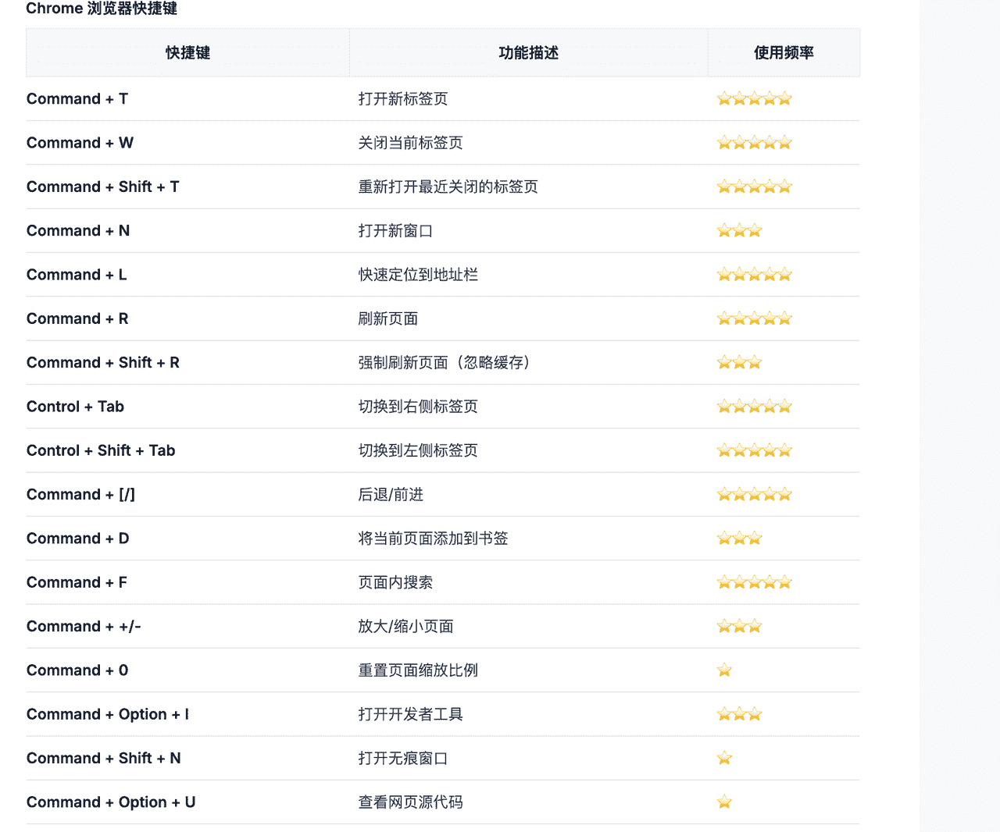

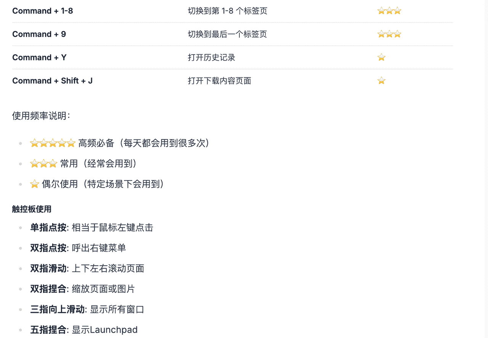

# 提高行动力的一些方法

+   发1000个视频就是100万，折算下来发一个视频就是一千块钱，只要计算自己，发一个视频就有一千块钱到账，自己的动力就大得多。

+   写下自己的欲望，比如想买什么东西，达成什么目标，这个目标写得黑暗一点也可以，欲望是人进步的动力，什么贪财好色，嫉妒仇恨，疯狂的爱恋，都是很好的动力来源。

这些听上去貌似不是那么多积极正统，但是确实是一个很好的动力来源。

写下来，不需要伤害任何人，我们只需要有这么一个动力来源去督促我们进步。有欲望是一种好事，无欲无求才是一件坏事，对于一个年轻人来说。

贪财、好色、嫉妒、虚荣……只要不伤人，这些全是顶级生产力。”

保持欲望，保持鲜活。就比如源神，自己坚持不下去了，就去看房子，就有了动力了。

+   用押金来督促自己，比如转几百块钱给自己的朋友，假如说晚上没有完成，没有剪出来一个视频，那么这个钱就归他所有。人就是这样，对于暂时没得到的东西，失去了无所谓。但是属于自己的东西，丢掉了那就心疼坏了。

# 未来的提效逻辑

## 多维表格

第一个是多维表格，现在我还不太会多维表格，但是我感觉多维表格用的B站好物当中，提效肯定也是很强的，自动抓取商品链接到表格当中，直接在多维表格当中生成封面图，生成最终稿。

多维表格也是很强大的工具，这期航海也有上，虽然没有报名，会打算去看一下航海手册和高手回放，然后再从B站上面搜索一些教程，各个大企业用AI最直接的方式就是在多维表格当中使用AI。、

## claude skills

另外就是`claude skills`，未来也是有机会应用到这个项目当中，可以看一下小排老师写的这两篇👸号文章，对`claude skills`的一些介绍。

`https://mp.weixin.qq.com/s/L5_LSgYfr98buRSYE7gC9g?scene=1`

`https://mp.weixin.qq.com/s/UjZAqvkfk8AzpOoK1KV0yw?scene=1`

前几天看到有一个人说，

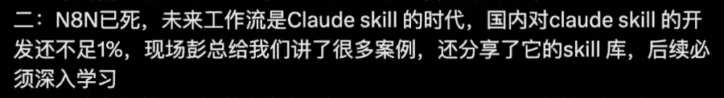

我觉得倒不至于`n8n`已死，但肯定是有比`n8n`强的一些地方。

## AI编程

AI编程的重要性就不言而喻了，我感觉AI的终局就是AI编程，玩AI的高手，如果说不懂一点AI编程，也不太好意思说自己是懂AI的高手。

自己的需求，自己最清楚，未来肯定会有很多人通过AI来创造属于自己一个人用的AI软件或者AI网站，帮助自己提效降本。

就像深海圈当中的破茧老哥，自己给自己做一个合适的B站剪辑软件，效率简直不要太高。
