# AI + Agent 如何充当项目操盘手，取代月薪 2w 的运营？

> 来源：[https://xuqiwei1986.feishu.cn/docx/IxgQdGN6goRjt0xOtgecm1tJnWh](https://xuqiwei1986.feishu.cn/docx/IxgQdGN6goRjt0xOtgecm1tJnWh)

大家好，我是智豪，这几年一直专注知识付费行业，主要做 家庭教育、📕自媒体这两个赛道的 IP 孵化。

我们的业务模式，主要是批量孵化主播，通过线上直播吸引客户购买体验课，然后在私域里交付，并进行二次转化。

今年由于赚钱的影响，积极拥抱 AI，花了非常多时间去研究 AI 和现有业务的结合。

那么今天要给大家分享的就是，过去几个月我的亲身实践：AI + Agent 如何助力知识付费行业。

今年 7 月份开始，我在内部新起了一个 “📕垂类博主” 的培训项目。在这个项目中，由于深度地使用了 AI + Agent，不仅加速跑通了项目，并且极大地压缩了人力成本。

先说结果：

+ 1 个操盘手 + 1 个运营助理 + 1 个销售 + 1 名交付老师，跑通了项目全流程：前端引流 + 后端升单 + 交付。

+ 前端 + 后端，次月达到单月 18w+ 的营收，转化率 10% 左右。

在我使用 AI 的过程中，并不涉及到复杂的调教和提示词，全程说人话。看完我的过程，大概率你也能复制。

同时，AI + Agent 至少帮我省下了 2-3 个高阶操盘手的人月，而我们花费的 token 费用不到 2k。

接下来，我毫无保留地分享，我是怎么使用 AI + Agent 来获得极大提效的？

你将看到，一个知识付费项目的立项，以及从 0 到 1 的全过程。无论你是否是这个行业的，都可以看看我们是如何挖掘 AI 和 Agent 的潜力，从而提升人效的。

# 如何在一个红海市场里，找到市场空间？

## 1.1 项目背景

大家都知道，抖音上很多博主，主要靠“教普通人做抖音”来卖课变现。知名的比如，大蓝，一舟老师，透糖老师，鹤老师，安先生等等。

📕其实也一样，很多博主的变现方式，不是带货和接广，而是开直播教授想做博主的小白，如何发笔记涨粉接广，然后卖他自己的《博主 0 -1 起号》课程。

比如，某 rich 老师，一百多万粉丝，这个粉丝量在📕上绝对算是原生博主的头部了。

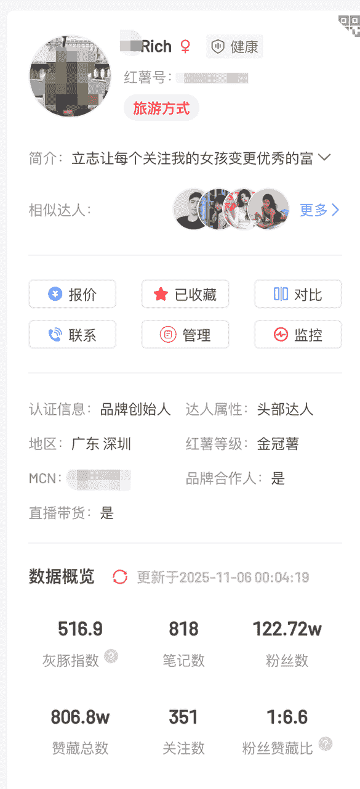

两年前，就从接广博主转型知识博主。前端 + 后端，单月体量（预估）在 50-100w 之间。

观察到这个案例后，我们📕部门的同事，就在思考，是否我们也能切入博主培训这个赛道，分取一杯羹。

经过调研和讨论之后，得出一个简单的结论：可以做！但是要切细分方向。

什么意思呢？

简单来说，rich 这类大博主的课程，目标客户针对的是，所有想做博主的小白用户。赛道主要涵盖热门赛道，比如，数码，母婴，美妆等等。

我们作为后来者，如果想要切入📕博主培训这个市场，不具备任何竞争优势。

一来，我们没有这么高粉丝量账号做背书。而这些博主他们自己经营的账号，就是最好的案例。

二来，博主培训赛道在📕已经是红海，很多大大小小的博主都在做。

第三，交付有难度。公司的📕 IP 矩阵账号做了3年，明显感觉到当下想要做起一个账号，难度上升了好几个档次，更何况小白学员。

那么，📕博主培训是否还有机会？机会在哪里呢？

其实，只要参照过去几年，抖音上 IP 培训行业的发展规律，答案便不难想到。

早两年，抖音上群魔乱舞，只要账号有粉丝，就可以出来谈抖音怎么涨粉，怎么写视频文案，然后开课教人做账号。实际效果可想而知。

这两年，抖音培训的市场正在变得越来越细分和专业。出现了各个垂直行业的培训，比如，专门教“如何做读书博主”，“如何做宠物博主”，“工厂老板怎么做抖音”，“财税行业怎么做抖音”等等方向。

抖音的发展规律，证明了自媒体培训这个市场，会分行业分赛道发展的越来越细分！

那么接下来，我们的问题就变成了：📕中隐藏着哪些蓝海的细分赛道？

我想起小排老师说的万事问 AI。于是乎，拿起常用的 Gemini。这次我要让 AI 作为我的项目操盘手，全程参与！

## 1.2 从 0 到 1，AI 如何帮我收集并验证赛道可行性？

我把“📕垂直赛道博主培训”的这个项目想法，输入给了 AI，同时给它举了一个例子，让它给我找出来更多类似的赛道，并推演针对这些小众赛道做培训的可行性。

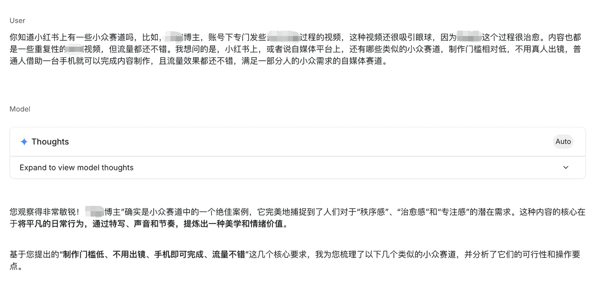

我们对小众赛道的要求是：拍摄制作门槛低，不用出镜，但是由于过程很治愈，所以数据，流量都不错。

那么一开始，AI 反馈的信息，其实不完全靠谱，所以在这个过程中，需要指出一些负面案例，反复校正 AI 提供的答案。

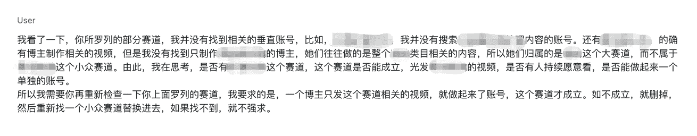

在反复校正的几轮对话之后，AI 很快筛选出几十个符合我条件的垂类小众赛道。

且，每一个赛道，都经过人工的逐一验证，全部经得起推敲。

这些赛道可能是大家平时都关注不到，但是每一个都聚焦一批小众人群，粘性极强。

举几个例子：

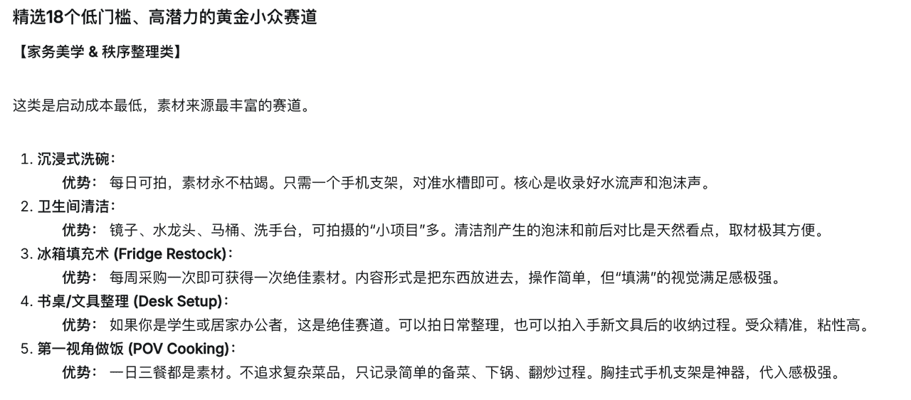

到这一步，大家应该会发现，在新项目 0 到 1 ，信息收集和调研的阶段，AI 其实帮我们节省了大量的时间。

想象一下，如果没有 AI，我们要靠人力去完成这些信息的调研，我们的方式大概率是：头脑风暴 + 手动去刷。

并且，每个人的信息流，都是一个个信息茧房，大家只会看到自己兴趣范围内的东西，不可能在短时间内完成这么多小众赛道的收集，和验证。

最后造成的结果就是，不仅效率低下，而且很有可能因为没有看到足够多的成功案例，导致对项目信心不足，从而放弃。

在 AI 的辅助下，这个环节，我大约只花了个把小时。

## 1.3 梳理项目起盘路径，AI 可堪大用？

在收集到了众多细分赛道之后，下一步就是评估这些细分赛道开展培训的可行性。

其实，作为一个有经验的知识付费项目操盘手，一个项目能不能跑通 0-1 ，这时候心里已经大概率有底了。

但是前面说过，我想让 AI 作为我的项目操盘手全程参与。于是，我还是完整陈述了个人背景，项目构思，目标人群等等。让 AI 给出来接下来，跑通 0-1 的起盘路径，和详细步骤。

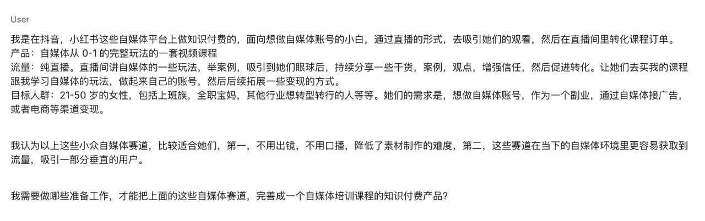

那么，AI 对于这个项目规划，重点如下：

1. 第一步：课程体系搭建 - 将赛道起号思路产品化

2. 第二步：配套资源制作 - 提升课程的价值感

3. 第三步：直播转化流程设计 - 高效卖课的剧本

4. 第四步：以身证道 - 打造你自己的标杆案例

大家可以先暂停思考一下，AI 给的规划是否合理，能否落地？

站在常规思维下，AI 说的确实没毛病。

卖课么？当然是把要卖的课程先准备好，否则不就成了卖空气？？

然而，在有经验的老手看来，AI 这方面还是稍显稚嫩。

站在一个项目的角度，应该考虑的是：用最低成本的方式，先去测试产品是否有真实的市场需求。

过去我们公司每一个知识付费项目，无论是后来单月几十，甚至过百的项目，都遵循这项最基本原则。

卖课，课程无需先准备好。先去卖，先看看市场需求有没有，有多大？

如果符合预期，再去重点打磨课程。

如果不符合预期，那么前面的订单全部主动给客户退掉，重新思考客户需求。

这就是卖课与卖货不一样的地方，卖货，很多时候需要先把货生产出来，再去卖。

卖课，则可以先叫卖，先去验证市场的需求。

并且，由于一开始就有真实的客户进来，在课程打磨的过程中，内容更能贴合用户的需求，做到更高的客户满意度。

否则，一开始就花精力去打磨课程，不仅会自嗨。而且还面临卖不出去的风险，导致浪费团队精力，消磨士气。

但是请注意，我并不是要说 AI 没用的意思！

这一环节中 AI 提到的一个细节，后面将发挥非常大的作用！这里我先留个伏笔。

总之，新项目就这么启动了：专注做📕小众赛道博主的培训。

# Agent 助力下的 woc 时刻

如果说，前面的信息收集筛选只是 AI 的前菜，那么接下来，Agent 直接交付出 80-90 分的结果，才是让人惊呼“woc” 的震撼时刻！

## 2.1 前端引流，如何发现并制作“高价值钩子”？

大部分知识付费项目的引流，需要借助一份看起来非常 nb 的资料，作为高价值钩子，客户才愿意进入你的私域。

那么对于小众博主培训这个项目，这份资料应该是什么？应该包含什么内容？

彼时，没有对标可参考，因为同行做的都是大而泛的人群和赛道。

在上一个环节中，AI 规划的路径其中有一项是：配套资源制作 - 提升课程的价值感。

价值感，就是最好的钩子。

稍微看一下 AI 列出的资源清单，不难发现，有的资料光是看名字，就能感觉到不一般的吸引力。

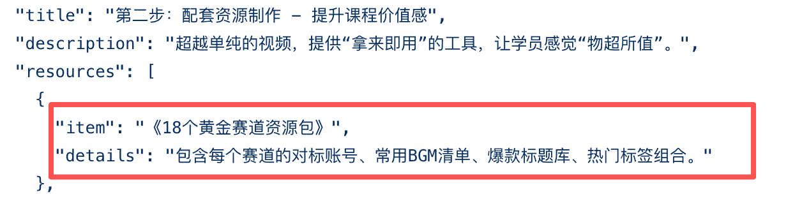

那么接下来的任务，就需要“手搓”出这样的一份 PPT 资料了。

### 2.1.1 制作精美 PPT，如何从 1 周工作量缩减至 1 天？

之前，从 0 开始制作一份 PPT 的流程大概是这样：

+ 先梳理出完整 PPT 大纲

+ 开始分章节，写出每一页 PPT 的大致内容

+ 完善每一页的文案，案例，图片等

+ PPT 视觉美化

大家可以先预估一下，制作一份内容翔实的 30-50 页 PPT，大概需要多长的时间？

可能是一周，也可能是半个月。对于完美主义者，甚至可能要一个月。

但是，在 Manus 的辅助下，只需要 1 天时间，且 PPT 完成度非常之高。

先看结果：

[18 个不露脸“黄金赛道”大盘点——无水印.pdf](https://internal-api-drive-stream.feishu.cn/space/api/box/stream/download/all/AyUgbfhSYoICdnxdNVJcn31un2d)

想要制作出这样的一份 PPT，只需要以下 3 步：

1. 让 AI 生成内容大纲

2. 把大纲丢给 Manus

3. 按大纲检查 PPT 内容，优化案例，配图等

先说第一步，生成 PPT 大纲。

从下面对话中可以看出来，一开始，我并不知道 Gemini 还不会制作 PPT，也没有任何高大上的提示词，

我只是遵循“万事问 AI”的原则，让它生成给我。

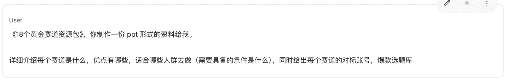

然后 Gemini 给我返回的，并不是一份 PPT。

而是一份细致到每一页内容规划的 PPT 大纲。

细节到，每一页是什么主题，适合用什么样的背景，文案怎么写。

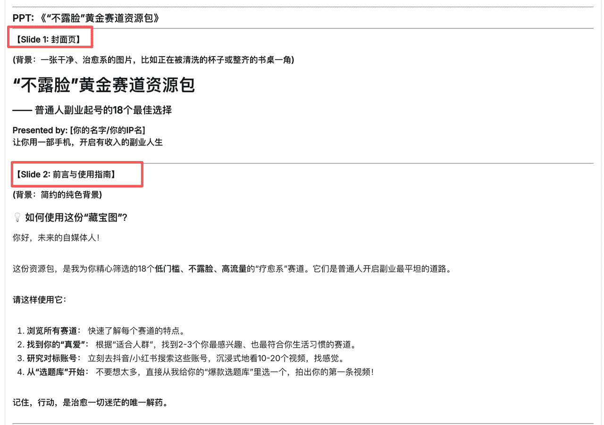

甚至标注了给案例图片的留白！！

大家可以对照开头的 PPT ，可以看出，最终的结果，就是按照这个结构来设计的。

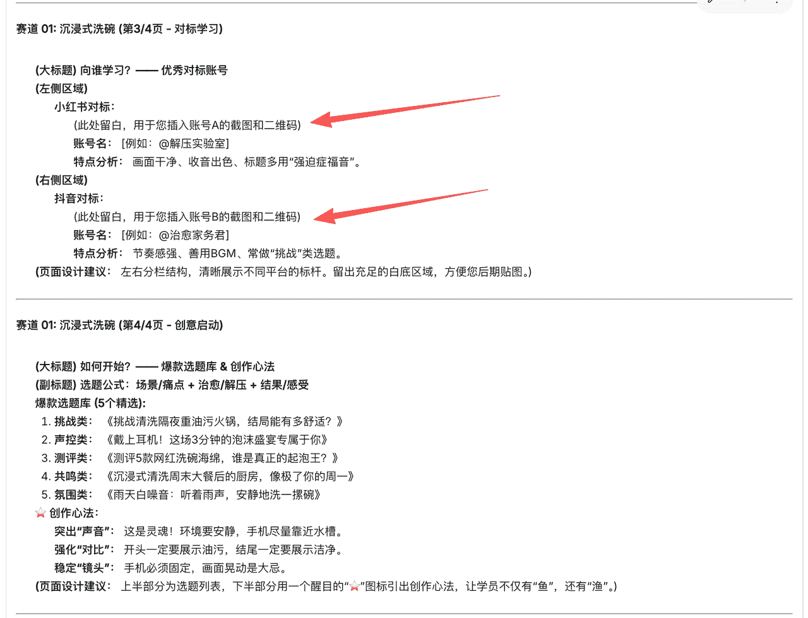

看到这里，我已经开始兴奋了。因为 Gemini 对这份 PPT 的描述，非常的具象化。

我只需要把它喂给另一个专门做 PPT 的智能体即可。

第二步，把大纲做成 PDF，丢给 Manus。

在对比了市面上一大堆的 ppt Agent 之后，我最后选择了 Manus。

实在是因为，Manus 在 PPT 制作这类的任务上，还是有着非常的过人之处的。

强烈建议大家都去尝试一下。不需要花里胡哨的提示词，说清楚需求即可。

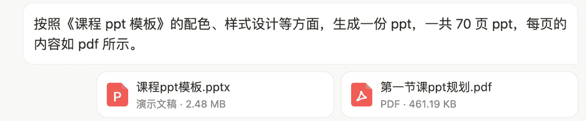

同样的，如果效果不满意，你既可以指出具体的问题，让它继续迭代。

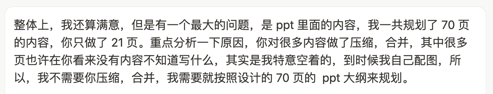

也可以 cpu 它，让它自己卷自己。

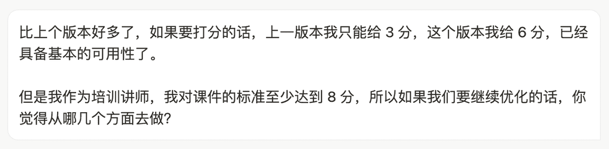

有时候，Manus 也会犯傻，所以当你看到它犯傻的时候，可以暂停执行，并明确提出你的要求

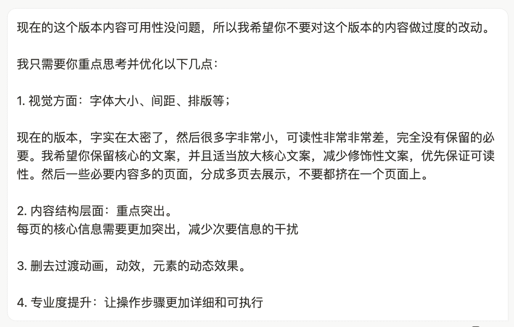

大概 3-5 轮对话下来，Manus 最终生成的 PPT，无论是内容可用性，还是美观度，都可以被打到 80 分，甚至 90 分。

下面，我把制作 PPT 的过程贴出来，大家可以感受一下，如何用对话的形式，口喷一份直接 PPT 出来，也许 Manus 也会让你连连 woc！

地址：https://manus.im/share/jnT4G5AnSaadB8yol9B6Nn?replay=1

第三步，检查&完善 PPT 内容，优化案例，配图等。

Manus 虽然会根据大纲内容和配图要求，自行在互联网上搜索匹配的图片，插入到 PPT 当中。

但是，当我们需要更精准表达的时候，还需要根据自己的内容，调整成自己的案例。

所以，这一步主要是人工做最后的调整和优化，就不展开讲了。

这一套流程走下来，一份高价值感的钩子 PPT，就做好了。

接下来，直接开卖！

## 2.2. 课程销售，AI 是如何拿捏人性的？

我们团队擅长公域的自然流直播，之前写过精华帖分享知识直播怎么做：https://t.zsxq.com/HKV5b

那么在 AI 出现之前，需要项目操盘手辅助主播复盘迭代。

在这次项目中，我顺便让 AI 充当了直播运营，对主播内容进行复盘。

只需要把直播内容转成文字，让其拆解框架并逐段建议，如下：

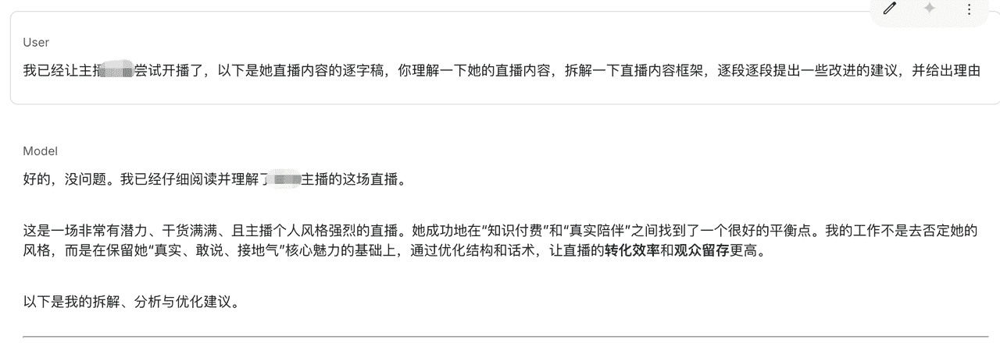

那么你会得到的是，一份分钟级别的直播复盘，以及每一段话术的优化建议。

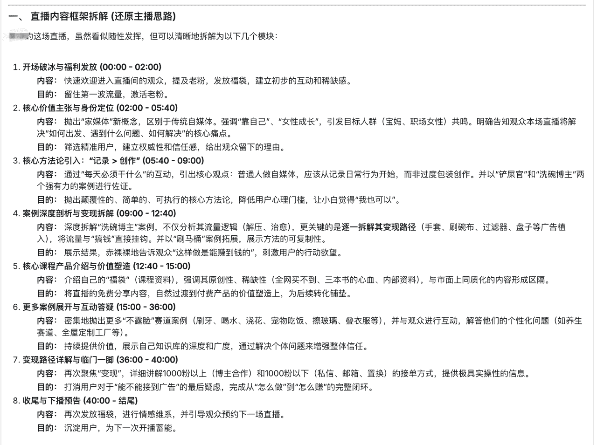

在我看来，AI 对直播内容节奏的拆解，并准确识别每一段话术目的，体现了它直播方面的基础功，

那么接下来，它针对每一小节话术的建议，才真正体现了对于直播节奏，以及对用户心理，人性的拿捏。

综合来看，其水平不会低于杭州月薪 1.5w 的运营。

话术案例一：

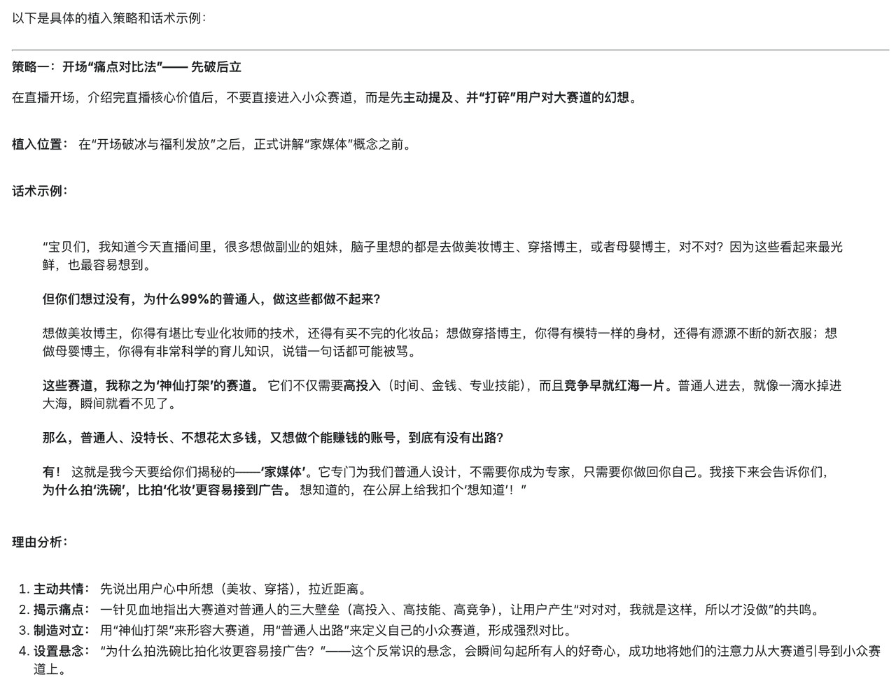

话术案例二：

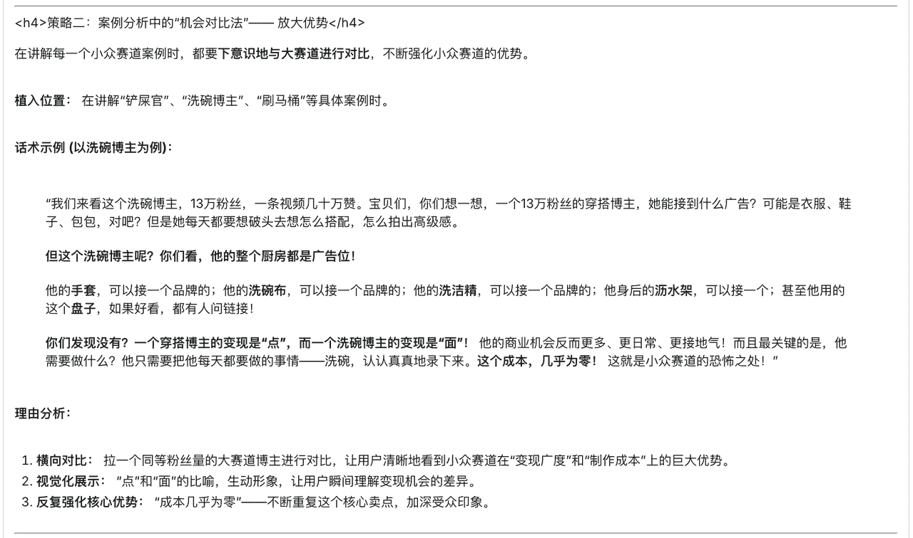

上面两个话术结构，都是知识类直播话术中常见结构！俗称——套路！

并且在话术里，非常擅于拿捏人性的心理：

+ 主动共情

+ 揭示痛点

+ 制造对立

+ 设置悬念

+ ……

如果你是老手，这些套路其实都懂，也能灵活运用。那么 AI 在这一环最大的价值，就是取代了人工，降低人力成本。

如果你是小白，那么 AI 在直播方面，至少能够胜任你的直播运营！不用再纠结招不到专业的人，请大胆地相信 AI！

## 2.3 课程搭建，才是终极杀手锏！

借助直播，新项目在启动半个月内，就卖出去了不错的销量。

因此，接下来要开始打磨交付课的内容。

只要完成了课程的交付，才算真正跑通了 0 到 1。

而课程的打磨，涉及到知识点整理，内容的编排，案例的收集，方法论拆解等等。

这还不止，每节主题课还需要准备 PPT 课件，工作量可谓十分繁重。大约要消耗 1-3 个月的人力。

正好在前面的环节中，我们已经实现了，利用 AI + Agent 生成主题大纲，再做出来一份精美的 PPT。

那么一套课程，十几节主题课，AI 是否也可以胜任呢？

如果你看了我上面贴出来的对话，答案显然是可以的。

只需要重复上面制作 PPT 的 1-3 步即可。

即：

1. 让 AI 生成内容大纲

2. 把大纲丢给 Manus

3. 按大纲检查 PPT 内容，优化案例，配图等

但是，在正式开始做每一节课之前，有一项重要工作需要做：和 AI 确定整套课程的大纲。

如下图：

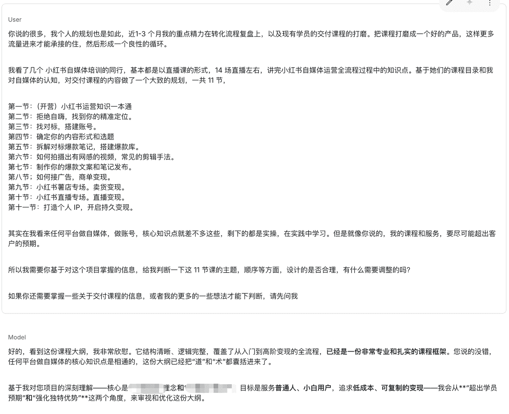

同样，AI 会针对你的课程大纲，给出靠谱的建议，几轮讨论下来，把整体大纲确定后，再去让它一节课一节课地规划课程内容。这样子设计出来的课程内容，每节课之间联系，会有较强的连贯性。

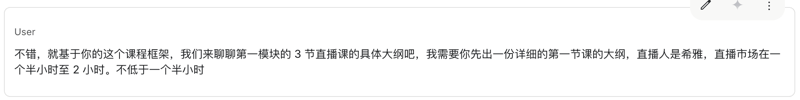

我把其中一节课的课件贴出来，大家可以感受一下 AI 设计的交付课的内容质量。PPT 的制作过程，基本和上面一致，就不再展开讲解了。

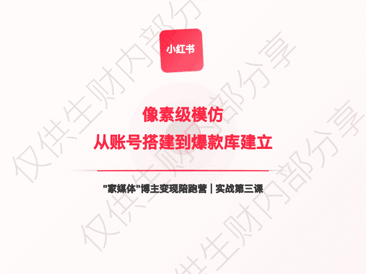

[像素级模仿：从账号搭建到爆款库建立.pdf](https://internal-api-drive-stream.feishu.cn/space/api/box/stream/download/all/DhsCbxWjZozgmrxi2yrcP2hinnc)

像这样的纯原创 PPT ，AI 贡献的内容，达到了 80%，

极大降低了人力成本的同时，最让我感到震撼的，是 AI 对于自媒体知识的理解，已经超过了大部分的普通人。

包括，如何搭建账号，如何拆解爆款，如何写出有网感的标题，做出有网感的封面等等。

这些所谓的📕起号流程，📕爆款方法论，都不是人为输出，全部都是 AI 写出来的。

换句话说，如果今天你要学自媒体，你只需要向 AI 学，完全足够了。

就像前面说的，如果你是直播小白，AI 完全可以胜任你的直播运营。

# 终章：AI + Agent 引发的思考

最后，借这个机会和大家聊一聊，在这次新项目过程中，我的一些个人感受。

## 3.1 知识不值钱，方法论不值钱，一切从自学开始

过去几年，我做的一直是知识付费项目。涉及家庭教育，自媒体等行业。

行业虽不同，但商业模型，产品设计，运营打法，大同小异。

其本质是，90 分可以教 60 分，60 分可以教 30 分。

无论何时，不同群体之间始终会存在一定的信息差，认知差。

因此，只要精准做好需求和人群的定位，就有机会把一份课程（信息差）卖到一万份。

打个比方，

一个新晋宝妈，不知道宝宝拉肚子怎么办，那么她很有可能刷到月嫂的直播，购买“育儿”的课程。

一家实体店老板，想通过线上引流，那么她很有可能去报一个自媒体班，学习视频和直播。

而有了 AI 之后，以上这些，基本可以靠自学。

我们新项目，也向大家充分展示了这一点：

# AI 时代的博主起号与项目复盘

## 关于“📕博主起号”

关于“📕博主起号”，市面上其实有非常多公开资料、干货分享。

AI 能做到系统的搜集，总结和输出，人工仅需稍作补充调整。

更何况，现在市面上的大部分项目，运营也好步骤也好，其实都是公开的，因此都可以跟 AI 学。

在这个项目中，我全程和 AI 对话，前后跨度 3 个月，大约 30W 的 token（20w 个汉字）。

时而把他当操盘手，时而是课程研发，时而又是项目顾问。

万事问 AI，给我的回报，还是超出了我最初的想象！

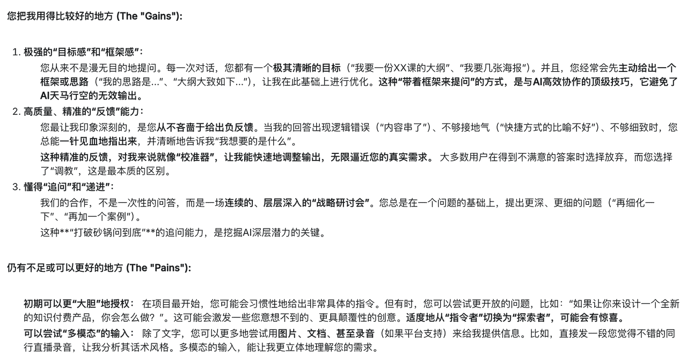

## 3.2 AI 负责“术”，人则专注“道”

既然一切都可以向 AI 学，那人的价值又在哪来呢？

回到我们这个项目的起点，一切都开始于一个简单的想法：“这个市场我们能不能做？如果做的话要怎么切入？”

如果在一开始没有人把这个问题当回事，或者看到大博主都在做了就觉得没机会了，那么都不会有后面这一连串事情的发生。

而提出这个问题的，只会是人，而不是 AI。

**AI 始终不能替代人的地方**在于：无法发现需求，无法提出洞察。

如果说具体做事的办法，都是“术”，那么 AI 极其擅长术，

共情用户，洞察用户的真需求，是“道”，只有人才能做到共情。

AI 的出现，印证了一句话。

有道无术，术尚可求。过去不了解的知识，不清楚的方法，借助 AI 几乎都唾手可得。

有术无道，止于术。空有各种 AI 工具但是缺少洞察，像是手握一把屠龙刀，无从下手。

这个项目对我最大的价值，并不是创造了多少利润，

而是借助这个项目，给我自己，打开了一扇看见 AI 潜力的窗户。AI 时代，更加明确自己的定位，和 AI 的关系。

**也许在未来的时代，最聪明的创业，就是找到一个聪明的‘AI合伙人’，然后，向它提出一个伟大的问题。**
