# 47 岁大叔，尝试无数个第一次，从电脑小白到抖音自然流CPS航海GMV 突破 83 万

> 来源：[https://xuqiwei1986.feishu.cn/docx/OVWkdUgEZoc1jUxY4dicoRFbnDA](https://xuqiwei1986.feishu.cn/docx/OVWkdUgEZoc1jUxY4dicoRFbnDA)

# 前言

各位圈友好，我是平凡之路。

47 岁，做了 23 年服装实体店，钓了半辈子鱼，电脑水平停留在能开机就不错的程度。

前段时间，我遇到了一件超出我人生想象范围的事，那种程度让我连最爱的钓鱼都暂时放在了一边。那就是：

**10**** 月 ****16**** ****号加入生财**

**10**** 月 ****21**** ****号参加第一次航海**

**10**** 月 ****31号挣到第一单佣金**** ****0.01**** ****元**

**11**** 月 ****14号****抖音 CPS 的 ****GMV**** 突破 ****83**** ****万**

我常说，那一分钱不是钱，那是一个我从未想象过的世界正在对我打开门。

# 一、47 岁的小白大叔，第一次靠近新世界的大门

今年47岁，电脑知识小白，来自河南兰考县，焦裕禄精神的发源地。

从02年就开始做服装实体店，从一家23平的平价店铺做到现在的6个品牌15家店铺，我用了整整23年的时间。

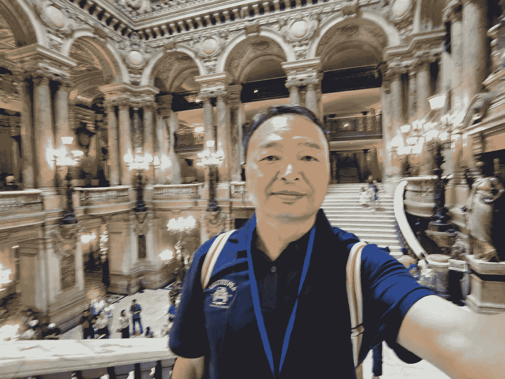

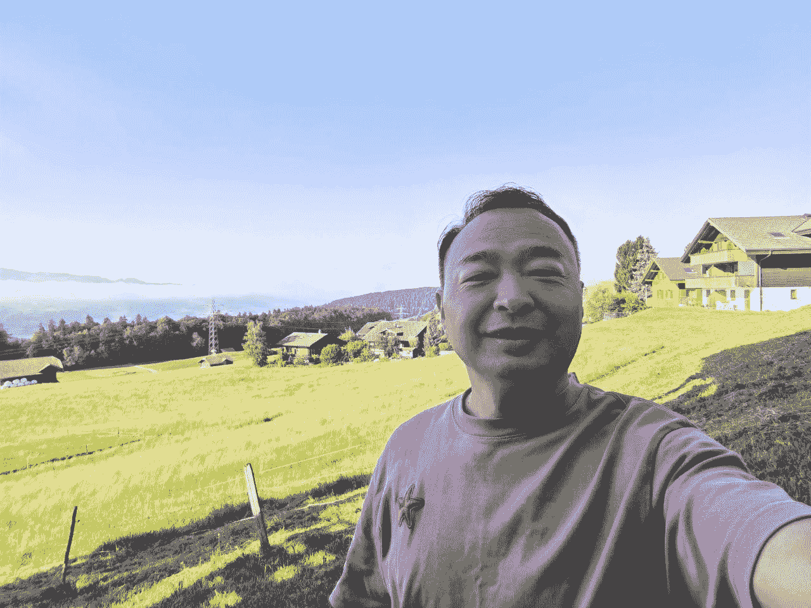

从来没有考虑过副业，更未挣到过副业的一分钱。业余时间就钓鱼消遣一下。

这两年来，随着经济的下行，我们实体店越来越难做了，公司给的压力也越来越大。进店客流越来越小，库存越来越多。我第一次意识到：

如果我不拥抱新事物，未来可能真的撑不住了。

我也被逼走出了自己的舒适圈，想办法改变自己，学习拥抱新零售。想学习怎么通过线上引流，想学习怎么直播带货，想学习怎样打造自己店铺的公众号，培养并服务好自己的顾客。

于是就开始蹲抖音上相关大佬的直播间，花钱加入了年会员并进入了会员群，在群里大佬每天都会发些文章，自己都会仔细拜读，发现这些文章的确都挺好的，但内容大多不完整，并且大部分都来自于一个叫 生财有术知识星球 的地方。于是自己上网搜索生财有术并联系了@纪钟教练，参加了10.13-15的三天体验营。

这三天改变了我的认知：**在这个时代竟然还有人毫无私心地教大家怎么去赚钱，并把赚钱的办法分享给大**家，竟然还可以不通过实物的买与卖赚钱，竟然还可以仅凭一部手机通过各种APP赚钱。

讲真话，这三天的经历对于我太震撼了，直到体验营结束，我还没有从震惊中恢复过来。

那一刻，我第一次意识到，我过去的人生，被自己限制得太死了。

我仿佛看到生财给我打开通往另一个财富世界大门，打通了赚钱的通道[呲牙]于是毫不犹豫加入了生财这个大家庭，并且有幸抢到了 怡然 教练的抖音CPS的船票。

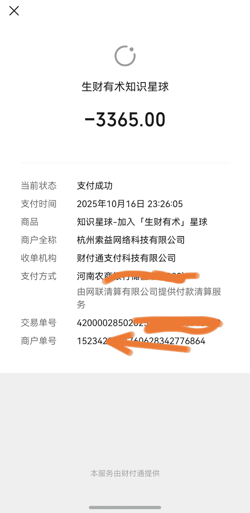

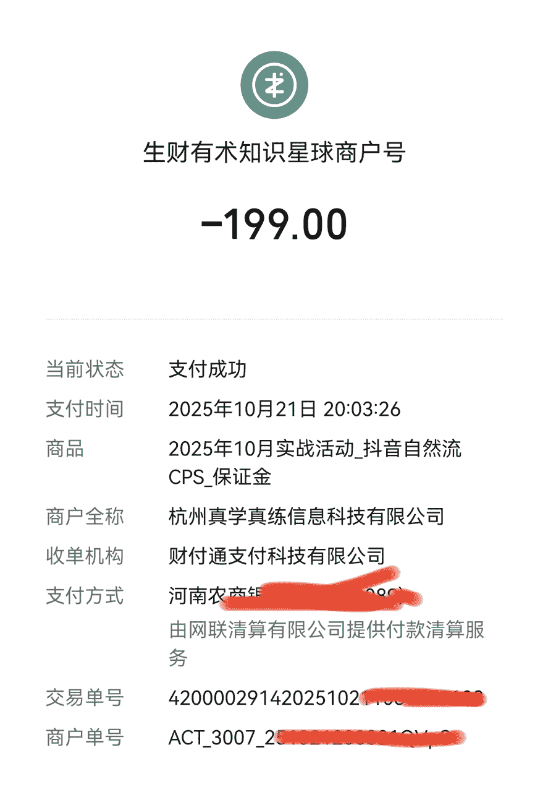

# 二、在航海里，我被迫直面无数个第一次

## （一）刚加入生财，有些迷茫

刚加入生财后，看了好多帖子，看到好多项目圈友都挣到了钱，我白天夜里一有时间就看帖子，觉自己以前钓鱼的时间都浪费了，非常后悔！

感觉每一部帖子都是干货满满，都是商机。感触最深的是一个宝妈在小红书上零基础进入，三个月的时间买课收入30W。这篇文章深深触动了我：自己有23年的零售实践与经验，难道不能变现吗？

但是随着看的帖子越来越多，我的困惑也越来越大。感觉每一个项目都很高端上档次，但每一个项目我都落地不了。因为很多项目动不动就是编程，就是AI,就是海外。我英语水平大概只有26个字母还会，更别提编程与出海了。到现在我连 谷歌 浏览器都不会下载，更别提翻墙了。甚至连自己加入生财的最初目的，引流与转换都不知道应该如何去做了。

**我甚至一度想退费：“算了，我还是回去**老老实实做我的服装吧。”或许自己不应该眼馋与羡慕别人赚各种快钱，因为自己是一个47岁的小白大叔！（苦笑）

但自己就是不知道该从哪下手？好在咱们的鱼丸比较负责，及时与我沟通并分析现状，并提出合理建议。正当我像无头的苍蝇乱逛时，我加入生财后的第一缕光它来了。

怡然教练的抖音自然流CPS航海马上就要出海了。我想反正哪个赛道我都不懂，光看也看不出花来，不如加入一次航海试试，看看圈友都是怎么做的。况且 怡然教练在这方面是大那，航海介绍也说了，0基础小白也可以参加。并且船票只需199元。

我想：“反正每个赛道我都不懂，不如上船试试。”没想到，这个决定彻底改变了我后面一个月的人生。当时压根也没敢想自己能出单，并不要说业绩做到500返船票了。

## （二）先说说我的成果吧

从10.31号挣到我人生副业的第一个 一分钱到11.11号当天GMP到37万，截止到14号，共计15天GMV破83万。

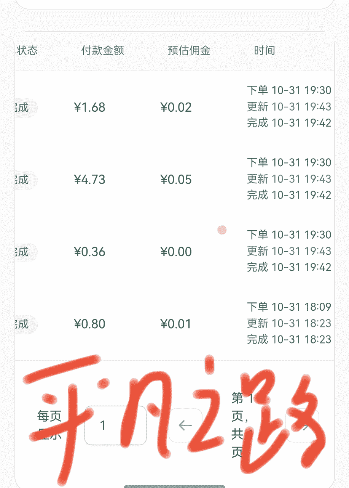

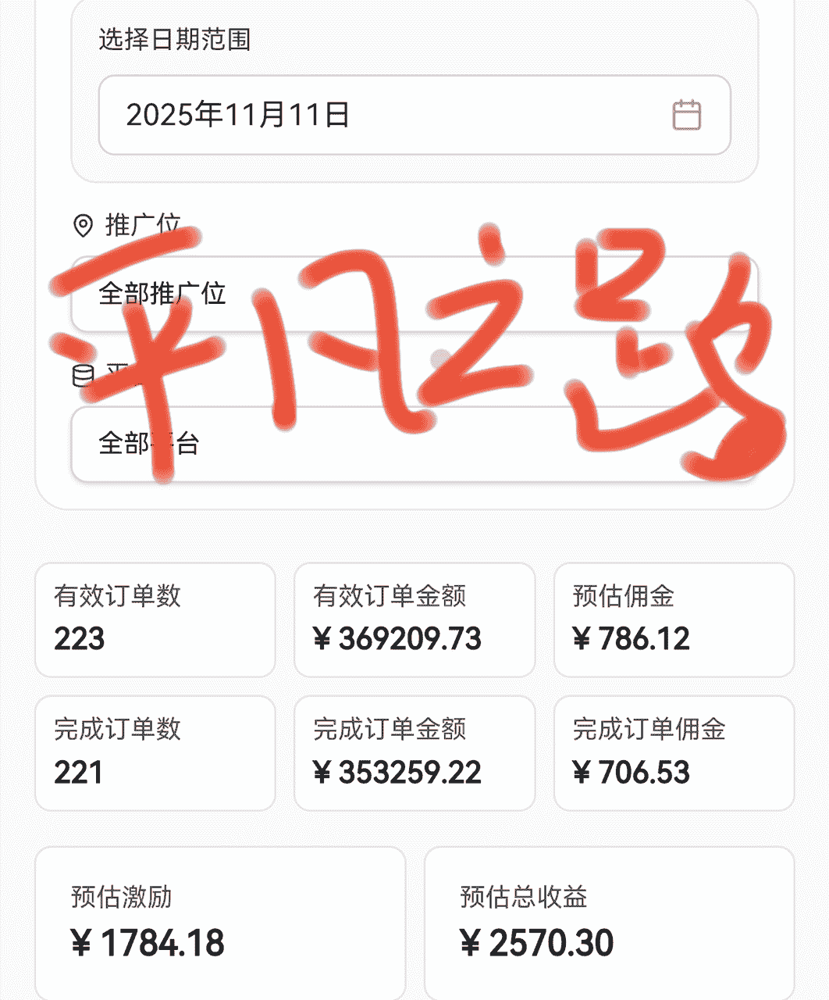

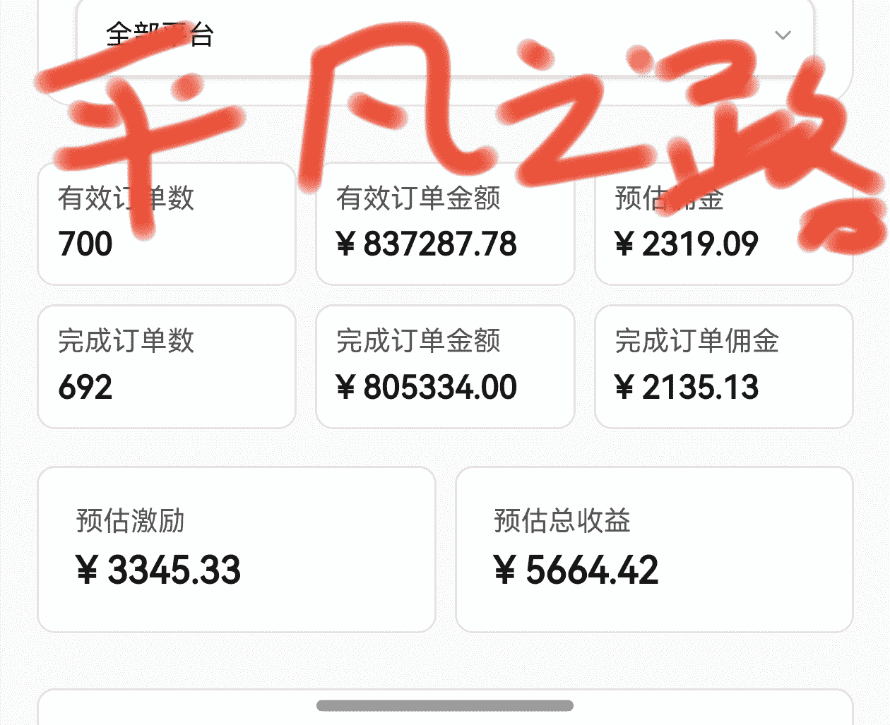

## （三）我的航海历程

10月27号晚8:00点开船，到11月17晚8:00靠岸，共计21天。

#### 无从下手(10.27--10.29)

开船前，看了各位圈友的自我介绍，非常的羡慕佩服他们，各个行业的翘楚都在，心中非常激动，更加庆幸自己加入了生财，才能近距离接触到这些大佬。但自己内心也更加惶恐不安了，他们说的我都不懂，我还以为船员都是像我一样的小白呢。

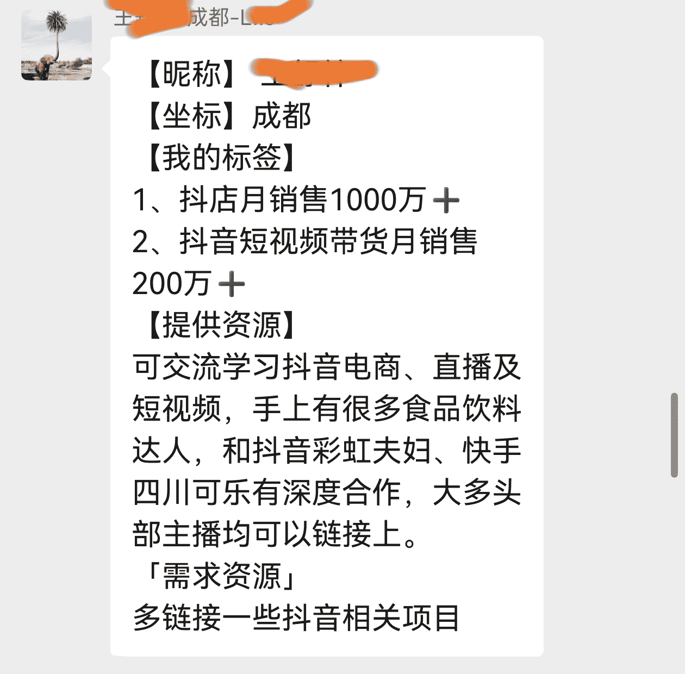

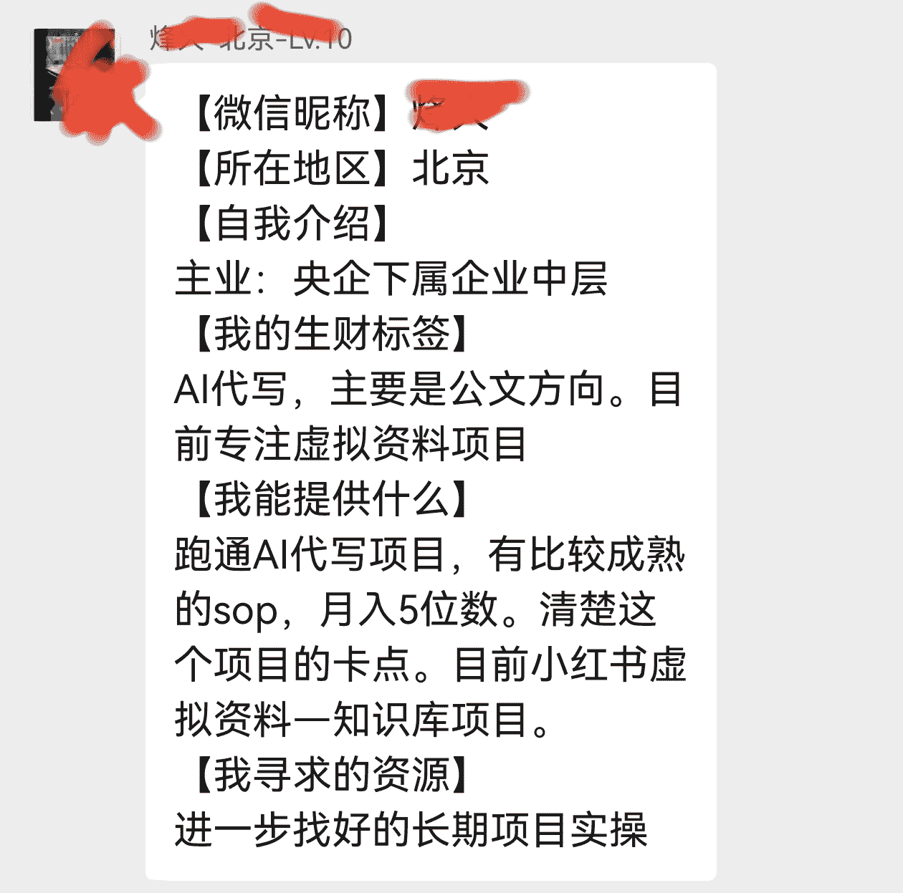

27号开船仪式，当晚心情非常激动。虽然教练讲的专业知识听不懂，但是我记住了 怡然教练 的一句话：不会不懂没有关系，你只要按照教练讲的去做就行了，做了就比不做强。

接下来两天，就按航海手册上讲的做：就是疯狂找对标账号，学习剪映。但是因为从未了解过视频剪辑，第一次进去看到这个复杂的操作面板，整个人都是懵的：

视频怎么分段？

字幕在哪加？

调色是什么？

导出后文件去哪了？

面对一块不到 13 寸的屏幕，感觉比面对 200 平米服装仓库还无力。最后，也没做出一条视频（主要是自己没有愿力与驱动力，想着时间还长着呢）。

#### 那一天，我从晚上 8 点剪到凌晨 5 点 (10.29--10.30)

直到29号第二次直播，教练说好多船员都出作品并且拿到了不错的成绩，自己才慌了神，想着无论如何不能做个落后分子拖大家的后腿，决定无论如何也得把第一条视频做出来。

白天没有时间就晚上加班，30号晚上8点多，自己一个人躲到书房，静下心来剪辑视频，奈何眼高手低底子差，一直卡壳，遇到哪里不会就现场看帖子看视频，实在弄不懂的就问教练。

例如，剪辑好视频导出后文件在哪里自己都找不到，还是土豆教练告诉我的（苦笑），即使自己也看帖子也自学剪辑，但大多数问题疑惑还是土豆教练给我答复的，真的算是我在这方面的第一位老师了。

在此重点感谢土豆教练，第一个视频能成功出炉，都是在土豆教练的帮助下诞生的，一直到凌晨两三点，土豆教练还在给我答疑解惑，真心感谢🙏

终于31号凌晨5点，历时9个多小时第一个视频发出来了。除了坐的腰酸屁股疼，自己感觉一点都不困，精神处于极度亢奋的状态。

**自己终于迈出了在生财的第一步，无论结果如何，对我来**说就是成功了。因为我行动了，就是进步了！

#### 第二天，我等来人生第一笔副业收入：0.01 元 (10.31--11.8)

####

接下来那一整个白天，我几乎什么事都没干成，隔几分钟就忍不住刷新一下后台——浏览量有没有涨？有没有新的点赞？会不会突然有订单？眼睛都快粘在屏幕上了。从清晨到傍晚，订单数始终稳稳地停在那一个刺眼的“0”上。

可说来也怪，我居然一点也不觉得沮丧。哪怕只是看到一个陌生的点赞，或者发现浏览量又可怜巴巴地往上爬了一两个，都能让我一个人对着屏幕傻乐半天，感觉心血没有白费。

就在下午6:09，一个我反复刷新了无数次的时刻，毫无征兆地，第一笔订单，来了！

**佣金显示：0.01元。**

我先是愣了一下，随后忍不住一个人放声大笑起来。一边笑，一边在心里自嘲：“就这么一分钱，也值得你这么高兴？真没出息！”可嘴角就是不受控制地往上扬。

你可能不理解，这一分钱，我等了将近十个小时。它不只是我在新领域里赚到的第一分钱，更像是一道终于透进来的光，结结实实地告诉我：你选的这条路，没有错；你所有的坚持和笨拙的尝试，都值得。

就像亦仁大佬说的那样：副业一小步，人生一大步。意义非凡！

在此感谢 亦仁大佬的肯定 怡然教练的认可 海宇教练的鼓励  土豆教练的帮助

**这一分钱****让我有了前进的动力与信念！****我仍然拥有无限可能！**

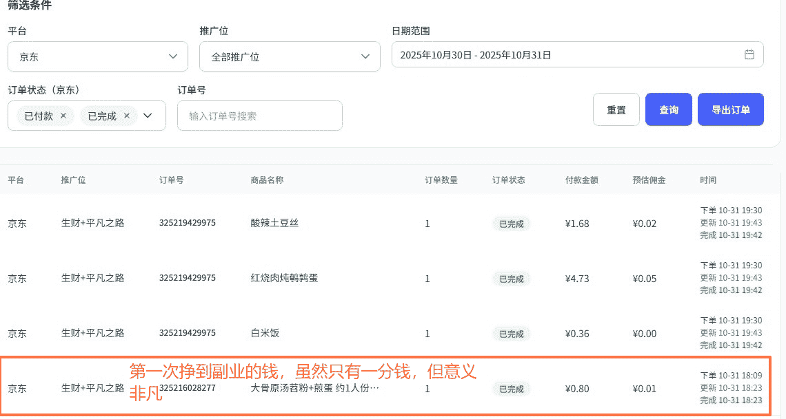

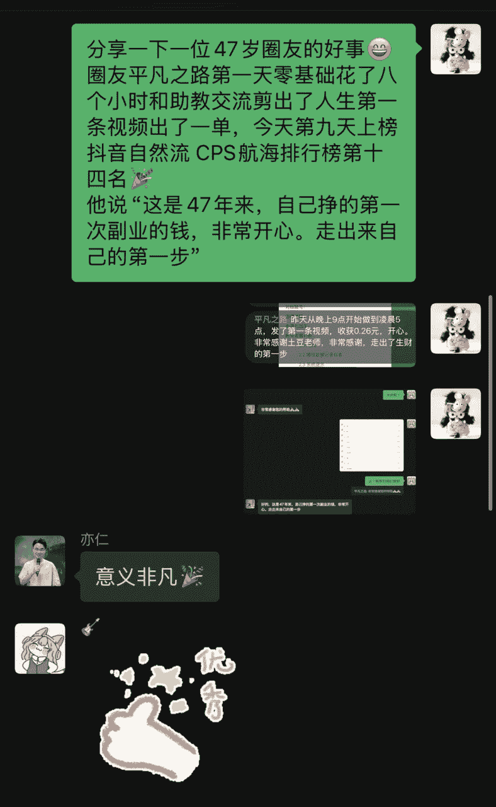

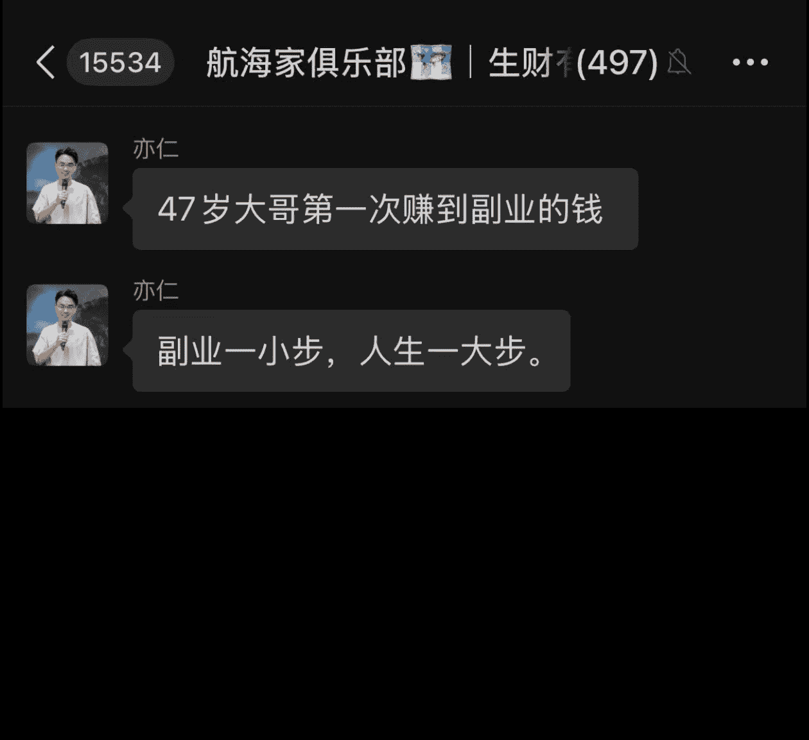

#### 我开始一天一个视频，从外卖切到手机，爆了 (10.31--11.8)

于是，我就像上了发条一样，浑身是劲儿，几乎雷打不动地坚持一天更新一个视频。您可别嫌慢，我是零基础起步，一切从零手搓，每个视频从找素材、写文案到剪辑、配音，全是自己一点点摸索着来。那段时间，常常一坐就是三五个小时，夜深了还在反复修改，就为了一个细节能更顺眼一点。

慢慢地，我把内容重心从外卖转到了手机上。没想到，这一转，竟真的转出了点光亮。

+   11 月 4 日一个手机视频小爆：GMV 4.3 万

+   11 月 8 日再次爆：GMV 10.5 万

我那颗心啊，怦怦直跳，对着后台数据反复确认了好几遍。还没等激动的心情完全平复，又一个视频爆了。

那一刻，我真切地感觉到：手里这把“老锄头”，终于刨对地方了。作为一个47岁才开始摸索副业的中年大叔，这点小小的成绩，带来的不只是数据，更是一种“原来我也能行”的笃定与安慰。

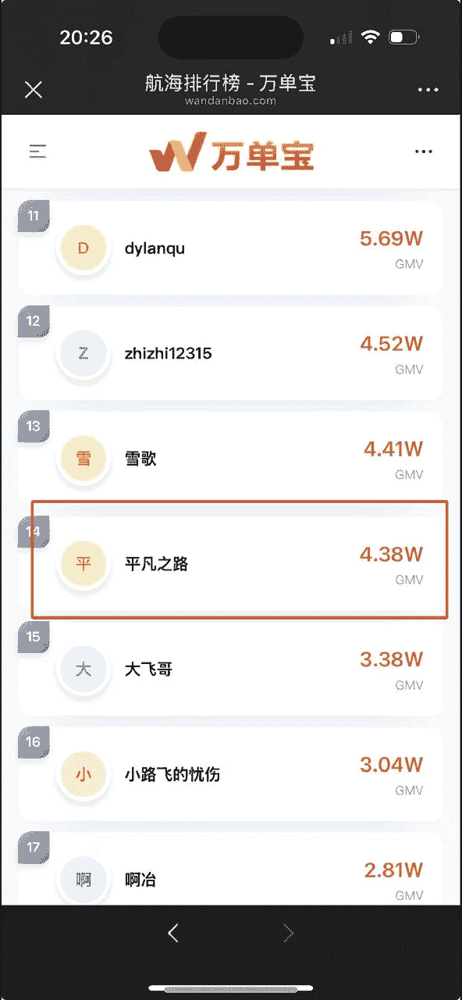

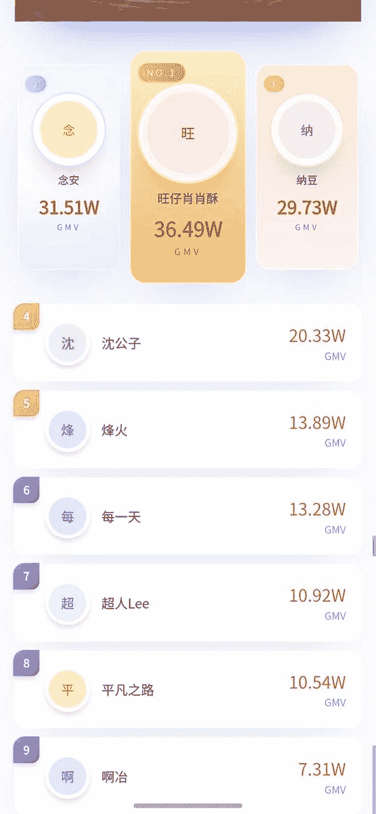

#### 双 11：迎来业绩爆发（11.9--11.13）

随着双11的到来，苹果也上市售卖，自己也按照教练的要求调整了打法：先看对标近期爆款，自己再修饰改动，以自己的风格做出来。终于在双十一当天迎来了高峰，当天GMV突破37万，排名第三。

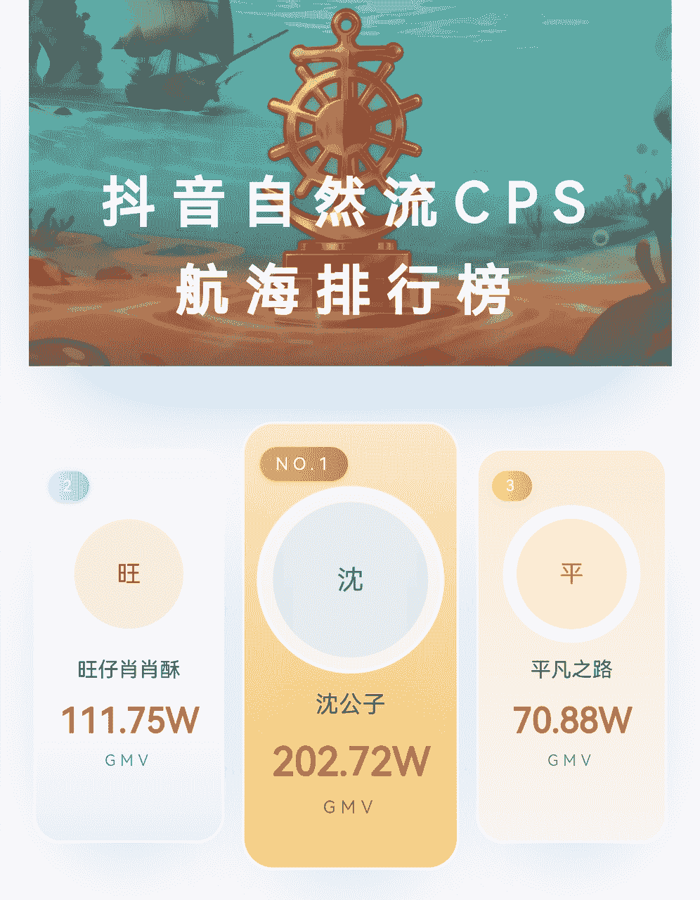

#### 稳定心态，继续前行（11.14-11.17）

双十一的热度慢慢降温，每天的业绩也慢慢下滑，自己又把外卖推广捡回来了。每天有空的时候就考虑自己现在应该怎么做，虽然外卖佣金低，有终归好过没有吧，后期陆陆续续又做了13万左右。

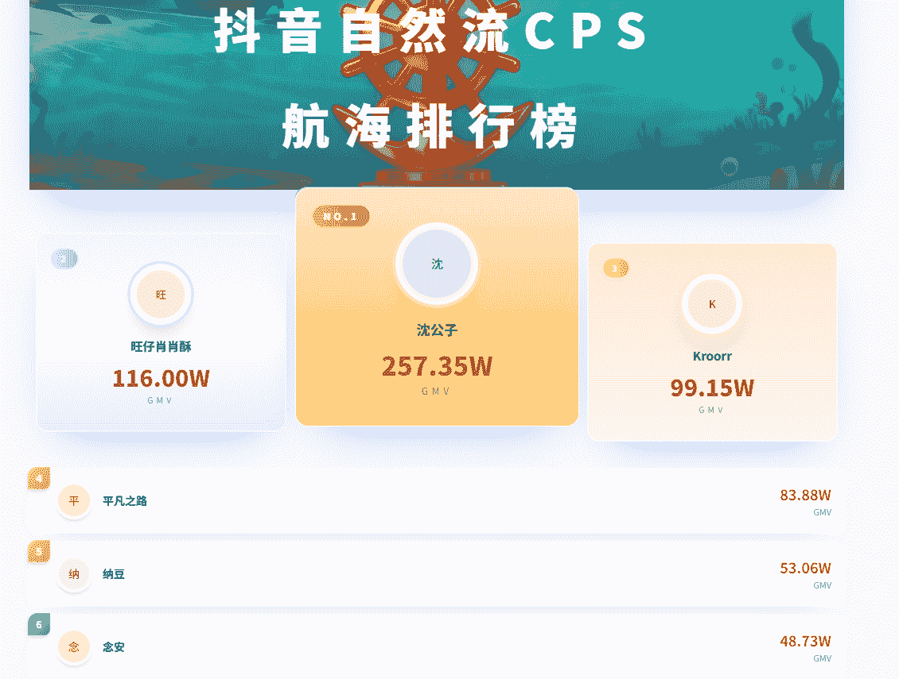

# 三、航海结束后，我反复问自己：我最想告诉大家什么？

**首先感谢自己的勇气与执行力****！**

我不是最努力的，不是最聪明的，不是技术最好的人。但是愿意去行动，愿意去尝试各种第一次。

过去一个月，我跨过了人生里的多个“第一次”：

第一次见识到生财氛围

第一次接触非实体行业

第一次用剪映剪视频

第一次学习那么多新事物

第一次靠手机赚到副业钱

第一次受到那么多人的帮助.....

这么多“第一次”堆在一起，构成了我最想告诉大家的那句话：去尝试，迈向新事物的那一刻，你的人生就重新拥有了无限可能。

每个人都会年纪增长，每个人都想呆在自己的舒适圈。如果我能和之前的自己对话，我想说：

+   不要把自己关在原来的世界。少钓点鱼吧！

+   学会接受新的事物与观点

+   不要因为起点，就否定可能性

+   当你对某件事情认可后，就去学习并去做，不要怕做错，做了永远比原地踏步强

+   遇到好的教练团队，可以起到事半功倍的效果，一群正能量的人更能有好的结果。

在这里，我要衷心感谢教练团队的帮助与鼓励，感谢圈友们的有问必答！

庆幸自己第一次航海就能取得结果，得到的都是圈友们的正反馈。

就像海宇教练讲的那样：有人一起同行，互相支持和鼓励，是我们本次航海的能量源泉！

最后，再次感谢那个在 47 岁仍愿意尝试新事物的自己。

**愿每位圈友都能走通 0—1，**

愿你们的人生里，也能出现那一道 0.01 元的光。