# 大龄程序员“偷时间”做B站好物，每天一个半小时，依然可以月入过万！

> 来源：[`https://xuqiwei1986.feishu.cn/docx/YIbzdky90oXEwZxkPPJckadOnQg`](https://xuqiwei1986.feishu.cn/docx/YIbzdky90oXEwZxkPPJckadOnQg)

## 前言

哈喽，大家好，我叫辰木，我是：

+   年过40的大龄程序员；

+   INTJ；

+   加入赚钱5年，没有特别大的成绩，但平均每年也能有10W的副业收入。

今年下半年参加B站好物的深海圈，目前副业的全部精力都投入在了B站好物，双十一期间的收入差不多在2W左右，虽然不是什么特别傲人的成绩，但基本上也符合我的预期。

而且，可能由于自己是程序员+INTJ的原因，在时间规划、工具提效方面，我经常会有一些“鬼点子”，我在本职工作已经占了全天绝大部分时间的前提下（早上7点出门，晚上7点半到家、11点必须睡觉），依然可以保持稳定的输出。

**我的一些方式方法，应该会对同样是还在白天**上班、晚上回家做副业的圈友，有一些帮助。

## 一、大龄程序员，每天“偷时间”做副业

### 今日头条：沉浸在简单的快乐之中不能自拔

第一份副业做的是头条号的问答，差不多是16、17年，当时号称要对标知乎，平台会按照你回答内容的阅读量给钱（这个业务在2020年左右就被头条砍掉了）。

我做的是一个软件开发类的账号，最多的时候，一个月差不多挣四五千吧，那时候工资也才两万，副业能挣四五千已经很满足了。

做了一年，后来头条的问答社区没做起来，平台不再扶持了，流量骤降，我也就没再做了，前一天还能日入两三百，第二天就没钱赚了。

不过做这个过程中，我有几点收获：

1）选对领域很重要（也就是选品）

我在今日头条上发软件开发的内容，看到人很少，也不知道引流，这一步就走错了。当时历史、军事类的账号，收入是我的三四倍，但是我自己觉得对这些领域都没接触过，肯定写不好，就这么错过了。

2）尽量不要做一份投入一份回报的工作

回答一道题，挣一份儿钱，如果哪天没有回答，第二天就没收入，边际成本太高，尽量不要沉浸在这种“快乐”当中，而是要想办法流程化、自动化，让工具和AI帮你完成这些工作。

### 知乎好物：真正的税收收入

头条这个项目结束之后，我就开始四处找副业项目来做，在这个过程中知道了赚钱，这个时候我已经有了知识付费的意识，所以果断加入了赚钱，也正好赶上了赚钱的知乎好物小航海，带队的是家蒙老师。

按照当时知乎好物的逻辑，只要你的文章能排在关键词搜索的前几位，那真的是可以到“躺挣”，当时我有几个选品能排在搜索的前三位，所以收入还是不错的。

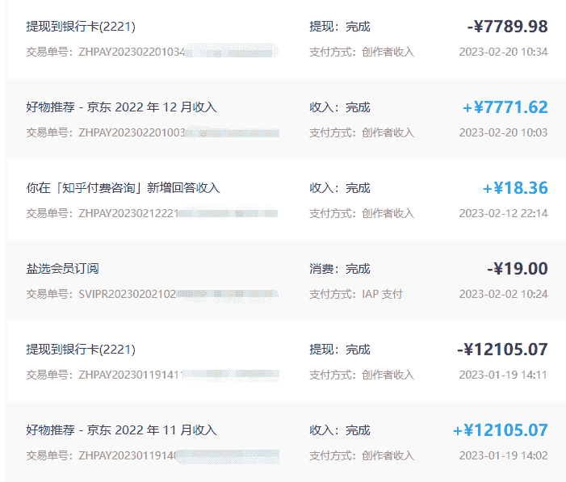

在这个过程中，我的几点收获：

**1）选品，还是选品**

虽然我有几个品类的搜索排名还不错，但是这些品类的流量、客单价和佣金都很低，所以这就决定了我的收入上限；不过也多亏这些品类，流量虽然低，但是竞争确实也小，所以能让我晚进场一年的情况下，依然喝到了汤。

**2）多账号，用数量撞概率**

我前后做了三个账号，后面两个账号，比第一个账号还晚一年，入场太晚，没有挣到多少钱。现在我反思，在看好这个项目的那一刻，在自己时间和精力允许的情况下，就应该尽可能多账号投入，测试更多的品。很多时候，不是你做的比别人好，真的就是因为做的早。

### 百家号：🛰️群“捡来”的副业

在一个全是博主的群里，看到一个百家号博主的晒单，月收入差不多一万多，但是他小心地隐去了自己账号，生怕别人知道他发的什么内容。

**嗯，是的，不少博主都不会告诉**自己的账号是什么，因为很容易引起恶性竞争，甚至有些人会举报你。不过我还是把他的号挖了出来（有时候感觉自己像个侦探），他的号主要是发心灵鸡汤的视频，靠着播放量挣钱，顺便带货卖书。

没想到这种“粗制滥造”的视频，在百家号的流量这么好！我看到他账号的第一眼，就知道：这个账号可以模仿，并且可以用软件+ RPA机器人，批量做视频。

然后我赶紧注册账号，跑通流程，再对整个流程进行拆解，有些步骤可以通过程序完成，剩下的我都写了RPA机器人脚本，整个流程基本做到了自动化。三个号，每个号每天发15个视频，只需要30分钟。

当年三天跑通全流程，6月份开始发视频，7月份开始有收益，3个号的收入加起来，每个月差不多一万多，而我每天花费的时间，只需要半个小时，这个项目差不多吃了一年。

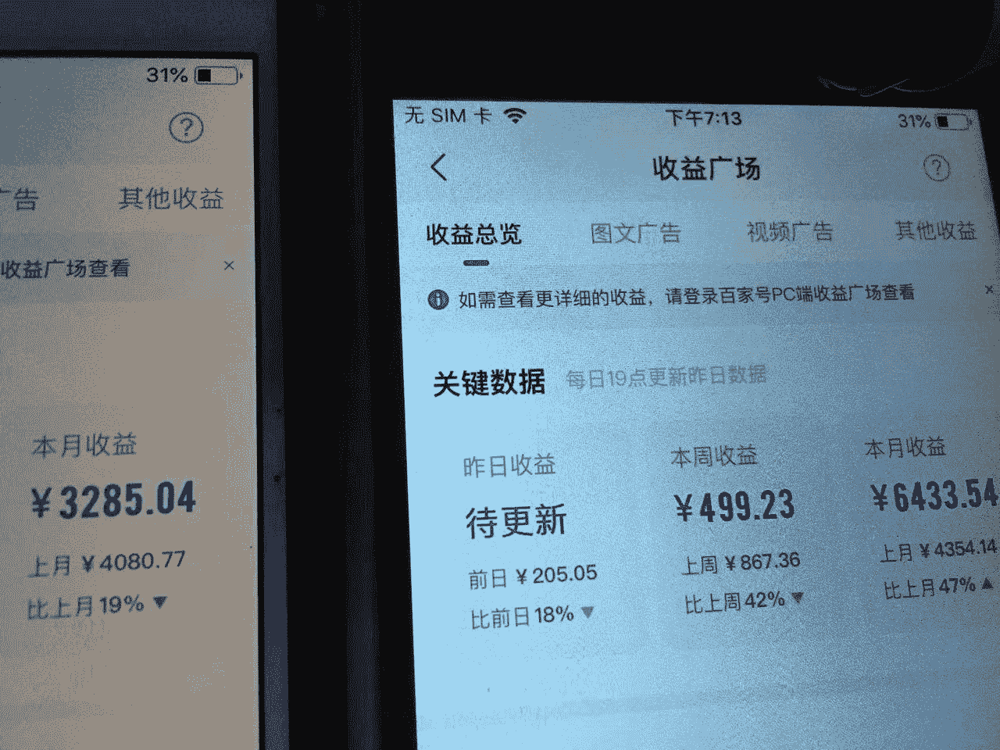

在这个过程中，我的几点收获：

**1）保持“搞钱”的敏感度**

百家号项目最让我开心的是，这个项目不是我跟着别人学的，是我自己发现的，自己摸索着跑通的，所以我现在再刷抖音、📕、B站的时候，时刻会想着，他们能挣到钱吗？他们是怎么挣钱的？

**2）全自动真的太香了**

每天半小时，月入1W，这个投产比真的很不错。当然，不同的项目自动化程度可能不一样，只能说尽可能用工具、用AI代替手动。

## 二、B站好物：从来没有想过，做视频原来这么简单

### 晒晒收益：正反馈来的最快的项目

随着知乎的没落，百家号开始打击低质视频，我的副业收入直线下降，这期间我一直在寻找新的项目，项目尝试过📕资料引流、👸号爆文、抖音图文电商、AI博主等很多项目，都没有拿到太大的结果。

直到遇到了B站好物深海圈，虽然深海圈设置了学费的门槛，我还是义无反顾地报了名（虽然家蒙老师不太喜欢被叫老师，也好像不太喜欢别人感谢他，不过当时我能义无反顾地报名B站深海，有一大部分原因是冲着靠谱的家蒙老师的），以前对视频一直都有畏难情绪的我，没想到正反馈来的这么快。

9月7日发了第一个视频之后，就有人点击蓝链查看商品了；9月13日发了第二个视频，第二天就开始出单；后面每发一个视频，多多少少都能出单，我也基本上保持一周发一个视频的节奏；

**到**了10月中下旬，就进入了双十一，我在整个双十一期间，佣金+奖金+商单，差不多挣了两万多，不算什么傲人的成绩，但也基本符合我自己的预期。

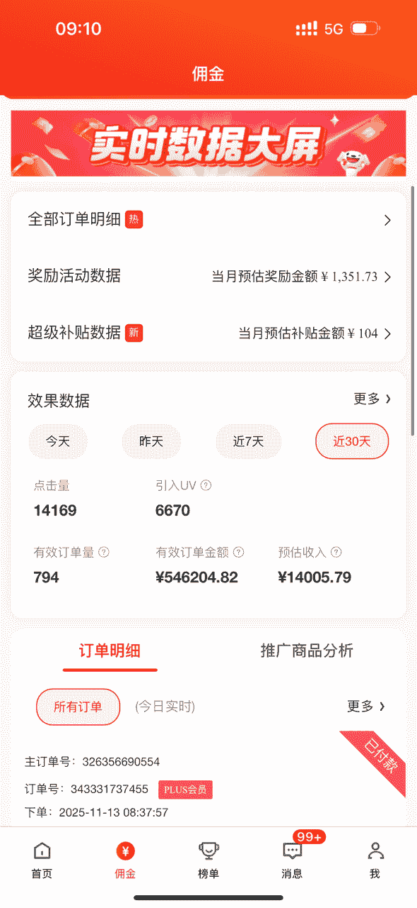

### 我投入了什么？

**1）必备的：**

+   一个B站的账号（需要1000粉丝，不管想什么方法，弄到1000粉丝就行）

+   一个麦克风（100多块，正好我在做AI博主的时候买过）

+   手机（拍摄手机就够用了，不用特意买相机）

+   落地的手机支架（必备，几十块）

+   剪映svip（我感觉啊，有个vip会方便很多）

**2）非必备：**

+   闲置的pad（非必备，这个主要是当提词器用，没有的话也没有关系，可以用手机的前置摄像头拍摄，或者买个几十块钱的提词器）

+   补光灯（非必备，我是挣到钱之后才买的，前期可以不买）

+   搞定设计或其他设计网站的vip（做封面，做PPT用，这个是看自己，也有不花钱的）

## 三、稳定出单，我做了什么？

### 贯穿我所有工作的核心思想

#### 采用适合自己的方式

有的人全职做，有的人副业做，有些人上班可以摸鱼，有些人上班一点儿时间都没有，每个人的情况不一样，所以不要硬套。

先讲讲我每天的时间安排：

+   7:10 出门，为什么这么早？因为要送孩子上学，我也就直接去上班了

+   7:15-7:40 我一般打车到单位，路上20分钟左右，我会刷刷对标账号或者搜集搜集资料（20分钟）

+   8:30 起来活动活动，准备上班

+   9:00-11:30 上午的工作

+   11:30-13:00 吃完午饭，回来休息一会儿，如果有时间，改半小时稿子（30分钟）

+   13:00-19:00 下午的工作，晚饭

+   19:00-20:20 回家之后休息几分钟就得去接孩子（20分钟）

+   20:20-21:00 跟孩子聊聊学校的情况、看看作业、洗漱

+   21:00-22:30 终于有大块的时间做副业（90分钟）

**工作**日的时候，我一天只有晚上一个半小时可以用来做副业，其余的时间都是“挤出来”、“偷出来”的，比如上下班路上整理资料，有些工作我是用手机完成的，效率远不如在电脑上操作，但它是最适合我的。

所以希望你在规划每天工作的时候，一定要结合自己的实际情况。

#### 善用AI，但是不要完全依赖AI

我看有些人上来就用AI写稿子、用AI配音，但是我的建议呢，在做B站好物的初期（包括做其他项目），不要用AI，先自己做几个视频：自己写稿子、自己录视频、自己配音、自己剪辑，了解整个流程之后，再考虑哪些步骤可以用AI提效，原因有几点：

1.  **创造性的工作，自己要会：**重复性的劳动，用AI没有问题，比如搜集资料、整理资料，没啥技术含量，你可以用AI；但是对于创造性的工作，比如写作，我一直坚信，你有60分的水平，用AI可能做到80分，但是你的水平是0，用AI做出来的东西也不会特别好；

1.  对自己能力有提升的工作，要自己做：配音，貌似也是重复性的劳动（不就是对着稿子念一遍嘛，完全可以用AI实现），我做了十多个视频之后的感觉是，这个是真有用啊，第一篇稿子我念一念就磕巴，等到第十篇的时候，已经非常流利了，相信等到第五十篇、第一百篇的时候，我的表现力也会有很大的提升，等我的能力提升到一定程度的时候，再考虑用AI。

1.  **前期先尽可能降低成本：**我反思之前失败过的很多项目，就是投入大、产出少，正反馈来的太慢，很容易就放弃了，现在好用的AI工作都是要花钱的，`chatgpt`买个会员，`minimax`买个会员，别的什么什么再买个会员，成本渐渐就拉上去了，这时候如果没有产出，很容易着急，只要一着急，你的动作就容易变形。目前我用的所有AI工具都是国内免费的，后期等你挣到钱了再迭代。

### 选品

> 选品虽然不能定生死，但是能定收益

前面的很多项目都教会了我，选品很重要。但是选品也要灵活，要结合流量、下单率、佣金、竞争度等等来综合考量。

比如冰箱、洗衣机这种大家电，流量高、佣金高，有时候卖出去一个能有几百的佣金，但是竞争也很激烈，你发一个视频可能都泛不起来水花。

#### 方法一：大海捞针

> 看似笨，实则很有效

打开京东的首页，就能看到所有商品的列表，一个品类一个品类的看，看起来很笨，但实际上很有效，而且任何时间都可以做这件事儿：

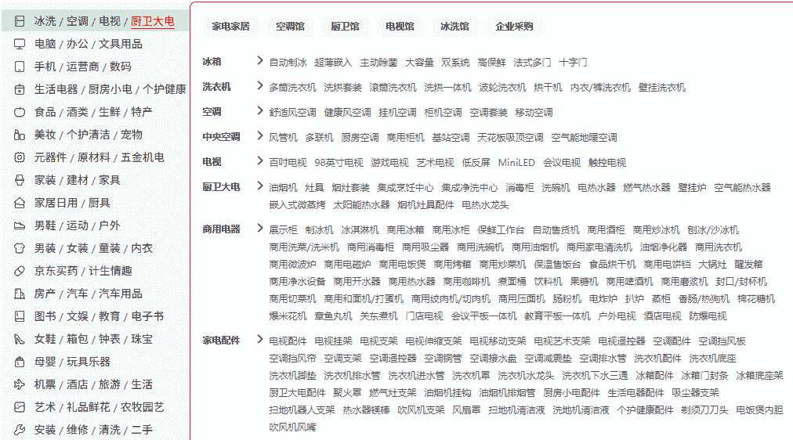

我主要看这几点：

1.  在京东里看看产品的销量，热销产品销量几百万、几十万，普通产品几万也行；

1.  在京粉里看看产品的佣金，一单能赚20块钱以上，如果是小众一些的品类，佣金越高越好；

1.  在B站搜一下这个产品，第一页里面，有没有近几天发的视频。

在B站里面，如果搜索第一页，近一周发的、播放量几百几千的视频越多，说明这个品类的竞争相对不是很激烈（B站会给新视频机会），反之，如果80%的视频都是几万、几十万的播放，说明这个品类不是很容易“挤进去”。

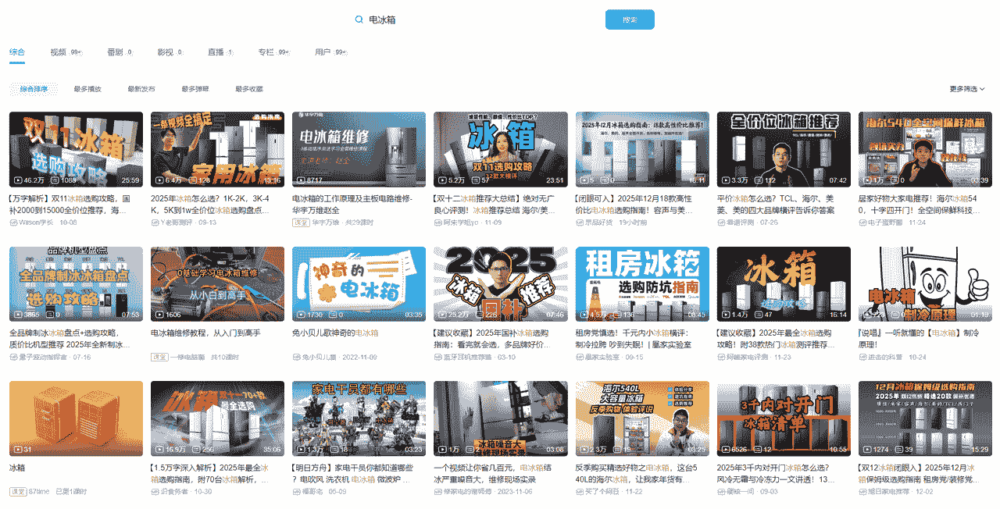

#### 方法二：找细分领域

> 大领域挤不进去，我找细分领域的还不行吗？

如果我还是觉得电冰箱的佣金香，卖一台顶别的产品10台，我就想试一试，怎么办？可以找细分领域，在B站里面搜索电冰箱，可以看到各种联想词：

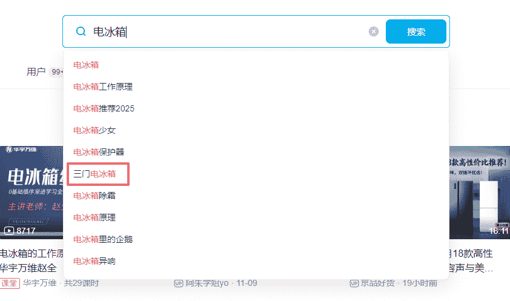

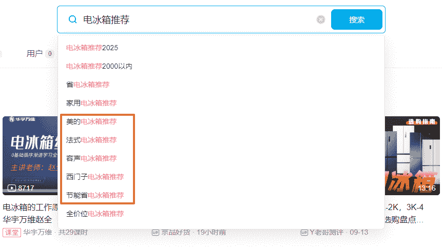

电冰箱推荐范围太大，那么我就先做一个《三门电冰箱推荐》《法式电冰箱推荐》，或者某个品牌的《美的电冰箱推荐》《海尔电冰箱推荐》

搜索下拉菜单里面有的词儿，说明有流量，我们可以先抓住这些精准的流量。

#### 方法三：跟着热点跑

> 热点跟对了，一个视频可以抵十个

这一点很重要，群里的大佬按照这个思路已经拿到了不错的结果。

这里的热点不是新闻热点，而是搜索热点，可以是：季节、节日、某些重要的日子。

最容易想到的就是：夏天卖降温的，比如空调、电扇，冬天卖取暖的，比如电暖气、电褥子、壁挂炉。

还有一些重要的节日，比如快过年了，很多人放假回老家，如果你平时就是写手机的，这时候你可以写一篇《送父母的手机推荐》。

某些重要的日子，比如每年的开学季，可以想想开学之前，家长和学生都要买什么。

如果实在想不到，可以问AI，让AI帮你想想。

```
你是一个B站的测评博主，请总结一些，在每年的不同阶段，测评哪些商品会有更好的流量？比如九月份是大学生开学季，那么8月份笔记本电脑买的人会多一些，宿舍用品买的人会多。比如11月份进入冬季，天气降温，那么取暖设备卖的会好一些。
```

这时候，你就会得到这样的结果，在结合自己的思考去选择。

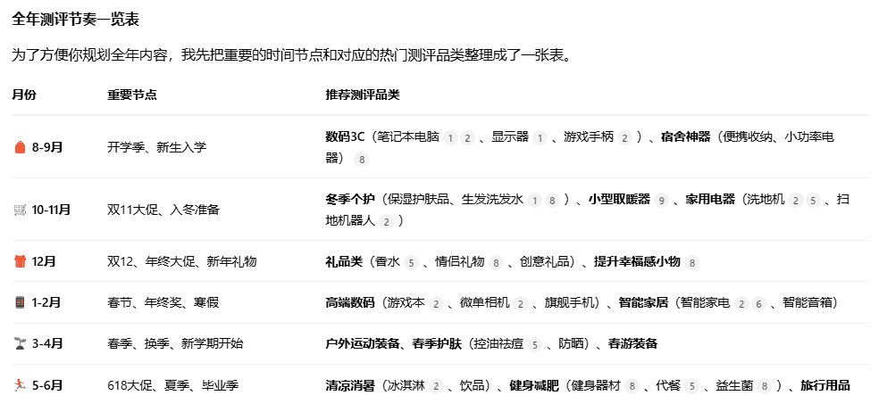

按照这个思路，你也可以围绕着某一个人群选品，你现在已经知道9月份是开学季了，8月份可以针对大学生选品，特别是大一新生，他们第一次上大学，有什么需求？

#### 方法四：对标写啥我写啥

> 最强辅助，辅助上面所有的方法

很多项目的起手就是“找对标”，B站也可以走这个路子。去建一个在线文档，把平时刷到的，觉得还不错的账号信息都总结出来。

我的对标账号里面，说不定就有哪位圈友，为了避免暴露圈友，名字我就隐藏了。

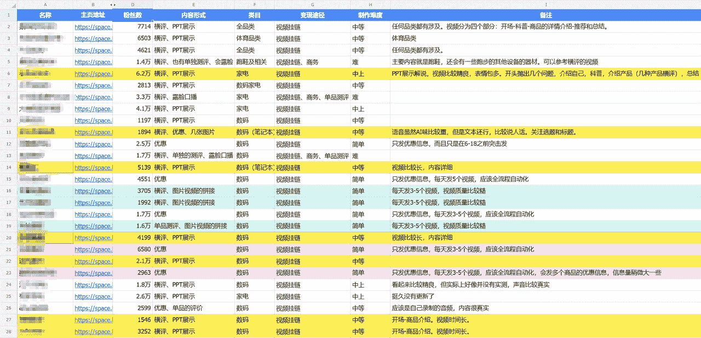

没事儿可以刷一刷他们的主页，看看他们发了啥视频，最好找那种AI味儿比较重、什么品类都发的作者，这些人不会花钱刷数据，你看的播放量、点赞量大概率都是真实的，这时候他们某一个视频的流量非常好，可以重点关注这个品类（它用AI写都有流量，你真人出镜一定可以）。

比如这个账号平时每个视频的流量都是几百、小几千，但是电动自行车和羽毛球鞋这两个视频的流量都是两万多，那么就可以考虑写一下这两个品类。

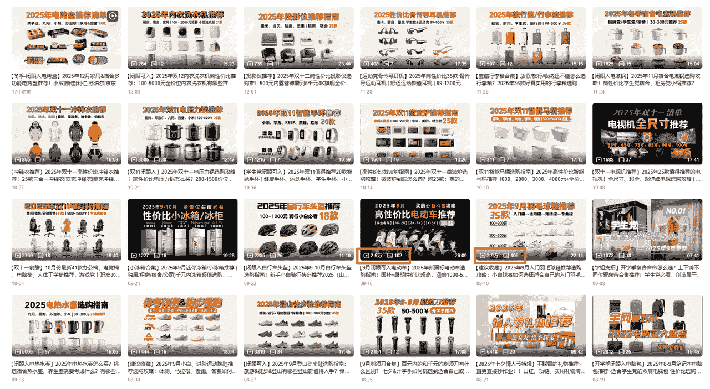

### 找商品

当你确定了一个品类之后，下一步就是找具体的商品，比如你选了“电冰箱”，那么至少要选出来10款具体的型号（我一般都选10-15个商品）。

**首先要确定商品的分类**，每一种分类找几样商品，可以按照商品的价格来分类，这个是最常用的分类方法，例如:

+   2000元以内：4款

+   2000-3000元：4款

+   3000元以上：4款

也可以**按照商品的某种特征分类**，例如：

+   对开门：4款

+   十字门：4款

+   法式：4款

个别的品类，可以**按照品牌分类**，例如：

+   海尔：4款

+   美的：4款

+   容声：4款

当然，冰箱这个品类明显不适合按照品牌分类，因为冰箱的好品牌太多了，每个品牌产品的价格区间大、型号多；

但是有些产品，好品牌就三四个，比如电话手表，常见的品牌只有小天才、华为两个，小米和360勉强也可以，加起来就4个，那就可以按照品牌进行分类。

确定好分类和每个分类的数量之后，就可以找具体的商品了，我通常的依据是：

+   **覆盖常见品牌：**比如2000元以内的4款，那么最好保证常见的品牌都能覆盖到，可以是美的、海尔、容声、TCL各一款；这样就算观众点了你推荐的海尔这一款，没买，但是下单了另外一款，你也是有佣金的，而且是同店的佣金。

+   **销量要高：**最好选京东自营店或品牌旗舰店，你别总推荐那些佣金高但是销量没几个的产品，也别推荐第三方店铺的，下单率会比较低，观众也会觉得，你怎么总是推荐这些每人买的。

+   **佣金要合适：**两款产品的销量和口碑都差不多，那就有限推荐佣金高的哪一款。

+   **尽量有差异（非必要）：**我在挑选产品的时候，会尽量选择一些有特色的产品，再比如2000元以内的4款冰箱，这款空间非常大，另外一款有一个什么自研的保鲜高科技，这样有差异感的话，在推荐的时候也会有侧重点，而不是说，这四款介绍下来，好像每一款的参数和功能都差不多。

我最常用到的就是京东里面的**【排行榜】**，从头到尾，看看每一款的佣金，推荐上面的产品肯定不会错。

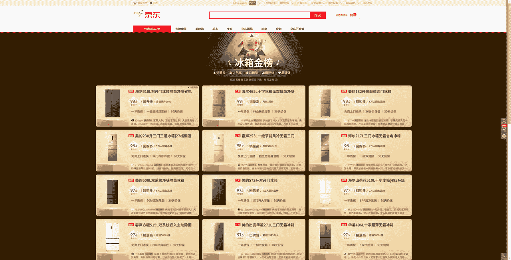

当然，还有一个更简单的办法，就是相信你的对标账号，看看他们都在挂什么商品，一定是销量不错、佣金高的产品。

### 整理资料

> 最重要的两点：一定要有资料库，一定要用AI整理资料

找到品类和具体商品了之后，把这次选到所有的商品都总结到飞书文档里面，主要是商品名称、地址、价格和佣金这几个参数。

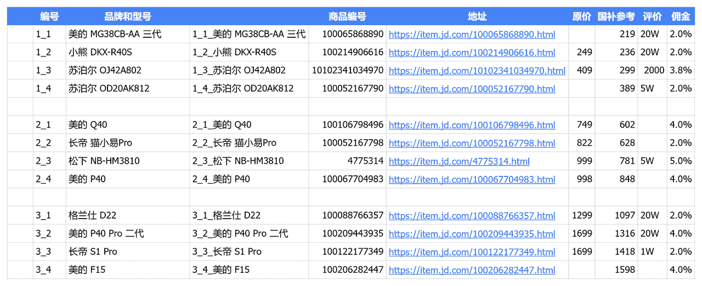

下一步就是整理每一个产品的资料，这一步就是纯体力活，最好找AI来做。商品详情就是京东商品页的这一块。

有群友用了`notebooklm`，整理速度非常快，填入京东链接，都可以把这些信息整理出来，不过也有几个问题：

1.  这里的信息有时候不全；

1.  对你的网络环境有要求；

1.  参数都是死的，我希望能总结出来这个产品的特点。

如图，这些都是这款烤箱的特点。

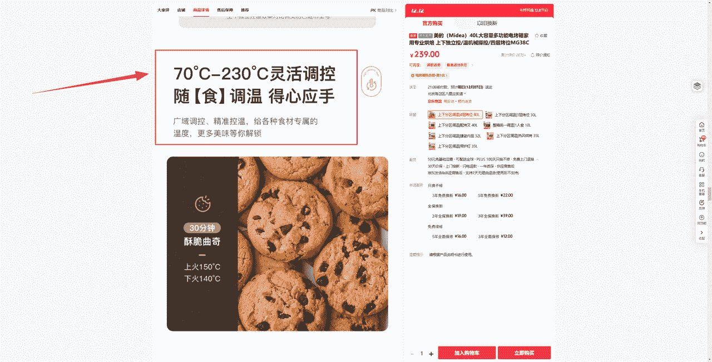

我下面的操作，可以在PC上操作，也可以在手机上操作，整体的思路是：把整个网页截取下来，扔给AI做整理。

1.  如果是你PC端操作，你可以使用火狐浏览器（自带截取整个网页的功能）、谷歌浏览器截长图插件，不过这些方法截取的长图都有最长的限制，如果网页特别长，只能截取出来一部分。也可以使用飞书的截长图工具，就是麻烦一些。

1.  如果你是手机操作，你可以用手机的截长图功能，苹果手机也是可以截取长图的，看看我的录屏演示。

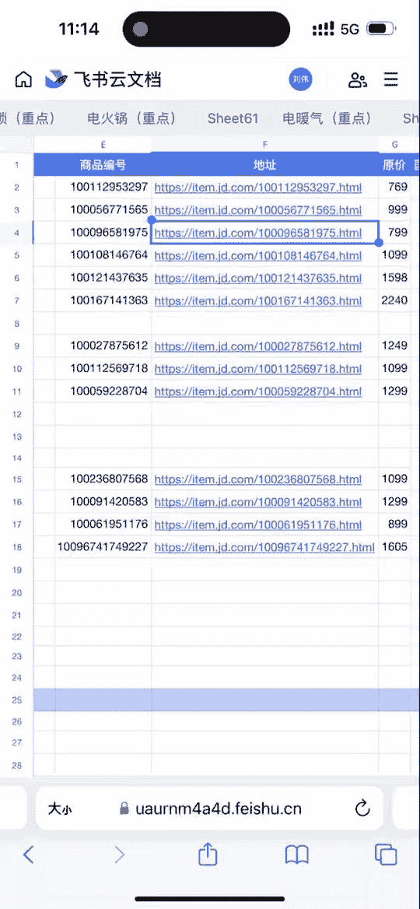

[ce9378f3eec8653321059e9ba77695af.mp4](https://internal-api-drive-stream.feishu.cn/space/api/box/stream/download/all/StkxbogN9oUxBRxHoNbcw0n3nKg)

截取出来的长图扔给AI，我用的是腾讯元宝，适用下面的提示词：


```
总结文档中这款产品，完成以下工作:

一、提炼产品的名称和型号

二、提炼基本参数，以列表形式输出：
容量(升) 功率 (瓦) 烤位 加热管与布局 热风循环 温控范围与方式 控制方式 清洁便利性 安全设计

三、并总结你认为最重要的特点、亮点，不少于5个，个数上限不做限制。
两段式输出，形式为 特点总结：特点描述 例如：风冷无霜科技：多维冷风循环，食材不结霜、不风干，一个亮点一行，不带括号
其中特点总结不超过8个字，特点描述的字数在30-80之间随机。
同一个产品，特点描述的字数不要过于一致，比如不能全是20个字，要长短有差。
如果产品的亮点有很多，那么请把这个产品的重点参数放在前面，例如产品是笔记本电脑，那么主要参数是处理器、内存、屏幕、续航，如果其中一个参数明显优于同类产品，那么就把这个亮点排在第一，非主要功能的亮点也要总结出来。
售价、功率不作为产品亮点
```

这样你不仅可以得到参数：

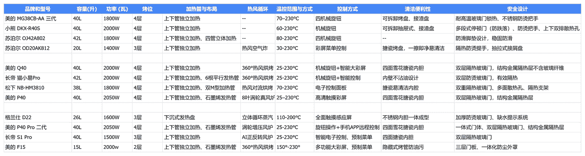

也可以得到这样的产品优势总结：

```
上下独立控温：上下加热管可独立调节温度，精准匹配不同食材烘焙需求，如上火强下火弱适用于蛋糕，避免烤色不均或夹生，提升烹饪效果。
四层灵活烤位：四层烤架卡位设计，允许灵活调节烤盘高度，一次可同时烹饪多种食物，如烤肉、蔬菜和面包，提高效率，适合派对或家庭聚餐。
广域精准温控：70°C至230°C宽温度范围，覆盖从低温发酵到高温烘烤的各种场景，适应面包、披萨等多样食谱，控温准确，食材受热均匀。
机械简易操作：四旋钮机械控制，温度、时间、功能独立调整，操作直观易懂，新手也能快速上手，无需复杂设置，日常使用便捷。
长通定时功能：0-60分钟自由定时加长通模式，支持果干、肉脯等长时间低温烘烤，自动化程度高，省去手动监控，烹饪更省心。
安全耐热设计：耐高温玻璃门有效锁热，不锈钢把手符合人体工学，防烫安全，细节贴心，确保使用过程中安心无忧。
```

这样的产品特点总结，不管是写口播稿，还是画PPT，都是可以用到的。

## 口播稿

> 可以用AI，但是你得会

我做了四五年的知乎，在写稿方面还是有一些经验的，新手也不用怕，可以用AI写初稿、自己修改的方式。写稿我用的是DeepSeek（目前所有的AI工具我用的都是国产免费的）。

**把上一步总结出来**的产品参数和提示词，都扔给DeepSeek，他会给你一篇相对来说，还能凑合用的口播稿。

提示词：

```
你是一名B站的数码博主，请根据这几款数码产品的参数，写一篇文字稿，用于视频录制。

# 内容要求：
1. 参数要严格按照给出的内容编写，不要篡改。
2. 提及关键参数，但是不要只罗列参数，更要描述使用体验，着重介绍产品优缺点相关的参数，其余参数可以适当忽略。
3. 语言更平实、客观、中性，直接陈述参数和感受，不要使用夸张或网络化的形容词、感叹句。
4. 避免主观化、情绪化，不要使用网络流行语、感叹句和夸张的形容词。
5. 针对产品定位，突出调1-2个最核心的优势。
6. 要明确指出缺点，增强内容的实用性和可信度，符合观众寻求“真实建议”的需求。
7. 语气自然，像朋友聊天，没有夸张的感叹号或固定口号，叙述平实。可以使用网络流行语、俚语、缩略语和轻松表达。
8. 所有的句子、过渡词和连接词替换为最基础、最常用的词语。尽量使用简单、直接的表达方式，避免使用复杂或生僻的词汇，确保句子之问的逻辑关系清晰，删掉开头打招呼的部分，删除文未总结的部分。
9. 不要严格按照“分点-优点-缺点-总结”的模板。可以穿插介绍、比较、吐槽、总结。让信息流更自然。
10. 增加对比，比如这款产品在同价位里面，哪一点最突出，或者和上面一款比，这款有什么优势。

# 格式要求及限制：
1. 介绍每款产品的字数随机500-700字，严格控制字数在这个范围内。
2. 一个型号就是一个自然段，一个型号的内容不要分段，不要有格式，只要一篇文字稿。例如：
   第一自然段：产品1名称 产品1介绍
   第二自然段：产品2名称 产品2介绍
   第三自然段：产品3名称 产品3介绍
   第四自然段：产品4名称 产品4介绍
   ...
3. 不要提商品的价格。
4. 按照列表的顺序输出。

# 内容整理：
生成的内容要按照以下要求整理：
1. 删掉连接词：在不破坏文章逻辑的基础上，把那些显眼的排比式连接词，像“其次、因此、所以、然后、总之、其中”之类的，统统删掉。
2. 简化标点：把小连接词后面的“逗号”去掉，比如把“然后，….”改成“然后……”，让句子更简洁。
3. 变换句式：改变段落里重复的句式，可以用“把字句”或“被字句”，别让同一结构反复出现。
4. 添加主语：在句子中加上“主语”和“主语表达形式”，让句子更有依据。
5. 调整结构：在不影响文章结构的情况下，把段落中的“总分总”结构换成其他形式，比如保留“分点论述”，把“总结”部分去掉。
6. 合并短句：把短句连成长句，删掉多余的“逗号”，用“因而、同时、导致、使得、所以、故而”等连接词把句子串起来。

参考材料：

后面就是所有产品的参数和特点，直接从文档里面复制粘贴出来就行

```

DeepSeek生成的口播稿，我会手改一遍，心里默念，边念边改，却道到时候录视频、录音的时候，稿子是通顺的。

文章的开头，我觉得还是很关键的，所以我都是自己写，特别是开头的几句话，尽量做到吸引观众看下去：

1. 抛出痛点：你购买XXX的时候，是不是经常遇到这样的问题；

1. 制造焦虑：如果XXX选不对，可能会造成什么什么后果；

1. 引发共鸣：我因为遇到什么问题，所以要买XXX，花了两周时间做功课，现在用了几个月了，我觉得挺好的，把选购攻略分享给大家。

## 视频制作

> 不要追求完美，但是不要忘了进步

整个文章的结构是这样的：

+ 开头：抛出一个问题，或者说说我自己的经历，为什么要买这个商品（30秒）

+ 第一部分：介绍购买这个商品需要注意什么（1-2分钟）

+ 第二部分：商品推荐，通常我会选10-15个商品进行介绍（7-8分钟）

+ 结尾：简单的一个结尾（10秒）

只有开头和结尾部分录视频，中间时间最长的这两个部分，我都是直接录制音频，相当于一个10分钟的视频，我可能只露脸1分钟，中间9分钟只有声音，搭配都是 BRoll。

什么BRoll？

我发几个视频的截图，你一下子就明白了：

可以是单个产品的介绍，这个PPT是我用搞定设计做的，你也可以直接用其他的工具制作（注意看右上部分的产品特点，就是用AI总结出来的）：

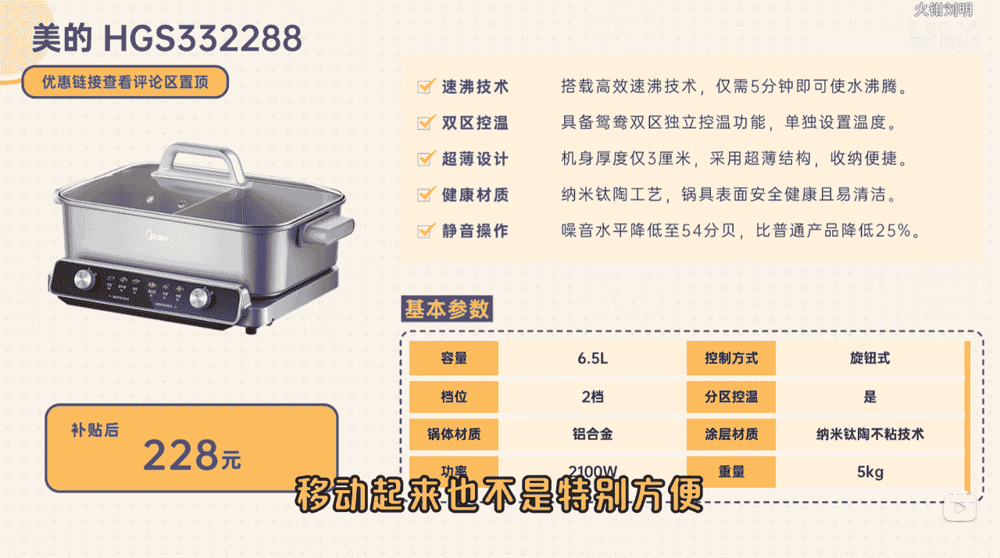

只念PPT，有点儿单调，可以加一些图片，这些图片都是从京东的产品详情页面下载下来的。

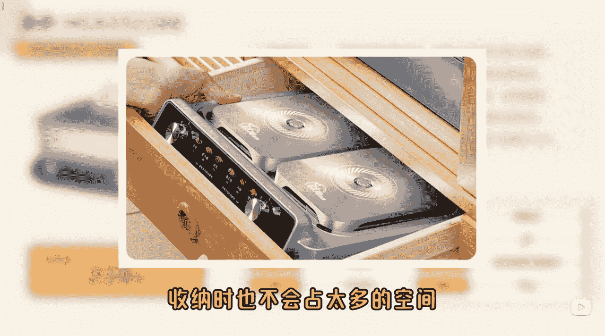

也可以做成多个产品对比的PPT，这样更加直观：

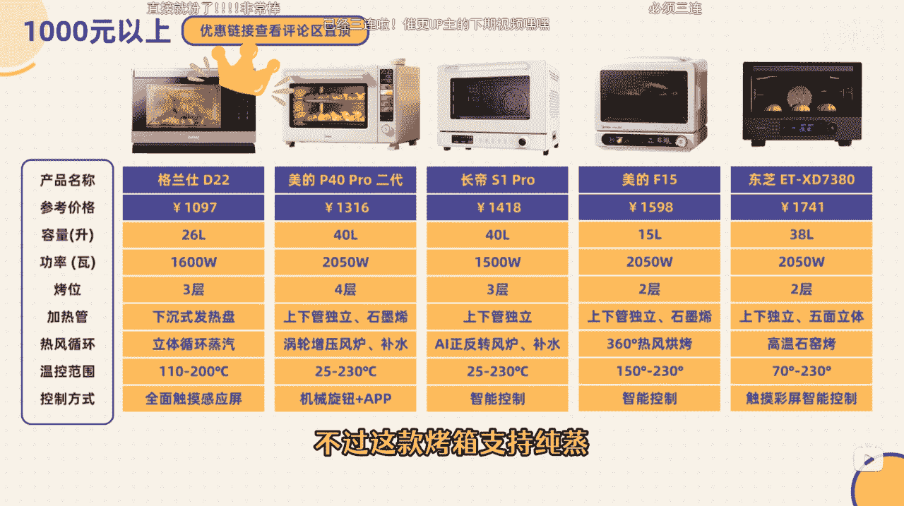

在整个录制的过程中，不要怕说错，很少有人能10分钟的录制，一个字儿都不念错、一个磕巴都不打的，也不需要一段一段录。

整个口播稿一次念下来，用剪映里面的【智能剪口播】这个功能，把念错的话全部剪掉就好了。我经常要念15分钟，最后剪出来只有10分钟。

在做B站好物这个项目之前，我的剪辑水平几乎为0，于是我就给自己定了一个要求：

**每次剪新的视频，一定要学会一个剪映的技巧，哪怕是选**一个好看的背景，或者怎么给文字加个特效。

不要花时间报班、上课，每次就学一个技巧，就进步一点儿。

## 评论区运营

> 很重要、很重要、很重要

发完视频之后，不是就不用管了，要时不时地看看有没有人在评论区提问，有的话，赶紧解答，同时不要忘记加上推荐的链接，这样可以提高开单率：


# 四、走过的一些弯路，以及自认为还不错的方法

> 其实没有什么弯路，所有的努力，终将在不经意间，沉淀为宝贵的财富

## 前期过度依赖AI

在最开始运营这个B站账号的时候，我对露脸做视频也是有畏难情绪的，所以采用的是 AI 配音的方式，虽然我选的声音AI味儿不是那么重，但依然能听出来不是真人录制的（断句的时候很容易听出来），所以前期出单效果不是很好。

另外，由于AI配音对于某些词儿的发音不标准，比如多音字，所以调试AI配音花费的时间，可能还不如我自己录制的速度快。

在制作PPT的时候，开始我也使用AI，做出来的效果大概是这样：

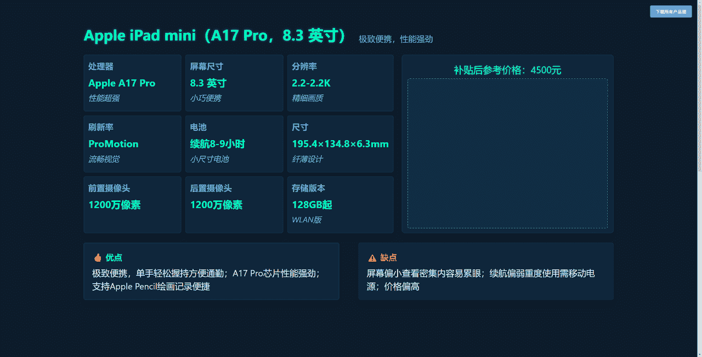

效果不能说很差，但确实比较一般，而且后期可调整的空间比较小，我把提示词也放在这里，大家不一定采用这个方法制作PPT，但是可以参考参考：


```
根据下面给的材料制作一个HTML页面
1. 每一款产品就是一页，向下滑动进入下一个产品。
2. 每一页的样式和布局都保持一致，不要用动态特效，颜色不要超过3种（可以是一种颜色不同深浅），背景不能是白色
3. 对于一款产品的布局：
    ◦ 页面元素布局要合理，一页展示所有内容，布局不能太拥挤，也不能有大片的空白
    ◦ 页面整体分为4部分，布局从上到下：
                顶部留白：10%
                标题和简介：10%
                产品参数、产品图片的预留位置、产品优缺点和价格：70%
                底部留白：10%
    ◦ 产品的名称就是每页的标题，位于最上方的左边，字号45px。在标题右边，有一行不超过20字的介绍，要和标题底部对齐，高度概括这款产品的特点或定位，字号20px，字体是：AlibabaPuHuiTi
    ◦ 标题下面是产品参数、产品图片的预留位置、产品优缺点和价格，分为左右结构，左边是产品参数，宽度占50%，右边是产品图片的预留位置、产品优缺点和价格，宽度占50%：
    ◦ 左边的产品参数，单列展示，每一个参数的高度自适应，所有参数的高度加起来，要占70%的高度
    ◦ 右边整体是一个容器，从上到下分别是：产品图片、产品优点、产品缺点，其中产品图片的高度占容器的60%，产品优点高度占容器的20%，产品缺点高度占容器的20%
    ◦ 产品图片的预留位置不要有文字提示，长宽比例是1:1或4:3
    ◦ 产品图片预留位置的顶部，展示一行字：“优惠链接查看评论区置顶”，字号20px，字体是：AlibabaPuHuiTi
    ◦ 产品图片预留位置的底部的中间展示价格，内容是：“补贴后参考价格：XXX元”，其中XXX是具体价格，在参考资料中，价格的样式要突出，但是不要太扎眼，字号30px，字体是：AlibabaPuHuiTi
    ◦ 产品优点、产品缺点，字号20px，字体是：AlibabaPuHuiTi
    ◦ 产品的优点和缺点如果字数过多，请进行优化，优点不超过30个字，缺点不超过20个字
    ◦ 左侧产品参数区域的高度与右侧区域（产品图片+优缺点区域）的总高度保持对齐
    ◦ 编号不要展示，隐藏起来
    ◦ 页面不要有页号或者下滑、右滑进入下一个产品的提示
    ◦ 文字不能太小，避免用户看不清楚
    ◦ 标题用纯色，不要用渐变色
    ◦ 如果字体找不到，请用其他可商用字体代替
4. HTML代码需要注意：
    ◦ 左右留白距离不超过12%，不低于7%
    ◦ 使用JavaScript动态生成产品页面，将产品数据存储在JS数组中，然后通过循环生成每个产品的HTML结构。  
    ◦ 在HTML中只保留一个产品页的模板，然后通过JavaScript填充数据并复制生成多个产品页。
    ◦ 数据是JSON格式，样式举例：
         [
                    {
                            id: &quot;1_1&quot;,
                        name: &quot;AAAA&quot;,
                        intro: &quot;旗舰性能·专业创作·顶尖视觉&quot;,
                        price: &quot;4000&quot;,
                        parameters: {
                            &quot;处理器&quot;: &quot;Apple M4&quot;,
                            &quot;屏幕尺寸&quot;: &quot;13 英寸&quot;,
                            &quot;分辨率&quot;: &quot;2.3-2.7K&quot;,
                            &quot;刷新率&quot;: &quot;支持 ProMotion 自适应刷新率&quot;,
                            &quot;电池&quot;: &quot;续航约 10 小时&quot;,
                            &quot;尺寸&quot;: &quot;281.6mm × 215.5mm × 5.1mm&quot;,
                            &quot;前置&quot;: &quot;1200万像素&quot;,
                            &quot;后置&quot;: &quot;1200万像素&quot;,
                            &quot;存储&quot;: &quot;256GB WLAN 版（可扩展）&quot;
                        },
                        pros: &quot;性能较强，天玑 9000 系列芯片应对游戏、办公等场景有不错表现；13 英寸大屏，观影、游戏视野好；电池容量大，续航有保障&quot;,
                        cons: &quot;系统生态丰富度不如苹果；在专业创作软件适配、协同体验上，对比苹果等生态有差距；品牌在平板领域的用户认知度，相对传统平板厂商弱一些&quot;
                    },
                    {
                            id: &quot;2_1&quot;,
                        name: &quot;BBBB&quot;,
                        intro: &quot;轻盈入门·高效学习·苹果体验&quot;,
                        price: &quot;4000&quot;,
                        parameters: {
                            &quot;处理器&quot;: &quot;Apple A14&quot;,
                            &quot;屏幕尺寸&quot;: &quot;10.9 英寸&quot;,
                            &quot;分辨率&quot;: &quot;2360×1640&quot;,
                            &quot;刷新率&quot;: &quot;未明确&quot;,
                            &quot;电池&quot;: &quot;续航约 10 小时&quot;,
                            &quot;尺寸&quot;: &quot;248.6mm × 179.5mm × 7.8mm&quot;,
                            &quot;前置&quot;: &quot;1200万像素&quot;,
                            &quot;后置&quot;: &quot;1200万像素&quot;,
                            &quot;存储&quot;: &quot;64GB WLAN 版（可升级）&quot;
                        },
                        pros: &quot;价格相对亲民，适合预算有限想入苹果生态的用户；A14 芯片满足日常上网课、看视频、简单办公等基础需求；10.9 英寸屏幕比 mini 大，观影、操作更舒展&quot;,
                        cons: &quot;性能在苹果平板里偏入门，应对大型游戏、专业创作力不从心；屏幕刷新率普通，滑动流畅度不如 Pro 系列；存储 64GB 起步，存大量资料易满，256GB 版本加价多&quot;
                    }
         ]

        其中：
        id: 编号
        name：产品名称
        intro：产品的简介，不超过20字的介绍，高度概括这款产品的特点或定位
        parameters：产品参数
        pros：产品的优点
        cons：产品的缺点
        rating：评级
5. 页面支持下载功能，点击之后，可以下载多张图片，每个产品就是一张图片。页面支持图片下载功能实现要求：
    ◦ 提供明显可见的下载按钮（固定位置）
    ◦ 下载的每一个图片的名字，就是编号+产品名称，格式：“编号_产品名称”
    ◦ 使用html2canvas库（v1.4.1）
    ◦ 设置缩放比例scale: 2确保高清输出
    ◦ 开启useCORS: true处理资源加载
    ◦ 使用allowTaint: true解决跨域限制问题
    ◦ 点击下载的时候，临时隐藏下载按钮本身，移除页面中的滚动指示器，替换不支持的特殊效果
    ◦ 合理命名下载文件（包含产品名称）
    ◦ 支持Chrome/Firefox/Safari最新版
6. 页面整体风格要有科技感，深色系
7. 输出所有产品

参考材料：
编号        参考价格        平板型号        处理器        屏幕（尺寸、分辨率、刷新率）        电池        尺寸（长宽高）        前置摄像头        后置摄像头        存储版本        优点        缺点        
1_1        4500        Apple iPad mini（A17 Pro，8.3 英寸）        Apple A17 Pro        8.3 英寸，2.2-2.2K ，支持 ProMotion（未明确具体数值）        未明确标注，续航约 8 - 9 小时（小尺寸电池容量有限，重度使用易中途没电 ）        长 195.4mm；宽 134.8mm；高 6.3mm        1200W        1200W        128GB WLAN 版（还有 256G、512G 可选 ）        极致便携，单手轻松握持，方便通勤路上使用及户外记录；性能强劲，A17 Pro 芯片应对大型手游、轻度创作无压力；支持 Apple Pencil（二代），生态功能下沉，画画、记灵感便捷        屏幕太小，做表格、看 PDF 等内容显示密集，易累眼，分屏操作鸡肋；续航短板，重度使用依赖移动电源；价格偏高，同价位安卓平板配置更 “堆料”
2_1        2000 iQOO Pad2 Pro        天玑 9000 系列        13 英寸，3096*2064 ，刷新率未明确标注        11500mAh        长 308.56mm；宽 198.32mm；高 6.64mm        800W        1300W        256GB WiFi 版（还有 12 + 512GB 等可选 ）        性能较强，天玑 9000 系列芯片应对游戏、办公等场景有不错表现；13 英寸大屏，观影、游戏视野好；电池容量大，续航有保障        系统生态丰富度不如苹果；在专业创作软件适配、协同体验上，对比苹果等生态有差距；品牌在平板领域的用户认知度，相对传统平板厂商弱一些

```

这套提示词可以生成一个HTML页面，支持下载的功能，代码和数据是分离的。

AI我用的是腾讯元宝，每次把提示词发给他，生成的样式可以微调，如果你觉得这个效果还算满意，可以留下这段代码，后期只要把商品的数据替换掉，就可以快速生成一张张PPT图片。

后来我就把方法迭代成使用搞定设计来做PPT，这个网站是要收费的，但物有所值（如果大家有其他网站的会员，比如可画什么的，一样够用）。大家也不需要觉得做PPT很难，上面有很多模版，你只要整理出来一套模版，后期都可以套用。

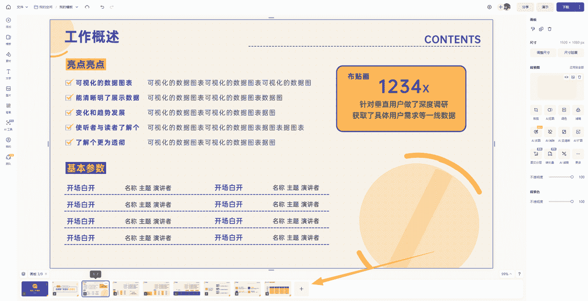

# 建立自己的知识库

这里不得不说一句，飞书文档真的很好用，大家一定要用起来！大家一定要建立自己的知识库！所有的选品，每个品类的数据资料，每次写的口播稿，统统都总结到知识库里面。

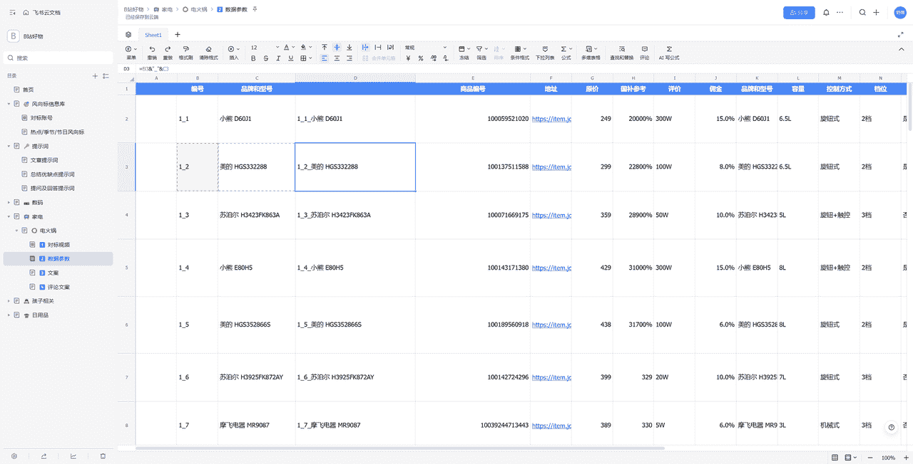

跟大家算一笔账，如果你一周发一个视频，一个品类半年后再发一次，理论上你选26个品类之后，就够了。半年之后你再做视频的时候，你就不需要再从0搜集资料了，换几个商品就行了。

# 拍视频，我克服了畏难情绪

我之前对做视频一直有畏难情绪，用觉得我一个男的，长得也不好看，拍出来的视频怎么可能有人看，更别说带货了，我的很多项目也是因为这个原因失败的。

但事实证明，B站粉丝的包容性还是很强的，B站现在的推流机制对新up主非常友好，只要你的内容有价值，哪怕视频拍的糙点儿，也是有人看的。

我在拍摄第前几个视频的时候，家里甚至连一个整洁的背景都找不到，我就在家里的柜子前面拍，正面不好看，我还是斜着拍的，剪辑也不会剪。但我感觉，视频好看不好看，对接商单会有影响，但是对于好物带货，前期条件不具备条件的时候，先拍先做，在做的过程中不断优化。

如果你真的因为什么原因，实在不想露脸，那么先保证声音是自己的。可以参考这个账号：

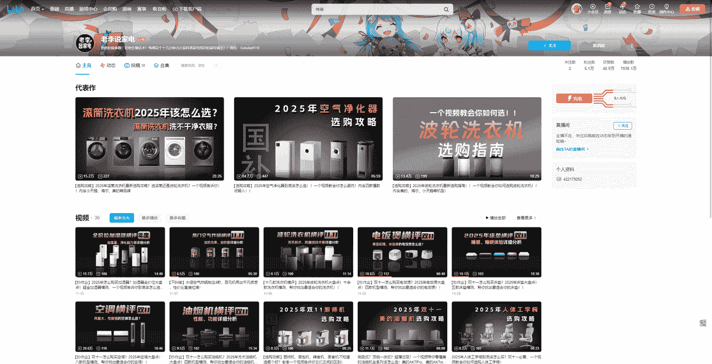

# 任务拆解和时间规划

我上面也提到过，我每天做副业的时间比较有限，大块的时间只有晚上9点到10点半这一个半小时，相信很多有全职工作的圈友，也有一样的问题。

我的方法是把任务拆解成一个个独立的小任务，根据你的实际情况，合理安排时间。例如B站好物整个流程可以拆解成：

+ 选品（选品类和具体的商品）：上下班路上做
+ 搜集整理资料：下班回家或周末做
+ 写口播稿：早到单位一个小时做
+ 录制视频（开头和结尾）：周末做
+ 录制音频（中间部分）：下班回家做
+ 剪辑：下班回家或周末做

# 六、送给想尝试的朋友几句话

## “每一步都算”

我也算赚钱的老人了，最早做知乎，有了几年不错的副业收入，不过后来知乎慢慢没落，我也参加了很多次航海大部分都只挣了点儿小钱，没有完全做起来。

但是，我在做Ai博主时练习的口播能力，在知乎和小店练习的选品能力，在知乎练出来的文本能力，都在B站好物这个项目中用到了，甚至之前买的三脚架、麦克风，都用到了。

不要怕失败，学到的东西早晚都能用上。

## “先做个垃圾出来”

现在反思很多项目失败的原因，就是对自己要求太高，反倒是限制了自己。投入精力多，正反馈来的慢，用不了多久就放弃了。

现在看看自己B站的第一个视频，还蛮可笑的，很多地方都很糙，前置摄像头拍出来还有点儿模糊，但这样做是对的，先做再完善。

## 流程化的同时，不要忘了进步

尽可能利用工具，把一些工作流程化，尽量使用A替代手动劳动，这样可以缩短做一个视频的时间。但是在这个过程中，千万不要忘了进步。

我前面提到过的，剪辑目前还是我自己做，因为我觉得剪辑还是挺有用的，我就要求自己每剪一个新的视频，必须学一个剪辑技巧，这就是进步，遇到做的还不错的效果、特效，就设置成了剪映的预设，这就是流程提效。

再比如，之前拍摄背景不好看，我重新布置了一个，这就是进步。每次拍摄三脚架放哪，补光灯放哪我都记下来，这就是流程提效。

## 不要比，不要焦虑，按照自己的节奏来

同期的群友，最多有挣到十万的，还有很多能挣到四五万的。有一两个视频就开始爆单的，还有几十个uv就能日入过千的。

你也不要和我比，我至少还做了几年的副业，在写作、搜集资料方面还是有一定积累的。

不用焦虑，按照自己的节奏慢慢来，看到别人优秀的地方就学习、模仿，只要大方向没错，保持进步准没错。

---

差不多就这么多了，

如果有描述不清楚的地方，可以交流，

如果项目整个操作的过程中，有可以优化、提升的地方，也请告诉我。
