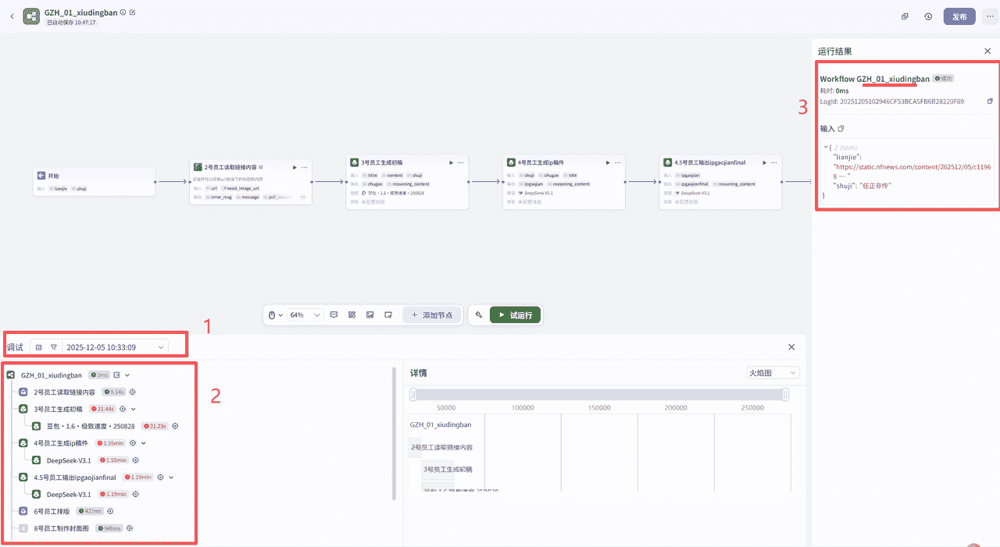
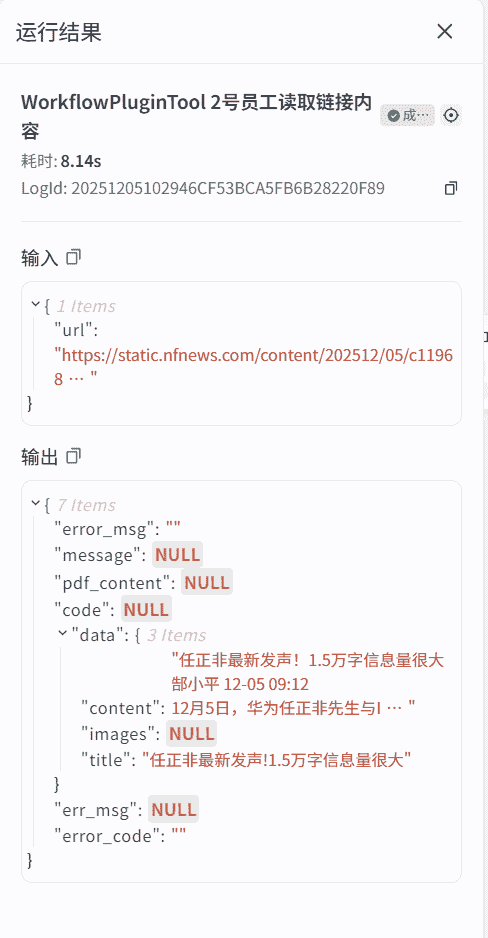
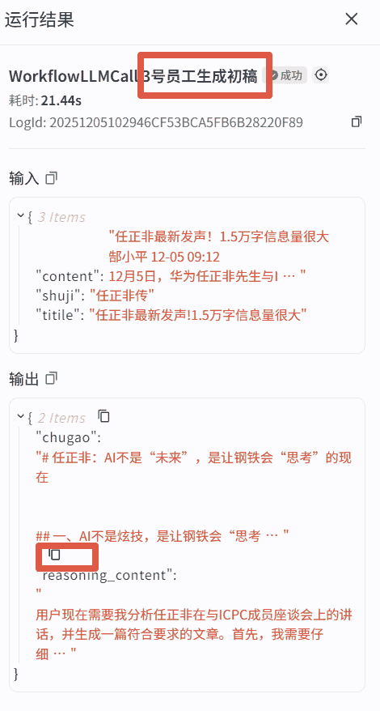
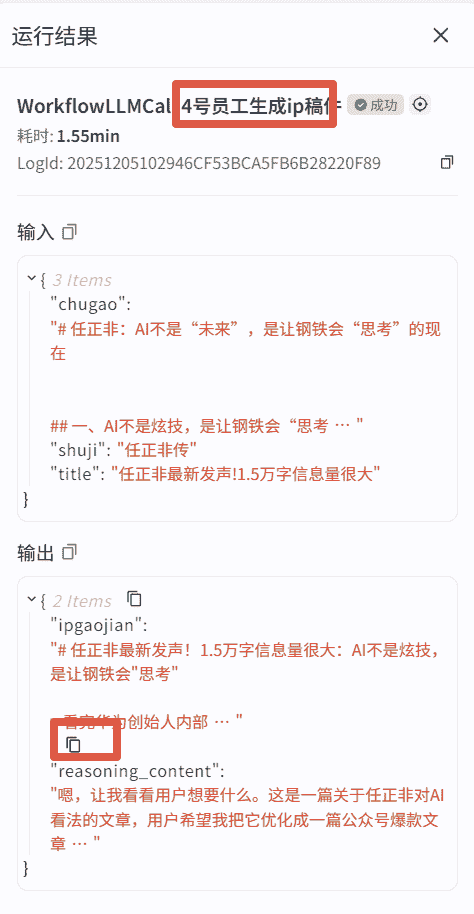
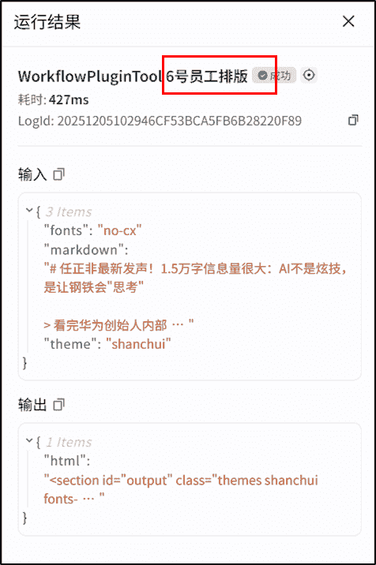
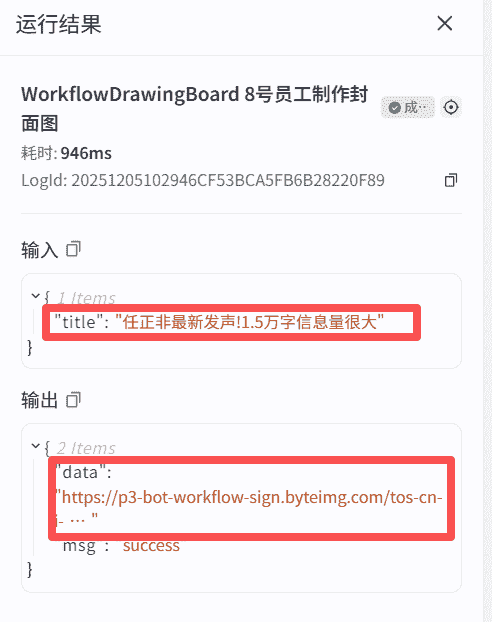
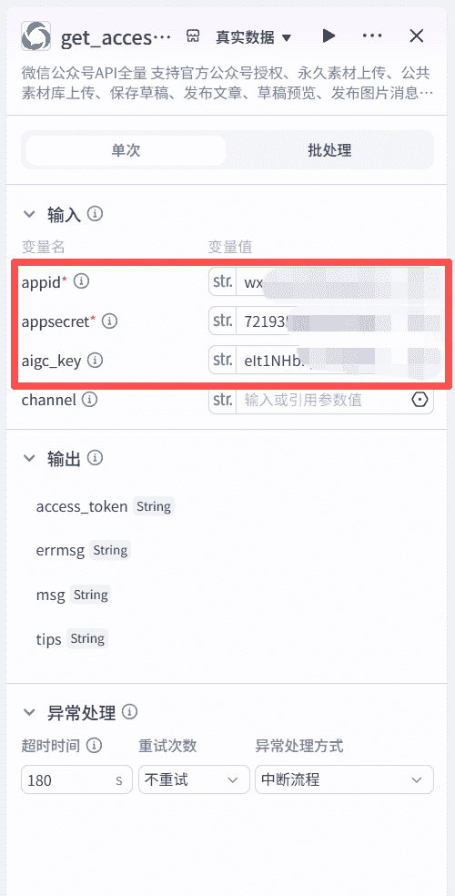
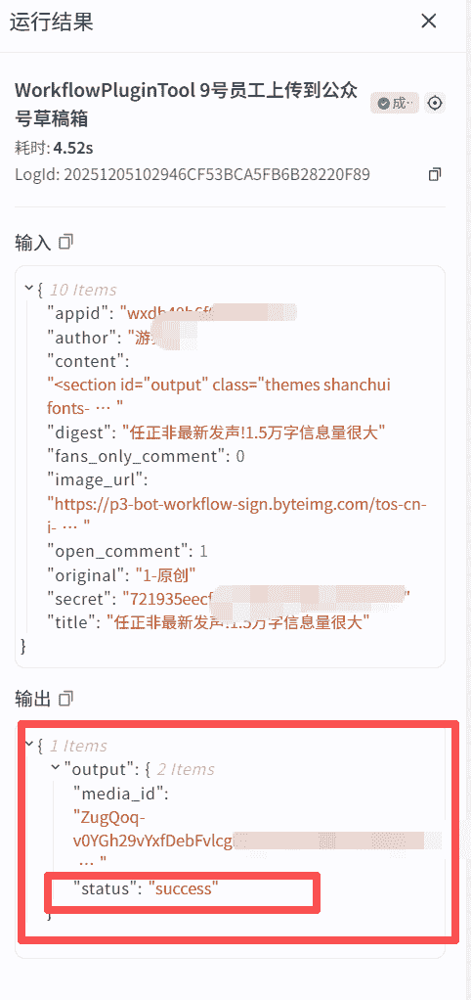

# 小白用户coze搭建公众号工作流1.0遇到问题的解决经验分享

> 来源：[https://xuqiwei1986.feishu.cn/docx/F1hLdDpSRo0WZgxIrDscOzQ3nVd](https://xuqiwei1986.feishu.cn/docx/F1hLdDpSRo0WZgxIrDscOzQ3nVd)

我根据这篇文档逐字模仿，但可能还是把握不到关键点，所以还是出了很多bug。所有就有了这篇，分享一下我找bug的一些经验，以及成功运行之后，各个节点的呈现界面。让像我一样的小白用户可以逐节点核对，知道自己哪里错了。

[航海来袭，给大家添把火！飞书多维表格 + Coze 保姆级教程，让写公众号垂直文章像转发文章一样简单，搞定只要一秒？](https://w194sny3eli.feishu.cn/docx/YG2JduKm3oMYAWxR5Ftcznltnxd)

## 一、参考资料

### 1.1、我严格按照生财精选文档执行，这篇文档写的非常细致。

[航海来袭，给大家添把火！飞书多维表格 + Coze 保姆级教程，让写公众号垂直文章像转发文章一样简单，搞定只要一秒？](https://w194sny3eli.feishu.cn/docx/YG2JduKm3oMYAWxR5Ftcznltnxd)  下面简称“生财枫晓陌版本”。

### 1.2、在我遇到bug卡点最后看了CSDN的这篇文章，解决了最后的卡点。

公众号授权给Agent去录入草稿箱。在序号1的生财文档中，生成到草稿箱这一步，是用了“微信公众号发文助手第三版”这个三方插件工具实现。

> 微信公众号发文助手第三版 **插件功能描述:**

> 微信公[众号发文助手第三版，支持排版](http://101.126.35.226/)设[置 通过传入的参数将文章发布](http://101.126.35.109/)到[公众号，目前只支持上传到草稿](http://101.126.44.209/)箱[。 输入的参数为AppID、](http://101.126.44.196/)A[ppSecret、封面素材](http://101.126.35.67/)u[rl、文章标题、文章作者、](http://101.126.47.44/) [文章摘要、html格式文章正](http://101.126.45.223/)文[。 需要在公众号添加如下白](http://180.184.49.77/)名单ip： 101.126.35.226 101.126.35.109 101.126.44.209 101.126.44.196 101.126.35.67 101.126.47.44 101.126.45.223 180.184.49.77 180.184.35.14 180.184.92.230 101.126.25.134 180.184.86.184 180.184.66.211 180.184.65.14 插件默认打开评论、所有人可评论 正文必须为html格式的

最后排查bug阅读了CSDN的这篇文章，下简称CSDN教程，授权工作流录入到公众号，他用了三个公众号API，我拆解步骤，猜测问题点是在AppID、AppSecret，或者封面格式、还是文章Html的格式等几个这个环节的配置。在 生财枫晓陌版本上，这个环节试运行成功，但是生成结果一直是null，由于我没有成功运行经验，我一直不知道成功后应该是什么样，直到看到这篇文章。所以也放在开头供大家取用。

CSDN教程：https://blog.csdn.net/weixin_72959097/article/details/147043349?spm=1001.2101.3001.6661.1&utm_medium=distribute.pc_relevant_t0.none-task-blog-2%7Edefault%7EBlogCommendFromBaidu%7ECtr-1-147043349-blog-149394592.235%5Ev43%5Epc_blog_bottom_relevance_base1&depth_1-utm_source=distribute.pc_relevant_t0.none-task-blog-2%7Edefault%7EBlogCommendFromBaidu%7ECtr-1-147043349-blog-149394592.235%5Ev43%5Epc_blog_bottom_relevance_base1&utm_relevant_index=1

PS. 为了跑通工作流，提示词我直接复用的生财枫晓陌的，是markdown格式的，权限问题无法复制，我是截图，给到公众号去识字，再到markdown编译器（供取用：https://markdown.lovejade.cn/）里调整格式，删除或者改写个人适配信息的粗糙版本。

大家可以用CSDN教程里面的提示词，比较简单，但是可以直接复制，在跑通工作流层面可以稍微提提速，反正最后都是要优化的。

> 毕竟AI时代做IP，就是做IP Agent

## 二、运行结果界面展示

我从debug的角度，呈现下运行成功的显示。生财枫晓陌版本已经把顺着搭建的流程写的非常清楚了，我的文档是供友友们，搭完工作流后，运行不成功后逐步排查。

有的时候运行成功，不代表没有问题的，有可能这个节点成功，但是没有输出下一个节点完整可用的素材，所以对于小白选手我来说，找问题点的过程蛮迷茫的，也是这篇文章的撰写初心。

### 2.首先是找到完成的测试界面。

图中标1的地方找到最新一次测试，图中标2是具体环节的测试，图中标3是测试的运行结果。后续将只展现右边的测试结果更方便阅读一些，这里介绍方便大家整体概览定位。

### 2.1 开始节点

目前是当前的开始节点，输入了一个链接，输入了一本书的名字。在右边输入层面也是读取正常。

### **2.2  读取链接内容员工**

2号员工读取链接的结果，这张图可以看到，并不是Null就是异常请，有Null也是正常的，

但是要看你流程里面用到的结果有没有输出闭环，比如2号员工，读取链接的data、content、title，这三项都是必须的。

### 2.3 生成初稿+生成终稿员工

点击图下方的红色框，可以展开内容。在生成初稿这个环节是必须的，需要满足

1、chugao 不是Null

2、点图上下方的红色框，看下全文，生成的是不是一篇完整的稿件，是否有AI的思考话术或者其他。

> 我之前的失败经验是，不是null，但是我没点进去看，生成的并不是一篇完整的文章，而是有AI思考。导致后续生成终稿的AI会觉得自己没有接收到初稿，排版的AI觉得自己无内容可排版。出现问题，要么换AI的模型，从豆包换成其他豆包，或者换成DeepSeek之类的；要么调整一下提示词，给到AI更明确的任务，生成完整的文章。

> 同样后续终稿的文案也要点进去看下，在终稿那里就不赘述了。

### 2.4 排版员工

后续一步上传到草稿箱的AI支持html格式，可以在这一步把输出的、html的、完整内容复制出来，到html预览编辑器里看下效果，如果没问题就是完整的生成。

随手找到的预览编辑器也分享给友友们：

https://www.jyshare.com/front-end/61/

### 2.5 制作封面

可能很多友友跟我想的一样，一定要封面吗，后续上传行不行，答案是不行的，因为在公众号草稿预览框那里已经有封面了，所以可以随便瞎搞一个，也是要有的。

封面其实是文生图的调校了，我还不精通，所以就按照枫晓陌的教程，简单的文案排版了。我急着跑通，甚至把他凝练的调校话术都调整了，直接用链接文章标题生成的

所以

1、要有文案

2、生成网址形式的图片格式，可以把网址复制出来点开看看，是不是引用了文案，生成的图片。

### 2.6 上传到草稿箱员工-公众号授权

前面有提到，我用枫晓陌的版本，查不出问题，所以参照CSDN的文章，引入了“公众号API” 就叫这个名字，从get access token获取公众号允许开始排查。

果不其然这里就出现了失败。

我填了id 和 secret之后，没能成功。

不过出现了一个付费链接，19.9，我觉得也还行。

1、付费

2、付费后生成一个aigc_key。同时他有一个白名单IP地址。

2、填写aigc_key，公众号后台添加白名单。

再运行就成功了。

> 没有花钱的不是

### 2.7 上传到草稿箱

根据枫晓陌的指引，填写，运转，最后Success！

终于！

## 三、总结，也是对自己说。

如果你还在debug，那么沉下心来思考+胆大心细推敲可以助你一臂之力。流程不难，一定可以跑通的，与其找人求助，不如多搜索多思考。毕竟你我才是自己工作流的owner，否则后续优化也会有问题出现。

工作流正常运行只是1.0。

接下来就是优化大模型了，优化大模型可以列为2.0阶段的目标，就是明确什么能做，怎么做。

训练大模型和AI的前提是，你能够看出来好坏，这样才知道往那个方向优化，审美是好东西。

一点点经验之我发布了两篇文章，

一篇是直接用的爆款文章标题，十几个粉丝的小号，带来的效果是阅读八九十，涨粉2个。发布时间是23:30

一篇是新闻信息，阅读只有7,，0涨粉。发布时间是上午11点左右。

所以爆款是有基因和公式的，要坚定的执行。或者从新闻到爆款的大模型思路仍然需要打磨，不是简单的AI改写就可以实现。

2.0版本优化方向，

1、优化提示词

2、飞书工作流让整个工作更简单

## 四、火山引擎官方给到的coze功能指引

https://developer.volcengine.com/articles/7398648241820500018#heading11

其实这个文档对coze的运行逻辑介绍的非常到位，但是也非常催眠.....共享一下。