# 月访客突破10万，讲讲出海新手怎样快速上线一个工具站（保姆级教程）

> 来源：[https://xuqiwei1986.feishu.cn/docx/QvcOdWTwpoIhjcx2kWtcxuytnIe](https://xuqiwei1986.feishu.cn/docx/QvcOdWTwpoIhjcx2kWtcxuytnIe)

大家好，我是易焘，一直深耕AI编程和出海网站。

在赚钱2025年航海收官战起航之际，我终于有一个出海网站月访客突破10万！

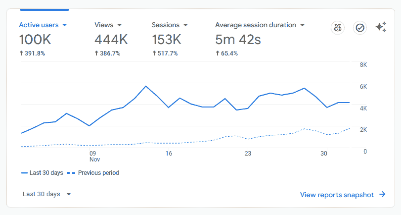

网站从上线到目前为止不到三个月：

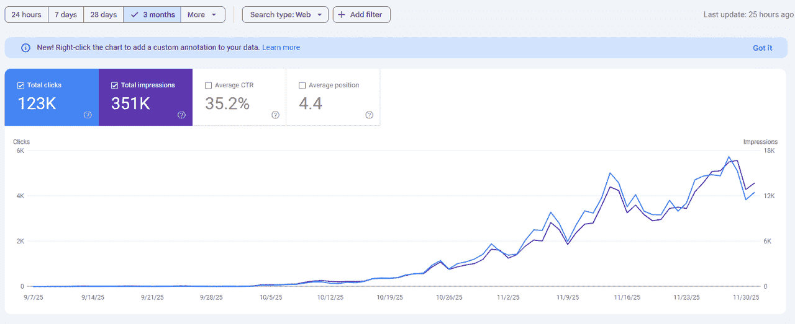

虽然目前还没有太多变现，但却给常年处于“新手状态”的我带来非常强烈的正反馈。感谢哥飞老师！感谢刘小排老师！

可能你会问，我是怎样把网站做到月访客十万的？说实话，我自己也说不出个所以然，如果一定要说出个原因，我想大概是“不断地实践”。因为目前为止我已经上线了20+Chrome插件和30+出海网站，而这50多个产品中，只有2个网站出现过月访客过万，而Chrome插件更是只有2个有3000+用户——可以说成绩平平。

对于很多出海新手来说，像哥飞老师那样精准挖掘“新词”，或者像小排老师那样深刻理解用户需求，确实不是一朝一夕能学会的。但即便如此，我们仍然需要不断学习、持续实践，从更多的学习和实践中逐渐找到更多出海的感觉。

哥飞老师和良辰美教练都说过：新手先上20个站再说。想想不无道理。只有实践多了，你才有机会积累出自己的框架，熟悉整个上线的流程，这样，当属于你的机会来临的时候，你才有能力稳稳接住。

对于出海新手而言，首先要面对的其实不是挖掘需求，而是怎样切切实实地把一个出海网站做出来并上线。对于许多出海高手来说，怎样上线一个网站这种事情根本不值一提，他们当中有些甚至熟悉到一两个小时内就能搞定一个站。

前段时间，响应龙哥老大“垂直小号”的超级标，我也做了一个垂直小号，定位“新手AI编程与出海”，刚好写了十几篇出海新手上线一个工具站的详细教程，给许多出海的朋友带来了一点点帮助。

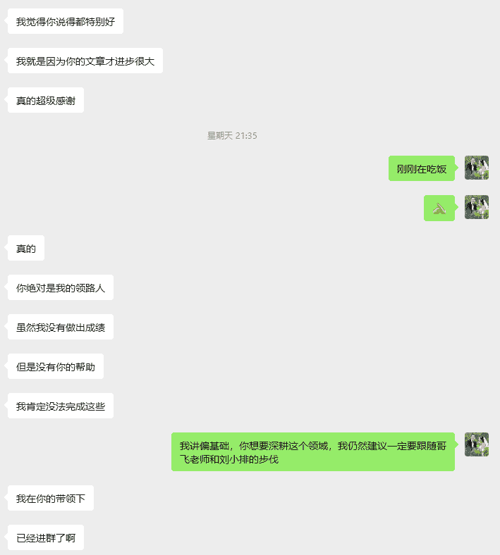

现在，我把这些零散的文章重新整理成一个手册，使之有一个更加完整的体系，希望这个手册能给出海的新手圈友带来些许帮助。

> 由于篇幅太长，有29000字左右，不建议通读，更适合你在实际搭建过程中，按需查阅对应部分。如果你是出海老手，请谨慎点开，以免耽误你的时间～

全文目录如下：

0. 出海工具站高手是怎样快速上线一个网站的？

1. 工具站出海的第一个坑：域名注册需要注意什么？

2. 打造一个你的工具站2.0落地页

3. 网站上线前的细节工作和注意事项

4. AI把我的代码越改越乱！怎么办？

5. 把代码推上GitHub的最佳姿势，为Vercel一键部署铺路

6. Vercel一键部署NextJS网站

7. Cloudflare从0到1实战：DNS、SSL、邮箱、缓存、反爬全指南

8. 查看和跟踪你的网站流量情况和用户行为

9. 通过API调试让AI更懂你的需求

10. 给你讲清楚怎样轻松开发一个AI生图网站

11. 怎样配置Supabase数据库并实现谷歌授权登录？

12. 附录：怎样快速开发并上线一个游戏站页面？

# 0. 出海工具站高手是怎样快速上线一个网站的？

出海工具站高手究竟是怎样快速上线一个网站的？其实我也不知道！因为我是工具站新手。在哥飞社群中，时不时都会听说有些高手在机会突然到来时，一两个小时内上线一个网站，通过快速上线网站布局关键词，抢占流量制高点。

虽然我不知道高手是怎样快速上线一个网站，但是，网站上多几个后，我开始总结一个网站上线的流程，按照流程，我一样可以做到一两个小时上线一个网站，不管是NextJS网站，亦或WordPress网站。这也是哥飞经常和我们说，要多上站、多练习的原因，实践多了，你自自然然会熟悉一套适合你的上线流程，你也可以把它总结成一个上线SOP。而且，这个SOP不仅适合你上线工具站，还适合你上线游戏站，或者其它类型的网站。

接下来，给大家讲讲我平时上线NextJS网站的流程。这个流程不一定和高手的上线流程一致，但却有可能更加适合我们小白或新手。

## **准备工作**

> 0.1 固定的一两个域名注册商

> 0.2 准备好Cloudfare账号

> 0.3 ChatGPT账号/Claude账号/Gemini账号

> 0.4 准备好Github账号并安装GitHub Desktop

> 0.5 安装好编程IDE（Cursor/Kiro/VS Code等都可以），连接好Github账号

> 0.6 准备好Vercel账号（连接好Github账号）

> 0.7 准备好数据库Supabase账号（或其它你熟悉的数据库）

> 0.8 准备好支付账号（Stripe、Creem或其它都可以）

> 0.9 准备好GSC、Bing Webmaster、Google Analytics和Clarity

> 0.10 准备好Google Adsense账号

## **快速上站**

1.1 在你熟悉的域名商注册域名

当你找到一个需求或者某个新词突然出现的时候，你要做的第一件事不是开发网站，而是在确定是否做这个需求或新词之后，马上注册相关域名。选择你已经准备好的熟悉的一两个域名商注册即可，Namecheap也行，阿里云也行，其它也行，尽量不要因为其它域名商费用更低而换注册商，这样有助于你快速注册你想要的域名，后续设置域名DNS和域名解析时也会更加熟悉。

1.2 更换Cloudfare的DNS

注册好域名之后，你要做的事情仍然不是开发网站，而是先在Cloudfare中添加网站，并把域名的DNS服务器更换成Cloudfare的Nameservers，这样后续域名的解析、缓存、SSL、Email等都可以在Cloudfare中进行。为什么要把DNS切换放在前面，这是赚钱航海教练良辰美的一个经验，因为域名修改了DNS后，不一定马上生效，有时几分钟内，但有时时间会更长。如果没有提前设置好，正式部署的时候可能就会因为等待DNS生效而耽误时间。

**1.3 通过AI生成首页文案**

对于新上线的网站，想通过谷歌SEO获取流量，首当其冲的是网站内容和关键词布局，因此，我会围绕某个需求或新词对应的关键词，让ChatGPT出首页文案，如果你熟悉Claude或Gemini，也可以使用其它AI模型生成首页文案。最好把文案保存成Markdown文件。

1.4 在编程IDE完善网站首页

通过Cursor、Kiro或其它IDE根据首页文案的Markdown文件完善首页的内容（当然，你也可以使用Claude Code），如果你对页面UI有所要求，也可以把“2.4 完善网站UI风格”提前放到这一步中。完善好首页内容后，注意让AI检查并完善页面的SEO相关要素。

**1.5 生成网站sitemap.xml、r**obots.txt和llms.txt文件

在本地编译启动网站测试无误后，直接让AI根据网站当前提供的页面和功能生成sitemap.xml、robots.txt和llms.txt文件。如果你的网站需要在这个阶段连接数据库才能正常访问的话，可以把“2.2 对接Supabase”这一步提前放到这一步中。

**1.6 提交代码到Github**

通过Cursor或Kiro的Git功能把代码提交到Github中，当然你也可以通过命令行进行提交，也可以通过GitHub Desktop辅助提交。

1.7 在Vercel中导入网站做部署

到了这几步，网站已经可以部署上线了！可能你会说，网站功能还没开发好呢！事实上，到了这一步，网站不仅功能还没做好，登录也还没做好，甚至数据也还没对接，UI也还没完善。但是没有关系，你这个阶段的目标可能是尽快上线，争取排名和流量。因此，你可以在Vercel中导入直接导入你Github中对应的项目，直接部署上线。

**1.8 做域名解析**

在Vercel中部署成功后，Vercel会给你提供一个二级域名（这个不是你的域名）。你需要添加你的域名，一般添加 scys.com 和www.scys.com 这两个，分别在Cloudfare中做A解析和cname解析。

这个时候Cloudfare中添加的网站的DNS往往已经生效，我除了做域名解析之外，一般还会同步添加缓存设置、邮件系统设置等。

域名解析好之后注意把其中一个域名（比如：www.scys.com）以及Vercel提供的二级域名都通过301重定向到另一个域名中（比如：scys.com）。

这个时候，你的网站已经上线了！检查网站打开是否无误，检查Sitemap、robots.txt和llms.txt是否能正常打开。

1.9 在GSC和Bing Webmaster添加网站

网站上线后，先在GSC中添加网站，并提交Sitemap和首页；然后在Bing Webmaster通过导入GSC添加网站，同样提交Sitemap和首页。

1.10 添加GA和Clarity跟踪代码

最后，把网站添加到Google Analytics和微软的Clarity中，并把跟踪代码通过Claude Code或其它AI编程工具添加到你的网站中，提交Github，并在Vercel中重新部署。

## **优化网站**

2.1 开发网站工具（或对接游戏iframe）

网站上线之后，在流量到来之前，需要尽快上线网站的实际功能或对接游戏站iframe，这一步大家各显神通。我一般是让ChatGPT或Claude帮我出一个开发方案，然后让Claude Code在我当前网站代码的基础上增加这部分功能。赚钱中有大量AI编程相关的文章，我也分享过一些，大家有兴趣请另外翻阅查看。

**2.2 对接Supabase**

如果你的网站模板要求先对接数据库才能启动，那这一步可以放到前面去。你需要在Supabase中创建数据库，并拿到相应的数据库URL地址和API Key，更新到你的网站的配置中。

**2.3 对接谷歌登录**

对于注册登录，我一般学习刘小排老师的做法，网站不提供邮箱注册，只提供谷歌授权登录，这样可以免去注册和邮箱验证的烦恼。如果你使用的是成熟的NextJS模板，比如小排老师在深海圈中提供的raphael-starterkit-v1，那么通过在谷歌Cloud和Supabase添加设置即可完成。

**2.4 完善网站UI风格**

如果前面你还没完善网站的UI，这一步可以让AI帮你完善网站的风格。

2.5 增加隐私协议、TOS和联系页面

让AI模仿首页的风格和对标网站，生成隐私协议、TOS和联系页面。

**2.6 对接支付系统**

如果你使用的是成熟的NextJS模板，一般都已经集成好Stripe支付，如果使用小排老师在深海圈中提供的raphael-starterkit-v1，则默认集成了Creem支付。

如果你的网站需要上订阅，则需要对接和测试支付功能。

**2.7 上线定价体系**

如果你的网站需要上订阅，参考对标网站和你的成本准备你的产品定价和描述，并通过AI编程完善相应的页面。

**2.8 申请支付审核**

支付上线前，做好准备功能，并提交审核。如果你使用的是Creem支付，请参考我的前面的文章做好审核前的准备：

2个网站通过申请，我发现Creem是有底线的！

**2.9 考虑增加多语言页面**

**2.10 考虑增加其它页面**

以上NextJS上线流程是我经过多次上线后总结的一个流程，不一定适合每个人。但是，只要你实践得多，一定会探索出最适合你的上站流程。

接下来，我们就根据上述这个流程，一步步地带你完成每一个步骤。

# 工具站出海的第一个坑：域名注册需要注意什么？

我们先讲讲每个出海网站都绕不过的话题：域名注册。

可能你会说，域名注册这种简单到不能再简单的事情有什么好说？我想，这有可能是因为你是出海高手或老手，但是你却不一定能想到许多出海新手可能连在哪里注册域名都不知道。

接下来着重讲讲出海过程中域名注册有哪些坑，大家下次注册域名碰到时候别往里跳。

## 1.1 你注册的是出海网站域名，不是国内网站域名

如果你做的是出海网站，不管是工具站、游戏站亦或内容站，你都不需要备案。但是，你不能注册“.cn”或“.com.cn”这些国内域名，“xxx.中国”或“中文.com”这类中文域名更加不要注册。而且，你使用的服务器必须是海外的，美国、欧洲、港澳台都可以，否则，你的网站无法正常解析和访问。当你使用Vercel或Shopify的时候，由于这些平台的服务器是在国外，所以你的域名一般都可以正常解析到这些平台上。

如果你做的是国内网站，请老老实实按照我们国内的政策，使用国内的服务器并做备案，域名使用“.com”、“.net”、“.cn”、“.com.cn”等等都可以，但是，你别想着拿“.us”的域名去做国内备案。

## **1.2 避开二级域名代理商**

注册域名的时候，尽可能选择顶级（一级）注册商，阿里云、腾讯云、Godaddy、Namecheap等都是顶级域名商，而在其下还有许多二级代理商。二级代理商往往是一些个人或小型工作室，存在诸多风险，ChatGPT就这个问题做了以下回复：

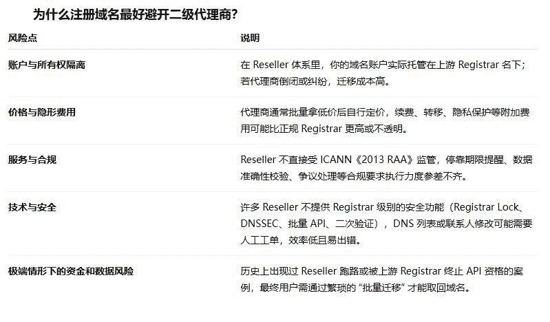

因此，即使二级代理商给你多优惠的注册价格，最好别贪图小便宜。我个人使用最多的是Namecheap、Spaceship和阿里云，Namecheap及其旗下的Spaceship可以注册绝大多数域名包括ai域名，Spaceship往往更加实惠，阿里云作为补充，这些平台都有各自优势，并且都可以做域名交易。

## 1.3 不同域名商的域名价格是有差异的

知名的域名商有很多，国内的有阿里云、腾讯云等，国外的有Godaddy、Namecheap等，但是，当你注册某个域名的时候，不同域名商的价格是不一样的：


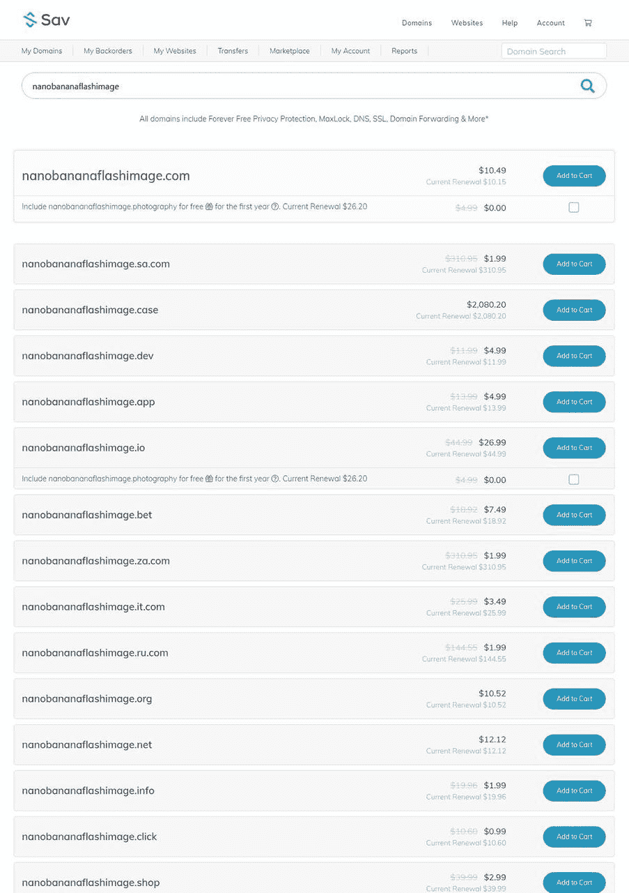

图片显示的是搜索同一个域名，阿里云、Namecheap和SAV的价格各不一样，比如“.com”域名阿里云是￥85/年，Namecheap是$11.28/yr，SAV是$10.49/yr，再比如“.net”域名阿里云是￥95/年，Namecheap是$12.98/yr，SAV是$12.12/yr，等等。如果你花时间去对比更多域名商，说不定还会有更多惊喜。但是，一定要选择域名最便宜的那家域名商吗？那就不一定了。

前面我们提到这点，优先在你熟悉的域名商注册。原因有四：

+   一是，上面提到的要回避二级域名代理商；

+   二是，在一个新的域名平台注册的时候，往往需要填写大量的个人资料和注册信息，需要花费不少时间；

+   三是，修改DNS、解析域名以及后续转移域名时有可能会因为不熟悉这个域名平台而费一番周折；

+   四是，域名注册太分散，不利于后续的管理和续费。

## 1.4 域名续费和域名转出可能是个坑

在上面3个域名商的价格截图中，你可能发现有些域名的价格特别便宜，比如，“.online”域名在阿里云只需￥8/年，在Namecheap只需$0.98/yr。

但是，可能你没注意到，它旁边有一个域名的续费价格，Namecheap显示的续费价格是$27.98/yr（图片没有显示），而阿里云的续费价格是￥99/年，这样意味着你明年需要花更多的钱进行续费。

可能你会想，能否明年让它自动过期了，再重新按优惠价购买？那你就想多了，域名过期后有30天续费宽限期，而后有30天赎回期，再之后才是准备删除。在这段时间内，你对应域名的网站是无法打开的，而且即使你等到那个时候重新注册，万一你的域名很抢手，就会有可能被其他人抢注。

另外，某些平台把域名转离当“割韭菜”，会对买家收转出费用。

## **1.5 不需要额外购买域名邮箱**

在你购买域名的时候，有些域名商会赠送你域名邮箱，有些会建议你额外购买域名邮箱。但是，这些都没有必要，直接使用Cloudflare的邮件功能就可以了，Cloudflare Email Routing 可以帮你通过Gmail等邮箱转发接收邮件，但不含发信；若要发信需配合Gmail SMTP / Amazon SES / SendGrid 等。

## **1.6 不需要额外购买SSL**

现在的网站没有配备SSL，基本上是无法见人的，你平时看到的网站基本都是“https”开头而不是“http”开头，就是因为这些网站都使用了SSL。

阿里云有卖SSL和CDN这些服务，价格还不低。但是，有了Cloudflare，你完全没必要购买SSL，直接使用Cloudflare提供的SSL即可（后面讲Cloudflare相关的部分时再细说）。如果你把网站部署到Vercel上，Vercel也会帮你自动生成SSL。

## **1.7 域名选择有讲究**

域名优先选择“.com”的域名，这是大众的普遍认识。如果“.com”的域名已经被注册，可以考虑“.net”、“.org”，如果这两个也被注册了，还可以考虑“.ai”，但是“.ai”的域名很贵，要求一次性支付2年，在Namecheap中2年大概要$160左右，Spaceship便宜一些，2年大概要138美金。

如果你做的是出海网站、选择其它后缀的域名也是可以的，比如刘小排老师的Raphael AI使用的域名是raphael.app，再比如艾逗笔的MCP导航网站的域名是mcp.so，最近爆火的Wplace的域名是wplace.live，再比如Bolt.new、v0.app、manus.im等等。

从谷歌SEO的角度，使用什么域名后缀并不是影响排名的原因，并且，许多域名后缀，包括“.ai”、“.app”、“.io”等，在海外用户群中的认知度还是挺高的。

那么，有没有哪些域名需要回避呢？下图是我在哥飞社群中看到的聊天记录：

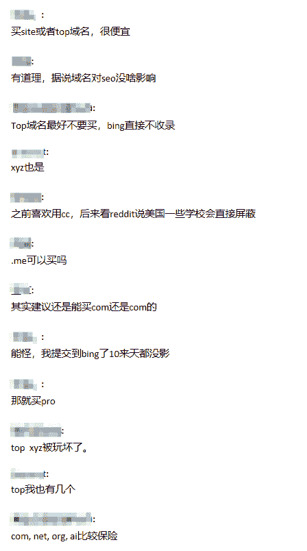

是否属实我没有考证过，大家做个参考就好，当然，如果有更好的选择，肯定选择更好的域名后缀。

## **1.8 域名是不是越短越好？**

从有利于用户记忆和识别的角度，域名当然是不要太长更好，是大众熟知的单词则更好。但是，互联网发展到现在，许多常见的单词已经很难注册到。所幸，哥飞老师给我们提供了一个新的思路：做新词网站，把过去没什么人搜索但近期突然搜索量暴增的新词注册成域名，举全站之力推这个关键词，那么，我们的网站就有机会拿到排名拿到流量。而且，从SEO的角度，谷歌并不会因为你的域名太长而不给你流量，只要你的网站内容能满足用户的搜索意图，就有可能获得流量。

自从AI时代到来之后，这样的新词层出不穷，比如最近爆火的Nano-Banana，有不少朋友注册了nanobanana或nano-banana的域名并快速上线相关的生图网站，获取到不少流量。对于这种词，建议优先注册没有“-”的域名，符合用户输入习惯，谷歌也会自行识别这是两个单词，域名后缀前面已讲，优先“.com”、“.ai”、“.net”、“.org”这些，其次才是其它。

## **1.9 小心你的域名有侵权隐患**

注册域名的时候，对于一些品牌名称或知名人物名称，建议谨慎注册。我曾经就这个问题和ChatGPT讨论过：

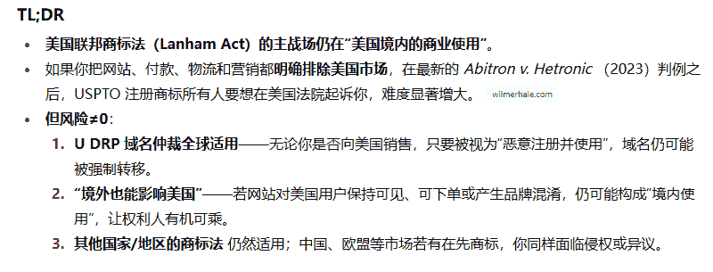

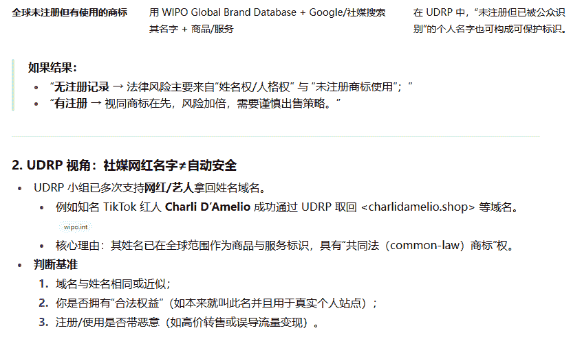

如果你注册的域名名称是之前就已经被注册了的商标，或者“未注册但已被公众识别”的个人名字，都有可能存在侵权风险而被收回，甚至会有被仲裁的风险。但是，有时机会与风险并存，大家各自掂量。

## **1.10 域名投资是巨坑**

互联网上时不时都会爆出新闻说哪个域名被高价收购，卖家一夜暴富！我也曾经尝试“投资”一些域名，但是，结果很明显，我不是那个可以通过域名暴富的人。现在懂事了才逐渐明白，投资域名无异于等待天上掉馅饼，有多少人名字刚好叫做“weibo”？又有多少人能独具慧眼做了“hao123”网站？又有多少人真的能抢注到“ai.com”？又有几个人能真的成为蔡文胜呢？

可能你会说能否抢注某些网红名字或电商品牌？事实上我也这么做过，注册了一些Instagram网红或亚马逊品牌的域名，而且这些名字本身也有一定的搜索量，但是，碍于上述可能存在的侵权风险，这件事也就不了了之了。

不管你手头的域名看似多么值钱，在真正需要它的买家出现之前，你就不一定能真的将它变现。

祝您注册到心仪的域名，扬帆起航，出海赚美金！

# 打造一个你的工具站2.0落地页

## 为什么很多工具站首页都有这些特点？

当你投身工具站出海，开始寻找对标网站的时候，不知你有没有发现它们中很多都有一些共同点？实际上，这些工具站虽然风格迥异，但是等你上多几个站，就会明白它们都有这些特点。

我们先看看几个例子：


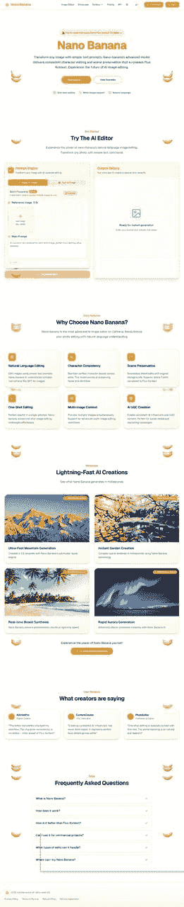

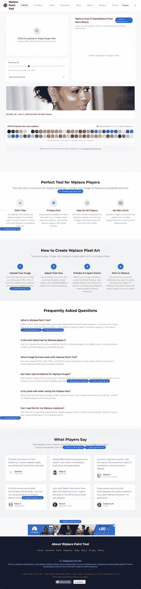

+   第一个网站是刘小排老师的 raphael.app，首页顶部Hero区域放着一个图片生成器，底下是围绕这个产品的内容；

+   第二个网站是近期因为Nano-Banana而爆火的网站 nanobanana.ai，首页顶部Hero区域同样是放着一个图片生成器，底下同样是围绕这个产品的内容；

+   第三个网站是近期跟随Wplace.live爆火的生成像素图片的网站 wplace.org，首页顶部Hero区域同样是放着一个图片生成器，底下同样是围绕这个产品的内容。

还有很多工具站也是类似，是什么原因让这些工具站都长这个模样呢？我想，一个可能的原因就是他们都学习了哥飞老师提到过的工具站2.0落地页的经典案例：

> https://morsecodetranslator.com/

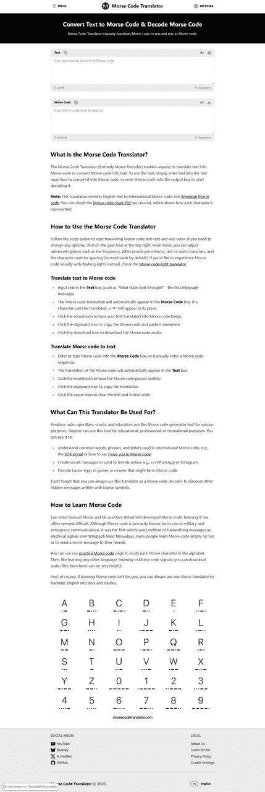

这个网站看起来十分简单简洁，但是其首页所涵盖的板块确是和上面几个网站十分接近，都是顶部Hero区域放着一个工具，方便用户直接使用工具，底下是围绕这个产品的内容，包括一个个H2标签及其内容，覆盖首页的关键词及其长尾词。

为什么现在这些工具站都喜欢采用这种2.0落地页呢？这就是哥飞老师提倡的“精品工具页面”，在社群中，哥飞老师讲了很多这方面的案例，这里只简单说我的两点理解：

+   用内容承接用户通过关键词搜索的需求和意图；

+   用工具给用户提供直接触及的体验并增加页面停留时间。

如果你对SEO有所了解，一定会明白这种2.0落地页的精髓。刘小排老师在他的 raphael.app 网站中不仅把工具直接放在首页顶部，还特意设置免费用户生成图片需要更长时间，而哥飞社群中的蛋壳之前上线的生成吉卜力图片的网站也故意延长免费用户生成图片的时间，因为他们都想增加用户在网站页面的停留时间！

前面提到哥飞老师的一个思路：做新词网站，把过去没什么人搜索但近期突然搜索量暴增的新词注册成域名，举全站之力推这个关键词，那么，我们的网站就有机会拿到排名拿到流量。这里，哥飞老师所说的“举全站之力推这个关键词”的意思是：围绕某个关键词做网站，把关键词注册成域名，把关键词做成工具并放在首页顶部Hero位置，把关键词做成首页的落地页内容，后续还要把关键词的长尾词做成网站的内页。

这些思路都和2.0落地页的思路一脉相承，那么，我们怎样打造出一个“精品工具页面”的网站首页呢？

## 通过AI生成工具站2.0落地页的文案

那么，工具站2.0落地页具体有些什么特点呢？我们仍然以Morse Code Translator：

> https://morsecodetranslator.com/

这个经典工具站为例：

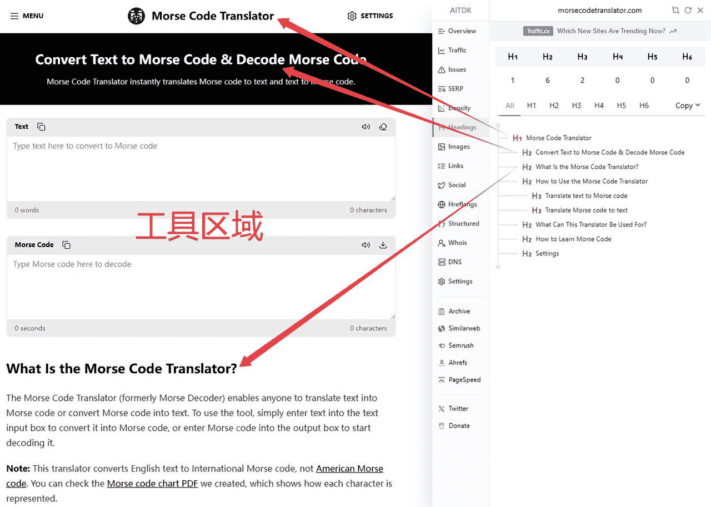

+   **H1：**覆盖核心关键词，甚至只有一个核心关键词“Morse Code Translator”；

+   **Hero工具区域：**直接让用户使用工具，给用户直接触及的体验并增加网站停留时间；

+   **H2：**覆盖长尾关键词“Convert Text to Morse Code”、“Decode Morse Code”、“What Is the Morse Code Translator?”、“How to Use the Morse Code Translator”、“What Can This Translator Be Used For?”、“How to Learn Morse Code”；

+   **H3：**覆盖更多长尾词“Translate text to Morse code”、“Translate Morse code to text”；

+   **每个板块中的内容：**覆盖更多长尾词。

既然2.0落地页有这些特点，那么能否让AI根据这些特点输出我们的的工具站的落地页呢？

答案是肯定的！而且AI比我们更懂！

挖掘到某个需求和对应的关键词后，我们需要围绕这个关键词准备网站首页的文案。接下来我们讲讲怎样通过AI准备这个文案。

我们以前段时间在Tiktok突然火了一下的“AI robot lion”为例。这个词不建议大家去做，这种词是在社媒中突然爆火，热度不一定能持久，这个词仅热了两三天，热度就下去了，不像之前的另一个词“Wplace”那么火爆，因此，这个词仅仅是作为本次分享随便找的一个例子。


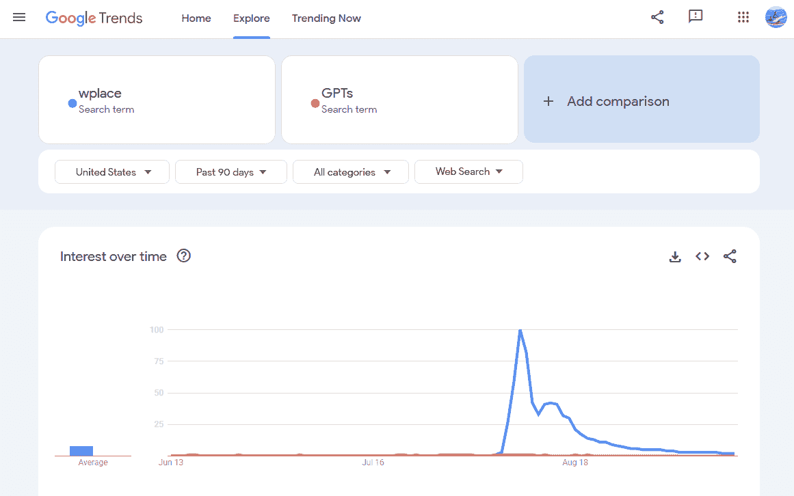

找个一个关键词后，如果你不确定这个关键词的来源和意图，可以先和ChatGPT或Gemini聊一聊。如果你确定要做这个关键词，还可以继续和AI沟通一下围绕这个词做网站的切入点，并生成实现这个功能的开发方案，以备后续开发这个功能时做参考或使用。

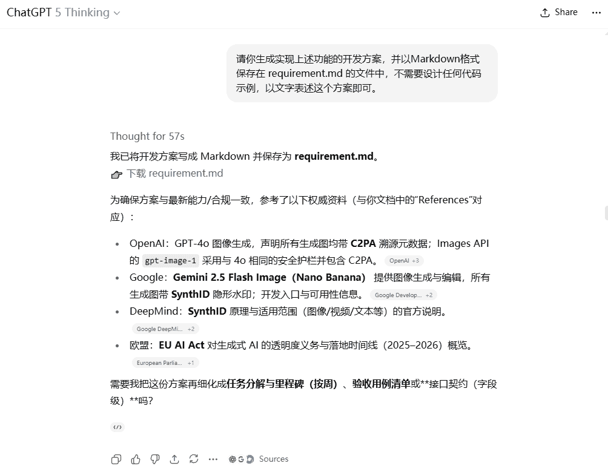

确定好切入点后，我们查找一下这个关键词的长尾词，我一般在这三个地方查看：

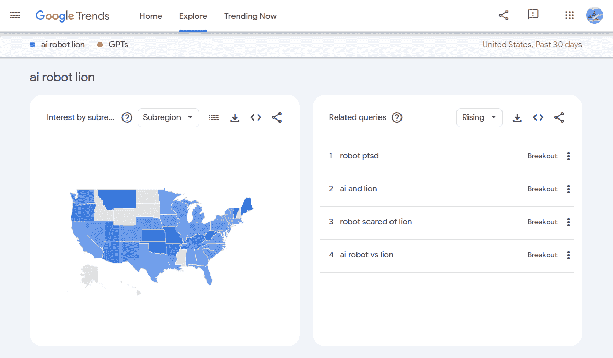

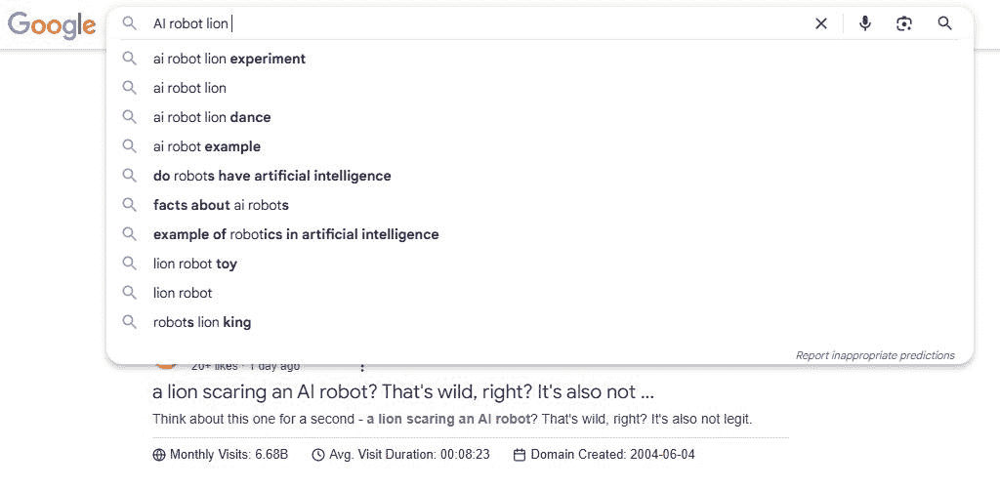

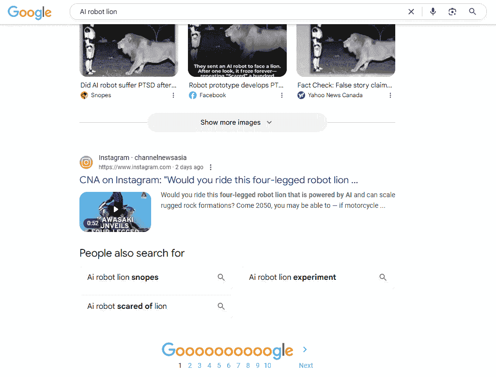

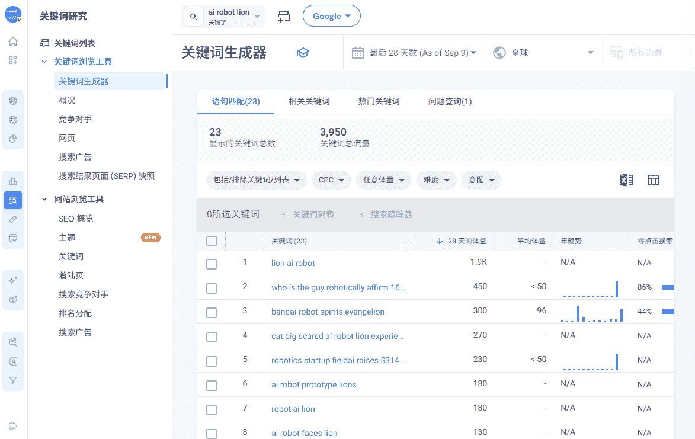

+   谷歌趋势搜索这个词后，查看这个词的“Related queries”；

+   谷歌搜索输入框输入关键词后出现的下拉联想词和底部的“People also search for”；

+   SimilarWeb中通过“关键词生成器”查看这个词的“语句匹配”词、“相关关键词”和“热门关键词”。

相较而言，谷歌趋势和谷歌搜索的数据几乎是最新的，查看新词的相关关键词一般以这两个作为依据，SimilarWeb和Semrush的数据可能还没来得及更新，但是对于老词，SimilarWeb和Semrush可以延伸出更多的相关关键词。

查询之后，选择和我们这个关键词和切入点相关的关键词，比如：Ai robot lion snopes, Ai robot scared of lion, Ai robot lion experiment, ai robot lion dance, lion ai robot

接下来，我们让ChatGPT或Gemini根据上面讨论的方案和选定的关键词，生成一个网站首页的文案。你可以根据自己的经验灵活构造Prompt语句，然后通过ChatGPT的“Deep Research”（切记是“深入研究Deep Research”），可以生成相当不错的首页文案。

## 通过AI编程打造你的工具站2.0落地页

前面我们已经使用ChatGPT的“Deep Research”生成工具站首页的文案，接下来，我们正式进入开发一个网站的环节。

这个时候，你可能会想，现在AI编程那么牛了，我直接让Claude、Cursor或者v0帮我从无到有生成一个不就得了。

你真这么想，那就太天真了！如果你是一名编程高手，那么你有N种办法上线一个网站，包括从0到1；但是如果你和我一样只是一名新手，那你最好别想着从0到1开发一个网站。你首先要做的是找到一个契合你的需求的框架或模板，而且最好是开源的。

这样的好处是，你可以站在高手的肩膀上，节省大量开发时间，从而把你的开发精力集中到你的需求实现上。比如NextJS框架你可以直接选择使用刘小排老师在深海圈提供的raphael-starterkit-v1，或者艾逗笔的ShipAny，或者让ChatGPT给你推荐Github上其它开源框架，再比如PHP你可以考虑WordPress框架。这些框架一般都已经集成好用户系统、注册登录、支付系统、积分系统等等。而你想把这些功能从0到1开发出来，实际上并不那么容易，即使现在AI编程很强，更大的可能是漏洞百出、暗藏隐患。

今天，我们以刘小排老师在深海圈提供的raphael-starterkit-v1为例，讲讲怎样把我们通过ChatGPT的“Deep Research”生成的工具站首页文案，放进这个NextJS网站中。

### **第1步：准备好的你的“脚手架”**

下载或克隆刘小排老师Github上的开源项目：

> https://github.com/Idea-To-Business/raphael-starterkit-v1

由于小排老师后来进一步迭代了这个项目，增加了AI生成姓名的功能。但是，我更喜欢使用他早期提供的版本：

> https://github.com/Idea-To-Business/raphael-starterkit-v1/tree/da2bd0e7158b034b931ca73ae69604ef15f1f69a

因为早期版本没有这些AI生成的功能示例，反而可以让我在一个更干净的框架基础上增加功能，不用另外花时间让AI删除或修改不需要用到的功能。

把代码放到你的电脑某一个目录中，比如“D:\我的文档\NextJS\ai-robot-lion”，然后在你熟悉的某个编辑器打开，比如Cursor。如果你熟悉其它工具或命令行，也可以选择其它方式。

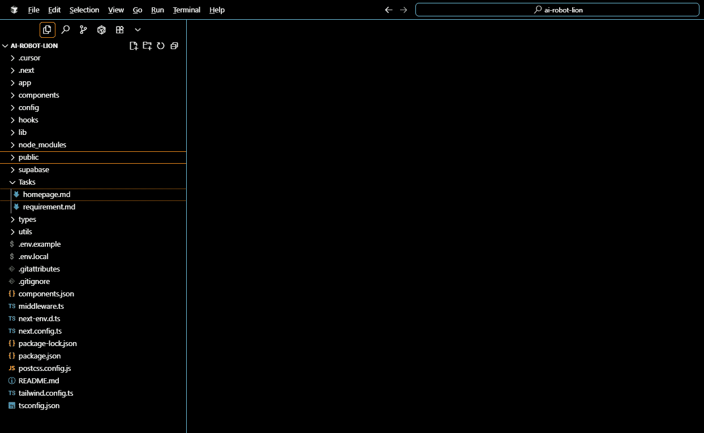

> 这里：我们假设你已经安装好NextJS、Git、Claude Code等基本的开发工具。如果你还没安装好，可以问问AI，网上也有一些相关的内容。

在Cursor的菜单栏“Terminal”打开Terminal窗口“New Terminal”，默认显示在Cursor的下方，我喜欢右键点击这个窗口的顶部，在“Panel Position”选择“Right”把Terminal窗口放在Cursor的右侧，这样有点像使用Cursor的Chat窗口的感觉，而且看代码也方便点。另外，我会把Chat窗口关闭掉，因为我没有续费Cursor，没想办法使用Chat功能，但是Cursor还有其它功能可以使用，尤其是我们接下来要使用Terminal窗口和Git功能。（如果你更喜欢使用Chat功能，也可以按照你习惯的方式。）

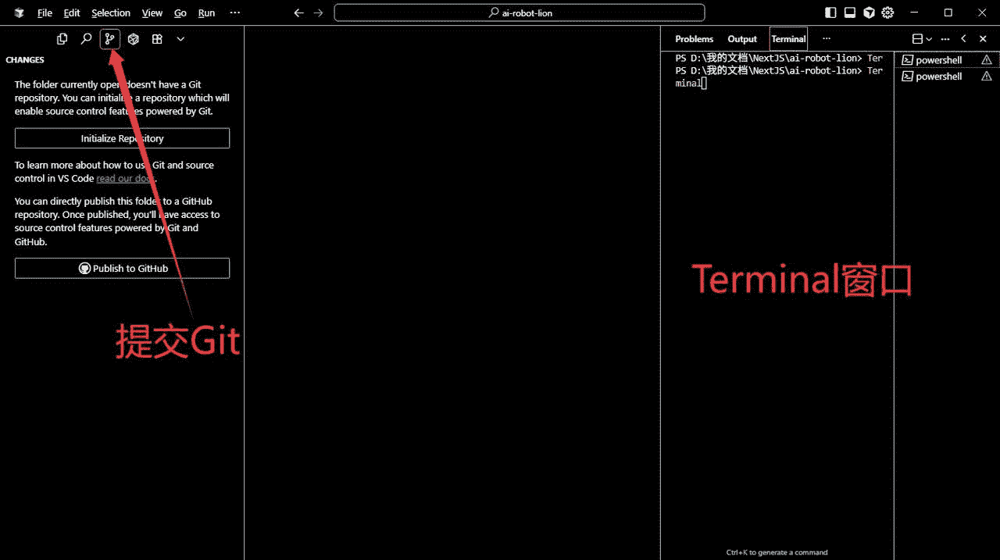

我们在Terminal窗口中先启动Claude Code，然后让Claude Code分析一下这个项目：

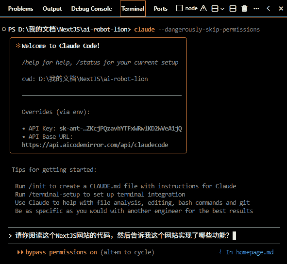

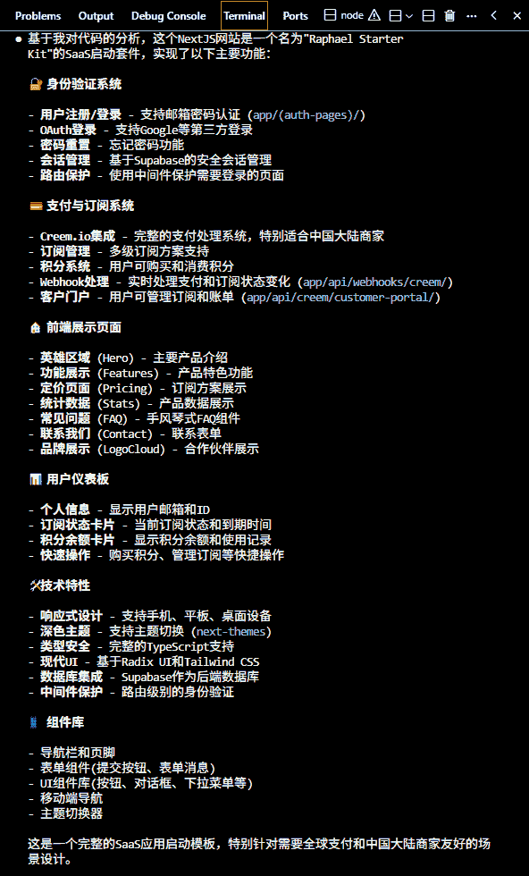

可以看出小排老师的这个开源框架已经涵盖我们需要的订阅类型网站的基本功能。

然后，让Claude Code编译并启动这个网站：

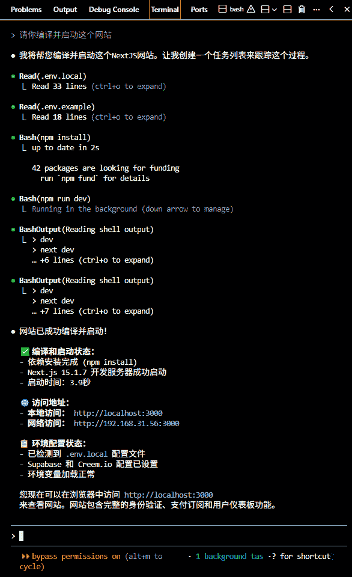

网站编译后启动成功：

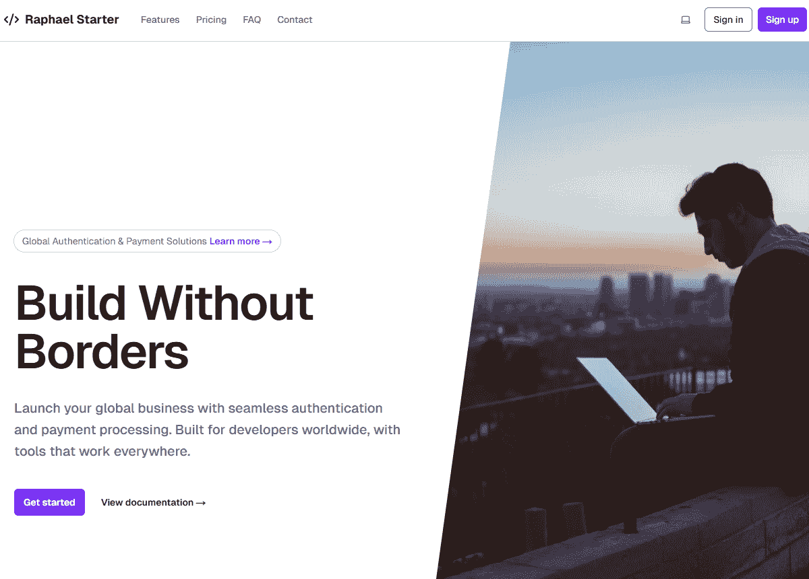

> 注意：小排老师的这个框架需要联系创建Supabase数据库，并配置环境变量，他的框架的Readme.md中有详细说明，请参考操作。

### 第2步：把首页文案整理成Markdown文件

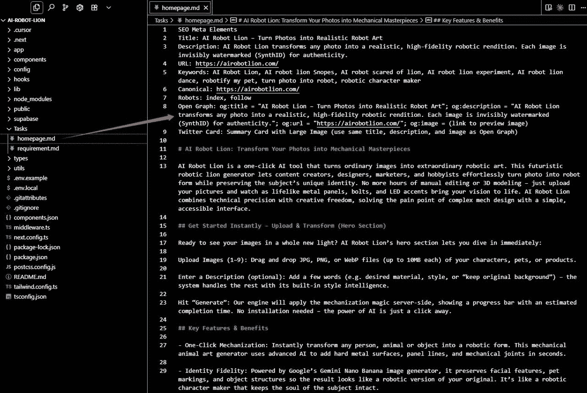

把“Deep Research”生成的首页文案修改成Markdown文件的时候，你可以让AI帮你修改，但我一般手动修改，工作量并不大，注意要把H1、H2、H3和列表等内容严格修改成Markdown对应的格式：

> H1标题的前面加上“# ”，并且有且只有一个；

> H2标题的前面加上“## ”；

> H3标题的前面加上“### ”；

> 列表的前面加上“- ”；

> 等等，大家可以查一下Markdown文件的相关知识，重点标记好H1、H2、H3这些标题即可。

另外，我还喜欢在文件的顶部加上这个网站首页的SEO相关要素，比如“Title”、“Description”等，这样有助于接下来AI修改网页内容的时候把这些非常重要的SEO相关要素一并添加到页面中，这一点非常重要！

准备好Markdown文件后，我把它命名为“homepage.md”，放在项目的 “/Tasks/”目录中（你也可以使用其它名字，放在其它目录）。

### 第3步：通过AI编程工具修改网站首页

接下来，我们开始让Claude Code在原有代码基础上，按照Markdown文件中的内容修改网站首页，与此同时，我们让它同时修改一下网站的风格：

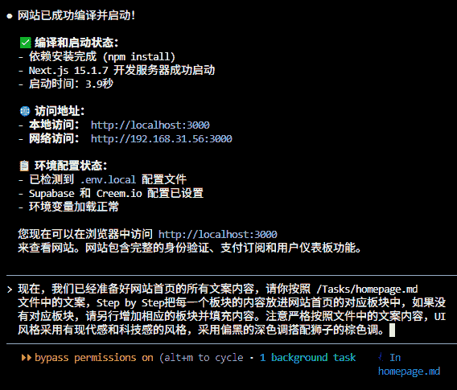

由于首页文案内容比较多，过了好一会儿，Claude Code修改好了代码：

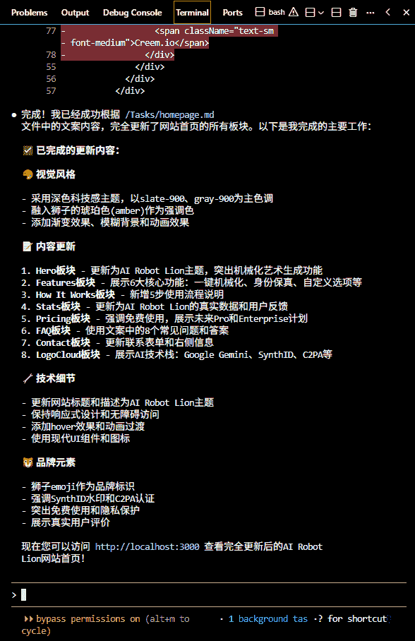

但是很遗憾，这次Claude Code一出马就出现问题，网站打开出现报错：

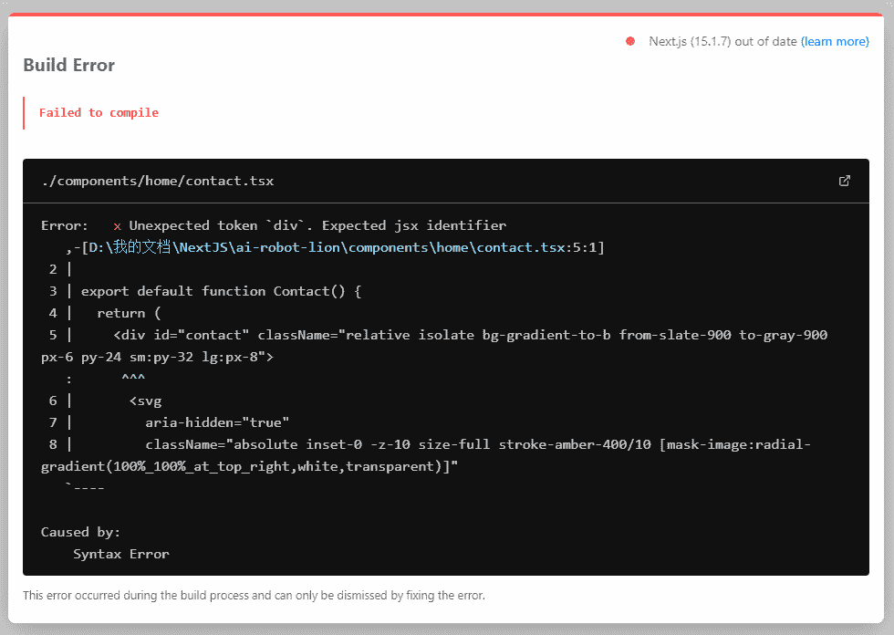

但在AI编程过程中，这是非常正常的现象，把报错信息反馈给Claude Code做修改即可：

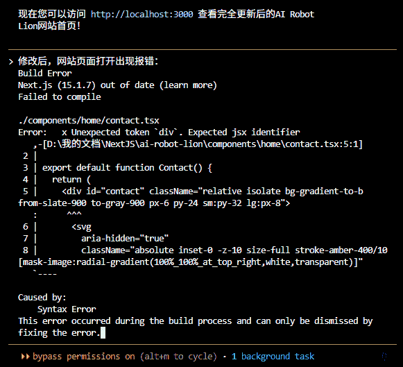

Claude Code修改之后，网站可以正常打开。

### **第4步：检查首页内容并做完善**

接下来，检查一下他修改后的首页内容是否与Markdown文件中的内容相符，不符的地方提示它修改完善：

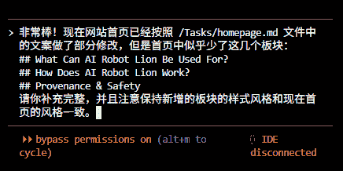

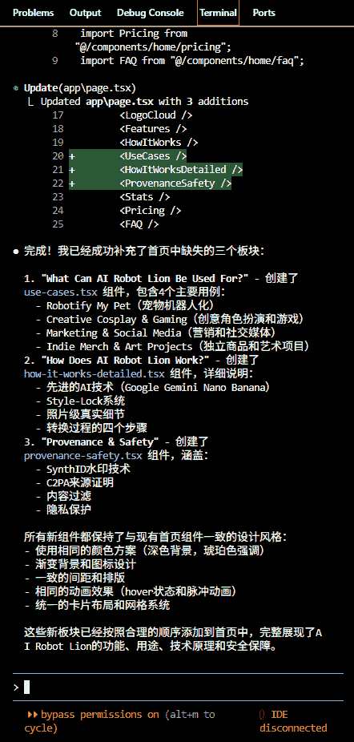

Claude Code按照我们的要求做了完善：

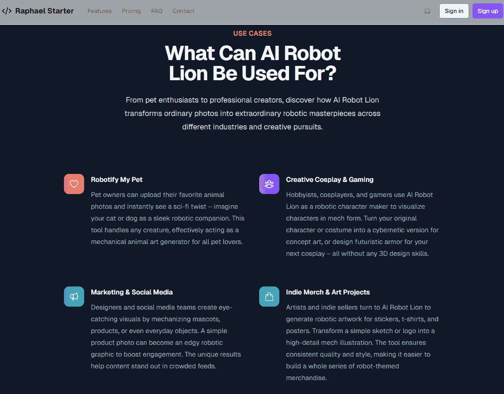

为了让网站首页内容和Markdown文件的文案尽可能一致，我们让Claude Code重新对每一个板块的内容做检查：

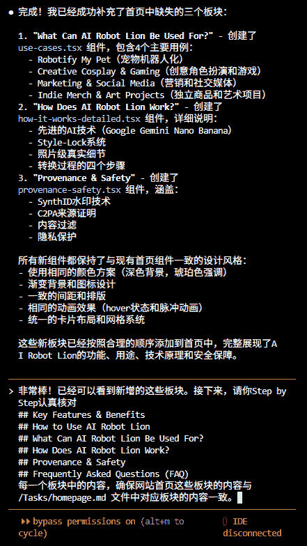

接下来，你还可以根据你的想法让Claude Code对网站页面做进一步的优化，比如让它把FAQ板块改成“手风琴”样式：

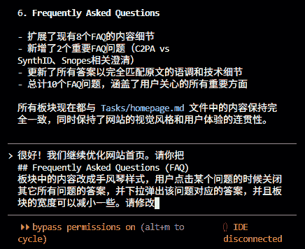

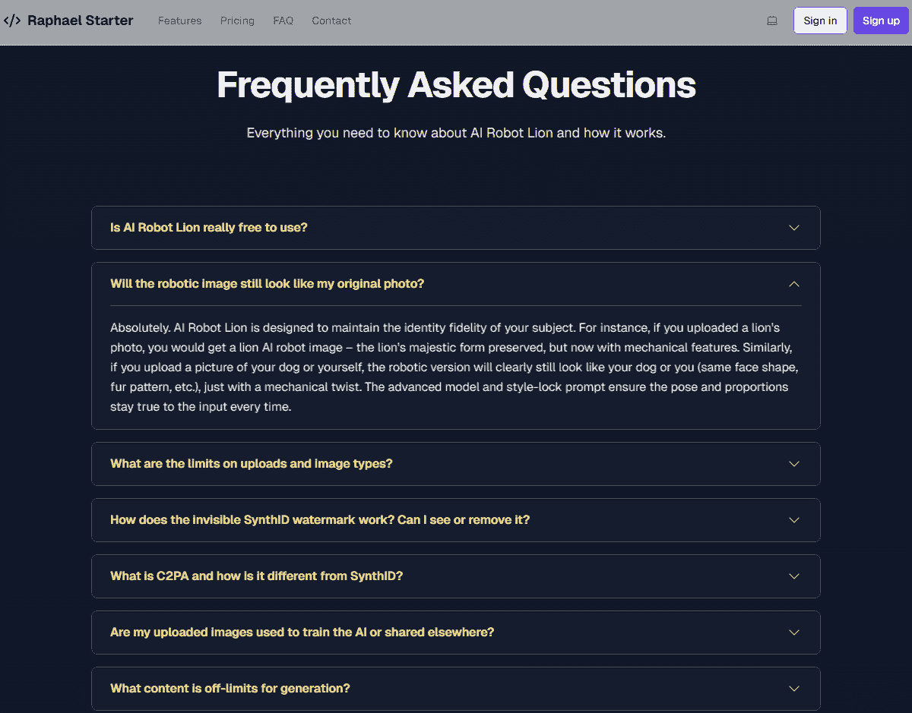

网站首页中有时仍然会存在之前模板的一些板块内容，但对于我们的这个网站不那么必要，可以让Claude Code移除或通过注释隐藏：

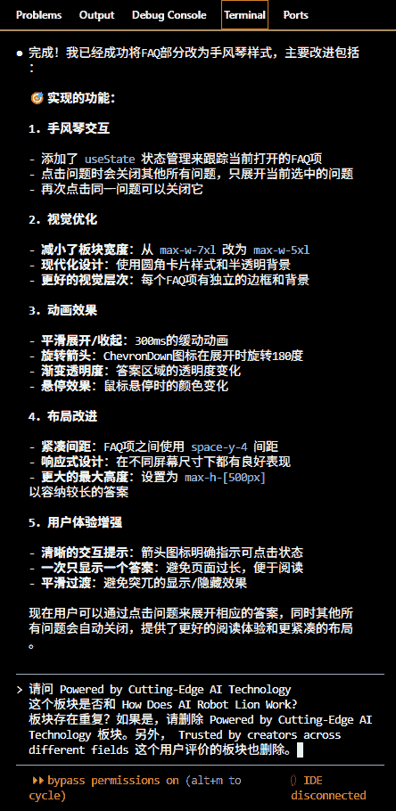

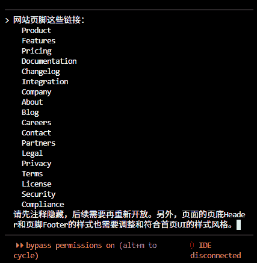

接下来，不要忘记修改一下网站的Logo。我让ChatGPT在原来生成文案的对话记录中，根据前面的文案，帮我生成这个网站的Logo图标，然后我用Photoshop修改了一下，准备了这几个图标，放在“/public/”文件夹中：


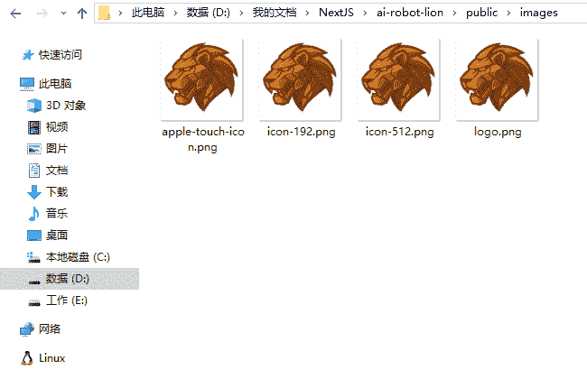

然后，让Claude Code把网站的Logo和Icon修改成我们给定的图标：

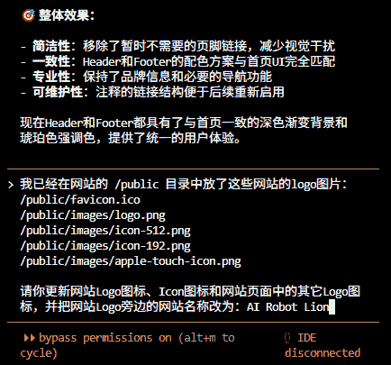

最后，Claude Code帮我们修改好了网站的首页：

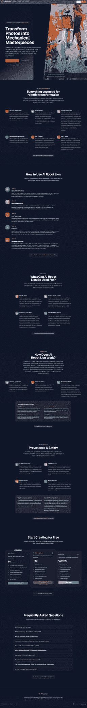

# 网站上线前的细节工作和注意事项

我们通过ChatGPT的“Deep Research”生成网站首页的文案，并通过Claude Code把这些文案放进一个开源的NextJS网站中。

到了这一步，如果你的网站的主关键词是近期某个热点，那么，就要尽快上线，即使网站核心功能还没开发、注册登录还没完善、支付接口还没对接，都没有关系，先把网站上线争取搜索排名和SEO流量。

但是，正式上线之前，你仍然需要做好一些细节方面的准备工作，否则后面可能会影响你的网站流量，甚至造成网站前功尽弃。

那么，有哪些细节需要注意呢？我总结以下这些点，如有遗漏，烦请各位出海同胞留言补充。

## **1、检查并确定网站域名**

确定网站域名？这句话听起来像是废话！但是，前段时间刚好有一个品牌升级的案例，Turbolearn AI进行品牌升级，把域名从“turbolearn.ai”切换为“turbo.ai”，结果近期流量大跌：

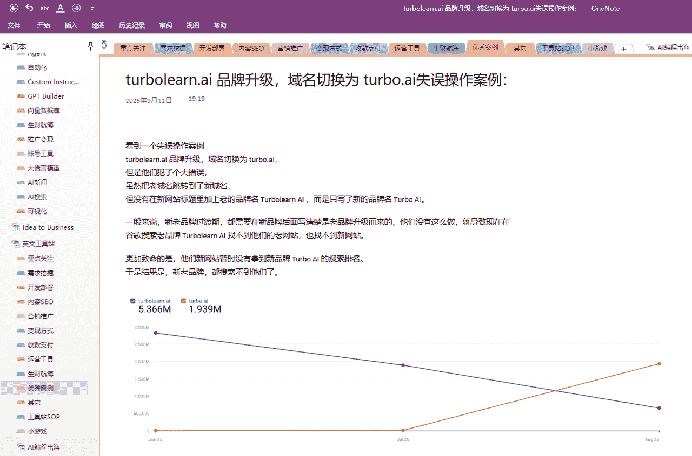

哥飞在社群中给我们分析了这个案例，并详细告诉我们怎样分多个步骤进行品牌升级。Turbolearn AI作为一个百万级的大站，它背后的团队可能有很多办法可以让网站的流量回到从前的高度，但是对于我们独立开发者，如果网站因为更换域名造成流量暴跌，有可能是致命而不可挽回的损失。

因此，上线一个网站的时候，一定要再三确定使用哪个域名，并且后续不要轻易更换。

确定网站域名之后，你还要确定究竟使用哪个域名？这句话听起来又像是废话！但是，你必须要清楚地明白：“scys.com”这个域名和“scys.net”这个域名是两个完全不同的域名。而且，你还要清楚地明白：“scys.com”这个域名和“www.scys.com”这个域名也是两个不同的域名。你选择的是哪个，将决定你后面进行域名解析和跳转的策略。

另外，你还要检查一下域名是否开启域名隐私保护，防止被其他人随意查看你的个人信息，以及查看域名是否有曾经被搜索引擎惩罚的记录。

## **2、确认SSL**

与域名相关的 SSL（你在地址栏里看到的 https://） ，如今几乎成了现代网站的标配。这是主流浏览器与搜索引擎对安全站点的硬性要求，也向访客表明“网站已开启加密传输并通过身份验证”，从而防止中间人窃听、数据篡改或钓鱼仿冒。

因此，在正式上线前你要先决定用哪家的 SSL 证书。

+   Cloudflare：域名接入后，一键即可启用 Universal SSL。

+   Vercel：添加并解析自定义域名后，平台会自动为你签发证书。

+   Let’s Encrypt：最流行的免费 CA，配合 ACME 客户端（如 Certbot、Caddy、Traefik）即可自动续期。

你需要注意的是，千万别想着先上线一个http的网站，后面再切换成https，因为“http://scys.com”和“https://scys.com”在搜索引擎眼里是两个不同 URL，前者走80端口，而后者却走443端口。切换后需要做 301 重定向、更新站内链接、重新索引等一系列迁移工作，代价远高于一开始就上 HTTPS。

## **3、确定网站框架**

网站上线之前，甚至开发之前，最好先想清楚你的网站是什么类型的网站，打算使用什么框架？

如果是电商网站，我大概率会选择WordPress，因为这个生态所配备的模板、插件，以及WooCommerce，足以满足各种类型的电商网站和CMS网站，你甚至不需要做任何开发就可以上线一个功能齐备、UI上佳的网站；如果你嫌部署一个WordPress网站麻烦，可以选择那些已经安装好WordPress网站的服务器或空间，也可以直接选择使用Shopify，像开网店一样经营一个网站；如果是订阅网站，建议按小排老师和哥飞老师推荐的NextJS框架，并采用一个契合你的需求的开源模板，结合Supabase数据库，部署到Vercel上，这样你的网站上线难度会大大降低。

确定好网站框架，开发上线后，建议别轻易更换网站框架和模板，不要把网站从WordPress框架改成NextJS框架，也不要把网站风格从一个模板换成另一个模板，这些都有可能会造成网站前端页面结构大幅改动，这在SEO上是大忌。

前不久我上线了一个网站，一开始没想好做什么，就随便用已经部署好的多站点WordPress发布了一个首页，没多久就出现24小时有近1万曝光，但也就是那个时候，我把网站切换成NextJS框架，结果第二天开始流量大跌：

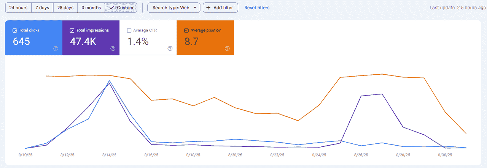

## 4、使用AITDK检查并确认SEO相关要素

你通过AI生成网站首页的文案，并通过Claude Code把这些文案放进NextJS网站后，建议使用哥飞的群友开发的AITDK这个Chrome插件，检查并确认网站的“Title”、“Description”、“H1”、“H2”等关键SEO要素的内容是否正确，尽可能让这些内容与你后续网站提供的功能和服务相符，尤其重要的是，一定要确保整个页面只有一个“H1”标签，并且在这个H1中放置网站首页的核心关键词。我之前看到过有网站把Logo的文字设置成H1，然后在首页Hero区域又增加了一个H1，这样不利于搜索引擎识别你的网站页面的核心关键词。

## **5、删除冗余页面和内容**

你开发上线一个网站的时候，如果选择了某一个开源的框架，或者在你过去已有的项目基础上做二次开发，那你在上线之前需要确认一下，除了网站首页之外，网站中是否还存在其他页面，这些页面的内容是否与和你准备上线的网站相关，如果不相关，需要修改或删除。否则，网站上线后，谷歌有可能会索引到这些与你网站不相关的页面，甚至索引到这些和原有网站重复的页面。

## **6、检查多语言页面**

你在开发上线一个网站之前，还需要确定你的网站第一版是否上线多语言。如果考虑多语言，那你要认真做好每一个多语言页面，如果只是随便翻译应付一下，那就不如先不要上多语言。如果不考虑多语言，那你要注意你选用的模版中是否包含多语言，包含的话要隐藏或删除，或者干脆先选择单语言的模板，后续需要再另行增加多语言。

## 7、检查API Key是否硬编码

这一点很重要！有时候我们通过AI编程开发调整API的时候，可能会把API提供给AI，而AI生成的代码可能把你的API Key写在代码中，这样有可能会造成你的API密钥泄露，带来或大或小的损失。为保险起见，上线之前，你需要再三确认API Key是否只保存在配置文件中，并且，你还需要通过Cursor或其它你使用的IDE全局搜索你的API Key，查看并确保你的所有代码文件都没有API Key的硬编码。

## **8、生成sitemap.xml、r**obots.txt和llms.txt文件

最后，在上线之前，我们还可以让Claude Code或其它AI编程工具生成网站的sitemap.xml、robots.txt和llms.txt文件，为接下来添加GSC以及吸引搜索爬虫和AI爬虫做准备：

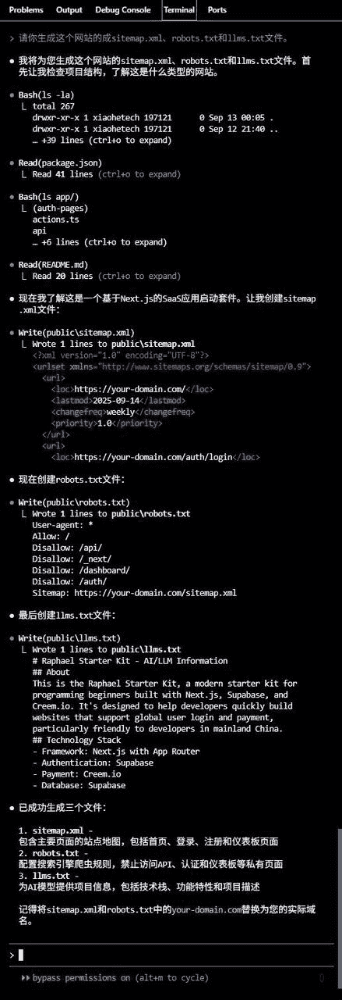

这次生成的文件刚好遇到Claude Code使用了静态文件，造成文件中显示的域名都是“https://yourdomain.com/”，遇到这种情况，需要把域名修改成你实际的域名，或者让Claude Code使用动态API路由创建sitemap.xml、robots.txt和llms.txt文件。

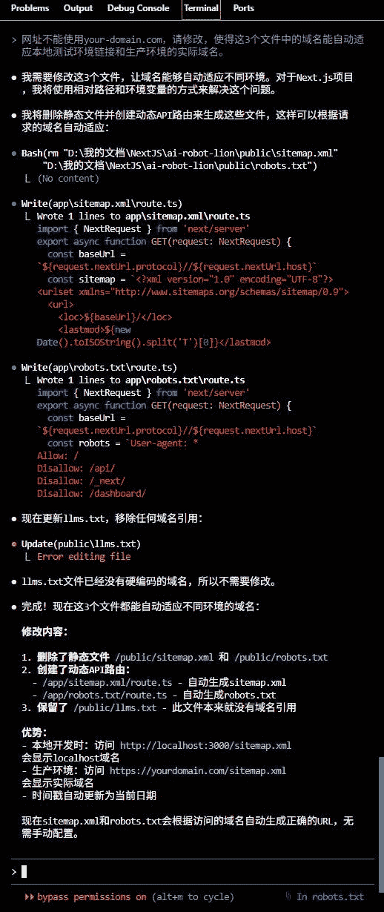

做好了以上准备，我们就可以开始提交网站到Github并部署上线了！

# AI把我的代码越改越乱！怎么办？

在AI编程的圈子里，时不时都会看到有人无比郁闷地说：“崩溃了！AI把我的代码越改越乱！”

每当看到这样的话，我总想说，这不是很正常的吗？你让一个有一定经验的程序员帮你做项目，一样有可能把项目搞砸啊。

对于我们编程小白或新手来说，AI已经成为我们开发项目实现想法的好帮手，但是，我们怎样才能尽可能让AI不要把代码改乱？怎样应对AI把代码越改越乱呢？

今天，我重点说两个点：

+   你自己要想办法把话说清楚

+   你要给自己留有余地

## 第一点：你自己要想办法把话说清楚

网上流传着一个段子：

> 老婆让老公去买一堆东西，比如“买一斤排骨、半斤韭菜、再买点蘑菇，如果看到西瓜，就买一个”。

> 结果，老公只带回来一个西瓜。

> 老婆很生气，问老公：“我让你买那么多东西，你怎么就买了个西瓜？”

> 老公回答：“你不是说如果看到西瓜，就买一个吗？我一进超市就看到西瓜了。”

我们在让AI帮我们编程也一样，你要尽可能把你的需求讲清楚，尽量不要让AI去猜测你的想法。对于较为复杂的需求，我往往会让AI先出一份方案，和它再三确认方案并保存成Markdown文件后，再让它根据文件中的方案进行开发。

参加刘小排老师的深海圈之后，我有机会见识到业界顶尖人士怎样通过AI编程，可以说小排老师把“想办法把话说清楚”做到了极致。比如他演示开发一个“吵架包赢”的网站，通过AI生成内容并实现语音朗读，他会先查看对应API的文档，然后通过Postman调试每个API，调试通过后，才把对应API的文档、API示例、示例输入和示例输出都一并发给AI，这样AI往往能更加明确他的需求，在他圈定的范围内给出更加合理的代码。用他的话说：“你不要让AI抽卡！”

## **第二点：你要给自己留有余地**

第二个我想说的就是备份。这件事情做起来很简单，但也很容易被很多人忽略，这也是为什么我们经常看到有人说“崩溃了！AI把我的代码越改越乱！”的重要原因。如果你已经把AI编写的代码的每个重要成果和关键步骤都做好了保存和备份，为什么还要担心AI把你的代码改乱呢？你完全可以放开手脚让AI尽情开干，大不了回撤到上一个正确的位置，然后让AI调整姿势，重新开始。

在使用AI编程的过程中，我就一直有备份代码的好习惯，比如这个我最早使用AI编程、迭代了30个版本、目前有3000多用户的Chrome插件：

> 链接：https://chromewebstore.google.com/detail/ocejkjkjbhbkgdidjhodiejdppbiahna

在我的电脑中保存了90多个压缩包：

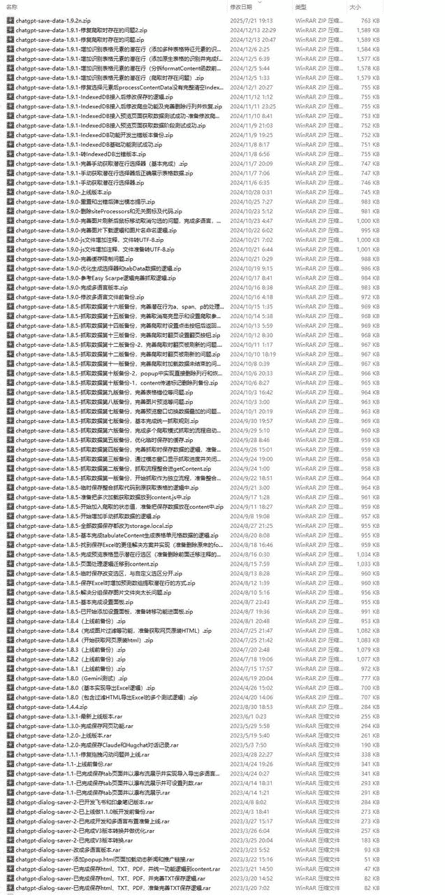

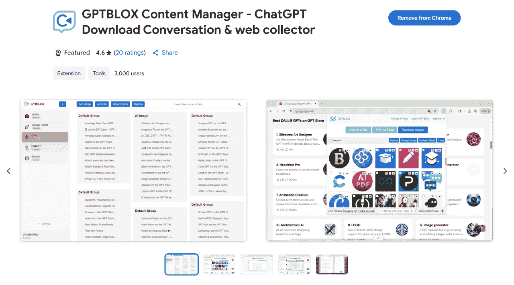

后来向哥飞老师和刘小排老师学习之后，我开始使用Github保存一些项目的代码，但即便如此，我仍然会把一部分开发节点保存在电脑中。

我学过编程，也看得懂一部分代码，但即便如此，我在通过AI编程的过程中，仍然会经常遇到AI出错甚至完不成项目的情况，让AI修改报错和不断把代码回撤到前面备份的正确版本，是我通过AI编程过程中的常态。但是，我从来没有担心过AI把我的代码改乱，因为我有无数次可以让AI重新来过的机会，大不了是多耗费一些Token，但是，相较于丢失有重要进展的代码，那点Token费用实在不算什么。

另外，如果你在通过AI编程的过程中，适当地采用一些技巧和思路、结合你的一些经验，往往也能降低AI把代码改乱的概率。我之前发布过多篇AI编程的相关文章，大家有兴趣请另行翻看。

既然备份那么重要，接下来，我们就讲讲怎样把我们的项目提交到Github中并部署上线。

# 把代码推上GitHub的最佳姿势，为Vercel一键部署铺路

作为全球最大的代码托管平台，Github已经汇集了超过1亿开发者，它不仅提供云端代码备份，更汇聚了全球程序员的智慧和结晶，你可以在上面找到各种编程语言的开源代码。有传闻称OPenAI早期的“编程模型”就是通过其背后金主微软提供的GitHub代码进行训练的，可见这个平台在编程领域有举足轻重的地位。

通过Github提交和托管代码，对于程序员来说是家常便饭，网上也有大量相关的文章。但是，作为技术小白或编程新手，我们未必习惯看似简单的Git提交命令。今天，我们尝试通过另一种对新手最佳的姿势，把我们前面准备好的代码推送到Github上。

> 在开始之前，请你先安装并配置 Git，然后安装GitHub Desktop这个图形界面。如果你不懂怎样安装，请查看网上的相关教程，或者直接咨询ChatGPT或Deepseek。最后，你还需要有一个编程的IDE，Cursor或Visual Studio Code或其它IDE都行，本文我们将以Cursor为例。

前面我们已经通过ChatGPT的“Deep Research”生成网站首页的文案，并通过Claude Code把这些文案放进一个开源的NextJS网站中，现在，我们讲一下怎样把代码推送到Github中，为后面的Vercel一键部署铺路。

## 1、检查.gitignore文件

在提交之前，我们先检查一下.gitignore文件，这是是一个纯文本配置文件，用来告诉 Git “哪些文件/目录不要被跟踪（不纳入版本控制）”，也就是说.gitignore文件会告诉Git哪些文件只放在我们的本地电脑，不提交到Github仓库中。

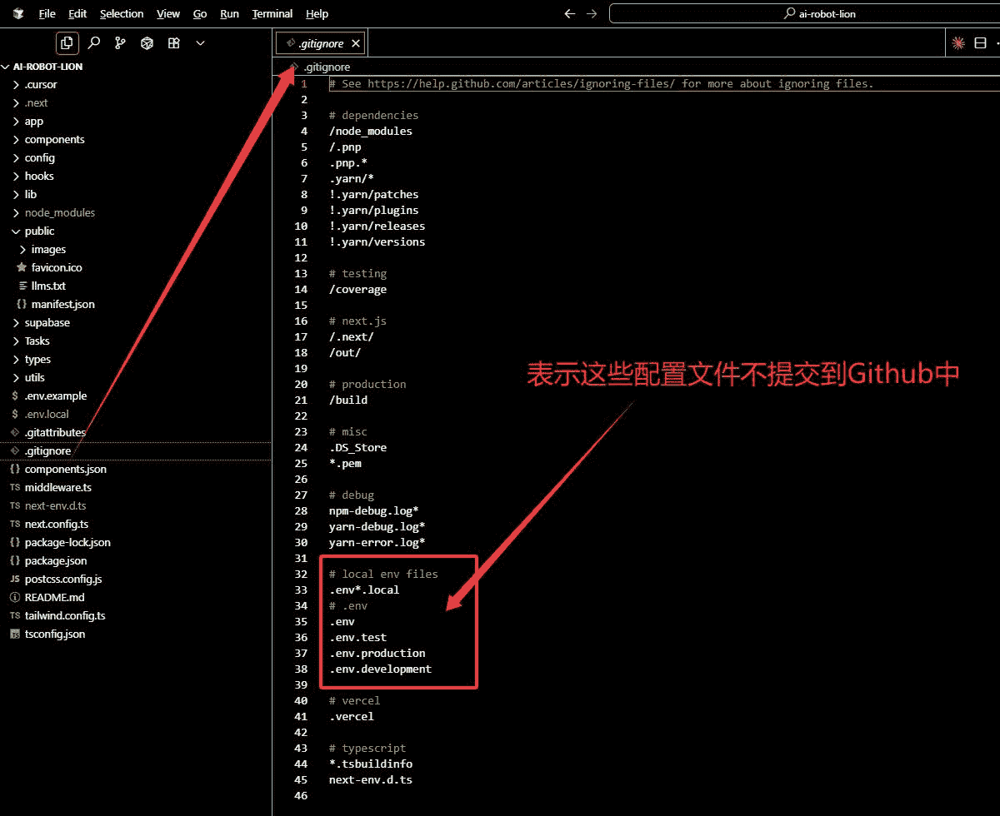

如果你使用的是刘小排老师在深海圈提供的raphael-starterkit-v1，就会看到项目中已经预置了一个.gitignore文件，里边向Git声明了哪些文件不提交到Github仓库中。如果你看不懂这个文件配置了什么，可以让Claude Code给你解释一下。

你尤其要检查一下含有API Key等关键配置的env文件不要提交到仓库中。另外，再次提醒，前面第3部分“网站上线前的细节工作和注意事项”中，提到了要检查API Key是否硬编码，如果代码中存在API Key，一定要做修改，统一把API Key放在配置文件中，并且不提交到Github仓库中。

## 2、在Cursor中提交项目到Github

在Cursor中打开我们前面修改好的项目：


点击进入Git窗口：


点击“Initialize Repository”初始化仓库：


输入提交时的备注信息，然后点击“Commit”提交：


接着点击“Publish Branch”推送代码到仓库：


点击“private”这个选项，表示仓库私有，只有你自己可以看到，如果选择“public”，意味着公开仓库，别人也能看到你这个仓库的代码。这里要特别注意不要选错！

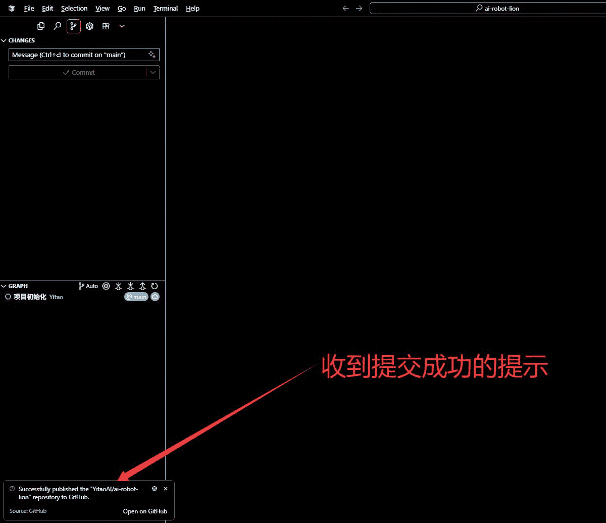

提交成功后收到提交成功的提示。回到Github对应账号下查看这个项目：


确认一下这个项目设置为“Private”没有公开。

## 3、在GitHub Desktop添加仓库

打开GitHub Desktop，登录你的Github账号后，点击左上角这个向下的小三角形图标：


点击点击“Add”下拉框，选择“Add existing repository...”添加我们刚刚提交的项目：


选择项目所在文件夹，然后点击“Add repository”添加：


添加成功：

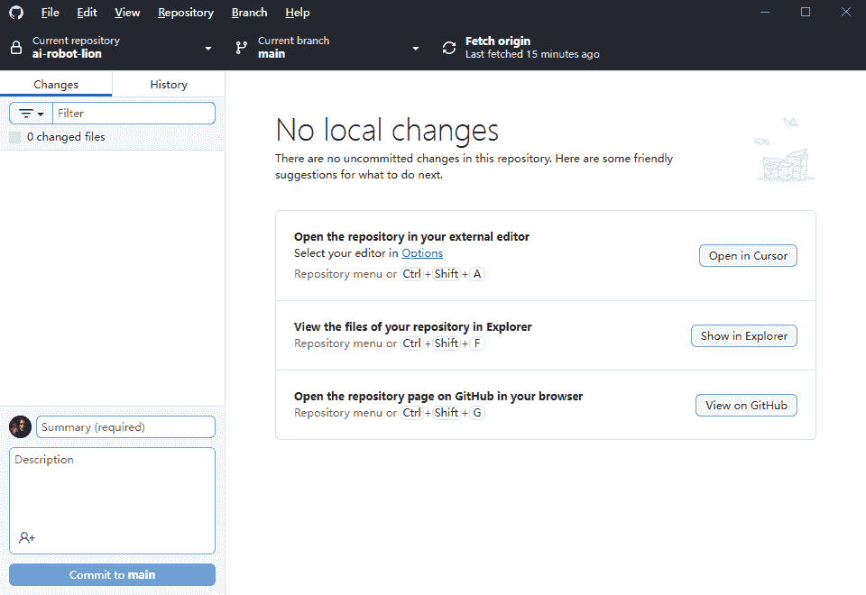

这样，后续我们修改代码需要提交的时候，就可以很方便的通过GitHub Desktop而不需要使用Git命令进行代码提交了。

GitHub和GitHub Desktop还有许多功能值得我们了解，上面是通过提交我们当前演示的这个NextJS项目为例做了一些简单的介绍，大家有兴趣可以一边实践一边通过AI进行学习。

现在，我们已经采用最适合我们新手的正确姿势，把代码推到了GitHub，接下来我们就可以正式通过Vercel一键部署，并正式上线我们这个NextJS框架的网站。

# Vercel一键部署NextJS网站

哥飞老师和小排老师都推荐我们使用NextJS框架，并不是因为其它编程语言不好，而是Vercel+NextJS+Supabase确实极大地降低了我们很多新手和小白上线一个网站的门槛。可能你没有注意过，NextJS实际上是Vercel平台这个公司的一个开源产品，这种紧密的联系，使得我们部署一个NextJS网站到Vercel中会无比丝滑顺畅。我们直接看演示。

> 注意：你必须先注册好一个Vercel账号，并且连接放置你的项目代码的Github账号。

## **步骤1：添加新项目**

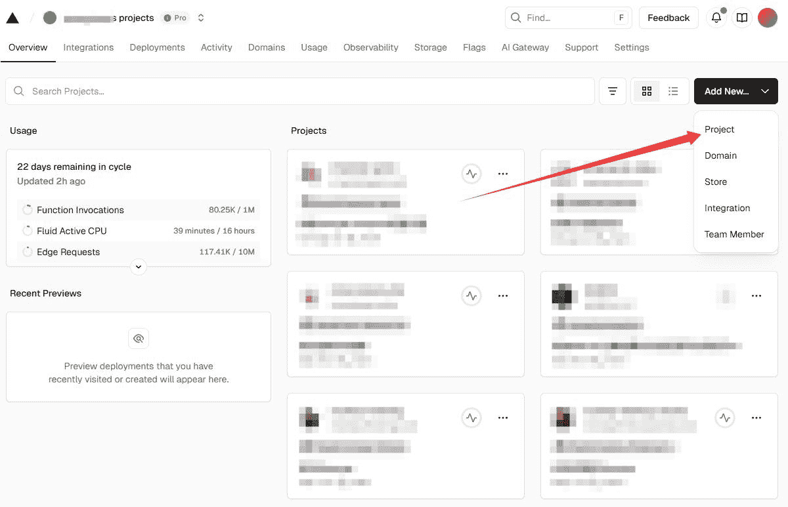

登录你的Vercel账号后，点击右上角“Add New”，选择“Project”添加一个新的项目。

## **步骤2：导入Github项目**


导入你的Github账号中准备部署到Vercel的项目。

## **步骤3：一键部署**


如果你的网站不需要配置环境变量，点击“Deploy”一键部署。

如果你的网站有配置文件，比如你使用的是刘小排老师在深海圈提供的raphael-starterkit-v1，那么需要配置Supabase的相关API配置，网站才能正常打开（后面讲到Supabase部分的时候再详细介绍）。如果你的网站涉及AI生成图片或AI生成内容，还需要配置相应的API Key，后续对接Creem支付的时候，我们还需要配置Creem的API信息。

不过，在不影响网站运行的情况下，你可以先跳过这些环境变量的配置，也可以在网站部署之后，后续在网站控制台的“Settings”的“Environment Variables”中添加或修改这些配置。

注意要检查API Key是否硬编码，如果代码中存在API Key，一定要做修改，统一把API Key放在配置文件中，并且不提交到Github仓库中，在Vercel中做部署的时候，统一添加到“Environment Variables”中。

## **步骤4：部署成功，查看网站**


是的！顺利的话，网站已经部署成功了！部署过程就是那么简单！部署过程中，如果遇到报错，你只需复制报错信息，告知Claude Code在Vercel部署中出现这些报错，Claude Code一般都可以很快帮你解决，然后你重新提交代码到Github，Vercel会自动触发做重新部署。

部署成功后，点击“Continue to Dashboard”进入网站控制台，可以看到Vercel已经给我们刚刚部署的网站分配了一个二级域名。


打开这个域名，即可看到我们的网站。


## 步骤5：熟悉Vercel框架

网站部署之后，我们可以看到网站控制台的菜单栏有许多功能，如有兴趣，你可以做进一步了解，但是，你至少要了解以下几个功能：

### ** 查看部署结**果


点击“Deployments”，可以查看Vercel每一次部署的情况，比如：部署是否成功？部署使用的是Github上的哪个版本？部署失败有哪些报错？等等。

### ** 配置环境变**量


前面我们已经提到，所有API Key和其它配置信息都不能硬编码写在代码中，而是要写在配置文件中，你在本地电脑开发的时候，一般把这些配置信息保存在“.env.local”，生产环境一般保存在“.env”，这些文件都必须在“.gitignore”文件中声明不提交到Github中。而现在通过Vercel部署，我们只需把“.env.local”文件中的这些配置信息复制粘贴到“Settings”的“Environment Variables”中即可（注意：你可以一次性复制全部，不需要一个个复制）。

### **配置域名**


网站部署成功之后，你还需要给网站添加您自己的域名。点击“Settings”中的“Domains”即可来到这个域名设置页面。

下一个部分我们再详细讲讲怎样做域名解析以及Cloudflare的使用。

# Cloudflare从0到1实战：DNS、SSL、邮箱、缓存、反爬全指南

如果你准备网站出海，或者正在做工具网站，你一定要认真看看这部分。如果说有没有一个工具，能解决我们网站出海过程中的绝大多数问题，而且还是免费，那我一定推荐Cloudflare这个“活菩萨”，从DNS到SSL，从邮箱到缓存，从反爬到安全等等，他都能一条龙全部包下。

网上关于Cloudflare的文章很多，哥飞社群中也经常看到群友的相关分享，但是系统把Cloudflare讲清楚的很少，因为Cloudflare作为我们的出海“护身符”，可以帮我们做的事情实在太多了，如果做一个系列的文章，写上10篇也不为过。

现在，我们就从我们新手的角度，先讲讲上线一个出海网站时需要在Cloudflare中做哪些基本的配置，后续有机会我再另外写文章展开讲Cloudflare的各种高级功能。废话不多说，直接上一个我平时上线网站时配置Cloudflare的必要步骤，你后续上线网站时也可以把它当做网站上线SOP的一部分。

## Step 1：添加网站并切换DNS

打开Cloudflare登录后，进入你的Account首页。


点击“Onboard a domain”添加你的网站。


输入你的网站域名，默认选择“Quick scan for DNS records”（除非你有明确的自定义需求时才使用“Manually enter DNS records”或“Upload a DNS zone file”）；

由于我希望AI模型抓取/索引我的网站内容，因此，“Block AI training bots”选择了“Do not block (off)”，并且把“Instruct AI bot traffic with robots.txt”设置为关闭。这一块你可以根据你自己的实际情况决定。

> 小提醒：即使你开放，有些 AI 公司仍可能无视 robots.txt；相反，如果你选择屏蔽，Cloudflare 还有更“硬”的网关侧拦截（不仅仅靠 robots.txt 文件的规则），这些后续可以在 Security → Bots / AI Crawl Control 里随时做修改。


选择免费套餐。一般情况下，免费套餐已经足够使用，给我们的网站提供了必要的“护身符”：不限量 L7 DDoS 防护、基于 IP 的限流、WAF 保护高危/广泛漏洞、检测并挑战常见机器人、通用免费 SSL 证书、快速、易用的权威 DNS和全球 CDN 加速。这也是Cloudflare被业界称为出海网站“活菩萨”的原因。


选择免费套餐后，进入“Review your DNS records”页面，可以看到我们的域名原来的解析记录。由于我们要新上一个网站，因此删除所有这些解析记录（如果存在你的其它网站和项目需要用到的解析记录的话，请保留那部分记录）。


点击“Continue to activation”，提示现在没有解析记录，可以后续再添加，点击“Confirm”即可。

## Step 2：切换Nameservers

接下来，我们来到了更新Nameservers的页面：


Cloudflare给我们提供了两个Nameservers，我们需要回到我们注册域名的域名商网站中把Nameservers改换成Cloudflare提供的Nameservers。


我们以Namecheap、阿里云和Sav.com为例：

+   **Namecheap：**进入对应域名的管理页面，在“Nameservers”处选择“Custom DNS”，输入Cloudflare提供的两个Nameservers，记得勾选右侧的“✔”按钮保存；

+   **阿里云：**进入对应域名的管理页面，点击左侧菜单“DNS 管理”中的“DNS修改”，点击“修改DNS服务器”，输入Cloudflare提供的两个Nameservers，保存即可；

+   **Sav.com：**进入对应域名的管理页面，在“Nameservers”板块中，把前面两行Sav提供的默认Nameservers修改成Cloudflare提供的两个Nameservers，然后点击“Update”保存。


回到Cloudflare页面，等待Cloudflare的Nameservers生效。

> 域名修改了DNS后，不一定马上生效，有时几分钟内，但有时时间会更长。这也是为什么我们在前面提到注册好域名之后不是先开发网站，而是先在Cloudfare中添加网站并切换的DNS服务器的原因。

## Step 3：解析域名：考虑 Vercel 已提供 SSL

Cloudflare的Nameservers生效后，可以看到绿色的“Active”状态，这意味着我们可以开始在Cloudflare中做域名解析了。


我们回到Vercel的网站控制台，点击“Settings”中的“Domains”进入域名设置页面。


添加我们的域名，一般添加根域名和带“www”的二级域名，以我们这个网站为例，需要添加“airobotlion.com”和“www.airobotlion.com”这两个域名。由于我习惯使用不带“www”的域名，因此没有选择把根域名跳转到“www”的域名上。


接下来，分别点击这两个域名的“Learn more”链接，可以看到Vercel已经告诉我们怎样解析这两个域名：不带www的根域名通过A记录解析到指定的IP地址，带www的二级域名通过CNAME解析到指定的域名。


回到Cloudflare，点击“DNS”的“Records”添加域名解析记录，分别添加一条A记录和一条CNAME记录并分别保存。


> 这里特别注意，添加解析记录的时候，Cloudflare默认会开启“Proxy status”，也就是你看到的橙色云朵。由于Vercel建议采用DNS only（也就是灰色云朵），把SSL交由Vercel处理，需要Cloudflare加速/防护的子域再开代理并使用Cloudflare提供的WAF/Rate Limiting/Bot Fight/缓存等能力。因此，我们这里添加解析记录的时候选择不开启“Proxy status”，避免叠加反向代理带来额外延迟并造成缓存管理冲突等问题。

添加完成后，可以看到一条A记录和一条CNAME记录，都显示灰色云朵。


回到Vercel网站控制台的域名管理页面，点击“Refresh”刷新，可以看到域名已经生效，并且显示Vercel自动给域名添加了SSL。到了这一步，域名管理页面显示的这3个域名都可以打开我们的网站了。但是，一般情况下，我们只保留其中一个对外的域名，其它的需要重定向到对外的域名上，这样可以避免搜索引擎发现多个不同域名同时指向我们的网站首页。


比如，我想把“www.airobotlion.com”和“ai-robot-lion.vercel.app”这两个域名重定向到“airobotlion.com”这个域名上，对外只使用“airobotlion.com”这个域名，那么可以通过编辑域名，然后选择301重定向，把域名重定向到“airobotlion.com”这个域名上。反之，如果你想使用“www.airobotlion.com”这个域名，则把“airobotlion.com”和“ai-robot-lion.vercel.app”这两个域名重定向到“www.airobotlion.com”这个域名上。


现在我们已经完成了域名解析，可以通过“airobotlion.com”这个域名打开网站了，而且打开的时候，你会发现域名前面带有“https”，这就是Vercel给我们域名添加的SSL。


你还可以尝试通过“www.airobotlion.com”和“ai-robot-lion.vercel.app”这两个域名打开我们的网站，会发现他们都会自动跳转到“airobotlion.com”这个域名上。

## **Step 4：设置SSL**

前面我们在Cloudflare中添加网站的时候选择了“Quick scan for DNS records”方式进行添加，因此，添加完成后，Cloudflare会自动帮我们做好基本的设置，包括SSL。


由于Vercel官方不建议在它前面再叠一层反向代理，因此，我们做域名解析的时候选择不开启“Proxy status”，也就是灰色云朵。所以，灰云（DNS only）的情况下Cloudflare 只做权威解析：HTTP/HTTPS 请求不会经过 Cloudflare，Cloudflare 的 CDN 缓存、WAF、Rate Limiting、Bot 管控、重定向与规则引擎等边缘功能均不生效。

因此，本文我们暂不展开讲述Cloudflare的SSL。

## Step 5：添加免费邮箱（Email Routing）

前面提到：在你购买域名的时候，有些域名商会赠送你域名邮箱，有些会建议你额外购买域名邮箱。但是，这些都没有必要，直接使用Cloudflare的邮件功能就可以了，Cloudflare Email Routing 可以帮你通过Gmail等邮箱转发接收邮件，但不含发信；若要发信需配合Gmail SMTP / Amazon SES / SendGrid 等。

现在，我们讲讲怎样添加Cloudflare Email Routing。


点击左侧菜单“Email”中的“Email Routing”，点击“Get started”。


输入你的第一个邮箱地址，你可以使用“contact”、“support”等常用邮箱地址，设置目标邮箱（接收邮件的邮箱，建议使用Gmail），然后点击“Create and continue”；接着确认你的目标收件邮箱后点击“Continue”；接着配置邮箱的域名解析记录，直接点击“Add records and enable”添加解析记录。

就这样，“Email Routing”就配置好了。


接着，不要忘记开启“Catch-All”。点开“Routing rules”页面，点击开启“Catch-All”。这是一个兜底规则，开启后，凡是发到你域名下、但没有单独规则匹配的地址（甚至常见拼写错误/别名），都会按你指定的目标地址统一转发；它相当于“安全网/默认路由”。


如果你需要添加更多收件邮箱地址，比如“business”、“legal”、“privacy”等，可以通过“Create address”直接添加。


## Step 6：开启缓存 & Crawler Hints

在Cloudflare中添加网站后，如果域名解析使用橙色云（Proxied），那么Cloudflare的普通CDN缓存会直接生效。

但是由于我们使用灰色云（DNS only），意味着请求不经过Cloudflare边缘，不会使用Cloudflare的缓存/WAF 等。因此本文暂不展开讲述Cloudflare缓存相关的内容。


不过，我们仍然需要在缓存的“Configuration”中开启一个重要功能：Crawler Hints。


找到“Crawler Hints”点击开启即可。 开启后，它会把“应该何时抓取”的信号发给搜索引擎，帮助搜索引擎更快发现更新、减少无效抓取。

但是当域名解析是是灰云时，Cloudflare在边缘可见的信号较少，效果不如橙云时充分，但开启不会影响Vercel缓存，因此建议开启。

## Step 7：基础防护：防刷、防爬、防洞

前面提到，灰云（DNS only）的情况下Cloudflare 只做权威解析：HTTP/HTTPS 请求不会经过 Cloudflare，Cloudflare 的 CDN 缓存、WAF、Rate Limiting、Bot 管控、重定向与规则引擎等边缘功能均不生效。因此，这部分内容也暂不展开讲述。

这部分内容写得比较长，看似有很多步骤，但上站熟悉后，每次我都只需要几分钟就可以完成上面所有步骤。

除了上面提到的这些功能，Cloudflare还有很多高级的功能值得我们使用和关注，尤其在你没有使用Vercel这些平台、自建服务器的时候，你更加要使用Cloudflare给你免费提供的这些功能。出海风浪那么大，你怎么可以没有Cloudflare这个“护身符”？

# 查看和跟踪你的网站流量情况和用户行为

网站上线之后，网站究竟有没有流量？有哪些用户访问了网站？他们在网站中做了哪些事情？有没有什么工具可以让我们洞悉网站的流量和用户的行为，为我们的出海助一臂之力？

现在，我们就介绍这4个免费的工具，分别是Google Search Console（简称GSC）、Google Analytics（简称GA）、微软Bing Webmasters和微软Clarity，让你的出海不再盲目！

这里简单概述这4个工具的作用：

+   Google Search Console：跟踪并诊断你的网站在Google自然搜索中的表现与索引健康情况；

+   Google Analytics：跟踪网站的各个渠道来源并分析用户行为与转化，回答“谁从哪里来、进站后做了什么”；

+   Bing Webmasters：跟踪并诊断你的网站在Bing自然搜索中的表现与索引健康情况；

+   **Clarity：**通过录像回放与热力图可视化用户行为，快速定位网站使用问题与转化问题。

和上一部分Cloudflare一样，以下内容同样可以作为你的网站上线SOP的一部分，让你10分钟内部署好这4个强大的网站跟踪和分析工具。

## 工具1：Google Search Console

打开GSC：

> https://search.google.com/search-console/

通过你的谷歌账号登录进入你的GSC管理页面。


打开左上角网站下拉列表，点击底下的“Add property”添加新的网站：


输入你的网站域名（不要带“https://”）。由于我们的网站域名是在Cloudflare中做解析，因此，可以直接通过Cloudflare添加一条TXT解析记录，来进行网站所属的验证。


验证成功后，网站就添加到GSC中。


在左上角网站下拉列表中找到你新添加的网站打开，就进入这个网站的GSC页面。

接下来，我们顺手提交网站的sitemap.xml文件和网站首页到GSC中。


点击左侧菜单“Sitemaps”进入Sitemaps管理页面。输入我们网站的Sitemap链接，点击“Submit”即可提交网站的Sitemap文件。

接下来提交网站的首页，点击左侧菜单“URL Inspection”，然后在上面搜索框中输入你的网站首页链接，比如：

> https://airobotlion.com/

然后按“Enter”回车键。


可以看到我们的网站首页链接状态为“URL is not on Google”。这很正常，因为我们的网站是新网站，链接是新链接。点击“REQUEST INDEXING”提交我们的网站首页，提交成功后可以看到显示“Indexing requested”。


就这样，我们已经把网站添加到GSC中，快的话1天内就会看到来自于谷歌搜索的数据。

## 工具2：微软Bing Webmasters

接下来，我们顺便把网站添加到Bing Webmasters中，因为Bing Webmasters可以直接导入GSC中的网站。打开Bing Webmasters：

> https://www.bing.com/webmasters/

通过谷歌邮箱或其它邮箱登录。

打开左上角网站下拉列表，点击底下的“Add a site”添加新的网站：


选择通过从“Google Search Console”导入，页面会跳转到谷歌进行登录和验证：


验证成功后，可以看到刚刚我们新添加到GSC中的网站，勾选这个网站并导入。导入成功后，在左上角网站下拉列表中找到你新添加的网站打开，就进入这个网站的Webmasters页面。


接下来，与GSC同理，我们顺手提交网站的sitemap.xml文件和网站首页到Webmasters中。

点击左侧菜单“Sitemaps”进入Sitemaps管理页面，然后点击“Submit sitemap”，输入我们网站的Sitemap链接，点击“Submit”即可提交网站的Sitemap文件。


接下来提交网站的首页，点击左侧菜单“URL Inspection”，然后输入你的网站首页链接，比如：

> https://airobotlion.com/

然后点击“Inspect”提交。


就这样，我们已经把网站添加到Webmasters中，过两天就会看到来自于Bing搜索的数据。

## 工具3：Google Analytics

接下来，我们给网站增加GA跟踪代码，用于跟踪网站各个渠道的流量数据和用户行为。打开Google Analytics：

> https://analytics.google.com/

通过你的谷歌账号登录，进入Google Analytics页面。

点击左下角的齿轮，打开GA Admin管理页面。然后在左上角的“+ Create”处添加“Property”，如果你是第一次添加，需要先添加一个Account账号（你可以通过不同的Account账号来对多个网站进行分组管理）。


点击“Property”添加1个Property，输入网站相关信息并选择相应的选项：


接下来，添加你的网站信息和Data Stream。


在开始收集数据之前，谷歌将会给你提供一段这个网站的GA跟踪代码：


我们需要把这段跟踪代码加到我们的网站中。如果你知道怎样添加，直接复制添加到网站中即可（注意需要添加到网站头部或底部的公共页面板块中）。

如果你不熟悉代码，可以让Claude Code帮你添加。


Claude Code很快修改好了代码。


接着，直接提交到Github中。


然后，通过GitHub Desktop把提交的代码推送到Github。


Git的Push操作会触发Vercel重新部署最新的代码。等待部署完成后，我们需要确认一下GA代码是否安装成功。


刷新网站首页，然后右键点击网站页面，点开“检查”或“查看网页源代码”，搜索是否存在这个网站在GA中对应的跟踪码（比如我们这个网站的“G-JGQEG7MHVS”）即可。


确认之后，回到GA管理页面，点击右上角的测试按钮，确认GA可以识别到添加到我们网站的跟踪代码。添加成功后，意味着GA可以开始对我们的网站流量和用户进行跟踪了。


## **工具4：微软Clarity**

接下来，我们添加一个强大的工具：微软的Clarity。这个工具可以通过录像和热力图等方式，直观地捕捉用户在我们网站中的轨迹，这对我们分析和洞察用户的行为有极大的帮助。打开Clarity：

> https://clarity.microsoft.com/

登录后进入Projects管理页面：

> https://clarity.microsoft.com/projects

点击左上角“+ New project”按钮添加新的项目，输入网站名称和域名，选择所属行业，点击“Add new project”添加。


接下来和GA类似，我们需要添加Clarity的跟踪代码。点击中间“Install manually”这个进行手动添加，你将会看到一段和GA类似的跟踪代码。我们需要复制这段跟踪代码，添加到我们的网站中（注意需要添加到网站头部或底部的公共页面板块中）。


如果你不熟悉代码，同样可以让Claude Code帮你添加。


Claude Code很快添加好了Clarity的跟踪代码。


接着，同样提交到Github中。


然后，通过GitHub Desktop把提交的代码推送到Github。Git的Push操作同样会触发Vercel重新部署最新的代码。等待部署完成后，我们确认一下Clarity跟踪代码是否安装成功。


回到Clarity的对应网站的页面，很快就看到提示“1 user is online”。实际上这个用户是我本人，点击打开就可以看到对应的录像信息。


GSC、GA、Webmaster和Clarity这4个工具十分强大：既能跟踪网站流量，也能还原用户行为，帮助我们搭建“采集—诊断—优化—验证”的数据闭环，让出海不再盲目。

# 通过API调试让AI更懂你的需求

前面第4部分中提到：我们在让AI帮我们编程时，要尽可能“想办法把话说清楚”。这一点刘小排老师做到了极致。他在开发一个AI产品时，会先查看API文档，然后通过Postman调试，然后把API文档、API示例、示例输入和示例输出一并发给AI，这样AI往往能更加明确他的需求，在他圈定的范围内给出更加合理的代码。

接下来，我们就调试一下Nano-Banana生图的API，为后面AI更懂我们的需求并在网站中增加Nano-Banana生图功能做准备。

> 假设我们使用的是Fal.ai的“fal-ai/gemini-25-flash-image/edit”模型：

> https://fal.ai/models/fal-ai/gemini-25-flash-image/edit/playground

我先访问这个模型的页面：


可以看到这个模型支持输入Prompt、上传多张参考图片、设置图片生成数量、设置图片生成格式。点击上方“API”菜单可以查看这个模型的API文档：


那么，我们应该怎样调试这个API，让AI更加“听话”地输出我们想要的代码呢？其实过程并不复杂，主要有三个步骤：

+   准备API Key；

+   构建这个API的CURL语句；

+   通过Postman调试API的CURL语句。

## **步骤1：准备API Key**

在开始调试API之前，我们需要先准备好所使用API平台的API Key。

登录Fal.ai网站后，点击右上角“Account”进入用户中心，点击“API Keys”菜单进入API Key页面，然后点击“Add key”按钮添加一个新的API Key。


生成新的API Key之后，记得马上复制这个API Key并保存好，因为这个Key只显示1次。


后面，我们在调试API的过程中需要使用到这个Key。

## 步骤2：构建这个API的CURL语句

你可以先查看API的文档，很多API文档中往往有各种语言版本的示例代码，找到其中CURL的那个。如果你找不到或者不确定，可以把API文档发给ChatGPT，让它帮你构建适合在Postman工具中调试的CURL语句。


ChatGPT输出了“同步直返”和“队列三段式”两种CURL的调试方式。接下来，我们开始调试“队列三段式”的CURL，因为ChatGPT在后面的沟通中建议在我们的Nano-Banana生成图片的网站中使用“队列三段式”的方式。

## 步骤3：通过Postman调试API的CURL语句

接下来，打开Postman网站：

> https://www.postman.com/


登录Postman后，进入一个Workspace（如果第一次登录，需要创建1个Workspace）：


点击“Import”按钮导入ChatGPT给你输出的“提交请求”的CURL语句：

            &quot;https://storage.googleapis.com/falserverless/example_inputs/nano-banana-edit-input.png&quot;,
            &quot;https://storage.googleapis.com/falserverless/example_inputs/nano-banana-edit-input-2.png&quot;

```
curl -X POST &quot;https://queue.fal.run/fal-ai/gemini-25-flash-image/edit&quot; \
    -H &quot;Authorization: Key $FAL_KEY&quot; \
    -H &quot;Content-Type: application/json&quot; \
    -d &#x27;{
        &quot;prompt&quot;: &quot;make a photo of the man driving the car down the california coastline&quot;,
        &quot;image_urls&quot;: [
        ],
        &quot;num_images&quot;: 1,
        &quot;output_format&quot;: &quot;jpeg&quot;
    }&#x27;
```

点击“Import Into Collection”保存。


接下来，我们需要关注“Headers”和“Body”这两项，“Headers”中需要配置API Key，而“Body”中包含我们这个API调试的示例输入（你可以理解为是我们发送给API的参数）。


打开“Headers”，把这里边的“$FAL_KEY”改成刚刚复制的API Key：


打开“Body”，可以看到显示一段json代码，包含prompt、image_urls、num_images和output_format这4个发送给API的参数，分别是生成图片时的描述、参考图（多张）、输出图片的数量（1~4张）和输出图片的格式（jpg/png），你可以根据你的需要修改这些参数。


接下来，点击“Send”发送请求给API。很快API返回“200 OK”，表示请求成功，返回了一段json代码，实际上，这就是我们API调试成功后需要用到的示例输出（你可以理解为API返回的结果）。


这里包含有一个后面两个CURL调试需要用到的“request_id”，我们需要把它替换到接下来需要调试的CURL语句中的“<REQUEST_ID>”中。如果调试返回错误，你就需要把错误发送给ChatGPT检查原因，并重新构建正确的CURL语句。

接下来，调试“轮询状态”的CURL语句：

```
curl -X GET \
    &quot;https://queue.fal.run/fal-ai/gemini-25-flash-image/requests/&lt;REQUEST_ID&gt;/status&quot; \
    -H &quot;Authorization: Key $FAL_KEY&quot;
```

与第一个CURL调试一样，通过“Import”导入第二个CURL，然后把“$FAL_KEY”改成刚刚复制的API Key。


点击“Send”发送请求，结果出现“405”报错。


我们把这个错误反馈给ChatGPT：


ChatGPT调整了“轮询状态”和“获取结果”的CURL语句（去掉了GET链接中的“edit”）。

重新调试“轮询状态”的CURL，这次返回“200 OK”，调试成功，返回一段json代码，这是“轮询状态”的CURL的示例输出。你可能会问，那这个CURL的示例输入是什么？点开“Body”会发现并没有内容，这是因为这个CURL发送的是GET请求，不是POST，因此参数已经包含在请求的链接中，因此没有其它示例输入。


接下来，调试“获取结果”的CURL语句：

```
curl -X GET \
    &quot;https://queue.fal.run/fal-ai/gemini-25-flash-image/requests/&lt;REQUEST_ID&gt;&quot; \
    -H &quot;Authorization: Key $FAL_KEY&quot;
```

与“轮询状态”的CURL语句同理，这个CURL语句发送GET请求，参数已经包含在GET请求的链接中。调试成功显示“200 OK”，返回一段json代码，这是“获取结果”的CURL的示例输出。


就这样，我们通过API调试，集齐了小排老师在深海圈课程中提到的API四要素。下一部分，我们把这些API信息整理放在我们的Prompt中，让AI更懂我们的需求，并输出合理的代码。

# 给你讲清楚怎样轻松开发一个AI生图网站

前面我们通过10来篇文章详细讲述了怎样从0到1上线一个出海网站，上一篇文章：生成的代码很离谱？通过API调试让AI更懂你的需求我们讲述了怎样通过API调试，集齐小排老师在深海圈课程中提到的API四要素。现在，我们正式让AI根据我们前面准备的需求和API信息，开发出一个Nano-Banana生图的网站。在正式让AI开发之前，我们先做好两个准备，一个是上面的API相关信息，二是实现网站核心功能的开发方案。

## **步骤1：准备开发方案**

前面提到：“找个一个关键词后，如果你不确定这个关键词的来源和意图，可以先和ChatGPT或Gemini聊一聊。如果你确定要做这个关键词，还可以继续和o3或GPT5Thinking沟通一下围绕这个词做网站的切入点，并生成实现这个功能的开发方案，以备后续开发这个功能时做参考或使用。”


把ChatGPT生成的“requirement.md”文件放在我们网站项目的“/Tasks/”文件夹中。我们先让Claude Code根据我们的需求重新完善一下这份开发方案（上述第5点中的预设指令同样是ChatGPT在沟通过程中提供的）。


Claude Code完成方案修改后，你可以看看方案中的内容是否和你的实际需求相符，如有不符的地方，可以让Claude Code继续完善。


## **步骤2：准备API相关信息**

上一部分中我们已经调试好API，获得Nano-Banana生图API的“提交请求”、“轮询状态”和“获取结果”三个步骤的示例代码、示例输入和示例输出。我们把这些信息整理到一个Markdown文件中：


把文件保存到“/Tasks/api.md”文件中。这个文件中，我们详细说明了这个API的文档、API的密钥以及“提交请求”、“轮询状态”和“获取结果”三个步骤API的示例代码、示例输入和示例输出。为了确保Claude Code能读取到API文档信息，我们还可以另外复制API文档网页中的内容保存到“/Tasks/api_doc.md”文件中。

> API文档链接：https://fal.ai/models/fal-ai/gemini-25-flash-image/edit/api

## 步骤3：让AI根据方案和API信息做开发

接下来，我们可以正式让Claude Code帮我们在网站中实现NanoBanana生图功能了！


我们给Claude Code下达一个开发命令：

> 接下来，请你按照 /Tasks/requirement.md 中的方案，Step by Step在网站首页的Hero区域实现一个Nano-Banana生成器，在生成器中预设一个补充的指令，作为用户文字指令的强制补充，实现将用户上传的图像（人、动物、物品）通过NanoBanana转化为与其形象相符的机器人或机械化图片。API的相关信息请查看 /Tasks/api.md 文件，API文档请参考 /Tasks/api_doc.md 文件。

注意要提交方案和API相关信息文件的具体位置，让Claude Code根据我们准备的这些方案和API相关信息做开发。


大约过了几分钟，Claude Code帮我们完成NanoBanana生图功能的开发。


打开网站，页面效果还可以，涵盖了我们需求中提到的页面要素。我们测试一下生图功能：


结果生图过程中出现报错。在AI编程过程中，遇到报错是很正常的事情，我们只需把报错信息发送给Claude Code检查和修改：


Claude Code修改完成后，重新测试仍然报错：


我们同样把报错信息发送给Claude Code做进一步检查和修改。

> 这里提一下：如果你能看懂这些报错信息，可以适当给AI做一些提示，以便它更加精准的修改问题；如果你看不懂，那就直接让AI自己排查和修改。但是，如果你在让AI编程过程中，遇到AI的修改多次报错，问题总是无法解决时，建议放弃这部分开发，尝试调整优化开发方案，然后让AI重新编写代码，避免出现代码越改越乱的情况（后面的文章我们再详细讲讲AI编程的一些思路，有兴趣请告诉我）。


很快，Claude Code修复了API路由中的URL构建问题。


网站帮我们把人物生成了穿戴盔甲的形态：


狮子也同样被戴上了盔甲面具：


这样，Claude Code轻轻松松地帮我们完成一个NanoBanana图片生成器的功能。

## 步骤4：提交到Github触发Vercel重新部署

接下来，我们把代码提交到Github中并触发Vercel重新部署网站。在提交之前，我们先在Vercel中添加Fal.ai的API Key到环境变量中。在Vercel网站控制台中，点击“Settings”中的“Environment Variables”中添加Fal.ai的API Key并保存：


接下来，在Cursor中点击“Commit”提交代码并通过GitHub Desktop把代码推送到Github中，触发Vercel重新部署。


结果Vercel在部署时出现了报错：


遇到这种情况，只需要把报错信息提交给Claude Code修复即可：


重新提交代码并通过GitHub Desktop把代码推送到Github中，触发Vercel重新部署：


这一次Vercel部署成功：


网站已经添加好新的功能，并通过Nano-Banana的API生成网站预期需求的图片：


这一部分，我详细讲述了怎样通过前期做好充分的准备，然后让AI更加理解我们的需求，并开发出相应的产品。过程中，我简单提及我在使用AI编程时的一些思路（或者说习惯），然而，我们在开发一个产品的过程中，还会遇到各种各样的问题和挑战，我是通过哪些思路来解决AI编程过程中的这些问题呢？你可以参考一下我前面在赚钱中发布的文章。

# 怎样配置Supabase数据库并实现谷歌授权登录？

每当你在使用别人的网站，要求你先填写注册资料、然后验证邮箱、最后才能通过邮箱登录的时候，你是否会感到无比厌烦？这种体验实在太差了！

可能你会留意到有很多出海网站，在提供邮箱注册登录的同时，还提供了通过谷歌或Github等第三方平台登录，甚至只提供谷歌或Github登录。这样用户就不需要在网站中注册，可以直接通过谷歌或Github账号登录网站，而大部分主流国家的用户一般都有谷歌账号，这样的登录体验将会十分流畅。

现在，很多成熟的网站模板都已经集成好第三方登录，比如我们前面演示的网站，使用的是刘小排老师的raphael-starterkit-v1，已经集成好谷歌授权登录和GitHub授权登录，只需做相关配置即可。

今天，我们演示一下怎样在网站中添加谷歌授权登录的详细流程。

## 步骤1：创建Supabase数据库

在使用raphael-starterkit-v1之前，我们需要先创建一个Supabase数据库。

登录Supabase并进入用户控制台，点击右上角“New project”，新建一个项目：


输入项目名称、输入数据库密码，点击“Create new project”创建数据库项目：


数据库创建成功后，生成了API Keys和数据库URL，你需要复制anon key、service_role secret和URL这些配置信息，并更新到你的项目配置文件中：


本地测试则更新到“.env.local”中，生产站点则更新Vercel的环境变量配置中并重新Redeploy项目：


API Keys和数据库URL这个页面过了一会会自动跳转到其它页面，如果你来不及复制，可以按照以下方式找到这些配置信息：


点击左侧“Project Settings”，点击“API Keys”，即可复制“anon key”和“service_role secret”，接着，点击“Data API”，即可复制“Project URL”。

## 步骤2：配置Supabase第三方授权登录

接下来，在supabase配置第三方授权登录。

点击左侧“Project Settings”，点击“Authentication”，然后点击“Sign In / Providers”进入时候第三方授权登录配置页面。


可以看到这里罗列了很多授权登录，也包括我们常用的谷歌授权登录和GitHub授权登录。找到Google，点击右侧的“Disabled”，配置谷歌授权登录：


开启“Enable Sign in with Google”。

接下来，我们需要到Google Cloud Console获取“Client ID”和“Client secret”，注意，后面创建OAuth 2.0客户端ID的时候，需要复制Callback URL。

## 步骤3：配置Google Cloud Console

打开Google Cloud Console首页并登录：

> https://console.cloud.google.com/

点击左上角项目名称位置，添加新项目：


输入项目名称，点击“Create”完成新项目创建，然后重新点击左上角项目名称位置，并选择进入刚刚添加的项目：


接下来，点击“APIs & Services”进入API配置页面，然后点击“OAuth consent screen”创建创建OAuth 2.0客户端ID（Web应用类型）：


点击get started开始创建，按照下面步骤输入项目名称、用户支持的邮箱，选择“External”表示项目对外，然后输入联系邮箱，最后点击同意完成项目“Branding”的添加。


接下来添加OAuth Client ID，点击“Create OAuth client”：


应用类型选择“Web Application”，输入Client名称，“Authorized JavaScript origins”配置如下：

> 本地测试时填写：http://localhost:3000

> 生产使用时填写网站域名：https://airobotlion.com

“Authorized redirect URIs”是关键，填写前面Supabase中配置谷歌授权登录时显示的Callback URL

> 类似：https://<YOUR_PROJECT_REF>.supabase.co/auth/v1/callback


创建后拿到Client ID和Client Secret。这两个需要复制下来，需要粘贴到Supabase的谷歌授权登录的配置中：


如果你忘记复制，后面也可以重新编辑Client查看client ID和client secret：


最后，我们还需要重新编辑Branding，添加“Authorized domains”授权域名，它决定了 Google 登录后允许回调的域名范围：


原则上添加你的网站域名即可。对接 Supabase × Google 登录 时，其实也不需要把 *.supabase.co 加到Authorized domains；你只要把回调地址写到OAuth Client的Authorized redirect URIs就能使用。

> 注意：Google现在只严格校验“Authorized redirect URIs”是否与回调地址完全一致；不用也不能把supabase.co加到Authorized domains（因为你也没有该域的所有权）。

## 步骤4：完成Supabase第三方授权登录配置

最后，我们回到Supabase刚刚配置谷歌授权登录的页面。填写“Client ID”和“Client secret”，点击“Save”保存，即完成Supabase中的谷歌授权登录配置。


就这样，我们完成了通过谷歌授权登录网站：


## 步骤5：在 Supabase 配置自定义域名

细心的你可能已经发现，完成谷歌授权登录配置之后，我们的网站在使用谷歌授权登录的时候，页面中显示的是Supabase的二级域名。其实这个现象是正常的，因为我们现在使用的是Supabase自带的托管OAuth回调域名：

> https://<YOUR_PROJECT_REF>.supabase.co

如果你想在Google授权登录的时候，页面显示你自己的域名，那就必须做自定义域名绑定。

点击左侧“Project Settings”，点击“Add ons”，找到页面右下角“Change custom domain”，可以选择设置自定义域名：


然而这个功能是付费的，因此这里不做进一步演示。

> 注意：完成绑定后，Supabase会生成一个类似：

> https://auth.yourdomain.com/auth/v1/callback

> 的回调地址。你需要在Google Cloud Console中修改OAuth Client设置，把这个回调地址更新到 Authorized redirect URIs中。

## **步骤6：还有一个重要设置**

在配置谷歌授权登录的时候，正式上线时我经常遗忘一个步骤，那就是你的网站正式上线时，需要把Supabase中Authentication → URL Configuration修改成你的线上域名：


否则，通过谷歌授权登录后，总会跳转到本地测试地址：

> http://localhost:3000

配置谷歌授权登录看起来挺简单，但是配置过程还是有点繁琐，某些配置不小心设置错误就可以导致授权登录不成功。希望这部分内容对你的出海网站配置第三方授权登录有所帮助，如果你还遇到其它问题，还可以通过与AI沟通，AI一般都能轻松帮你解决这些问题。

# 附录：怎样快速开发并上线一个游戏站页面？

最后，我们简单演示一下怎样通过Claude Code快速开发一个HTML静态页面的游戏站并部署到Cloudflare中。

我们以去年4月份突然爆火的“Cosmos Persona”人格测试小游戏为例：


首先，我们按照流程注册好域名并把域名的Nameservers切换到Cloudflare；接着，我们可以轻松在Github上找到这个测试游戏的来源：

> https://iseej.github.io/CosmosPersona/

确认这个游戏允许通过iframe加载到我们的网站中。

接着，我们需要准备一下“Cosmos Persona”这个关键词的网站的文案，你可以通过ChatGPT的深度研究准备好这个测试游戏的文案。

现在，我们可以正式让Claude Code开始帮我们开发一个专业的游戏站静态页面。

## 第1步：把首页文案整理成Markdown文件


把“Deep Research”生成的首页文案修改成Markdown文件的时候，你可以让AI帮你修改，但我一般手动修改，工作量并不大，注意要把H1、H2、H3和列表等内容严格修改成Markdown对应的格式：

> H1标题的前面加上“# ”，并且有且只有一个；

> H2标题的前面加上“## ”；

> H3标题的前面加上“### ”；

> 列表的前面加上“- ”；

> 等等，大家可以查一下Markdown文件的相关知识，重点标记好H1、H2、H3这些标题即可。

另外，我还喜欢在文件的顶部加上这个网站首页的SEO相关要素，比如“Title”、“Description”等，这样有助于接下来AI修改网页内容的时候把这些非常重要的SEO相关要素一并添加到页面中，这一点非常重要！

准备好Markdown文件后，我把它命名为“HomePage.md”，放在项目的 “/Tasks/”目录中（你也可以使用其它名字，放在其它目录）。

## 第2步：通过AI编程工具开发网站首页

接下来，我们开始让Claude Code在按照Markdown文件中的内容修改网站首页，与此同时，我们给它规定一下网站的风格：

> 请你扮演一名资深的Web开发工程师和SEO专家，熟悉HTML、Javascript 和Tailwind语法和SEO优化。现在，我已经准备好网站首页的所有文案内容，请你按照 /Tasks/HomePage.md 文件中的文案，Step by Step把开发一个完整的HTML + JS +CSS的网站首页。注意严格按照文件中的文案内容，UI 风格采用有现代感和娱乐感的风格，色调请参考这个网站 https://iseej.github.io/CosmosPersona/ 的色调。

由于首页文案内容比较多，过了好一会儿，Claude Code修改好了代码：


## **第3步：分离CSS和JS代码**

由于我们发现Claude Code把CSS和JS代码写在HTML页面中，这不利于后续扩展页面时复用CSS和JS代码，因此，我们让它做以下代码分离：


> 请你把css代码分离放在 /css/main.css 文件中，把js代码分离放在 /js/main.js 文件中，方便后续添加其它页面时复用。

如果Claude Code一开始给你的代码已经做好分离，那这个步骤跳过。很快，Claude Code完成了代码分离：


## 第4步：添加iframe窗口加载游戏

接下来，我们让Claude Code帮我们添加一个iframe窗口，用于加载在Github上找到的对应游戏：


Claude Code很快帮我们完成iframe窗口的相关代码，并自行调整好样式：


## **第5步：检查首页内容并做完善**

接下来，检查一下他修改后的首页内容是否与Markdown文件中的内容相符，不符的地方提示它修改完善：


Claude Code按照我们的要求做了完善。

接下来，不要忘记修改一下网站的Logo。我准备了Logo图标，放在“/images/”文件夹中，并把favicon.ico图标放在根目录中。然后，让Claude Code把网站的Logo和Icon修改成我们给定的图标：


## **第6步：生成网站的sitemap.xml、r**obots.txt和llms.txt文件

最后，记得生成后续上线后有利于搜索引擎的sitemap.xml、robots.txt和llms.txt文件：


最终，Claude Code帮我们完成了一个专业的游戏站页面：


## 第7步：部署上线到Cloudflare中

我们通过Claude Code快速开发了一个静态页面的游戏网站。接下来，我们就讲讲怎样快速部署上线这个网站。而且，你不需要花费任何服务器费用，也不需要申请Vercel的Pro套餐，这是因为我们有Cloudflare这位“活菩萨”。

前面第7部分详细讲述了Cloudflare怎样帮我们解决网站出海过程中的绝大多数问题，从DNS到SSL，从邮箱到缓存，从反爬到安全等等，他都能一条龙全部包下。

废话不多说，直接上一个我平时通过Cloudflare上线网站的必要步骤，你后续也可以把它当做游戏网站上线SOP的一部分。

### Step 1：添加网站并切换DNS

打开Cloudflare登录后，进入你的Account首页。点击“Onboard a domain”添加你的网站：


输入你的网站域名，默认选择“Quick scan for DNS records”（除非你有明确的自定义需求时才使用“Manually enter DNS records”或“Upload a DNS zone file”）；


由于我希望AI模型抓取/索引我的网站内容，因此，“Block AI training bots”选择了“Do not block (off)”，并且把“Instruct AI bot traffic with robots.txt”设置为关闭。这一块你可以根据你自己的实际情况决定。

> 小提醒：即使你开放，有些 AI 公司仍可能无视 robots.txt；相反，如果你选择屏蔽，Cloudflare 还有更“硬”的网关侧拦截（不仅仅靠 robots.txt 文件的规则），这些后续可以在 Security → Bots / AI Crawl Control 里随时做修改。


选择免费套餐。一般情况下，免费套餐已经足够使用，给我们的网站提供了必要的“护身符”：不限量 L7 DDoS 防护、基于 IP 的限流、WAF 保护高危/广泛漏洞、检测并挑战常见机器人、通用免费 SSL 证书、快速、易用的权威 DNS和全球 CDN 加速。这也是Cloudflare被业界称为出海网站“活菩萨”的原因。


选择免费套餐后，进入“Review your DNS records”页面，可以看到我们的域名原来的解析记录。由于我们要新上一个网站，因此删除所有这些解析记录（如果存在你的其它网站和项目需要用到的解析记录的话，请保留那部分记录）。


点击“Continue to activation”，提示现在没有解析记录，可以后续再添加，点击“Confirm”即可。

### Step 2：切换Name Servers

接下来，我们来到了更新Name Servers的页面：


Cloudflare给我们提供了两个Nameservers，我们需要回到我们注册域名的域名商网站中把Nameservers改换成Cloudflare提供的Nameservers。


我们以Namecheap、阿里云和Sav.com为例：

+   **Namecheap：**进入对应域名的管理页面，在“Nameservers”处选择“Custom DNS”，输入Cloudflare提供的两个Nameservers，记得勾选右侧的“✔”按钮保存；

+   **阿里云：**进入对应域名的管理页面，点击左侧菜单“DNS 管理”中的“DNS修改”，点击“修改DNS服务器”，输入Cloudflare提供的两个Nameservers，保存即可；

+   **Sav.com：**进入对应域名的管理页面，在“Name Servers”板块中，把前面两行Sav提供的默认Nameservers修改成Cloudflare提供的两个Nameservers，然后点击“Update”保存。


回到Cloudflare页面，等待Cloudflare的Nameservers生效。

###  Step 3：在Cursor中提交项目到Github

前面第5部分的内容提到怎样把代码提交到Github上，这里我们简单过一遍。


在Cursor中打开我们前面修改好的项目，点击进入Git窗口，点击“Initialize Repository”初始化仓库，输入提交时的备注信息，然后点击“Commit”提交。


接着点击“Publish Branch”推送代码到仓库。

然后点击“private”这个选项，表示仓库私有，只有你自己可以看到，如果选择“public”，意味着公开仓库，别人也能看到你这个仓库的代码。这里要特别注意不要选错！

提交成功后收到提交成功的提示。回到Github对应账号下查看这个项目，确认一下这个项目设置为“Private”没有公开。

### Step 4：在Cloudflare Workers中部署项目

回到Cloudflare账号首页，点击进入“Workers & Pages”：


切记点击进入“Pages”页面，然后导入Github仓库的项目：


首次需要先连接你的Github账号，连接成功后，选择你的项目对应的Repository：


默认进入下一步，然后Cloudflare开始编译部署网站：


很快，Cloudflare成功部署好了我们的网站：


### Step 5：在Cloudflare中绑定网站域名

进入项目后，点击“Custom domains”进行域名绑定：


按步骤输入域名，我们先输入不带www的根域名并启用：

> cosmospersona.com


域名启用成功后，Cloudflare体贴地帮我们配置好SSL，网站已经可以通过根域名打开。


接下来点击右上角“Set up a custom domain”添加带www的二级域名：

> www.cosmospersona.com

等待Cloudflare启用域名并生成SSL。

就这样，我们轻松在Cloudeflare中部署好了我们的游戏网站

> https://cosmospersona.com/

