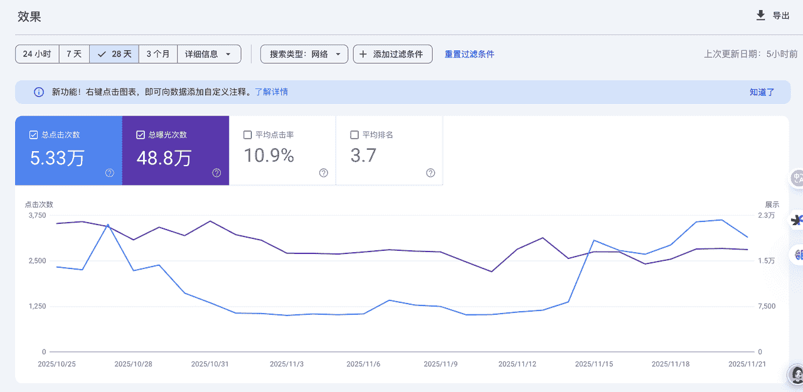
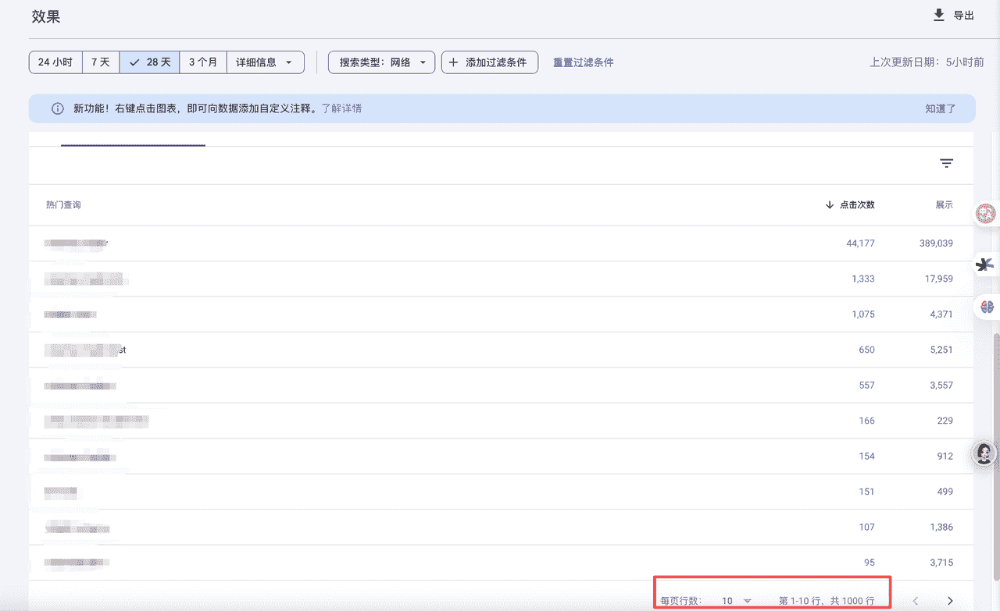
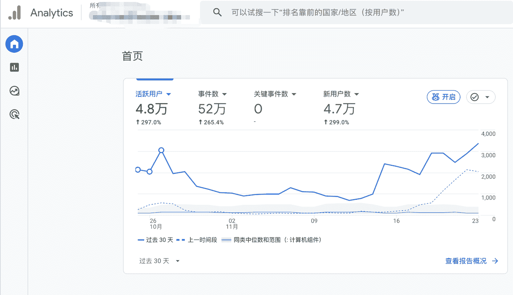
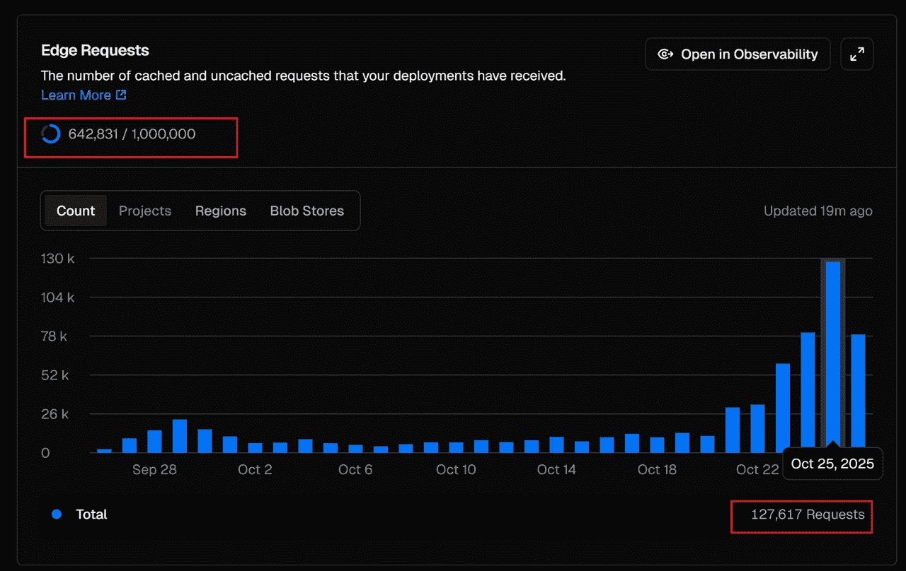

# 从0到谷歌Top 4，我是如何通过“低竞争+强差异”策略引爆工具站流量的？

> 来源：[https://xuqiwei1986.feishu.cn/docx/N3CWdm3Feoudrux5JiicYQxNnce](https://xuqiwei1986.feishu.cn/docx/N3CWdm3Feoudrux5JiicYQxNnce)

大家好，我是星城。

首先感谢官方约稿。今天想和大家拆解一个我近**期操盘的案例：我**和我的合作伙伴 @超哥（也是在赚钱认识的）一起做的一个工具站。

我们在9月底买下域名，半个月杀入谷歌首页，1个月内稳定在前5，目前核心大词排名前4。这期间我们踩过技术坑，也验证了一套SEO的打法，希望能给大家的出海之路带来一些参考。

## 一、 成绩单

先看结果。这是 Google Search Console (GSC) 的后台截图：

大家可以看到，目前已经出了 1000+ 个关键词。

这意味着我们的长尾词覆盖策略非常成功，不仅仅是靠一个主词在带流量，而是形成了一个健康的流量矩阵，抗风险能力很强。

这是一个典型的“老域名+新站”工具类项目，解决了用户某个具体的技术参考痛点。从趋势看，流量仍在稳步爬升。

## 二、 选品核心：与其“找”词，不如“判”词

很多朋友问我怎么发现这个关键词的。其实，发现词不难，难的是判断这个词值不值得做。

**在立项前，我**做了一个深度调研，发现这个这个词满足了三个关键要素，这也是我判断“能做”的底层逻辑：

1.  **竞争对手弱**：排名2~5名的网站，很多是近半年才上线的。这说明该领域的SERP（搜索结果页）尚未固化，不需要极高的老站权重也能突围。

1.  **外链门槛低**：通过 Ahrefs 分析，竞品的反向链接很少，大多在200以内，甚至有竞品仅靠2个外链就上了首页。这意味着我们不需要巨额预算去砸外链。

1.  **流量天花板高****：第一名拥有1~2M的月**流量，而第2~5名也有30k~300k。吃不到肉，喝汤也能喝饱。

**👉 总结我的选品标准： **找大流量（Top1吃肉）+ 弱竞争（Top5喝汤）+ 低门槛（外链少）的“中间地带”。

这套方法是前段时间参加AI赚钱航海大会，@TC教会我的，我和他一个房间，两天时间都一直聊到凌晨3点才睡，这里特别补充说明，感谢@TC！！！

为了方便大家理解，我不妨打个比方：

假设我们这次选中的是 **“某射击游戏灵敏度转换器”** 这样的细分需求。

+   **看老大（Top 1）：** 排名第一的可能是一个运营了10年的老牌电竞门户，月流量 200万，地位难以撼动（这是在‘吃肉’）。

+   **看老二老三（Top 2-5）：** 但当我们往下看，发现排名第 2 到第 5 的网站，竟然都是几个月前才上线的简陋个人站，页面丑陋、功能单一，甚至只有几个外链，但它们每个月依然能分到 5万-30万 的自然流量（这就是在‘喝汤’）。

+   **我们的机会：** 这说明这个词的搜索需求极大，但优质供给不足。我们要做的，就是做一个比 Top 2-5 界面更清爽、算法更精准、加载更快的‘转换器’，利用新站的红利期快速抢占这些‘喝汤’的席位。

## 三、 流量获取：低竞争+强差异+广传播

### 挖掘低竞争潜力词

具体的找词方法航海手册里很全，我常用的是这三招：

+   Google Trends 顺藤摸瓜：输入大词根（如 AI, app），看“相关查询”里的飙升词，这是捕捉趋势的最快路径。

+   **Similarweb 竞品透视**：通过“关键词生成器”看流量起伏，或者直接扒对标网站的“新点击量”页面，看他们最近哪个页面火了，直接跟进。

+   **社媒嗅觉**：在 TikTok/Twitter 刷到新词 -> 去 Trends 验证热度 -> 去 Similarweb 验证商业价值。

+   Semrush 找开源/vibe coding大站：通过看github/v0/bolt/aistudio等子站点（xxx.github.com）流量大的站点，来找灵感，甚至抄技术方案，来解决流量和技术可行性两大做什么和怎么做的难题。

### 找出内容差异化

这是我们能快速上位的核心。竞品大多内容陈旧，处于“无人维护”状态。

我们利用 AI（Claude/Gemini/GPT） 进行了深度加工。不仅仅是洗稿，而是做增量价值。

+   **实操技巧**：我会把竞品的内容喂给 Claude，通过 Prompt 让它分析竞品的优缺点，然后针对性地生成更详尽的解释、更清晰的图表，或者增加竞品没有的“常见问题解答（FAQ）”板块。

+   **数据策略**：想办法留下数据！任何在你网站干的事情，都是你的数据资产以及竞争壁垒，你有数据，其他竞对没有，时间久了就是你的壁垒！特别是在AI时代，技术壁垒已经被AI打的很低了，数据壁垒将更加可贵。

+   **榜单策略**：我们专门制作了对比榜单，这极大地增加了用户停留时**间。数**据显示，我们的用户平均停留时长达 3分钟，而竞品仅为30秒~1分钟。用户行为数据是谷歌排名的重要指标，这一招非常奏效。

### 外链建设广传播

+   **数量**：持续发，每天10~20个，积少成多。

+   **策略**：

+   **Follow竞品**：看对手在哪发，我们就去哪发。

+   **自建库**：利用我们积累的资源库进行铺量。

+   **垂直高权**：尽可能在相关性高的垂直网站留痕，流量更精准。

## 四、 开发SOP

开发我们用的全是vibe coding标配，建议能用最新最好的尽量用，省时间才是最省钱，大概流程如下：

1.  **Chatgpt-需求分析**: 分析关键词背后的真实需求，分析竞争对手，讨论具体方案

1.  **Github-技术方案**：找开源方案，不要重复造轮子（这个站就是用的github）

1.  **Chatgpt-需求文档**：写详细的PRD文档，以及列MVP优先级。有人可能问为啥不找Gemini，原因是他好像太克制，我叫他去看看人家网站他都经常说受限制，不够野

1.  **V0**：根据PRD出前端初稿，连github同步代码。这里用v0是因为他家是vercel的，之后同一个项目迭代方便，而且nextjs也是他家的，技术栈也是一套比较方便

1.  **Cursor**：拉github代码，继续本地雕花以及接后端neon postgres sql数据库。这里其实cursor只是用来看代码和启动服务器，写代码主力已经不用cursor，主要是太慢

1.  **Claude Code**：本地开发基本都用cc，claude账号问题所以接的是中转站，具体大家可以找找其他帖子，然后也买了glm4.6的套餐，claude用完就补上。glm4.6大概是claude 4.1 sonnet的性能，调用工具啥的都没问题，就是棘手的问题还是比较容易卡壳，还有记得让他不要mock data，我发现他很喜欢写模拟数据。本地开发主要是调整界面细节，写api后端代码等，具体流程是：

1.  先让他精读PRD，画架构图流程图（主要是给你自己看）

1.  让他根据PRD的MVP拆分全部任务

1.  把任务放到单独的md文件，拆分的时候需要分开发任务/审查任务/测试任务

1.  找各个subagent来开发对应的任务，完成后在任务列表打勾

1.  记得写完代码，再找专门的review/testing subagent把代码审核和测试都做了

1.  用chrome-devtools mcp，让他打开页面跑功能测试，不然他可能只会在命令行给你curl

1.  **Neon Postgres**：为啥弃用supabase？因为免费给的数据库太少了只有两个，而且不给区分branch，这方面如果你多个项目的话，一个Neon账号会更有好

1.  **Claude Skills**：最近兴起的好东西，可以定义跨项目的技能给不同产品复用，例如我现在就定义一个SEO专家技能，还有前端UI优化技能，还可以定义一个标准的PRD写作讲呢，节省你提示词/工具在各个项目间抄来抄去的重复劳动

## 五、 避坑指南：花钱买来的教训

项目虽然顺利，但中途有两个“小插曲”，差点让我们前功尽弃，大家务必避雷。

### 坑一：Canonical 标签与重定向灾难

有天排名从前 10**直接掉**到第 3、4 页。原因是我们在做** www 规范化时，把 canon**ical（规范链接）配错了，还错误使用了临时 302（Temporary）而不是永久 301（Permanent）。

**

正确做**法：

+   **统一一个首选域（带或不带 ww**w），全站 301/308 永久跳转到它；

+   每页只保留**一个自引用 canonical**（<link rel="canonical" href="绝对URL">）；

+   上线前做条目检查：HTTPS、www 统一、robots/sitemap、canonical 唯一、hreflang 成对（如多语）。

> 术语小抄：

+   **301/308** = 永久重定向（Permanent）

+   **302/307** = 临时重定向（Temporary）

修正：确保 301 Redirect 配置正确，且 rel="canonical" 指向唯一规范版本。改回后，排名逐渐恢复。

### 坑二：Vercel 的“天价”账单预警

现象：网站部署在 Vercel 上，几天内 Edge Request（边缘请求）暴涨到 12万次/天。按这个速度，免费额度（100万次）10天就会耗尽，触发 $2/100万次 的扣费。

原因：Vercel 的请求数是按资源数计算的。一个页面如果有 13 个资源（CSS, JS, 图片），1个访客访问5个页面，就是 65 次请求。流量一上来，额度瞬间爆炸。

解决方案：套一层 Cloudflare (CF)。

将 Name Server 指向 CF，开启 CF 的免费 CDN 缓存。这样绝大多数静态资源请求会被 CF 拦截并处理，根本不会打到 Vercel 服务器上。

**建议：**

建站第一天就套上 Cloudflare，不要等流量起来了再换，中途切换DNS可能会导致短暂的访问中断。

## 六、 后期维护：稳态运营

上线不是结束，只是开始。

1.  **持续外链**：像存钱一样，每天存一点。利用我们自建了外链库保持频率。

1.  **内容微调**：盯着 GSC 的数据，哪个词展现高点击低，就去改 Title；哪个页面跳出率高，就去优化首屏加载速度。

1.  **技术监控**：时刻关注 Core Web Vitals（核心网页指标），确保 LCP < 2.5s，移动端体验是谷歌排名的重中之重。

1.  **内容更新**：由于我们做了数据库，有了用户提交的数据，就可以定期出一些blog来写写文章，根据数据做一些分析，结合长尾关键词，来蹭相关流量提高网站的权重。

1.  **功能优化**：可以垂直或者水平扩展功能。垂直是把自己原有功能做得更深，例如一开始的MVP可能只是做用户流程的最最有价值的一个点，现在可以扩展做当前节点的上下游节点（例如生成图片->编辑图片）；水平是把原有功能套到其他领域（例如生成图片->生成各种定制化模板化的各种图片）。

1.  **用户反馈**：如果是saas，千万不要自己猜用户想法，一定要去聊，所以建议一开始就留反馈邮箱，如果可以的话用上第三方的用户反馈saas会更好

## 七、 写在最后

回顾这个站的起盘，我认为核心公式是：

**精准选词（低竞高需）+ ****快速搭建MVP + ****技术护航（性能/SEO规范）+ 内容**微创新（差异化/AI辅助）+ 持续外链。

这其中，离不开工具的赋能，更离不开靠谱的队友。

特别感谢龙哥盟这个平台，让我遇到了超哥，也认识了一群志同道合的人。做海外项目，一个人走得快，一群人走得远，多找人交流碰撞，往往能擦出意想不到的火花。

我是星城，2025年我们会做更多的站，希望能继续和大家分享更多实战干货！