# 内容工厂Agent 航海复盘，小白照做也能轻松复刻

> 来源：[https://xuqiwei1986.feishu.cn/docx/ZMbqdV2AroJzOJx0jHvc8jgpnJd](https://xuqiwei1986.feishu.cn/docx/ZMbqdV2AroJzOJx0jHvc8jgpnJd)

花了两天时间搭建的内容工厂Agent，以前一周要做的内容，现在自己几个小时就搞定了—— 内容工厂Agent 是真的香！

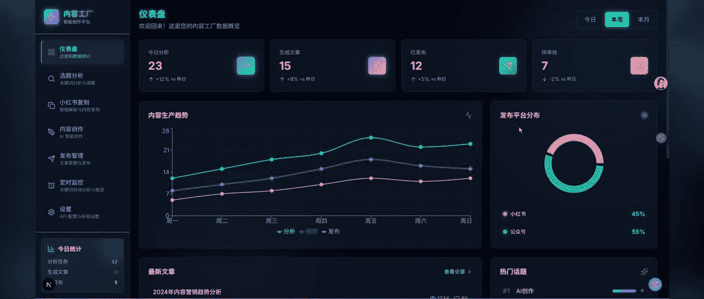

[内容工厂Agent演示.mp4](https://internal-api-drive-stream.feishu.cn/space/api/box/stream/download/all/EtKkbvC3mobS3QxbMG7cKZ7XnWf)

+   按关键词批量采集抓取公众号文章、小红书笔记

+   根据批量的内容，一键生成数据分析+内容选题洞察

+   快速改写/创意生成 新的公众号文章、小红书笔记

+   直接把内容发步到公众号、小红书的草稿箱

举个例子：之前在小红书做职场内容，光找选题、找对标就得扒几十篇笔记，再分析半天数据，改写+配图到最后发布，折腾 1 天下来心力憔悴。现在有了内容工厂Agent，冲杯咖啡的功夫，就能全搞定了：

输入 “2025 职场高效工具”，1分钟就能扒来 100+ 篇高赞的公众号 + 小红书内容

再用1分钟分析，然后直接生成洞察：“把 AI 工具结合时间管理一起写，互动率能提高 40%”

基于这个洞察，几分钟就能改出 3 篇笔记，然后一键发布到小红书草稿箱里

连笔记里加什么 emoji 、加什么标签，都直接参考对标的爆款笔记弄好了

不管是公众号、小红书、小绿书，还是国外的 X、Reddit，内容工厂Agent 都能实现 “指数级提效”—— 帮助我们把精力聚焦在更重要的事情上

对自动化提效感兴趣的朋友，一定要看 @钱塘江鲤 教练这篇干货帖：https://wx.zsxq.com/group/1824528822/topic/45811414221158288

大家好，我是 A 米，前企业信息化咨询，23年加入生财入局短视频和直播电商，25 年开始探索 AI 产品和内容出海。这次跟着钱塘江鲤教练学习 “内容工厂 Agent”，不光把核心功能跑通了，更重要的是学会了搭建思路和方法，收获满满。趁热打铁做下复盘，把本次航海学习做个系统的梳理，希望能帮大家快速了解内容工厂Agent的实现路径，搞懂如何从0-1落地～下面是详细内容：

## 一、搭建前的准备工作

### 编程工具及编程模型的准备

编程工具：Visual Studio Code、Antigravity

编程模型：claude code、codex、gemini 3、国产模型驱动cc

+   在VS code中使用claude code、codex或者国产模型驱动cc

codex需要充值chatgpt，安装codex插件后登录即可；Claude code yolo 可以用国产模型驱动cc，安装claude code yolo插件后配置国产模型API即可使用

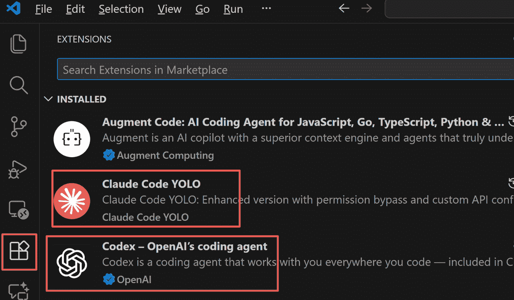

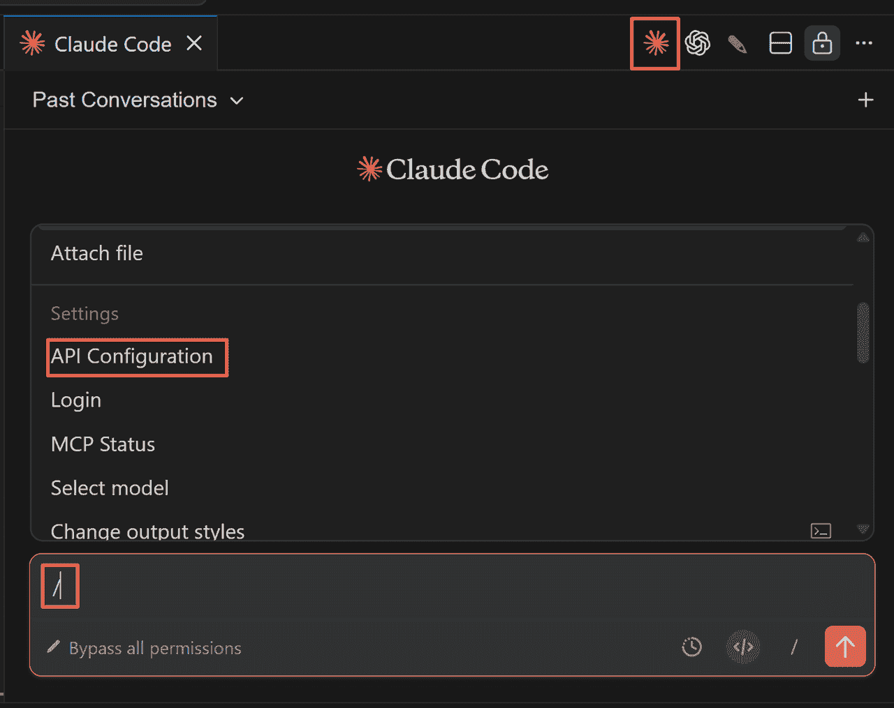

配置国产模型GLM4.6、Kimi、Minimax等模型的API信息，就可以使用这些国产模型进行编程了

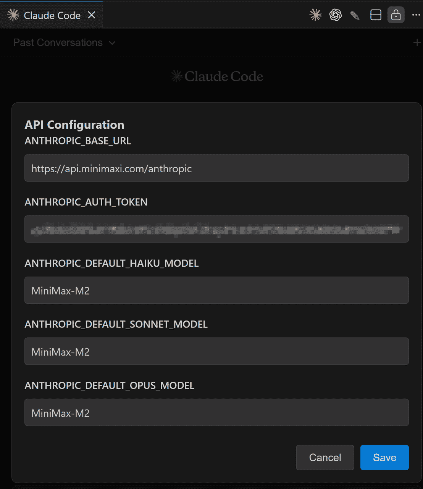

VS code汉化

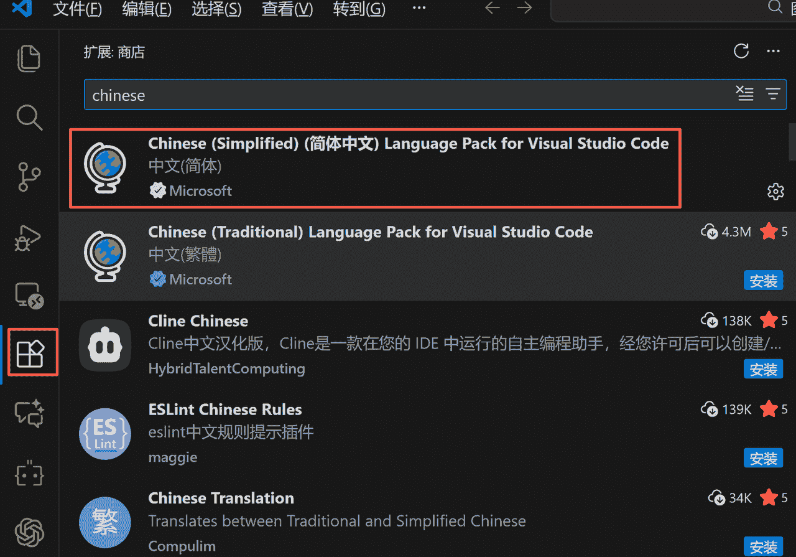

+   Antigravity，google搜索直接下载，可以免费使用gemini3和claude sonnet 4.5

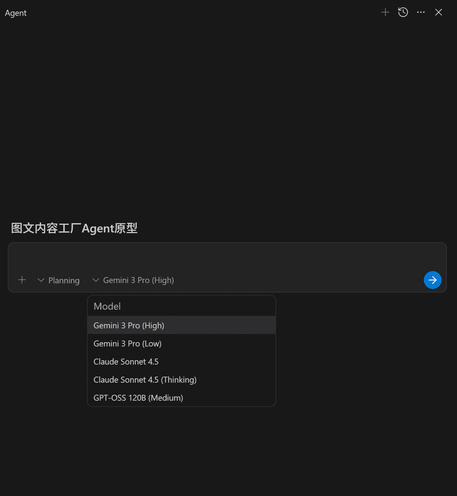

###

### 基于业务流程，梳理系统框架及核心功能

+   图文类内容核心业务流程：找对标->拆解对标->复刻/改编->内容发布

+   内容工厂系统层业务流程：对标批量采集->批量拆解，分析框架->单条复刻/基于框架改编->内容发布

+   内容工厂系统层核心功能：选题分析->选题洞察->内容复刻/内容创作->发布管理

###

### 根据要实现的功能寻找合适的API，能看懂API文档，了解API的能力边界

+   根据功能需求找合适的API，可以通过询问AI、google搜索、咨询的方式查找

+   看API文档，只需锁定关键信息：

（以公众号发布为例，API文档：https://wx.limyai.com/dashboard/open-platform）

1.  请求方式：是post还是get

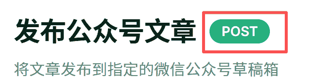

1.  接口地址：一般在API接口文档的开始部分，curl的请求示例中也可以直接获取

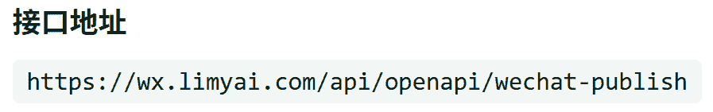

1.  示例代码：完整的curl示例代码

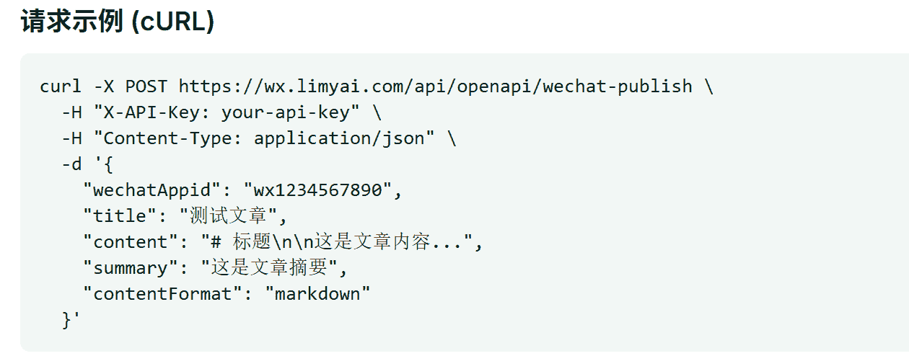

1.  示例输出：完整的响应示例代码，如果API文档中没有就在线调试或者通过postman提供示例输入，得到示例输出

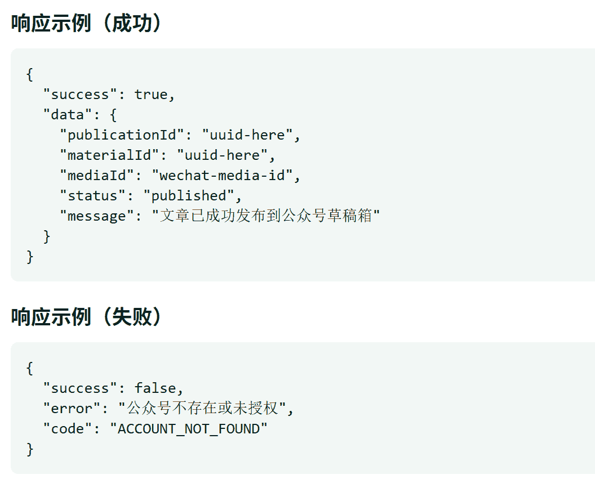

把以上这些API信息一并提供给AI编程模型，同时提供API kEY和API文档链接

+   受制于官方限制，有些功能需求是需要拆分成多个API来实现的，比如小红书获取笔记列表和笔记详情是需要组装不同的API来完成，所以要了解每个API的能力边界

###

### 与AI简单直接且无歧义的需求沟通

以小红书为例，与AI编程模型直接沟通需求（要求AI先不要代码生成，需求确认后再着手开发）

我要做一个内容工厂Agent，需要实现四部分功能：

+   选题分析，支持根据关键词批量获取笔记，通过xx API可以获取小红书搜索笔记的列表信息、点赞量、

+   选题洞察，基于选题分析获取的公众号文章数据，使用xx API对每篇文章进行概要分析，然后基于这些概要分析进行选题洞察并生成洞察报告，洞察报告需要包含xxxx内容

+   内容创作，需要支持根据选题洞察或者自定义由xx API实现一键AI创作笔记，并由xx API支持根据内容自动生成配图，生成新的笔记需要支持以草稿形式保存在发布管理页的列表中

+   发布管理，内容创作生成的新笔记在发布管理列表中，列表的操作栏除了常规的增删改查外，还需支持通过xx API一键发布到小红书

以此为基准与AI进行多轮沟通，拉齐需求与技术实现，过程中有不懂的技术语言，不会提的需求，都要求AI用大白话解释或者由AI协助梳理需求

###

### AI实现过程中，通过有效的方式与AI协作解决随时出现的问题

+   终端报错/界面报错：复制/截图报错信息提供给AI编程模型，告知报错了让其来解决

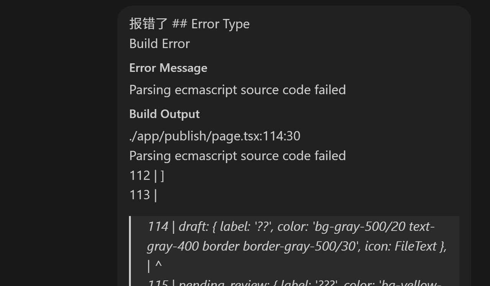

+   网页端右键->检查->看console的报红信息，同样截图给AI编程模型解决，或者chatgpt/豆包等模型来沟通原因解决

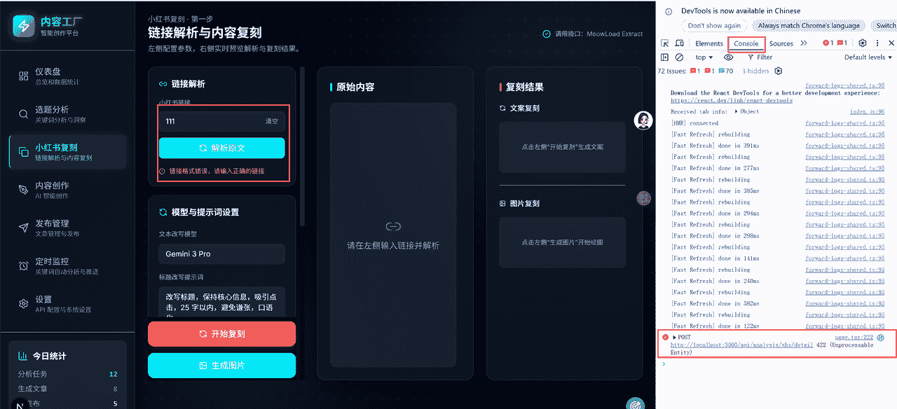

+   要求AI编程模型，在指定动作(比如点击某个按钮）后为每一步打上日志详情，帮助AI定位问题精准解决

### 在ROI能打正的范围内使用最好的模型

+   前端原型->gemini 3 pro (high)

+   后端功能->claude sonnet 4.5 & GPT-5.1-codex-Max

+   文字生成->claude/gemini

+   图片生成->nano banana 2

## 二、实现过程复盘

【PS:以下内容涉及的原型和提示词均来自@钱塘江鲤教练，本过程仅作为复刻还原】

### 按统分结构，先实现整体的原型设计

+   工具：Antigravity

+   模型：gemini 3 pro (high)

+   功能说明：实现首页、导航栏、每个页面的界面内容和样式、简单的页面交互

+   与codex沟通确认后，实现需求如下

```
请和我一起讨论一个需求，我希望做一个内容工厂agent，主要由三个部分组成：
第一部分是选题分析，需要支持根据关键词获取公众号文章（有第三方API，且可以获取到标题正文，阅读数，点赞数，在看数，然后使用openai兼容的AI接口对每篇文章首先进行概要分析，然后再整体结合这些概要进行选题洞察，使用ai api生成洞察报告。注意洞察报告需要包括点赞量最高的五篇文章，互动率最高的五篇文章，高频词云，五个选题洞察。
第二部分是内容创作，需要支持针对生成的选题进行一键AI创作，生成新的文章，生成新的文章中第一步使用upsplash获取一些相关图片插入其中，注意为了方便管理需要新建一个发布管理的页面，所有AI生成的文章都要放到发布管理页面的列表中，并且文章还需要有一些状态方便管理。
第三部分就是发布。针对生成的文章在列表操作栏需要有发布到小红书和发布到公众号两个选项，这一部分也有第三方API。为了方便和快速上手我希望你使用next.js框架和sqlite数据库。针对我以上的想法，请你首先帮我讨论需求，并帮我设计页面结构和主要元素布局，可以用简要的线框图形式描述方便我们对齐确认。
```

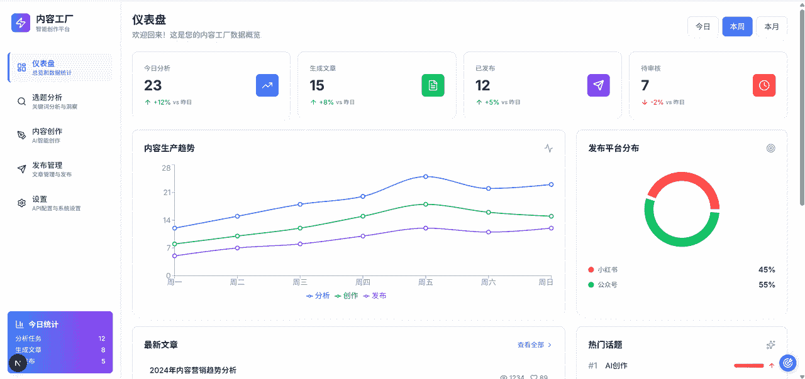

+   与gemini 3沟通优化界面样式，哪里不对调哪里

```
请你先通读一遍代码，帮我将所有页面统一换成更高级的风格，要充满高端和科技感
```

经过沟通与调整，保证每个页面的风格统一，实现需求如下：

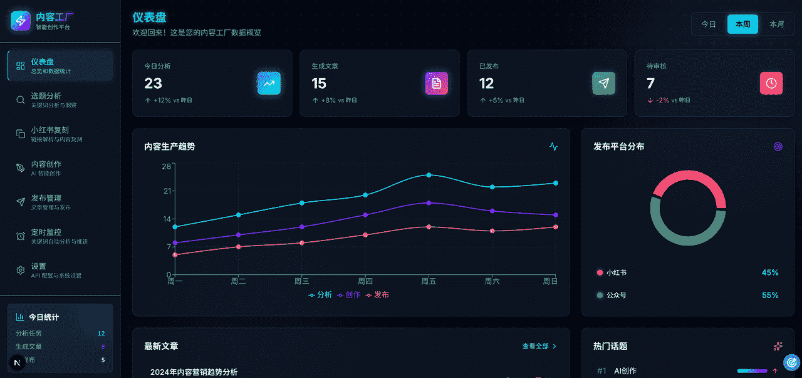

###

### 根据原型设计，按结构分步实现功能

+   工具：Visual Studio Code

+   模型：GPT-5.1-codex-Max

#### 选题分析（含选题洞察）

+   功能说明：在独立平台下根据输入的关键词、时间范围、条数，采集并分析文章或笔记生成数据分析结果及内容洞察

+   小红书 https://s.apifox.cn/4dd9eeb2-ca15-4927-93aa-ae021487a25f/api-304007176 访问密码：yWBO3kr3

+   与codex经过多轮沟通，实现需求如下：

```
请你帮我完成选题[分](https://s.apifox.cn/410674f9-f451-4b4f-957a-5f54f243bc83/api-199754666)析这个页面中获取公[众号文章的逻辑，根据关键词获取公众号文章的API接口如下：
A](https://www.dajiala.com/fbmain/monitor/v3/kw_search)PI文档链接：https://s.apifox.cn/410674f9-f451-4b4f-957a-5f54f243bc83/api-199754666
API key：替换为你自己的API KEY，最好在.env.local中维护，让模型读取.env.local文件中的密钥
示例代码：
curl --location --request POST &#x27;https://www.dajiala.com/fbmain/monitor/v3/kw_search&#x27;
--header &#x27;Content-Type: application/json&#x27;
--data-raw &#x27;{
&quot;kw&quot;: &quot;人民日报&quot;,
&quot;sort_type&quot;: 1,
&quot;mode&quot;: 1,
&quot;period&quot;: 7,
&quot;page&quot;: 1,
&quot;key&quot;: &quot;{{key}}&quot;,
&quot;any_kw&quot;: &quot;&quot;,
&quot;ex_kw&quot;: &quot;&quot;,
&quot;verifycode&quot;: &quot;&quot;,
&quot;type&quot;: 1
}&#x27;
返回消息：
export interface ApifoxModel {
code: number;
cost_money: number;
cut_words: string;
data: Datum[];
data_number: number;
msg: string;
page: number;
remain_money: number;
total: number;
total_page: number;
[property: string]: any;
}
export interface Datum {
/**
* 封面
/
avatar: string;
/*
* 分类
/
classify: string;
/*
* 正文
/
content: string;
/*
* 原始id
/
ghid: string;
/*
* 发布地址
/
ip_wording: string;
/*
* 是否原创
/
is_original: number;
/*
* 再看数
/
looking: number;
/*
* 点赞数
/
praise: number;
/*
* 发布时间
/
publish_time: number;
publish_time_str: string;
/*
* 阅读数
/
read: number;
/*
* 文章原始短链接
/
short_link: string;
/*
* 文章标题
/
title: string;
/*
* 更新时间
/
update_time: number;
update_time_str: string;
/*
* 文章长连接
/
url: string;
/*
* wxid
/
wx_id: string;
/*
* 公众号名字
*/
wx_name: string;
[property: string]: any;
}
并把API KEY放入.env.local中
```

```
[我们现在已经实现了公众号的选题分析，我需要再实现小](https://www.dajiala.com/fbmain/monitor/v3/xhs)红书的选题分析，以下是小红书搜索笔记的API相关信息，请你帮我实现：
API文档链接：https://s.apifox.cn/4dd9eeb2-ca15-4927-93aa-ae021487a25f/api-304007176
示例代码：
curl --location --request POST &#x27;https://www.dajiala.com/fbmain/monitor/v3/xhs&#x27;
--header &#x27;Content-Type: application/json&#x27;
--data-raw &#x27;{
&quot;key&quot;:&quot;{{替换为你自己的API KEY，最好在.env.local中维护，让模型读取.env.local文件中的密钥}}&quot;,
&quot;type&quot;:1,
&quot;keyword&quot;:&quot;饭搭子&quot;,
&quot;page&quot;:1,
&quot;sort&quot;:&quot;general&quot;,
&quot;note_type&quot;:&quot;image&quot;,
&quot;note_time&quot;:&quot;不限&quot;,
&quot;note_range&quot;:&quot;不限&quot;,
&quot;proxy&quot;:&quot;&quot;
}&#x27; 返回响应：export interface ApifoxModel {
code: number;
cost: number;
has_more: boolean;
items: Item[];
remain_money: number;
[property: string]: any;
}
export interface Item {
id: string;
model_type: string;
note_card?: NoteCard;
xsec_token: string;
[property: string]: any;
}
export interface NoteCard {
corner_tag_info: CornerTagInfo[];
cover: Cover;
display_title?: string;
image_list: ImageList[];
interact_info: InteractInfo;
type: string;
user: User;
[property: string]: any;
}
export interface CornerTagInfo {
text: string;
type: string;
[property: string]: any;
}
export interface Cover {
height: number;
url_default: string;
url_pre: string;
width: number;
[property: string]: any;
}
export interface ImageList {
height: number;
info_list: InfoList[];
width: number;
[property: string]: any;
}
export interface InfoList {
image_scene: string;
url: string;
[property: string]: any;
}
export interface InteractInfo {
collected: boolean;
collected_count: string;
comment_count: string;
liked: boolean;
liked_count: string;
shared_count: string;
[property: string]: any;
}
export interface User {
avatar: string;
nick_name: string;
nickname: string;
user_id: string;
xsec_token: string;
[property: string]: any;
} 
我的密钥为：替换为你自己的API KEY，最好在.env.local中维护，让模型读取.env.local文件中的密钥
```

```
[小红书选题分析的笔记弹窗，点击查看原文是跳转到小红](https://api.meowload.net/openapi/extract/post)[书平台需要扫码才能看笔记详情，现在需要你帮我实现查看原文直](https://api.meowload.net/openapi/extract/playlist)接展示笔记详情，小红书详情API配置已经在.env.local中提供
API文档链接：https://github.com/MeowLoad/Media-Downloader-API?tab=readme-ov-file
示例代码：const api = &quot;https://api.meowload.net/openapi/extract/post&quot;; // 单个帖子提取接口，如果主页批量提取使用：https://api.meowload.net/openapi/extract/playlist
const apiKey = &quot;替换为你自己的API KEY，最好在.env.local中维护，让模型读取.env.local文件中的密钥&quot;; 
const params = {
url: &quot;https://v.douyin.com/MGkSpJS/&quot;,
};
const xhr = new XMLHttpRequest();
xhr.open(&quot;POST&quot;, api, true);
xhr.setRequestHeader(&quot;content-type&quot;, &quot;application/json;charset=UTF-8&quot;);
xhr.setRequestHeader(&quot;x-api-key&quot;, apiKey); // 指定 API Key
xhr.setRequestHeader(&quot;accept-language&quot;, &quot;zh&quot;); // 指定错误 message 返回的语言为中文
xhr.onreadystatechange = function () {
if (xhr.readyState === 4) {
console.log(xhr.responseText);
}
};
xhr.send(JSON.stringify(params)); 
请你为我实现
```

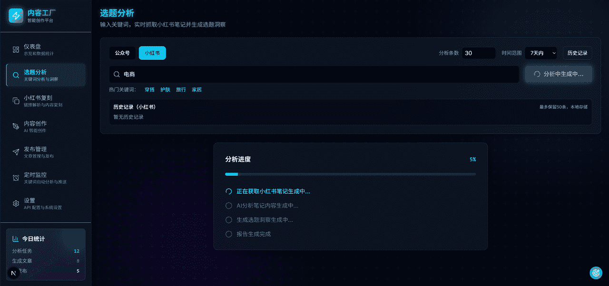

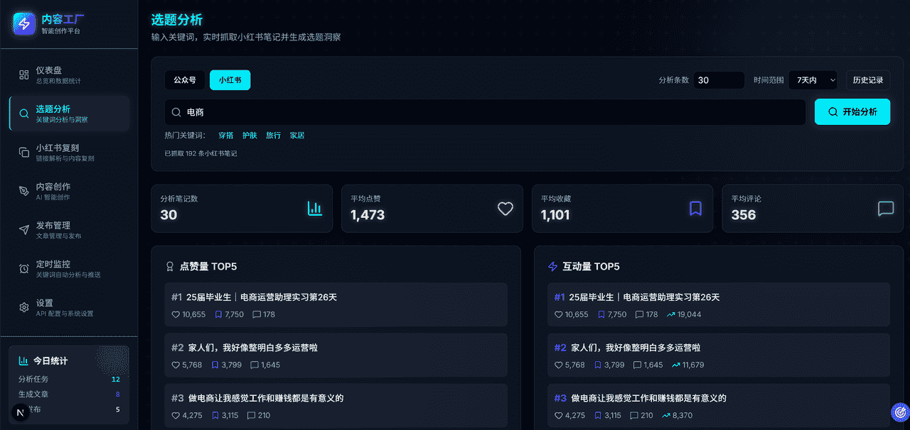

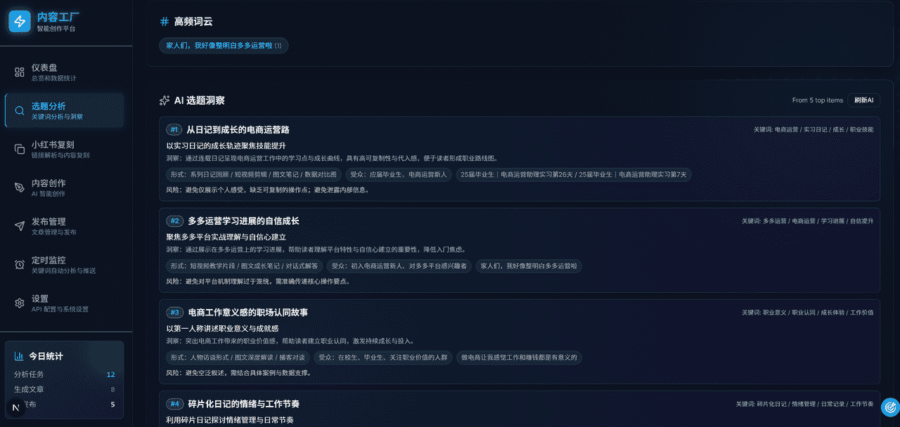

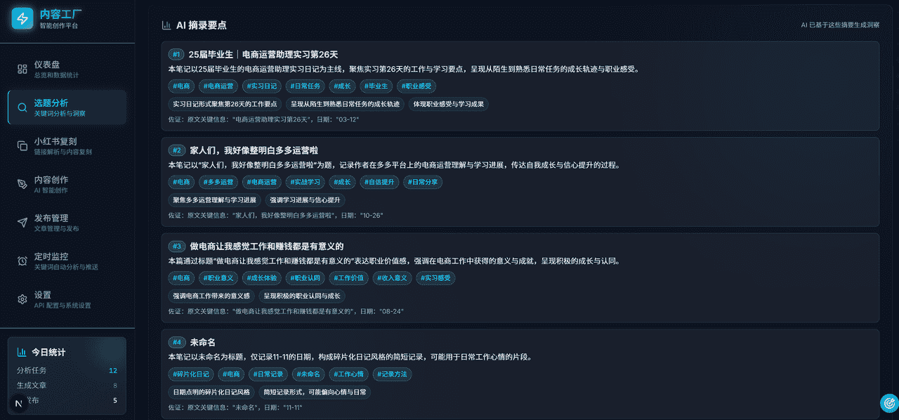

+   过程中遇到的问题和补充的部分细节，按需和codex沟通来解决报错、修复问题、完善功能细节：


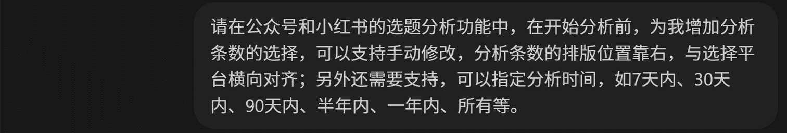

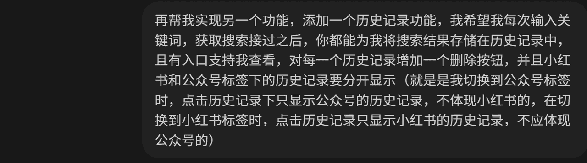

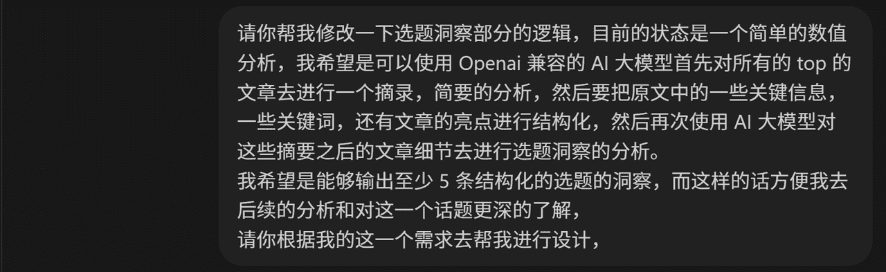

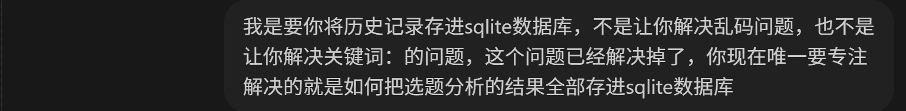

####

#### 内容创作

+   功能说明：根据选题分析生成的洞察报告或者自定义选题，设定文章长度、写作风格、配图数量，由AI大模型自动创意生成公众号文章或者小红书笔记，并以草稿形式一键保存到发布管理列表中

+   与codex根据多轮沟通，实现需求如下：

```
你帮我修改一下内容创作这个页面，我希望从洞察报告中选择的时候，可以实时的获取到选题分析中不同的关键词生成的选题洞察报告，这部分数据要能够联动起来
另外可用选题部分按照时间的顺序去进行倒叙排序。
同时我还希望在进行开始创作的时候，你可以参考我目前本地环境变量中配置的与OpenAI 兼容的大模型的 API 的一些基本信息调用 AI 去给我生成文章。
内容创作页面中生成的文章，点击保存草稿的时候，直接保存到发布管理页面的列表中
请结合现在的页面的现状，以及选题分析中关于选题洞察生成的相关的逻辑首先设计技术方案，对于设计可能变动的地方罗列出来，然后再和我进行需求上的确认。在我获得我的许可之后再去进行代码的修改。
```

```
在内容创作页[面，目前生成文章的时候，生成图片的逻辑其实是随机获取图片](https://api.siliconflow.cn/v1/images/generations)的，但是这种图片和文章的关联性很差，希望你去调用硅基流动的官方的生图 API，然后使用Kolors模型去帮助我生成文章的配图。
整体流程是你首先根据生成的文章内容去调用 AI 接口去生成指定张数的图片提示词，然后根据这些图片提示词再去调用图像生成接口，再去生成文章内的插图。
所以你根据我刚刚的需求去深入分析相关的代码，然后给出我技术方案，然后并且和我确认需求，在得到我的许可之后再去进行代码的修改。
硅基流动Kolors模型的接口文档为:https://docs.siliconflow.cn/cn/api-reference/images/images-generations

示例代码：
curl --request POST
--url https://api.siliconflow.cn/v1/images/generations
--header &#x27;Authorization: Bearer &lt;token&gt;&#x27;
--header &#x27;Content-Type: application/json&#x27;
--data &#x27;{
&quot;model&quot;: &quot;Qwen/Qwen-Image-Edit-2509&quot;,
&quot;prompt&quot;: &quot;an island near sea, with seagulls, moon shining over the sea, light house, boats int he background, fish flying over the sea&quot;
}&#x27;返回参数为:{
&quot;images&quot;: [
{
&quot;url&quot;: &quot;&lt;string&gt;&quot;
}
],
&quot;timings&quot;: {
&quot;inference&quot;: 123
},
&quot;seed&quot;: 123
},
model 为:Kwai-Kolors/Kolors,
API KEY为:替换为你自己的API KEY，最好在.env.local中维护，让模型读取.env.local文件中的密钥
```

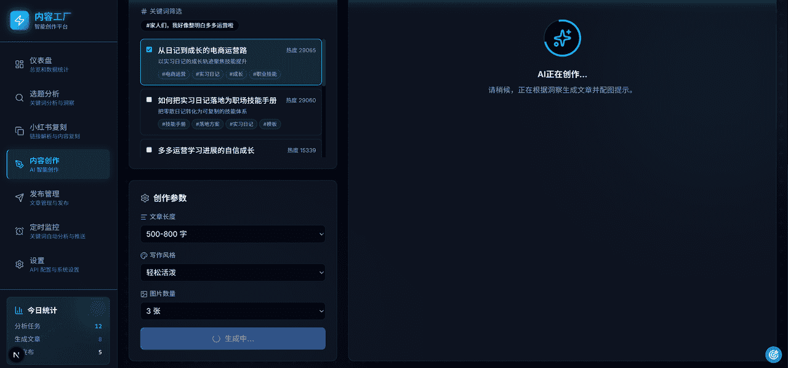

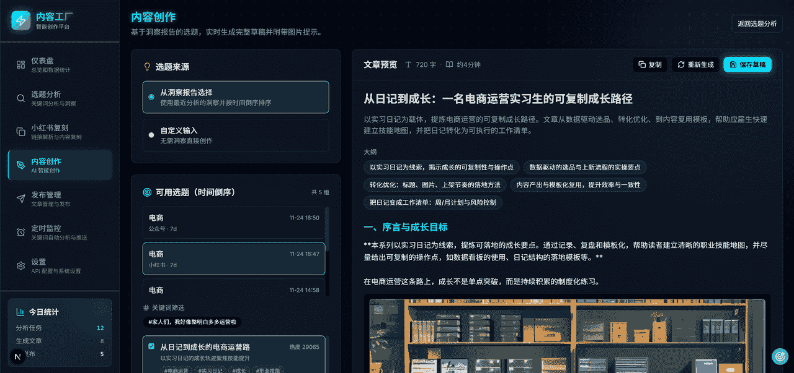

+   过程中遇到的问题和补充的部分细节，可以按需和codex沟通来解决报错、修复问题、完善功能细节：


####

#### 发布管理

+   功能说明：支持内容创作生成的文章/笔记草稿在线预览、编辑、删除，也支持在发布管理页中新增草稿，支持文章/笔记草稿一键发布到公众号及小红书的草稿箱

+   小红书推舟https://note.limyai.com/dashboard/open/publish_note 激活码：H64Q4VRD

+   与codex经过多轮沟通，实现需求如下：

```
请你帮我修[改发布管理这个页面，我希望实现发布到公众号的逻辑是：首先在](https://wx.limyai.com/api/openapi/wechat-accounts)用户点击发布到公众号这个按钮之后，要[跳出来一个弹窗，这个弹窗上面可以去选择要发布的公众号和要](https://wx.limyai.com/api/openapi/wechat-publish)发布的发布类型，发布类型同时支持发布到公众号文章和小绿书，用户选择之后去点击发布。
下面是涉及到的公众号发布的两个接口，第一个接口就是用于获取这一个 API key 下的所有的公众号的信息，第二个接口就是根据用户选择的公众号去执行一个发布的操作，下面是这两个接口对应的 API的文档。请你根据 API 文档以及提供的key 先进行一个流程和技术方案上的设计，请你务必去深入研究所有相关的代码，首先把改动的范围也去罗列出来，不要着急修改代码，先和我确认好了之后再进行代码的变动。

API接口文档：获取公众号列表
API文档地址：https://wx.limyai.com/dashboard/open-platform
接口说明
获取当前用户授权的所有微信公众号信息
接口地址
POST https://wx.limyai.com/api/openapi/wechat-accounts
请求头
X-API-Key: 替换为你自己的API KEY，最好在.env.local中维护，让模型读取.env.local文件中的密钥
Content-Type: application/json

请求示例： (cURL)
curl -X POST https://wx.limyai.com/api/openapi/wechat-accounts \
  -H &quot;X-API-Key: 替换为你自己的API KEY，最好在.env.local中维护，让模型读取.env.local文件中的密钥&quot; \
  -H &quot;Content-Type: application/json&quot;

响应示例：
{
  &quot;success&quot;: true,
  &quot;data&quot;: {
    &quot;accounts&quot;: [
      {
        &quot;name&quot;: &quot;测试公众号&quot;,
        &quot;wechatAppid&quot;: &quot;wx1234567890&quot;,
        &quot;username&quot;: &quot;gh_abc123&quot;,
        &quot;avatar&quot;: &quot;https://...&quot;,
        &quot;type&quot;: &quot;subscription&quot;,
        &quot;verified&quot;: true,
        &quot;status&quot;: &quot;active&quot;,
        &quot;lastAuthTime&quot;: &quot;2024-01-01T00:00:00.000Z&quot;,
        &quot;createdAt&quot;: &quot;2024-01-01T00:00:00.000Z&quot;
      }
    ],
    &quot;total&quot;: 1
  }
}

API接口文档：发布公众号文章
API文档地址：https://wx.limyai.com/dashboard/open-platform
接口说明
将文章发布到指定的微信公众号草稿箱
接口地址
POST https://wx.limyai.com/api/openapi/wechat-publish
请求头
X-API-Key: 替换为你自己的API KEY，最好在.env.local中维护，让模型读取.env.local文件中的密钥
Content-Type: application/json

请求示例：
curl -X POST https://wx.limyai.com/api/openapi/wechat-publish \
  -H &quot;X-API-Key: 替换为你自己的API KEY，最好在.env.local中维护，让模型读取.env.local文件中的密钥&quot; \
  -H &quot;Content-Type: application/json&quot; \
  -d &#x27;{
    &quot;wechatAppid&quot;: &quot;wx1234567890&quot;,
    &quot;title&quot;: &quot;测试文章&quot;,
    &quot;content&quot;: &quot;# 标题\n\n这是文章内容...&quot;,
    &quot;summary&quot;: &quot;这是文章摘要&quot;,
    &quot;contentFormat&quot;: &quot;markdown&quot;
  }&#x27;

响应示例（成功）
{
  &quot;success&quot;: true,
  &quot;data&quot;: {
    &quot;publicationId&quot;: &quot;uuid-here&quot;,
    &quot;materialId&quot;: &quot;uuid-here&quot;,
    &quot;mediaId&quot;: &quot;wechat-media-id&quot;,
    &quot;status&quot;: &quot;published&quot;,
    &quot;message&quot;: &quot;文章已成功发布到公众号草稿箱&quot;
  }
}

响应示例（失败）
{
  &quot;success&quot;: false,
  &quot;error&quot;: &quot;公众号不存在或未授权&quot;,
  &quot;code&quot;: &quot;ACCOUNT_NOT_FOUND&quot;
}

注意事项：
文章内容支持Markdown和HTML格式
图片会自动上传到微信服务器
发布后文章会出现在公众号的草稿箱中
如果未指定封面图，会自动从内容中提取第一张图片作为封面
小绿书（图文模式）说明
当 articleType 设置为 newspic 时，发布为图文消息（小绿书）：
系统会自动从内容中提取所有图片（最多20张）
内容中必须包含至少1张图片
文字内容仅支持纯文本，最多1000字
不支持HTML标签和复杂格式
图片会自动上传到微信服务器
适合以图片为主的内容发布

发布示例（小绿书）：
curl -X POST https://wx.limyai.com/api/openapi/wechat-publish \
  -H &quot;X-API-Key: 替换为你自己的API KEY，最好在.env.local中维护，让模型读取.env.local文件中的密钥&quot; \
  -H &quot;Content-Type: application/json&quot; \
  -d &#x27;{
    &quot;wechatAppid&quot;: &quot;wx1234567890&quot;,
    &quot;title&quot;: &quot;小绿书测试&quot;,
    &quot;content&quot;: &quot;这是纯文本描述\n\n\n&quot;,
    &quot;articleType&quot;: &quot;newspic&quot;
  }&#x27;

```

```
**请你帮我修**改发布管理这[个页面，就是我希望能够实现用户如果去点击发布到小红书这个](https://note.limyai.com/api/openapi/publish_note)**按钮的时候，
首先做的第一****步就是要把**这篇文章的所有的图文去分离出来，然后把文字清洗为纯文本，再调用第三方平台的接口。
这个接口的返回格式中会包含对应的发布的 URL 的链接，你需要把这个 URL 的链接去渲染成一个二维码，就是一个弹窗二维码，然后方便手机端去进行扫描。
接下来请你参考我提供给你的文档以及一些密钥的信息，去帮我完成这样的流程，主要是首先你可以帮我去进行技术方案上的这样的一个设计，请你务必要深入的研究分析所有这些相关的代码，然后把涉及到的变动的范围罗列出来。先不要着急去修改代码，确认完成之后和我去进行沟通，我们再去进行代码的变动，

下面是文档：# 发布笔记 API 接口文档基本信息
API文档地址：https://note.limyai.com/dashboard/open/publish_note
接口地址： POST https://note.limyai.com/api/openapi/publish_note
Content-Type： application/json
认证方式： API Key 认证
在请求 Header 中添加 X-API-Key 字段
X-API-Key: 替换为你自己的API KEY，最好在.env.local中维护，让模型读取.env.local文件中的密钥

请求示例：
curl -X POST https://note.limyai.com/api/openapi/publish_note \
  -H &quot;Content-Type: application/json&quot; \
  -H &quot;X-API-Key: 替换为你自己的API KEY，最好在.env.local中维护，让模型读取.env.local文件中的密钥&quot; \
  -d &#x27;{
    &quot;title&quot;: &quot;如何提升工作效率&quot;,
    &quot;content&quot;: &quot;今天分享5个提升效率的小技巧...&quot;,
    &quot;coverImage&quot;: &quot;https://example.com/cover.jpg&quot;,
    &quot;images&quot;: [&quot;https://example.com/1.jpg&quot;, &quot;https://example.com/2.jpg&quot;],
    &quot;tags&quot;: [&quot;效率&quot;, &quot;职场&quot;]
  }&#x27;

响应格式
成功响应（HTTP 201）
{
  &quot;success&quot;: true,
  &quot;data&quot;: {
    &quot;id&quot;: &quot;550e8400-e29b-41d4-a716-446655440000&quot;,
    &quot;note_id&quot;: &quot;efficiency_tips_001&quot;,
    &quot;title&quot;: &quot;如何提升工作效率&quot;,
    &quot;status_id&quot;: 1,
    &quot;publish_url&quot;: &quot;https://your-domain.com/publish/note?pub_id=...&quot;,
    &quot;xiaohongshu_qr_image_url&quot;: &quot;https://your-domain.com/api/xiaohongshu/qr?note_id=...&quot;,
    &quot;cover_image&quot;: &quot;https://example.com/cover.jpg&quot;,
    &quot;images&quot;: [&quot;https://example.com/1.jpg&quot;, &quot;https://example.com/2.jpg&quot;],
    &quot;tags&quot;: [&quot;效率&quot;, &quot;职场&quot;],
    &quot;created_at&quot;: &quot;2024-01-15T08:30:00.000Z&quot;
  }
}
```

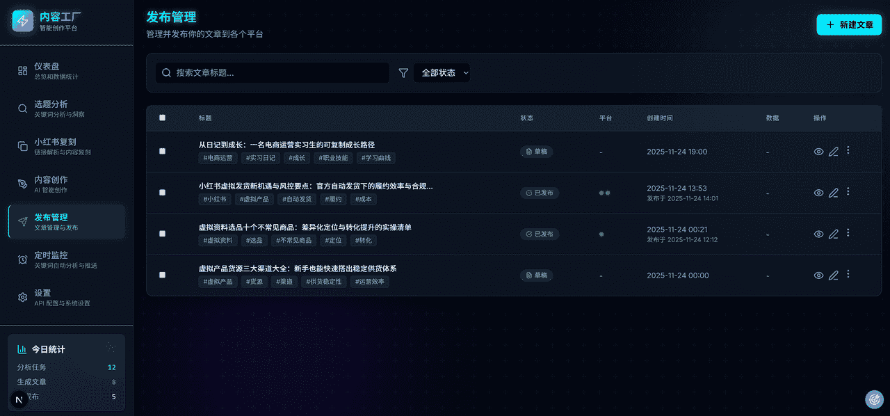

+   发布草稿预览

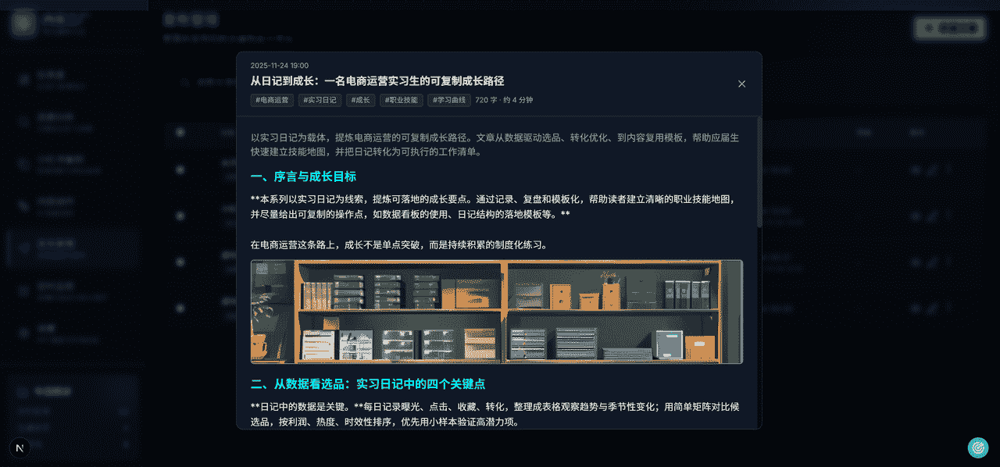

+   发布草稿编辑

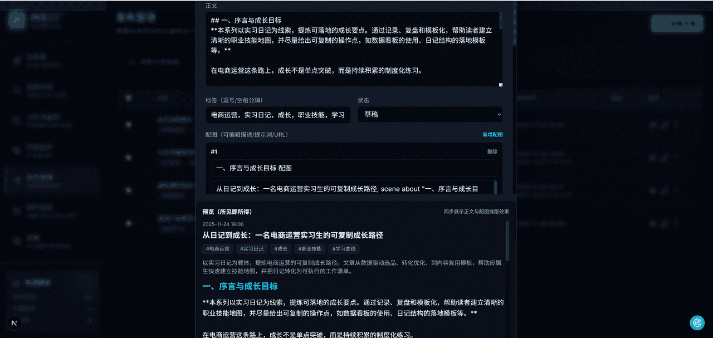

+   发布到小红书：

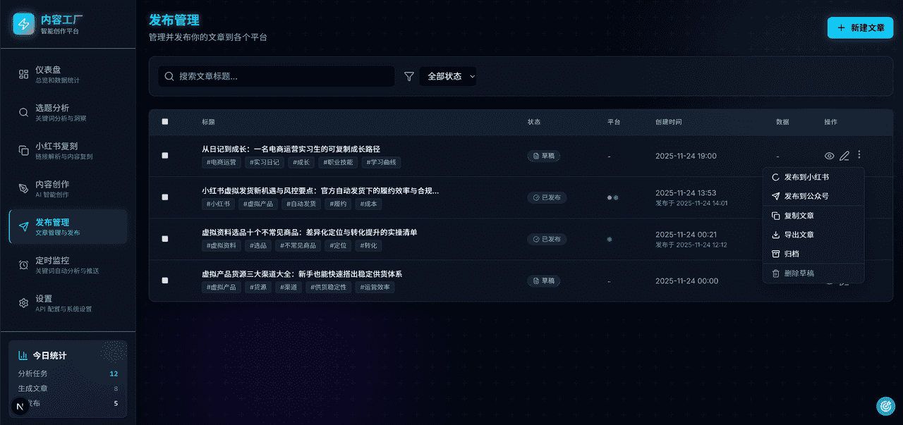

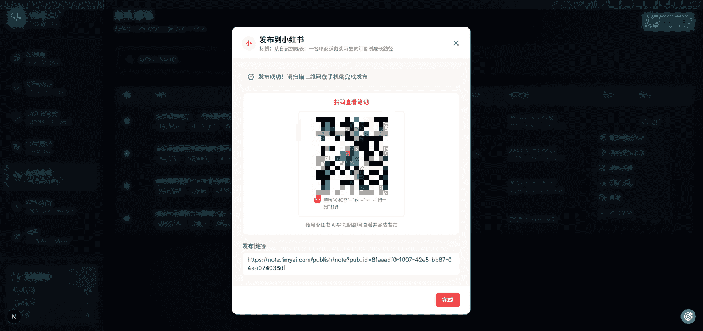

用手机小红书app扫码即可实现一键发布到小红书，以下是扫码后效果：

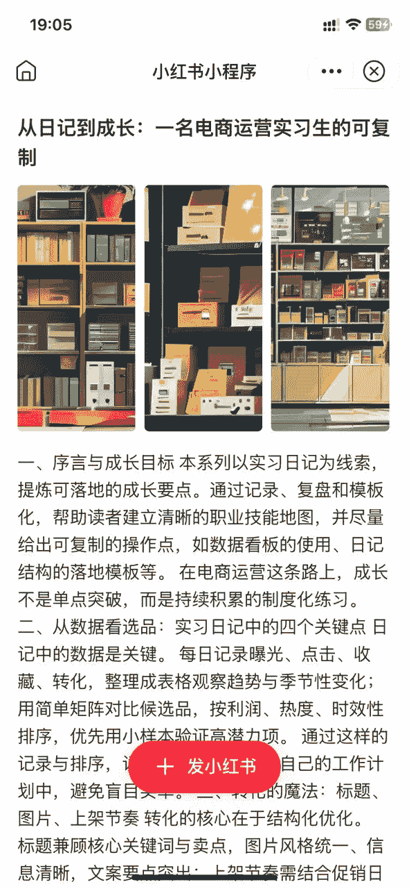

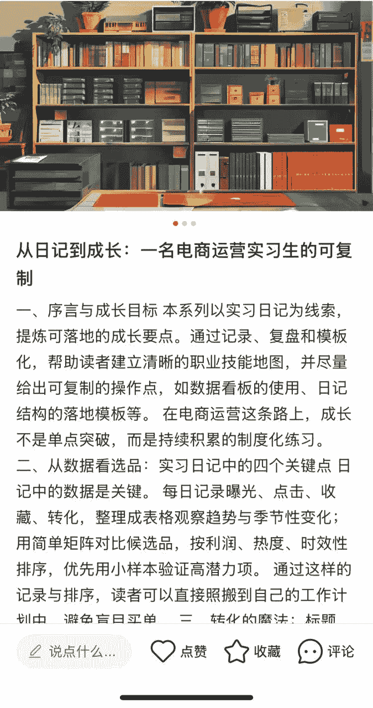

+   发布到公众号：

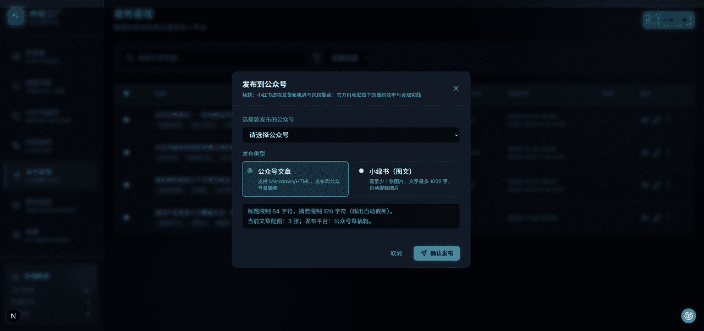

**发布的公众号文章效果：**

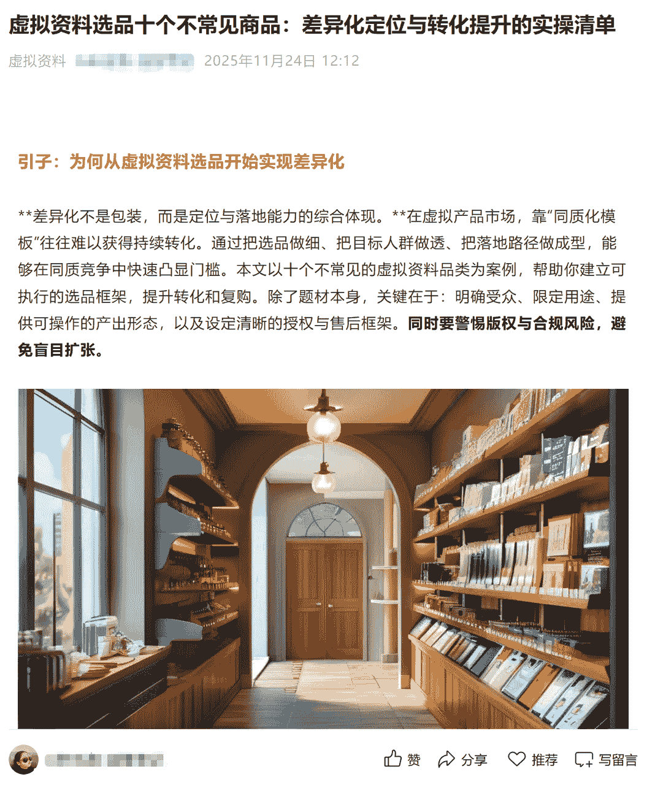

**发布的小绿书（图文）效果****：**

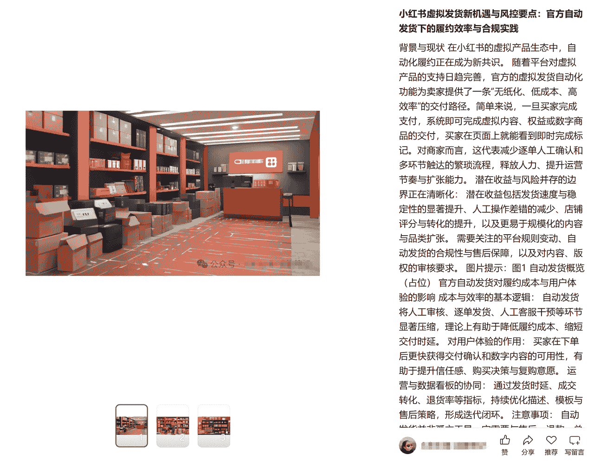

+   过程中遇到的问题和补充的部分细节，可以按需和codex沟通来解决报错、修复问题、完善功能细节：


#### 小红书复刻

+   功能说明：输入小红书笔记链接，指定笔记改写模型与提示词，指定配图模型与提示词，实现单篇笔记一键改写

+   与codex经过多轮沟通，实现需求如下：

```
请你帮我在侧边栏新增一个小红书复刻入口和对应的页面，这个页面就叫小红书复刻页面，我希望的效果是我输入一个小红书链接，然后你去给我调用一个第三方的 API 接口去解析出这个正文标题，或者说原笔记的一些图片，然后提取成功，你再去调用这个 Openai 兼容的这种大模型去给我进行这个标题和正文的改写，API Key已经维护在.env.local中。然后再去调用图生图的大模型去针对所有的图片去进行一个复刻，图生图模型的API key也已经维护在.env.local中。另外我希望我自己是可以去自定义修改这个笔记的提示词的，也可以去修改这样的一个图中图的提示词，然后现在请你首先帮我设计一下这个原型，在开始之前你可以首先使用一个简要的线框图的形式对我的需求去进行一个设计。并且展示在我确认了之后，你再正式的去进行这个代码的生成
```

```
请你首先帮我实现链接解析的这一个功能。链接解析的 AP[I 文档如下，](https://www.henghengmao.com/user/developer)对应的API key为：替换为你自己的API KEY，最好在.env.local中维护，让模型读取.env.local文件中的密钥，文档为：# 单个帖子(视频/图集/音乐)提取接口文档  API 基于 REST 架构设计。API 具有结构清晰的面向资源的 URL，接收 JSON 格式的请求体，返回 JSON 格式的响应，并使用标准的 HTTP 响应状态码。  该接口为单个帖子(视频/图集/音乐等)提取接口，哼哼猫支持的平台(999+)，该接口都支持。 
请求参数
API文档链接：https://github.com/MeowLoad/Media-Downloader-API?tab=readme-ov-file
接口地址: https://api.meowload.net/openapi/extract/post 
请求方式: POST 
请求 Content-Type: application/json 
请求Header：x-api-key（API-Key，在开发者接口管理页面获取）；accept-language（错误返回时 message 的语言，默认en，支持zh、en、ja、es、de等）
请求Body：url（单个帖子分享链接地址）
响应成功示例：
{
  &quot;text&quot;: &quot;Introducing Opera One https://t.co/ABHoIW116d&quot;,
  &quot;medias&quot;: [
    {
      &quot;media_type&quot;: &quot;video&quot;,
      &quot;resource_url&quot;: &quot;https://video.twimg.com/ext_tw_video/1650757905975595010/pu/vid/1280x720/HhaDnQS7feVgqhAN.mp4?tag=12&quot;,
      &quot;preview_url&quot;: &quot;https://pbs.twimg.com/ext_tw_video_thumb/1650757905975595010/pu/img/t5yBiZFRPAIa_4Pi.jpg&quot;
    },
    {
      &quot;media_type&quot;: &quot;image&quot;,
      &quot;resource_url&quot;: &quot;https://you.net/v/8097271834853567236_n.jpg&quot;,
      &quot;preview_url&quot;: null
    },
    {
      &quot;media_type&quot;: &quot;audio&quot;,
      &quot;resource_url&quot;: &quot;https://you.com/8AF5905EB8EE07DACD0.m4a&quot;,
      &quot;preview_url&quot;: &quot;https://you.com/000I5jJB3blWeN.jpg&quot;,
      &quot;headers&quot;: {
        &quot;Referer&quot;: &quot;https://www.you.com/&quot;,
        &quot;User-Agent&quot;: &quot;Mozilla/2.0 (compatible; MSIE Version; Operating System)&quot;
      }
    }
  ],
  &quot;id&quot;: &quot;1650758247739949056&quot;,
  &quot;created_at&quot;: &quot;Tue Apr 25 07:06:50 +0000 2023&quot;
}
返回失败示例：
{
    &quot;message&quot;: &quot;链接格式错误&quot;
}

```

```
图生图：
API文档链接：h[ttps://docs.apimart.ai/e](https://api.apimart.ai/v1/images/generations)n/api-reference/images/gemini-3-pro/generation
请求示例：
curl -X POST &quot;https://api.apimart.ai/v1/images/generations&quot;
-H &quot;Authorization: Bearer 替换为你自己的API KEY，最好在.env.local中维护，让模型读取.env.local文件中的密钥&quot;
-H &quot;Content-Type: application/json&quot;
-d &#x27;{
&quot;model&quot;: &quot;gemini-3-pro-image-preview&quot;,
&quot;prompt&quot;: &quot;A serene lake at sunset with mountains in the background&quot;,
&quot;size&quot;: &quot;1:1&quot;,
&quot;n&quot;: 1
}&#x27; 

response example: {
&quot;code&quot;: 200,
&quot;data&quot;: [
{
&quot;status&quot;: &quot;submitted&quot;,
&quot;task_id&quot;: &quot;task_01K8SGYNNNVBQTXNR4MM964S7K&quot;
}
]
}
```

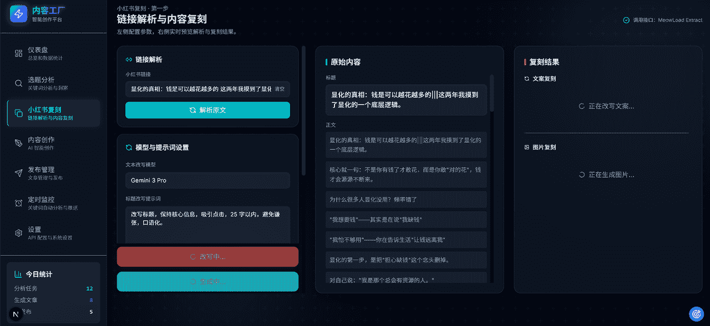

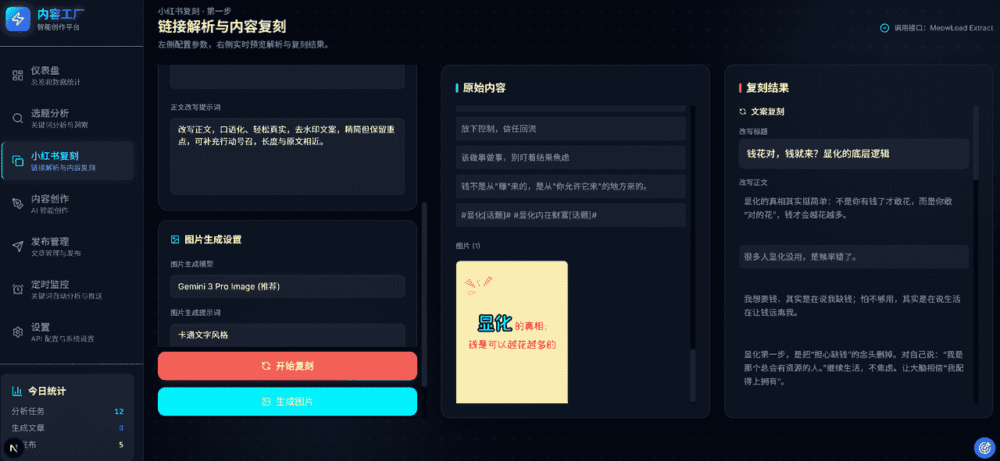

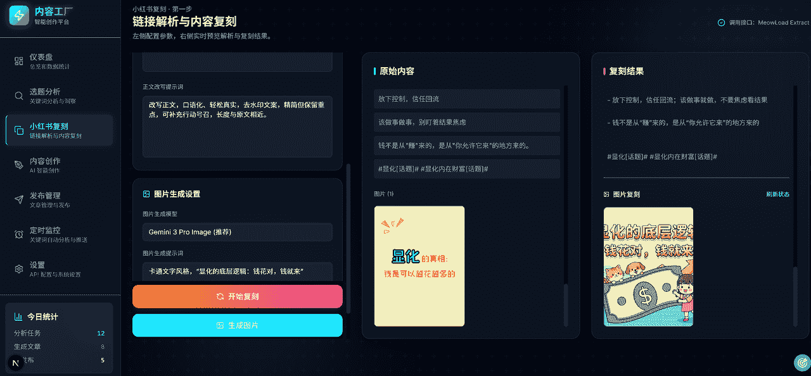

+   过程中遇到的问题和补充的部分细节，可以按需和codex沟通来解决报错、修复问题、完善功能细节：

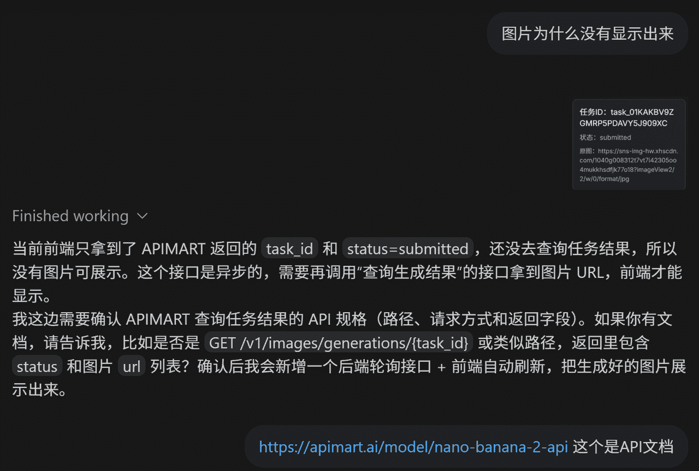

####

#### 定时监控

+   功能说明：对常用关键词进行定时监控，设定执行计划，自动采集并分析，生成洞察结果通过飞书webhook告知用户，用户点击即可直接查看洞察结果

+   飞书webhook地址获取

1.  在飞书中创建群组

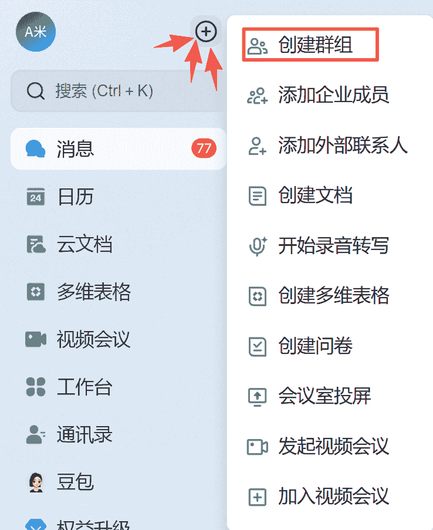

1.  进入群组，点设置，添加机器人，获取webhook地址

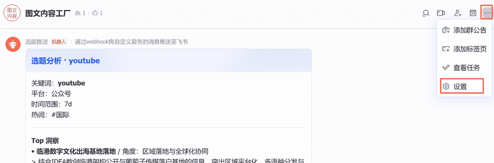

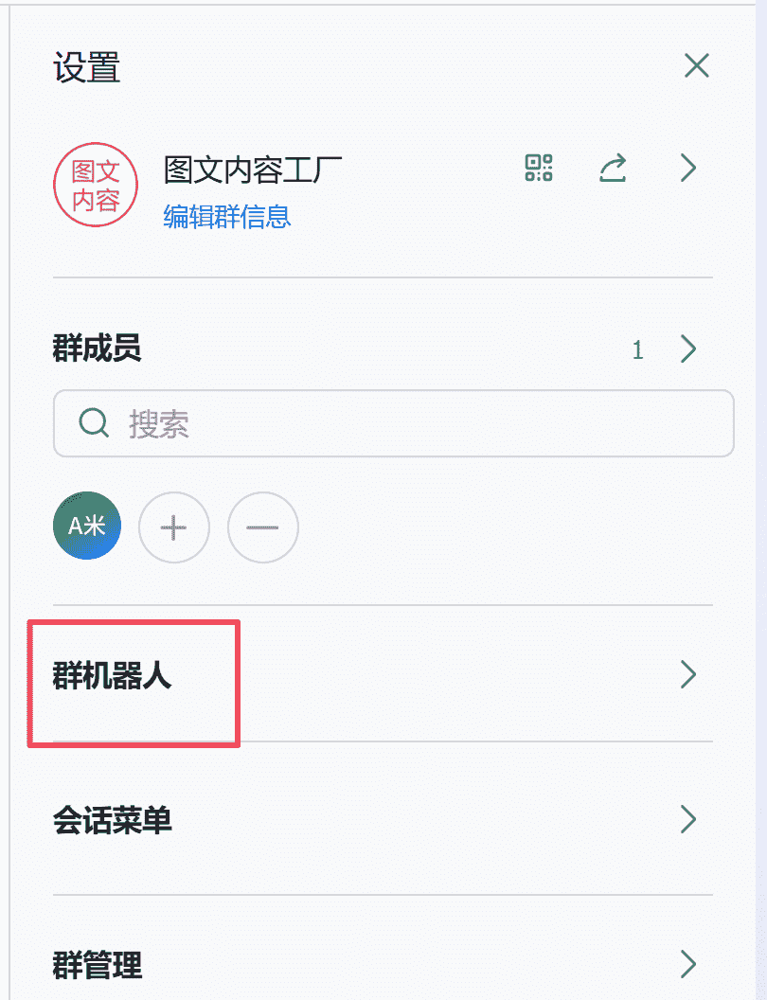

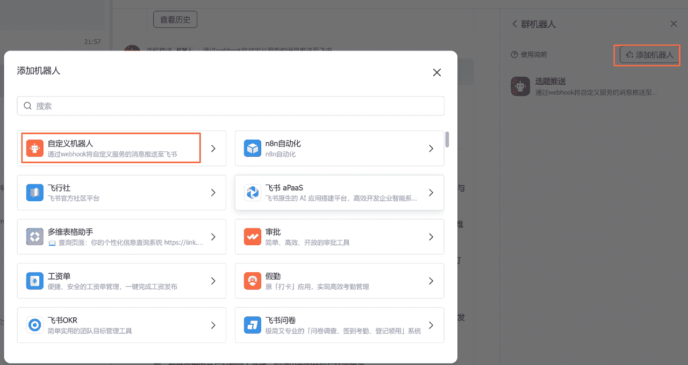

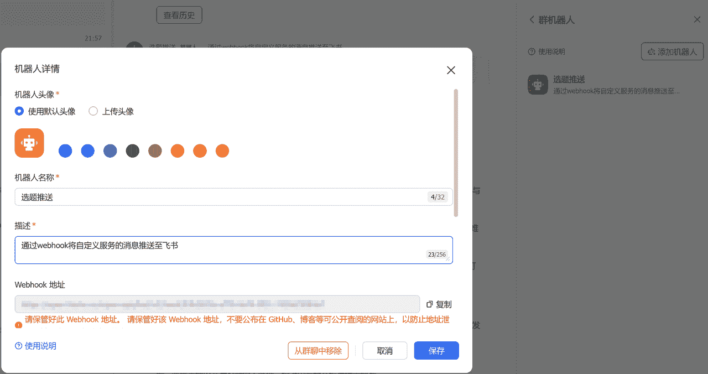

+   与codex经过多轮沟通，实现需求如下：

```
我需要请你帮我研究一下，就是目前的选题分析页面，它其实是可以根据关键词去检索拿到相关文章去进行选题分析的，但是毕竟它还需要手动去触发，我希望的是可以去支持一下每天定时，比如说每天早上8点去自动启动我监控的所有的这些指定的关键词。然后自动帮我分析，再推送到我的飞书群组上，稍后我会给你我这一个飞书的一个 Webhook 的地址，我希望你去帮我实现这样的一个功能，然后具体要怎么做设计？涉及哪些代码上的变动？首先第一步请你给我一个详细的技术方案，先不要改动代码。
飞书webhook地址：替换为你自己的webhook地址，最好在.env.local中维护，让模型读取.env.local文件中的webhook地址
```

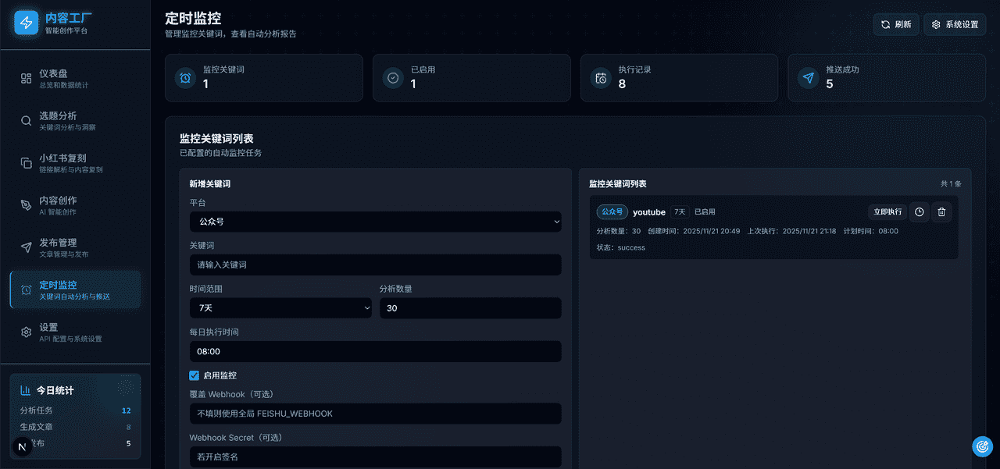

+   飞书群组中接收定时监控结果的效果：

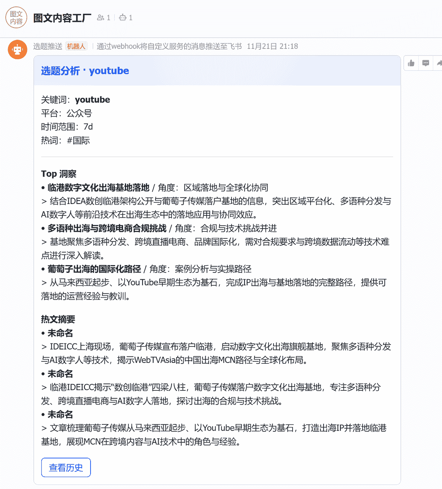

+   点击飞书“查看历史”直接查看选题分析报告的效果：

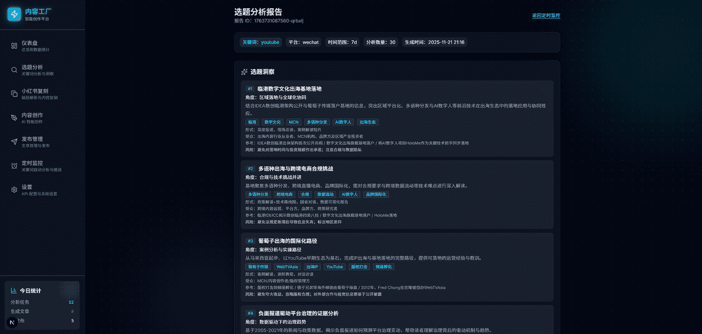

+   过程中遇到的问题和补充的部分细节，可以按需和codex沟通来解决报错、修复问题、完善功能细节：


## 三、避坑提示

1.  与AI沟通上下文过长，问题解决效果不理想，可以及时通过重开对话窗口或者切换模型来调整解决

1.  建议一个窗口仅对应一项功能，避免多窗口 / 多模型同时修改同一文件，减少混乱

1.  每完成一个功能或者一次成功的迭代后，及时把版本提交到git保存，便于后续被AI操作破坏，可以回滚到最近的可用版本（操作不熟悉，就让AI编程模型协助完成）

## 四、心得体会

以上是对本期航海学习收获的一个回顾和梳理 —— 虽然时间紧凑，目前只是把核心功能的流程跑通了，功能细节上还有很多待完善的空间，生成的内容质量也还需要通过提示词的迭代持续打磨。

特别感谢生财邀请钱塘江鲤教练举办了这次干货满满的航海—— 必须要大大点赞我们的宝藏教练@钱塘江鲤！感谢教练全程耐心细致的指导，手把手带着我们把项目落地；也很感谢助教老师和领队志愿者们的暖心支持，帮我们解决了不少实操里的卡点。

这次内容工厂 Agent 的学习，让我对 “自动化提效” 有了更体系化的认知：不管是需求梳理的逻辑、和 AI 高效沟通的技巧，还是问题排查的思路、功能细节的落地方法，都有了更深入的理解，也 get 了不少实用的新方法论。

希望这篇复盘能给圈里的伙伴们提供一点参考，也期待后续和大家继续交流～