# 小红书虚拟矩阵3.0：双轨模式+AI半垂直选品+店矩阵（可工作室放大！）

> 来源：[https://xuqiwei1986.feishu.cn/docx/A1Dddr6wSo6aOaxHMbZcy3U2n0b](https://xuqiwei1986.feishu.cn/docx/A1Dddr6wSo6aOaxHMbZcy3U2n0b)

# 一、开篇和实操目录

## 1.技术分享的开篇

我是属于那种，**脑袋里有干货，手上有实操，**但是不善于表达出来的人。

我在电商这个领域，已经做了快10来年了，做小红书虚拟矩阵这个项目，也有2年了。

**目前在广州黄埔区，有2个工**作室，1个半专门做小红书虚拟电商，半个做其他平台的虚拟。

这2年做小红书虚拟的店矩阵，**也拿到了很多结果。**

要不然，工作室的十几个小兄弟**，也不可能**跟我到现在，随手截3个店的30天数据，以正视听！

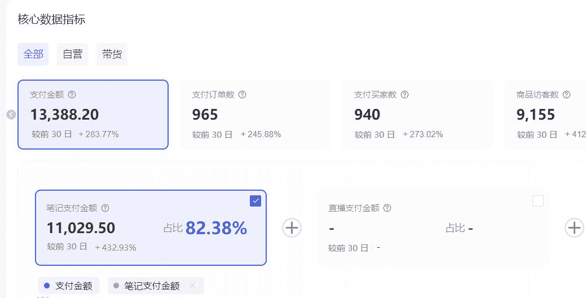

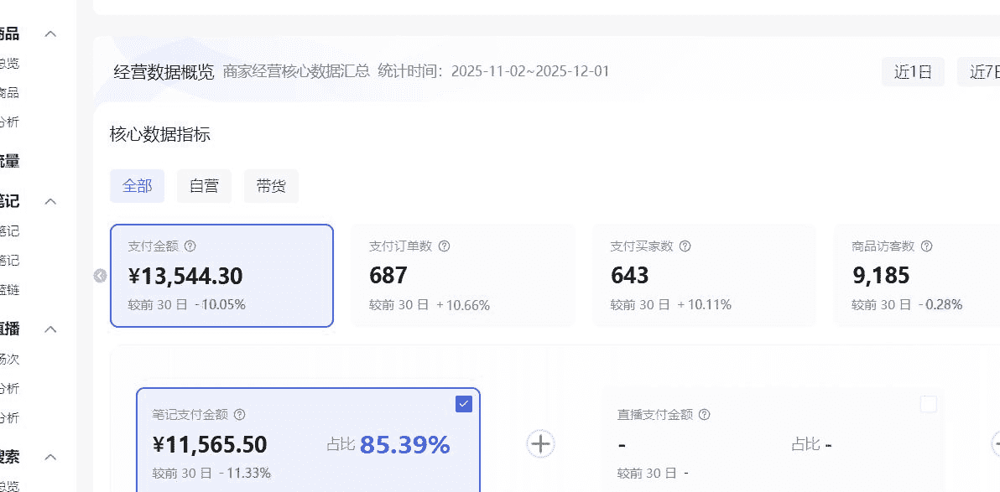

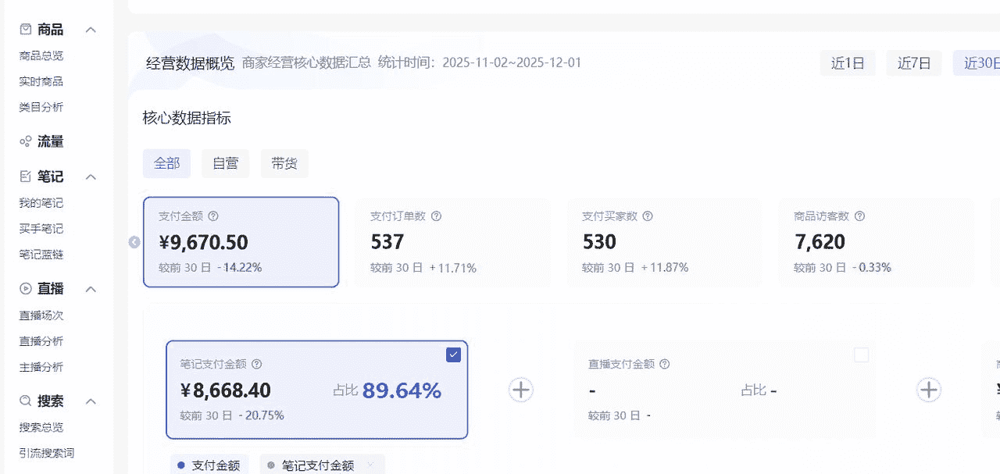

**很多圈友认识我，也是通**过半年前，我写的一篇实操精华帖：小红书虚拟矩阵。

这次小红书虚拟矩阵项目的实操，是3.0，算是技术的全面更新。

**3.0，是基于半年**前，我发布的1.0的操作基础上的，感兴趣的圈友，可以点开我的主页，翻看下半年前的1.0实操步骤。

当时很多的圈友，**通过这篇帖子拿到了结果**，以至于后来，还偶尔会有圈友过来问我相关的实操问题。

## **2.分享的10条主线**

**一：**3.0操作的起源

**二：**AI+半垂直化选品

**三：**双轨操盘模式

**四：**批量搬款演示

**五：**批量做图演示

**六：**批量发笔记演示

**七：**小红书虚拟店矩阵

**八：**附带收益操作

**九：**新手必能拿结果

**十：**成功经验和总结

# 二、3.0操作的起源

首先，**可以给大家非常打包票明确的说：**

小红书虚拟矩阵，这个项目是完全可以放心大胆去做的，它完美的符合小资金、轻创业的模式。

我相信有应该也有很多圈友，是做了10多年的老电商人。

**特别是像我们这样，**从淘宝做到抖店，又做到小红书的圈友，应该也不在少数。

正**是基于这一个老资历，我才能深**切的知道，如果你把小红书虚拟这个项目当兼职做，当作副业做的小玩家，要想做好，需要怎么做，又需要做什么。

当然了，如果你们还是按照之前1.0的做法去做，肯定很难拿到结果的，因为随着时间的推移，出现了很多变因。

比如，我下面这个店，用之前1.0的做法，拿结果有难度。

估计大家，如果没有机会看到我这篇3.0的做法的话，还深陷泥潭中。

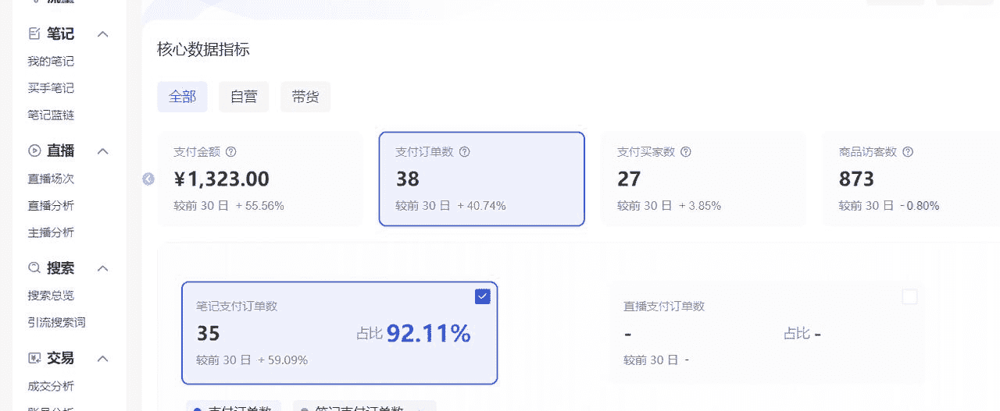

接下来，我想用整篇文章，给大家拆解我们内部3.0的做法。

有圈友可能会疑惑，2.0去哪了？

2.0是因为我没有写实操贴分享，就是因为搞怕了。

**以前1.0**分享完了以后，市面上很多的人，切入到这种玩法去做，导致了竞争加大。

甚至有很多培训的机构，或者个人，拿我的那篇实操帖，稍稍的去摸索下，就去做培训，导致加剧了这个领域的竞争。

所以后来的2.0，我一咬牙就没有更新实操贴。

但是后来我发现，火势一起来了，是很难压住的，即使我后面不给大家更新。

市面上依然，有很多鱼龙混杂，乱七八糟的做法，其实很多是在误导大家。

那么咬咬牙，**这次3.0的实操步骤**，还是给大家更新出来。

3.0的打法是全方位的，拿结果很明显，即使像我这样卖18.9高价的，依然有效（如下）。

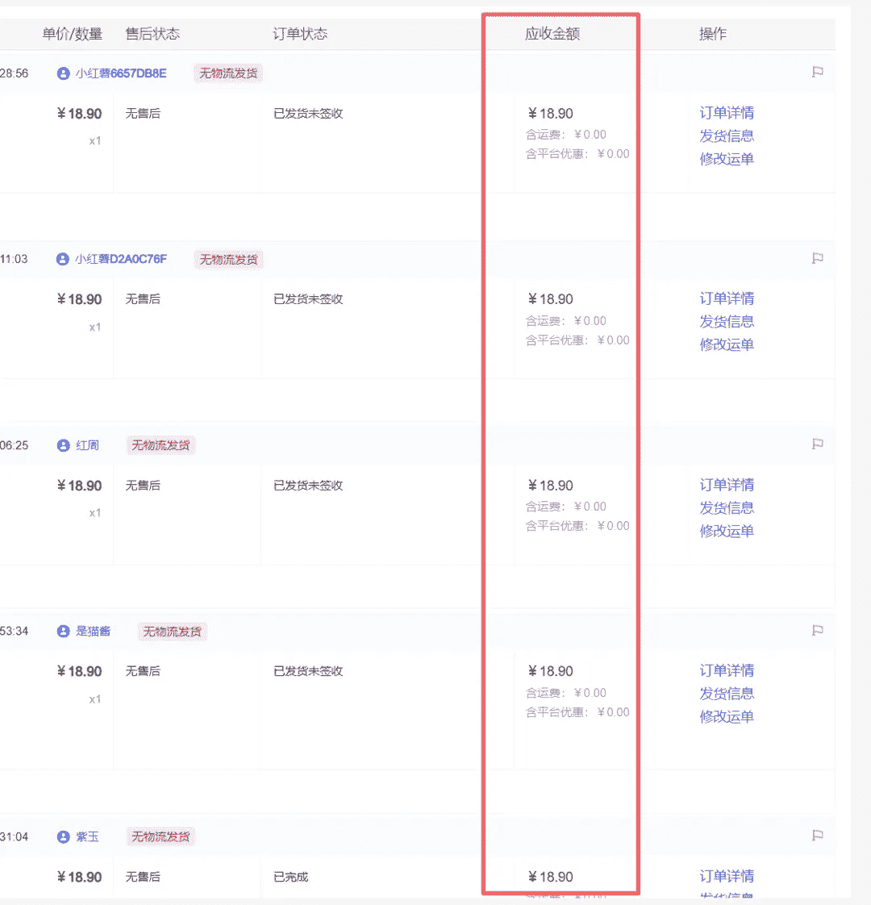

这样你们就能知道，分辨出我的操作方法，和市面上的有何不同。

无论是从选品方法，还是操作模式，还是配套的工具使用，都是我们原创和自主研发的。

特别是做项目的，**实操技术和工具一定要更新。**不可能，**一个玩法或者工具吃半年，**那是极不负责的表现。

唯有新方法和新工具，才能够有一个好的效果。

# 三、AI+半垂直化选品

我本来就有2个工作室，30多个店，专门做小红书虚拟的。

**半年前，**那会我们工作室在做的时候，**是按店矩阵的方式做的**。

## **1.杂货铺式选品**

一个店从淘宝上，用搬款工具上500个款，然后每个款发1篇笔记。

笔记的封面图用宝贝主图，笔记内容用自编的通用文案，每天发30篇，同时3个店为一组，同时操作。

的的确确，实打实的，**吃到了一波平台红利**，因为这个玩法是我原创的。

我们之所以敢大量搬款，不怕虚拟资料，大家都担心的侵权什么的。是因为我们一直卖的是弱版权的产品。

比如“表格、模板、素材、文档、协议、合同”等。

**在淘宝上找，只要**是符合这个要求的，都会搬到小红书店。

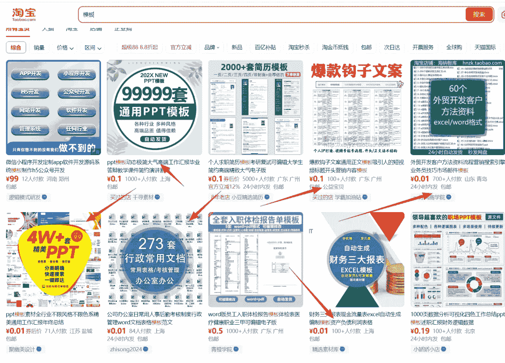

**相当于是杂货铺式的铺款！！！**

**刚开始做的时候，我的想法很简单**，根据小红书平台的用户属性来做。

下方这种店，**就是杂货铺式的，**整个店什么都卖：广播剧，计算机，教程，管理资料等等。。。

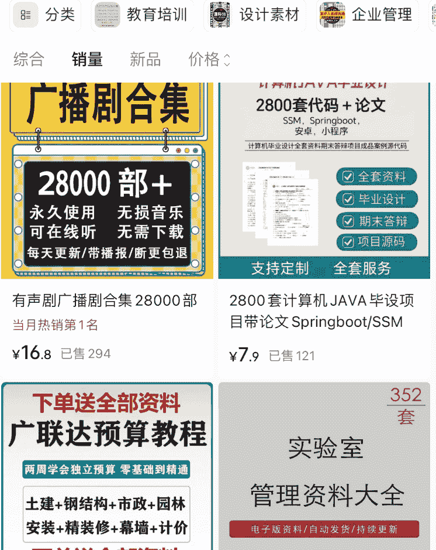

**但是后来，做着做着，**随着时间的推移，发现再这么干就不行了，卖这些虚拟品的人太多了。

这样，就导致了在选品端，如果还是，按照之前杂货铺式选品的做法，不好拿结果了。

后来，我在想做杂货铺式的选品铺货不行，那能不能，就按市面上的垂直化选品去做。

## **2.纯垂直化选品**

什么是纯垂直？

大家都知道，小红书上的人群年轻人居多，如果你是个学生或者求职的，肯定需要表格模板等资料。

**下方这种店，整**个店只卖PPT和简历，这个就是垂直。

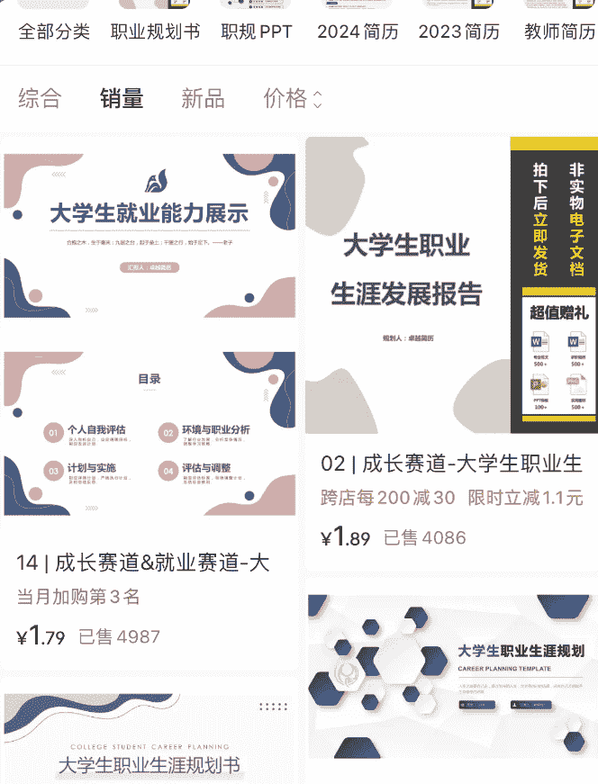

于是，我就从工作室里**抽调2个人专门开了4个店**，去垂直选品。

首先，确定做的是2个领域，一个是教师类，一个是行政类。

也是每个店精挑喜欢了10个款，每天每个店发5篇笔记。发了10来天，发现还是没有成交。

于是，我让他们坚持再做半个月，**发现还是很难出单**。

每篇笔记，都是让他们模仿爆款笔记拆解出来的，爆款的封面，还有爆款的笔记内容。

**就这样，让这1个**小兄弟，1个美女做了1个月，看成交数据，真的是一言难尽。

截图如下，半个月只有670元，这个肯定是很难的。

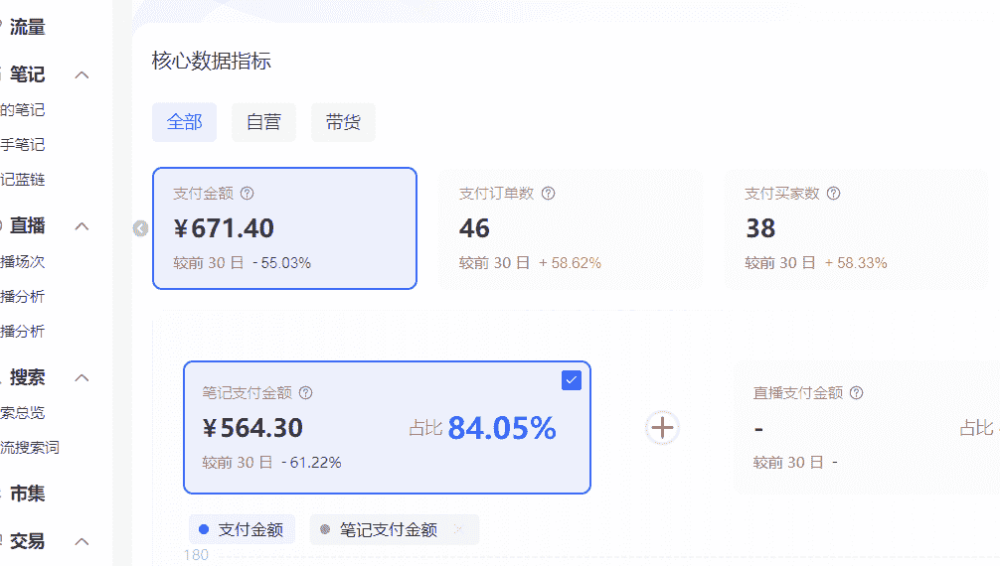

后来，跟工作室的几个有经验的小伙伴，一起探讨了下。

**总结出了之所以纯垂直**化选品去操作，出单难得原因有几个：

1.纯垂直化选品，品少，能上的链接少。

2.纯垂直化选品，竞争非常大，同行链接多。

3.纯垂直化选品，同质化非常严重，很难做出差异化。

**再回想，为什么当初**我们杂货铺式选品，一个店铺500个品，为啥能出单容易。

是因为，里面会有很多**竞争小，同行少的品**，所以出单容易。

**而纯垂直化选品，随**便一个品，老的爆款笔记和新上的笔记，每天乌央乌央的多。

比如，下方截图的这样的类。

你若也是一股脑扎进去，卖纯垂直的PPT模板啊，简历啊**等，你看看别人**的这些排名靠前的笔记数据，你竞争不过的。

还有每天非常多的人，又发了非常多的新笔记。

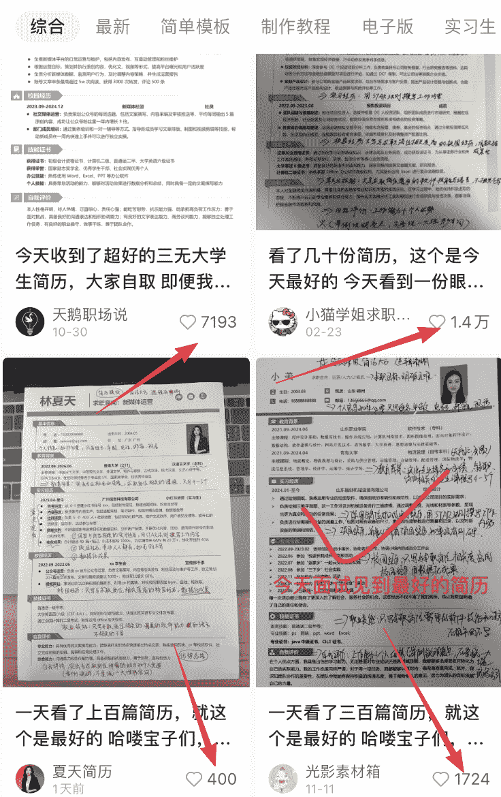

除非你新发的笔记，**有什么过人之处**，或者你的款销量比别人高。

**对于新手，新店**，新踏入做小红书虚拟的人来说，是非常不友好的，这个是很难的。

后来，我想，再这么做下去，肯定是很难有大结果的。

## **3.半垂直化选品**

既然500个品杂货铺式的不行，10个纯垂直化选品的也不行。

那能不能**取个中间值**，我就一个店选100个半垂直化品。

**于是，我就**把这4个纯垂直化的测试的店，换个思路：

让他们把行政类的店，再加上财务类，人事类，运营类，企业类等等。

这一拓展，思路一下子就打开了：

一个店由原来的一个人群，现在是一类人群。

一个店就围绕一类人群去布局，这个店选品拓展后，围绕的都是“办公室白领”类的。

**然后，就让小伙伴们测**试下这个玩法，果然，效果出奇的好。

下面这个刚做的店，就是这么做的，某天来了个小爆发。

而且看曲线可以看到，是个增长的趋势。

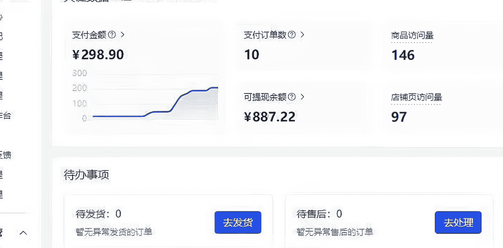

这样，**一个店要想覆盖100个品**，是轻而易举的，这样可操作的空间就大了，**会错开很多同行的竞争。**

同时**0销量，0评价，0评论**情况下能出单的款，会多很多。

后来，我迎着这思路，又用到了现在市面上非常火热的AI。

原创研发了一个**“AI+半垂直化选品”**的新打法。

## **4.AI+半垂直化选品**

我给大家拆解下：**用AI去半垂直化选品。**

**这个是之前，没有跟大家分**享的，后来我们自己在操作的过程中，会用到。

**假设：**你是做考试方向的。

整理下国家官网，发布的80个类目的考试时间（如下），对比下AI给出的时间是否正确和匹配。

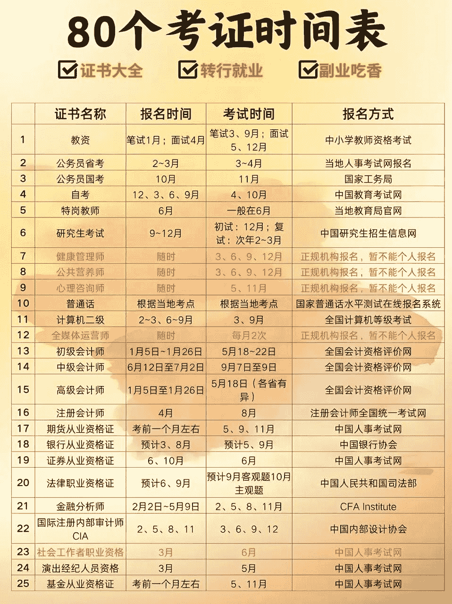

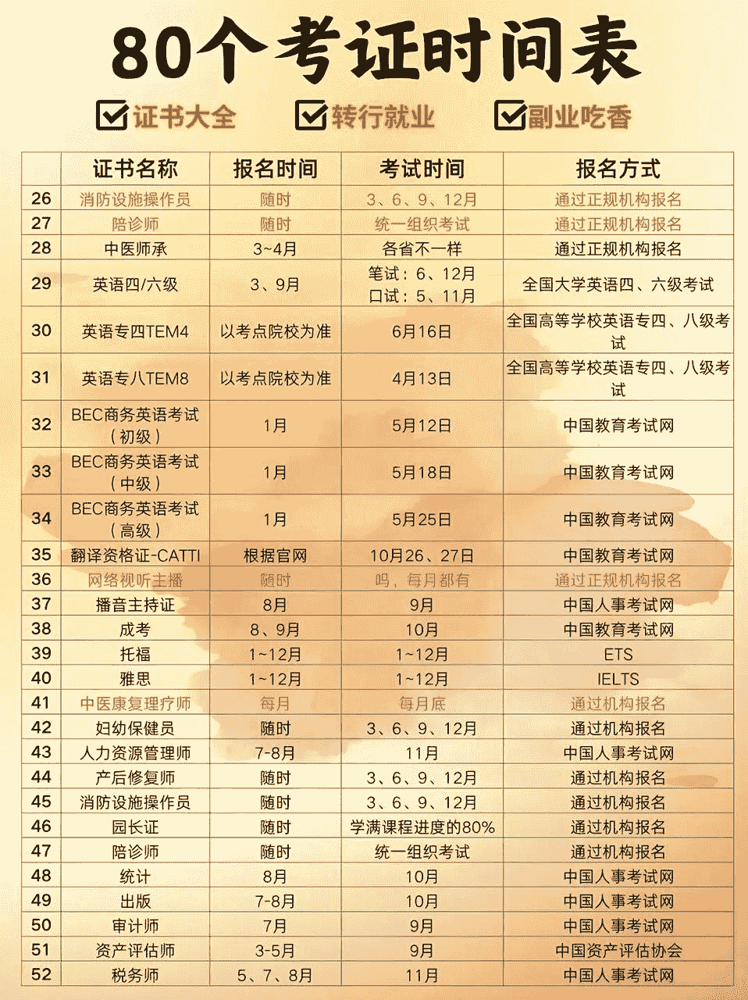

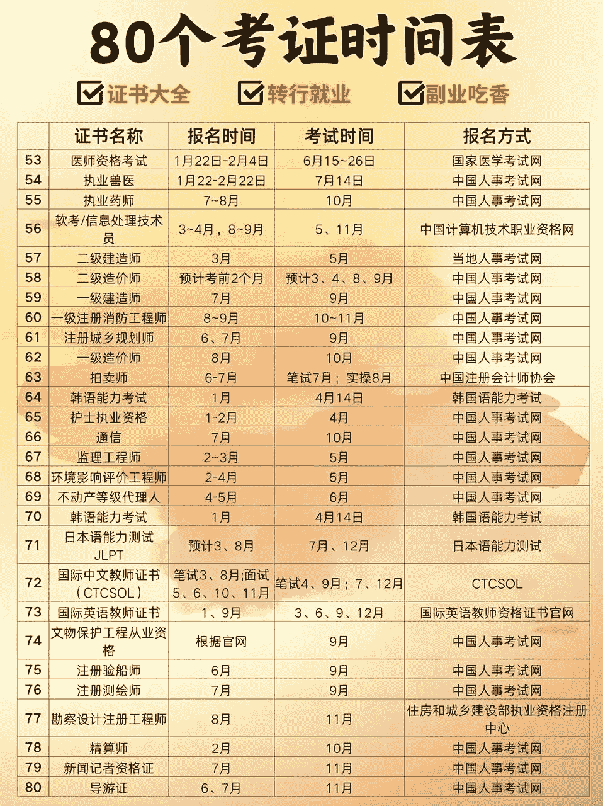

你可以问AI：每年每个领域什么时候考试（如下）。

**提示词**（截图的箭头所指部分）**，**你们可以模仿我:

我是一名小红书上卖虚拟品资料的店主，我现在想卖考证方向的虚拟品，但是不知道当前卖哪个考证方向是最好的时间，请帮我列出最火的考的是什么证。

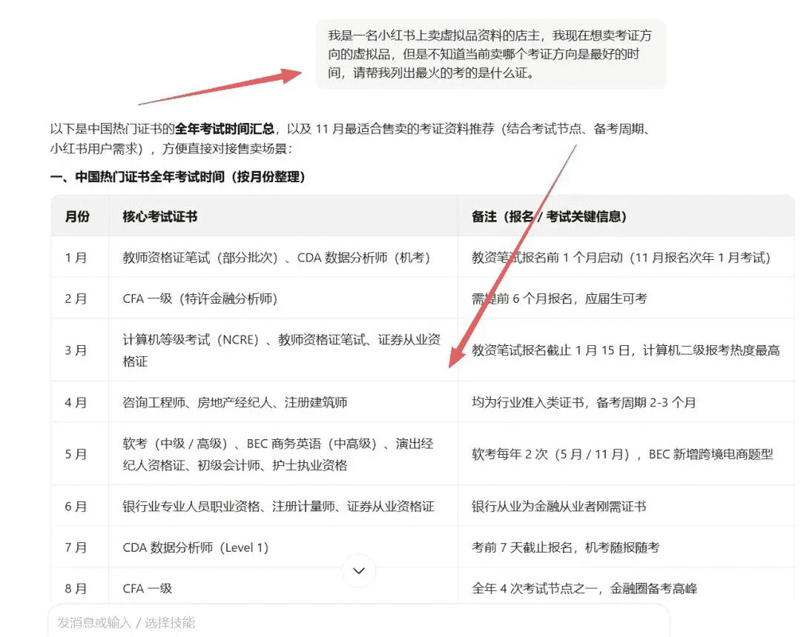

AI会非常详细给出，每年几月份是什么证的时间。

那么，就可以在这个领域的前几个月内，专门做这个领域。

**有市场就会有需求！**

甚至，AI还会告**诉你，小红书**文案的话术（如下），是非常详细的。

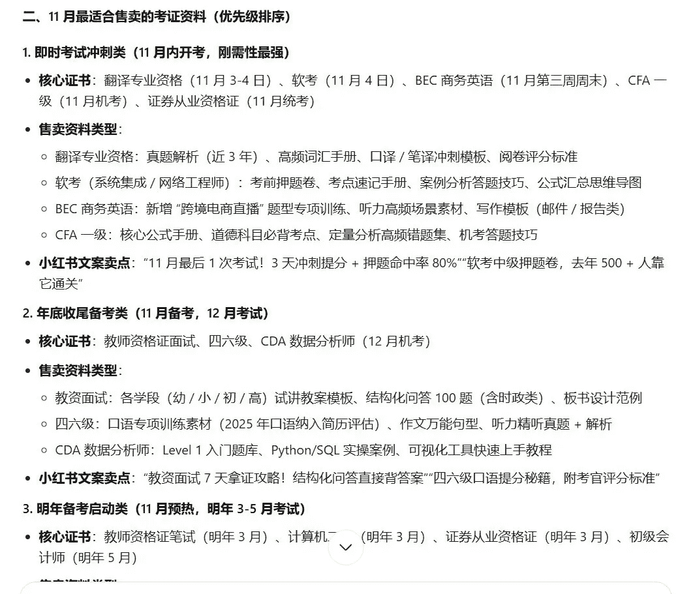

如果，你是做小吃配方领域的，你可以让AI帮你列出相关的虚拟词。

**想要多少，你就说要多少**，比如你让它列出300个（如下）

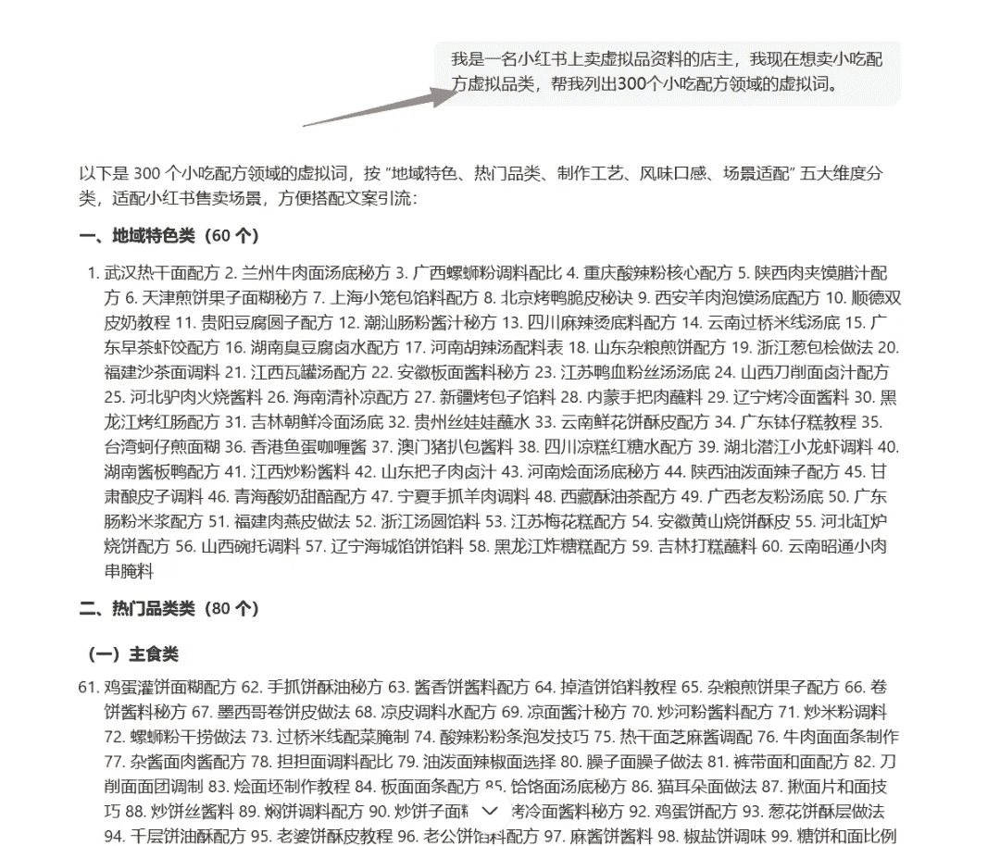

然后，针对它给你的这些具体**的虚拟词，去找很多**的品。比如淘宝上，搜AI给出的虚拟词：武汉热干面配方

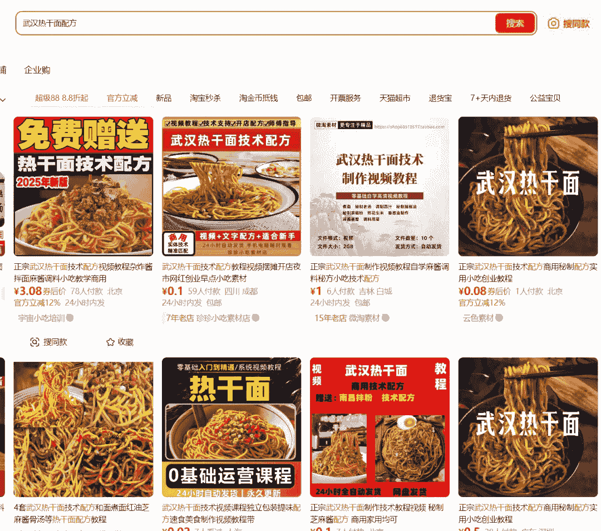

这大把的，小吃配方类的虚拟资产品，不就来了吗。

然后围绕“小吃配方”类，**不断的去找品，**可以找到很多，上到自己小红书店。

这就是我想给各位表达的，什么叫**AI选“半垂直化”品。**

**总结下：**

半垂直化选品，是一个店，专门选一类人群的品去做。

不再是原来的范围非常广的杂货铺式，也不是某个人群的纯垂直化，而是拓展到某类人群的半垂直化。

再结合AI工具的使用，如虎添翼！！

# 四、双轨操盘模式

我做小红书虚拟矩阵这个项目，**已经快2年多了，**关注我的圈友，应该知道。

定了要半垂直化选品的路线后，**我们就确定了很多大的方向：**

教育类，教辅类，考试类，资料类，职业类，办公类，设计类，素材类，PPT类，小吃配方类。。。

其实还有很多非常好的类，如果你们不会，都可以通过AI去问，会罗列出来。。

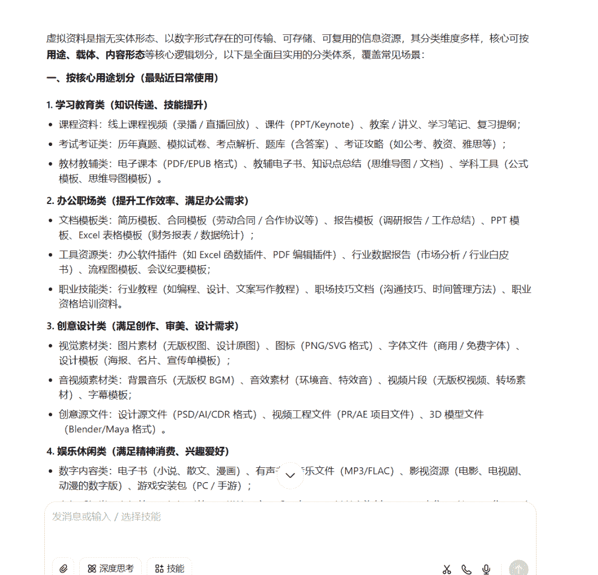

此时，**又面临一个问题：**

一个店，**到底是多上款少发笔记**，以款的数量为主好。

还是，**少上款，多发笔记好**，以笔记数量为主好。

我相信，各位圈友当你们遇到我当时的困境的**时候，也会有次疑惑。因为市**面上也没有人，能告诉我们到底哪个模式好。

## **1.多款少笔记模式**

**于是，我干脆一不**做二不休，既然没有人能告诉我答案，那我就自己去寻找答案。

两个模式同时操作，孰好孰坏，**测试后便知！**

这种思维，就是测试对比思维，当你不知道两个辣椒，哪个辣哪个不辣的时候，我分别都少买一点，尝试后就知道了。

回想半年前，当时市面上都是按照，一个店精挑细选几个款，死怼笔记的做法。

我反其道而行，测试出了，我原创的“淘式”小红书虚拟矩阵打法。

于是，过去几个月，我**采用双轨模式同步操作，**经过大量店铺的实操，拿到了结果。

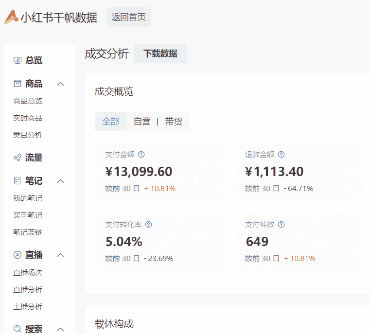

**首先开多个小红书店**，围绕半垂直化多上款，我们内部叫测款店。

这么做，**可以解决大家的选品困难症**，测款店1个店上100个左右的品的情况下，你还用纠结卖什么的问题吗？

因为品多，所以不用纠结一个品的好与坏！

**比如下方我们**测款店的出单，像这样在0销量，0评价情况下能自然出单的款，相对是好款。

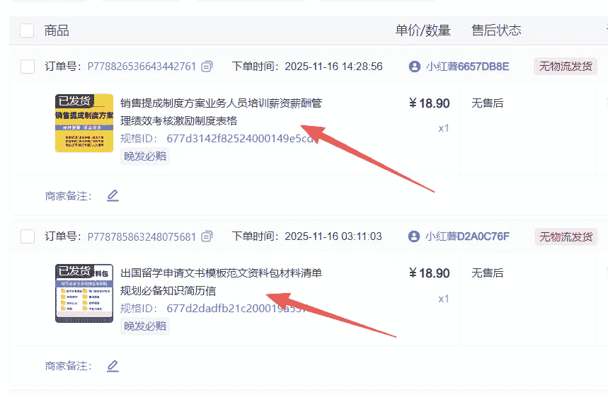

每个店**用工具从淘宝上搬100个品**，然后每天挑选20个款，用工具去直接生成20个款的20张原创笔记封面，去自动发笔记。

## **2.少款多笔记模式**

**5天发完为一轮**（如下），一般发的过程中，或者发完两三轮，就会发现有相对数据好的款。

**然后，再把测出**的好款，重复上到打款店，我们内部叫怼款店。

针对好的款，起步可以先人为的，搞几十个销量评价（**都是有快速的**方法的），目的是流量进来后，提高转化率。

**每天每个款，发**1篇高质量的原创笔记，也是用AI工具操作，不需要自己手搓，后面实操演示部分会分享步骤。

如果在怼款店，好的款比较多，没办法每天发1篇，那么可以隔两三天发一篇。

**好的款一定要经常发笔记**，这样**才能薅到小红书的免费流。**

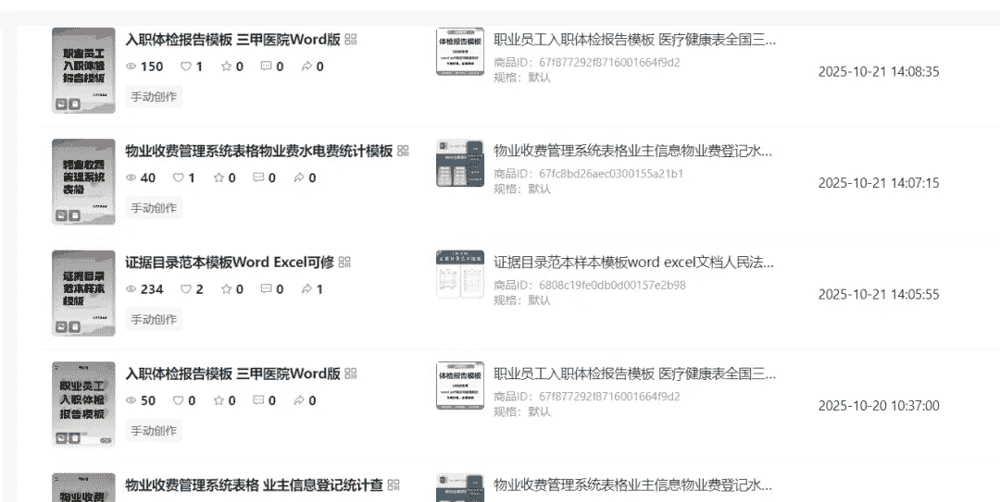

## **3.双轨模式操作的优势**

**相信看完操作步骤后**，此时一定会有自以为懂行的朋友，会质疑为什么要开个测款店，直接去搞别人店里卖的好的款不就完了。

错，这个思路用电商的行话说，叫“跟款”。

你试想下，你跟的肯定都是销量高的款，要不然你怎么能判断出这个款是好款。

既然别人已经销量高了，你再跟着卖，**你起步销量为0，**评价为0，笔记评论为0，买家凭什么买你。

我**们测款的目**的，是为了能找出，那些在你的宝贝是3个“0”的情况下，还能出单的好款，进行放大。

**同是还能卖高价，下方**截图是我们一个店，每天的到账情况，可以看到是18.9的，之所以每单少了0.21，这是平台的抽点。

18.9，在虚拟资料领域算是高价了。

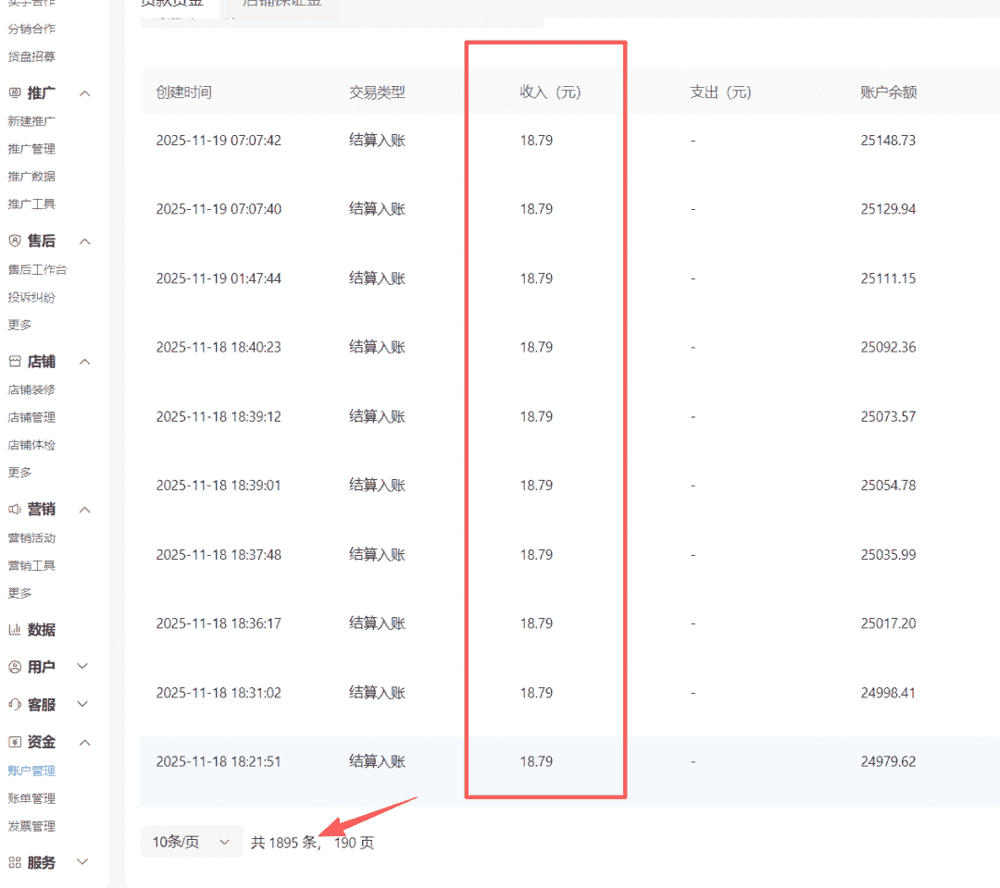

有时候可能你**测款店出单容易，因为覆盖的品多**。

有可能怼款店出单容易，因为好款发的笔记多。

双模式运作，我表达得可能非常肤浅。但是意思是非常明确的，效果也是非常突出的。

# 五、批量搬款演示

前面，我们确定了要双轨模式操作，确定了要半垂直化选品。

接下来就是去选品，然后**把款从淘宝批量搬到小红书店。**

工具的好坏，能非常影响操作这个项目的时间。

一个好的工具能够节省大量的成本，包括人力成本，还有时间成本。

**欲善其事，必先利其器！！**

## **第1步：下载安装哈士奇插件**

这个插件的作用，是为了把淘宝上，你选好的宝贝的链接提取出来。

下载链接：https://hsq.dangxun.com/

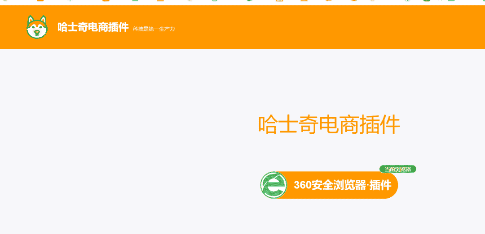

可以根据自己使用的不同浏览器，去下载安装。安装好后，浏览器的右上角就会有一个狗头像出现。

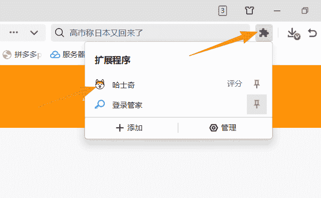

## **第2步：用哈士奇提取淘宝链接**

我以小吃配方类为例，演示下如何半垂直化选品和搬款。

首先，在淘宝上搜：小吃配方。

安装了哈士奇插件的刷新页面后，就可以看到每个宝贝下方都有可勾选的框（如下）。

用哈士奇，把淘宝上你要搬的款勾选，然后点击复制。

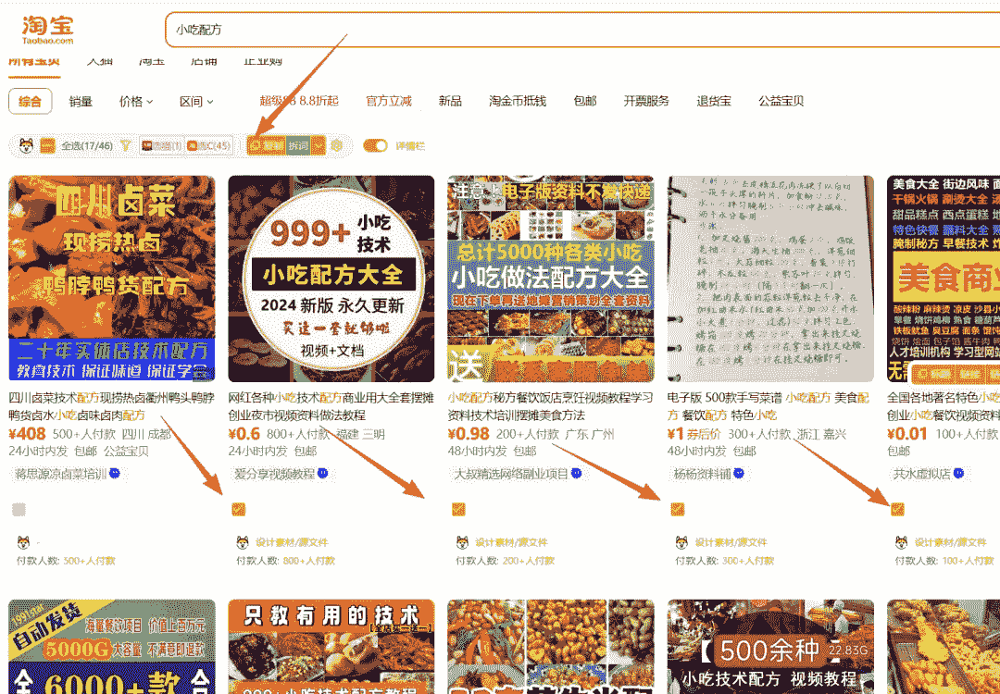

一般我的操作，是不会直接或者单纯的，就在淘宝搜索页选择宝贝。

而是点击每个宝贝下方的店铺，进到别人店铺里（**如下），因为一**般有经验的运营选品的时候，都会有侧重点。

**既然一个店铺选了小吃配方**类，很大概率他整个店铺都会是这个类，最起码大部分是。

所以，进到别人店铺后，就可以找到很多，符合要求的品。

这个就叫做：**站在别人的肩膀上选品。**

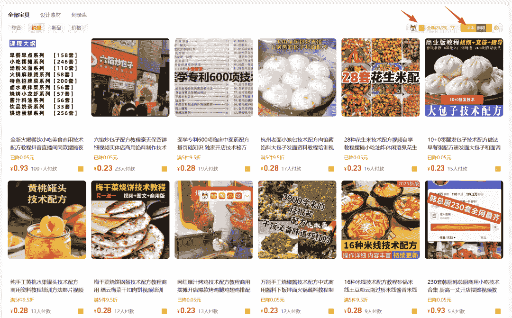

## **第3步：链接复制到表格**

再把提取的链接，复制粘贴到表格筛选。

**筛选的是什么？**

在挑选的时候，有时候会误勾选非小吃配方类的品，或者是卖实物的，不是电子资料类的。

还有一些违规的词：比如标题带有某个机构名，某个人名的。

**这些都要删除掉。**

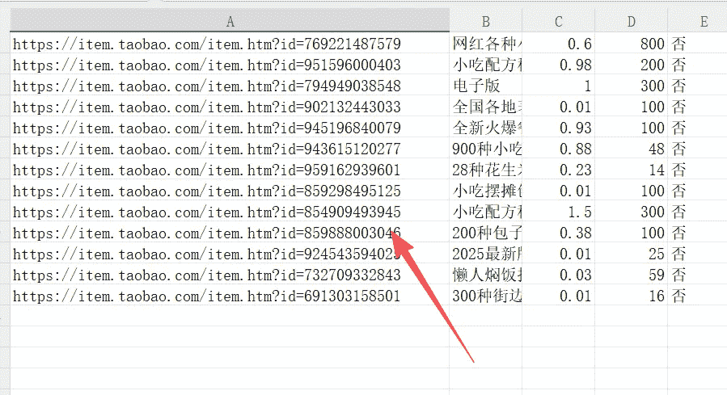

## **第4步：搬款工具的设置**

**我用过的搬款工具**有很多，目前，我觉得下面这款工具是比较好用的。

市面上，从淘宝批量搬款到小红书店的工具有很多，你们可以根据自己需要去选择。

**为避免打广告的嫌疑**，我就不在此具体展示工具名了，要不然吃力不讨好。

**如果看到这**个界面知道是哪款的，你们可以去咸鱼上买，还蛮便宜的。

如果实在不知道，又有需要的，只能来找我分享了。

工具的设置这块，就照我截图这样的起步去设置。

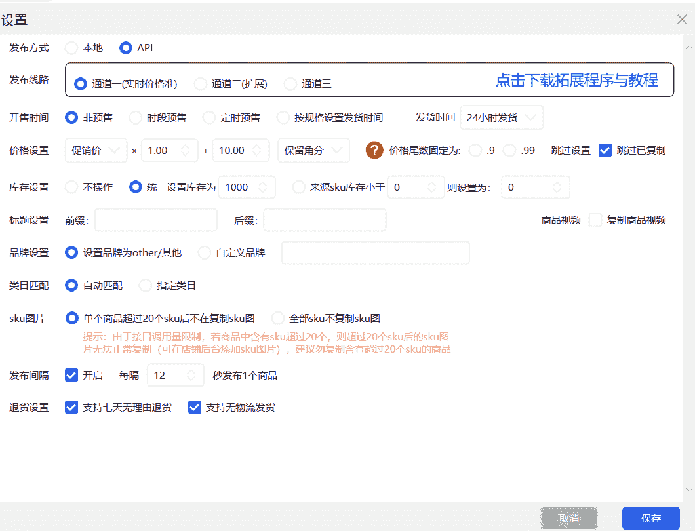

## **第5步：搬款工具的操作**

设置好工具后，把表格中，复制的淘宝宝贝链接，粘贴到搬款工具，点击开始发布。

整个操作流程，非常干净利落和丝滑。

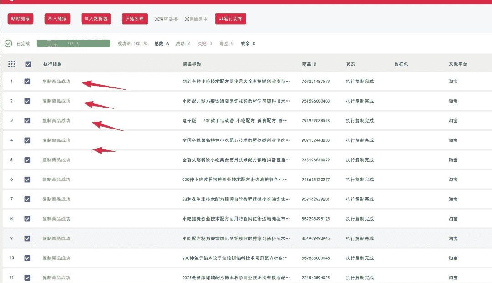

发布的时候还是非常流畅的，当然了，**在整个过程中，每**个人实际操作的时候，可能会遇到不同的问题。

**如果搬款过程中，出**现下方截图的这个问题：值不能为null，这种情况是因为店铺的教育类没有开通导致的。

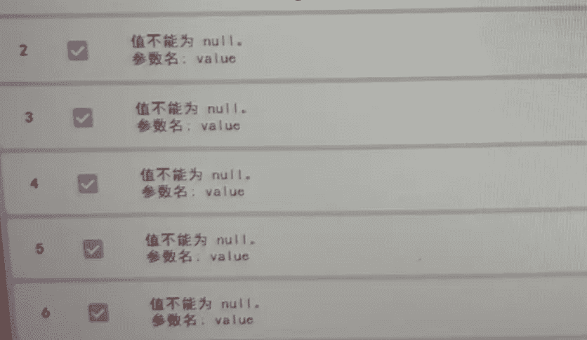

比如出现下方截图的这个问题：**商品已经下架**，其实商品没有下架。

遇到这个问题，就要找工具的客服，要配套的提取宝贝链接的插件。

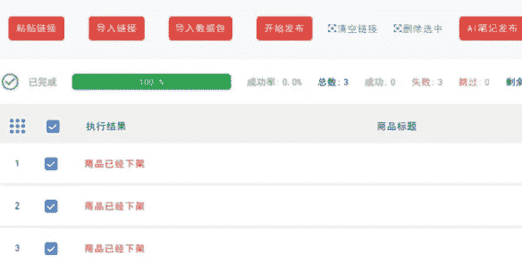

当然了，可能每个人操作的时候还会遇到其他问题，这个不是每个人都能遇到，遇到了，可以找我给你们看下。

好用的工具，**才能更好更容易得拿结果。**

# 六、批量做图演示

搬款到小红书店后，接下来就是做笔记的图，要批量的做原创封面图。

我们的做法，**不是什么去分析同行**，拆解爆款笔记封面等，**这样太花时间了**，也不利于项目的快速，批量，矩阵操作。

**因为我们测款店，一个店10**0个品，一天发20篇笔记，每天就要做20张原创封面。

半年前，我们那会做小红书虚拟矩阵的时候，知道这么做的商家不多，笔记的封面，我是直接用淘宝宝贝主图，效果非常好。

**但是，现在你如果还在**用宝贝的主图，作为封面图的话，大部分笔记会提示违规，截图如下：

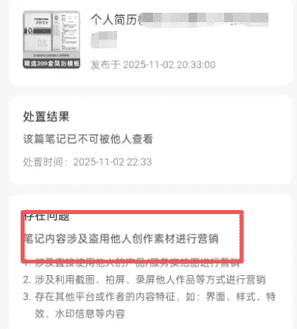

甚至推广也不允许，截图如下：

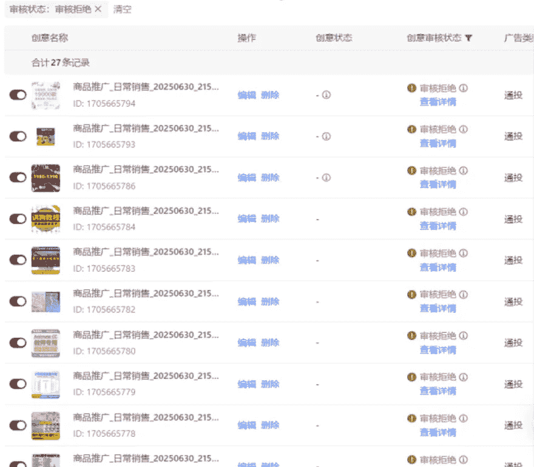

造成以上情况的出现，是因为**你用宝贝主图，作为笔记封面。**

而你上的这些款，**前面有很多人都做了**，就导致了封面非原创的违规。

**所以，笔记的封面图必须得原创！**

**大量发笔记，要涉及到批量**做原创封面图。这个时候肯定不能自己手搓，得用到工具才能提高效率。

那一天发20款笔记，原创图怎么批量做呢？

## **1.创客贴网站批量做图**

网址：https://www.chuangkit.com/templatecenter

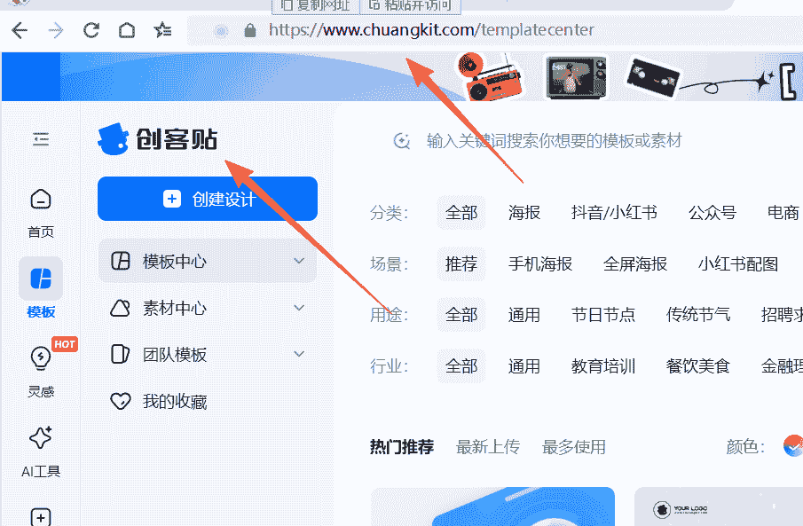

可以任意挑选模板，然后根据自己的笔记需要，修改上面的文字。

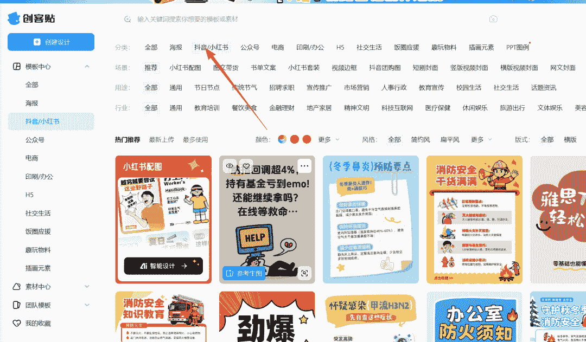

也可以批量制作图：点击左侧的AI，再点击“批量设计”

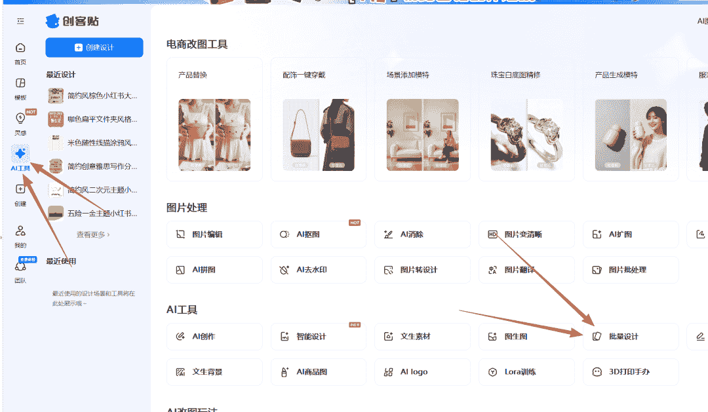

然后手动，填写笔记的文案等，再批量生成。

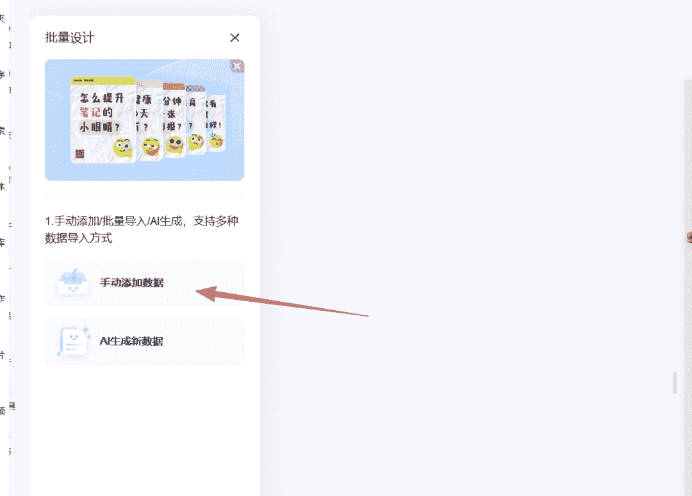

**市面上的批量做**图工具，基本上都这样，属于半自动化的，也比较花时间。

这样的做图网站也收费的，你们可以酌情选择。

当然了，相当于你用PS或者美图秀秀，一张张的去做，还是要省时间。

**但是，我们毕竟是要批**量，大量做原创图的，以上方法还是不能满足我们的要求。

于是，我找会写编程的兄弟，**自己研发了一个做图工具**，大大提升了效率。

## **2.我们自己研发的做图工具**

这个时候，**价值就来了。**我们自己内部研发的，**批量原创作图工具**。

这个批量做图工具的强大，不是市面上那些，图文合成工具能比的。

**工具展示截图如下：**

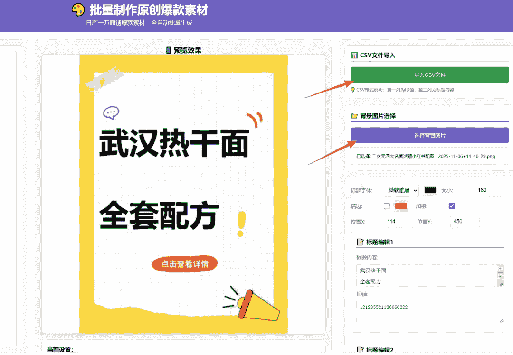

**这个工具，就**是为这个项目的操作，量身定制的！

可以把店铺里要发笔记的宝贝勾选，然后导出成如下表格。

导出后的表格带有宝贝ID，还有宝贝的核心主词。

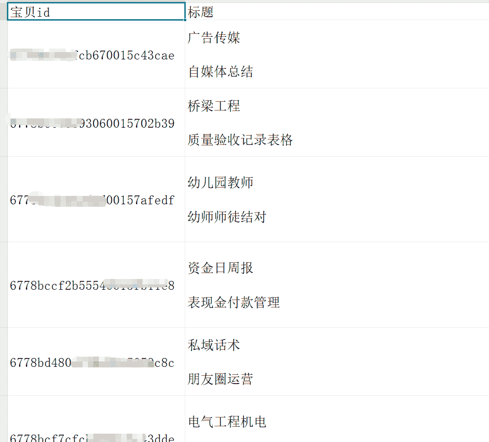

## **3.做图工具批量做图演示**

**第1步：**安装我们的插件，勾选店铺里的要发笔记的宝贝。

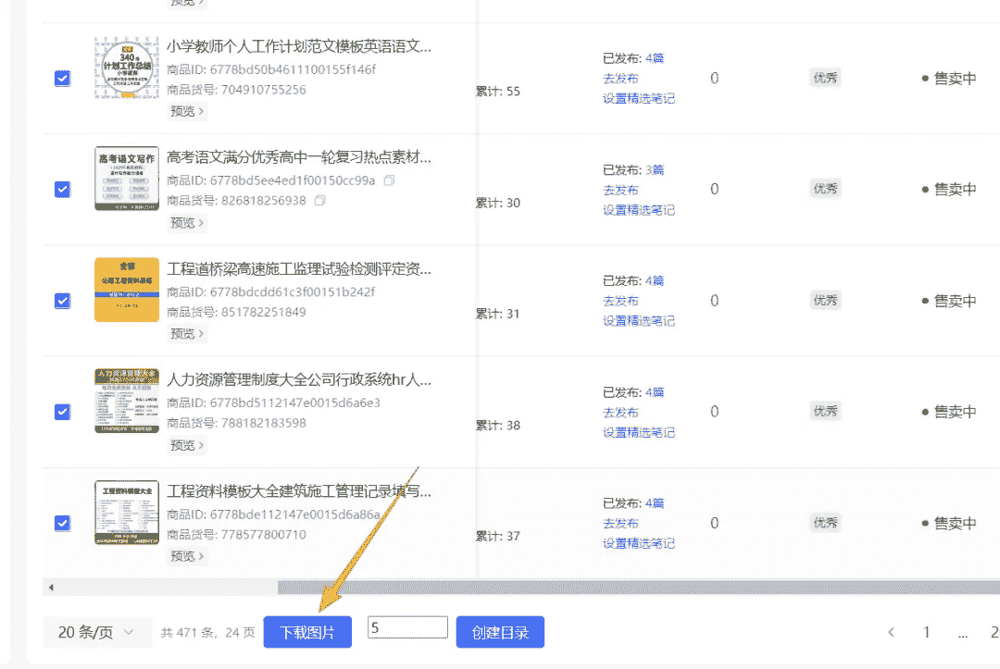

**第2步：**导出以后就会生成一个表格，表格里宝贝宝贝标题，宝贝ID。

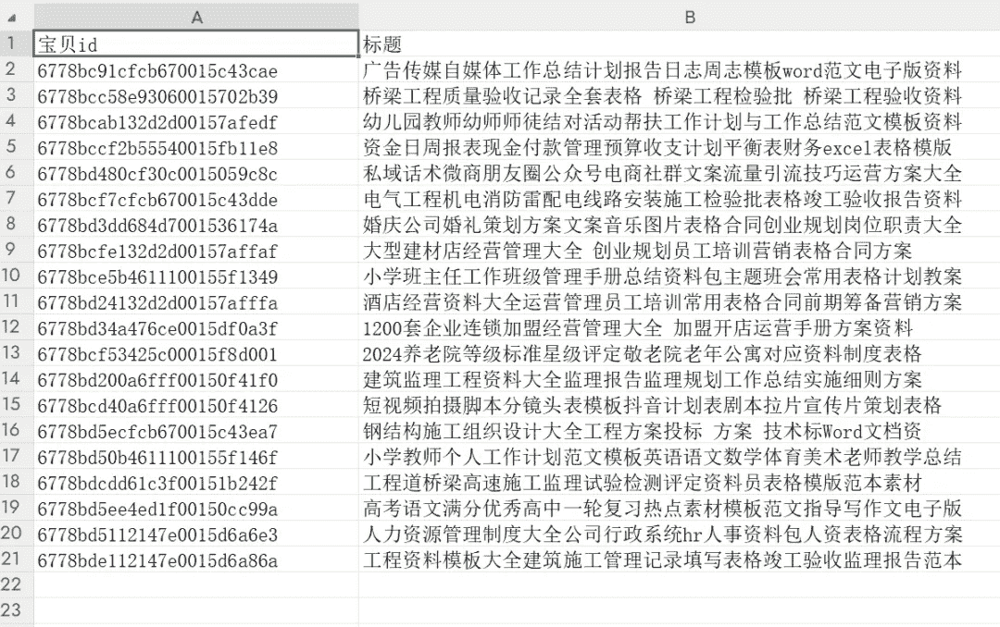

**第3步：选择背景模板**

先准备下小红书背景模板（如下），模板的来源有很多地方，比如淘宝上买，小红书上搜，或者前面的创客贴网站下载等等。

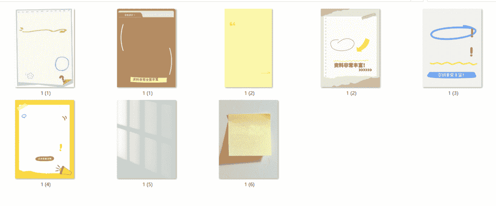

再添加一个背景模板进做图工具（如下）

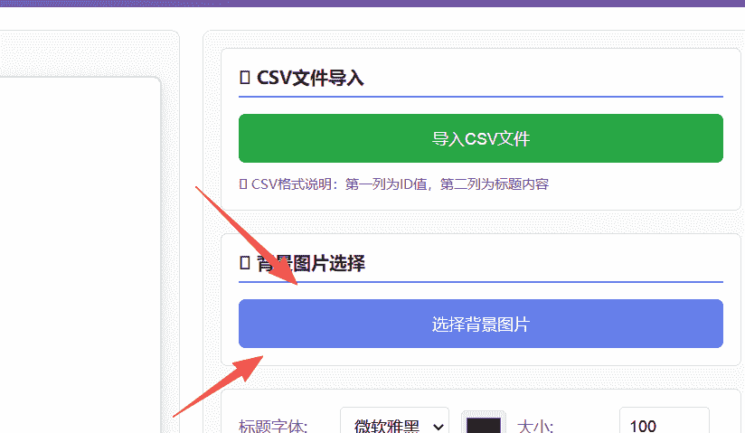

**第4步：导入工具**

再把表格导入到做图工具，就可以自动填写每个宝贝的主词+宝贝ID。

这里可以调整字体的型号，大小，位置，颜色等。

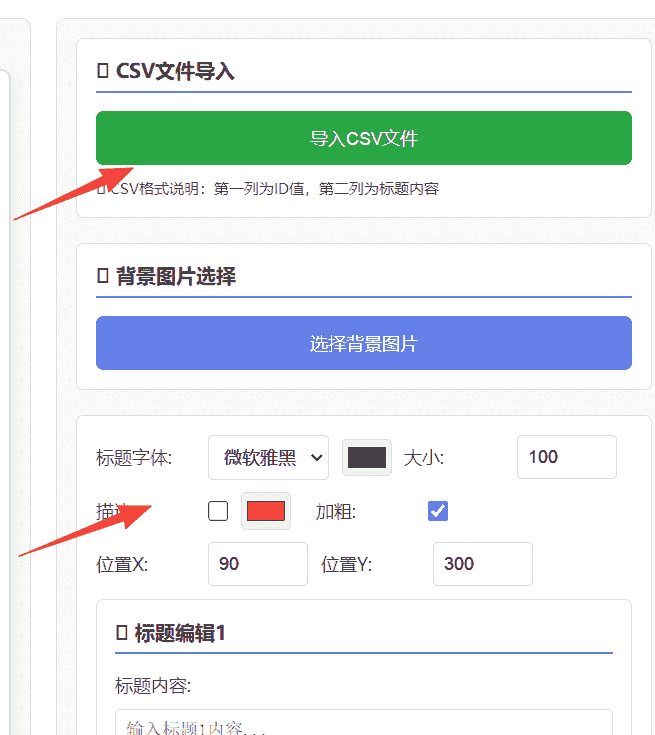

导入模板，导入表格，调整字体颜色大小位置后，成效如下：

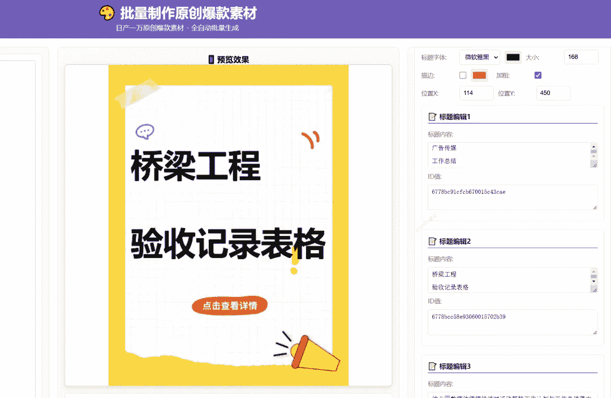

**第5步：**批量导出后，每张图都是以每个宝贝的ID命名的，这样做出的封面图和宝贝的ID是一一对应的。

**第6步：**自动发笔记插件，就可以自动调取图和宝贝去AI发笔记了。

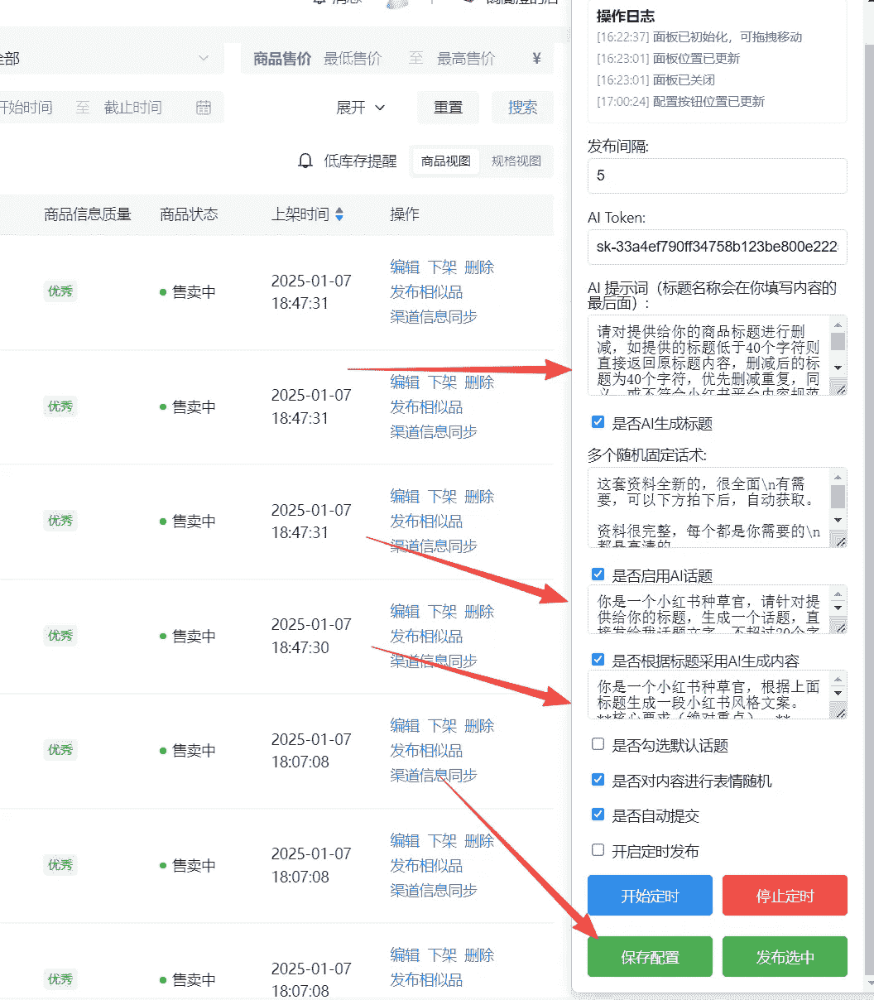

## **4.优势对比**

不会像你们在市面上学到的那种，做完图以后放到表格，或者放到飞书里面，用流程化的东西去调用。

这样做也可以，但是发的笔记多了，就比较费时间，还有一个就是不干净利落。

**我们这个是做**图工具和发笔记工具，两者**搭配使用，图**和宝贝是一一对应的，不会有偏差。

而且发布的笔记，**高度符合小红书数据好的封面**，**所以拿结果是很明显的。**

数据展示如下，每篇笔记的浏览量在150-500左右，一天20篇。

**你们可以细算下，薅多少免费流。**

**这就像你的苹果**手机，后来苹果又出了其他的产品，两者之间是可以联动的，而且效果极佳。

视线调回到半年以前，半年前发布的小红书虚拟矩阵1.0技术，当时很多圈友也跟我反馈，确实拿到了非常多的结果，帮助很大。

**我印象很深刻的是**，有个圈友跟我说，以前是做淘宝的，始终搞不到钱，也找不到突破口。

那天晚上，无意间找突破口的时候，看到了我的那篇实操贴，然后从头到尾的看了好几遍，越看越觉得有搞头。

但是，后来半年当中，发生了很多的变化。

**其中一个变化，就是全新工具**的使用，能大大提升大家搞钱的效率。

# 七、批量发笔记演示

批量做好原创封面图后，**接下来就是发笔记了。**

我相信现在应该没有谁，还在自己手动的去写笔记的内容吧。

如果你真的还在手搓笔记，证明你没有跟上AI时代的步伐了。

我们也是用的AI工具，全自动化AI发笔记的。

自动生成笔记内容，自动发布，实现全流程自动化，没有地方需要人手动操作的。

这个工具，也是我自主研发的，市面上买不到。

## **第1步：设置插件**

**先设置好插件的提示词**内容（如下）：

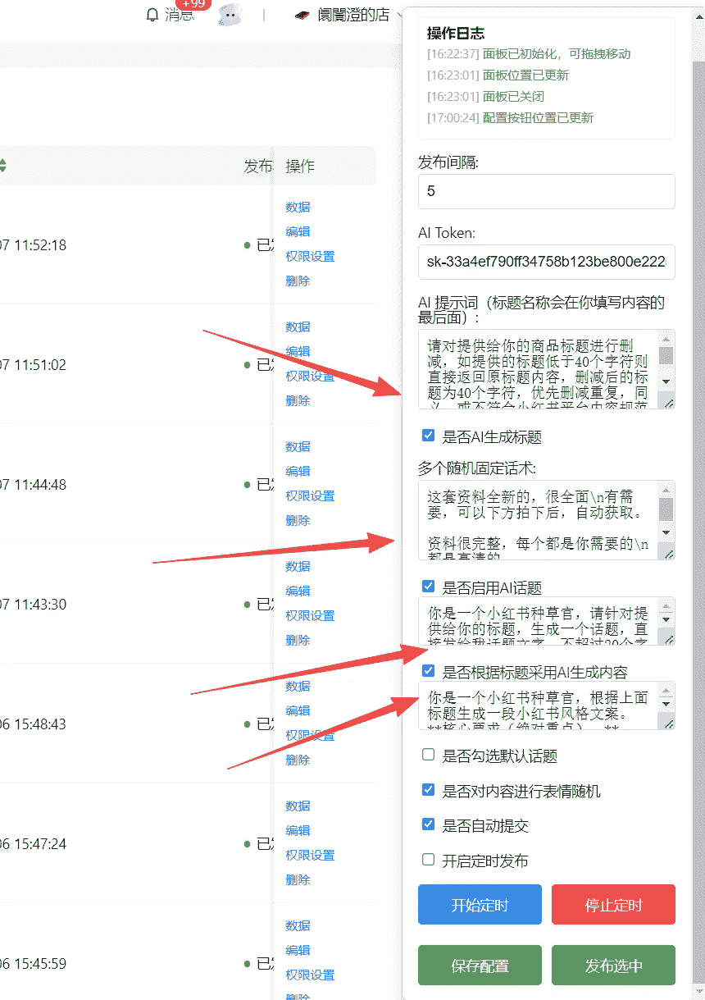

设置好后，**全程不需要任何点鼠标的动作，**插件就会**全自动操作了。**

## **第2步：插件调用封面图**

**插件自动调用**做图工具做好的图**笔记封面：**

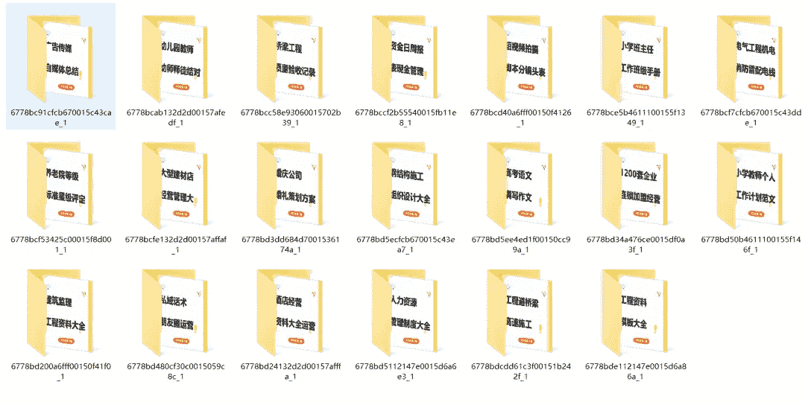

## **第3步：智能化标题**

**插件智能化**提取宝贝标题中的20个字作为笔记标题：

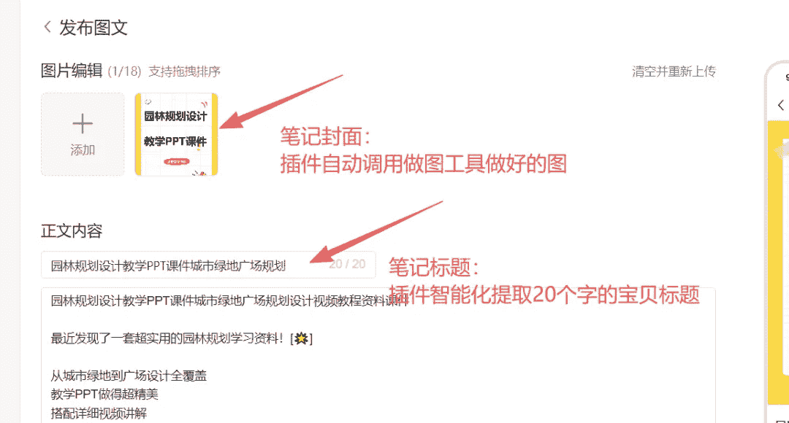

## **第4步：AI内容**

**插件自动**把宝贝全标题放在笔记内容的首行，买家搜索的时候也能搜到，弥补了笔记标题中减少的宝贝标题中的词。

正文部分对接AI，智能化写出高度符合宝贝的文案，排版公众，表情符号到位。

## **第5步：智能化话题**

**插件**根据每个宝贝，自动添加精准话题

## **第6步：自动发布**

**插件**自动选择笔记对应宝贝，自动发布，同时自动跳转到下一个宝贝，自动循环操作。

这款我们自主研发的，全自动化AI发笔记的插件。

当市面上的培训机构，还在教你们用工作流去调用的时候，我们已经完成了自主研发工具的程度。

市面上也有蛮多，号称自动化发笔记的工具。

**他们的会有很多问题：**AI内容排版不工整，符号乱用，文字叠加在一块，笔记内容和宝贝不相符，不能够自动添加话题，更别谈，可以全自化了。

## **7.发多了会不会限流？**

很多圈友做小红书虚拟店，听别人说笔记不能发太多，会限流之类的。

**我告诉你们，纯属扯淡。**

给你们截图（如下），我们自己后台发的笔记，每天发20篇笔记，也没见有限流的。

哪里有限流，什么叫限流。

**再换言之，你不这么做，你就老老**实实的一天发5个笔记，就能做起来了？

**你们没有学我的方**法之前，不就是这么干的吗，你们有做起来吗？

没有做起来对吧，所以**要打破固有思维，**拥抱新方法。

**不破不立！！**

笔记积累多了，权重越高，涵盖的关键词越多，搜索流就越多。

当然了，一天也不能发太多，还是要照顾下官方规定的。

我们测试出来，一个店一天发20篇笔记内是没有多大问题的。

# 八、小红书虚拟店矩阵

方法论跑通后，配套工具也齐了，那么做1个店是做，做3个店，做10个店也是可以一样做。

其实，我实测下来，1个人一天做1个店的时间，和做3个店的时间，相差并没有太大，无非就是一天半小时和1个小时的区别。

**做虚拟电商，有个痛点：**

一个店一天搞100元很简单，但是一天要搞1000元就有点困难了。

1个店1天能搞大几十或者100，证明0-1的路子已经跑通了。

比如，下方这个店数据，一天能搞个100多，就够了。

此时，就可以**复制方法**，多开店了。

**这个项目叫小红书虚**拟店矩阵，可以像我们这样3-4个店为一组。

**每个店上1**00个品，每天每个店发20个篇笔记，矩阵操盘。

**你可能会担心手**动上款花时间，发20个笔记太花时间，不用担心，我们有工具辅助的！

3个店，每天每个店盈利50-200左右后，再起下一组3个店。

**如果你们像**我们卖19.9，一天一个店随随便便，成交10单就达成目标了。

你们要记住：**量变才能质变！**

**积小流，方成大海！！**

**切莫小家子气**的，一天到晚在那纠结自己一个店的得失好坏，患得患失的。

你开一个店，我们学员同时做10个店，谁能容易拿到结果？

有圈友可能会想，我没有那么多身份证开店，如何多开店。

官方规定是1个身份证开1个个人店，或者开很多个体店，这个要去办个体户执照。

**当然了，市面上也**有资源可以1个身份证，无限开很多个人店，你们可以市面上去找找，未来有机会我再给大家分享下，不过这都是后话了。

# 九、附带双份收益

**以上从选品，搬款，到做图和**发笔记，做小红书虚拟店矩阵，已经可以是高手中的高手了。

我在操作这个项目的时候，就在想能不能把网盘拉新衔接进去。

以前就知道有网盘拉新这个项目，只是没有过多注意。

## **1.网盘拉新的收益**

**我新增了一个，附带收成**的操作，就是小红书虚拟+网盘拉新。

**我们自己本身也是这**么在做的，做过一段时间后，发现结果还是非常ok的。

可以看下收成截图，**测试中都有2000多了，**也算是额外的：

网盘拉新不是一个新的项目，是一个很**多年的老项目，只是做小红**书虚拟项目的人，很多没有注意到这个方法。

网盘拉新，简单来说就是帮助推广网盘的使用数。

小红书上，买了我们资料的买家，收到我们发的资料下载链接以后，他无非就以下几个动作：

要么他把你发的资料转存到自己网盘，要么没有网盘他会去注册，

**无论哪个动作，官方都会给佣金（**截图如下**）**

要么他收到资料后觉得下载慢了，就会花钱买网盘的会员。

**那我们拿的佣金就更多了**，截图如下：

这些，都是做小红书虚拟项目，以外的收成。

## **2.操作步骤演示：**

**第1步：**手机下载和申请任托邦，申请的时候必须要填邀请码，可以填下方这个码664483。

**第2步：**任托邦按照官方的这3步，绑定自己的百度网盘。绑定以后只要是通过自己网盘分享出去的链接，都跟你有关联。

**第3步：**把你获得的资料下载链接，先保存到自己网盘。

自己网盘点击分享生成下载链接，发给你的买家。

后面只要买家有任何动作，你都有佣金。

## **3.赚双份收益**

小红书虚拟店矩阵+网盘拉新，这两个项目的结合，也算是个小创新。

**可以同**时获得卖资料的收益，还有网盘拉新的额外收益，双份！

接下来，**要做的就是多开小红书店**，矩阵去卖虚拟资料，把结果最大化！

当然了，有的人可能会想，能不能单独把网盘拉新放大做，其实是可以的。

比如，淘宝上，拼多多上很多卖0.01,0.1的都是这个套路。

# 十、新手必能拿结果

**经常有圈友，来问我，**小红书虚拟矩阵，这个项目还能不能做？

必须能做的！而且我们一直也在做！

随手截几张我们店铺的数据图，以正视听。

**这个项目其实是很灵活的：**进，你可以多开店，形成工作室模式。退，你可以空余时间做两三个店，一个月搞个万儿八千的。

有没有结果，结果是做出来的，不是问出来的。

**我们下方这个店，从11**.02-12.01一个月也有1.35W。

**我敢给兄弟们保证：**只要按照我的双轨模式+AI半垂直化选品+店矩阵，只要做了。

一般不出三五天必然出单，**持续做，持续滚雪球爆发。**

给你们截图看下我们**新起的一个小店**，不一样开始慢慢的起来了。

还有大家比较关心，**每天要花多少时间**，来做这个项目的问题。

有很多人是兼职做的，白天在外面上班。

因为现在**全自动化做图+AI发笔记**，都很省时间。

我们一般是，**一个电脑上同时4个店一起发。**

你如果是在外面上班的，可以中午午休的时候，用我们工具批量做好的原创封面，设置好。

把店铺打开，发笔记插件打开，**让它自动操作就行。**

中午你午休完，基本上就发布完了。

# 十一、成功经验和总结

## **1.要坚持做**

**任何项目，都**没有说速成，速成就能搞到钱的事，还轮得到你？

只有坚持做，才能拿到想结果。

大家做项目，都是对搞钱的渴望，你渴望的、你向往的，没有哪一样，是轻轻松松就能到手的。

有的人，像蜗牛般缓慢却坚定地爬行着；有的人，如雄鹰，永远向着更高处翱翔奋进。

有很多项目，从0-1很简单，但是要从1-**10，很多人就难了，这个难，**不在方法上，而在能否坚持做下去，有积累！

## **2.要学会自我创新**

人与人之间，最大的差距在于:是否敢于迈出第一步，以及能否始终不渝地去坚持到底。

**我有时候，回头想一**年前，如果还在继续做淘宝，不转头做小红书虚拟的话，估计现在还在迷茫。

那个时候做小红书虚拟的，很多还是老套路做，包括市面上搞培训的，都是一个调调。

都是说要一个店精挑细选，分析数据，去扒同行的款，拆解同行的爆款笔记，模仿或者AI改写等等。

但是，我根据多年的淘宝经验，**做了玩法上的创新**，一个店上500个品，每个品发一篇笔记，同时做10个店。

半年后的今天，我又发现，照旧干的话，拿结果不行了。

于是，我又做了这次玩法上的创新，采用我们原创的“双轨模式+AI半垂直选品+店矩阵”。

你看看，这就是坚持后，**再加上创新，就能达到彼岸！**

## **3.要保重身体**

电商人，通常有3个疾病，一个是社交恐惧症，一个是肥胖症大肚子，另一个是尿酸高通风。

我3个都占了，不善社交+大肚子+尿酸高！也不知道大家占了几个。

这是电商人，或者做互联网项目人的通病！！

所以你做电商，如果没有搞到钱，同时也花费了时间，健康也没了，最后三输的局面！真的是得不偿失！