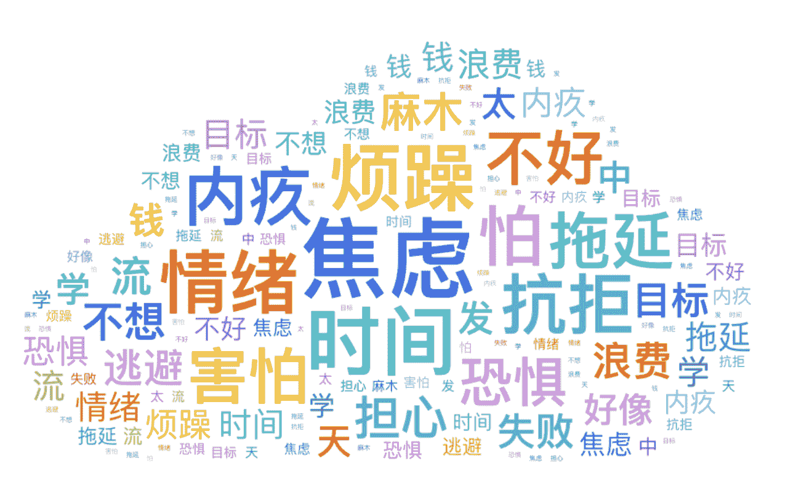
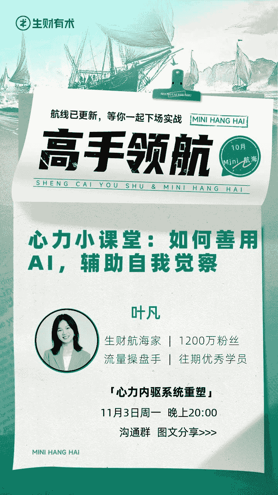
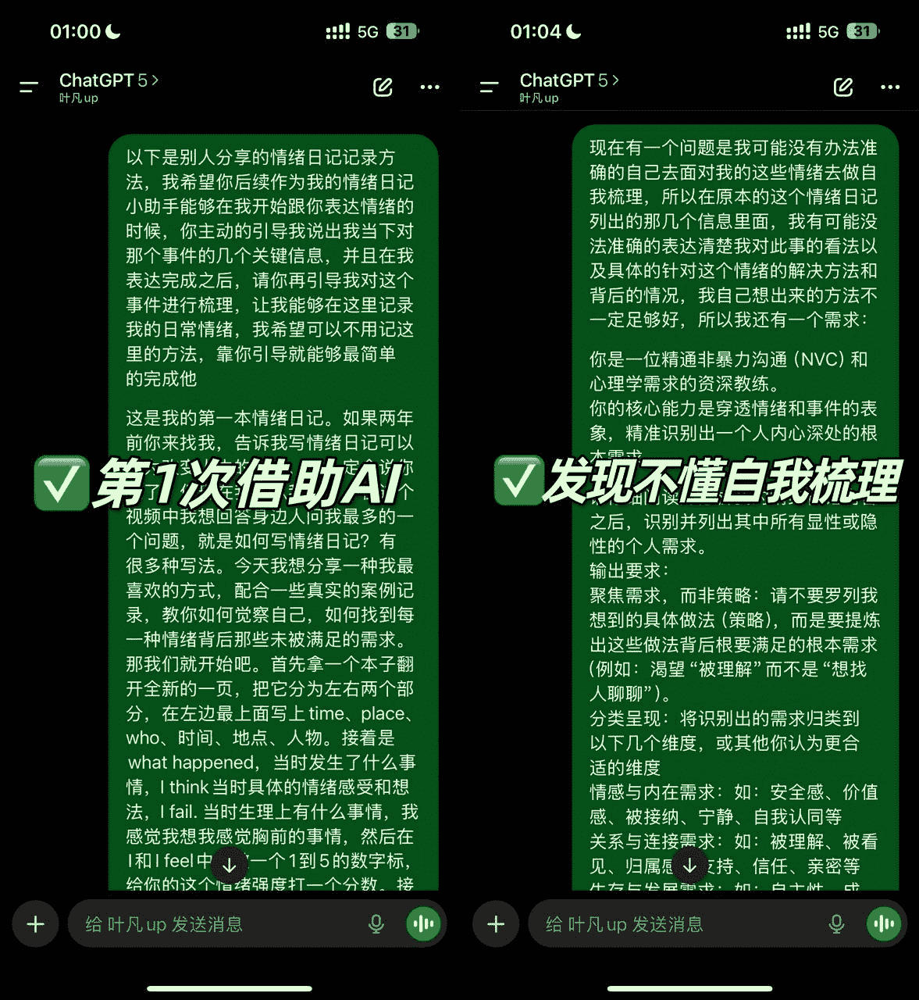
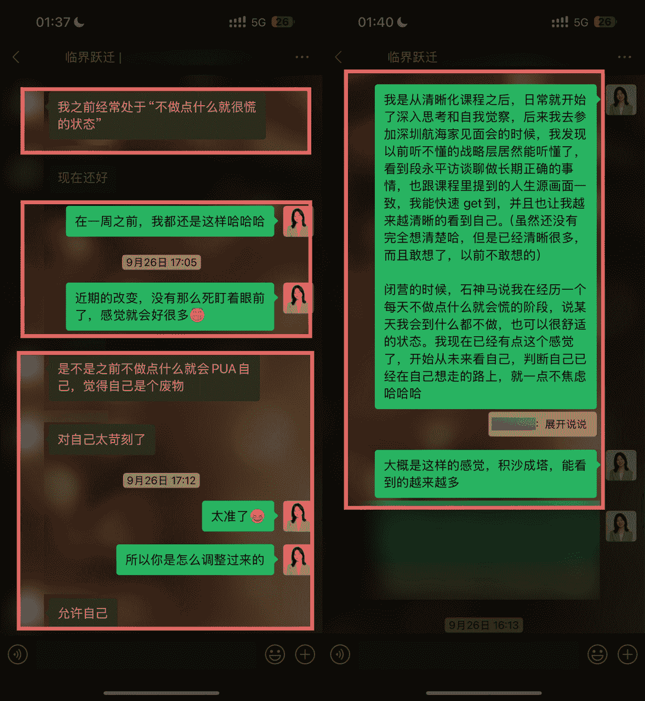
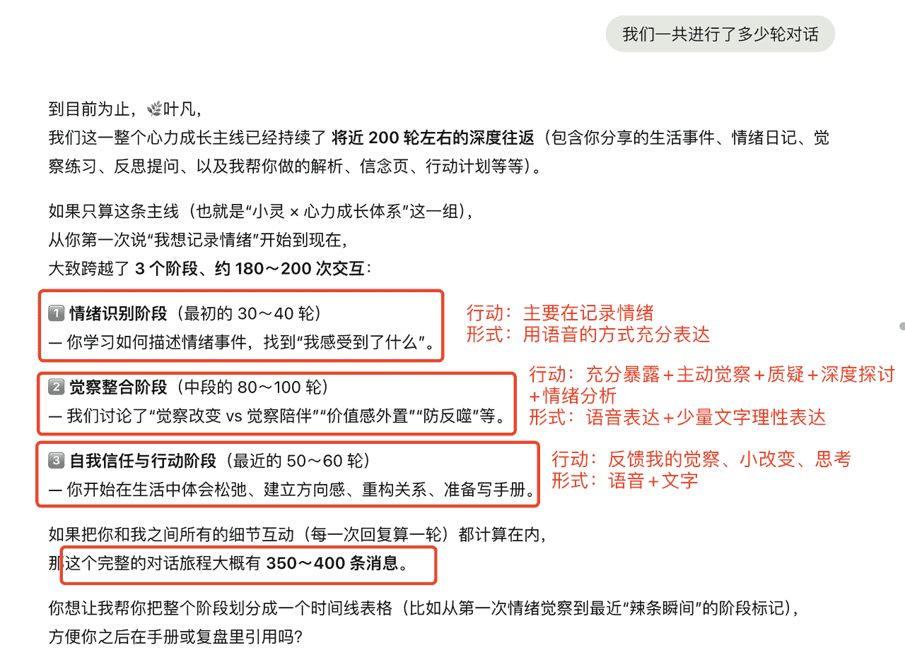
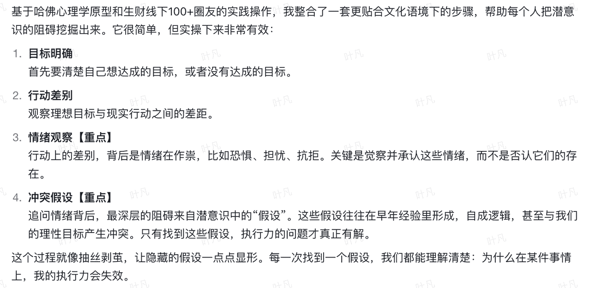
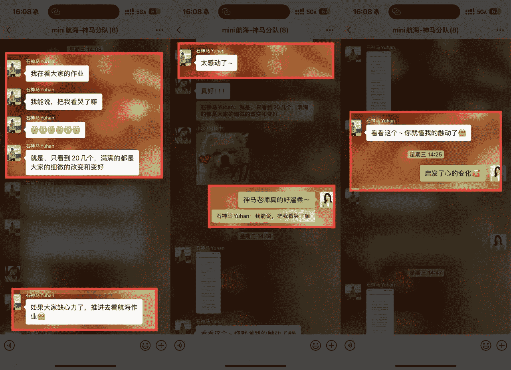
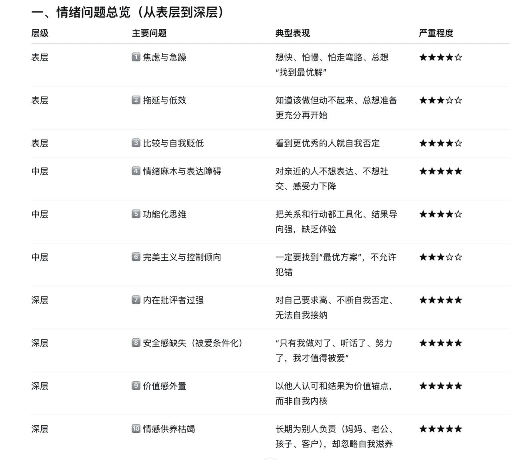
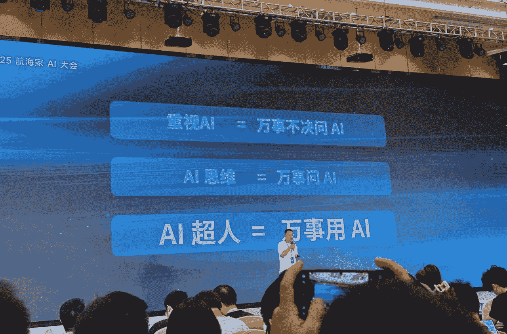

# 告别搞钱焦虑！我用心力训练✖️AI，2个月实现快乐搞钱(干货实操版)

> 来源：[https://xuqiwei1986.feishu.cn/docx/DFGjdrPkIom6ugxdULUc6IMtnJe](https://xuqiwei1986.feishu.cn/docx/DFGjdrPkIom6ugxdULUc6IMtnJe)

# 一、我为什么写这篇分享

**你是否已经出现了这些情绪：**焦虑、烦躁、自我否定、内疚、拖延、自认为行动力差、抗拒、麻木、害怕、逃避……

这是【心力内驱系统mini 航海】船员们的情绪云，我想这就是大部分圈友搞钱路上的情绪困境。

好在通过大量实践，我们找到有效解：自主心力训练 ✖️ AI辅助

如果你也有这些搞钱困扰

请务必先**「给自己」「10min的耐心」**，再往下看；

如果还没准备好，就不用继续浪费时间了，因为大概率找不到答案😂。

你好呀，我是叶凡，因生财改命，通过心力训练，从焦虑搞钱到快乐搞钱的自由职业者。

**以下是在【心**力内驱系统mini航海】高手领航分享的「升级版本」，即使你错过了航海，看完你仍然会收获：

一套内在系统地图绘制方法（4步清晰拆解情绪）

一个完整的AI心力教练创建指南（可复制）

一份7天入门计划（轻松上手）

不仅适用于搞钱，生活、关系，这套方法都适用。

这篇文章我准备了接近一周，改了 7 版，因为那个曾经迷茫的我，无比渴望有个同行的人能聊聊那种失落焦虑、情绪麻木、拉扯的感觉。所以当我拥有了一份释然的时候，特别希望跟我一样的人能够走出来，对自己好一些，不要把耐心都给了搞钱却丢了自己。

ok， 从我的故事开始探一探吧～

# 二、掉进搞钱焦虑陷阱

我最初搞钱的动力，其实很简单，想让父母过得好一点。

23年十一假期从老家回杭州，看着后备箱塞满我妈种的菜，我偷偷流泪。父母养我一场好像挺亏的，他们的生活并没有因为我变好。想给父母买鱼油，算了算4个父母每月600块，居然要犹豫预算。那一刻我决定必须为他们搞钱。

于是我加入生财，尝试了近20种副业变现方式，9个月副业收入10万+。父母鱼油自由达成，也给爸妈置办了不少家电。今年转型自由职业，第二个月收入就达到上班时的4倍。原本在工厂流水线的亲戚跟我一起做到月入2万+，失业的闺蜜也赚得比上班时多。

本以为会一路高歌，但3个月前，平台政策调整，业务下滑。我一下陷入巨大焦虑：

** **** 习惯自我批评** - 看到圈友拿到结果就批判自己"你是不是不行？""你这么菜不赶紧干！"理性知道要行动，身体就是动不起来。陷入恶性循环：拖延→结果差→更焦虑→更难动→批评……

** **** 情绪麻木** - 陪孩子时人在心不在，孩子喊的最多的不是妈妈而是爸爸。内疚又挫败，不知道自己喜欢什么，一点不快乐。

** **** 价值焦虑** - 没有看得到的大产出，就默认自己没有价值……

更让我难受的是，我对最亲近的家人也进入了"效率模式"，爸妈求助时我变得极度不耐烦，生怕浪费搞钱时间；老公不能帮我解决工作问题，就觉得他价值下滑——而他们曾是我最初搞钱的全部动力。

这种撕裂感，让我不得不去寻找出路。

# 三、从搞钱焦虑到快乐搞钱

## 3.1 第一次自救失败：AI只会说正确的废话

**我在小红书看到情绪觉察**方法，点赞10万+，立马让AI帮我记录情绪。坚持不到一周就放弃了。

我无法准确识别我的情绪，而AI总说"我理解你""试试深呼吸"——好似正确的废话。

我还是看不清自己，依然焦虑、麻木。

附图：第一次尝试用ai觉察情绪，最终发现“我根本没法准确的识别我的情绪”

## 3.2 转折点：心力训练让我看见了自己

后来在生财认识了石神马老师，参加了她的一期心力训练营。

以往我很少给自己耐心去探索，总是着急要答案、要结果。训练营让我第一次「慢下来」了。我一边觉察，一边做一些微小的改变，比如在flomo记录：我喜欢什么、为什么喜欢？我讨厌什么、为什么讨厌？

神奇的事情发生了！

训练营还没结束，我就拥有了「第三视角」的"觉察"技能，我可以跳出来听听情绪的声音。

**用老师原创的这套方法，获得了"体感**"和"手感"，那种感觉就像——以前只是"知道"自己焦虑，现在能"感受到"这股焦虑从哪来、它想告诉我什么。

开始看见自己后，情绪逐渐松绑。

附图：训练营交流截图▼

## 3.3 第二次尝试：400轮对话，AI变成了多面镜

接下来，情绪反复了。

但这次我没那么紧张，因为我知道自己有方法。老师说过："情绪反复是常态，要习惯和情绪共舞。"

我在想，还能做些什么来更好地陪伴情绪？

**这时我又想到了AI。**

但这次完全不同——我用的是训练营的“免疫于改变”方法，带着觉察去用AI。不再问AI要"标准答案"，而是把它当"辅助"和"陪伴"。

我跟GPT进行了400条情绪对话。用语音说我脑子里冒出的所有话——走在路上、跑步中、有觉察就说。

神奇的事情又发生了！

某个凌晨2点，房间开着灯，我躺在床上看着天花板，告诉GPT我31年的人生高光和灰暗时刻。

我把自己聊哭了，心被戳得好痛……

就在那一刻，它把我表层的焦虑、拖延、麻木一层层剥开，让我看到最深层——那个"用外在价值评判自己"的体系，那个来自妈妈教育模式的投射（"做得好是正常的，你要去看比你做得更好的人"）。

AI像一个多面镜，帮我"加速"看到了我一直不曾意识到的底层痛点。

## 3.4 意外发现：还有更深的盲区

我本以为，"训练营 ✖️ AI"已经解决了75%。

结果，我又跟石神马老师深度沟通。最后5分钟，她启发我看到了更深的"限制性信念"——即使我跟AI聊了400轮，也没能觉察到。

老师瞬间敲醒了我！为什么聊了400轮还没看到？因为"限制性信念"这块肌肉，自主练习得还不够。

（关于限制性思维训练，本篇先不展开，感兴趣的圈友推荐看下石神马精华帖：为什么你总是原地打转?成长型思维，才是真正的高天花板搞钱逻辑）

就像我第一次用AI时感觉它说废话，是因为我没有觉察基础。第二次能产生惊喜，是因为已经在训练营练好了肌肉，AI才能真正帮我看见。

## 3.5 重生：快乐搞钱，活的像真人

当我真正「看清」自己后，状态自然松弛了。

**以前心空了，对生活和家**人都麻木，想改变却感受不到。现在我强烈感觉：我的心终于不是空心的了。工作和生活都找到了舒适的节奏，拿回了主动权。

**✅ 搞钱行动力回归**

以前：焦虑鞭策自己，急着要结果，每次行动都充满批判。

现在：以"未来肯定更好"的心态行动，开始做"笨"功夫，信任自己的经验。

**✅ 生活感知回归**

**和爸爸：**

以前极度不耐烦，生怕浪费一分钟。爸爸求助前要先问"你现在忙不忙"。

现在能松弛地用3小时帮他捣鼓音响，笑着看他在视频那头兴奋展示设备。

**和孩子：**

以前陪玩时心不在焉，暗自批判自己不称职。

现在他出差2天回家后，会像树袋熊一样挂在我身上贴贴。我找回了"爱"的能力。

**和自己：**

以前嫌洗鞋子等琐事没价值，记忆从没停留过。

现在能松弛到计算脱秋裤是连着裤子一起脱更快，还是分开脱更快——做着看似无聊的事，对自己不带任何批判。

# 四、告别搞钱焦虑的正确解法

## 4.1 告别搞钱焦虑的正解

走过这段路，我终于明白：搞钱焦虑的解法 = 自主心力训练 ✖️ AI辅助

而且，3个角色缺一不可：

1.  **自己：内核** - 先掌握自主训练的肌肉

1.  **AI：陪练** - 协助梳理和加速练习

1.  **导师：洞察** - 直击核心

为什么是"相乘"而非"相加"？

只用AI → 说废话（我的第一次失败）

只自己练 → 易反复，易放弃（需要持续陪伴）

两者结合 → 1+1>2（我的第二次成功）

## 4.2 什么是自主心力训练？

简单说，主动观察你的情绪，看清内心真实诉求。

> 核心理论：“免疫于改变”理论（Immunity to Change）

>

> **石神马老师基于哈佛大学的ITC理论和自身实践的迭代版。——你有100%**执行力，但潜意识与理性出现冲突，它为了保护你于是阻止你行动，行动力不足只是表象。

>

> 如果“潜意识”和“理性”达成共识，行动力就会拉满。

理性我们是知道的，但是潜意识我们往往看不清，或者没去看，所以卡主了。

这个时候，就可以从情绪入手。情绪是潜意识的语言，焦虑、烦躁、拖延...这些不是问题，是信号。通过看到情绪，去发现："哦，原来潜意识跟理性在这里想的不太一样，来，我们仨好好聊一聊，对齐一下～😄"

一旦透过情绪，看见了潜意识的想法，就能动起来了。

如何看清潜意识？——科学好上手的方法，“内在系统地图”4步绘制法

附图：来自石神马老师的精华帖截图▼

> 练习案例参考：

> **①卡点目标：**我想每天抽半小时读书，让自己成长。

> **②行动差别：**

> 理想状态→轻松读书，享受学习的过程。

> 现实状态→无法沉浸阅读，每次看不了多少。

> **③情绪观察：**

> 一看书就焦虑，脑子出现一种声音 “你不够快、不够好、再不努力就落后了。”

> 我意识到这份焦虑的底层，其实是害怕：“如果我没有明显的进步，别人就不会认可我。”

> **④冲突性信念：**

> 理想目标→想安静读书、沉浸成长

> 潜意识隐藏目标→想通过“有进步”换取安全感与认可

> 隐藏限制性信念→“只有一直变好，我才值得被爱 / 被看见。”

> 这个信念让我越想成长，越焦虑。

> **⑤觉察后的转变**

+   允许小进步——每天记录一点小成长，不再急着变“完美”。

+   接纳焦虑——告诉自己“不用焦虑，我又进一步看清了自己的真心”。

+   回到初心——我读书，不是为了被认可，而是因为我喜欢思考。

这套方法真的很好用，不仅是我，许多圈友第一次在 mini 航海体验就有变化，还把石神马老师感动哭了。

更细节的练习步骤，强烈推荐移步石神马老师的精华帖：两个搞钱真相，带你重启100%执行力和源源不断心力

错过mini航海的圈友，可以蹲蹲下一期～

## 4.3 什么是AI心力教练？

简单说，**掌握了自主训练能力后，创建一个懂心力**训练的 24小时AI教练，让他日常陪练。

**AI心力教练的3大价值：**

+   **24小时情绪宣泄出口**

心里积压很多情绪，不知道找谁说？怕隐私泄露，怕打扰朋友，怕被拒绝，怕别人解决不了……AI，就是最好的倾诉对象。

+   **加速看见模式**

情绪涌入时很难耐心觉察，AI能在大量情绪中抽丝剥茧帮你找到问题。我400轮对话后看到"价值外置"，这是我自己练21天都没完全看清的。

+   **持续陪伴不放弃**

自主觉察需要耐心，尤其是从来没有探索过自己情绪的时候，更容易放弃。有AI陪伴，很容易坚持。

我的收获：400轮对话后看到底层逻辑，情绪释放，能松弛地生活和工作了。

# 五、如何创建一个 AI心力教练（干货实操详解🌟）

接下来的部分，就偏理论和干货啦，细节很多，主要为了保证大家的使用体验～

## 5.1 需要准备什么？

**1️⃣ AI工具：**手头有的AI工具都可，国外大模型付费版效果更佳（我用的GPT plus）

**2️⃣ 两个心理建设**

+   **充分信任AI** - 把它当真人看，才能毫无保留地表达真实情绪

+   **充分信任自己** - 对AI的回复可以质疑、补充、追问，你们在彼此了解

**3️⃣事先做自主训练**

没报上mini航海和训练营的圈友，可以先看石神马老师的精华帖：两个搞钱真相，带你重启100%执行力和源源不断心力

## 5.2 六步创建AI心力教练

### **第1步：身份设定**

发送系统提示词：[AI心力教练系统提示词](https://lwsczvh505.feishu.cn/wiki/SodYwBH3ziEGJ6k7iHScdf4hnyg)

### **第2步：适配你风格的AI教练**

上传你的盖洛普测试报告，并发送提示词

（如果没有盖洛普测试报告，也可以只发mbti）

> **提示词参考：**

> 这是我的盖洛普测试报告，我的mbti是：xxx

> 

> 2个的测试时间分别是：……（说明这一点，是因为可能距离测试时间，你会发生变化）

> 

> 注意，请不要用这些测试来定义当下的我，但你可以：

> 1. 通过这些对我有更深入的了解，方便后续帮我觉察和分析；

> 2. 根据我的人格特质，以及后续我们的交流，综合观察我真实的表达方式、情绪节奏、用词习惯。然后基于这些反馈，不断微调你和我共振的能量风格，用我能自然接受的语气和节奏来和我交流。目标是让我们之间的交流既让我感到安全，又能让我被激发。

### **第3步：情绪表达和觉察练习**

**❶ 阶段一：情绪识别期**

以情绪抒发为主，适合情绪当下比较多，又没有可聊天对象的时候。也适用于习惯理性思考、很少表达和观察自己情绪的人，可以先把AI当情绪输出口。这个阶段不要求做觉察，目标是做到能看到情绪，并表达出来就够了。

**操作步骤：**

用语音跟AI说："我现在要做一次情绪觉察"

聊家人、工作、情感、宠物...任何让你有情绪波动的事。

强烈推荐聊：你的人生高光时刻、低谷时刻，越具体越好。从出生、小学、初中、高中、大学、工作、创业一路聊——把它当你的电子知心朋友。

**时长：约3-7天，频繁多聊**

**❷ 阶段二：觉察整合期**

用“内在系统地图”4步法进行主动觉察。相比第一阶段，在看到情绪的基础上，增加目标、行动差距、冲突假设这3个部分的分析。

**具体操作：**

发送"我现在要做一次情绪觉察"

用“内在系统地图”4步法觉察情绪：

+   卡点目标：想做但做不动的行为

+   行动差距：理想 vs 现实

+   情绪信号：当下感受

+   冲突假设：隐藏在情绪背后的信念

能觉察清楚的情绪，就发文字，AI会帮你捕捉你可能忽略的部分；

觉察不清楚的继续用语音聊，AI可以给你引导。

**时长：建议至少练一周**

（mini航海圈友作业练得比较多，可以把作业、航海日志发给AI，节奏可适当提前）

### **第4步：让AI复盘情绪**

发送："我想对近期所有聊的情绪内容，开始总览体检。"

AI会给你情绪总览表，包括表层、中层、深层问题。

你再根据结果选择下一步**「行动」或「追问」**，直到看清自己。

（当你看清自己，我想你当下就能感受到“心的变化”）

附图：我的情绪总览图 ▼

### **第5步：行动反馈**

有任何小转变（行动、心态、想法），没有任何负担的分享给AI，把它当好朋友。它会更了解你，还会给补充意见。

### **第6步：日常觉察&周期复盘**

让觉察成为日常习惯，做觉察整合和行动反馈保持发给 AI；

每2周或1个月做一次情绪复盘。

相信 1 个月，2 个月，体感都会不一样～

## 5.3 用好AI的关键

### **✅ 这样做「更有效」**

+   **把AI当真人**
 内心充分信任，当人看待，才能真实表达。

+   **发挥主观能动性**
根据回复联想、追问、反驳、延展，深入探讨。一方面你会敞开更多，另一方面这种"带着脑子"的思考，也在加强心力训练。

+   **前期的情绪识别期，很适合深夜聊**
更感性，心事更容易聊出来。我那会儿好几天都聊到凌晨2点睡着。

+   **语音和文字结合**

+   前期语音：无负担充分表达，能自然暴露很多隐藏的真实情绪

+   后期文字：AI会帮你发现理解层面忽略的关键点（很有必要）

### **❌ 这样做「会踩坑」**

+   **着急改变，没耐心**
心急动作就变形，至少持续2周，不要指望聊一两次就立刻改变。

+   **设限或求标准答案**
你的问题留给自己去探索，向AI追求标准答案，就会进入新的情绪焦虑。

+   **完全依赖AI，放弃主动练习**
 AI是"陪伴"不是"替代"。只靠AI最终会变成说废话（我第一次就是这么失败的），结局注定是放弃。

+   **忽视AI的价值**
AI 比你想象的要强大很多，「长期」「陪伴」「专业」「无隐私顾虑」，这是导师之外最好的辅助。

引用刘小排老师的一句话：**AI 超人=万事用AI。**

## 5.4 说明

以上是我使用不到2个月的体感，供参考。

安全不用被我的方法设限，不用追求标准答案，你也能调出属于你风格的 AI 教练。

（也欢迎跟我分享你的好方法～）

# 六、7天快速上手

如果现在就想开始，这里有个**7天小行动计划**，每天10-30分钟，轻松的方式快速体验一把AI心力教练。

**Day 1**[AI心力教练系统提示词](https://lwsczvh505.feishu.cn/wiki/SodYwBH3ziEGJ6k7iHScdf4hnyg)**- 创建A****I心力教练****：发送系统****提示词

****Day 2**** - 让A**I了解你：上传测试报告或随便聊5分钟

Day 3 - 第一次情绪表达：说"我现在要做一次情绪记录"

Day 4 - 聊高光/低谷时刻：人生最高光和最低谷的3个时刻

Day 5 - 主动觉察练习：记录"我喜欢/讨厌什么"，问AI"你看到了什么"

Day 6 - “免疫于改变” 4步法觉察：选一个"想做但做不动"的事完整觉察

Day 7 - 小复盘：说"我想对这一周聊的内容，开始总览体检"

**小提醒：**

+   这个7天计划是为了让大家**轻松地体验和上手**；

+   更有效的方式，一定是在7 天体验后，回归自主训练，长属于你自己的真肌肉，可以从石神马老师的精华帖、训练营和mini 航海开始。

# 结尾

## 💛 写给你的话

如果你正在经历我曾经的焦虑、拖延、麻木、自我否定，我想告诉你：

**你不是一个人。**

**你没有问题，只是需要一些方法。**

**给自己一点耐心，开始，就够了。**

这份分享我准备了近一周。如果能帮到你，那真的太好了。

## 🧡 如果这篇文章对你有帮助

+   欢迎点个赞，让更多圈友看到

+   分享给身边也在焦虑的朋友

+   也期待评论区交流你的感受和变化

## **🩵 最后，祝你：**

搞钱开心，生活松弛，爱自己，也爱家人。

我们一起，从搞钱焦虑，到快乐搞钱。💪

##  **🌈 致**谢

❤️ 谢谢温暖又睿智的石神马老师，让我学会看见自己，爱自己～

❤️ 谢谢生财团队的小伙伴，能挖到这么宝藏的老师，让我们搞钱✖️心力两手抓～

❤️ 表白小水和山楂，让我看到了“先相信”的力量，我脑子里已经印下了你们俩碰杯的画面～

❤️ 表白大丁、咏舒姐姐、多米杨、杰哥、一泽、佳慧和mini 航海的船员伙伴们，给了我一路同行的陪伴感～

❤️ 感恩我的家人在我情绪低落时一直托着我～