# 新手小白怎么从抖音cps赚到第一块钱

> 来源：[https://xuqiwei1986.feishu.cn/docx/O0ahdOYUxoeyILxwYxwcMRyRnIe](https://xuqiwei1986.feishu.cn/docx/O0ahdOYUxoeyILxwYxwcMRyRnIe)

圈友们好，我是毛小雨，在生财待了两年时间，大大小小的航海参加了十几次，这次在抖音cps做到5w的销售额，排名40/450，这些成绩虽远不及百万的大佬，但也跑通了第一个小闭环，赚到了第一千块的佣金，作为第一期纯新手入局cps，想为大家分享一下自己踩的坑，也为这次刚报名cps的伙伴们对齐颗粒度，梳理下我自己做cps的流程和感悟

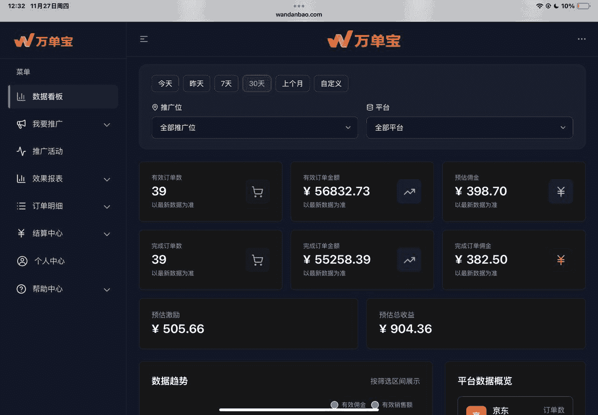

# 第一期cps的实操感悟

# cps的底层逻辑：种草

用户用了我们推广的密令领取到优惠券，并用此优惠劵下单，消费者以更便宜的价格买东西，我们赚取了一定比例的佣金，互惠共赢。

新手最开始要知道这个密令词进去以后，实际优惠是什么，有优惠多少，得理清楚这个逻辑才能做内容。比如“惊喜红包XXX”在平台搜，弹出的界面是这样的，用户领取完红包之后，再下单再算到佣金里的。

# 新人怎么入局抖音cps(美团外卖or3c数码，家电)

# 把手弄脏，发布第一条视频，确定要做的类目

外卖是客单较低，出单频次较高的类目，像下面这种类型

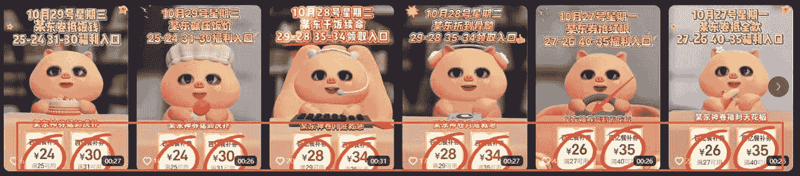

手机、数码是高回报，但是需要持续发一段时间内容的类目

建议：双十一双十二的消费趋势下，多钻研下手机、数码3C类目。也可以准备三到四个账号，分别做外卖和3c数码。

新号起量，**一定要知道当下的流量品是什么**，如果推3C产品类目，手机会场里主流的数码品牌：Apple、华为、小米等，双十一期间教练建议只推iPhone，不要用其他品牌，流量太小了；也有同行推其他品，是老司机的从容；除非是新品发布。

小tips**：**如果有可能，还是建议能不能多点号，这样测试效率高。因为一个号测三天，其实和三个号测一天的测试答案一致的。

## 找对标   怎么找对标，什么叫好对标

模仿好的对标，也算是测试不同的爆款模板

可在抖音平台搜索“xxx的羊毛日记”“羊毛”“攻略”“国补信息”“家电”“数码”等，建议选择一周内的内容。一开始就专注抖音平台即可，另外有很多同行发视频的标题里带有标签，这些都可以搜索到

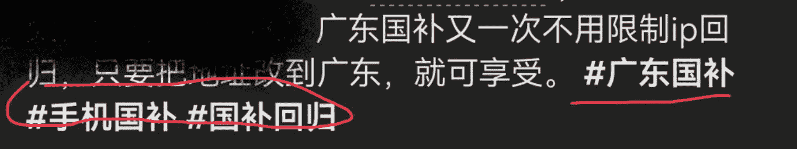

1.  低粉（粉丝量少，1000以内的，避免买流量的嫌疑，我们有能力可复刻）

1.  爆款（点赞>100，像这转发量大于点赞，也属于妥妥爆款，引导分享复制链接）

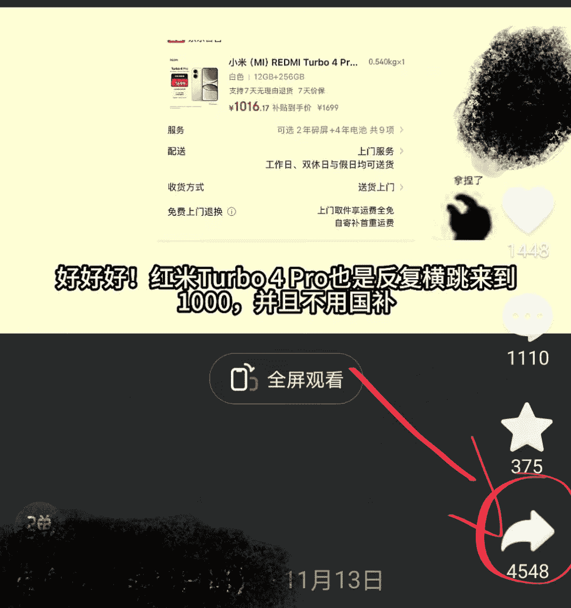

注意：避雷投流素材，我们主要做的还是自然流量，可以做下甄别，这种很难模仿出效果，主页内容数量较少，无长期更新动作

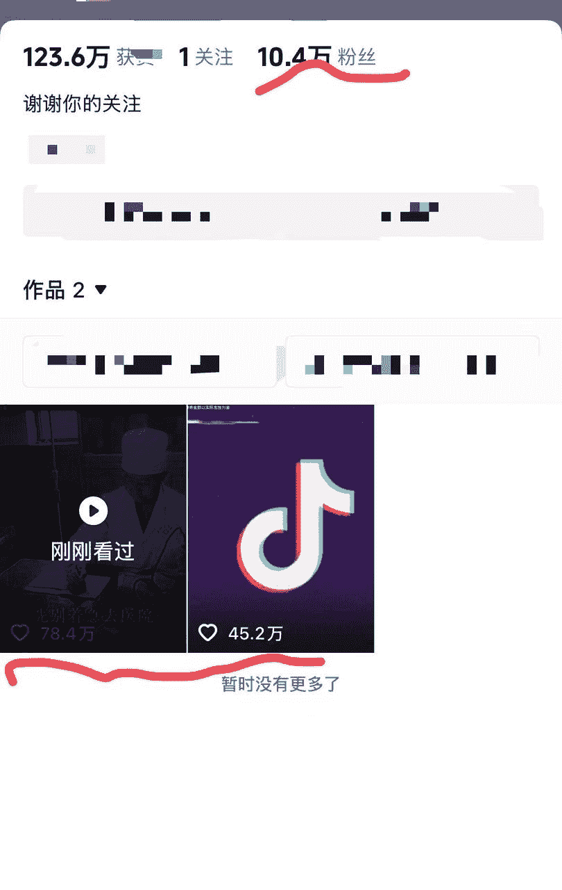

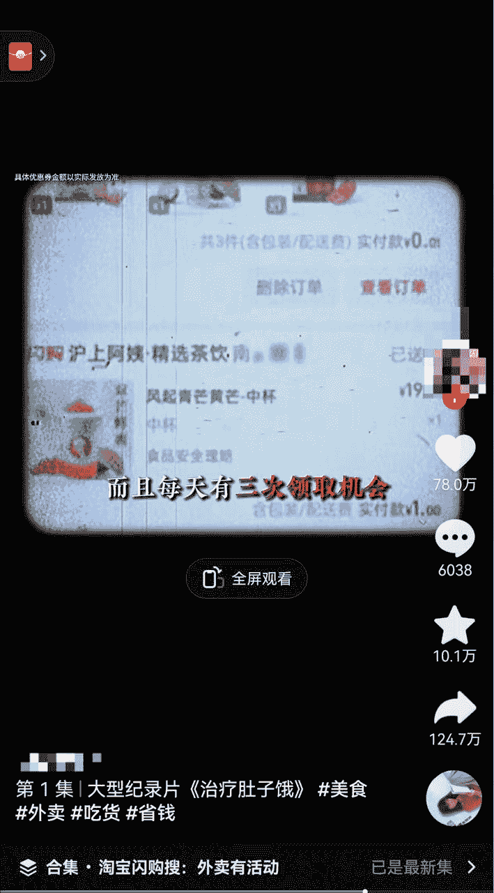

## 口播or曼波类型？

口播有真人在镜头前说话、互动，自带一种真实的温度，能让观众愿意停留，考验的是一个人的表达能力和镜头表现

优势：每天口播都是新的素材，而且比重大。同质化的可能性小。

劣势：一开始掌握不好视频节奏，没有情绪。

第一期航海我做了30多条口播，想着豁出去了，被熟人看见就看见，但是一开始效果不好，每条视频只能转化1到2单，要想真正做好口播，需要长期坚持和积累复盘，要注意以下几点：

+   需要像面对面讲述的感觉，调整眼睛的位置，不能明显在看词

+   突出重点

+   视频风格一致，封面一致，背景统一

+   信息要有及时性，不能滞后，比如在双十一期间，广东国补突然就可以用了，当时有几个伙伴及时地抓到这个信息点，然后很快 发视频收获了一波流量

+   小tips：如果做口播的话，在剪映里面有个智能剪口播的功能，可以直接一键剪出来信息突出的效果

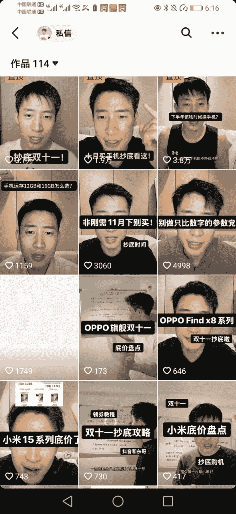

曼波配音类视频有各类素材在流转，更需要靠你的网感来抓住观众，表情包得能让大家看得进去，注意，表情包一定要有网感，比如下面的这个切片，主要是这3点做好了

+   信息紧凑

+   网感表情包，有看下去的欲望

+   可加上抖音常见bgm

两类型都能做出过大结果，可以根据自己的自行选择。不过我还是建议先用剪辑加上AI曼波配音的形式，这样门槛低，重点在于筛选网感表情包，然后搜集市面上同行的趋势和最新的信息点，口播同质化虽然低，但是不确定性高，新手上路做出口播爆款比较难

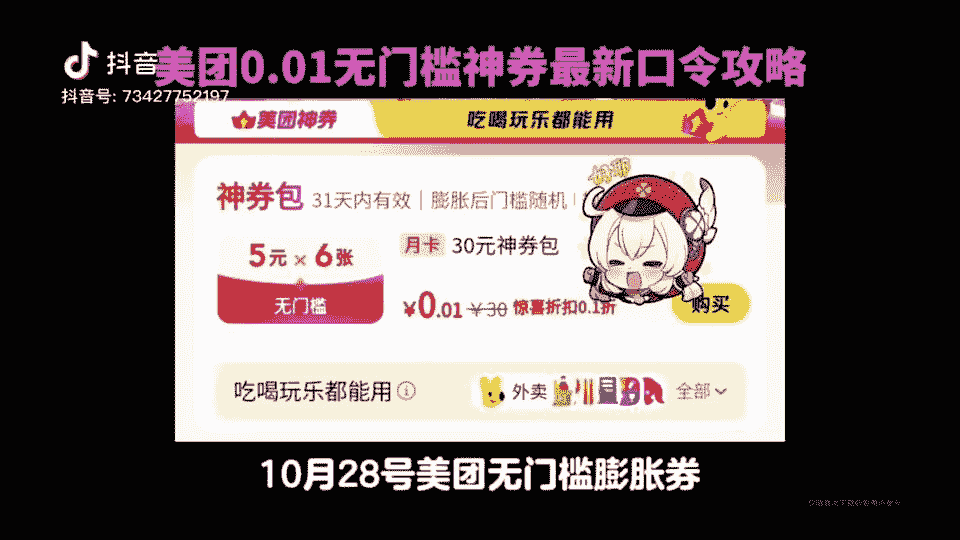

[copy_51638B89-5006-4D61-8DDE-ABD8549C163F.mov](https://internal-api-drive-stream.feishu.cn/space/api/box/stream/download/all/F5mXb2qKroiur9xJEOOcrEbdnbd)

## 做好利益点输出，建议先拆解好流量品

什么是流量品：就是近期卖的好，容易推的品。双十一期间是iPhone，这个可以看同行谁拍的同类型多

无论是什么类型，都要做好利益点的传输，用户看到我们视频就是为便宜买手机，找信息差，所以输出要紧凑，利益点一接一个。

比如下面这段口播文案，一开始先吸引注意力，然后再说一些目前主流的手机品牌，把需要购买手机的用户留下来，然后插入自己想要推广的口令，最后评论区引导。

> 很多新手机上政府补贴了！大家注意。

> 那些没国补还没买手机的朋友，恭喜你们，你们赢麻了！当前双11期间可以抄底了。你们知道当前很多新款上10个点的政府补贴吗？在东哥这边，OPPO find x9全系、一加15、iQOO 15、荣耀Magic8不用领国补券，拍就有500的政府补贴。

> 之前vivo X300系列都上了，当前红米K90也有补贴，K90 Pro Max还没来，但迟早的事情，包括小米17全系也不是没有可能的。各位这都是刚发布的新款，新款在短期双11、双12不降价格的，基本拿个补贴就能拍。

> 各位如果当前还不知道哪些机型参与补贴，去搜【xxx】这里，当前能看到东哥哪些机型参与政府补贴。不过大家要注意，这个补贴是一会有一会没有的。如果还想拿东哥的双11补贴，搜【xxx】这里，可以领三次，可以叠加使用的。虽然目前量不多，但是可以先囤着。

> 最后，你们关注的心仪机型，评论区告诉我，我帮你留意价格，降价一定发视频提醒。关注我，双11买手机，我们一起抄底价入。

曼波文案举例：逻辑都是差不多的，第一句话吸引注意力

> • 所有人准备，晚上8点

> • 4,799买512G的iPhone 17

> • 因为5号双11开始，配合第四批国补，买苹果可以叠加教育优惠，国补至高五重补贴，4,799就可以拿下512G的苹果17

> • 主播熬夜啊，给兄弟们整理好了双十一苹果攻略，大家直接跟着我做就可以了哈

> • 首先打开东哥，在首页直接去搜xxxx，先领一个双十一的专属大包，至高可以抢到5个1，不管买什么都是立减的

> • 下面呢重点来了，再返回首页，输入xxxx，进去先选好地区，绑定国补资格，在右上角放大镜搜索苹果17，进入苹果官方主会场，就可以看到苹果新的多重补贴

> • 如果你是学生党的，在东哥首页输入学生优惠月，完成学生认证，就可以享受教育补贴

> • 最后我们配合换新补贴，省下的不是一星半点，直接在我评论区留言

> • 顺便转发给你的2G网朋友

> • 一起试试哈

## 视频节奏

### 前两秒跳出率  +前五秒完播率

播放量低，先没有做好前三秒，前五秒（那就参考下对标，看看哪些细节不足，包括不限于文案跳出时间，剪辑特效），逐个对齐

一般这两个到40%是合格线

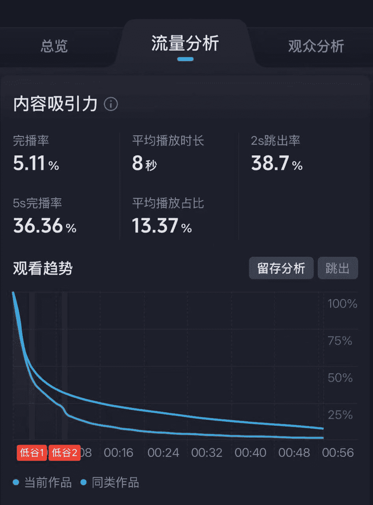

小tips：一条视频多平台发，换不同表情包，在剪映里剪好模版，批量制作。我觉得学会投机取巧不是坏事，每天的时间有限，如果做好模版，一天发三到四条没问题

模仿对标也算是测其他对标模版

## 模仿

1.  视频标题可以直接抄，因为像这种标签都是搜索流量。比如：     iPhone17promax最后一波捡漏机会#iPhone17promax #苹果 #上热门

1.  内容：曼波视频→文案+表情包+bgm 稍改动

口播视频→文案稍改动

加一些近期的利益点放文案里，比如双十一期间的iPhone17优惠券可以叠加使用到一千元（教练同步在群）

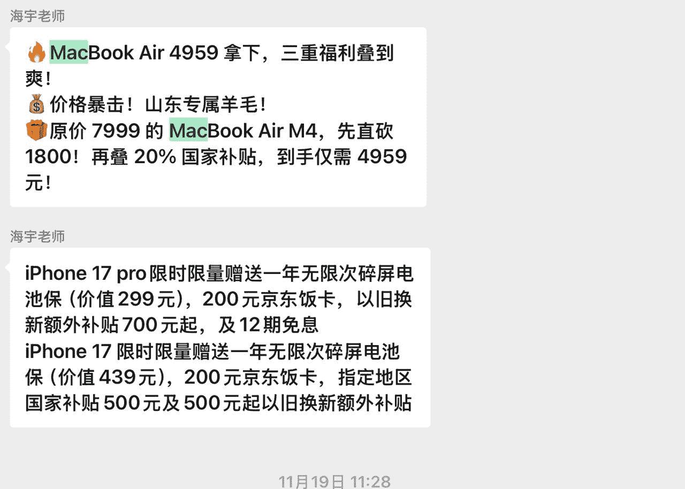

个人建议，大家可以先把对标的文案扒下来，把对应活动的词换成自己的。先发布，把手弄脏，只要密令词能跳转，就没啥问题，建议不要追求完美，先完成再优化，但是模仿不是搬运，文案改动下，表情包改动下，整体视频节奏不变。找到自己做视频的手感，做的多了再开始优化和创新

## 跳出流量瓶颈怪圈，做出差异化

其实在模仿一段时间之后，作品的流量就会下降，经历过很多次一条视频只有几十个播放的情况，这种情况其实就是视频的同质化，文案和内容实在是太相似了，平台就不给推流了。可以去用AI，豆包就行，去把原来的视频文案做一下修改，然后整体视频的节奏不变的情况下，更换其他表情包，或者说一些其他的流量品。

也有两种其他情况：

1、账号本身有问题，发什么都是几十个播放，甚至0播，这种就直接换号

2、视频内容出现了敏感词，抖音等流量平台不希望站外导流，所以在视频内容、标题、评论和个签中要注意回避敏感词。如避免直接提及京东、淘宝等平台名称，可使用谐音词代替，如“东哥”“狗东”“某宝”等。

## 维护评论区和用户引导

像这种就是高转化用户，一步步引导后来下单的，评论区有疑问的可以私信去回

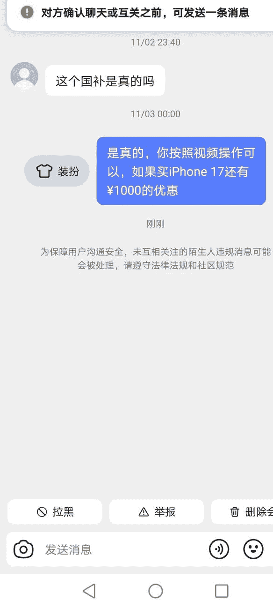

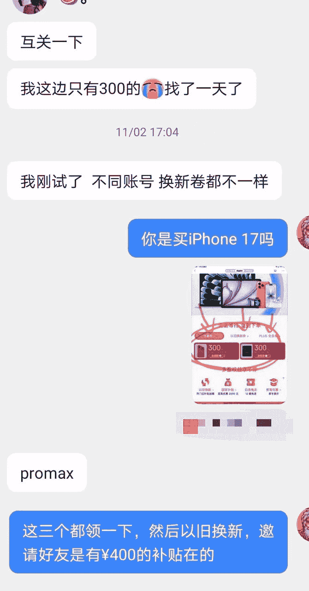

# 我们都是在不断试错，等着属于自己的爆款

想都是问题，做才是答案，干中学，无论什么时候开始都不晚，成功做出一条爆款，成效大于几十条普通的视频。

反观我第一期参加的动作，其实就是找对标拆爆款发作品，找对标拆爆款发作品，找对标拆爆款发作品，以此循环，不要太在于在意自己发过作品，然后一直去盯着数据怎么怎么样，这个时间其实可以再多做下一条视频，爆款是不断改变变量测试出来的。

感谢怡然老师和海宇老师，助教团队带我入局，也谢谢你看到这里🦷