# 一周爆卖2100单！小红书虚拟垂直小店复盘：揭秘我选品、测品及运营放大的关键动作

> 来源：[https://xuqiwei1986.feishu.cn/docx/LEXKdB43OoIY78xWlf8cwfvDnGe](https://xuqiwei1986.feishu.cn/docx/LEXKdB43OoIY78xWlf8cwfvDnGe)

# 为什么要做小红书虚拟垂直小店

大家好，我是苏晗，之前创业5年开过15家实体店，24年进入生财后，才发现互联网相比于实体，真的是天高任鸟飞，海阔任鱼跃，只要你去找总会有很多非常好的机会，先后尝试了多多淘宝虚拟，跨境电商，都拿到一些结果。

每个周期下平台都会释放红利，这对于我们普通人来说，就是一个个好机会。

我是今年3月份来到生财的联合办公，来之前是非常迷茫的，非常想要确定自己前进的方向和寻找新的增长点。

因为当时虽然可以通过看精华帖再执行赚到钱，但每次做完项目，都觉得自己没有积累，又在做短期追风口的事，就会陷入内耗，循环反复。

来到生财联合办公后，在亦仁，王燕楠，枸杞和黄亮等老师的指点下，以及和金天，虚虚的沟通后，我真正理解了笃定和耐心的重要性。

这里的创业和交流氛围真的特别好，基本上不到1年见了过去3年的人数，这几个月的时间让我的认知和思维高速成长，也让我找到了自己内心想要的答案。

之前在做项目的过程中，我总是容易浅尝辄止，是一个很没有**耐心的猎人，所以总是很快打到猎物就**走了。而现在我更想做的是，持续的在一个领域内打猎，直到成为这个领域内最厉害的专家。

我虽然知道一毫米的宽度，一万米的深度的道理，但是没有做到知行合一。

于是在9月份，决定躬身入局自己并不太熟悉的内容电商平台，小红书。因为我之前拿到结果的项目都是虚拟产品相关的，并且选品和跑MVP是我比较擅长的事情，小红书也在红利期。

**虚**拟产品对于我们普通人来说，0库存，0成本，没有售后，纯利润，自动化发货，稳定后可以做到睡后收入，是值的深入研究的一个好赛道。

还有一个原因就是我亲眼看着两个朋友从6月份和8月份开始做小红书虚拟，都拿到了很不错的结果。

我采用的打法是单品打爆和垂直小店的运营思路，做细分人群的生意，就是用1个主店铺+3个关联账号的方式，4个账号只发1个产品的笔记，一天发布笔记30-50篇，从而迅速占据产品在平台的生态位。

交付的产品是安装包，交付形式用的网盘链接，客单经过设计在8.8-29.8之间。

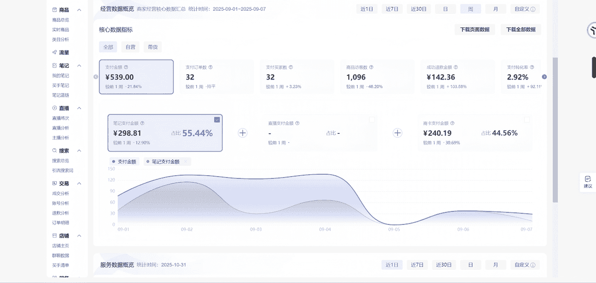

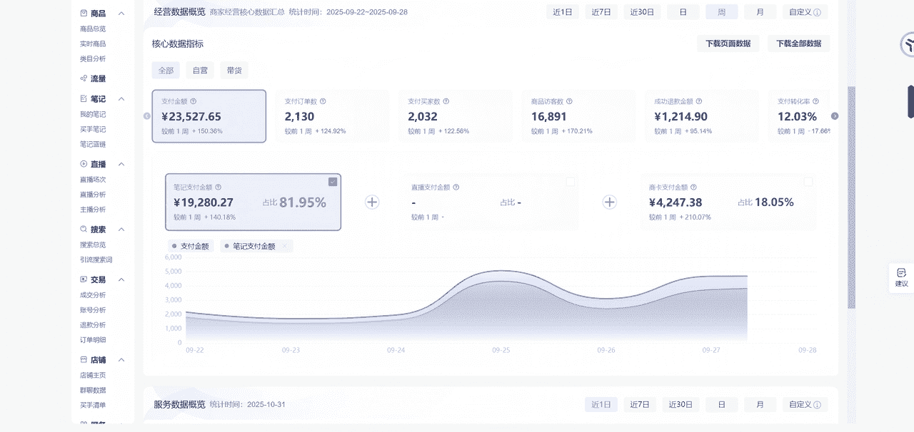

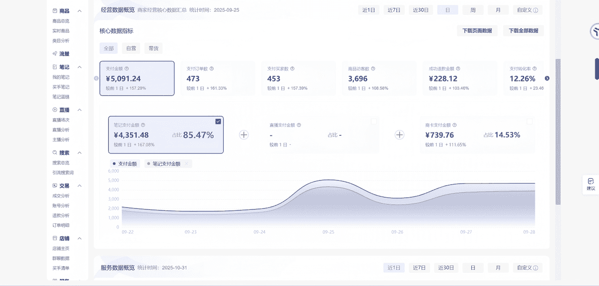

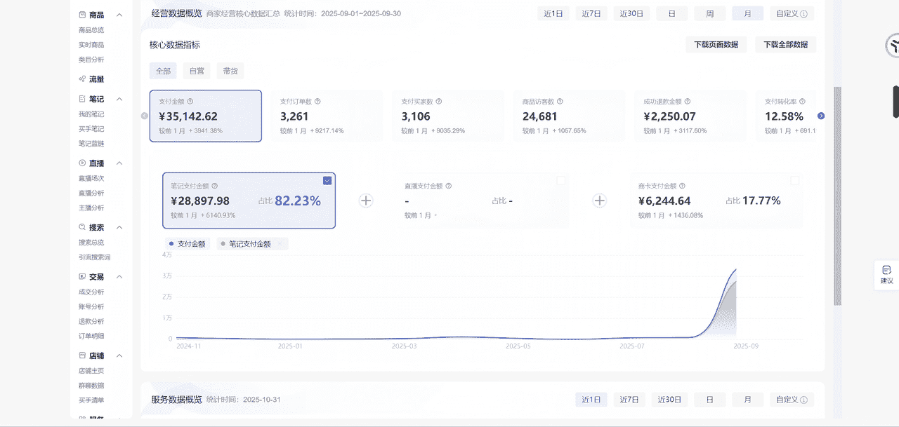

**单**人单店第1周539，第2周514，第3周9300，第4周23000，销量3200，单日最高5K，月销售额3W+

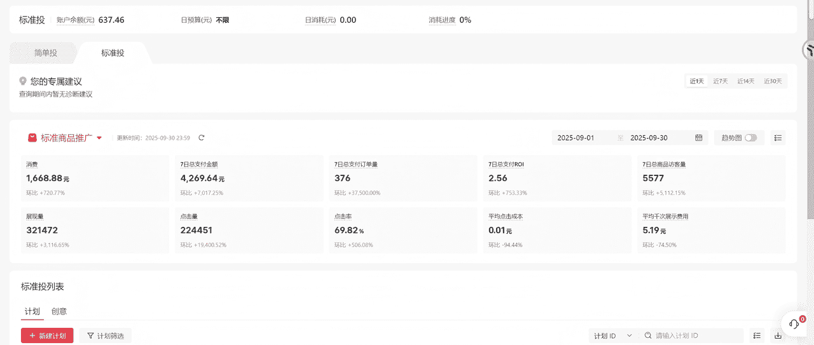

**经**过1周测试20个不同的投放计划，我用1600块跑出2.56的roi也就是4200元，千次展现控制在5元左右。

为了打好这一仗，我暂时离开氛围很好的联合办公空间，在家里进行了为期一个月的闭关。

这也是我第一次尝试用内容电商的模式去卖非服务类的虚拟产品，所以我也是抱着边做边学的心态开始的。

小红书平台对于虚拟产品的扶持力度还是很大的，很多政策都是利好于虚拟产品。

**在写这篇复盘的时候，无意中发现踩中了亦**仁老大11号发的超级标，小红书垂直小店。

那刚好借着这个机会，**和大家分享一下我是如何做好小红书垂直小店的4个关键动作:选品、测品以及**运营放大，我会用最简单和最详细的方式分享给大家，让大家看了之后就能直接上手实操。

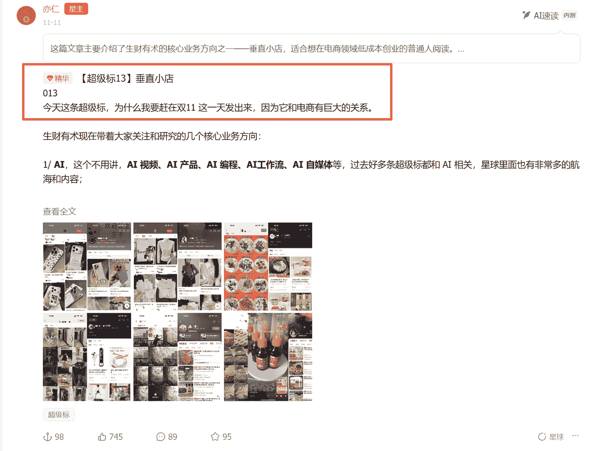

# 一、怎么选品

选品是一个老生常谈的问题，但是在任何平台，底层逻辑都是一样的，选品就是找用户需求，再用最低的成本去验证用户需求，跑通MVP。

我们选品的最终目标，**就**是用一个自己熟悉的品来触达和验证一部分人群，然后围绕着这个人群不断的做衍生品，从而做成小红书垂直小店。

## 选品原则1：

### 找到已经被验证过的用户需求的产品

**选品包括：调研数据+验证假设**

首先我们要有一个共识，就是别人在爆的品，我们发不一定能爆，所以我要先假设爆品

那么只需要通过数据反馈来得知，

我的做法会测试1周，但是我的笔记强度高，每天会发30-40篇笔记，

如果一周后并没有好的数据反馈，就说明可以放弃这个品，当然前提是我们已经测试过了所有的爆款模板了

**其实选品的本质，就是找到已经被验证过的用户需求点，并且用户**愿意为之付费的，我们才可以叫做有效选品。

对于跟品，我们要看4个数据，

1.是对标账号的粉丝量

2.是这个品做的时间

3.是竞争对手的数量

4.是对手发布笔记的频率

这里为了方便大家理解，以 星露谷 来举例，其他产品的底层逻辑都是一样的。

怎么判断一个品能不能跟，首先要看这个品在当下是不是爆款，可以通过产品页的24小时加购来判断，比如这个星露谷的24小时加购是800，

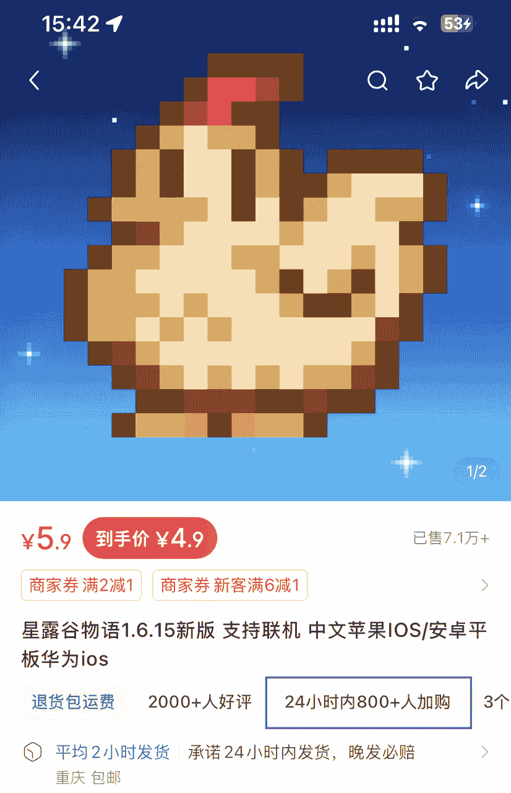

那么我们可以知道，这个就是一个爆品，那么下一步，我们看下同行有没有在爆，通过搜索可以看到，这个同行的24小时加购是100，

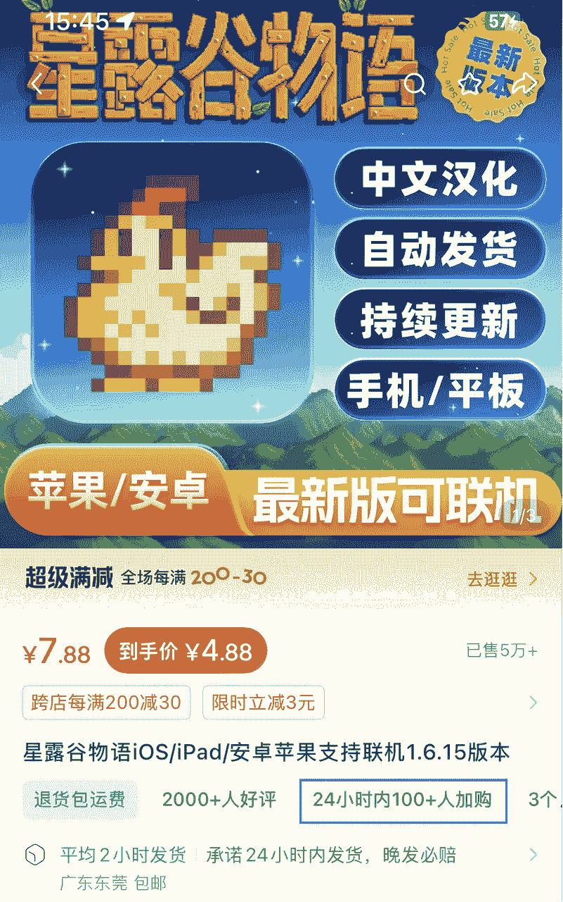

到这里，我们就可以判断这个品是当下爆款，下一步我们就要验证这个产品的话题热度，

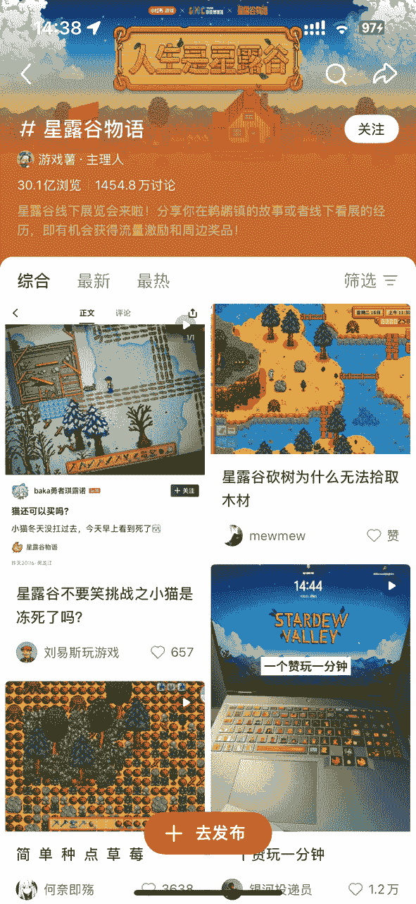

首先，我们需要先看这个品的话题热度，以星露谷举例，我们通过搜索关键词，点击话题，可以看到浏览数量为30亿，这种热度就是现象级的品，是可以长期售卖的，因为除了品存在的时间久之外，更多的是发烧友玩家会自发的发贴，带动这个游戏的宣传，这样就会吸引源源不断的新人进场。

然后我们需要看这个关键词的在平台的搜索量，这个方法很关键，可以进一步的确认这个品是否有市场需求，

我们来到千帆推广的后台，新建一个计划，再点击搜索推广，然后添加关键词，在关键词内输入星露谷，就可以看到用户最常搜索的关键词是什么

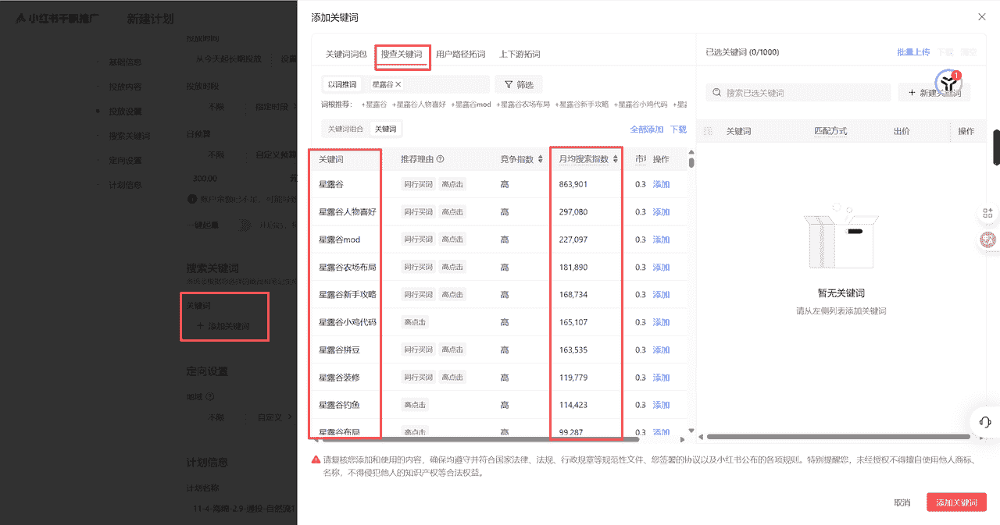

通过月搜索量，我们可以看出，这个产品的热度非常高，并且需求也一直很强烈，

好，到这里，我们确定了产品侧是没有问题的，

那么下一步，我们要看4个指标了来判断能不能打得过了

| **1.是对标账号的粉丝量** | **2.是这个品做的时间** | **3.是竞争对手的数量** | **4.每天发布数量** |
| --- | --- | --- | --- |
| **对标1: 1.7W粉丝** | **对标1： 1年前** | **对手超过20个** | **一天6-13条** |
| **对标2: 2700粉丝** | **对标2： 1年前** |  |  |

这么分析下来，这个品是非常红海的，但是需求是非常明确的，所以进场可能可以喝汤，但是想要分到蛋糕，就要有新的爆款内容，但这对于我们前期做来说，是不现实的，所以直接放弃。

#### 判断是否打得过的4个标准

我就是用这4点找到了自己的第一个爆品并判断打得过

> 1、对标粉丝量越低越好，说明是低粉爆款，可能最大排除粉丝基数带来的销量

>

> 2、品是在1个月内起销量的，是比较好的入场时机

>

> 3、竞争对手小于5个最好，并且要看到第1第2在笔记水平相当的情况下销量差距不大，则说明这个品为爆品，你上你也行

>

> 4、对手每天的笔记发布数量少，这个时候就是很好的机会，他发10条，我们发40条，用量变引起质变，大力出奇迹

## 选品原则2：

### 选的品是自己有感觉/感兴趣/受众

这个地方我是踩着坑过来的，第一个选的品，是雅思作文资料，但是因为我没有考过，对英语也不感兴趣，所以我在做笔记的时候，就只是单纯的模仿，能出一些小单，但是做起来很痛苦，也没有持续发笔记的动力。

这个就是错误的选品，**虽然产品是被市场强烈需要的，但是你自己不懂也不感兴趣，更不是用户群体，这**样一来，我们在制作笔记的时候，其实根本不了解用户的下单心理，也就是爆款点（痛点）。

换个角度思考，**我**们愿意下单买某一个产品的时候，一定是因为这个产品的内容里有某一个点打动了我们，要么通过种草刺激了我们冲动消费，要么就是我们本身就需要。

所以最好的选品方式是我们本身就是这个产品的消费者。

我在按照上方的流程选到这个爆品后，就是没有着急的去上架，发笔记，而是先购买过来，自己安装体验过后，去了解这个游戏产品好玩的点在哪里，为什么能吸引用户下单购买，为什么要在我这里购买。

玩了2个小时游戏后，这些问题就都有了答案，我才开始制作产品主图，详情图，以及设计规格，这个地方的设计，一定要参考对标同行，并且加上自己的思考，如果前期没有经验话，就直接模仿对标就可以。

## 选品方法分享：

再明确好我们的选品原则后，我会从以下4个方法来辅助选品

### 1、关键词搜索，

关键词搜索出来的时效性是最好的，因为是即时的，我们可以直观的看到真实的销量，评论，好评以及24小时加购

**而**关键词可以从我们的兴趣爱好，消费习惯或者自身专业出发，这样我们做起来会更加懂产品的卖点是什么，就能更好的做出优质的笔记

比如我喜欢心理学，那么我们就搜索心理测试，比如我经常购买小学资料，那么我们搜索小学资料，再比如我擅长面试，那么我们搜索面试题

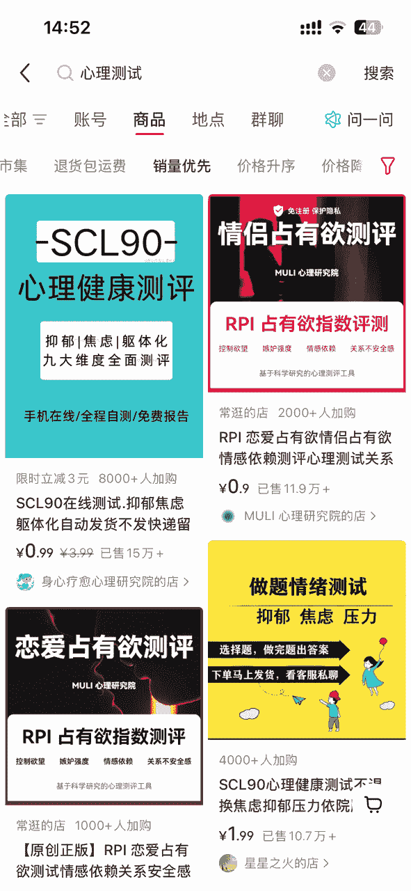

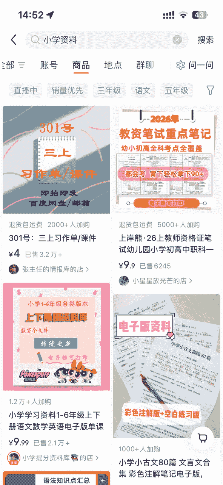

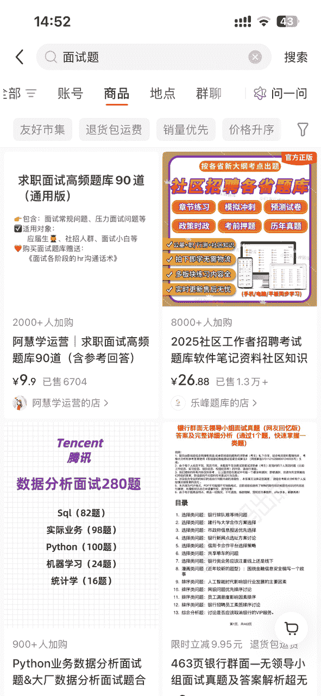

可以看到，基本每个关键词下都有对应的产品来满足用户的需求，而我们要做的，就是从大的关键词逐步探索到更细分的关键词，

**那我们喜欢什么，经常购买什**么都比较容易知道，那怎么找到自己的擅长点呢？

**我们可以平静的坐下来，认真仔细的想一想，我们在过往的经历中，通**过哪些能力拿到了结果，有哪些事情是别人做起来非常费力的，但是自己做起来很轻松的，这就是我们的擅长点。

我们很容易忽略自己的长板，而过于想要去补齐自己的短板，但是这样其实是适得其反，只需要把长板发挥到极致，这个在做虚拟品的时候可以很好的发挥出来。

### 2、千帆后台官方榜单

打开千帆APP-数据-市场-笔记排行-优秀账号，每天有200个优质店铺可以探索

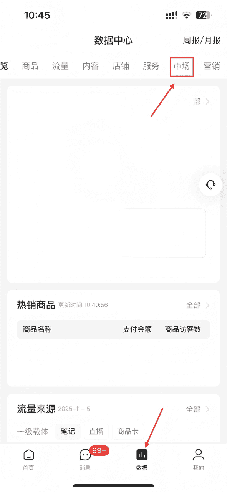

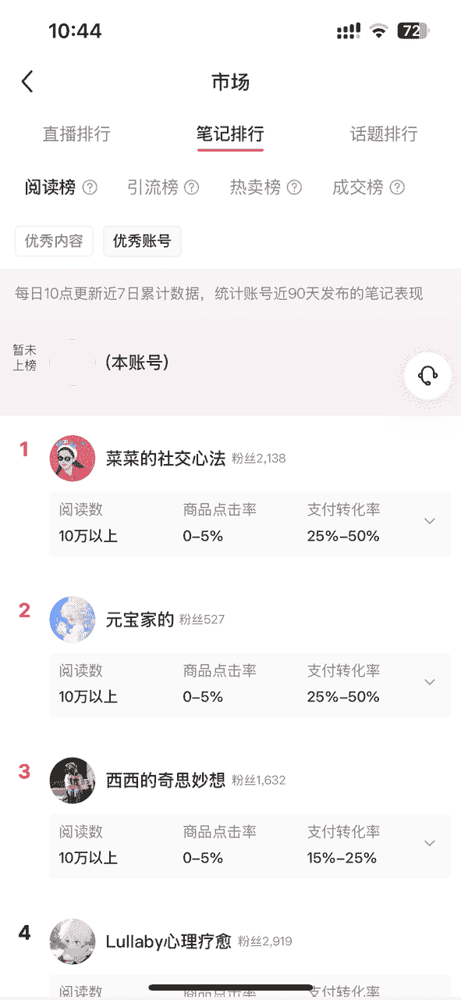

### 3、官方生活号开卷考试

每个月官方都会发布上一个月的优秀店铺和类目，我们就可以直接知道哪些账号是对应类目里做的最好的，再根据第一点，结合自身去选品。

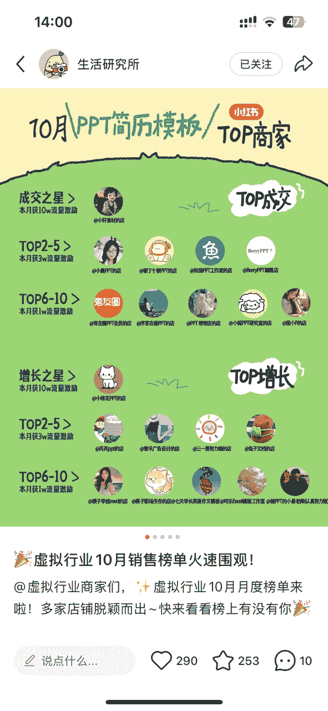

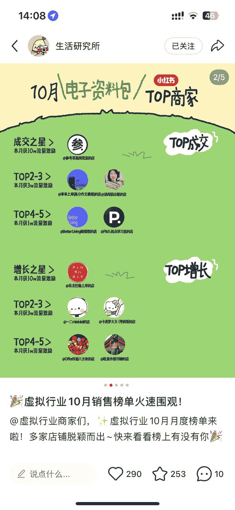

### 4、灰豚数据

数据平台会有一些滞后性，但是我们也可以从里面去发现一些不错的店铺和销量优秀的产品

灰豚是需要去某鱼买卡，如果需要免费的可以用圈友做的野马数据，也不错

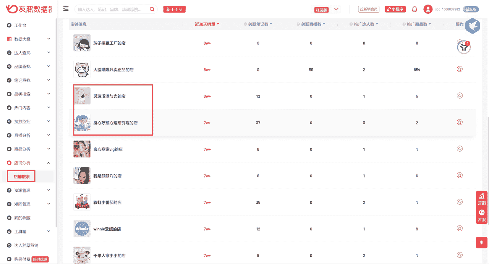

# 二、怎么制作视频笔记，测品

这里的笔记制作部分会主要以视频笔记来讲，因为我找的对标是用视频笔记起量的

其实我们发笔记，除了获得平台给的固定曝光外，更重要的是为了测出爆款模板

在9月12日以前，我发笔记的数量也是非常少的，每天大概就1-4篇，就是测试产品和流量

而且一开始我并没有直接上3个关联号，而是根据数据的回馈逐步增加账号的

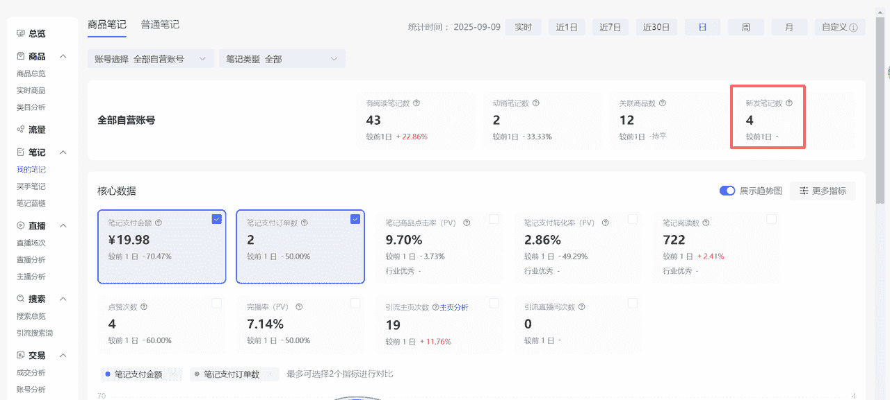

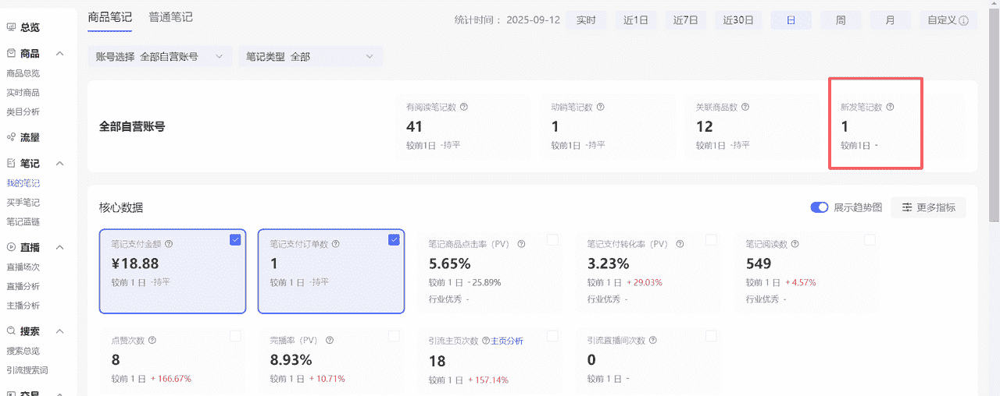

**直到9月12日，我测试了一个视频脚本，**发现流量远远超出其他的笔记，并且也能出单

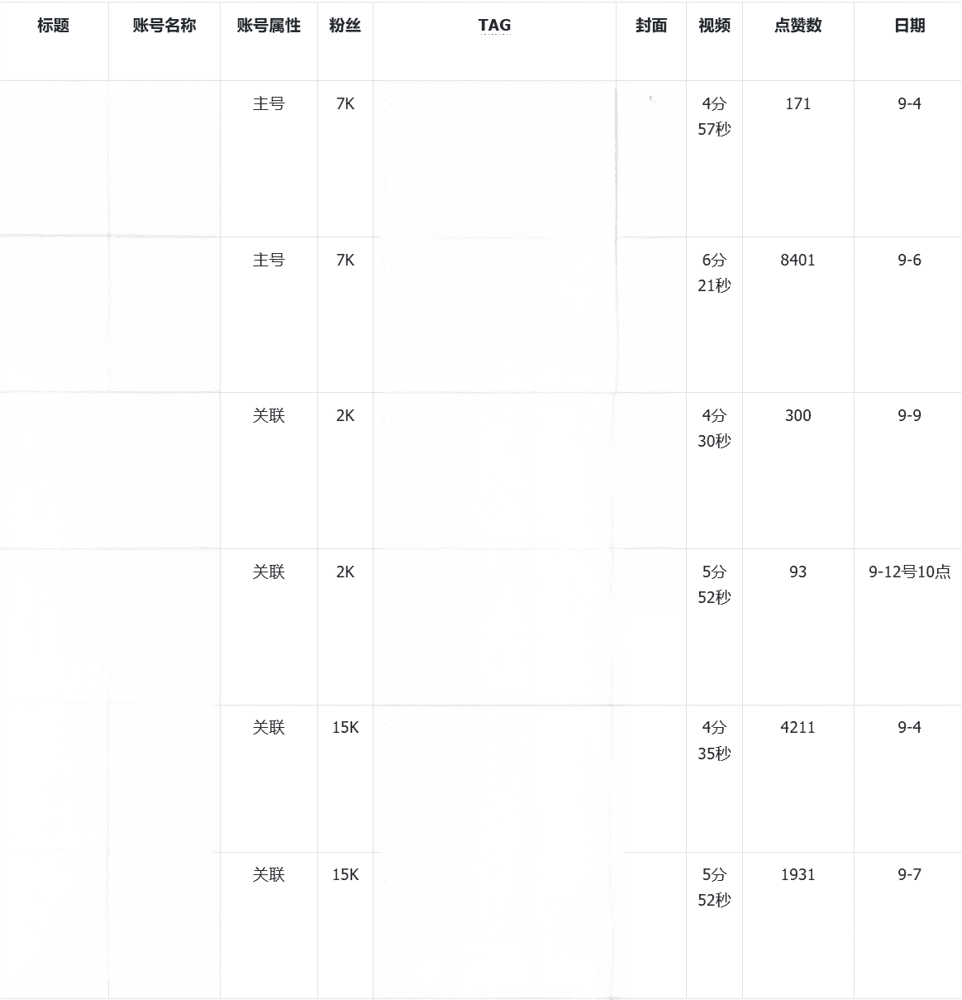

于是便在当天开始建立了对标的爆款分析表，并搜集素材，剪视频，那天剪到凌晨，剪出来了32个视频

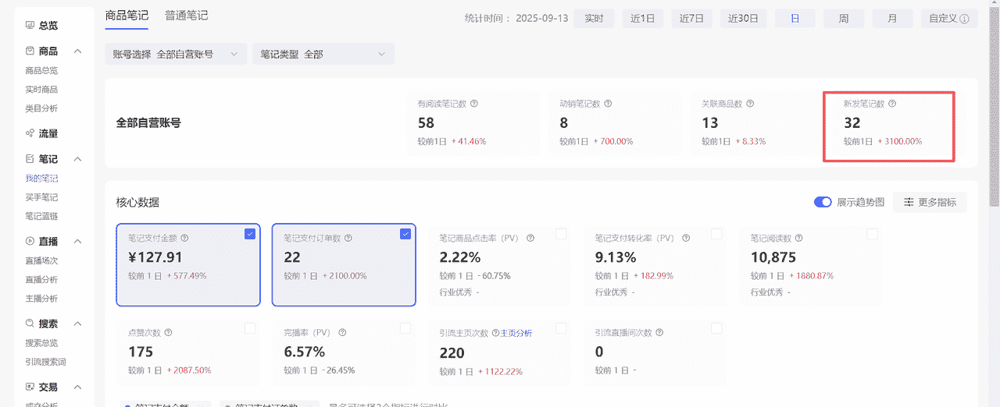

后面的剪辑思路我就围绕着这个爆款脚本，不断的延伸

**提取爆款元素，不断的重组视频，最高**的一天是9月19日，发布了50条视频笔记

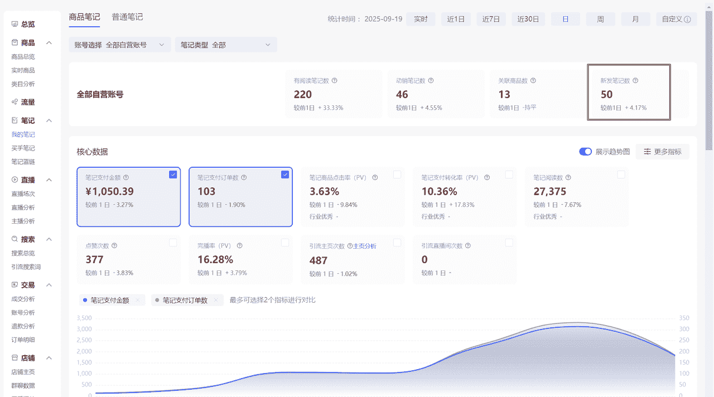

在我发到第5天和第6天的时候，单天的营业额就都分别超过1000元了。

小红书平台的一个特性，就是会延迟爆款

在我看自己的爆款模板的时候，往往发现是7天前，或者10天前的，

所以我们在发笔记的时候，只需要观察，这条笔记的数据是否比别的笔记要好，

这条笔记爆款后，

我后续又爆了几条模板类似的笔记，逻辑就是我上方提到的，爆款元素重组

## 付出不亚于任何人的努力，量变产生质变

爆款是重复的，爆过的内容是会再爆的

当时选到这个品，**我**判断能打的过，就是因为符合打的过的标准，对手只有2个店铺在做，一个月内起的量，更新频率很低，所以我的打法就是，矩阵+铺量

**由**于对标的素材太少了，一周总共发了15条，但是我一天需要30条以上的素材，所以只能边学习对标，边测试新的爆款元素。

素材的获取，我会从去抖音，快手找到相关的视频素材，优先选择被验证过的已经是爆款的素材

然后通过剪辑，再发布测试，

因为平台的差异性，在别的平台的爆款并不能复用到小红书

所以需要大量的测试出爆款元素，后续剪辑就围绕着爆款元素进行创作

**前期快速模仿对标，验证假设**

后期，拆解出爆款元素后，再伪原创

我记得很清楚，在发笔记的前1周，我基本都是学习对标同行的内容和封面，后面1周，同行就都来模仿我的了。

### 爆款封面（重要）

### 封面点击率是慢慢提升的

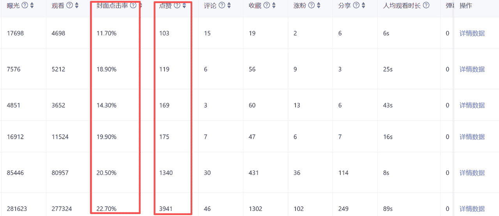

点击率从11%-22%都是一次次优化迭代测试出来的

大家可以看到随着封面和内容的优化，曝光量也从4000-20W不断上升

### 测品的试错周期

视频的制作会比图文要难一些，需要花时间剪辑，

但是要产出图文和视频的爆款素材，核心都是，大量的测试爆款模板，直到找到属于自己账号的爆款模板，

当然，**我的试错周期一般是7天一轮，这7天，每天会更新**30-40篇左右的笔记，来测试产品和素材

让用户有点击的欲望，是成交的第一步

只有用户点击进来了，我们才能做下面的运营动作，所以在小红书，封面的重要程度是非常高的

底层逻辑就是多发多测，

**每个账号都有属于自己的爆款模板**

举个例子，

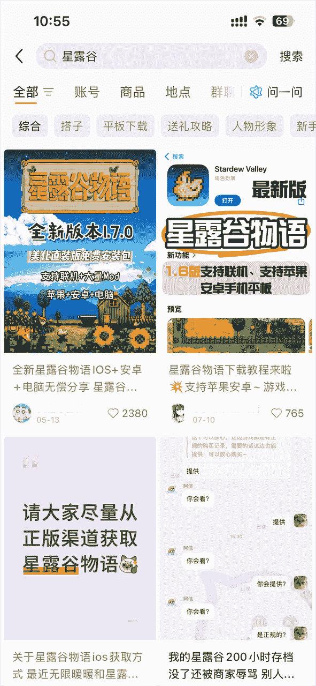

这两个封面的日期一个是7月份，一个是5月份

他们的封面想要表达的东西是一样的，但是展示的形态不同

5月份是用游戏背景+文字，7月份是用商店背景图+文字

从美观度上来说，左边是比右边好看很多的

而在小红书，好看的封面会更加受欢迎

我们模仿封面的原则就是

**越近期的爆款封面越要去测试**

爆款都是重复的

还有一点就是平时多刷一些爆款封面，就会对好的封面有一定的体感

先抄再超，也是一个非常好用的可以培养网感的方法

### 标题和正文

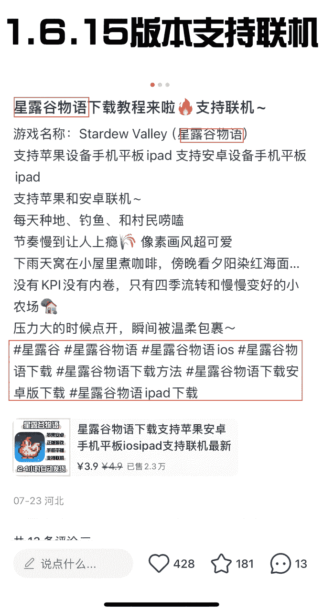

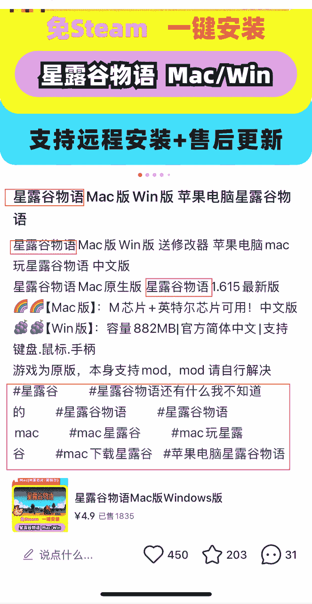

我的标题和正文，会以做SEO的逻辑为主，以星露谷这个产品举例，需要在每篇笔记里面埋入星露谷的主关键词，

这样的好处是，后续会有很多长尾流量通过搜索成交。

并且后续发笔记的时候，会不写正文，以标题和tag为主，但这个时候是建立在推送人群很精准的情况下了。

可以借助ai辅助生成

**但是前期我为了刻意练习网感，我的千赞笔记都是从以往**自己的爆款笔记里，拆出核心词再手搓重组的

我认为一定要有了自己的判断能力后，再借助ai提效是比较好的

### 发布笔记（电脑-群聊-手机分发）

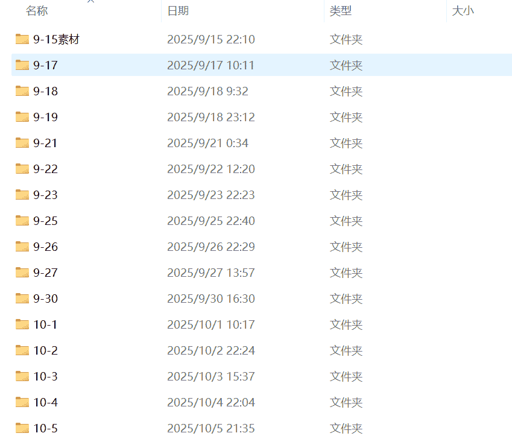

首先我会将视频素材按照日期导出在电脑文件夹里，

然后再发送到对应产品的微信群聊里，

最后各个手机下载视频后进行分发

## 视频素材剪辑的3大要素

### 1.视频节奏

2秒跳出

完播率

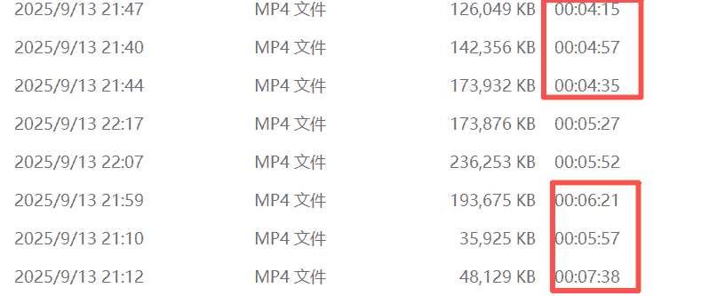

对于视频笔记的节奏，和我们平时刷短视频是一样的，需要控制2秒退出率，完播率，那么这就和视频的节奏息息相关了，

如图所示，我一般会将5-7分钟视频，剪辑到4分钟左右，我所删除的片段，就是一些无关紧要的，看起来容易让用户跳出的画面。

### 2.视频爆款元素（二创视频）

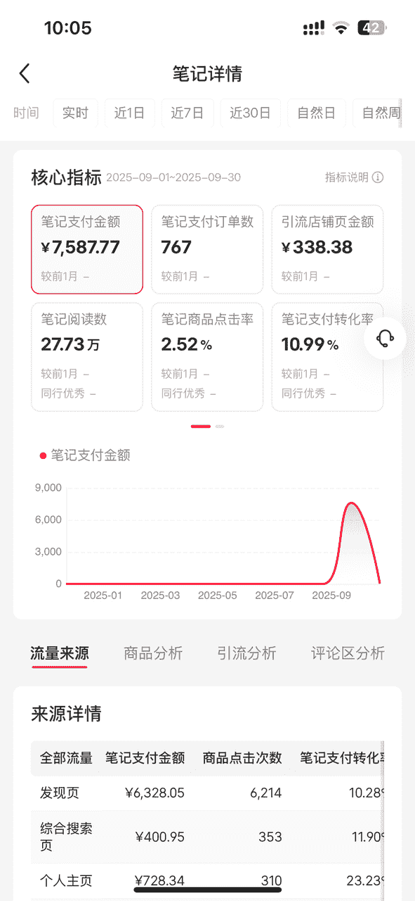

一条优秀的视频素材，可以带来很高的营业额，但是视频的爆款元素，只能通过测试，或者找到对标账号的素材作为参考，所以我们每天更新30篇左右的笔记，可以大大的减少测试时间周期，好的素材的数据会很直观的体现在曝光率，互动数据上，以及销售数据。

通过测试出的爆款元素，我们可以用不同的剪辑手法来产出新的视频。

我一般会用到，添加解说词，混剪画面，爆款元素重组

核心就是，尽量让一个视频里有更多的爆款元素，可以大大提升视频的平均观看时长，从而让曝光量更好。

### 3.视频去重

我一般会用，贴纸、文本、滤镜以及画中画来进行去重。

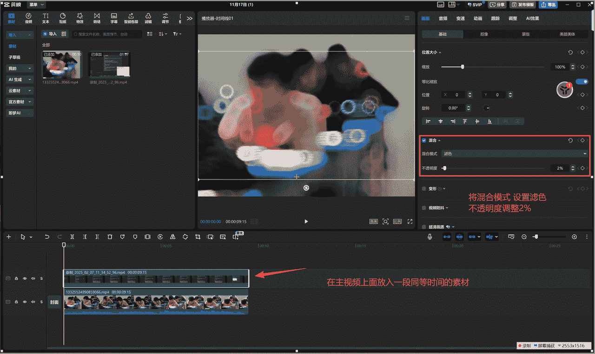

画中画的操作就是添加一段任意的视频素材，然后将混合模式调整滤色，并将不透明度调整2%

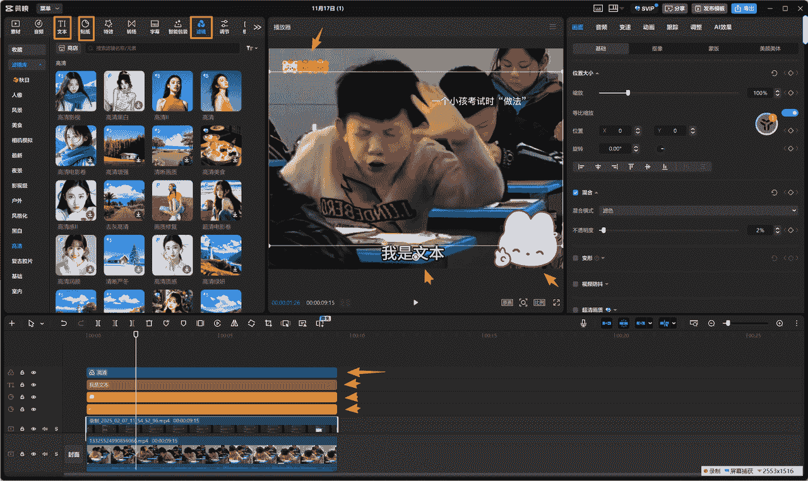

贴纸、文本、滤镜的添加效果

文本内容，以及贴纸和滤镜的风格，大家可以根据具体的视频素材内容进行变换即可。

## 视频素材笔记容易踩的3个坑

这里要注意的是，违规不是发完笔记马上就判定的，小红书会秋后算账，一般过了1周-2周再判定都是比较正常的

### 1.重复素材

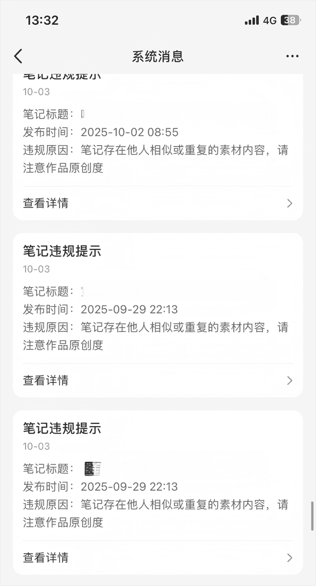

收到这种系统提示，就是2种情况

1是平台识别到你的素材高度重复，90%相似

2是被同行举报了

### 2.画面不佳

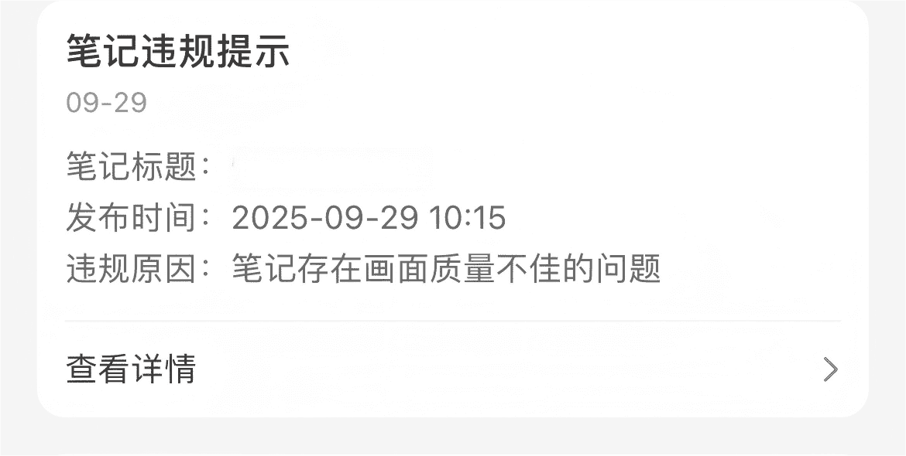

这个提示是因为，贴纸过大，或者遮挡物过多，影响画面美观度

可以重新修改下视频，或者直接隐藏笔记

### 3.违反平台规则

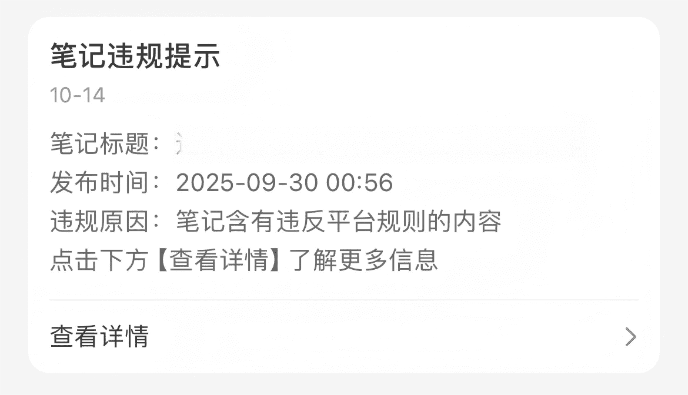

这个一般是视频语音或者画面里含有敏感词或者违禁词，

可以通过查词网站，进行文案前置自查

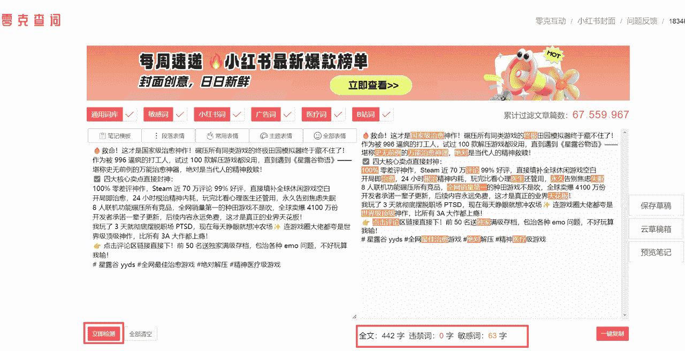

# 三、怎么运营

## 运营动作的核心，是提高下单转化率

我一共运营4个账号，1个主店铺号+3个关联账号，一机一卡一号。

其实运营的差距，就是颗粒度能够做到多细节，当然，内容是最大的因素，而我们运营动作的核心，就是提高下单的转化率。

## 优惠券

优惠券最常用的就是单品特价和新客券，主要作用就是让客户有觉得占了便宜的心理。

购物车券和复购，都算是二次触达了这个不可控，所以在第一次触达就要让用户下单。

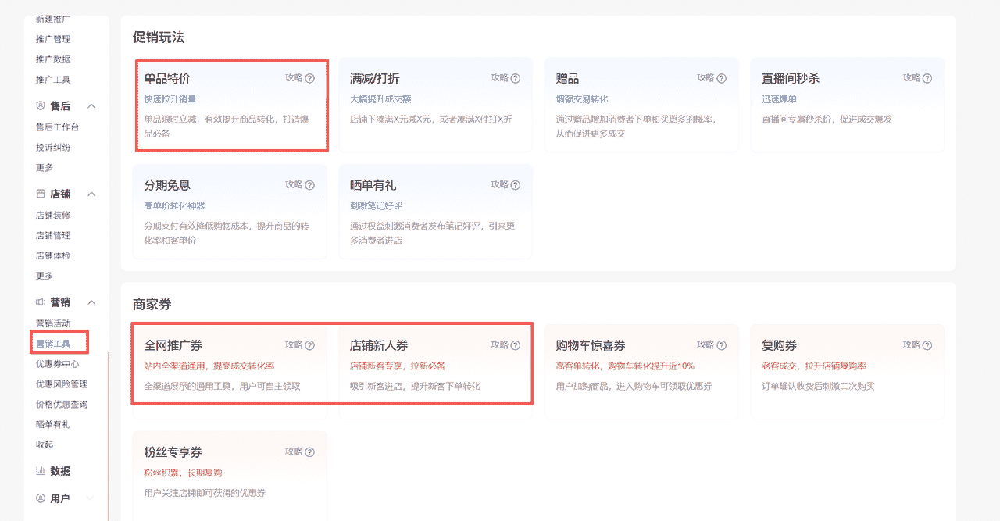

## 平台活动

而平台活动，官方都会有扶持的流量倾斜，所以如果产品符合报名条件，建议都报名上。

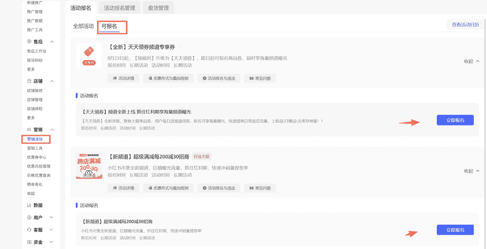

## 购买同款+置顶评论

这个位置，其实也算一个广告位，可以用简单的语句介绍一下产品的版本，功能性价值，使用情况等，会解决对这些问题有疑问的用户的下单顾虑。

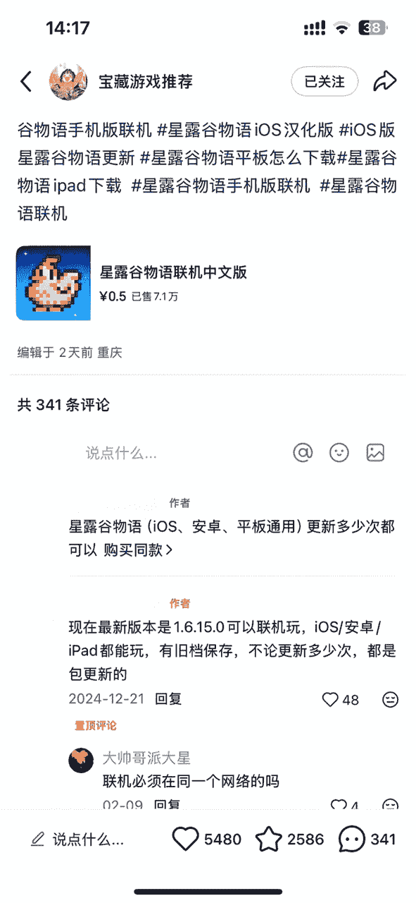

## 评论区互动：

部分小红书的用户的消费习惯会在评论区先问，这个要记得互动，不仅可以提高转化率，还可以让后面的用户更容易下单。

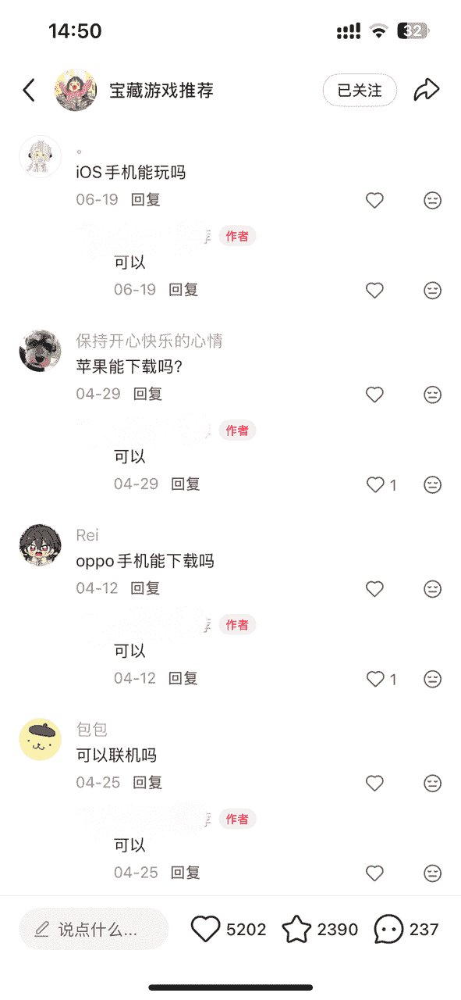

## 好评

在一开始产品刚上架的时候，如果没信心，可以用小号或者让朋友购买，再匿名评价，有1-2个的基础评价。

我做虚拟品不怎么刷单，因为在选品时候就已经验证过产品是被市场需要的，所以用户大概率刷到后就会直接下单，小红书的转化路径会比货架电商要短。

而好评的获取可以通过赠品来引导，这边举个例子，具体根据自己的产品设计就可以。

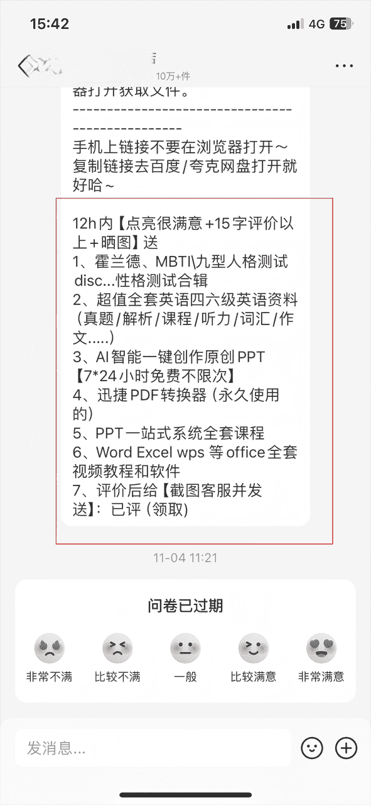

## 购后评价

购后评价是平台会从好评里挑选出合规的好评或者差评，展示在评论区，这个对于转化的帮助也是特别大的

这边有个细节值得注意，就是差评也会展示，所以再和用户沟通的过程中，要尽量避免差评的情况。

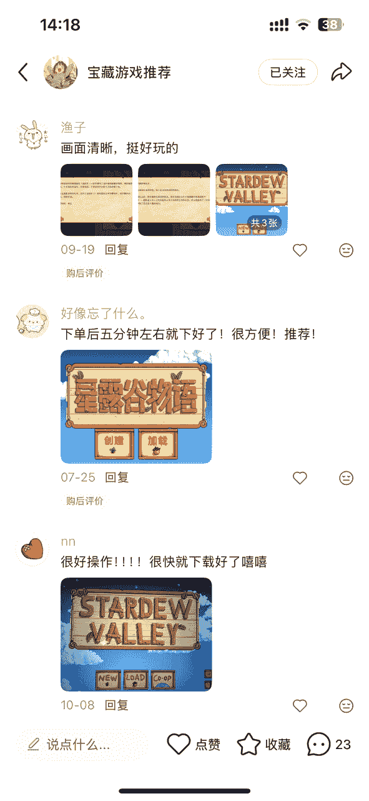

## 自动化回复（解决95%重复问题咨询）

小红书对于客服的考核是根据营业额来的

上个月>10万，考核3分钟回复率

上个月<10万，考核24小时回复率

自动化回复：我会搜集用户提问的问题，然后通过后台呢自定义自动回复，形成自动化回复。

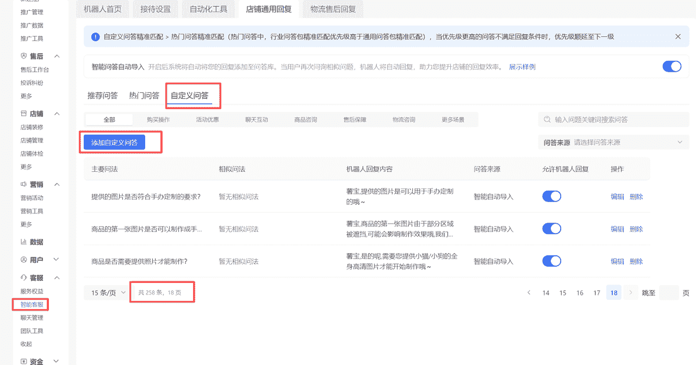

这个店铺添加了200多条的自动回复，基本可以自动回答98%的问题。

因为你当上一周客服，就会发现客户的问题，99%都是一样的。

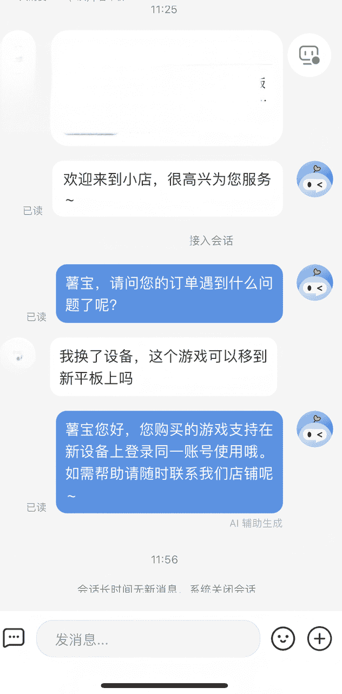

# 四、怎么放大

## 付费投流和增加店铺数量

这次付费投流相较于之前做货架电商平台，我并没有一开始就介入。

而是等待自然流跑的足够稳定，每天稳定100单的时候，再进行付费投流。

经过20个计划的1周测试，我用1600块跑出2.56的roi，也就是4200元，千次展现控制在5元左右。

对于付费投流，我们要达成的共识就是，投流只能锦上添花，而不能雪中送炭。

所以我们要保证素材的内容足够优质，有抓用户的痛点，这样再去投流，效果才是最好的。

我常用2种投放方法是通投和关键词投放

## 1.通投（展示笔记在发现页）

### 广告类型

通投经过我的测试，低客单的产品目前用托管的方式，投放效果是最好的。

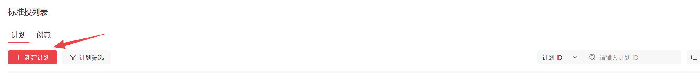

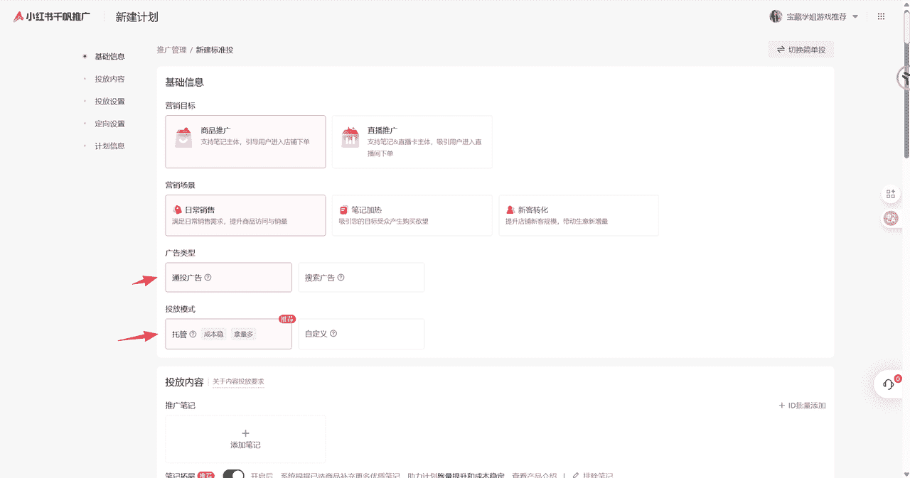

投放笔记的数量，我测试过一次100篇，但是整理数据下来，不如单次5-20篇

所以初期建议，少量多测

可以把不同的爆款脚本，分开测试，这样可以更加清晰的看出来投放的效果

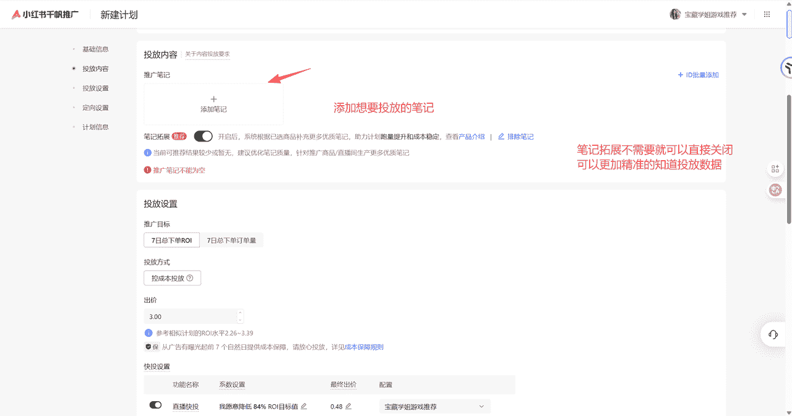

### 投放设置

ROI设定后，后面是可以调整的，一开始可以按照系统推荐的取一个中间值，然后根据投放的流速

来决定是否提高还是降低，我一般从ROI从2.9开始，建议新手，一开始从2开始投放，先能消耗出去金额，有体感之后，可以再追求更高的ROI

但对于虚拟品而言，ROI 1.2以上，就可以算盈利了

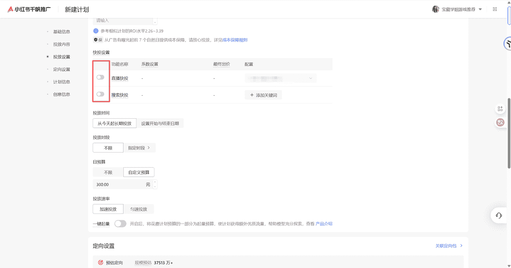

直播快投和搜索快投直接关闭就可以

投放时段，如果产品不是节假日属性特别强的，就不进行设置，反之，可以控制某一天不投放，或特定时间段投放

投放速率，就是花一定的钱，给你测一波泛流量，不建议开

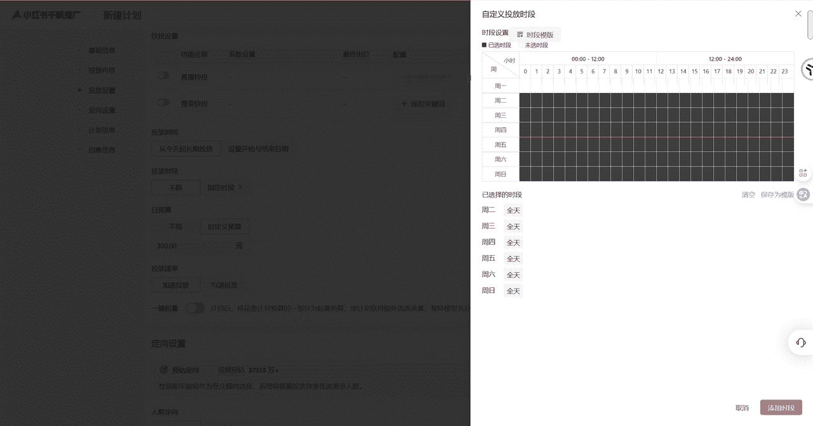

### 定向设置

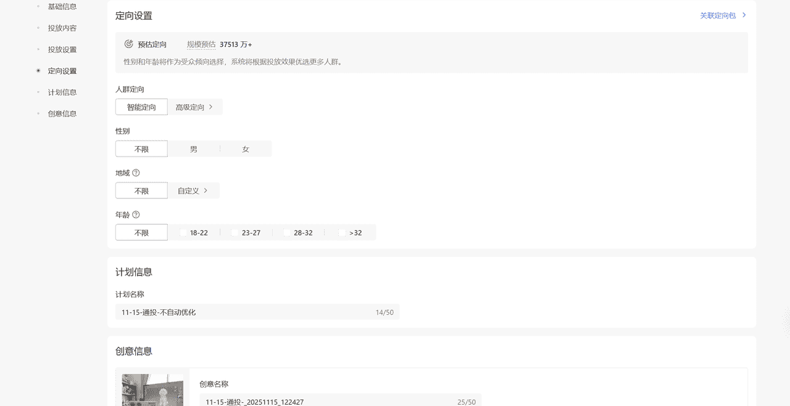

这里分2个情况，

第一种，

**如果你的产品受众比较广，并且你不清楚，具体的用**户画像，那么就用智能定向，让系统帮你探索

第二种，你的产品很小众（已经确定人群画像了）

**那么你要去选定性别或者年龄段**

这个也是需要建立不同的计划进行测试

### 计划信息

计划名称的命名规格，一定是自己能一下子看懂的，后面计划多了，就方便区分和进行复盘

我是以 时间+产品名+投放类型+roi+是否自动优化 来命名的，如果有设定人群

就是 时间+产品名+投放类型+roi+人群+是否自动优化

商品组件点开后，可以设置评论文案，这里默认的一般都是不太合适的，如果发笔记的时候没有提前设置，这边就要手动更改一下文案

自动优化，我的设置都是不启用的，因为我测试过，目前的自动优化还不是那么智能，会生成一些奇怪的标题，

这个转化率肯定是不如我们自己二创的爆款标题的

## 2.关键词投放（展示笔记在搜索页）

### 广告类型

关键词投放就是搜索广告投放，

这个会比通投的设置更少，也更加简单一些

### 投放设置

搜索广告的ROI，建议可以从2开始，因为它的展现数量是没有通投高的，因为只有用户主动搜索了，才能有机会看到我们投放的搜索笔记

其他的设置保持默认即可

### 搜索关键词

这里还是以 星露谷来举例，其他的产品逻辑是一样的

首先我们输入关键词搜索后，会按搜索热度排序所有的关键词相关的搜索词

这里需要手动的筛选符合我们产品的搜索词，然后逐一添加，这里不建议点全部添加，因为会有很多不相关的词但是包含星露谷的会进行投放，不能产生转化还会拉低roi

再选择好关键词后，按照默认的短语匹配就可以，因为用户有时候会在前后加一些词

这里的自动优化还是关闭，其他设置保持默认

> 付费投流可以简单的分为：通投和关键词投放

> 通投是将我们投放的笔记展现在小红书的发现页

> 关键词投放是当用户搜索我们投放的特定关键词后，才会展现在搜索页的笔记流中

## 3.增加店铺数量

对于单品打爆的玩法和垂直小店的运营思路，我们通过4个账号的笔记和付费推广，如果运营的足够好，是可以把大部分的流量吃光的。

但是如果要再开店铺，可以用带品的方式，也就是新店铺主要测品，然后把老店铺的爆品再上架一次。

这里要注意，新店铺的产品主图标题等信息不要和老店一致，需要做一些差异化，另外也要选定好人群。

10月份新开了店铺测试，测品为主的情况下，一个月可以跑出1W+的营业额。

**后续的运营动作就是要围绕着这个人群画像，来不断衍生这个人**群需要的产品，做成下一个小红书垂直小店。

# 五、One More Thing ,

# 相信相信的力量，不下牌桌，就能赢

对还在0-1路上的朋友们，我想说些心里话

其实在这次做小红书虚拟垂直小店之前，我就对自己可以做成的概率预期是100%，

这不是夸大自己，而是我确实眼睁睁看了2个案例从0开始做起，拿到结果

**并且我对选品和数**据调研验证是有足够自信的，数据是不会骗人的

所以我进场之前，就是给自己3个月的钻研和学习的时间，

我们要学会给自己时间和空间去做好一件事，慢慢来会更快

这就是文章开头提到的笃定感，我觉得自己可以做到，它就一定可以做到

在写这篇复盘分享的时候，我再次认真看了我每天发笔记的数量以及数据的情况，

发现一开始，和大多数人一样，一天几篇几篇的发，就没有一个强烈的正反馈

数据不好就容易放弃，但是其实很多爆款点和用户下单的痛点，我们其实是完全不懂的

**只模仿到了表象，但是没有模仿到核心**要素，其实就是对内容和平台的陌生感太强了

浸泡在什么样的平台，就会培养出什么样的体感

在做小红书的这段时间里，我每天都会花3-5小时用来刷笔记，培养自己对爆款笔记的感觉

以及跑通最小mvp后，一天30-50篇的坚持剪辑和发布笔记

一开始剪辑需要我每天从早10工作到晚上1点左右，后面熟练后才越来越快

网感不能一蹴而就，它就是需要慢慢沉淀和积累，就像我们小时候写作文一样

当我们想要做好一个平台的时候，一定要先了解清楚，

这个平台需要什么样的创作者，以及平台用户的调性是什么。

对于小红书垂直小店，我们通过产品找到人群后，就要围绕着这个人群不断的深耕。

**在心态上，也一定要有一股不服输的精神，多想想凭什么，凭什么**他发这么简单的内容就能爆，我为什么不行！

1次不行，就十次百次千次，成功就是概率事件。

平台在大多数时候，都会给到你标准答案，让你来抄，

其实大部分的项目，只要执行力到位了，就可以拿到结果，我已经验证了很多次了。

以上就是我的全部分享了，感谢大家的观看，有什么问题也可以和我多多交流，也希望得到大佬们的指点。

**乾坤未定，你我皆是黑马。**

**祝大家一起生财有术！**