# 小红书买手航海复盘，平台红利下的两个冷启动路径（直播与笔记）

> 来源：[https://xuqiwei1986.feishu.cn/docx/QumLde38SoSr0DxgDBecjLAdnde](https://xuqiwei1986.feishu.cn/docx/QumLde38SoSr0DxgDBecjLAdnde)

# 一、前言

## 个人介绍

我是小朱（百万版），广州家居产品经理，36岁，生财2年会员，6次志愿者；加入生财前，日更公众号100天、做过短视频等副业变现约等于0。

加入生财做过很多项目，给我带来最多变现反馈，是小红书平台，这是一个对普通人友好，而且能拿到大结果的平台。

## 小红书买手mini航海

小红书买手航海是我经历过反馈最快，最精准的一次航海，出单真是的红利，你想在小红书平台拿到反馈，可以看下这文章，我第1天直播成功卖出3单；航海期间GMV1500，佣金150+

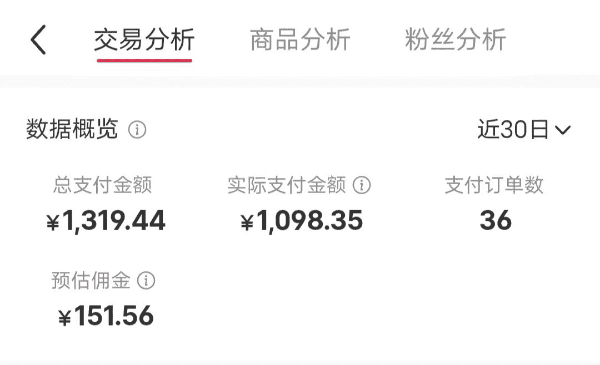

## 这文章能得到什么

这是我参加航海近30天的一次复盘，你可以看到一个36岁，打工人，利用晚上4小时，用1台手机，用最简单的场景，最简单的话术，最小的成本去拿到反馈，这个偏向“术”方面分享。

▪启动成本：1台手机+每晚4小时空闲时间，无其他设备投入

▪ 见效速度：第1天直播就出3单，比之前所有副业反馈都快

▪ 核心收益：近30天GMV1500元，佣金150+（纯新手起步水平）

▪ 关键路径：直播货架+爆款笔记，两条腿走路稳出单

我最开始的直播背景，右边是观众看到我的场景，麦也是用夹子定住的

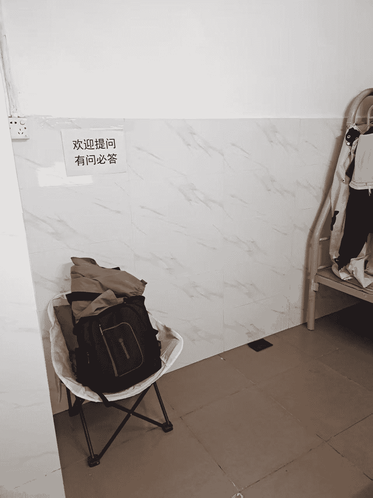

# 二、赛道选择

## 拿到反馈的赛道

我做航海前会先看一篇手册，然后把航海直播也看一次，谢无敌教练是给我们总结了不少赛道，同时还提示直播买手有官方扶持，结合我自己是家居产品经理，同时我还租了单间，我决定做出租屋改造博主（这个并没有带来大的变现）。

小建议

前期我们做项目时，可以先选一个赛道，动起来，这个阶段结果是先动起来，做一个笔记，一个视频、一次直播，再烂也得动起来，然后再迭代，优化变现；赛道不是一选定终身，新手要“先启动再优化”，而不是纠结到不敢动手。

▪ 借势平台：优先选教练提到的“官方扶持赛道”（比如当时的直播买手），平台给流量加持，出单概率翻倍

▪ 结合优势：用自己的职业、兴趣或生活场景赋能，比如我做家居相关，对产品卖点更敏感

▪ 轻量启动：别先囤货！先靠选品中心的商品测试赛道，像我前期没买样品也能出单，降低试错成本

## 变现的逻辑

红利！

红利！

红利

重要事情说三次，看前面这么次的直播背景、器材，都能拿到结果，这个切实是小红书平台给买手们的红利 ，因为小红书要把内容与商品在小红书平台内闭环，以前有一些商品会给导流到其他平台，这部分小红书没有拿到利益。现在小红书平台商品已经很丰富，需要买手去真实测评，把好产品发掘出来，提供给用户。

小红书买手变现，比商铺更容易，只要你愿意直播、愿意做笔记 、就会有精准推流。

为什么这么简陋的配置都能出单？核心是“小红书商业化闭环的红利”！

在任何平台变现，都需要与平台一起赚钱，才能长久，既然小红书要商业化，买手们就是小红书平台的销售，把小红书的流量，变现。

## 变现的方式

## 路径1：直播变现——从场观9人到出单9个，我靠“货架逻辑”破局

我最快的反馈是直播，根据手册提示， 把小红书买手选品里，把容易出单的商品加入到自己的橱窗，同时上架直播。现在小红书直播有激励，挂20+商品，直播2小时，就奖励流量卡。

我一开始就打算笔记 +直播2条路子一起做，因为我以前有外卖CPS直播的经历（拿回10倍门票），脸皮变厚了，就算没有人，我也能直播2小时以上。外卖CPS前5次直播场观不高，后来坚持直播，做到2000场观，给我带来400个订单

▪ 选品：去“买手选品中心”搜“高佣”“易出单”标签，优先加家居日用品、性价比小百货，凑够20件商品（重点！挂够20件直播2小时，能拿官方流量卡奖励）

▪ 心态：别怕没人看！我之前做外卖CPS直播，前5场场观都很低，坚持到后来场观2000+、400多订单，脸皮“厚”是副业刚需

11月10日，那天，谢无敌教练分享他们的直播间，卡卡的涨粉，给我很大的激励，平台扶持的具象化

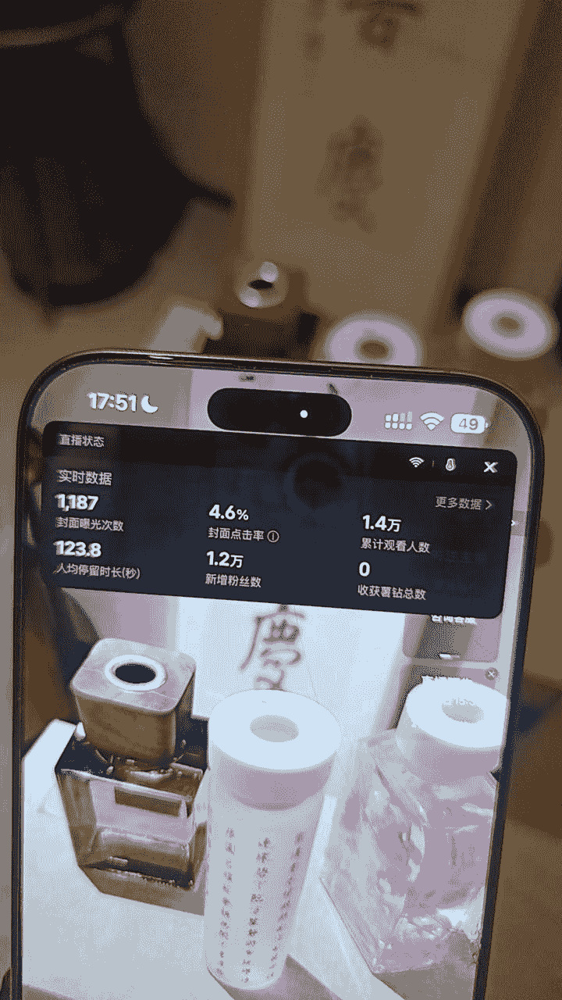

当天就决定，小红书直播，我是打定就算没人，我也会直播挂着，直播4小时，偶尔说一下话，给自己帐号做做数据，11月10日2场 ，第一场直播1.5小时，场观9人，感觉没什么人，有点怀疑自己账号，同时挂的商品不够20个，拿不到官方激励

▶ 第一场直播（1.5小时）：场观9人，0出单。问题出在2点：商品没挂够20件，拿不到官方激励；选品不够精准。

▶ 立刻优化：下播后补选易出单商品到20件，马上开第二场。

▶ 第二场直播（2小时）：场观36人，出9单！GMV539元，观看支付率25%

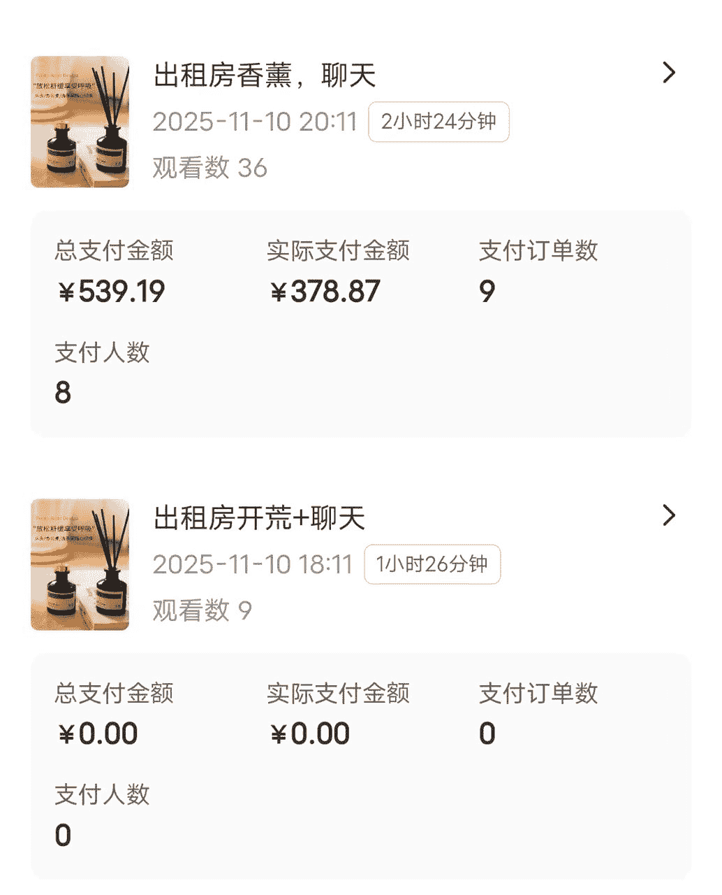

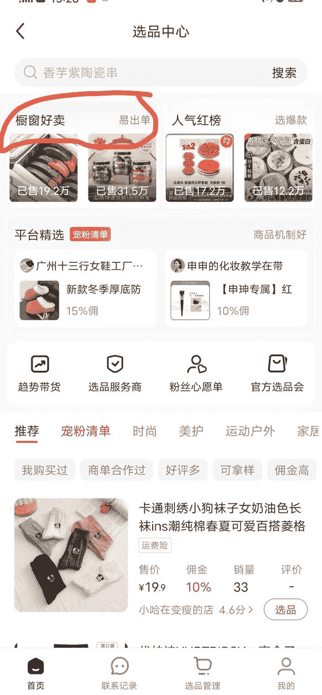

重点：这场出单我完全没准备：没有样品，没详细解说商品，就把直播间当成“线上货架”。用户都是平台精准推送来的，自己看商品下单——这就是新手期的红利！

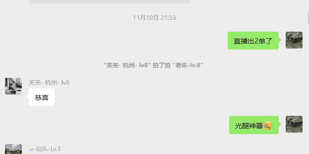

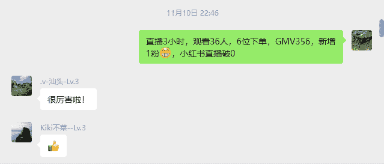

后来只有晚上有空就直播，挂商品，就算没人也挂着，测试出单情况，除了双11晚上，还有13号晚上有出单，这些出单商品，我都没有样品，只是嘴上说说，欢迎新进直播单的宝宝，BLBLB，后来这个货架的逻辑失效，可能是新手期结束，开始要考验我的人货场

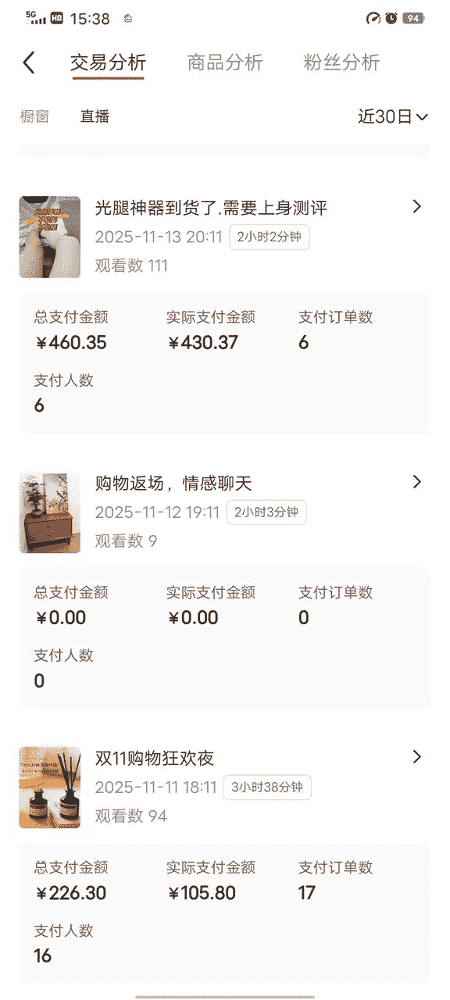

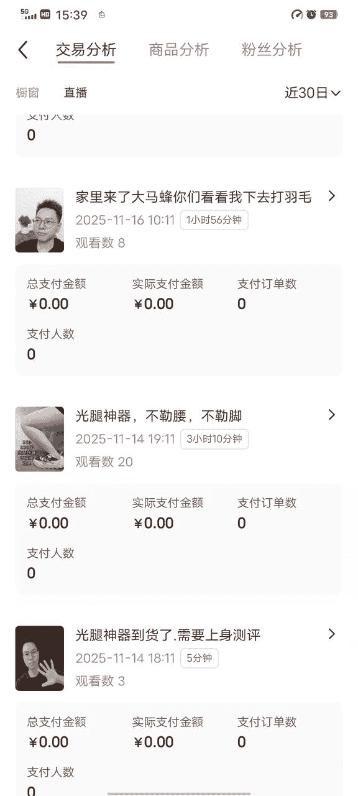

坚持直播一段时间后，“纯挂商品”的方法不管用了（新手期结束）。我立刻做了2件事：

▪ 回归出租屋赛道，采购样品把出租屋改造成直播间+实拍场地

▪ 优化直播话术：不再只说“欢迎新进宝宝”，而是简单介绍商品卖点，比如“这个东西怎样，能解决什么情况”，光腿神器上身效果怎样。

### 笔记变现过程

在直播期间，我同时有做出租屋改造，把卫生间进行改造，流程是，我先搜索出租屋改造，看一下爆款有什么痛点，发现返臭、墙面改造可以做，我就卡卡的在买手中心选样，发现有些样品只要你笔记带货，商品无需，可以退款，等商品到位，就实拍笔记带货，履约然后去退款。（要注意要先跟商家核实，避免后续要退货）

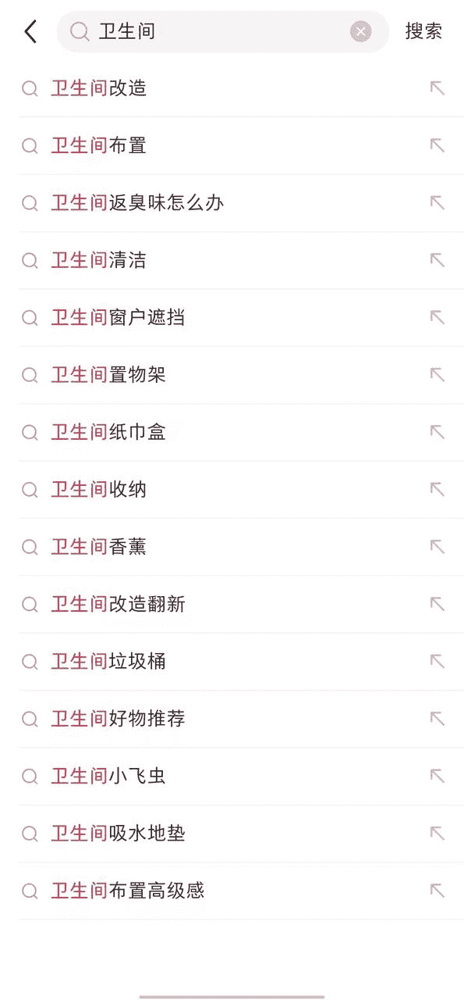

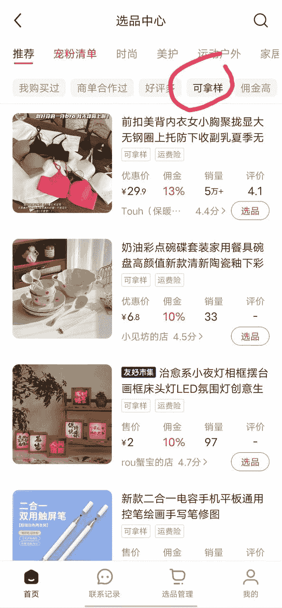

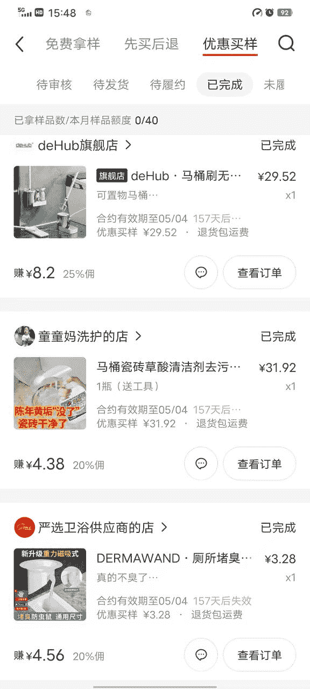

一开始我做出租屋改造笔记，直接挂改造商品链接，结果流量特别差（小眼睛不到100）。看教练答疑才知道：笔记挂商品后，平台推的是“商品流量”，不是“内容流量”

新手想先起流量，别直接挂链接！

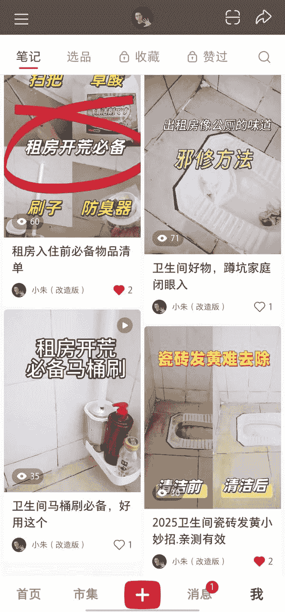

#### 笔记出单的转机，异常值

我实拍笔记前都会先去看一个爆款是怎样的，然后刷刷小红书看看有什么机会，11月20日上午，我刷小红书发现一个图文流量很好，同时当天类似还有一个视频，都过万赞，这是一个异常值，我看了是关于静电的，

我迅速找一下选品中心，搜索“去静电”没有类似的商品，我不死心，我想这种需求应该有类似的商品会满足，我尝试在小红书里搜索，果然找到带货商品“静电释放器”。

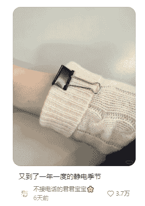

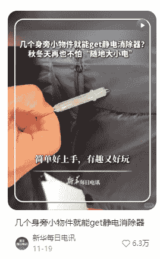

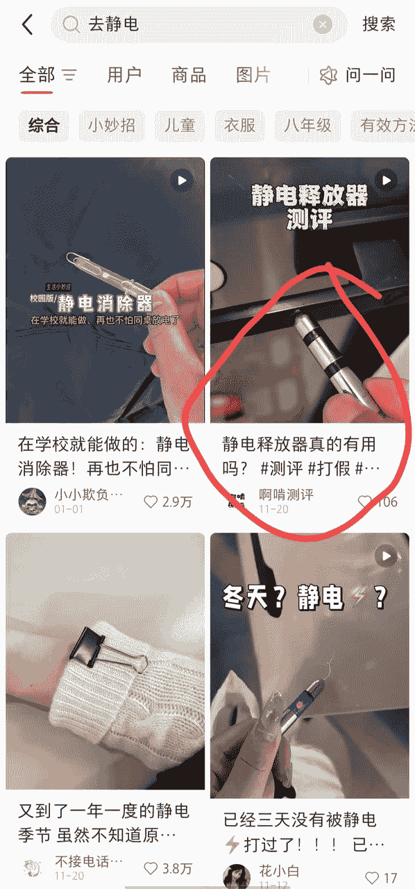

#### 快速执行，抓住异常值

中午我依照图文笔记，做了图文，说了一些防静电的方法，然后在评论区说，可以买商品，同时把自己做静音消除器的视频拍了下来，晚上又发一篇。流量终于过千，同时出了3单，终于不焦虑，形成一个完整的SOP。后续可以复制。

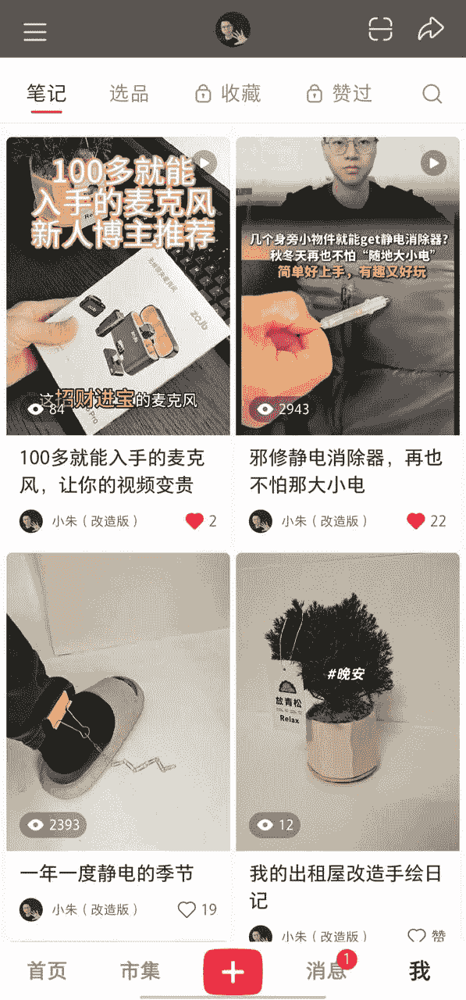

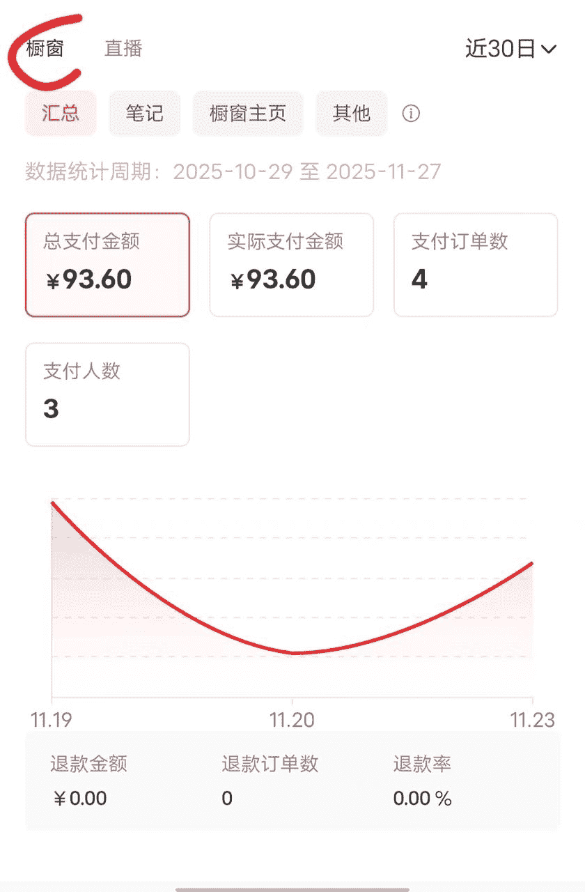

我笔记出单的核心方法，新手照做就能复制：

▪ 找异常值：11月20日刷到2篇“防静电”内容（一篇图文、一篇视频），都过万赞，这就是“爆款信号”

▪ 找商品：选品中心搜“去静电”没找到合适的，直接在小红书搜，终于找到“静电释放器”

▪ 快速执行：中午做图文笔记（分享防静电方法，评论区引导下单），晚上发相关视频——流量直接过千，出3单

# 三、小红书买手的定位

买手vs店铺：为什么新手优先选买手？

| 对比维度 | 小红书买手 | 小红书店铺 |
| --- | --- | --- |
| 启动难度 | 低，0押金，直接用选品中心商品 | 高，需上架商品、做客服、发货 |
| 反馈速度 | 快，1-2天就能出单 | 慢，需养店，竞争激烈 |
| 适合人群 | 新手、时间少的职场人 | 全职创业者、有供应链资源者 |

反而小红书买手，这是帮小红书流量变现，给小红书用户更真实的测评体验，给小红书店铺带来更多的客源。是小红书商业化生态位的一环。

这是平台红利，新人入局很容易能拿到结果。

很多品牌重视小红书这个平台因为有很优质的用户，在开拓这个平台其实，很乐意与小红书素人博主合作，只要有一定的数据。

# 四、小红书买手启动成本

## 样品钱都能省，新手零压力

我全程佣金150+，但样品基本没花钱，方法分享给你：

▪ 买手中心福利：部分商品标注“笔记带货后可退款”，先申请样品，发布带货笔记后联系商家退款

▪ 商务合作：在买手主页更新合作状态，会有品牌方主动联系送样品

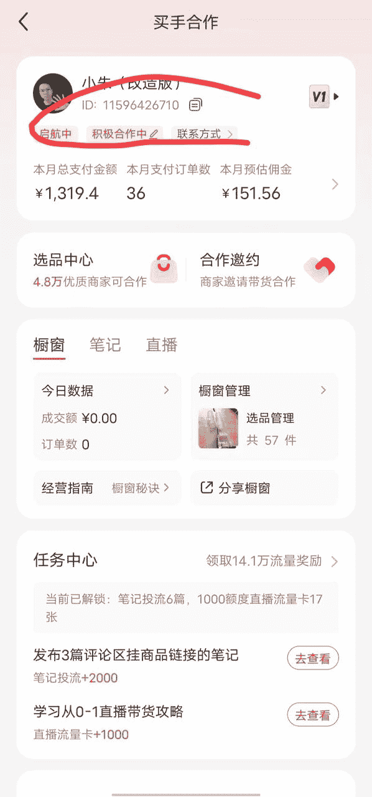

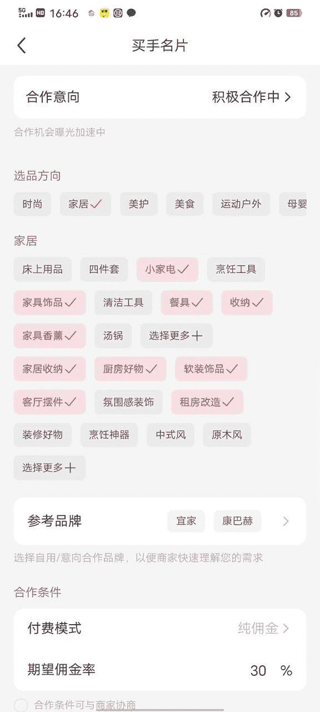

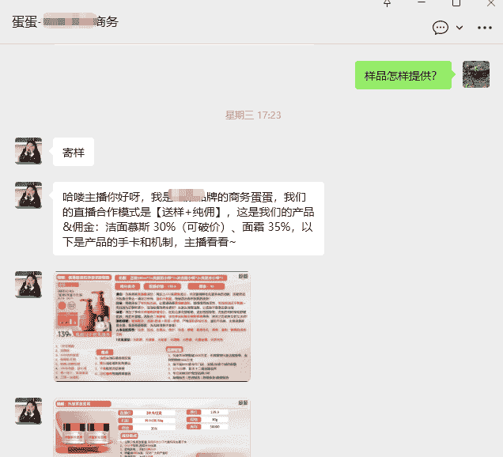

# 五、小红书买手变现MVP

MVP就是“最小可行性产品”，新手不用追求完美，完成这4步就能拿到结果：

▪ 破粉1000：航海群有热心船员分享“科技涨粉方法”，合规且高效，先达标拿基础流量

▪ 直播起步：选20件易出单商品，每晚挂播2小时，不管有没有人都坚持（新手期靠货架逻辑出单）

▪ 笔记测试：每天刷30分钟小红书，找“爆款异常值”，快速做对应内容，评论区引导下单

▪ 素人截流：在素人爆款笔记下，用小号评论“求链接”，大号回复附自己的买手链接（有小伙伴用这个方法赚了1000+佣金）

# 六、结尾

## 1. 定目标比瞎努力更重要

我做每个项目都会定“10倍门票”目标（比如航海门票199元，就定1990元变现目标）。目标清晰了，执行才不会偷懒。我会用豆包把项目和空闲时间输入，让它帮我列“日执行表”，比如“19:00-21:00直播，21:30-22:00刷爆款笔记”

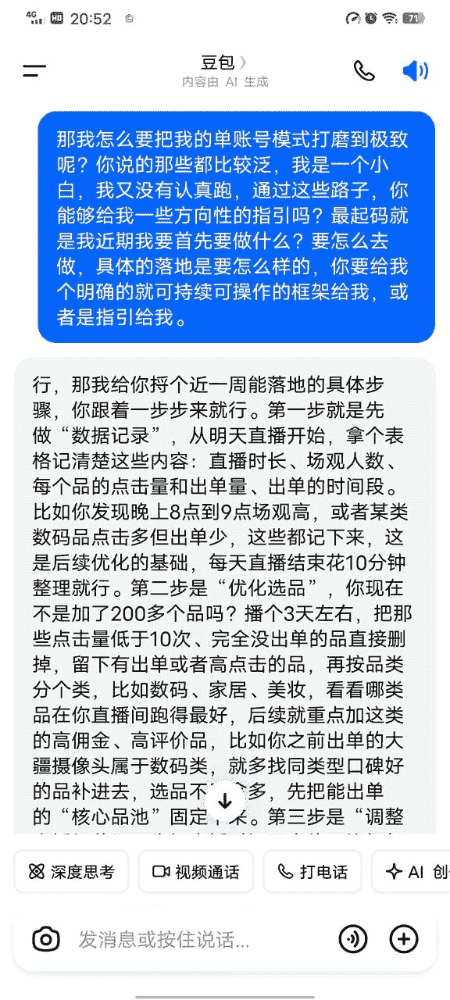

## 2. 新手别迷信AI，先自己入局

除了做执行表，我没用AI写笔记、剪视频。新手初期最重要的是“亲自感受MVP环节”——自己选品、自己直播、自己写笔记，拿到第一次出单后，再用AI优化话术、修图，这样才不会被工具绑架。

## 3. 红利期不等人，动起来就赢了一半

我36岁，下班累得只想躺，但还是挤出4小时做小红书。现在平台买手红利还在，你不用等设备配齐、不用等话术完美，今天挂20件商品开直播，明天发一篇爆款跟进笔记，下一个出单的就是你！

--------------------

# **后续**

在航海结束后，我劳动合同到期，正式毕业，与队友沟通后，我给自己一个机会，让我能全心全意去做自己的带货副业

后**续运用抖音选品法，制作口**播视频，四大平台同时发（抖、快、红、视频号），日更视频，都顺利出单，买手带货这个只要坚持执行，有手就行，就能拿到结果。

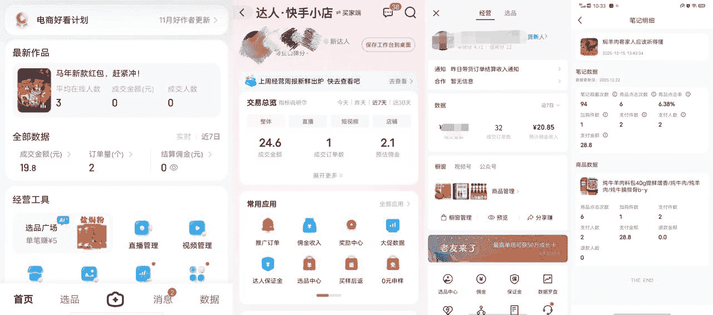

带货是与平台共赢的工作，本质是帮平台销售流量，爆款用不同的场景，素材复刻，是允许，

带货这是一个大市场，我们每一个笔记都是射向我们财富目标的子弹。

最后，祝大家暴富，10年10倍。