# 普通人如何通过notebooklm构建自己的生意！【内含notebooklm原创📕虚拟产品方法论！

> 来源：[https://xuqiwei1986.feishu.cn/docx/EBMFdLYzmow6v0xQB1fcS9ZOntc](https://xuqiwei1986.feishu.cn/docx/EBMFdLYzmow6v0xQB1fcS9ZOntc)

我强烈建议，每一个在互联网上做内容的人，无论你是在👸号、📕还是抖音、Bilili，并且你主要是知识领域的博主/创作者，一定要用notebooklm，日常把notebooklm融入到你的工作流。

理由很简单，它真的太好用了！！！

如果你现在深度使用notebooklm，你会有一种强烈的AI推背感。

并且我建议你一定要结合gemini的 nano banana pro同步操作。

今天来分享下关于notebooklm的用法，全网独家 全网最全！

## 01 什么是notebooklm

首先介绍下notebooklm，其实notebooklm是谷歌 开发的 AI 驱动的研究和写作助手，它的核心功能是扎根于自己上传的资料。

简单来说，您先上传您的来源材料（例如 PDF、Google 文档、文本文件，甚至网站链接），然后 NotebookLM 就会成为一个只针对这些材料的“专家”。你可以向它提问、要求它总结、让它生成大纲或构思新想法，而它的所有回答都将完全基于您提供的资料库。

并且NotebookLM还可以直接直接读取youtube链接，这对于大多数博主来讲是非常非常有用的一个功能，毕竟两个网站都是一家公司，彻底打通，AI生态。

NotebookLM的优势也显而易见了，就是不会有幻觉，一切生成的内容都是来源于你上传的素材，所以这对于自媒体博主非常友好。

下面给大家分享，几条关于NotebookLM的隐藏用法！！！

全网独家，建议转发/收藏/点赞！

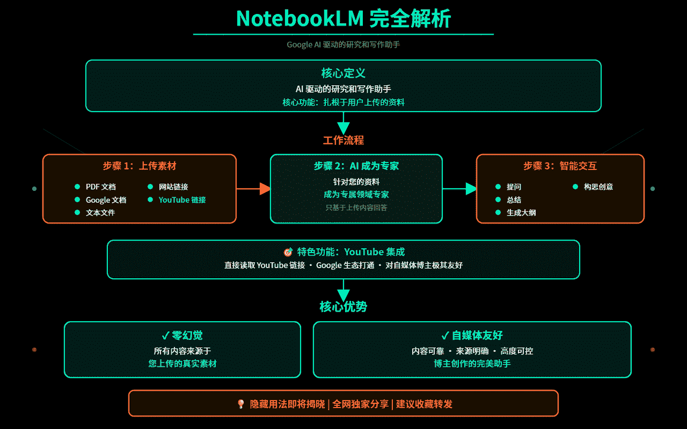

并且，现在notebooklm更新了一个非常炸裂、颠覆时代的功能，就是生成PPT功能，这个功能可以把任何文字转化为PPT。

下面会详细说！

## 02 notebooklm+youtube+📕

第一个玩法

如果你要在📕做内容，当📕博主，特别是一些专业领域，比如养生、身体保养、健身、个人成长等等

就是把notebooklm和youtube结合，当做你的内容外脑。

刚刚讲过notebooklm和youtube本身都是谷歌旗下的产品，所以两者可以完美联动 ，这也是谷歌的护城河，对于国内的内容创作者来讲，是一个 非常有价值的信号和信息差。

具体怎么做呢？

如果你需要一些知识的积累，或者说你需要让你的内容变得专业性，需要找一些内容素材，传统的做法，可能你需要去不断看一个一个又一个的youtube视频，通过自己的理解吸收，再成为你的内容支撑。

这样做，会比较慢，同时也很难快速捕捉的精华内容；

现在你可以通过notebooklm快速去捕捉你想要的内容；

举个例子，比如我是一名健身科普博主，我想要在📕上发一些关于"2区训练“的知识，我可以直接在youtube上搜索zone2，然后找到5个非常有价值的youtube视频，粘贴链接到notebooklm。

这就是你的优质素材库，你可以向你的素材库提问，提供给你更多的理论支撑和idea提供。

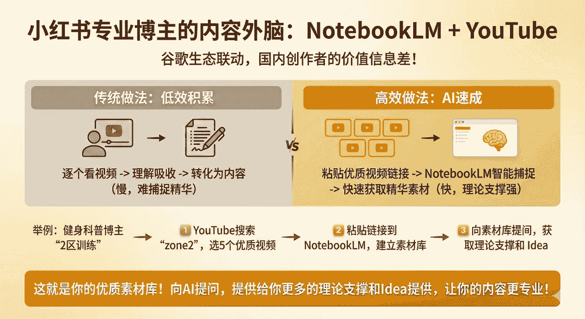

很多同学问过我，为什么notebooklm这么强，有没有平替工具？

这里我强调下，notebooklm的背后大模型支持是gemini3，gemin3是支持一百万token的，这是一个很大的上下文窗口，其他大模型不具备；

其次，notebooklm的优势是给你生成的内容不存在编造，没有幻觉，不像其他大模型，你上传文件，就给你生成了很多露娜七八糟的东西。

并且notebooklm它是可以给你内容来源的，你可以看清楚每一个句子，它是怎么生成的。

比如，**我会让notebooklm直接给我反常**识观点，它会给我一些基于素材的反常识观点，这样做的目的在于让我发在📕上的内容变得更加立体，同时也符合互联网的传播规律。

除此之外，notebooklm还有一个非常非常王炸的功能，可以生成各种不同角度的报告，也就是说是对你给到的视频内容进行深度总结。

同时，还可以根据你想要的方向生成报告；

举个例子，我想要一份普通人如何更好的2区训练指南，直接让它帮我生成就可以，没有任何难度。

这个指南也可以成为你的钩子产品，比如后续你想要在私域运营或者引流都可以用这个PDF产品，甚至你还可以把它直接当作文件上传到📕。

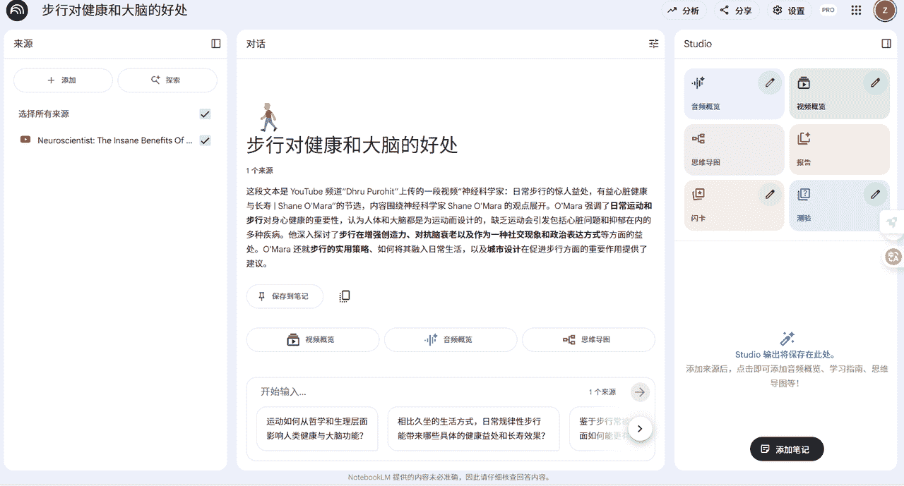

因为现在文件型📕笔记的浏览量还不错；

所以通过notebooklm，不仅可以让你的内容变得更硬核，同时还可以解放你的生产力....

notebooklm和📕的完美结合，目前还有一定的红利期。

并且现在很多youtube博主在📕的流量很好，知名度也高，同时他们的内容是不断更新的，而你就可以通过notebooklm打一个时间差。

快速找到这个视频的精华内容，并且转化为📕的语言，帮助你起号。

比如很多博主都是通过huberman的视频进行起号的，本质上找到了一个博主给你的📕账号做背书，你是一个翻译官，以及去整合和传播他们这些在某一个领域拿到了很大结果的博主。

你也可以起号，接商单，因为你这个账号的背后，是优质的、拥有垂直标签的人群，非常非常有商业价值，这也是通过notebooklm【借花献佛】

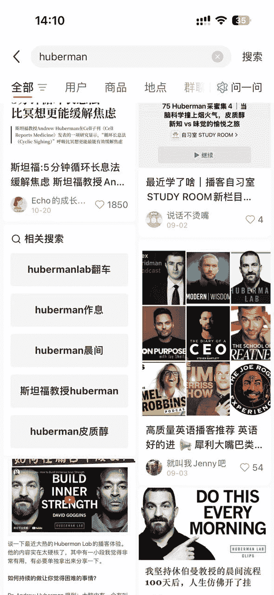

## 03 notebooklm+youtbube+虚拟产品

很多人纳闷，notebooklm就是一个学习工具（大多数人的视角），怎么可以做虚拟产品呢？

这就是看待事物的角度不同。

换一个角度讲，notebooklm和youtube完美结合，其实是可以通过notebooklm按照你的思路去重新组织youtube的信息，这不就是内容策展的思路吗，最后你整合成一个只属于你的虚拟产品，这个虚拟产品有你的思想和组织，它本身也是原创虚拟产品。

就像面对同样的食材，厨师可以采用不同的烹饪方法一样，可以创造不同的菜肴，notebooklm也是同样的逻辑，去把你的想法和创意实践。

另外，notebooklm的优势是可以一次性最多同时针对300个youtube视频进行处理，也就是说你的内容基础素材库是足够丰富的，你可以完全组织优质的信息源形成虚拟产品。

同时，notebooklm还有一个非常非常好用的功能，就是你可以根据你的特定需求，去直接做一个指南出来，所以你想要做什么都可以去让它生成。

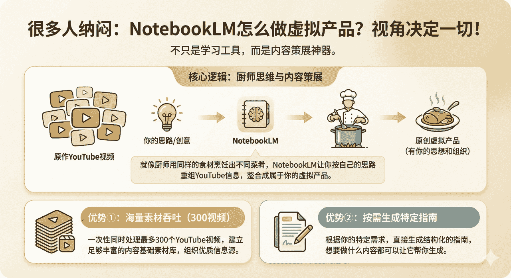

这是不是也已直接构成一个虚拟产品的demo?

当然，第一次生成的可能不满意，你可以让它多维度生成，也可以结合你生成的报告加上你的思路去重新整合，最终形成一份虚拟产品。

但是这里要注意，我建议虚拟产品不要只是完全照搬notebooklm生成的东西，因为没有办法直接用，毕竟AI生成的东西有很多AI味。

自己还是要做一个二次整理，并且要加入配图，排好版，不要让别人觉得你这个是纯AI生成的，毕竟消费者是花钱的，体验感还是要拉满的。

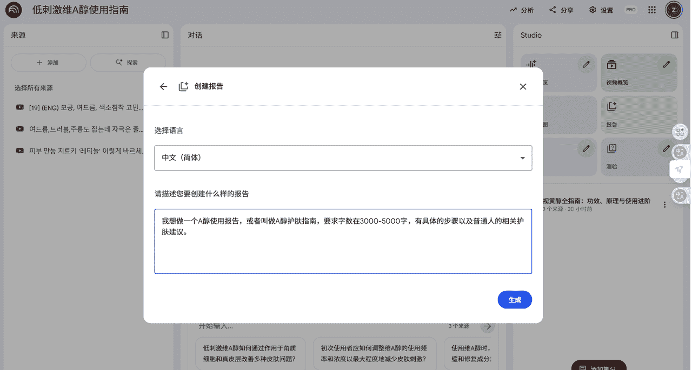

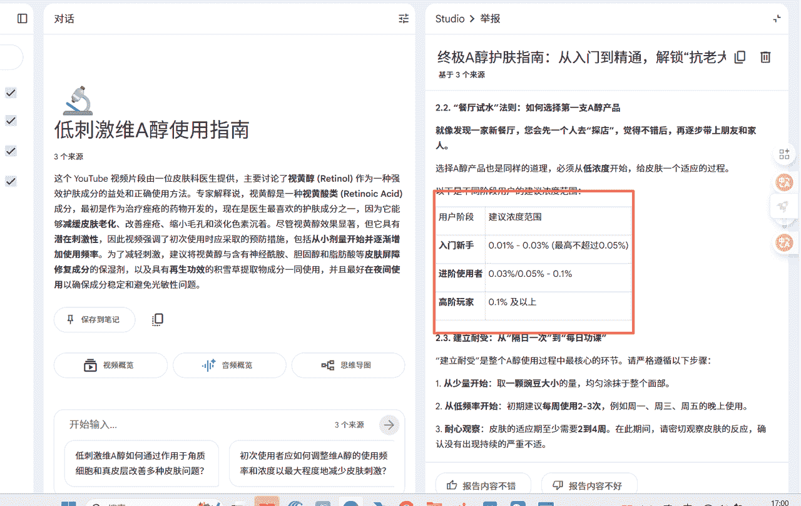

除此之外，还有一个隐藏玩法。

就是可以把notebooklm生成的虚拟产品当作钩子，直接在📕上传，帮你涨粉，因为📕用户天生是对干货有天然的喜爱，或者说成瘾。

所以，你如果是客资行业，也可以去通过notebooklm+youtube快速制作虚拟产品，去帮助你涨粉引流客资。

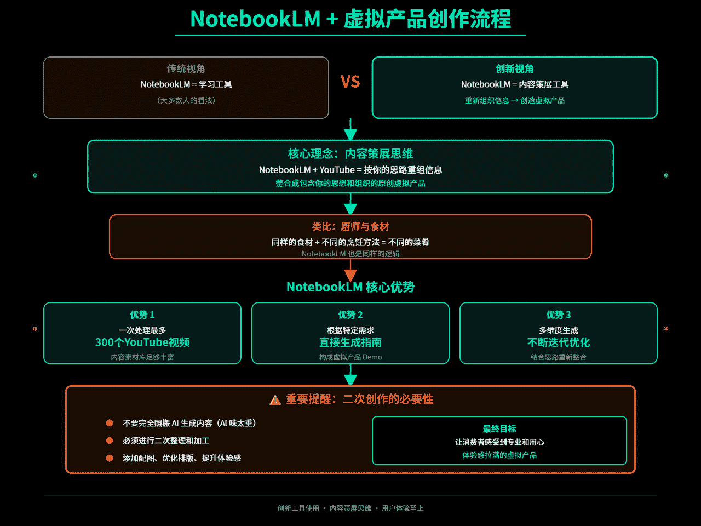

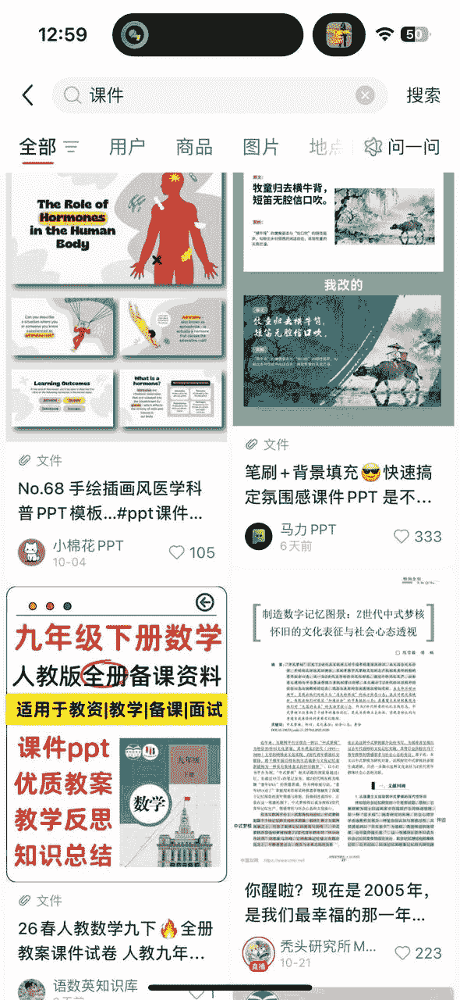

**比如这些笔记，带文件标识的都是文件型虚拟产品，是可以拿到📕更多的流量，而你可以通过notebook**lm对youtube视频进行总结，自己手搓出来一个PDF，挂在📕笔记上，增添你的笔记内容厚度，帮助你拿到更多的流量。

## 04 notebooklm原创虚拟产品

最近notebooklm迎来了重大的更新，这个更新功能基本上可以讲是改写了虚拟产品原创的难题，这个功能就是notebooklm生成PPT。

这个功能的优势其实是得益于gemini3.0pro的nano banana pro，因为nano banana pro的中文能力大大增强，并且nano banana pro的能力提升很重要一点是对用户任务的高度理解，它不会去非常机械地执行任务，而是会理解用户背后地意图，这是质的飞跃。

而notebooklm的PPT生成功能，其实就是nano banana pro根据你的指令和语料生成的一张张图片，最后整合成的PPT，最后导出来的形式是PDF。

我已经试验了很多场景，效果非常惊艳，特别是对于各种课件、学习资料、主题型PPT，以上这些在📕卖的比较好的虚拟产品，其实都可以通过notebooklm进行原创，而且我认为生成出来的水平是远超📕的商家的，非常非常好看。

给大家看几个我生成的效果

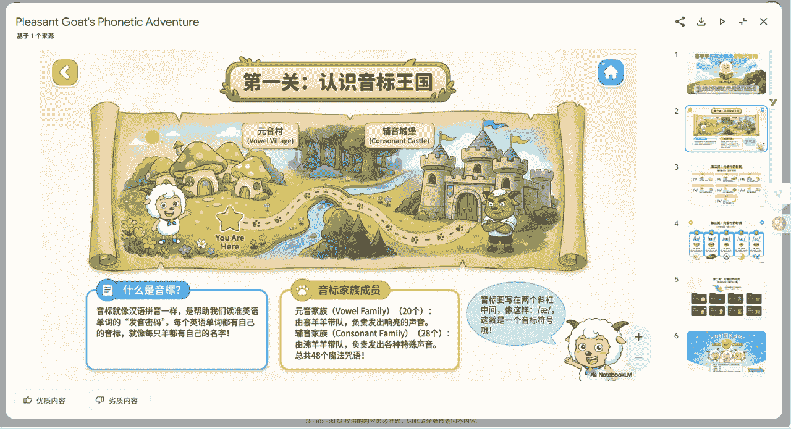

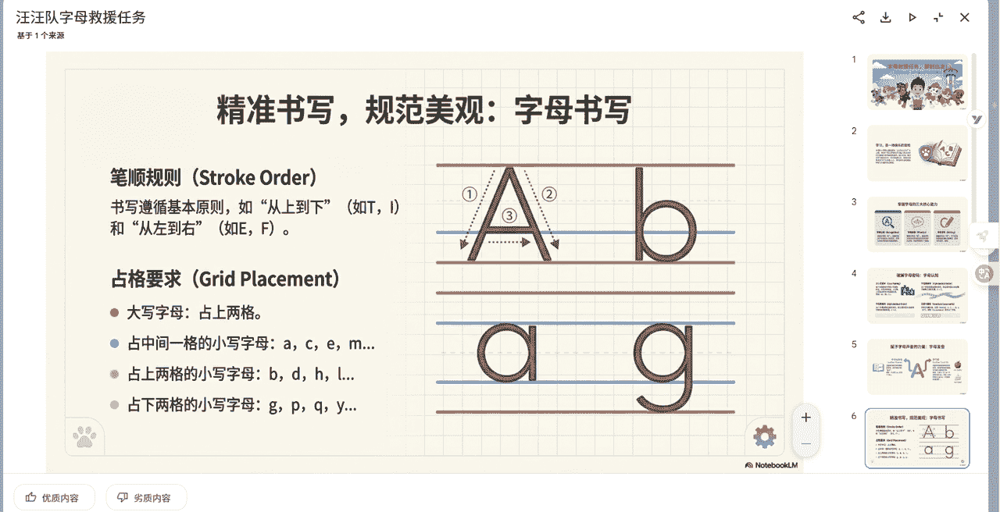

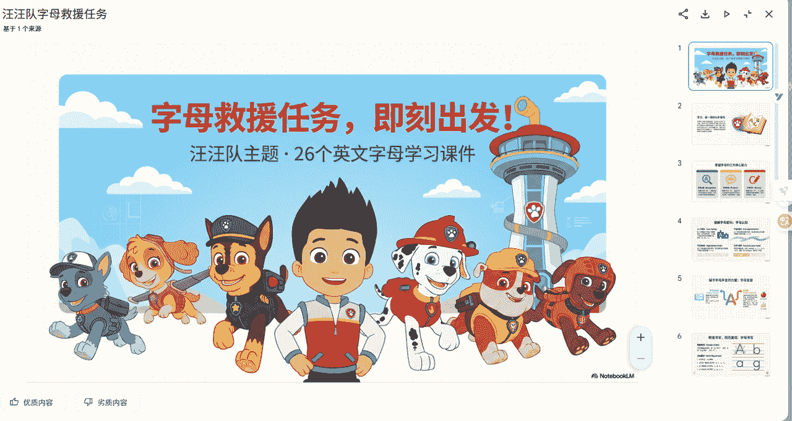

notebooklm可以理解你想要的角色、主题，你可以指定主题，比如汪汪大队、小猪佩奇、喜羊羊与灰太狼等等，不要给notebooklm你想要的IP形象，notebooklm会自己区找到相关的IP形象融入到PPT里，这一点非常非常强，强到离谱，再次感叹。

那么，该怎么通过notebooklm生成课件类型的PPT呢？

步骤也很简单

第一步，制作PPT的呈现内容

第二步，简述你的要求给notebooklm, 让它帮你生成PPT，比如你希望融入一些什么想要的板块内容，比如你的受众是谁？

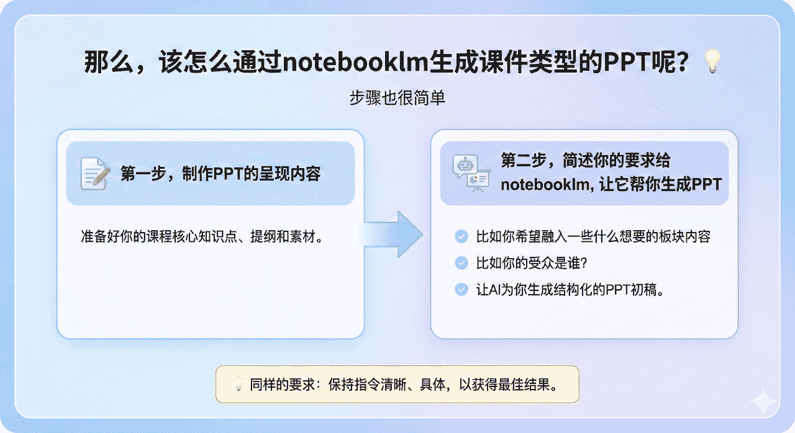

比如，我要复刻📕卖的很好的一个虚拟产品，是《我与地坛》的读书分享PPT，虽然以前也有所谓的用AI原创PPT，但是以前的AI相关的PPT工具并不能完美呈现PPT的主题性，而是一直都在套模板，所以经常碰到驴唇不对马嘴的状况。

而notebooklm不会这样，它会知道你想要什么主题，并且所有元素都和这个主题高度一致；

首先，我先让AI（任何一个大模型）都可以，生成了我与地坛的PPT内容；

第二步直接让notebooklm，根据我的内容生成PPT，没有任何提示词技巧，只是传达我的需求；

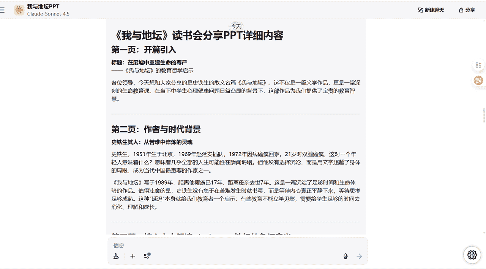

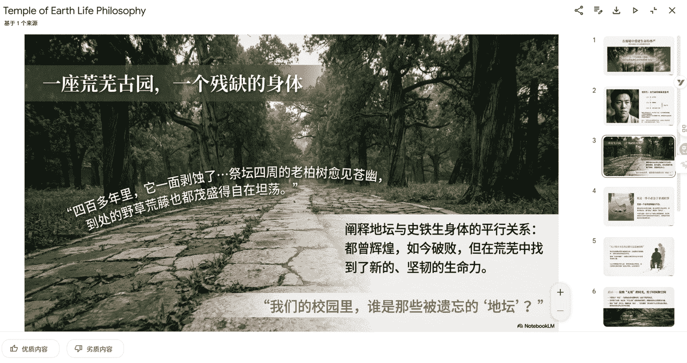

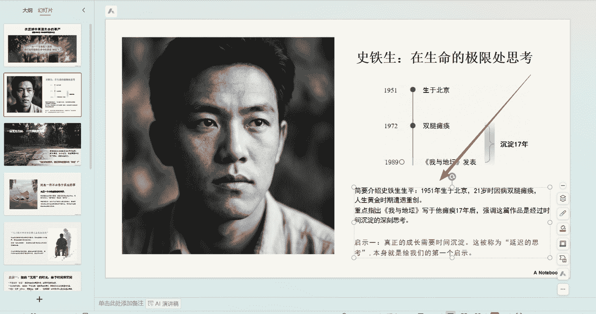

非常清爽的一个工作流，而且最重要的是，你可以通过WPS直接把PDF转成PPT，变成可以编辑的格式；因为面对字多的内容，notebooklm对中文的处理效果还是很差，有一点乱码，并且假如你真的要打包成一份虚拟产品出售，这个PDF一定是要可以编辑的。

重要的是！已经真正完成了notebooklm出单，完成了自己的0-1，并且目前还是在持续出单中!

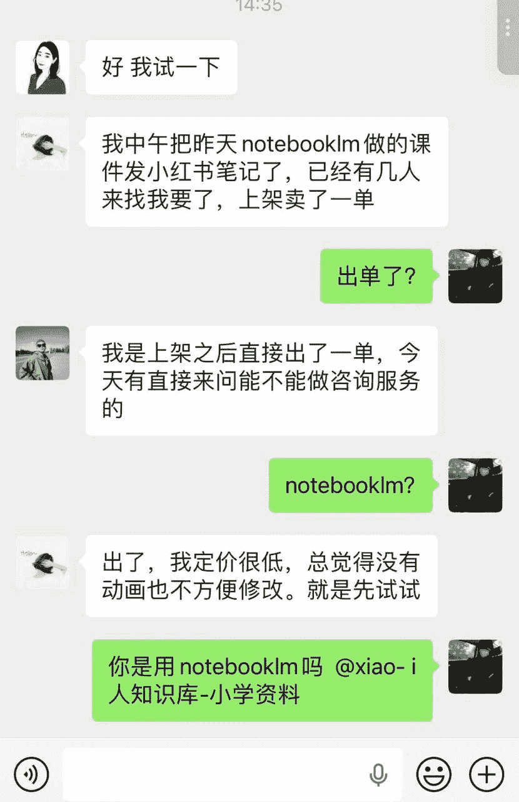

为什么能出单呢？

以及你如何通过notebooklm在📕赚到钱？

**第一个问题，为什么能出单？**

📕虚拟产品出单的关键不是选择一个你擅长的市场，而是选择一个多金繁荣的付费市场，两者有本质的区别，这也是我最新的感悟，分享给大家。

因为一个市场如果付费意识没有建立起来，你也很难唤醒用户的付费意识，吃力不讨好；

但是大部人在选择赛道，都会基于自己的优势和擅长去做虚拟产品，这是思维惯性，最后没有正反馈就放弃了。

现在有了AI，AI的本质就是知识平权，专业平权、理论上讲你可以成为任何领域的专家。

那么，现在应该做的就是去找一个多金繁荣的付费市场，这个市场的付费人数足够多，有足够强的购买付费意识，并且虚拟产品制作的难度不是很大。

显然，课件市场是一个不错的市场，尽管现在说课件已经很卷了，但是任何垂直的场景都有足够的机会，就像我上图的PPT制作，就是基于📕热门商品进行复现的。

第二个问题，你如何通过notbooklm在📕赚到钱？

当我们选择了课件市场后，并不是说你卖什么都能出单，这个也不太现实，而是要选择一个垂直场景，因为你要快速上架并出单。

所以，这里有一个小技巧：你用notebooklm做的虚拟产品，这虚拟产品一定要独立场景，你做完这个课件，就可以上架卖，这类场景有什么呢？

我举几个例子，你还可以继续挖掘

比如公开课、主题班会、读书分享会、家长会PPT等等。

都是针对独立场景的，你用notebooklm做完就可以上架，而不是你要做很多课件才能上架，比如你要上架物理学科的课件，可能你要做一本书的课件，才能成为一个虚拟产品。

这种虚拟产品对新手的性价比往往不高，且难度也很大。

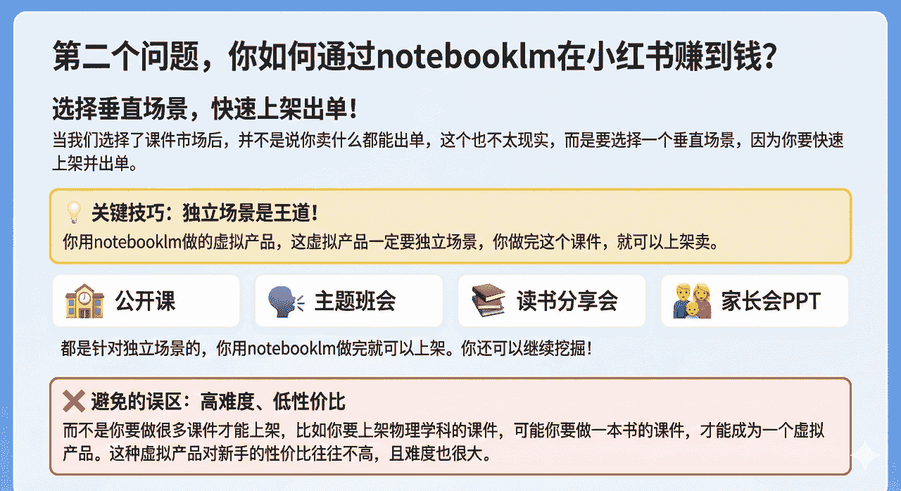

去年的时候，哪吒2特别火，有的商家就做了哪吒2的《开学第一课PPT》，出单效果都很不错！

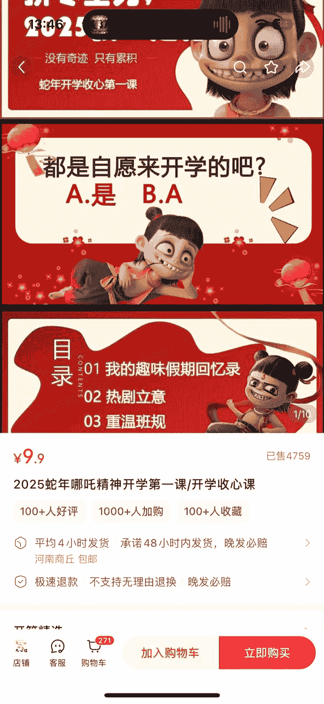

通过notebooklm原创虚拟产品在📕赚钱并不难，核心难点在于你能否挖掘出哪个PPT场景会有人在📕买单，选择一个多金的赛道；

notebooklm只是工具，关键还在于使用工具的人。

虽然目前notebooklm生成的PPT还存在一定的瑕疵，但是已经足够用了！

这就是AI的力量和价值！

##  05notebooklm+你的一切语料

除此之外，notebooklm除了可以读取youtube链接外，它还可以读取本地文件，所以它也可以结合你自己的一切语料去覆盖一些其他的工作/生活场景。

youtube上有很多博主已经分享了，如何高效把notebooklm覆盖到自己的工作生活场景中，比如最常见的一个场景就是求职找工作的场景。

很多人其实并不是了解自己，在找工作的时候，不知道自己的优势是什么，很多人就直接把自己的简历发给了notebooklm，让notebooklm直接生成播客，去谈论你的简历。

这样做的优势，你可以借助AI，去挖掘你的隐性优势，同时发现你更多的闪光点。

同时，对于教师来讲，也可以通过notebooklm进行备课，因为notebooklm有闪卡功能，可以生成问题和答案，直接帮助你课堂测试都准备完了。

而我的用处也有很多！

首先是素材的重新整理，比如我的一个典型场景是一鱼多吃，我有时候会跟别人分享，有时候也会跟别人做咨询，但是没有AI之前，很多语料都浪费了。

现在的工作流就很简单，先用录音笔记帮我记录原稿件，然后用通义听悟帮我转成转成文字，但是这只是初稿，这也是我给notebooklm的原始语料。

因为notebooklm的优势是生成的内容没有幻觉，不会胡说八道，所有生成的内容都可以溯源；

所以，我会先确定一个和原始语料相契合的主题，当我缺少某一部分内容的时候，直接向notebooklm提问，然后它就会给我内容。

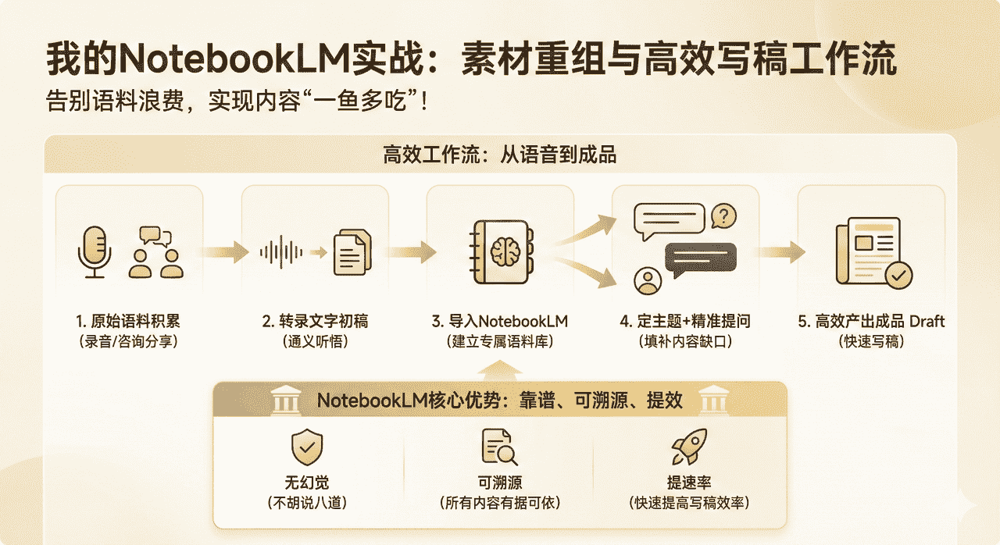

这就是notebooklm的优势，能够快速提高你的写稿速率。

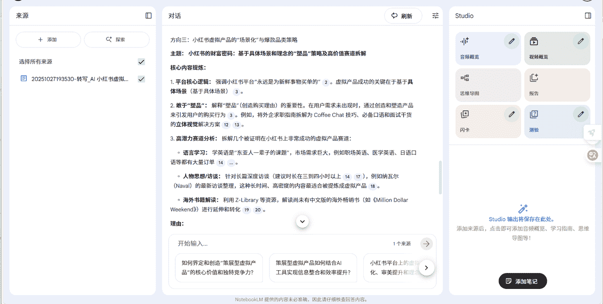

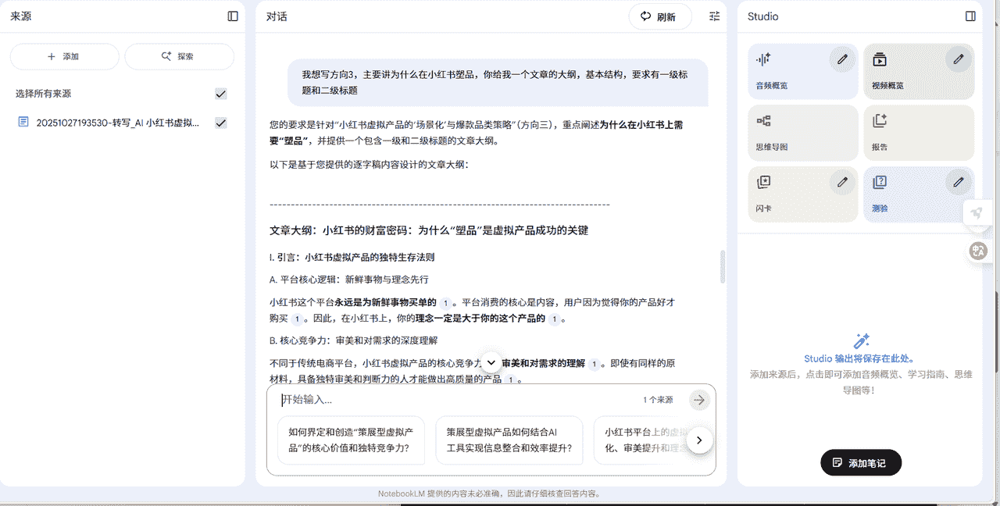

这也是一鱼多吃的AI玩法，它甚至还能帮你去写朋友圈，底层逻辑很简单，就是打碎、重组，这也是一种崭新的写作方法，内容策展写法。

你拥有一个模糊的想法，你知道你想表达什么，你有一个原生的预料包，通过notebooklm去帮你重组，最终涌现出全新的文章，在互联网传播你的思想。

这就是AI的意义和魅力，总能够涌现出一些全新的“东西”出来，包装这篇文章的很多配图，都是通过nano banana pro 做的

## 06notebooklm的隐藏用法

这部分分享一下关于notebooklm的隐藏用法，很多人其实遇到notebooklm也一脸懵，不知道到底怎么用；

基本所有人第一次想用notebooklm解读youtube的视频都会遇到一个问题，那就是如果你让notebooklm解读youtube视频，notebooklm给你的大概其实并不会完全反映视频内容的价值。

你也没有办法按照一个清晰的脉络去理解youtube视频，很容易造成内容信息的损耗。

那么，怎么办呢？

我推荐一个宝藏用法，因为视频都是有时长的，你只需要让notebooklm去按照不同的时长去总结就可以了，比如一个视频的时长是60分钟，你可以让notebooklm分别总结1-20分钟、20-40分钟、40-60分钟的视频。

也就是说，你让notebooklm分别总结3次的内容概述，每次都聚焦在一个比较短的段落，3次融合到一起，就会呈现更多的内容细节和干货。

同时，你可以通过AI学习AI，因为现在是AI时代，必须要学会通过AI去获取知识，你可以直接问gemini，关于如何使用notebooklm的技巧。

它会跟你很多可以直接落地的技巧和提示词。

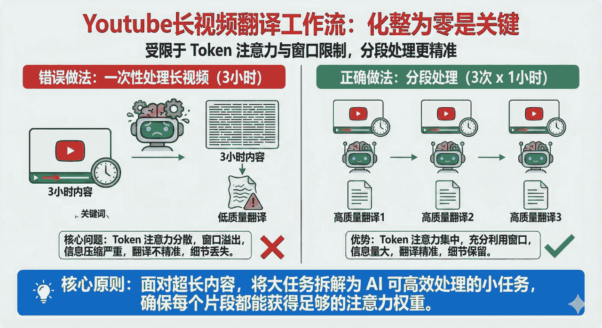

## 总结一下

notebooklm不仅是一个学习工具，我认为它更大的优势，是能够帮助你在自媒体平台上打造你的生意，生意模式主要有三种

第一种：通过notebooklm整理youtube的优质内容，把优质内容当作你的素材库，让你的📕内容变得更专业，内容变得更加硬核，特别适合垂直领域的专业知识传递。

第二种：通过notebooklm去做虚拟产品，比如把优质的youtube视频整理下来，单纯的翻译不够，你还需要按照你自己的想法对youutbe视频进行提炼总结，从而当你的内容变得更加有深度。

我插一句：我们要时刻去思考，我们给用户/读者呈现的内容是否满足了他们的需求，还是陷入了一种自嗨的怪圈？我看过很多内容策展型的虚拟产品，并不是策展，只是单纯的翻译，单纯的翻译并不能满足用户的阅读需求。

但是notebooklm是一个很好的内容重组工具，你可以让notebooklm帮你提炼重点，帮你去总结摘要，很多场景兜需要你自己去挖掘。

第三种：就是你的个人IP打造，比如你又很多原始的语料，到底怎么通过notebooklm重新组织你的语料？都是可以去挖掘的。

总而言之，我是非常推荐notebooklm，去帮你构建自己的生意。

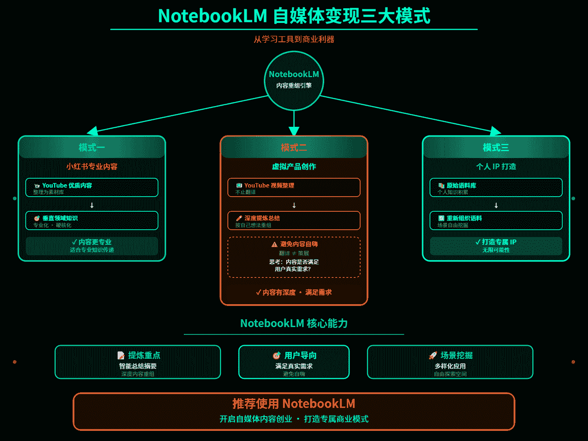