# 📕图文买手笔记+素人爆文评论区种草，2.5W GMV复盘

> 来源：[https://xuqiwei1986.feishu.cn/docx/Cacedwcn0oSKYKxKdpccoi6unEg](https://xuqiwei1986.feishu.cn/docx/Cacedwcn0oSKYKxKdpccoi6unEg)

> 我一直有一个理念：“一生都在要链接的中国女人”。真诚分享自己真心觉得好用的东西，一定会有人来问链接。

大家好，我是好天气，一名在📕专注家居领域的博主。

今天我要分享的是📕买手笔记+素人爆文评论区截流种草组合打法，既能用自己的流量，也能借助素人的流量进行出单。

有幸10月底报名了📕买手mini航海，在航海期间，根据教练们的手册直播和答疑进行学习，经过实践发买手笔记，发现📕买手项目绝对值得做，而且对于普通人来说，它是当前离钱最近、门槛最低、模式最轻的变现机会之一。

最吸引我的是这个图片模式的可复制性和低门槛——内容创作门槛简单：它不考验你的剪辑技术，不要求你写长篇大论，也无需你囤货和处理售后物流，只需要你真的种草你真正喜欢的东西，并分享出去，用户就会跟着你买买买。

在成为买手之前，我和很多人一样，是个特别爱买、爱分享的普通用户，整天在📕上种草拔草。

很幸运，在这次📕买手mini航海中，通过无敌老师的直播和社群答疑，我获得了许多灵感。

我的账号在航海开始第一天就开始做买手，目前两个账号带货在航海期间总GMV达到了2W4——主账号1.9W，副账号6K4。

主账号：这个账号在航海之前一直是接商单，自然涨粉2K4,开通买手需要1000粉丝，自然就开通了买手合作。

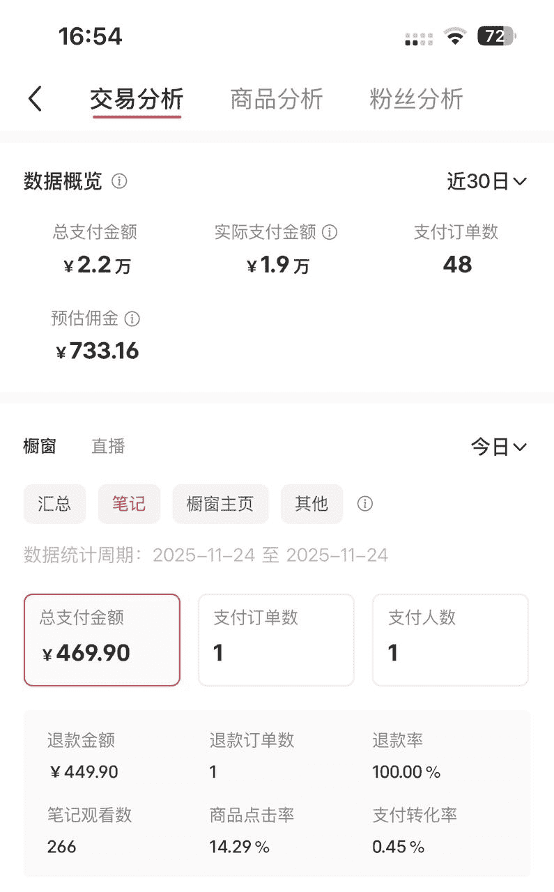

**为什么我又弄了一个小号？**

因为我发现有个品特别好卖，我就专门用这个号去种草那个产品，客单价在400-700区别。

小号一开始只有26个粉丝，为了开通买手合作，买了1000的粉丝开通了买手合作，买粉的方法是在航海群里群友们推荐的（说明了买粉不影响出单）

下面这个是小号的出单记录。

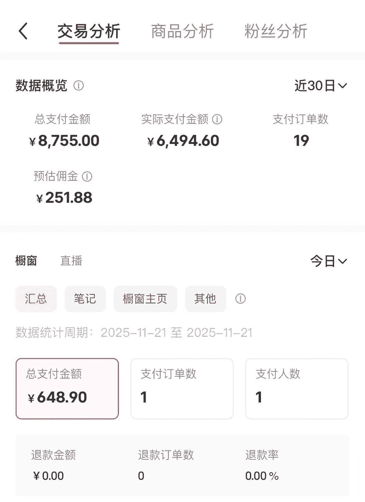

今天我想分享的，正是如何通过发笔记种草和评论区种草这两个核心动作，在家居赛道实现从0到1的突破。

## 一、📕买手是什么？

📕买手，就是你在📕上的“最会买东西的闺蜜”。

她不是冰冷的电商平台算法，也不是高高在上的明星代言人，而是一个凭借自己的品味、经验和真诚分享，帮你发现并买到好东西的关键角色。

📕买手主要是在买手选品中心，挑选优质的产品，上架到橱窗，通过视频或者图片的形式发布笔记，帮助用户挑选到真正好用的适合自己的产品，同时实现商业价值。

📕买手达到千粉后，不用自己找货源、囤货，门槛低、投入成本几乎没有，📕笔记发布后，优质的内容会一直有流量、一直有收入。我有一条笔记就是这样，现在1W多小眼睛了，一直都在出单。

📕买手收入：销售额*佣金比例-样品费

## 二、为什么📕买手值得做

📕正在全力押注买手和电商，扶持力度大，这创造了一个前所未有的利好环境。

### 01 平台属性和用户优势

📕拥有3亿月活用户，内容分享者超1亿，女性用户占比 70%，男性用户占比 30%，一二线城市用户占比 50%。

📕用户年轻化，对品质生活要求高，追求真实、精致、性价比，愿意为悦己和生活仪式感付费，消费力强，追求好用靠谱的好物种草。

比如像我，我种草的几乎是客单价在400-600以上客单价的产品，小博主也能种草成功。

### **02 流量倾斜，真金白银的扶持**

📕明确表示 “买手是📕电商最有活力的角色” ，并投入大量流量激励。这意味着平台算法会主动将你的带货笔记推荐给潜在用户，你不再需要与内容博主纯拼曝光量，只要你能促成交易，平台就给你更多流量

下面这个是我笔记里📕的真金白银的流量扶持。

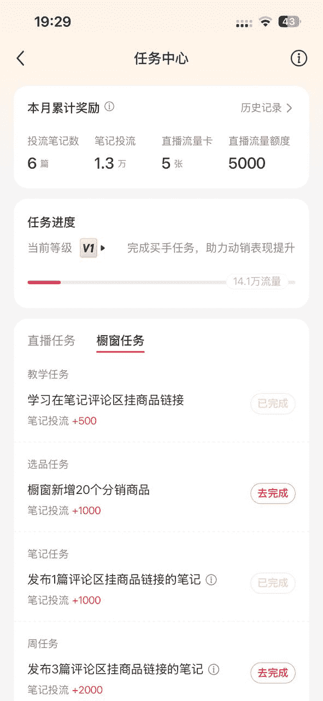

### **03 生态闭环，转化路径极短**

以前在📕种草，用户要跳转到淘宝、京东，过程中大量流失。现在，从 “种草”到“拔草” 全在APP内完成：

用户被笔记吸引 -> 评论区问链接/直接点击商品链接 -> 在📕站内完成购买

这个超短的闭环，极大地提高了转化率，让你的每一分内容努力都更直接地变成收入。

变现路径很清晰。

### 04 用户心智成熟，“要链接”是本能

正如我的理念，“一生都在要链接的中国女人” 。这里的用户带着明确的消费意愿而来，他们不反感广告，反而主动寻求购买建议。这种“求链接”的评论，就是很准的流量。

### 05 📕买手操作难度低

内容创作门槛简单：它不考验你的剪辑技术，不要求你写长篇大论，也无需你囤货和处理售后物流。它的核心技能就两点：一是“会分享”，能用图片和文字说出真实感受；二是“有网感”，知道什么内容能打动人。

用手机就能完成拍摄、剪辑、P图，容易上手。

## 三、 如何做：自己发种草笔记出单

我目前主要做的是图片种草，新人的话我觉得图片种草的优势是效率会更高，也更加会提高执行力，更快拿到正反馈一些，其实我发的笔记不算多，两个号加起来目前一共发了14条买手笔记。

### 01 关键动作：标题+图片的黄金组合

#### 标题：情绪化表达

可以直接对标做选题和内容的小爆款（百赞左右）。

**算法推荐：**

标题文案的来源也不是我拍脑袋写出来的，几乎是由刷到的爆款笔记标题提炼出来的，我刷到的每一篇我觉得可以模仿的笔记都会把这篇爆款笔记转发到我小号里。

你会发现每次打开发现页推荐页，算法会自动推送给你想要看的内容，机器会比你更了解自己想看什么内容。

下一篇就会马上结合爆款笔记的内容和自己的内容二创一下。

我主要就是靠首页推荐的爆款笔记来成为我的选题，因为很近也很新，也很有用，几乎只要马上跟进了，笔记小眼睛少的也有1000以上的小眼睛（我是重度用户，有时间就刷📕去了）

当然方法还有很多，比如航海手册写的我就不赘述了。

我的爆款笔记非常多，很多上W的小眼睛，一定要对标题重视（这些爆款笔记很多是之前发的，但是同样可以运用到买手笔记当中，我的笔记很多求链接的，可惜当时我不知道可以做买手给他们发链接，都是很老实的给他们说在哪里买的）

我的标题方法论很简单但有效：

+   情绪化：“为了XXX，和老公大吵一架”（13万小眼睛，评论区很多问具体是哪款产品的）

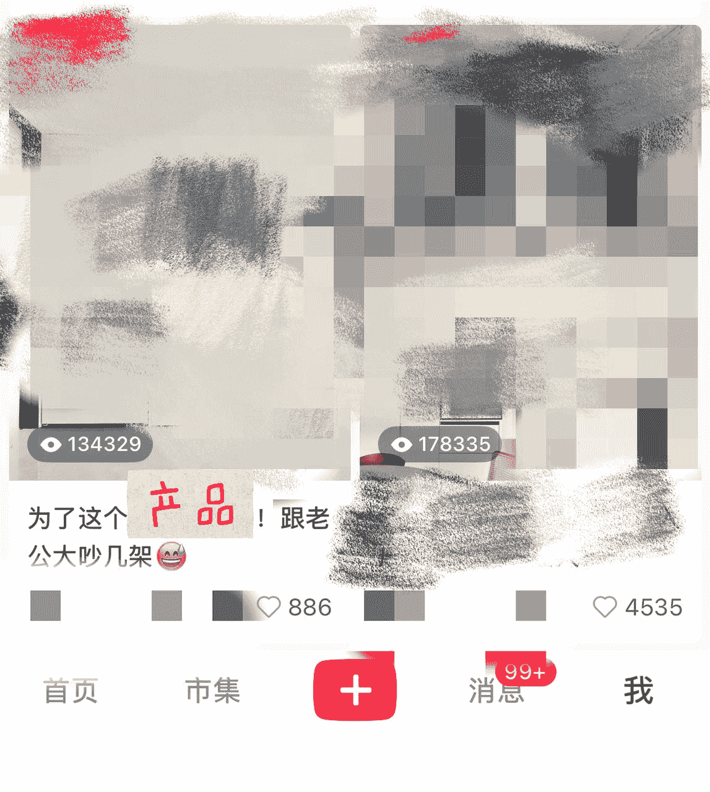

+   对比法：“对比了好几家，买了XXX，没翻车！”（1万多小眼睛，评论区很多问我哪家买的，由于我几乎都会和评论区互动我就不截图了）

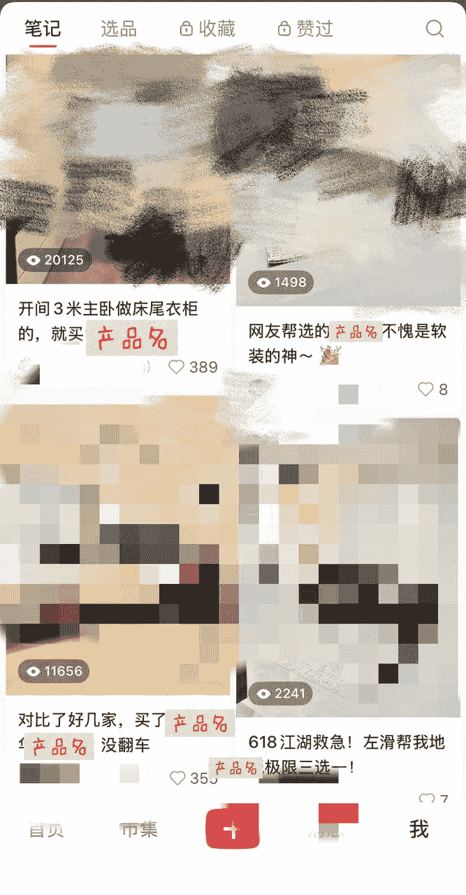

+   替人体验法：“替你们试过了，网购的XXX太值了！”

+   听劝法：“听我一句劝，XXXX（根据自己赛道写）

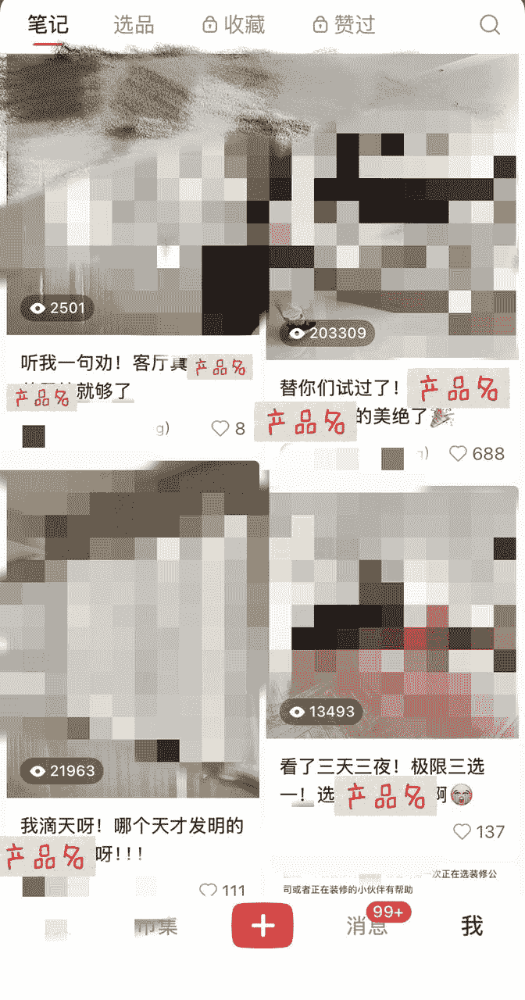

核心要点：根据对标结构加入真实体验，加上激发幸福感的生活化句子，坚决不AI化，保持真人感。

你们可以发现，我的标题文案大部分都很📕的feel，其中体验法和对比法是最好用的，根据我的笔记总结，对比法流量最好，涨粉最多，最容易带来赞藏，求问链接。

#### 标题：两个爆款标题综合起来

| 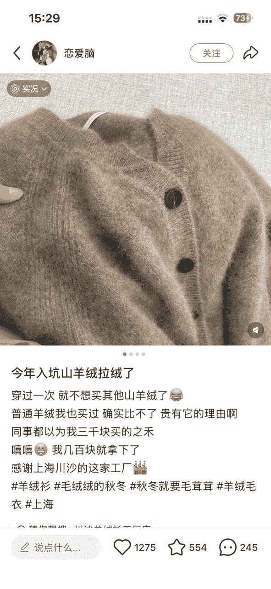 | 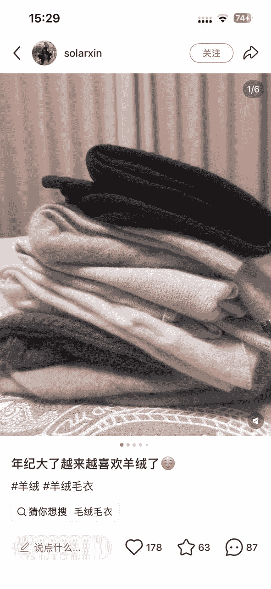 |
| --- | --- |

图片组成新的标题：年纪越大越入坑山羊绒

#### 图片：高清有质感有审美

我的图片大部分是Live图，📕用户很喜欢看Live图。

##### 构图：我基本的构图方法就是以下方法（我也是自己搜索网上学习的，图也是📕的）

| 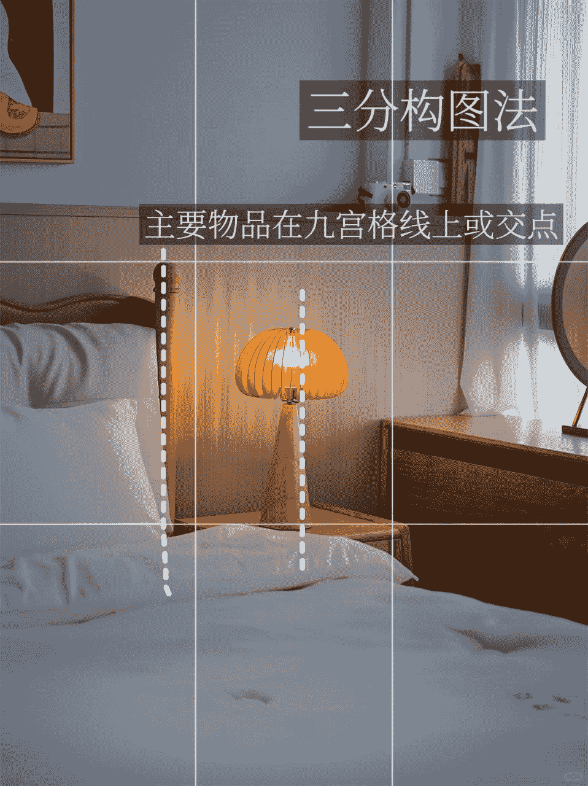 | 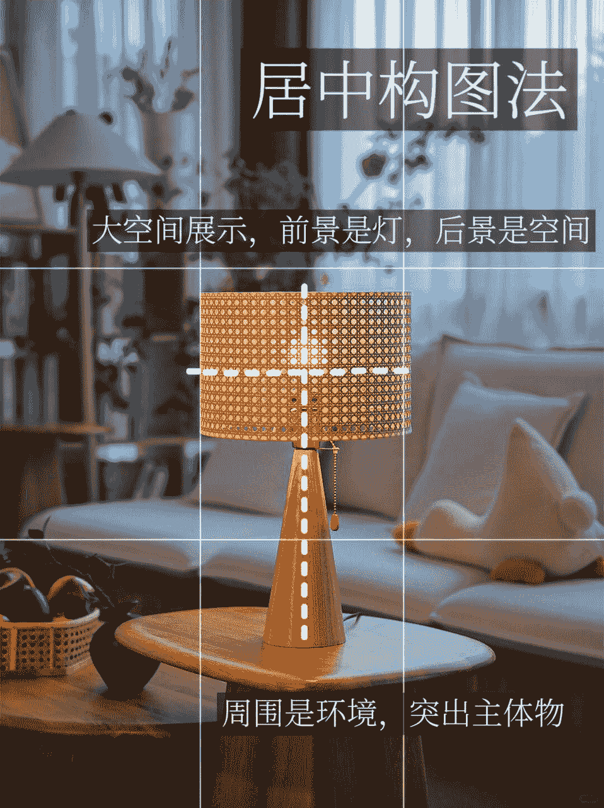 | 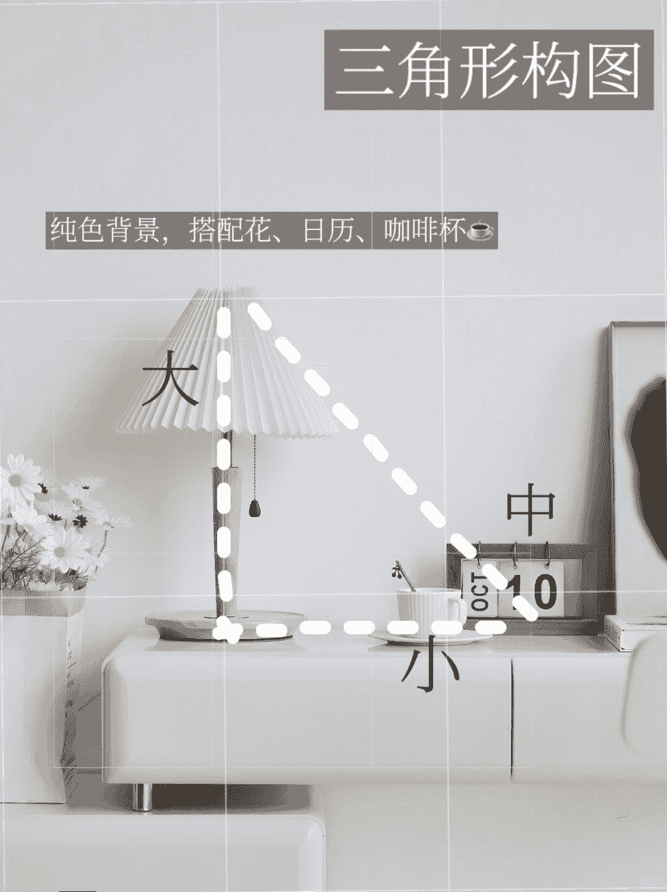 | 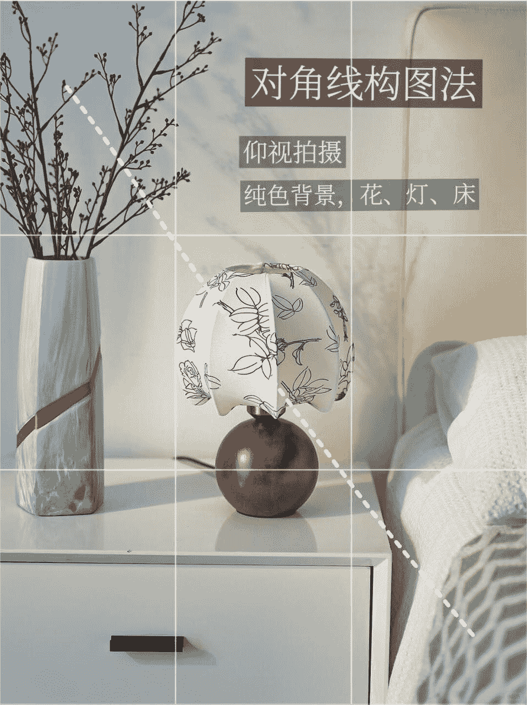 |
| --- | --- | --- | --- |
| 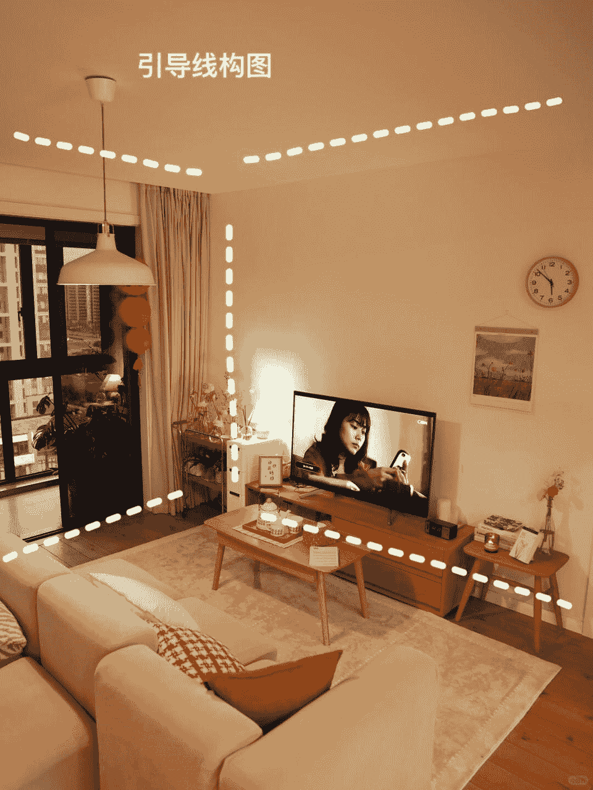 | 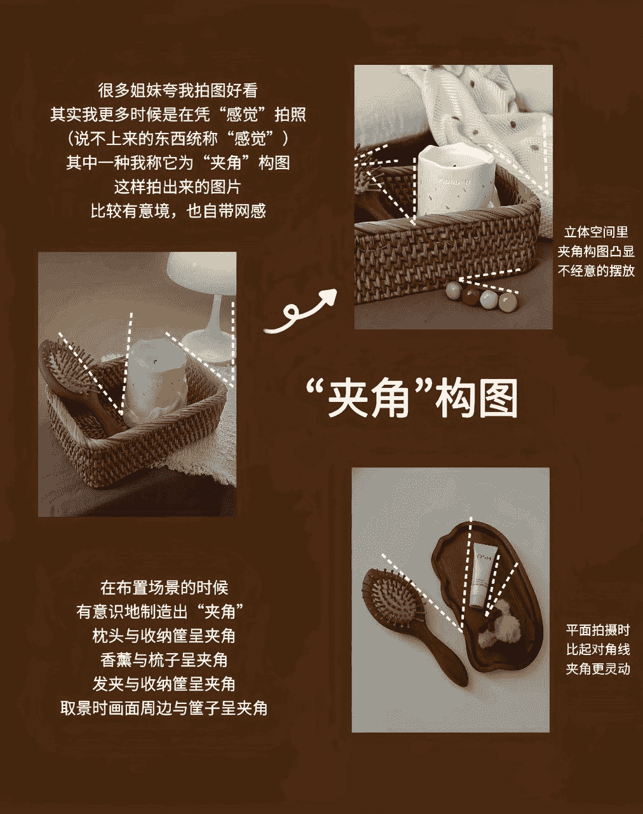 | 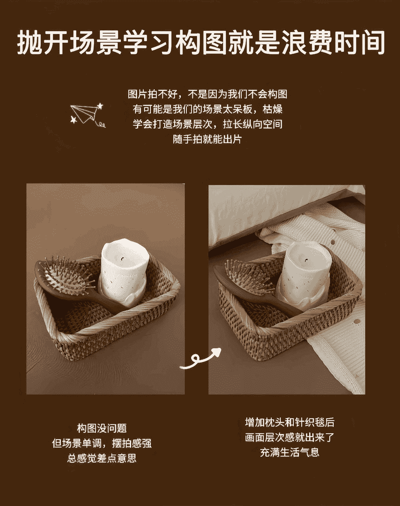 | 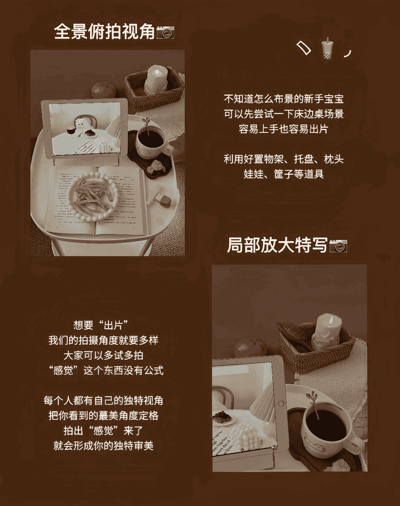 |

##### 照片调色

我所有的照片都会进行稍微的调色，有的直接在苹果上面调色，有的图片用的醒图/美图秀秀调色，让图片看起来更高清有质感。

现在很多P图软件也可以进行Live图修图。

具体的根据自己当时拍照完的光线进行调色，具体的也可以📕搜，上面都有完整的调色数据。

### 02 重视文案的口语感

除了图片和标题，文案我一般也会认真写，一定不要Ai化，真的会一眼假，我一般都是根据爆款笔记的结构，结合自己对产品的使用感觉真实的写出来。

也不要太多emoji，营销感太强。

你就当这个东西你真的是在分享给你闺蜜，你会怎么和你闺蜜说，你就怎么写文案，稍微整理一下结构就可以了。

**核心要点：根据对标笔记结构加入真实体验，加上激发幸福感**的生活化句子，坚决不AI化，保持真人感。

### 03 评论区挂种草链接并置顶

首先要把商品上架到橱窗

#### **上架商品到橱窗步骤：**

| 点击选品中心 | 种草的产品 | 选品管理上架橱窗 |
| --- | --- | --- |

可以选择在选品中心里的橱窗好卖或者人气红榜里挑选，当然佣金自然是越高越好，10%以上都可以，我种草的几个产品主要是因为虽然佣金只有5%，但是好在客单价在400-600之间，也比较好出单。

在📕mini航海里，我看到群内有小伙伴就是选的橱窗好卖的货，哪怕自己没有实物，自己直播也卖出好几单，就说明橱窗好卖的商品应该种草大部分比较容易。

当然也可以去联系商家看可否提高佣金都是可以的。

#### **发链接步骤：**

| 点击评论区加号 | 点击商品 | 点击添加 | 然后回复评论 |
| --- | --- | --- | --- |

#### 评论区发布种草链接

我也是在📕买手MINI航海中，看到无敌老师说，可以在评论区回复链接+置顶这条评论，评论区挂链接最自然和真实，而且给人也是一种不为卖货而是真诚分享，真的觉得这个东西好用的感觉，很多人更加会相信。

我也是这样试了一下，真心觉得好使，真实分享更好，还有记得无敌老师说，如果之前分享过的一些好物，但是没挂链接，单纯为爱分享的，这些都可以在历史评论区挂挂链接然后置顶，这样操作我也有出单的，📕的长尾流量真的很好。

所以我的大部分笔记是评论区置顶商品链接，一般我发一篇笔记，总是会有人来评论区问：姐妹有链接吗？怎么买。

回复：**xxxx（🔗）链接在这里**

这个时候及时回复📕商品链接并且置顶这条评论就能很好的承接流量。

**自导自演：自然引导**

我发笔记大多不直接挂链接，而是在评论区挂链接。如果没人问链接，我会：

1.  用小号评论：“姐妹，求链接”

1.  自己回复：“XXX这个就是~”

这样既自然又不突兀，然后自己回复商品链接并且置顶这条评论。

📕的长尾流量有时候就会这样默默的出单了。

## 四、素人笔记评论区种草的巧妙玩法

### 01 素人评论区截流：借力打力

为什么我会想到这个，是因为在📕MINI航海中，有一天看到有个群友发一张图片，是一条笔记下面有人在评论区发了种草的图片+链接，这个时候我才知道还能截流。

后面我在很多素人笔记下面也有这样的评论，我想着我是不是也能发一下试试，没想到刚在别人评论区种草不久就发现有订单了。

但是要注意在素人爆款笔记下发种草链接，但是不要硬发，你要真诚分享这个东西真的好用。

**下面是我的一部分出单详情：**

可以看到，哪怕是高客单价产品，在素人笔记真实的分享自己好用的产品，也能出单的，素人1.2W的浏览量我就出了4单，4000多的浏览量我也出了3单，而且都是客单价400-600左右的产品。

#### 判断可以在素人爆文笔记种草的标准：

##### 以下是判断维度

**数据表现**

基础互动量：赞、藏、评总数是直观指标。小爆文赞藏通常总量>100，或者1000以上。

主要是看评论区，2小时内评论量≥50，是爆发潜力的重要信号。

看评论区是否都在求链接的，**如果素人博主的笔记流量越来越好，我**也会出单越多（先在评论区种草的先发优势）

如果你看到素人笔记短时间内数据特别好，那么你就可以去他评论区种草这种自然是最好的。

但是其实也能在评论区没那么多人素人笔记的评论区种草，下面这个就是我在一个只有10多个评论的笔记下面种草的出单，说明📕用户其实是挺相信评论区的种草的。

| 我在素人笔记的评论 | 这条笔记的出单 |
| --- | --- |

**内容质量**

真实原生感：素人博主大部分文案是口语化分享，带有生活化场景和情绪共鸣，甚至有“微瑕疵”的细节

**

博主**属性

主页内容生活化，更新不规律，无过多商业合作痕迹，今天分享穿搭，明天分享各自鸡毛蒜皮的事。

**商业潜力**

评论区求链氛围：笔记评论区已经出现大量“求链接”、“怎么买”、“好看” 等询问性评论，说明用户购买意向明确，是截流的最佳时机。

##### **具体操作**

+   专注素人1周内的爆款笔记

如果你有确定的产品，可以直接搜索产品关键词，筛选最多评论和一周内，评论多大概率可能要链接的多，一般自然推流一个月内的素人爆款笔记也行。

+   点进主页确认是真实素人

+   在求链接热潮中自然抛出购物链接

我主要是在素人笔记那里发种草链接，主要集中在素人1周内的爆款笔记，也有不那么爆的笔记，但是素人1周内的爆款笔记评论区种草，我出单更多，毕竟是借助了别人的流量。

举个列子，如果你想卖铁锅，可以自己搜索，也可以系统给我推了一周内的素人类似种草需求的笔记，会吸引很多人来评论。

如果你怕不是素人，你可以点进他的主页看，就知道是不是素人发的笔记了，作为买手就可以类似这样去真实种草评论

列子如下：

| 素人近期爆款笔记 | 确认是真实素人 | 评论区发自己买的产品 |  |  |
| --- | --- | --- | --- | --- |

大家可以看到一堆人求链接，这个时候你顺其自然甩上一个📕购物链接，是不是很多人看到了自然就买了。

这样就是一个很真实自然也很真诚的一次评论区种草，而且也不会被删评论，至少这样的几率很小。

**很**巧的是，刚好看到有个博主在不同的素人评论区种草铁锅，根据素人发的笔记内容针对性的真实回复并且种草铁锅，这样真实又自然。

一定要考虑那篇笔记所代表的用户需求，根据用户需求去评论区种草。

那如果你回复了产品图片，但是没人问链接怎么办？

你同样可以拿一个小号在自己的评论区底下回复：求链接

然后你在回复：XXX这个就是。

当然，你也可以直接在素人笔记下面回复图片+商品链接，只是这样有点像营销了，怕会被举报。

#### 📕自动推荐素人帖子

可以在把📕里我的频道全部添加上，随时都可以刷到对应赛道的内容，如果首页推荐也行。

比如你想看美食的就点美食推荐的帖子，想看穿搭就点穿搭，如果有适合区评论区种草的帖子你就去回复图片+文字+链接，当然这个链接最好是有人求链接的时候再给别人是最好的，但是我试过同时发链接也有出单的。

| --- | --- | --- | --- |

### 02 素人评论区种草不分赛道

哪怕你是家居领域的博主，你也可以去素人穿搭发的帖子种草，比如光腿神器，去发食品相关的素人博主评论区种草好吃的，只要是你真的喜欢的东西，然后分享出去。

**这样做的优势：**

+   借助别人的流量池

+   真实自然，不易被删评论

+   转化率更高，因为用户已经表现出兴趣

比如：几乎都是素人发的帖子，可以看到，真实的分享都是有图片+文字的，然后其他用户看到了，被种草了自然就会有一堆人来问链接。

| 家居赛道 | 穿搭赛道 | 母婴赛道 | 宠物赛道 | 发饰类 |
| --- | --- | --- | --- | --- |

### **03 注意事项**

不要在那种自己也是卖东西的人那里评论，否则你会被删评论，甚至还会被投诉违规。

不要营销感重，真诚的分享，要不然也可能违规。

不要在别人笔记下面直接甩链接连文字都没有就走人。

## 五、复制门槛低

+   信任问题：其实现在很多用户相信真实素人胜过专业博主，你去素人评论区真诚分享真的可以带来出单。

+   情绪共鸣：情绪化表达引发更强互动

+   流量借力：借用素人流量，我在素人爆款笔记评论区的种草有1.2W的观看量，善用现有流量而非从零创造，这个流量就是白来的。

**复制需要什么：**

1.  网感：多刷自己赛道，知道什么能爆

1.  执行力：认真对标、模仿、优化

1.  审美力：基础图片处理能力

1.  真诚心：真心分享好物

最不需要的：专业设备、大量资金、团队支持。

## 六、经验沉淀与核心心法

做得最对的一件事：坚持“图片+情绪化标题”的黄金组合，让笔记既有美感又有温度。

最重要的心得：不要自嗨，要认真做选题和对标。

很多人数据不好，就是因为：

+   按自己心情随意发笔记

+   没有认真分析爆款

+   缺乏持续优化的耐心

**我的爆款心法：**

1、多刷赛道，培养网感

2、看到爆款，立即保存

3、文案结合自己使用感受二次创作，加入真情实感

4、图片精美，标题情绪化

5、评论区，自然引导

## 七、未来展望与行动建议

下一步计划：

+   测试视频笔记和直播的可能性

主要原因是看到无敌老师自己还做直播做买手示范给我们看，我也是从无敌老师那次的直播以及群内回答关于直播的内容启发到，后面我就拆解我那个赛道的博主，发现有个博主，视频没发多少篇，但是篇篇爆款，还能搭配直播和📕群聊，视频是一边种草商品一边输出干货。

最后让用户点击预约直播，在直播间进行转换成交，搭配群聊是进行说明直播间抽奖中奖更近一步促进直播间进行转化。

目前看是我有能力复制模仿有能力的风格。

| 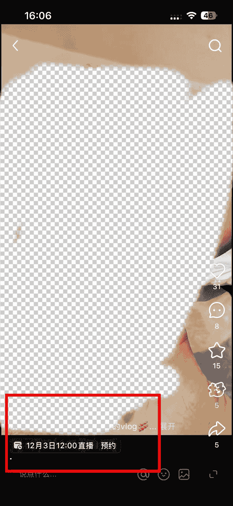 | 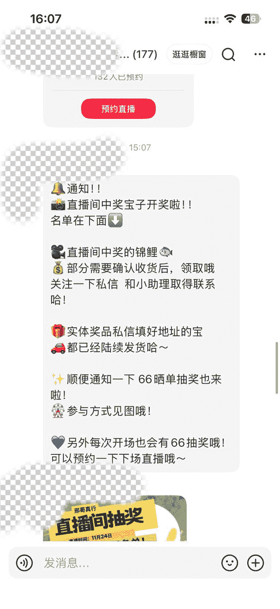 |
| --- | --- |

给还没动手的朋友：

不要想得太复杂，从今晚分析10篇同赛道爆款笔记开始，记录下打动你的标题和图片，明天就模仿创作一篇。

你只要真诚的去分享，去别人评论区种草也好，自己发笔记种草也好，分享自己喜欢的东西，真诚分享，在加上一些网感。

我觉得如果笔记数据不好，可能是不是自嗨了？对标找了有在认真模仿吗？

选题有在认真做吗？不要按照当下自己的状态，突发奇想就这么拍和发了，大概率数据不好。

其实我分享的内容没有那么多五花八门复杂的东西，就很简单，但是需要自己去做，有技巧的去做，让笔记变的很自然真实。

记住：“一生都在要链接的中国女人”永远存在，关键在于你能否用真诚和技巧，让她们看到你的分享，刚好自己喜欢分享自己喜欢的东西，去种草这个商品的购买链接，做📕买手。

## 八、致谢大家

最后，感谢龙哥盟搭建的这个平台，真的是一个很高质量的链接平台，有优质的信息参考，尤其是很有幸能参加这次的📕买手mini航海，是这次航海我也意识到做家居博主不仅仅可以在蒲公英接商单，还能在📕做买手，又增加了一个渠道的收入（之前用户问链接我都是傻乎乎老实的说在哪里买的）

感谢无敌老师、周周老师还有各位教练的尽心尽责的回答各自疑惑以及给予的启发，对我的帮助真的非常大，才能快速发笔记，快速出单，验证买手真的是可行的。

感谢一直在支持鼓励我的志愿者萱萱，鼓励我分享，鼓励我很多很多给予信心。

诚挚的感谢这一路上遇到的良师益友，我会更加持续得做得更好，再次感谢！