# 【小红书剧本代写】用0.1元小红书店铺链接引流，稳定月入两万全过程复盘

> 来源：[https://xuqiwei1986.feishu.cn/docx/HdyjdEOX9ozhW0xRBn3csYRvn0c](https://xuqiwei1986.feishu.cn/docx/HdyjdEOX9ozhW0xRBn3csYRvn0c)

大家好，我是漫漫，02年，今年刚大学毕业，一人旅居多个城市，现在暂居广州，欢迎线下交流

# 一、我为什么会选择剧本

## 1.1 个人经历

一年半前我是连饭都吃不上的大学生，吃饱了上顿担心下顿的，在大学别人忙着学习，我忙着做兼职，你能想到的线下兼职我都做过，摆摊，从奶茶店打工一个月1000块，食堂打工一个小时10快钱，发传单一个小时20块，做家教一个小时50，考研代理这些我都干过，当时我就是想吃饭，我的目的很简单，填饱肚子

当时做这些线下兼职的时候，就在思考有什么我不到场就能赚到的钱，因为实在是太想找到这样能在互联网上赚钱的方法，我什么都听，都看，命运的齿轮开始转动，我听到了雪姨的播客，知道了这么多能赚钱的项目，看到了那么多我不用在场就能赚钱的项目，我很感动和激动，原来这个世界上除了考研，考公，工作，还有这么多出路，你是可以活下去的，她们让我看到了不一样的可能性，当时也是让我知道了有生财有术这样一个社群

我开始研究如何在互联网上赚到钱，开始实操，不得不说，AI代写是最快拿到结果的，我去加了上百家淘宝店铺，咨询，加好友，好评，几十家企业微信，当时学习手册里明确也写了，新手超过60的单子就不要接了，但是我第一单就接了个100的，这个也是从此我接过最低的，需求催生能力，因为我极度想要做到，无论多难，我都会学习，既然有需求，那就干，那就学，又能赚钱，何乐而不为呢

就这样我就专门挑贵的接在淘宝100，200，400以上的都接过，我基本没在淘宝当过黑奴，而且因为我写的好，淘宝客服追着我喂单，所以那一个月我就在淘宝赚了四五千，对我来说也是很多了

## 1.2 如何找到适合自己的代写品类

我是一个文科生，在做代写前也是完全没接触过什么AI，lw之类的，什么数据分析，文献之类的都不懂，所以我在选择品类的时候，直接避开lw赛道，lw之类的我都不接，即使lw高客单也不接，只接一些我喜欢的，对我来说容易的，而且客单价又相对高的，我反复对比，除了lw还有什么客单价高的品，当时我开始做代写接单的时候就是9月份10月份，那个时候教学设计，教案流量很大，客单价也高，我做了几单发现太无聊了，模板什么的都是统一的，对我来说没有挑战性，我写的一点都不爽，后来又去接了策划书，各种商业策划书，客单价也是很高，但是涉及到找一些数据，我觉得很费劲，做了几单也没接了

后面我才看到了剧本，我接的第一个剧本单就是400，而且剧本的写手很少，我看了会写剧本的人真的很少，而且本身我自己在写剧本的时候，跟着故事人物在走，就很开心，找到客单价高又适合自己的品类

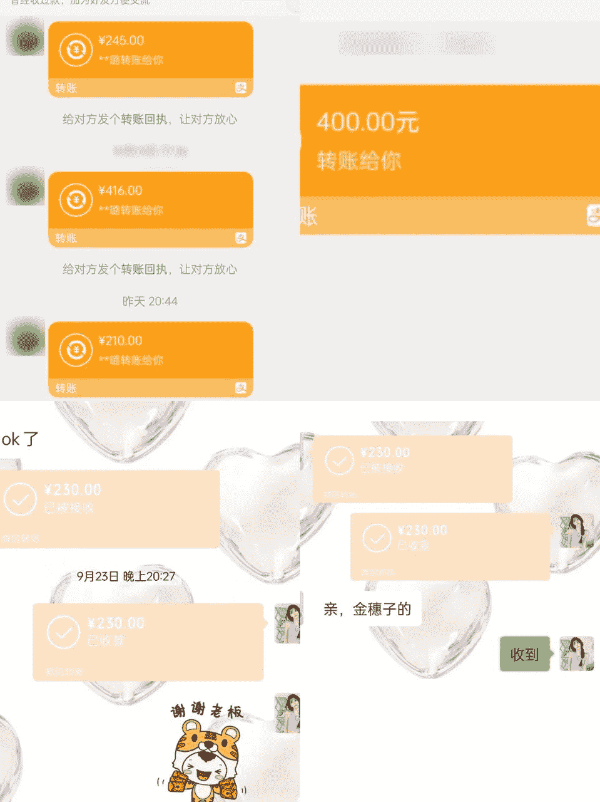

就根据我在淘宝学习的阶段，我了解到了，剧本市场的可观性，所以，我的所有精力都是用来弄剧本，我发现剧本的客单价真的比一般的作业要高，一般淘宝才给几十块钱的，但是剧本都是上百块，而且竞品少，我自己做流量的时候也发现闲鱼同行也不多，会写剧本的人也不多，所以我就只专注做剧本

## 1.3 剧本的客户群体和品类

剧本的客户群体主要是短视频剧本文案，有复购，客单价均价在150左右，有的在300一条，主要看具体难度，主要吃短视频文案的复购，文案也比较简单几百字就可以，短视频人群每天都要拍视频，可以谈成包月单，再加上我之前在一个传媒公司实习过，写宣传片文案，基本均价在800以上，高的可以在四位数

还有一类艺术类的学生，编导，传媒，文传的学生的毕设剧本，大概就在9月份开始接，基本也是四位数以上，9月份我就接了二十几个单子，这波学生可以服务四次，第一次毕设剧本，下一波分镜头脚本，接下来就是下个学期的创作报告

还有一类是舞台剧表演，也就是情景剧，类似大学生心理剧表演，老师各个节日汇报表演，体制内汇报表演，公司年会节目

除去上述几个我接单比较多的，还有一个短剧剧本，也有人找代写，但是都是需要试稿，有的是给稿费，价格在四位数以上，最近很火的AI漫剧也是属于这个类型的，AI漫剧会比短剧还要简单一点

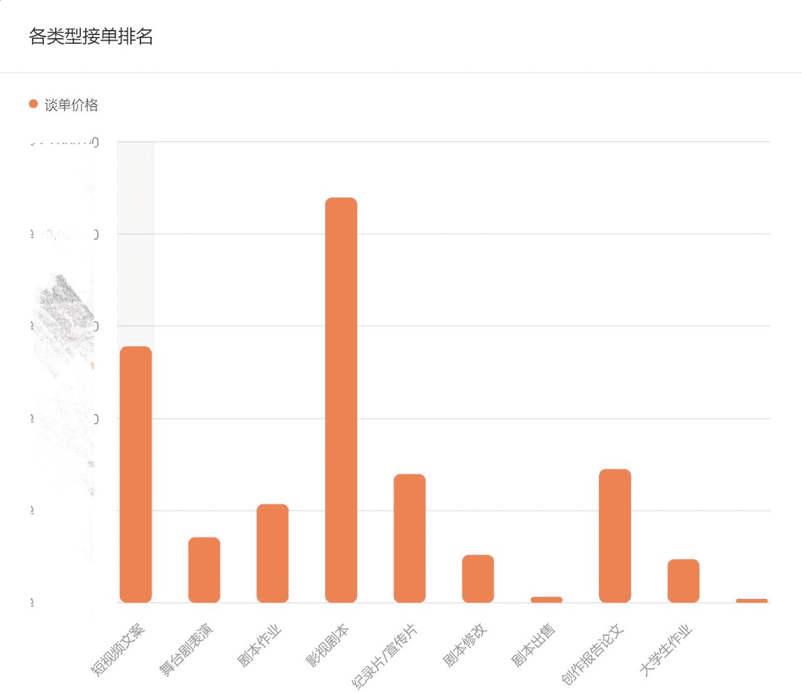

# 二、我为什么从闲鱼转战小红书

刚开始做代写的时候，我也是做闲鱼，闲鱼流量很大，而且基本的动作也是一致的，也是有一定的确定性的，闲鱼每日必做，新产品上新，擦亮，补单，下架，这些步骤我都会定好每天的闹钟，闹钟一响，在什么时间做什么事，我就一清二楚了，在固定的时间做固定的事

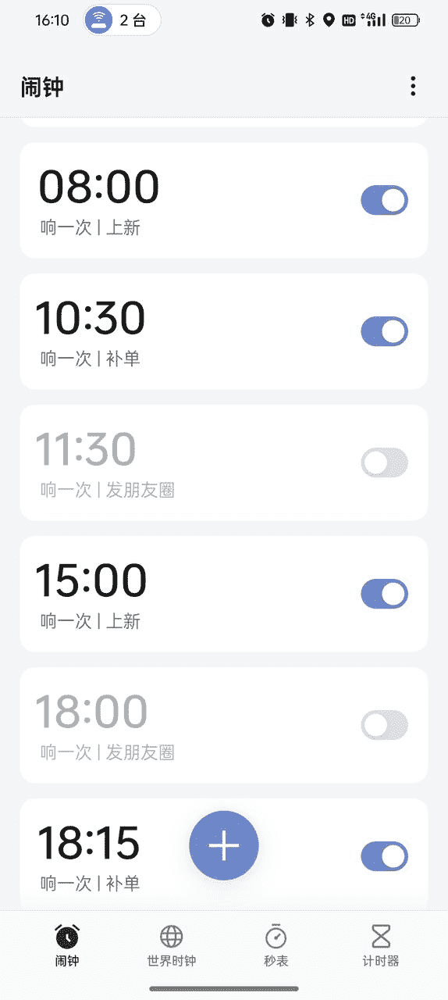

我去年刚做闲鱼的时候，我的剧本同行不多，我调研了一圈，不超过20个，就是很少，我只要基本闲鱼动作每日坚持做，我的链接，随时都可以爆了，但是今年大概从四月份开始，闲鱼的流量就不太行了，剧本的同行一下多了一倍，价格市场也没有之前那么客观好谈了，为了让我的链接持续曝光，我开始用闲鱼的超级擦亮，也就是闲鱼的投流，给闲鱼付钱，做平台喜欢的事，刚开始效果还特别明显，我每天的曝光都是超过一万，一天的咨询也是几十个，接不过来

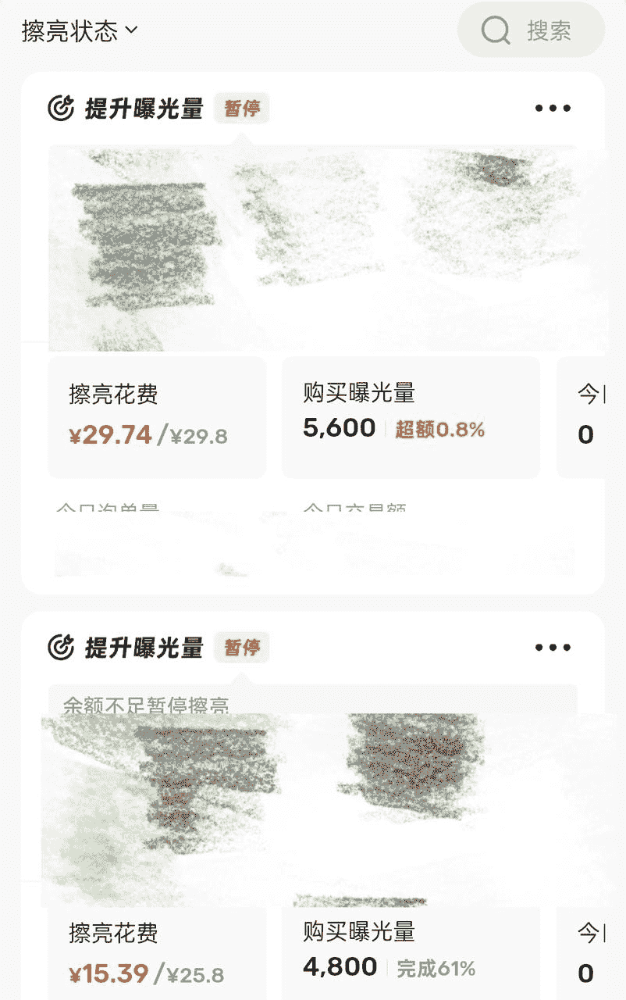

闲鱼流量跑通没有问题，我又想着扩大平台，去试试小红书的流量

这个期间我和一个做代写的朋友聊，他和我说小红书的客户会比闲鱼更加优质，客单价会更高，我当时随便发的一个帖子，同一个类型的转化的客单价也是比闲鱼高出好几百，所以我下定决心做小红书，后面我的全部精力也是用在了小红书上，小红书的自然流真的太香了，即使你哪天没有日更，你上个月的笔记还会有咨询，对于因为闲鱼补单上新很疲惫的我们是很友好的

# 三、我的小红书流量进阶之路

## 1.0阶段 小白学习小红书

我之前也是完全没有接触过这个平台，引流，标题，关键词，图文这些都不太懂，去听了很多课，看了生财很多关于小红书的帖子，学会了，但是还是有点蒙，带着半蒙的状态，开始实操小红书

调研了几十个小红书同行（当时找的时候我还专门找那种点赞收藏多，粉丝多的记录）然后我用飞书表格记录下来，看它的笔记形式，引流方式，封面怎么写，进私域是怎么转化的，朋友圈是怎么发的

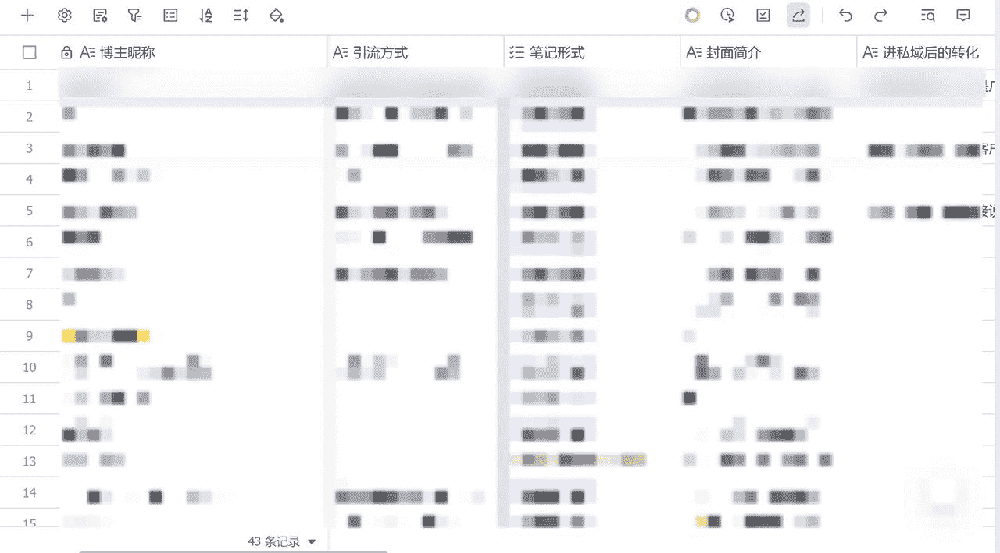

然后看完总结这几十个案例同行，我花了一两天，但是我的小红书还没开始发，我只是在学，一整个我学会了再实操的心态（小白)

当我开始发的时候，我就开始纠结我到底该怎么写标题，怎么写文案，我的图片要怎么弄，每天被这个标题文案图片内耗，我当时追求那种漂亮的分享案例，点赞收藏上千的剧本分享，每天在WPS里转文件图片，打水印就花费很长时间，我又纠结标题文案又花1个小时，一天才能发出一篇笔记

最主要的是，我这么精心做的笔记，小眼睛才几十个，我当时就想放弃，觉得这还没有我闲鱼来的快，这也太难了吧，反馈太慢了

## 2.0阶段 进阶学习小红书

在我花了很大的劲坚持了一段时间后，还是没有什么效果，还很麻烦，我当时听了一个小红书的课，重新学习了小红书的知识，又刚好看到一篇小红书流量推流法则，搜索流量，自然流，占位思维，小红书低粉高转化，才知道我从一开始找对标的时候就错了，我找的全是高粉高赞高收藏的，小红书对于我们这种引流玩家来说，点赞收藏都没用，最主要的还是评论和私信

我又重新开始找对标，找同行的模板，记录同行的模板，看了一圈基本都是大字报形式，也就是最基础的小红书图文形式（配图＋大字报）

我就开始模仿这种形式，图片有了，我的标题文案怎么整呀，我就照猫画虎，改几个对标的关键词，刚发一两篇就有了咨询，也让我看到了小红书的出路了

引流方式我试过这几种，基本都是圈友总结的，看了很多圈友的文章，感谢生财圈友提供的思路

+   小红书号修改成微信

+   微信背景图

+   小号引流

+   瞬间引流

+   微信群聊置顶引流

这些我都试过，每次有客户咨询，我让复制小红薯号，但是每次发，客户都不太明白什么意思，我又试了背景图，客户根本不愿意点开你的主页看，而且这个方式很快就被小红书识别了，被关了几天小黑屋

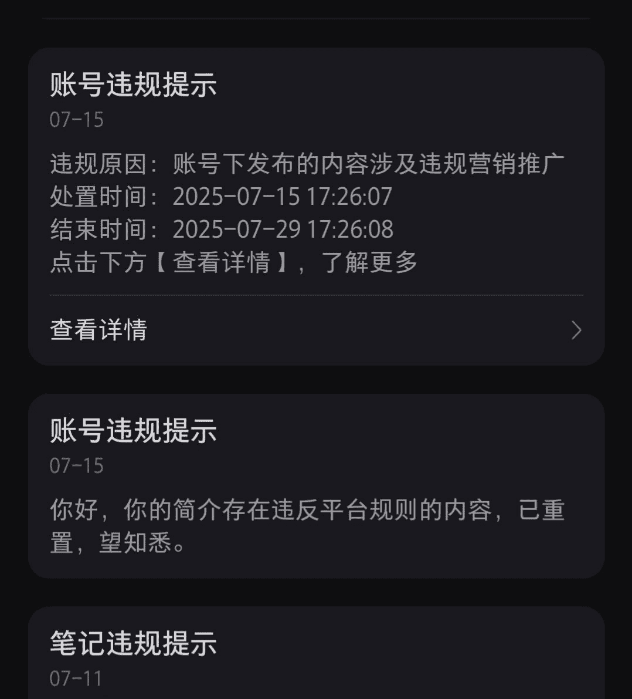

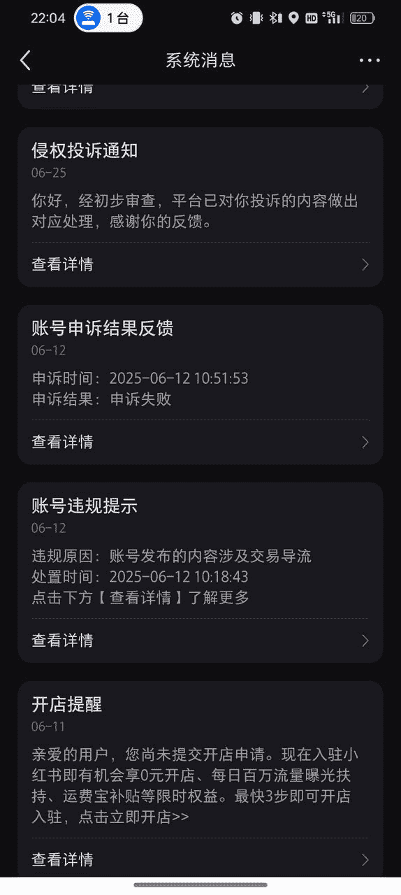

然后就是小号引流，小号我在主页放@小号小红书，因为有约稿@的字样，每几天我又被关小黑屋了，当时也是挺崩溃的

当时又在一个群里看到分享可以弄一个群聊，在群聊里引流

群聊引流我试过几种方式，一种是在公告里说明小红书号就是微信，一种是在群聊的头像里放微信，这两种方式也有好处，也有弊端，好处就是不容易被识别，不容易被封，坏处就是引流不到人

就是你要引流到人，最主要的就是，路径不要太长，对方既然都已经找代写了，太麻烦的事就不想做，所以我这个路劲还是太长了，当然如果圈友能在我这些基础上优化，可能会更加好

转折来了，因为引流不到人，我也很苦恼，有咨询，无法＋到人，刚好那天我在家搜家乡的特产，我就去咨询，店家也是给我发了一个群聊，我进群后，发现新的引流方式，就是左小角打开放微信，这个的确很好用

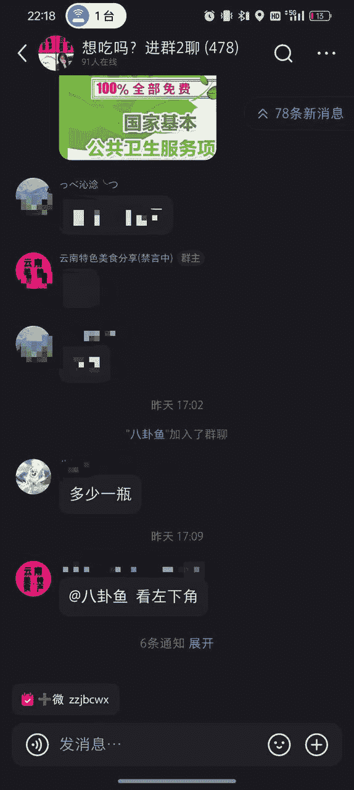

这个方法也是帮我进了几十个优质客户

但是左小角放的话，有的客户进群可能看不到，就一直问，你也是需要随时回复，后来有一天我有看到更快的引流的方式，在置顶放微信图，是在一个引流键盘图的群看到的，（所以我们做小红书引流的还是多去搜一下小的需求，去看看这些日常需求都是怎么引流的）这种就很直接，进群就能点开，也是很丝滑

这种大概持续了10天左右，还是被识别了（配图),直接不让我发笔记了

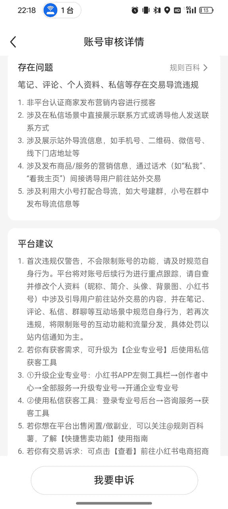

## 3.0 开小红书店铺

我的号又不能发笔记了，我只能再开一个新号，我之前的一个老号也是一直没用，我就注销了重新注册，又重新来一遍，刚好看到一篇公众号文章，小红书虚拟资料，我们做代写本身也是在卖一种虚拟资料，只是一对一定制，所以，我又调研了我的同行，我发现同行也有很多在这样做，我就开始研究如何开小红书店铺，如何开小红书店铺就不过多介绍，我们很多圈友小红书虚拟资料也写的很详细，我就讲讲如何把这个店铺赋能到我们的代写上

### 3.1 如何开小红书店铺

[【适合新手】小红书虚拟电商从0到1全流程拆解！无保留分享](https://o7nsrridj4.feishu.cn/docx/OrEhdYvTgoLlO8xDXeRcwJ3CnGc)以看这篇文章，当时是跟着这篇操作的，圈友写的很详细

### 3.2 如何引流

小红书虚拟资料和我们做店铺很大的区别就是，虚拟资料不用引流，只需要拍下付款发货就行，但是我们代写需要引流到私域成交呀，我当时想的是设置一个均价，100-200这样的一个定金价，但是很多人看到这个价格就被吓退了，试错成本太高，所以效果也不是很好，我就去问了小鹅这个我要怎么办呀

鹅总小鹅给我提供了一个新的思路，低价引流呀，这种时候我们设置一个最低价0.1元，直接挂出来，客户拍下来也不会有心理负担

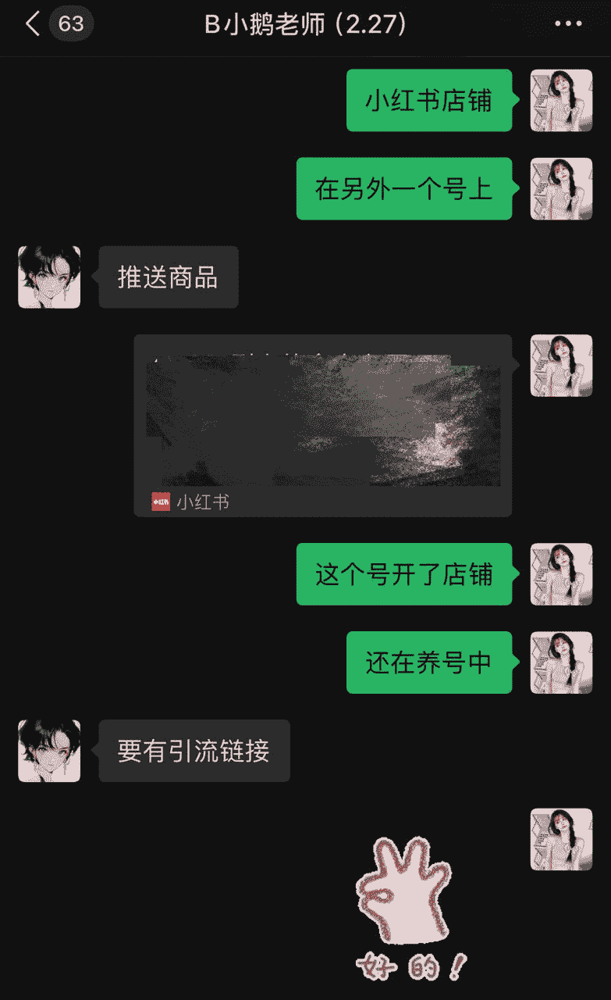

我立马就去实操，并参照我的同行设置一个商品标题（约稿拍下联系客服），然后在每一篇笔记上都挂上商品，效果真的出乎我意料，在代写全世界淡季的8月份，我的咨询还是爆了

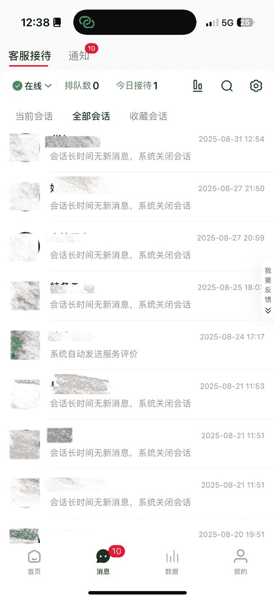

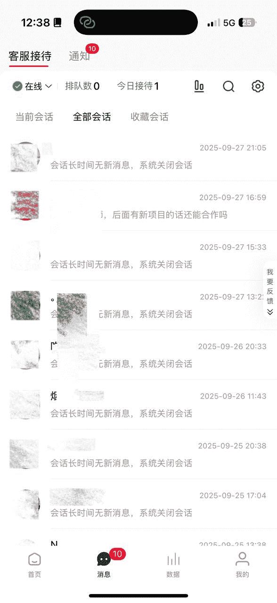

小红书店铺的好处就是，你在店铺里面回复微信，隐晦一点回复，是不会被识别，甚至可以设置自动回复，在自动回复里面＋上微信（这个思路对于所有做小红书引流都是可以直接用的）

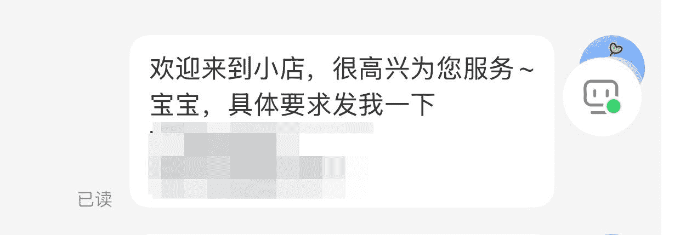

### 3.3 怎么发笔记

现在我的引流问题解决了，我的笔记我要如何优化，我的关键词我要怎么铺，学了很多概念，母词，子词

一句话总结，让圈友少走弯路，无论什么经验，一天发十篇是最好的经验

为了能大量发笔记，我只能选择最快的方式，不能再像以前一样，一篇笔记花费几个小时

这个时候，我就直接建了个微信群，拉我几个小号，我就疯狂刷对标，我也不分析了，直接把对标的标题文案话题直接复制发群里，实在不够，我就去闲鱼搜索，闲鱼关键词下的文案，我直接复制，因为图片是大字报的，我P图软件，几十张几十张的可以直接出（类似3.5 建立小红书选题库）

所以我发笔记的话，就花费1分钟不到，就是一篇笔记，东平西凑就是我的新的笔记，你的标题，闲鱼的文案，另一个对标的话题

这样的话我就可以量产

一个号不够，上两个号，一个小红书店铺可以关联三个号

### 3.4 没有浏览量怎么办

在我1.0阶段刚开始发小红书笔记会焦虑，每天观察小眼睛有几个，点赞有几个，后来我发现，对于我们这种要引流的玩家，小眼睛和点赞收藏评论都没用，我们主要目的是找到客户可能搜索的关键词，铺天盖地的铺自己的笔记，就是一篇笔记发完就不要看了，也不要管了

我现在两个月前发的笔记还有咨询，自然流真的太香

等你养成每天发10篇小红书笔记的时候，就可以优化了，看看自己的笔记，哪一个帖子咨询比较多，然后就按照咨询比较多的帖子开始发类似的笔记

也可以关注你的同行，它几点发，你就几点发，紧跟着发，发到最后，你是可以完全碾压你的同行

### 3.5 如何建立自己的小红书选题库

面对面建群，把我的大号和小号全部拉进去

我会花一天的时间来制作小红书素材，平时刷到同行的笔记也是带着标签话题直接复制过去，发的时候，就直接随便修改一下就可以了

图片制作方法，两个号对聊，换不同的聊天背景和头像，直接截图，就是好几个素材就成型了

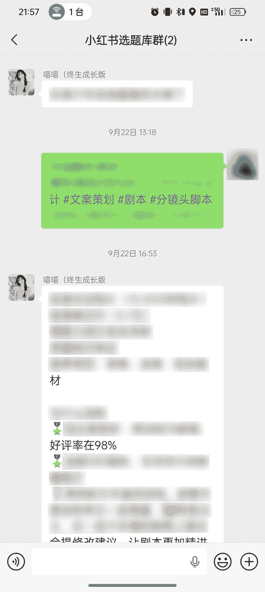

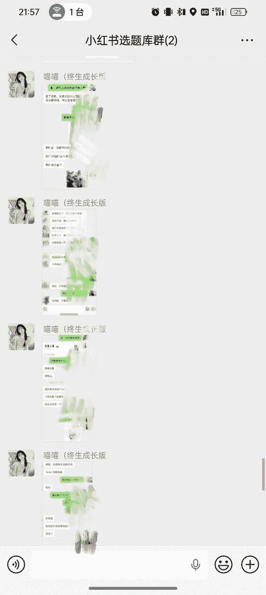

图片制作

### 3.6 如何设置小红书店铺自动回复

再电脑千帆店铺设置，回复的内容可以发

你好，都可以写，小编在忙

这里找我

(微信号）

然后在快捷回复的部分，再加微信，每次有咨询，直接发，微信＋这里找我

# 四、谈单转化部分

现在我流量问题解决了，咨询也是太多了，我转化率上不去怎么办，我有太多的咨询，太多的优质客户流失了，我要怎么办，转化率上不去，怎么谈高价单，我们本质上还是要建立客户的信任度，主要还是从朋友圈运营上来解决，给客户一个你报高价的理由

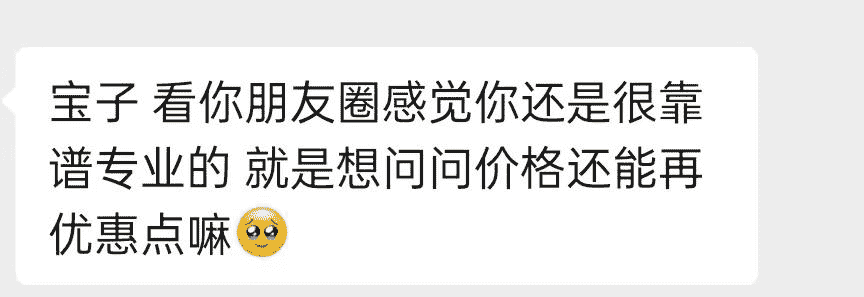

## 4.1 朋友圈运营

朋友圈每天发真的很重要，我之前也会一直懒得发，发得时候又不知道写什么文案，我就会用一个星期得一天得一个小时，专门用来制作朋友圈图文，好评图，日常图，干货图，分别都制作好，也是到点就直接复制粘贴，不需要耗费太多精力去纠结我今天发不发朋友圈，每天一到时间我就发，随手发我已经制作好的朋友圈，你发朋友圈不能只发朋友圈，还涉及如何排版，发什么的问题，什么时间段发

根据我的经验在每一条朋友圈前面加一个统一的表情，排版会好看一点

一般我的好评图会多一点，然后就是日常图

日常图的来源，为了真实，可以从自己的日常号的朋友圈拿，比如看到自己日常号的朋友发的朋友圈，美食，出去玩的图，都可以转发到自己的朋友圈预备群里

美食图，可以从大众点评里面的好评图截图拿

毕竟我们这种天天居家的，哪里来那么多日常发，就要充分利用自己身边的资源

不要发网图真的很假

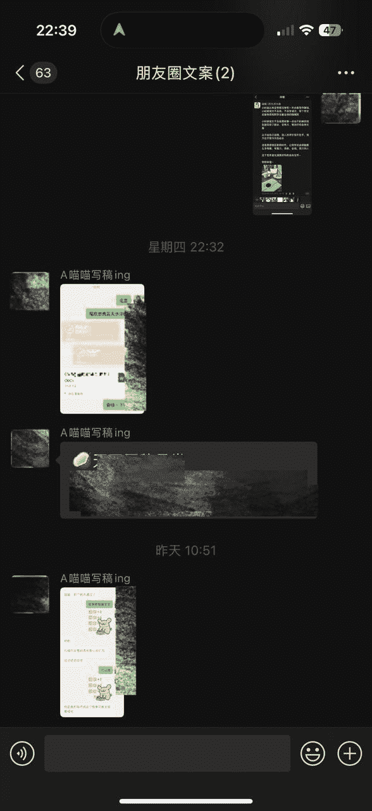

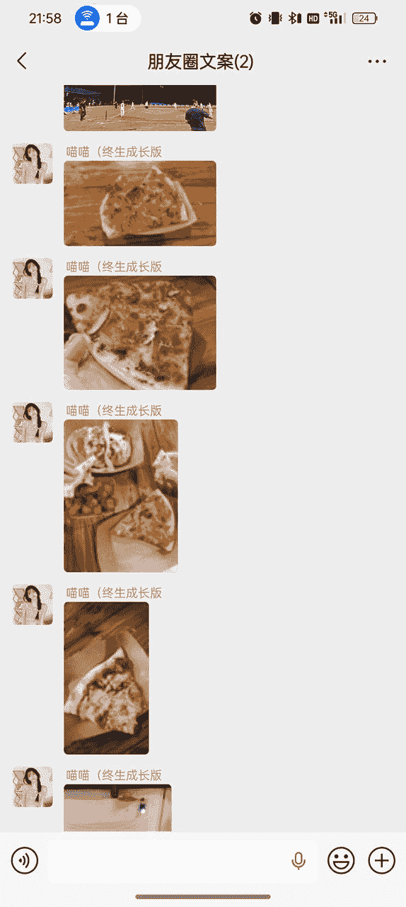

日常美食图

## 4.2 谈单话术

私域朋友圈运营好了，现在就是谈单了，前期还不会谈单得宝，可以直接去加同行，去套话，我也有谈单话术群，我会把好的谈单话术都放里面，每次调取也是很方便，直接复制粘贴过去就可以了，效果也特别好。我也会整理自己的成功谈单的话术直接放我的群里，每次遇到同样问题的客户，直接发过去就完事了

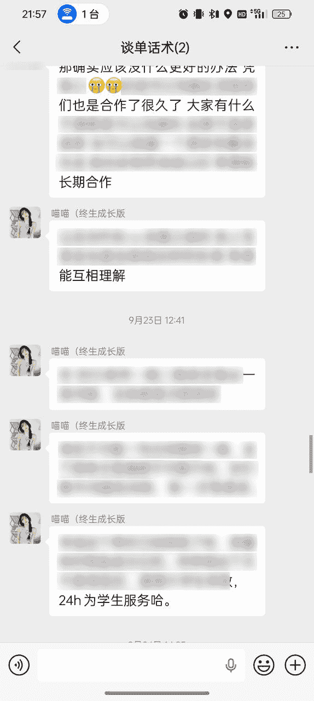

## 4.3 案例库如何建立

我这个类目，每次都会被问案例，需要看案例，毕竟博主也是有甲方的，需要看看质量如何

我主要用微信收藏，把一些经典案例直接放进去，每次有客户问，直接给他发过去，也是比较方便，可以分类不同类型的案例放收藏笔记里

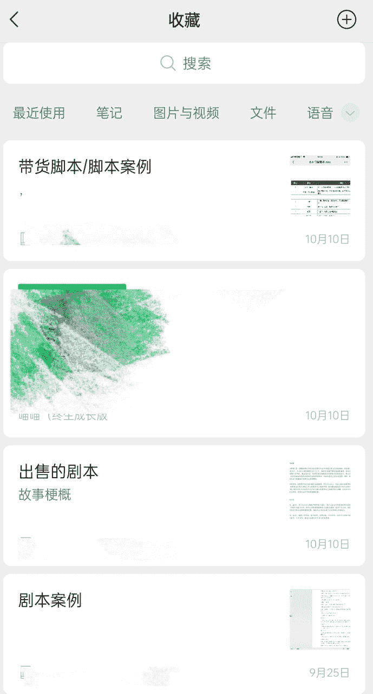

# 五、如何交付，单子太多了

刚开始做流量得时候，我都是自己接了自己写，每天累死累活，一个月到头来，顶天才一万左右，还把自己弄得身心俱疲，我开始放手，去找写手写，发现找不到，会写剧本的真的很少，我就去小红书发兼职贴，一天加了几十个写手，把我得时间分给他们，我想办法做更多流量，转化，找到的写手参差不齐，看运气，最好找的时候让对方带作品来应聘

也可以去BOSS直聘去应聘对应专业的写手来自己的写手库

后面我也和小鹅合作培训一批能写剧本写手，来承接剧本单子

# 六、个人如何算账优化排单

我的方法也是很简单，我用的飞书表格，可以看一下我每日的单子派单

我把每一个单子打好编号，然后拉群我也能找到对应的客户

然后就是业务复盘，我的每日复盘，用的飞书表单，每天记录自己有多少咨询，GMV多少，引流多少，成交多少，对自己每日的动作做一个直观的总结

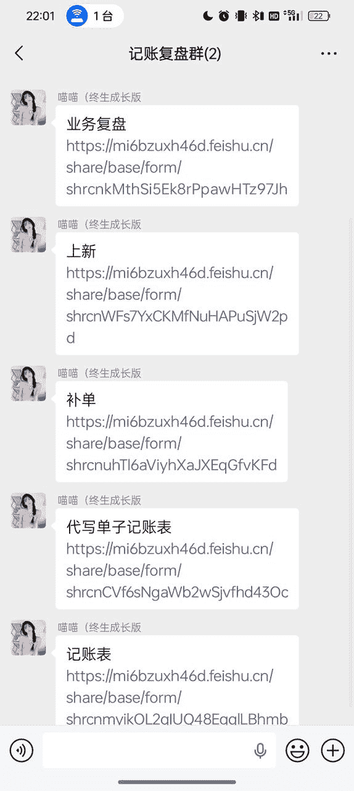

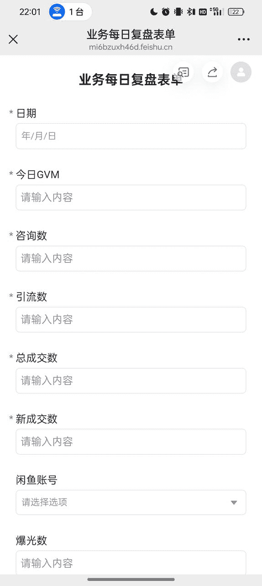

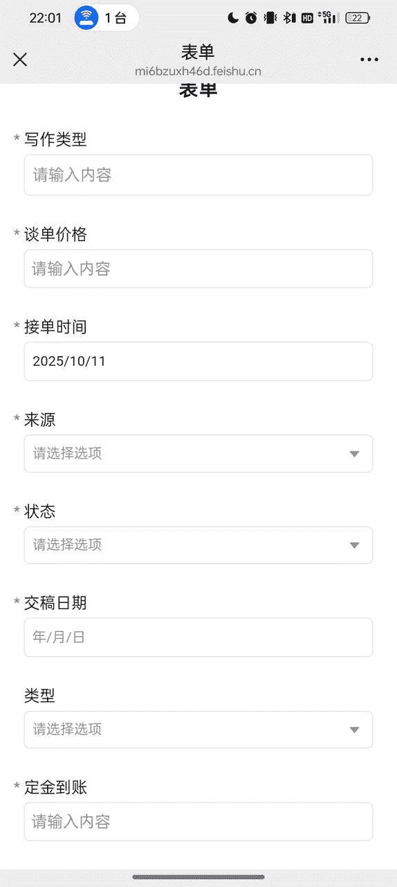

# 七、总结

差异竞争，在大多数人都在忙着接论文，接各种报告，几块钱的单子，我开始看上四位数的剧本单

当大多数人都在挤着闲鱼赛道，关注闲鱼流量的时候，闲鱼封号的时候，我铺天盖地的铺我的小红书笔记

我铺我的小红书店铺，我占满整个搜索词，吃自然流

差异化竞争，现在做代写的人越来越多，我去年刚做剧本的时候，闲鱼都没几个链接，从今年3月份开始，链接就多了

闲鱼竞品多了，我开始转战小红书

在家研究了一个星期的小红书玩法，怎么铺搜索流，反反复复一个月，成功靠小红书的自然流赚2万

小红书也是反反复复操作了很多次，很长时间没有小眼睛，但是这都不是问题

剧本现在至少比很多品客单价高，只要会谈单，我从刚开始研究的时候就在心里想我只做剧本，只专注剧本

总之，你只要比别人坚持的久一点，你就是这个领域的专家，没有小赛道，只有把赛道做小的人

不着急，慢慢来，此刻的你就已经很优秀了

希望我的经历能给你一点启发，能帮助到你一点我就很开心了

感谢你的阅读~

祝你每天都能拥有好运

很高兴认识你，感恩遇见

点个赞再走吧~下期更新小白如何写AI漫剧

感恩遇见，欢迎评论区讨论