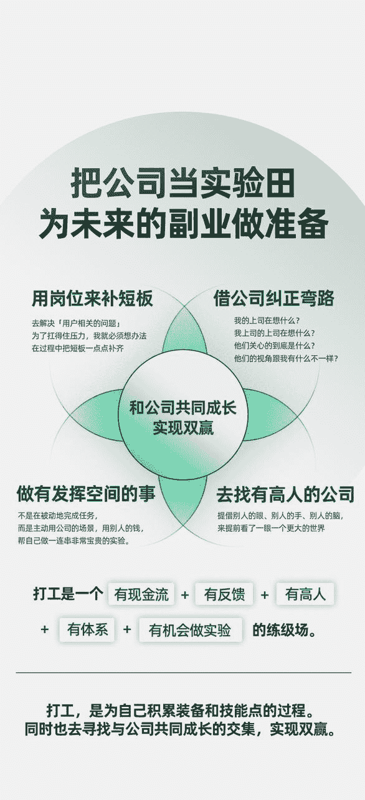

# 一边上班一边练级：把公司当实验田，为未来的副业做准备

> 来源：[https://xuqiwei1986.feishu.cn/docx/Sv37dteTSoLyX9xsTQicPKWznDe](https://xuqiwei1986.feishu.cn/docx/Sv37dteTSoLyX9xsTQicPKWznDe)

> 我是大铭

+   一个写了 30 年代码的全栈工程师

+   前大厂架构师

+   前全国最大月嫂公司的 CTO（将效率做到行业 10 倍）

+   现在在一个教育培训机构负责用户运营和商业智能，探索AI在智能体、流程上的应用

>

> 从之前工程师到现在的工作，虽然离开了技术岗位，但对业务和技术都有了更新的认知。每天的工作使用的工具，6成在飞书表格，2成在开发浏览器插件，2成在传统的编程，写自己的工具。

我觉得在生财的很多朋友，都可能是这样的一个状态：

+   一边花了不少钱报课、买星球、上训练营

+   看了很多项目拆解、风向标、复盘，脑子里也有很多想法，甚至手上可能已经在跑一两个项目了，或者至少也躺着几个半死不活的项目

+   但另外一边还得上班，毕竟离不开工资，还在给老板打工

真正能留给自己项目的时间不多，而且大概率也是晚上、周末这种零碎的时间，以及刚被折磨后的状态。

如果算笔账就很难受

+   **一**天当中 最清醒、最成块、最有配合资源的时间，贡献给了老板。如果你还想自己把副业搞起来，那就是贡献给了一个你迟早大概率会离开的地方

+   自己的事儿，反而被丢在了一天里面状态最差、能量最低的时间里

这时候那个灵魂拷问又来了。

**这**个工作，到底是给老板干，还是给自己干？

如果我们换一个视角去看这个问题，【打工】，是一个老板发工资给资源的试验场

现在给公司干的每一件事，都是经过思考和挑选的，可以为以后积累筹码的事。

我下面想说的，就是：

如果我们打工，是为了之后自己干做准备，那现在这份班该怎么打。

通过以下方向跟大家说说如何一边上班一边练级。

1/ 想清这个活儿，到底是给谁干的？

2/ 四条用公司给自己练级的路径

3/ 打工不是坏事，但不能为了打工而打工

---

# 一、还是那个问题：这个活儿，到底是给谁干的？

这个话题其实特别老生常谈了，但我觉得它该放在最前面，因为很多后面的选择，其实最后都会落回到这上面来。

如果我们心里已经很明确：我是想要自己干点什么的，那很显然，最终你干的活儿、你积累的东西，目标对象一定是你自己；问题就在于，我们现在人在公司，领的是公司的钱，做的是公司分配的任务，KPI 是公司的，流程是公司的，从表面上看，你好像就是在“给公司干活”，这一层东西是无法否认的。

我们要找到那种，在给公司办的时候，其实同时也是在给自己干的工作。

所以要想清楚的是：我到底要借这份工作，练什么东西、补哪块短板、验证什么样的想法？

如果这层想明白了，很多后面的选择，包括你选什么岗位、你在工作里怎么做事儿、你和上司的关系、你对公司的期望，其实都会发生变化。

视角一变，很多事情就不一样了

如果你自己还没有那么清楚，我们就以始为终站在一个“生意”/“业务”的角度去看，我们把整个的环节拆成

1.  流量 / 获取

1.  承接

1.  销转

1.  运营履约（服务动作）

1.  效果产出（结果）

1.  循环增长（复购/推荐/口碑）

然后我们大致看下每个阶段需要的能力，也就是如果我们去做，可以补足的能力

| 阶段 | 需要能力 |
| --- | --- |
| 流量 | 需求洞察 / 产品设计 / 用户流量结构 |
| 承接 | 转化漏斗 |
| 销转 | 需求挖掘 / 价值呈现 / 成交推进 / 客诉处理 |
| 履约 | SOP设计 / 成本结构分析 / 运营效率 |
| 效果产出 | 关键节点和数据定义 / 关键路径设计 |
| 循环增长 | 用户生命周期设计 LTV / 口碑设计和管理 / 产品梯度设计 |

这个表只是参考哈，每个业务都很可能不同。而且每个部分还可以拆分的更加细致。

以我自己为例，之前一直在做技术，那么就一直在产品设计等方面，但是对需求洞察、需求挖掘、用户流量结构、成交推进等方面就全部是我的短板，那我在选择工作时候，就来有针对性的进行补足。

# 二、四条路径：如何用公司给自己练级

## 用岗位来补短板：用上班扩展自己的技能树

拿我自己做例子，我之前一直是做技术的，说白了就是写代码的。站在自己的情况，我最不缺的是技术能力本身。我如果真的是为了以后自己做副业的话，我缺的不是再多学一个框架，一门语言，或者构建一个技术系统。

我缺少的是销售，是运营，是营销，是用户心智，是怎么从“人看见你”到“愿意付钱给你”这一整条链路到底是什么样子的。

我不会去找一个我擅长、我舒服的岗位；

我要让这个工作

+   每天逼着自己去解决「用户相关的问题」

+   为了扛得住老板给我的压力、扛得住业务的压力，我就必须想办法

+   在过程中把我的短板一点点补齐

所以对我来说，第一层是：**尽量让你的工作，本身就是在补你未来创业**会特别需要、但你现在明显偏弱的那块短板。

如果你现在也是生财里的人，你其实可以很简单地问自己几个问题：

我将来如果真的自己出来做，最有可能做的那类事情、那类项目，它需要什么样的能力结构？

我现在这份工作，是不是有在往那个方向靠？

如果完全没有，那我未来换工作的时候，是不是该考虑一下，要不要换到一个跟“流量”“销售”“转化”“数据”“运营”“供应链”这些靠得更近的岗位上去？

这就是把打工当成“点技能”的过程，而不是当成一个单纯的「换时间拿钱」。

### 自我拆解为例子

在这种前提之下，我再去找工作、再去打工，我的目标就不一样了：

+   我不是去找一个「我擅长的岗位」，我不会寻找技术工种

+   而是要尽量找一个**「能帮我把短板补上的岗位」**

我要补足的能力

+   用户需求、用户洞悉、销转的能力

+   如何获取流量

所以这次我现在的工作是负责

+   用户运营：

+   亲自做：用户承接、运营工作，作为线索、销售的粘合部门。

+   可以看到：销售的销转，转化路径，产品的设计

+   商业智能：

+   亲自做：做全公司的整体数据分析、竞对分析

+   可以看到：经营全貌

## 借公司帮你纠正弯路：用体系来“掰正”你的路数

如果打工这件事儿是为了补短板，那很自然的一个前提就是：这块东西我不熟，意味着我自己一个人闭门造车，哪怕看了很多书、很多课、很多案例，我都特别容易走弯路——而且是那种自己还意识不到的弯路。

你在看书的时候，在听课的时候，在生财里看一个又一个项目拆解的时候，你知道一件事情是可以做成的，你知道大概有哪些步骤、有哪些坑，但你真到了自己上手干的时候，你会发现其实里面的细节是密密麻麻的，很多东西是“不做一遍根本不知道哪里会崩”的那种。

**你知道一件事儿 “能做成”，和你 “****真**的能上手做成”，中间的差别，其实挺大的。

而公司这个环境，它和你一个人埋头做有一个非常大的差别在于：在这个过程当中，是有人会帮你纠偏的。

+   可能是上司；

+   上司的上司；

+   同事；

+   甚至整个公司的流程体系

在这样一个体系里做事情，当你想走弯路的时候，很多时候会被拍回来，会被问一个“为什么”，或者被一个数据打在脸上，或者被一个流程挡住。这就是一种「反馈」，其实是在被这个体系一点一点地掰正你的路数.

还有一点我觉得特别重要，就是不要**只是站在自己的岗位视角上想问题。多去想：我的上司在想什么？我**上司的上司在想什么？他们关心的到底是什么？他们看这件事情的视角跟我有什么不一样？你站在这个角度去做事儿的时候，你的视野其实已经被迫往上抬了一点，这对你以后自己做事儿的时候，是有非常大帮助的。

所以，对我来说，第二层其实就是：用公司的体系，来帮你修正你原本会走的弯路。

你不是一个人在黑屋子里摸索，你是在一个本身就是为了赚钱、为了跑出结果、为了提高效率而搭起来的系统里，一边完成自己的工作，一边被这个系统不断纠正和打磨。这一点，是光看书、光听课、光在社群里看案例，完全无法替代的。

### 自我拆解为例子

还是用户和流量端，因为我在商业智能部门，我就可以看到所有的产品、所有的渠道的数据，推广、转化、收入、ROI 等，以及在这个过程中不同部门做了什么会对上面的核心数据有什么影响

## 尽量去做有发挥空间的事儿：把公司当成一个大的实验田

如果你是奔着以后要自己干去的，就没做那种别人跟你说 1、2、3，你就只能做 1、2、3 的事情。

不是说这种工作不好，而是说，如果你的目标是以后要做自己的生意，那你光练“执行别人安排的事情”这一个维度，是远远不够的。

**所以我会更倾向于**在有选择的范围内，尽量去做那些能够有发挥空间的职位。所谓“有发挥”，不是说你可以乱来，而是说在这个岗位上，你可以提出自己的想法，你可以设计一部分方案，你可以推动一些东西真正落地，甚至你有机会去拉一些跨部门的资源，跑出一个相对完整的闭环。你在这个过程中的发挥，其实本质上就是在用公司的场景，来验证你自己的想法。

你想得越完整，你能把一件事情从头到尾串起来，你就越有机会去推动一些超出你岗位说明书之外的事情。这个完整性包括：你眼前这块活，能不能从头到尾交付清楚；你能不能站在一个稍微更大的角度，去看它在整个业务当中的位置；以及，你能不能顺着这一条链路，尝试着把这个生意从“最前端的获客”到“最后端的复购和转介绍”，每一个节点都过一遍，想一想如果你来设计，会怎么设计。

**一旦你有机会在公司里面，把其中某一条线从头到尾跑一次闭环，**其实你就在用公司当成你的一个大的实验田。你在这里做的每一次尝试，每一次优化，每一次调整，本质上都是一个个实验。

而这些实验，有几件很爽的事情：

第一，这些实验的成本，大部分是公司的成本；

第二，这些实验的收益，是你自己的经验，你自己的方法论，你自己的视角；

第三，有时候实验成功了，公司也赚到东西，你也在公司里多了一份成绩，这反过来还帮你在公司内部多了一点空间。

你一旦从这个角度去看问题，就会发现：你不是在被动地完成任务，而是在主动地用公司的场景，用别人的钱，帮自己做一连串非常宝贵的实验。

### 自我拆解为例子

1.  我想更多的接触用户，我现在就在收集和整理全公司的产品库，设计一个以年为尺度的产品库和运营节奏，同时推动竞对分析，从而可以开始构建一个教育行业的全年的全景图。
这个结果对公司有意义，构建的过程和推动部门协作的过程，对我自己有意义

1.  我以所有我收口的用户承接端为样本，开始打通从线索获取到用户转介绍的全链路数据流程和分析。不同渠道（比如抖音矩阵号、私域运营等）、渠道细分（矩阵号的不同账号等）、不同的承接方式、承接人、不同的销售、销售的动作话术等
我可以主持这个构建的过程，以及清晰的看到每一个环节的漏斗和数据变化。甚至可以测试一些动作对数据的影响，这都是宝贵的经验

我在做的不仅仅是上面的两部分，我只是举这个例子。这两个动作，并不是公司要求我做的，而是我站在老板的角度，一定希望更清晰的看到经营的情况，以及尽可能的精细化的运营。我做这个事情一定是符合公司的利益的，那我就推动去做。

今天我还发了一个朋友圈，感慨一下

## 刻意去找“有高人”的公司：线下版巨人的肩膀

在你有选择的情况下，哪怕你短期内不创业，光是打工，你也可以刻意去挑那种在你想补的能力上，有真正高手存在的公司。

这个高手，可能是某个业务负责人，可能是某个大厂背景的同事，可能是一个在行业里已经滚了很多年的前辈。你选这样的公司，本质上就是让自己有机会站在巨人的肩膀上，实打实地看一眼那个量级下的世界。

像我现在**所在的公司，里面做投放的一个兄弟，是从美**团出来的，他之前每年经手的预算，是那种“千个亿”级别的，就是人家真的是花过这一千个亿的。在这种情况下，你哪怕不在他的部门，你日常能跟他一起开一点会，围观一下他们的看数方式，或者你就多问他两句，他怎么拆一个渠道，怎么看一个人群，怎么判断一个投放动作有没有价值，你都会非常清楚地感觉到：这个人看待问题的视角，和我们自己瞎摸是完全不一样的。你站在他边上，已经很奢侈了。

而这种东西，很多时候你自己一个人在搞你的小生意，根本不可能有机会触碰到，或者说，你可能要花非常长的时间，踩非常多的坑，才有可能慢慢摸到那个水位。但现在因为你在一个这样的公司里，你有这样一层「同事关系」在，你是可以厚着脸皮多问几句的，甚至可以在自己的工作当中，尝试去对接他们、配合他们，从而在实操当中感受他们是怎么做决策，怎么调节节奏的。

对我来说，这个带来的影响是非常直观的：

我现在看到的一整套数据指标体系，怎么拆指标，怎么追踪，怎么根据指标调整节奏，以及整体上以销售为导向的一种组织的运作方式，基本上都是在这样的环境里被我重新刷了一遍。

因为公司里面有很多美团系的人，所以我其实是被这个体系「强行升级」了一遍。

说真的，我自己一个人闭门造车基本上没可能摸出来这些套路。那就靠身边的高人，帮我升级。

所以在这种情况下，我其实特别清楚地知道，我是在借别人的眼、别人的手、别人的脑，来提前看了一眼一个更大的世界，这部分东西，哪怕我以后离开公司也受益匪浅。

### 自我拆解为例子

1.  看到以十万、百万为单位进行投放的情况，有时候是为了获取流量，有时候是为了测试平台的流量上限，这些动作的打法以及对结果的追踪，都是我自己很可能无法触及的

1.  在对接矩阵号时候，我身边就有很多之前 IP 的操盘手，从直播、切片矩阵号、店播等方式，10分钟就可以给我一个大体的打法说明，这个就算是我必须亲自做，可能也得摸好长时间才能明白

这些“巨人”就在你身边，抓住他们，学习他们，站在他们的肩膀上。

# 三、最后：打工不是坏事，但你不能为了打工而打工

打工是一个有现金流、有反馈、有高人、有体系、有机会做实验的练级场，把岗位选成是在帮你补短板的岗位，把视角抬到多想想上司和上司的上司在想什么，把手头的工作当成一个个小项目、小实验去推动，把公司当成一个大的实验田，再尽量去找那些在你想补的能力上有真功夫的公司和同事，厚着脸皮多问多看多想一点。

这样在公司里干的每一天，就不再只是单纯地在给老板堆砖，而是在一点一点给未来的自己：补能力、补视角、补方法**论**、补对生意运转方式的真实感知。到那个时候，你再回头看这几年的打工经历，就不会觉得它是一段“浪费掉的时间”，而是会觉得：打工就是你为自己创业攒装备、攒技能点的一个过程。